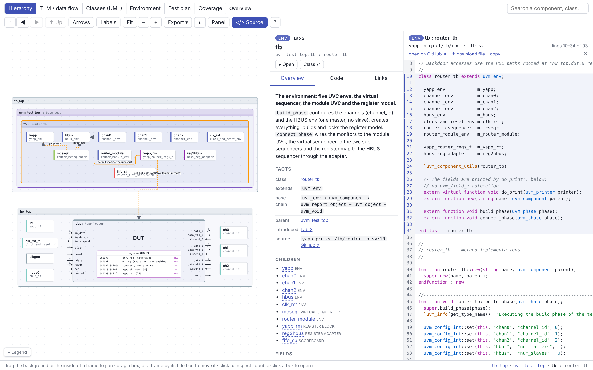
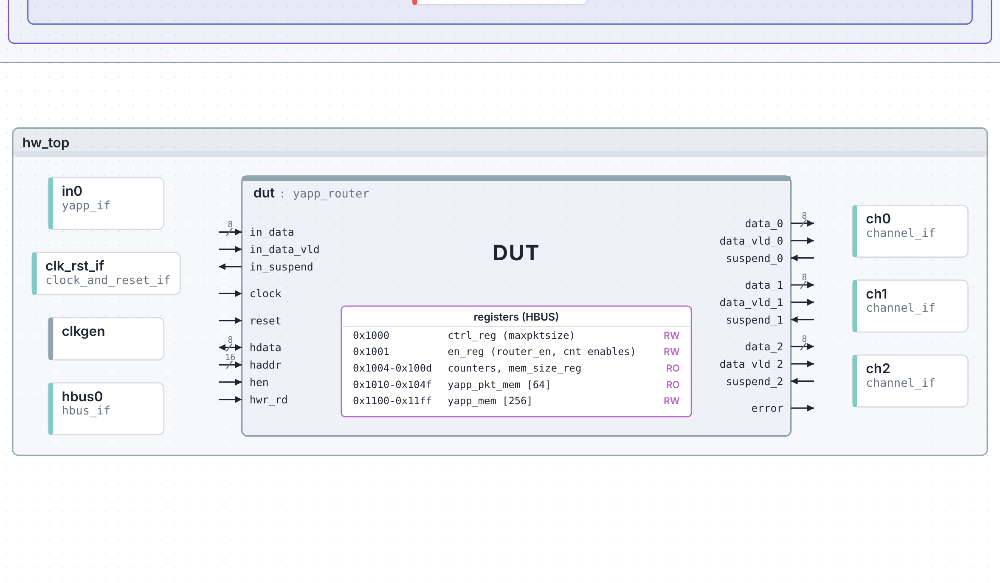
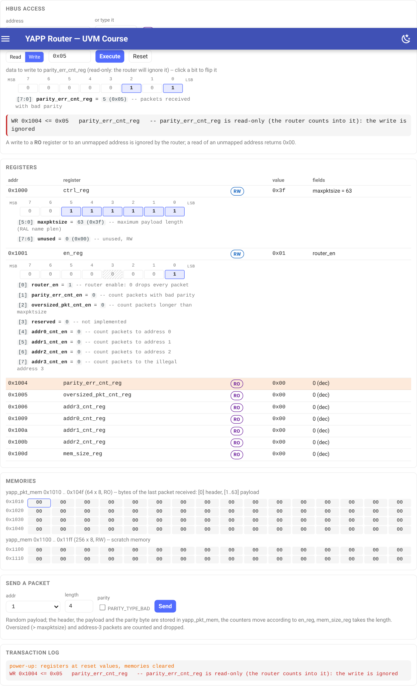
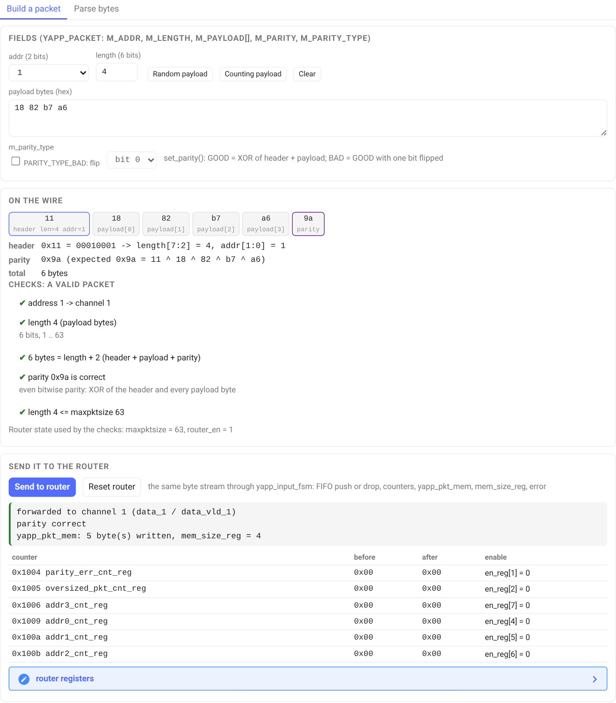
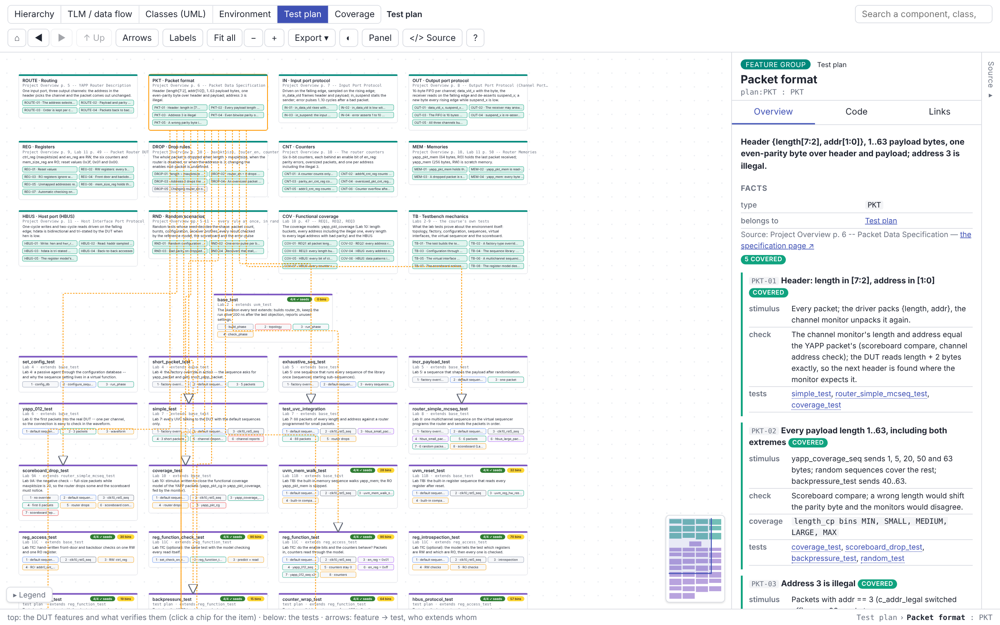
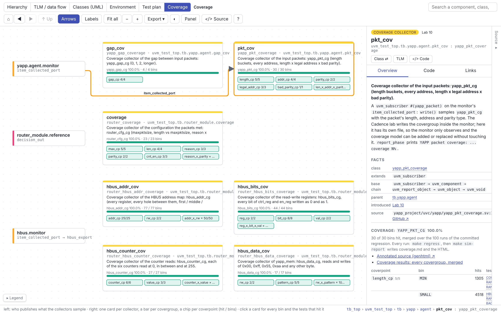

# YAPP Router — SystemVerilog & UVM course

[](https://github.com/tamirgabgab/Qcom-Mentoring/actions/workflows/lint.yml)
[](https://github.com/tamirgabgab/Qcom-Mentoring/actions/workflows/sim.yml)
[](https://github.com/tamirgabgab/Qcom-Mentoring/actions/workflows/docs.yml)
[](https://tamirgabgab.github.io/Qcom-Mentoring/)
[](https://tamirgabgab.github.io/Qcom-Mentoring/project-map/)

A complete, from-scratch reference implementation of the **YAPP packet-router
verification project** (the exercise behind the *SystemVerilog Accelerated
Verification Using UVM* training), written for mentoring. The DUT, the four
UVCs, every lab from 1 to 11C, a teaching site, an interactive map of the whole
project and two small simulators of the router — all in one repository, all
generated and checked from the same source code.

## Where to find everything

Most things have two copies: **online** on GitHub Pages, and **in the repository**, which opens
from disk after `git clone` / `git pull` (no server, no internet).

| What | Online | In the repository |
|---|---|---|
| **Course site** (home) | [tamirgabgab.github.io/Qcom-Mentoring/](https://tamirgabgab.github.io/Qcom-Mentoring/) | [`offline/site/index.html`](offline/site/index.html) |
| **Project map** (the interactive interface) | [/project-map/](https://tamirgabgab.github.io/Qcom-Mentoring/project-map/) | [`docs/downloads/yapp_project_map.html`](docs/downloads/yapp_project_map.html), one self-contained file |
| **Labs** 1 → 11C | [/labs/](https://tamirgabgab.github.io/Qcom-Mentoring/labs/) | [`offline/site/labs/index.html`](offline/site/labs/index.html) |
| **DUT specification** + register simulator | [/dut/spec/](https://tamirgabgab.github.io/Qcom-Mentoring/dut/spec/#try-it-the-register-file) | [`offline/site/dut/spec.html`](offline/site/dut/spec.html) |
| **Register map** (tables) | [/dut/register-map/](https://tamirgabgab.github.io/Qcom-Mentoring/dut/register-map/) | [`docs/dut/register-map.md`](docs/dut/register-map.md) |
| **Packet playground** | [/components/packet/](https://tamirgabgab.github.io/Qcom-Mentoring/components/packet/#try-it-build-or-check-a-packet) | [`offline/site/components/packet.html`](offline/site/components/packet.html) |
| **Test plan** + coverage matrix | [/test-plan/](https://tamirgabgab.github.io/Qcom-Mentoring/test-plan/) | [`docs/test-plan.md`](docs/test-plan.md) |
| **Regression results** (every test: seeds, logs, timelines, waves, pictures) | [/regression/](https://tamirgabgab.github.io/Qcom-Mentoring/regression/) | [`offline/site/regression/index.html`](offline/site/regression/index.html) |
| **Coverage results** (merged over the regression, holes) | [/coverage-results/](https://tamirgabgab.github.io/Qcom-Mentoring/coverage-results/) | [`yapp_project/regression/coverage.md`](yapp_project/regression/coverage.md) |
| **Coverage on the sources** (genhtml, a count on every bin) | [/coverage/yapp_project_tb/](https://tamirgabgab.github.io/Qcom-Mentoring/coverage/yapp_project_tb/index.html) | [`docs/coverage/yapp_project_tb/index.html`](docs/coverage/yapp_project_tb/index.html) |
| **Regression report** (every run: log, timeline, wave pictures) | [on GitHub](https://github.com/tamirgabgab/Qcom-Mentoring/blob/main/yapp_project/regression/index.md) | [`yapp_project/regression/index.md`](yapp_project/regression/index.md) |
| **Waves** of a run in Surfer | the *Surfer* column of the regression report | `<run>/<run>.fst` + layout [`yapp_project/tb/yapp_router.sucl`](yapp_project/tb/yapp_router.sucl) |
| **How to read logs, timelines, waves** | [/appendix/sim-report/](https://tamirgabgab.github.io/Qcom-Mentoring/appendix/sim-report/) | [`offline/site/appendix/sim-report.html`](offline/site/appendix/sim-report.html) |
| **Verification status** (Verilator vs Xcelium) | [/appendix/unverified/](https://tamirgabgab.github.io/Qcom-Mentoring/appendix/unverified/) | [`offline/site/appendix/unverified.html`](offline/site/appendix/unverified.html) |
| **CI** (lint, simulation, site) | [GitHub Actions](https://github.com/tamirgabgab/Qcom-Mentoring/actions) | `make lint`, `make regress`, `make docs` |

**Opening the files on your computer.** The `.html` files: double-click, they open in the
browser. The `.md` files read best on GitHub or in VS Code (Markdown preview). On GitHub an
`.html` file shows as source code, so use the online column for those. From a downloaded zip,
**extract it first**: a browser that opens `index.html` straight from inside the zip shows bare
text. `offline/site/` is rebuilt with `make docs-offline` (see [Tooling and CI](#tooling-and-ci)).

---

## Contents

1. [For students](#for-students)
   - [The project map](#the-project-map)
   - [The DUT and its registers](#the-dut-and-its-registers)
   - [Try it: the register simulator](#try-it-the-register-simulator)
   - [Try it: the packet playground](#try-it-the-packet-playground)
   - [The test plan](#the-test-plan)
   - [The labs](#the-labs)
2. [Quick start](#quick-start)
3. [Repository layout](#repository-layout)
4. [For mentors and contributors](#for-mentors-and-contributors)
   - [Coding style](#coding-style)
   - [Tooling and CI](#tooling-and-ci)
   - [Verification status](#verification-status)

---

## For students

The course builds a UVM testbench for a small packet router, one lab at a time.
Everything you need is on the **course site**: the DUT specification with the
protocol waveforms, one guide per UVM component (packet, driver, sequences,
monitor, agent/env, scoreboard, reference model, virtual sequencer, coverage,
register model), a feature-by-feature test plan, and one page per lab with the full solution,
the expected results and checkpoint questions.

### The project map

The [project map](https://tamirgabgab.github.io/Qcom-Mentoring/project-map/)
is one picture of the whole project that you can look into. Click a box for
its role, its file and the lab that introduces it; double-click to drill
down; the **Source** column on the right opens with the complete file of
whatever is selected (one class per file) and folds away when there is
nothing to show. Five views: **Hierarchy** (who contains
whom), **TLM / data flow** (who talks to whom), **Classes (UML)** (who inherits
from whom, with fields and methods), **Environment** (the course figure of the
whole verification environment, one role line per box) and **Test plan** (the
DUT features with their stimulus, checker, coverage and status on top, one card
per test with its plan below: the stages, what the run is expected to show,
the sequences and overrides it sets up, the plan items it verifies).

Arrows are drawn orthogonally; in the Hierarchy and TLM views they start hidden and
appear for the box under the pointer (the **Arrows** button shows them all). Boxes
can be dragged and the arrows follow: a leaf from anywhere, a frame by its title bar
(dragging inside a frame pans the view, and so do the middle mouse button or
Space + drag from any point). ⌂ returns to the overview, ◀ ▶ walk back and
forward through the views visited, the search box finds any component or class
by name with its full path, the status bar at the bottom shows the path of the
selected item, and the panel and source column can be resized. Every view opens
at a readable zoom (**Fit** then shows the whole picture; zoomed far out only
the names stay, bigger, and a minimap shows where you are); the Classes view has
one tab per package. The [test plan page](https://tamirgabgab.github.io/Qcom-Mentoring/test-plan/#coverage-matrix)
adds a coverage matrix: every plan item against every test.



The same map is one self-contained HTML file,
[`docs/downloads/yapp_project_map.html`](docs/downloads/yapp_project_map.html):
download it and open it in a browser, it works offline and in class.
Every view can be exported to SVG / PNG for slides (the pre-rendered pictures
are in [`docs/assets/project_map/export/`](docs/assets/project_map/export/)).

### The DUT and its registers

The hardware side of the map draws the router like the course figure: the
YAPP input, the clock and the HBUS host interface on the left, the three
output channels on the right, every pin with its direction and bus width
inside the DUT, and the **register map** as a block. Click a block to open it:
the DUT itself splits into the input FSM, the three output channels (each
with its FIFO), the register file and the error timer — one RTL module per
file in [`yapp_project/rtl/`](yapp_project/rtl/).



| Address | Register | Access | Meaning |
|---|---|---|---|
| `0x1000` | `ctrl_reg` | RW | `maxpktsize[5:0]` — maximum payload length (reset `0x3f`) |
| `0x1001` | `en_reg` | RW | `router_en` and the six counter enables (reset `0x01`) |
| `0x1004` … `0x100b` | counters | RO | bad parity, oversized, packets per address 0 … 3 |
| `0x100d` | `mem_size_reg` | RO | payload length of the last packet |
| `0x1010` … `0x104f` | `yapp_pkt_mem` | RO | the 64 bytes of the last packet received |
| `0x1100` … `0x11ff` | `yapp_mem` | RW | 256 bytes of scratch memory |

Every HBUS address holds one byte. The full table with the bit fields is on the
[DUT specification](https://tamirgabgab.github.io/Qcom-Mentoring/dut/spec/) page.

### Try it: the register simulator

A model of the register file that behaves exactly like the RTL. Pick an
address, read or write it, press **Execute**: writes to RW registers land,
writes to RO registers and unmapped addresses are ignored (and the simulator
tells you why), reads of unmapped addresses return `0x00`. **Send a packet**
moves the counters according to the enable bits, fills `yapp_pkt_mem` and
updates `mem_size_reg`, the way the router does at the end of a packet.



The value to write and every register with fields are shown as a bit-field
diagram -- bit 7 (MSB) on the left, bit 0 (LSB) on the right, one line per field
underneath with its bits, name, value and meaning -- and a click on a bit flips it.

Where to find it: on the
[DUT specification](https://tamirgabgab.github.io/Qcom-Mentoring/dut/spec/#try-it-the-register-file)
page, and in the project map — click the registers block inside the DUT, or
the **Simulate** tab on the DUT, `u_regs`, `hbus0` or the register model.

### Try it: the packet playground

Build a YAPP packet field by field (`addr`, `length`, `payload`), watch the byte
stream and the parity the packet gets, flip **PARITY_TYPE_BAD** to see the error
injection of the course, and read the checks: legal address, length vs.
payload size, parity, `maxpktsize`. **Parse bytes** decodes a packet copied
from a log. **Send to router** pushes the bytes through the same router model
as the register simulator and reports what happened: forwarded or dropped,
which counters moved, what `yapp_pkt_mem` holds.



Where to find it: on the
[packet](https://tamirgabgab.github.io/Qcom-Mentoring/components/packet/#try-it-build-or-check-a-packet)
page, and in the map on `yapp_packet`, `short_yapp_packet`, `channel_packet`,
the YAPP interface and the input FSM. The packet structure itself is drawn in
[`docs/assets/packet_structure.svg`](docs/assets/packet_structure.svg) and
explained next to the code in [`yapp_project/uvc/yapp/README.md`](yapp_project/uvc/yapp/README.md).

### The test plan

The [test plan](https://tamirgabgab.github.io/Qcom-Mentoring/test-plan/) follows the
pages of the course's DUT description: packet format, input and output protocols,
registers, drop rules, counters, memories, the HBUS host port, plus the requirements the
labs add (scoreboard, functional coverage, register tests). It is written as data
(`scripts/project_map/annotations.yaml`, section `plan`): **12 feature groups, 64 items**,
each with its stimulus, its checker, its coverage, the tests that cover it and a status
(63 covered; one excluded on purpose, a change of `router_en` in the middle of a packet,
which the specification leaves undefined).
The same data draws the **Test plan** view of the map and generates the site page, so the
three never disagree.



The **Coverage** view puts the functional coverage of the committed regression on one page:
who publishes what the collectors sample on the left, one card per collector on the right with
a bar per covergroup and a chip per coverpoint, every bin and the tests that hit it in the panel.



Ten directed tests exist only for the plan, in `yapp_project/tb/tests/`, for the features
the course's own tests never checked: `router_disable_test` (a disabled router drops and
counts nothing), `router_filter_test` (lengths around `maxpktsize`, the illegal address,
every counter with its enable on and off), `pkt_mem_test` (`yapp_pkt_mem` and
`mem_size_reg` hold the last packet byte by byte, even a dropped one),
`reg_bit_walk_test` (walking ones and zeros through every RW bit, writes ignored by every
RO register), `hbus_protocol_test` (raw bus cycles, tri-state after a read, unmapped
addresses), `backpressure_test` (slow receivers fill the channel FIFOs, `in_suspend`
stalls the input, no byte is lost), `parity_error_test` (the counter, the `error`
pulse within 1..10 cycles, the packet still delivered), `counter_wrap_test` (an 8-bit
counter wraps from 255 to 0 and keeps counting) and `back_to_back_test` (packets with
0, 1, 2 and 3 idle cycles between them, measured by the monitor and covered by
`yapp_gap_cg`) and `hbus_sweep_test` (every address of the HBUS window read and written
with four data patterns, every `ctrl_reg` / `en_reg` bit at 0 and 1, `yapp_mem` patterns,
every counter read at 0, in the middle and at 255 — the test that closes the four HBUS
covergroups). The four random tests (below) add the random scenarios.
Writing `backpressure_test` found a real bug in the YAPP driver's
handshake, fixed in `yapp_if.sv`; writing `back_to_back_test` found that the driver
could never send the minimum gap, so `m_packet_delay` now means the exact number of idle
cycles. The site page ends with a **coverage matrix**: every item against every test,
a dot in the colour of the item's status where the test covers it.

### The labs

| Session | Labs | Theme | You end up with |
|---|---|---|---|
| 1 | [1](https://tamirgabgab.github.io/Qcom-Mentoring/labs/lab01/), [2](https://tamirgabgab.github.io/Qcom-Mentoring/labs/lab02/) | data items, components, phases | a packet class and an empty test / testbench pair |
| 2 | [3](https://tamirgabgab.github.io/Qcom-Mentoring/labs/lab03/), [4](https://tamirgabgab.github.io/Qcom-Mentoring/labs/lab04/) | a UVC skeleton, factory, configuration | the YAPP agent printing packets; tests that reconfigure it |
| 3 | [5](https://tamirgabgab.github.io/Qcom-Mentoring/labs/lab05/) | sequences, objections, randomization | the YAPP sequence library |
| 4 | [6](https://tamirgabgab.github.io/Qcom-Mentoring/labs/lab06/) | interfaces, virtual interfaces, the DUT | packets flowing through the real router |
| 5 | [7](https://tamirgabgab.github.io/Qcom-Mentoring/labs/lab07/), [8](https://tamirgabgab.github.io/Qcom-Mentoring/labs/lab08/) | integrating UVCs, virtual sequencer | the full environment with a system-level sequence |
| 6 | [9A](https://tamirgabgab.github.io/Qcom-Mentoring/labs/lab09a/), [9B](https://tamirgabgab.github.io/Qcom-Mentoring/labs/lab09b/), [9C](https://tamirgabgab.github.io/Qcom-Mentoring/labs/lab09c/), [9D](https://tamirgabgab.github.io/Qcom-Mentoring/labs/lab09d/) | TLM, scoreboard, reference model | self-checking tests |
| 7 | [10](https://tamirgabgab.github.io/Qcom-Mentoring/labs/lab10/) | functional coverage | a coverage model and the stimulus that closes it |
| 8 | [11A](https://tamirgabgab.github.io/Qcom-Mentoring/labs/lab11a/), [11B](https://tamirgabgab.github.io/Qcom-Mentoring/labs/lab11b/), [11C](https://tamirgabgab.github.io/Qcom-Mentoring/labs/lab11c/) | register model (RAL) | register tests through the register model |

Each lab is a complete snapshot under [`labs/`](labs/) with its own `run.f` and
`Makefile`. Labs 1–6 carry their own copy of the YAPP UVC as it grows; from
Lab 7 on, the labs compile the finished UVCs and the DUT from
[`yapp_project/`](yapp_project/). The complete project — the state the course
reaches at the end of Lab 11C — is `yapp_project/` itself.

---

## Quick start

```bash
# install check (Cadence Xcelium)
cd test_install && xrun -f run.f

# run the complete project (any test of yapp_project/tb/tests); every command below runs from the root
make run-project TEST=reg_function_test
make run-project TEST=backpressure_test     # the test-plan tests live here too
(cd yapp_project/tb && make run TEST=reg_function_test)   # the same from the testbench directory

# run a lab
make run LAB=lab07_integ TEST=simple_test
(cd labs/lab07_integ/tb && make run TEST=simple_test)

# no Xcelium? the same labs with Verilator (free): install once, or open a GitHub Codespace
bash scripts/setup_sim.sh
(cd yapp_project/tb && make sim TEST=backpressure_test WAVES=1)   # PASS / FAIL + waves
make regress                                                    # every lab and test
make regress ONLY=yapp_project WAVES=1 && make sim-report        # the project (4 seeds per directed test, 8 per random test), logs + timelines + waves + pictures + coverage
make coverage ONLY=yapp_project                                 # the functional coverage merged over every run, and its holes

# lint everything without a simulator (slang + the Accellera UVM source)
pip install pyslang && make lint

# read / build the course site locally
pip install mkdocs-material && make serve

# regenerate the interactive project map after changing the code
pip install pyslang pyyaml jinja2 && make map
```

Simulator target: Cadence Xcelium with `-uvmhome CDNS-1.1d` (or `CDNS-1.2`).
Every `make run` accepts `TEST=<test>` and `XRUN_OPTS="..."`; `make gui` opens
SimVision. Without a licence, `make sim TEST=<test> [WAVES=1] [SEED=n]` runs the
same `run.f` on Verilator 5.052 -- see
[Simulating with Verilator](https://tamirgabgab.github.io/Qcom-Mentoring/appendix/verilator/)
(setup, Codespaces, waves, the differences from Xcelium). Every log tells the
run's story in order -- `[TEST]` banner and stages, one line per packet in every
UVC, `[DUT]` lines for what happens inside the router -- and `make sim-report`
bundles a regression into one folder per run with the log, a timeline, the
waves and wave pictures: see
[Logs, timelines and waves](https://tamirgabgab.github.io/Qcom-Mentoring/appendix/sim-report/).
Every run also writes its functional coverage; the report merges it over every
test and seed into `coverage.md` and an HTML page, published as
[Coverage results](https://tamirgabgab.github.io/Qcom-Mentoring/coverage-results/).

---

## Repository layout

```
yapp_project/                     the complete project — the source of truth
  rtl/                            the DUT, one module per file, in compile order of yapp_router.f
    yapp_router.sv                  top level: wiring only
    yapp_input_fsm.sv               IDLE → PAYLOAD → PARITY; drop rules, parity check, end-of-packet report
    yapp_output_channel.sv          one output channel: FIFO + data_vld / suspend handshake (×3, g_ch[i].u_ch)
    yapp_fifo.sv                    the 16 × 8 synchronous FIFO inside each channel
    yapp_hbus_regs.sv               HBUS slave, registers, counters, yapp_pkt_mem, yapp_mem (INJECT_ERROR lives here)
    yapp_error_timer.sv             the `error` pulse 1..10 cycles after a bad-parity packet
    yapp_router.f                   file list, used as `-F ../rtl/yapp_router.f`
  uvc/                            the verification components, one class per file
    yapp/                           YAPP input UVC: yapp_packet, driver, monitor, sequencer, agent, env, yapp_if,
                                    and the coverage collectors yapp_pkt_coverage (yapp_pkt_cg) and
                                    yapp_gap_coverage (yapp_gap_cg), subscribers of the monitor
      seqs/                           the sequence library (yapp_base_seq, yapp_012_seq, yapp_coverage_seq, …,
                                      yapp_pkt_seq, yapp_boundary_seq and yapp_gap_seq for the test plan,
                                      yapp_random_burst_seq for the random tests)
      README.md                       the packet structure, next to the code
    hbus/                           HBUS UVC: transaction, master agent, monitor, env, hbus_if, hbus_reg_adapter (RAL)
      seqs/                           write / read / set-default / small / large / read-max-pkt / enable / disable sequences
    channel/                        Channel UVC: channel_packet, rx agent (driver, monitor, sequencer), env, channel_if
      seqs/                           channel_rx_resp_seq, channel_rx_fast_seq, channel_rx_slow_seq (test plan),
                                      channel_rx_random_seq (receiver profiles: fast, normal, slow, stalling)
    clock_and_reset/                Clock & Reset UVC: transaction, driver, agent, env, interface, clkgen module
      seqs/                           clk10_rst5_seq, clk_rst_rand_seq
    router/                         router module UVC: router_scoreboard, router_reference (a full model of the
                                    registers and memories; checks every HBUS read with check_reads), router_module_env,
                                    router_fifo_scoreboard (Lab 9D), packet_compare, router_decision and
                                    router_coverage (router_cfg_cg, a subscriber of the reference's decision_out),
                                    router_hbus_{addr,bits,data,counter}_coverage (the HBUS collectors on hbus_export)
  tb/                             the final testbench
    yapp_router_tracer.sv           testbench observer bound into the DUT: [DUT] log lines, +trace_csv signal trace
    yapp_router.sucl                Surfer command file: the router signals in 10 colored groups (scripts/surfer_layout.py)
    yapp_router.surf.ron            the same layout as a Surfer state + view settings (File → Load state...)
    tb_top.sv                       UVM side: publishes the virtual interfaces, run_test()
    hw_top.sv                       hardware side: the DUT, the five interface instances, clkgen
    router_tb.sv                    the environment: five UVC envs, virtual sequencer, module UVC, register model
    router_mcsequencer.sv           the virtual (multichannel) sequencer
    mcseqs/                         router_mcseq_base, router_simple_mcseq, router_random_mcseq (the random scenario),
                                    router_hbus_sweep_mcseq (every HBUS address, counters to 255)
    tests/                          base_test, uvm_reset_test, uvm_mem_walk_test, reg_access_test,
                                    reg_function_test, reg_function_check_test, reg_introspection_test,
                                    and the test-plan tests: router_disable_test, router_filter_test,
                                    pkt_mem_test, reg_bit_walk_test, hbus_protocol_test,
                                    backpressure_test, parity_error_test (+ error_pulse_checker),
                                    counter_wrap_test, back_to_back_test, hbus_sweep_test,
                                    and the random tests: random_test, random_config_test,
                                    random_backpressure_test, random_parity_test
    reg/                            the register model: one class per register / memory, yapp_regs_c, yapp_router_regs_t
    yapp_router_reg_pkg.sv          the register-model package (includes reg/)
    run.f, Makefile                 `make run TEST=…`
  regression/                     GENERATED report of the last project regression (17 directed tests x 4 seeds,
                                  4 random tests x 8 seeds, Verilator): index.md + runs.json (every run as data),
                                  one folder per run with the log, timeline, waves and pictures,
                                  coverage.md / coverage.json (the merged functional coverage), merged.dat / .info
labs/                             one snapshot per lab; `make run` inside <lab>/tb
  lab01_data … lab06_vif/sv         the YAPP UVC as it grows (Labs 1–6 have their own copy)
  lab07_integ … lab11c_rm_sim       compile the UVCs and the DUT from yapp_project/
  lab11a_rm_gen/                    register-model generation: the hand-written model + quicktest.sv
docs/                             the course site (MkDocs Material) — see mkdocs.yml for the navigation
  index.md, getting-started.md      what the project is, how to run it, the conventions
  project-map.md                    the interactive map, embedded
  dut/                              spec.md (protocols, registers, the register simulator), rtl.md (walkthrough),
                                    register-map.md (GENERATED from regmap.yaml: the register map as plain Markdown)
  uvm/                              the big picture, architecture, phases, factory & config, TLM
  components/                       one guide per component (packet.md hosts the packet playground)
  labs/                             one page per lab + the session plan
  test-plan.md                      GENERATED from annotations.yaml (plan + tests): the feature matrix and the tests
  coverage-results.md               GENERATED from yapp_project/regression/coverage.json: the merged coverage, the holes
  coverage/yapp_project_tb/         GENERATED genhtml page: the covergroup sources with a count on every bin
  regression/                       GENERATED from yapp_project/regression/runs.json: the results, one page per test
                                    (seeds, logs, timelines, waves, the stages and pictures of seed 1)
  appendix/                         index tables, concept map, pitfalls, xrun options, Verilator, logs/timelines/waves, verification status
  assets/
    wave_*.svg                      protocol waveforms (generated by scripts/gen_waves.py)
    packet_structure.svg            the YAPP packet layout (generated)
    readme/                         the screenshots of this README (make readme-shots)
    project_map/
      app.js, app.css               the map's application (vanilla JS, no libraries)
      sim.js, sim.css               the router model + the two simulators (map and site)
      regmap.js                     GENERATED from scripts/project_map/regmap.yaml
      model.json                    GENERATED model of the project (classes, instances, connections, scenes)
      export/                       GENERATED SVG / PNG of every map view
  downloads/yapp_project_map.html   GENERATED single-file offline map
offline/site/                     GENERATED the course site as a folder that opens from disk (`make docs-offline`)
scripts/
  lint.py                           elaborates a run.f with slang + the UVM source (`make lint`)
  get_uvm.sh                        fetches the Accellera UVM source (2020.3.1) into scripts/uvm_src/ (not committed)
  sim.py                            Verilator flow: compile / run / waves / regress from the same run.f (`make sim`)
  sim_report.py                     bundles a regression: log + timeline + waves + pictures per run (`make sim-report`)
  coverage_report.py                merges the runs' coverage databases: coverage.md / .json, genhtml (`make coverage`)
  surfer_layout.py                  the Surfer signal layout of the waves → yapp_project/tb/yapp_router.sucl
  regress.yaml                      every simulation directory and its tests (`make regress`)
  setup_sim.sh                      installs Verilator 5.052 + UVM's DPI code for Verilator + lcov (`make setup-sim`)
  sv_style.py                       the code-style checker / fixer (`make style-check`, `make style`)
  gen_waves.py                      renders the waveform SVGs and packet_structure.svg
  readme_shots.mjs                  takes the README screenshots with headless Chromium
  build_offline_site.py             builds offline/site/ and build/QcomCourseSite.zip (`make docs-offline`)
  mkdocs_offline_hooks.py           the MkDocs hooks of that build: Mermaid + search shim inside the site
  project_map/
    extract.py                      pyslang → classes, methods, modules, ports, connect() calls
    model.py                        + annotations.yaml → nodes, edges, TLM paths, source files
    layout.py                       the geometry of every scene (hierarchy, TLM, UML, the DUT block diagram)
    build.py                        writes model.json, regmap.js, the standalone HTML, test-plan.md,
                                    coverage-results.md, dut/register-map.md, regression/*.md and the
                                    index tables (`make map`, `--check`)
    test_model.py                   consistency checks, incl. regmap.yaml ⇔ RTL ⇔ register model
    test_sim.mjs                    behavioural checks of sim.js (RouterModel) with node (`make map-check`)
    annotations.yaml                the hand-written half: roles, labs, layout hints, the test plans and the feature plan
    regmap.yaml                     the register map as data (picture, simulator, checks)
    export.mjs                      renders every view to SVG / PNG / PDF (`make map-export`)
common/
  lab.mk                            the Makefile shared by every simulation directory (run / gui / sim / waves / lint)
  uvm_version_compat.svh            UVM 1.1d / 1.2 shim
  rand_util_pkg.sv                  rnd:: -- every random value outside a randomized object (std::randomize)
  verilator/                        public.vlt (RAL backdoor access), vl_waves.sv (+waves=<file>.fst)
test_install/                     the UVM installation check
.github/workflows/
  lint.yml                          style check, slang lint of every run.f, project-map staleness check
  sim.yml                           Verilator regression: one job per simulation directory
  docs.yml                          builds the site and deploys it to GitHub Pages
mkdocs.yml                        the site (GitHub Pages)
mkdocs-offline.yml                the same site for offline/site/: page.html links, the offline plugin, no CDN
.devcontainer/                    GitHub Codespaces: Verilator, UVM, a waveform viewer in the browser
Makefile                          lint · style · run · run-project · sim · sim-project · regress · setup-sim · docs · docs-offline · serve · map · …
HANDOFF.md                        working notes for continuing the development (state, decisions, next steps)
CLAUDE.md                         the conventions an AI assistant follows in this repository (points to HANDOFF.md)
```

Files marked GENERATED are committed so that the site and the offline map
never depend on the tooling; CI fails if they are out of date (except `offline/site/`, which
CI does not check yet: rebuild it with `make docs-offline` after changing the docs).

---

## For mentors and contributors

### Coding style

The code is written to be read. Conventions, enforced by `make style-check`:

* **One class per file.** The library files of the course (`yapp_tx_seqs.sv`,
  `router_test_lib.sv`, `router_mcseqs_lib.sv`, `yapp_router_reg_pkg.sv`) keep
  their names and only `include` the class files of `seqs/`, `tests/`,
  `mcseqs/`, `reg/`.
* **`extern` prototypes in the class, bodies after `endclass`**
  (`function yapp_packet::set_parity();`), one `//-----` delimiter before every
  body. Read the class to learn what it does, scroll down to see how.
  **Constraints the same way**: `extern constraint c_length;` in the class,
  `constraint yapp_packet::c_length { ... }` after `endclass`, before the methods.
  Order inside the class: properties, `utils` macro, covergroups, `extern constraint`
  lines, `extern` methods.
* **Every class property starts with `m_`** (`m_addr`, `m_monitor`, `m_vif`);
  arguments and locals never do. The UVM runtime names stay plain
  (`create("monitor", this)`, the `uvm_config_db` keys), so the logs still read
  `uvm_test_top.tb.yapp.agent.monitor`.
* **Types in one place.** The typedefs and enums of a package live in its
  `<pkg>_defines.sv` (`yapp_defines.sv`, `hbus_defines.sv`, …), included first.
  An enum ends with `_e`, its values are upper case with the type name as prefix,
  and the first is `<NAME>_UNDEFINED`, never produced:
  `PARITY_TYPE_UNDEFINED, PARITY_TYPE_GOOD, PARITY_TYPE_BAD`.
* **`bit[7:0]`, no space** before a packed range (classes and packages; the RTL
  and the interfaces keep their own style).
* **Locals at the top of a function**, never in a bare `begin … end` in the
  middle; **`begin … end` around every control body**
  (`if / else / for / foreach / while / repeat`), also a single statement
  (`foreach (p[i]) begin s ^= p[i]; end` over three lines), in the testbench and
  in the RTL alike.
* **Random values come from `rnd::`** (`common/rand_util_pkg.sv`):
  `rnd::get_index(8, "pkt.bad_bit")`, `rnd::get_bytes(n, "pkt.payload")`, never
  a bare `$urandom`. Objects keep their own `randomize() with {...}`.
* **No `uvm_do*` macros.** A sequence writes `create → start_item →
  randomize() with { … } → finish_item` itself and starts a sub-sequence with
  `seq.start(sequencer, this)`.
* **No `uvm_field_*` automation.** `do_print`, `do_copy`, `do_compare`,
  `do_pack`, `do_unpack` and `do_record` are written by hand; a component reads
  its configuration with `uvm_config_int::get` in `build_phase`. What the
  course's macros would hide is on the page.

```bash
make style-check     # what CI runs
make style           # reformat every .sv to the conventions
python3 scripts/sv_style.py --check --diff path/to/file.sv
```

### Tooling and CI

* **The site, online and offline.** `mkdocs.yml` builds the GitHub Pages site
  (`make docs`, workflow `docs`). `make docs-offline` builds the same pages from
  `mkdocs-offline.yml`, which inherits it: `use_directory_urls: false` and
  Material's `offline` plugin so links and search work under `file://`, no
  Google Fonts, and `scripts/mkdocs_offline_hooks.py` ships Mermaid and the
  `iframe-worker` search shim inside the site instead of loading them from
  unpkg.com (both are fetched once with `npm pack` into `build/offline_cache/`).
  The result is `offline/site/` (committed) and `build/QcomCourseSite.zip`.
  It needs `pip install mkdocs-material` and `npm`.
* **Lint without a simulator.** `make lint` fetches the Accellera UVM source
  once and elaborates all 18 `run.f` files with slang (pyslang 12). It catches
  everything a compiler would; it cannot run the testbench.
* **The project map** is generated from the SystemVerilog:
  `make map` (pyslang reads the classes, ports, `connect()` calls and the
  module tree; `annotations.yaml` adds the prose and the layout hints) and
  `make map-check` fails when the committed `model.json`, `regmap.js`,
  standalone HTML or any generated page (`docs/test-plan.md`, `docs/coverage-results.md`,
  `docs/dut/register-map.md`, `docs/regression/`, the index tables) no longer match the
  code — so the map, the test plan and the results never drift. After
  changing any `.sv` file, `app.js`, `sim.js` or `regmap.yaml`: `make map` and
  commit the results; `make map-export` refreshes the pictures.
* **The register map** lives once, in `scripts/project_map/regmap.yaml`. It
  draws the registers block in the map, drives the simulators, and
  `test_model.py` checks it against the RTL `localparam`s in
  `yapp_hbus_regs.sv` and the offsets of the register model in
  `yapp_regs_c.sv`.
* **The simulators** (`docs/assets/project_map/sim.js`) are a hand-written
  model of `yapp_hbus_regs.sv` + `yapp_input_fsm.sv`. If the RTL's behaviour
  changes, update `RouterModel` with it (and the reference model, the register
  tests and `docs/dut/spec.md`, which document the same decisions), then update
  `scripts/project_map/test_sim.mjs`: it replays the register policy, the drop
  rules, the counters and the packet helpers against the model and runs as
  part of `make map-check` whenever `node` is installed.
* **Simulation without a licence.** `scripts/sim.py` reads the same `run.f`
  files and builds them with Verilator 5.052 (`make compile / sim / waves` in a
  lab, `make regress` at the root for every lab and test of
  `scripts/regress.yaml`). Verilator is two-state and its solver and coverage
  are younger than Xcelium's; the few places this touches are handled in the
  code and listed in `docs/appendix/verilator.md`. A new test belongs in
  `regress.yaml` too.
* **Random tests checked by a model.** `random_test` and its three variants
  (`random_config_test`, `random_backpressure_test`, `random_parity_test`) let
  the seed decide the shape of the test: 10..100 packets in bursts, a random
  configuration before each burst (`maxpktsize` 0/1/62/63, the router off,
  counter-enable masks), a receiver profile per channel that may stall, bad
  parity on dropped packets and storms of overlapping bad packets. Nothing is
  checked by hand: `router_reference` models every register and memory and
  checks each HBUS read, the scoreboard checks every packet and that none is
  left over, `error_pulse_checker` one pulse per bad packet. The storms found a
  real DUT bug (a second bad packet took away the first one's `error` pulse);
  the timer now schedules one pulse per packet. See
  [`docs/components/random-tests.md`](docs/components/random-tests.md).
* **Functional coverage you can see.** Every covergroup has its own file: a
  *coverage collector*, a `uvm_subscriber` with one covergroup
  (`yapp_pkt_coverage`, `yapp_gap_coverage` on the YAPP monitor,
  `router_coverage` on the reference model's `decision_out`, and the four
  `router_hbus_*_coverage` collectors on the HBUS monitor: address map,
  register bits, `yapp_mem` patterns, counter values); the monitors and the
  reference only publish. `sim.py` compiles with `--coverage-user`, so
  every run writes its bins to `build/sim/<bench>/coverage/<test>_s<seed>.dat`.
  `scripts/coverage_report.py` merges them (`make coverage` prints the summary
  and the holes); `make sim-report` writes `coverage.md` (every bin with its
  hits and tests, the holes, what each test adds) and a `genhtml` page of the
  annotated sources; `make map` turns the committed `coverage.json` into the
  site page *Coverage results* and the bin tables in the map's panels of the
  seven collectors; `runs.json` becomes the *Regression results* pages (one per
  test) and the regression section of every test's panel on the map. See
  [`docs/components/coverage.md`](docs/components/coverage.md).
* **Logs that read like a story.** The project runs at `UVM_MEDIUM`: one line
  per event, the full packet tables only at `UVM_HIGH`. `base_test` prints a
  banner with the test name and the seed, a `STAGE:` line at every step
  (`stage()` in every test) and the verdict at the end; the UVCs print one
  fixed-format line per packet or bus access; `yapp_project/tb/yapp_router_tracer.sv`,
  a testbench module *bound* into the DUT, prints `[DUT]` lines for what the
  hardware does (header accepted and where it goes, back-pressure, a packet
  leaving a channel, the error pulse) and, with `WAVES=1`, a per-cycle signal
  trace. `scripts/sim_report.py` (`make sim-report`) turns the logs of a
  regression into one folder per run with the log, `timeline.md` / `.csv`, the
  FST waves and SVG pictures of the first packet in and out, the first
  back-pressure, the first error pulse and the HBUS accesses -- drawn with the
  same `gen_waves.py` as the timing diagrams of the specification. A new
  message format belongs in `docs/appendix/sim-report.md`, and in
  `sim_report.py` if the timeline should count it. The waves open in Surfer
  with every signal already arranged: `yapp_project/tb/yapp_router.sucl`
  (*File → Run command file...*), or one click from the *Waves* column of
  the committed report.
* **CI.** `sim.yml` runs the Verilator regression on every push, one job per
  simulation directory, in the official `verilator/verilator` container.
  `lint.yml` runs on every push: style check → slang lint → map
  staleness check (incl. `test_model.py` and `test_sim.mjs`). `docs.yml` builds the site with `mkdocs build --strict`
  and deploys it to GitHub Pages from `main`.
* **The test plan** is data too: `annotations.yaml` holds every feature item and every
  test's plan, `model.py` turns them into feature nodes with *covers* edges to the tests,
  `test_model.py` checks that every test named exists and every test is named by at least
  one item, and `build.py` writes `docs/test-plan.md`. A new test needs a summary, a plan
  and a plan item in the YAML, then `make map`.
* **Screenshots.** `make readme-shots` rebuilds the site and retakes the five
  pictures of this README with headless Chromium (Playwright). The wave pictures
  on the *Logs, timelines and waves* page are copied from a report
  (`docs/assets/sim/`).

### Verification status

Every lab and every test **runs on Verilator 5.052** and passes: 31 test classes
over 18 benches plus one `INJECT_ERROR` build, 162 runs (`make regress`: one seed
per lab test, 4 per directed project test, 8 per random test; the **sim**
workflow repeats it on every push, one job per lab). The first runs found two
real bugs that slang could not see -- `set_parity()` left about half of the
"bad parity" packets correct, and an explicit grandparent call in Lab 9's
`scoreboard_drop_test` -- and a handful of Verilator differences that the code
now handles (`docs/appendix/verilator.md`). The random tests found a third, in
the DUT: two bad-parity packets close together got one `error` pulse; the timer
now gives each its own. Highlights: `coverage_test` closes `yapp_pkt_cg` at
100%, `backpressure_test` matches all packets while `in_suspend` toggles,
`random_parity_test` sees one `error` pulse per bad packet with up to three
owed at once, and the reference model checks every HBUS read of the random
tests. Merged over the project's 100 runs, the functional coverage is at 100%:
the 57 bins of `yapp_pkt_cg`, `yapp_gap_cg` and `router_cfg_cg`, and the HBUS
covergroups (address map, register bits, `yapp_mem` patterns, counter values)
that `hbus_sweep_test` closes while the reference model checks every read. The
project's 100 runs with waves form the regression report described
in [`docs/appendix/sim-report.md`](docs/appendix/sim-report.md).

Cadence Xcelium itself has still not run the code: four-state behaviour (the
`z` on HBUS, `x` before reset), UVM 1.1d compatibility and the IMC coverage
numbers are listed in
[`docs/appendix/unverified.md`](docs/appendix/unverified.md). Please report what
you see.

No Cadence material is included: the DUT, the "provided" UVCs, the interfaces,
the register model and every figure were written for this repository.
