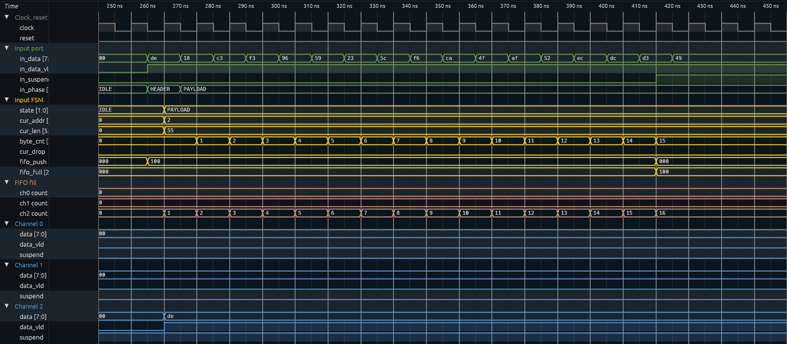

# Reading a simulation: logs, timelines and waves

Every run writes a log that tells its story in order: what the test is doing,
what every component of the environment does with each packet, and what happens
inside the router. `make sim-report` bundles the logs of a regression into one
folder per run, with a timeline extracted from the log, the waves, and a few
wave pictures of the moments worth looking at. This page explains the log
lines, the report and how to get the waves into a viewer.

## The shape of a log

The project runs at `+UVM_VERBOSITY=UVM_MEDIUM` (set in `run.f`): one line per
event, no packet tables. `UVM_HIGH` adds the full `Packet is` / `Packet
collected` tables of the course and the HBUS lines of the DUT tracer.

```text
UVM_INFO tests/base_test.sv(94) @ 0: uvm_test_top [TEST] === backpressure_test  seed 1 ===
UVM_INFO tests/base_test.sv(99) @ 0: uvm_test_top [TEST] STAGE: 1. slow receivers (channel_rx_slow_seq): 6 packets of 40..63 bytes fill the 16-byte FIFOs
UVM_INFO ...yapp_router_tracer.sv(148) @ 50: reporter [DUT] RESET released: router_en=1 maxpktsize=63
UVM_INFO ...yapp_tx_driver.sv(76) @ 50: uvm_test_top.tb.yapp.agent.driver [yapp_tx_driver] TX pkt #1: addr=2 len=55 parity=good delay=20
UVM_INFO ...yapp_router_tracer.sv(213) @ 265: reporter [DUT] IN  pkt #1 header: addr=2 len=55 -> channel 2
UVM_INFO ...yapp_router_tracer.sv(251) @ 425: reporter [DUT] SUSPEND asserted: FIFO 2 full, byte 0x49 held (pkt #1)
UVM_INFO ...yapp_router_tracer.sv(289) @ 565: reporter [DUT] OUT ch2 pkt #1 start: addr=2 len=55 (receiver waited 29 cycle(s))
UVM_INFO ...yapp_router_tracer.sv(257) @ 575: reporter [DUT] SUSPEND released after 15 cycle(s)
UVM_INFO ...yapp_router_tracer.sv(228) @ 975: reporter [DUT] IN  pkt #1 complete: addr=2 len=55 parity=ok forwarded, 57 bytes in 72 cycles (held 15)
UVM_INFO ...yapp_tx_driver.sv(80) @ 980: uvm_test_top.tb.yapp.agent.driver [yapp_tx_driver] TX pkt #1 accepted by the DUT
UVM_INFO ...router_scoreboard.sv(121) @ 1345: uvm_test_top.tb.router_module.scoreboard [router_scoreboard] ch2 pkt matched: addr=2 len=55 (1 matched so far)
UVM_INFO tests/base_test.sv(112) @ 6335: uvm_test_top [TEST] === backpressure_test  seed 1: PASSED (0 UVM_ERROR, 0 UVM_FATAL) ===
```

Three kinds of lines carry the story:

| Who | Id | Lines | Where it is written |
|---|---|---|---|
| The test | `[TEST]` | `=== <test>  seed <n> ===` banner at the start, `STAGE: …` at every step of the test, `=== … PASSED/FAILED (…) ===` at the end | `base_test` (`stage()`, `start_of_simulation_phase`, `final_phase`); every test calls `stage()` |
| The router | `[DUT]` | `RESET`, `IN pkt #n header / complete`, `SUSPEND asserted / released`, `OUT chX pkt #n start / done`, `ERROR pulse`, `CONFIG`; at `UVM_HIGH` also `HBUS write / read` with the register name and `FIFO x full / has room` | `yapp_router_tracer`, a testbench module **bound** into the DUT (`yapp_project/tb/yapp_router_tracer.sv`); it watches the ports and the input FSM, the RTL is untouched |
| The environment | the component's type name, as in the course | `TX pkt #n: …` / `TX pkt #n accepted by the DUT` (driver), `RX pkt #n on the input: …` (monitor), `chX RX pkt #n: …` (channel monitor), `chX: packet consumed` (channel driver), `Executed WRITE/READ …` and `Collected …` (HBUS), `chX pkt matched: …` (scoreboard), `Packet forwarded / dropped …` (reference model), `Starting clock …` (clock and reset) | the UVCs under `yapp_project/uvc/` |

The `[DUT]` lines are the ones that tell you what the hardware did, as opposed
to what the environment sent or expected: a header that will be dropped says so
(`-> DROP (illegal address 3)`), a held byte names the full FIFO, a packet
leaving a channel says how long the receiver kept it waiting, an error pulse
says how many cycles after the bad packet it came.

Every message with a number in it has a fixed format, so a script (or `grep`)
can follow one packet from the driver (`TX pkt #3`) to the router (`IN pkt #3`),
the channel (`OUT ch1 pkt #2`) and the scoreboard (`ch1 pkt matched`).

## The report

```bash
make regress ONLY=yapp_project WAVES=1           # run, record waves and the signal trace
make sim-report ONLY=yapp_project                 # bundle: build/sim/report/ + regression_report.zip
make sim-report ONLY=yapp_project OUT=yapp_project/regression   # refresh the committed report
```

The report of the project (16 directed tests with 4 seeds and 4 random tests
with 8, 96 runs) is committed in
`yapp_project/regression/`, so the logs, timelines, waves and pictures can be
read on GitHub or in the ZIP without running anything; `index.md` is the
entry point.

`scripts/sim_report.py` reads `build/sim/<bench>/logs/<test>_s<seed>.log` and
writes `build/sim/report/`:

```text
report/
  index.md                      every run: result, packets in / forwarded / dropped,
                                packets out per channel, suspends, errors, link
  all_logs.log                  every log in one file, each under a banner
  yapp_project_tb/
    backpressure_test_s1/
      backpressure_test_s1.log  the log, named after the test and the seed
      timeline.md               summary · stages · pictures · every event in order
      timeline.csv              the same events: time, severity, who, id, event
      backpressure_test_s1.fst  the waves
      signals.csv               the per-cycle signal trace (see below)
      wave_*.svg                the pictures
    backpressure_test_s2/
    ...
```

`timeline.md` starts with the verdict and a summary counted from the log
(packets sent, forwarded, dropped and why, packets out per channel, scoreboard
matches, back-pressure events, error pulses, HBUS accesses), lists the stages
of the test with their times, shows the pictures, and ends with the full
timeline: one row per event, `UVM_ERROR` rows marked.

## The pictures

With `WAVES=1` the tracer also writes `trace/<test>_s<seed>.csv`: one row per
clock cycle, sampled on the falling edge, with the input port, the three
channels, the HBUS port, `error`, the live configuration and the state of the
input FSM. `sim_report.py` finds the first occurrence of each interesting event
in the log and draws a window of cycles around it with the same SVG drawer as
the timing diagrams of the [specification](../dut/spec.md):

| Picture | When it is drawn | What it shows |
|---|---|---|
| `wave_reset.svg` | always | reset, the first idle cycles, `router_en` and `maxpktsize` after reset |
| `wave_first_packet_in.svg` | a packet entered the router | header, payload and parity on `in_data` with their `in_phase` (HDR / PAY / PAR), `in_suspend`, the input FSM state, the target FIFO filling up |
| `wave_first_packet_out.svg` | a packet left on a channel | `data_x`, `data_vld_x`, the receiver's `suspend_x` |
| `wave_first_suspend.svg` | `in_suspend` rose | the held byte on `in_data`, the full FIFO, the channel draining it |
| `wave_first_error_pulse.svg` | `error` pulsed | the end of the bad-parity packet and the pulse 1..10 cycles later |
| `wave_first_hbus_write.svg`, `wave_first_hbus_read.svg` | the host port was used | `hen`, `hwr_rd`, `haddr`, `hdata` for one write and one read |

Testbench-driven signals are drawn changing on the falling edge, DUT outputs on
the rising edge, exactly as the protocol works. A window is at most 30 cycles;
a longer packet is cut and the note under the picture says so.

Below, the first packet of `backpressure_test` (seed 1): the receiver is slow,
the FIFO of channel 2 fills up and the router holds the driver with `in_suspend`.


And the same packet leaving the router on channel 2:


## The waves

`<test>_s<seed>.fst` is the complete design, every signal. Open it with

* **GTKWave** (Windows, Linux, macOS): `gtkwave backpressure_test_s1.fst`,
  then drag `hw_top.in0`, `hw_top.dut` and `hw_top.ch2` into the viewer. The
  `[DUT]` times of `timeline.md` are the rising edges to jump to.
* **Surfer** (`surfer file.fst`, also available as a web app), or the
  **VaporView** extension of VS Code (installed in the Codespace): open the
  file from the Explorer.
* From a lab directory, `make waves TEST=<test>` starts whichever of the two is
  installed.

`signals.csv` is the same information for the port signals in a form a
spreadsheet or a script can read: one row per cycle.

### A ready signal layout for Surfer

`yapp_project/tb/yapp_router.sucl` is a Surfer command file that opens the
signals of the router in ten groups, one color per group, buses in hex, the
FSM state and `in_phase` by name, plus the two memories of the spec, folded.
Variable names are full paths (*Settings → Variable names → Global*):

| Group | Signals | Scope |
|---|---|---|
| Clock, reset | `clock`, `reset` | `hw_top` |
| Input port | `in_data`, `in_data_vld`, `in_suspend`, `in_phase` | `hw_top.in0`; `in_phase` from `hw_top.dut.u_tracer` |
| Input FSM | `state`, `cur_addr`, `cur_len`, `byte_cnt`, `cur_drop`, `fifo_push`, `fifo_full` | `hw_top.dut.u_input_fsm` |
| FIFO fill | `ch0 count` … `ch2 count`: bytes waiting in each channel FIFO | `hw_top.dut.g_ch[c].u_ch.u_fifo.count` |
| Channel 0 / 1 / 2 | `data`, `data_vld`, `suspend` | `hw_top.ch0` … `ch2` |
| Error | `error`, `pkt_done`, `err_timer` | `hw_top.dut`, `u_error_timer` |
| HBUS | `hen`, `hwr_rd`, `haddr`, `hdata` | `hw_top.hbus0` |
| Config, counters | `router_en`, `maxpktsize`, `addr0..3_cnt_reg`, `parity_err_cnt_reg`, `oversized_pkt_cnt_reg` | `hw_top.dut`, `u_regs` |
| Packet memory (folded) | `[0]` … `[63]`: the last packet, header first (0x1010, RO) | `hw_top.dut.u_regs.yapp_pkt_mem` |
| Scratch memory (folded) | `[0]` … `[255]`: written and read over HBUS (0x1100, RW) | `hw_top.dut.u_regs.yapp_mem` |

The memories are arrays, and Verilator leaves arrays of more than 32 elements
out of the waves unless told otherwise: `scripts/sim.py` passes
`--trace-max-array 256`, so `yapp_pkt_mem` (64 bytes) and `yapp_mem` (256
bytes) are in every `.fst` recorded since. In Surfer they are scopes under
`u_regs`, one variable per byte; a `.fst` recorded before has no memories.

Three ways to use it:

* **One click.** The *Waves* column of `yapp_project/regression/index.md` (and
  the line under the result in every `timeline.md`) opens
  [Surfer's web app](https://app.surfer-project.org/) with that run's `.fst`
  and the layout, both read from GitHub.
* **A local file in the web app or the desktop Surfer.** Open the `.fst`, then
  *File → Run command file...* and pick `yapp_router.sucl`. *File → Switch
  file...* then moves to another test and keeps the list.
* **Command line:** `surfer backpressure_test_s1.fst -c yapp_project/tb/yapp_router.sucl`.
* **With the view settings too:** `yapp_project/tb/yapp_router.surf.ron` is the
  same layout saved as a Surfer state, plus four settings no command can set:
  *Focus highlight → Background*, *Hierarchy → Tree*, *Show hierarchy icons*
  on, *Fill high values* off (and *Variable names → Global*). Open the `.fst`,
  then *File → Load state...*; the state keeps the waves that are open. The web
  app does not remember settings between visits, so this is the way to get
  them back in one step.

The first packet of `backpressure_test` (seed 1) in this layout: the header
`de` (`HEADER`, one cycle) goes to channel 2, `ch2 count` climbs to 16, the
FIFO is full and `in_suspend` holds byte `49`:



The layout is written by `scripts/surfer_layout.py` (`LAYOUT` at the top):
edit it there and run `python3 scripts/surfer_layout.py` to rewrite the
`.sucl`. For the `.surf.ron`, run the new `.sucl` in Surfer, *File → Save
state as...*, then `python3 scripts/surfer_layout.py --state <saved file>`
(it puts the four settings of `STATE_SETTINGS` in). To keep your own
arrangement after changing it in Surfer, use *File → Save state as...* and
*File → Load state...* next time (open the `.fst` first; the state keeps the
waves that are open and brings back the list).

A `.sucl` or `.surf.ron` file is never dragged into the Surfer window: a
dropped file is read as waves and fails with `UnknownFileFormat`.

### Which signals to look at

Following one packet from the driver to a channel (Surfer: click a scope in the
tree, then the signals in the *Variables* list; *Format → Hex* on the buses):

| Where | Signals | What they show |
|---|---|---|
| `hw_top.in0` | `clock`, `in_data`, `in_data_vld`, `in_suspend` | what the YAPP driver puts on the input port (it changes the inputs on the **falling** edge) |
| `hw_top.dut.u_tracer` | `in_phase` | what the byte now on `in_data` is: `IDLE`, `HEADER`, `PAYLOAD`, `PARITY`; changes with `in_data`, so `HEADER` lasts exactly the cycle of the header |
| `hw_top.dut.u_input_fsm` | `state`, `cur_addr`, `cur_len`, `cur_drop`, `fifo_push`, `fifo_full` | what the router decided, on the **rising** edge that sampled each byte |
| `hw_top.ch0` … `ch2` | `data`, `data_vld`, `suspend` | the packet leaving: the same bytes, in the same order, on the channel `addr` names |

**Why the FSM has no HEADER state.** The FSM takes the header while it is in
`IDLE`: on the rising edge where `in_data_vld` is high it latches `cur_addr` and
`cur_len` from the header and moves to `PAYLOAD`. So `state` shows `PAYLOAD`
half a cycle *before* the first payload byte is on the bus -- the testbench
drives a byte on the falling edge and the router samples it on the next rising
edge. A real HEADER state would cost a cycle per packet and change the
protocol of the course; `in_phase` is the readable label, computed in the
testbench (`yapp_router_tracer.sv`), with the RTL untouched.

## Running one test by hand

```bash
cd yapp_project/tb
make sim TEST=parity_error_test SEED=3 WAVES=1          # log, waves, trace
make sim TEST=parity_error_test SIM_OPTS="+UVM_VERBOSITY=UVM_HIGH"   # with the packet tables
grep "\[DUT\]" ../../build/sim/yapp_project_tb/logs/parity_error_test_s3.log
```

With Xcelium the same `[TEST]`, `[DUT]` and component lines appear in
`xrun.log` (`make run TEST=…`); the seed in the banner comes from `+SVSEED`,
the signal trace from `+trace_csv=<file>`.
