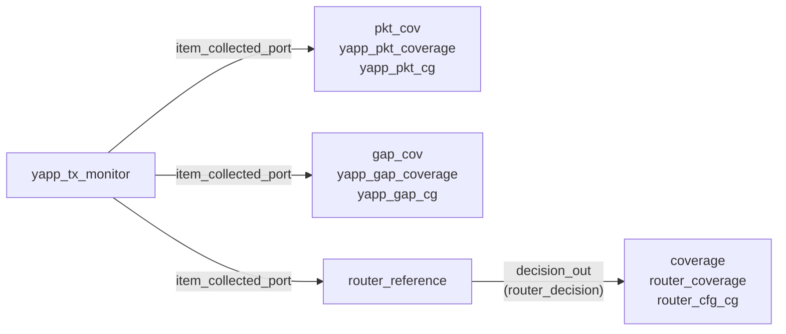

# Functional coverage

[Open on the project map →](../project-map.md#view=hierarchy&node=tb.yapp.agent.pkt_cov){ .pm-link }


Functional coverage answers "**did we exercise what we meant to?**" — not
whether the DUT was right (that is the scoreboard's job). It samples what the
**monitor** publishes, because the monitor sees what *actually* happened on
the bus, whatever the sequences intended.

## Where the covergroups live

Every covergroup has **its own file**: a *coverage collector*, a
`uvm_subscriber` that holds one covergroup and samples it in `write()`. The
monitor and the reference model only publish on an analysis port; the
collectors subscribe.



| Collector (instance) | File | Covergroup | Samples |
|---|---|---|---|
| `tb.yapp.agent.pkt_cov` | `yapp_project/uvc/yapp/yapp_pkt_coverage.sv` | `yapp_pkt_cg` (Lab 10) | length, address, parity of every input packet |
| `tb.yapp.agent.gap_cov` | `yapp_project/uvc/yapp/yapp_gap_coverage.sv` | `yapp_gap_cg` (ROUTE-04) | the gap before every packet, which the monitor writes into `packet_delay` |
| `tb.router_module.coverage` | `yapp_project/uvc/router/router_coverage.sv` | `router_cfg_cg` (random tests) | maxpktsize, length vs maxpktsize, drop reason × parity, counter enables of every packet received while the router is on, from the reference's `router_decision` |

Why not inside the monitor, as the Cadence lab writes it? The monitor's job is
to observe and publish. A separate collector can be added, replaced (factory)
or left out without touching the monitor, a passive agent keeps it, and a
collector can sample what *another* component decided (the reference model's
drop reason), which the monitor never sees. The bins are the same, so the
percentage is the same.

## The requirements (Lab 10)

| Req | Statement | Coverpoint / cross |
|---|---|---|
| REQ1 | every packet length, bucketed | `length_cp`: `MIN=1`, `SMALL=[2:10]`, `MEDIUM=[11:40]`, `LARGE=[41:62]`, `MAX=63` |
| REQ2 | every address, including the illegal one | `addr_cp`: `legal[] = {[0:2]}`, `illegal_addr = {3}` |
| REQ3 | every length bucket to every legal address **with** a parity error | `len_x_addr_x_parity` cross, ignoring `GOOD_PARITY` and `illegal_addr` |

## The covergroup

```systemverilog
covergroup yapp_pkt_cg with function sample(bit [5:0] length,
                                            bit [1:0] addr,
                                            parity_type_e parity_type);
  option.per_instance = 1;
  length_cp : coverpoint length {
    bins MIN    = {1};
    bins SMALL  = {[2:10]};
    bins MEDIUM = {[11:40]};
    bins LARGE  = {[41:62]};
    bins MAX    = {63};
  }
  addr_cp : coverpoint addr {
    bins legal[]      = {[0:2]};
    bins illegal_addr = {3};
  }
  parity_cp : coverpoint parity_type {
    bins good = {GOOD_PARITY};
    bins bad  = {BAD_PARITY};
  }
  len_x_addr_x_parity : cross length_cp, addr_cp, parity_cp {
    ignore_bins good_parity  = binsof(parity_cp) intersect {GOOD_PARITY};
    ignore_bins illegal_addr = binsof(addr_cp.illegal_addr);
  }
endgroup
```

* Inside a class a covergroup is **created** in the constructor —
  `yapp_pkt_cg = new();` — no separate variable.
* `with function sample(...)` lets the collector pass the values explicitly;
  the alternative is coverpoints on class members sampled with `sample()`.
* `illegal_addr` is a normal bin, not `illegal_bins`: REQ2 wants to *count*
  packets to address 3, not flag them as errors.
* The cross is **restricted** with `ignore_bins` so that only the combinations
  REQ3 cares about count towards 100%: 5 lengths × 3 addresses × BAD_PARITY =
  15 bins.
* `parity_cp` names its two bins. An enum coverpoint without bins gets one bin
  per value on Xcelium, but Verilator bins it by value range.
* Verilator ignores `ignore_bins` written with `binsof() intersect`, so under
  `` `ifdef VERILATOR `` the collector builds the same 15-bin cross from two extra
  coverpoints that hold only the legal addresses and only `BAD_PARITY` -- see
  [Simulating with Verilator](../appendix/verilator.md#what-differs-from-xcelium).

## Sampling

`yapp_pkt_coverage::write(t)` calls `yapp_pkt_cg.sample(t.length, t.addr,
t.parity_type)` for every packet the [monitor](monitor.md) publishes:

```systemverilog
--8<-- "yapp_project/uvc/yapp/yapp_pkt_coverage.sv"
```

The agent builds the collectors and connects them (`yapp_tx_agent`):

```systemverilog
monitor.item_collected_port.connect(pkt_cov.analysis_export);
monitor.item_collected_port.connect(gap_cov.analysis_export);
```

## Closing the holes

| Test | Covers | Misses |
|---|---|---|
| `router_simple_mcseq_test` (short packets) | MIN, SMALL, some MEDIUM; addresses 0–2 | LARGE, MAX, address 3, most of the cross |
| `test_uvc_integration` (88 packets, lengths 1–22) | all addresses incl. 3 | LARGE, MAX |
| `coverage_test` → `yapp_coverage_seq` | **everything**: each length bucket × each address × good/bad parity (40 packets) | — |

`yapp_coverage_seq` is the "modify your stimulus to achieve coverage" step of
the lab. Run it with several seeds (`+SVSEED=random`) and merge the results in
IMC to see 100% on the three requirements.

## Seeing the results (Verilator)

Every Verilator run collects functional coverage: `scripts/sim.py` compiles
with `--coverage-user` (the covergroup bins only, no line or toggle coverage)
and each run writes its bins to
`build/sim/<bench>/coverage/<test>_s<seed>.dat`. Three places show them:

1. **The log of one run.** Each collector prints its percentage in
   `report_phase`:

    ```text
    [yapp_pkt_coverage] YAPP packet coverage: 22 packets sampled, coverage 60.0%
    [yapp_gap_coverage] YAPP gap coverage: 21 gaps sampled, coverage 100.0%
    [router_coverage] Coverage of the router configuration: 65.2%
    ```

2. **The whole regression, merged.** After `make regress`:

    ```bash
    make coverage ONLY=yapp_project      # summary and the holes, in the terminal
    make sim-report ONLY=yapp_project    # build/sim/report/coverage.md + HTML
    ```

    `coverage.md` lists, per covergroup, covered / total bins, the **holes**
    (bins no run hit), every bin with its hits, the number of runs and the
    tests that hit it, and what each test adds (bins only that test hits).
    The committed report of the project is
    [`yapp_project/regression/coverage.md`](https://github.com/tamirgabgab/Qcom-Mentoring/blob/main/yapp_project/regression/coverage.md);
    the same data is the site page [Coverage results](../coverage-results.md).

3. **The annotated sources (HTML).** `genhtml` (lcov) draws every collector's
   source with the hit count next to each bin line:
   [coverage/yapp_project_tb/index.html](../coverage/yapp_project_tb/index.html).
   *Lines* there means "a bin on this line was hit"; a line with several bins
   (`legal[]`, a cross) shows each one under *Branches* (`+` hit, `-` hole).

The [project map](../project-map.md) shows the merged bins too: open a
coverage collector (`pkt_cov`, `gap_cov`, `coverage`) and its panel lists every
bin with its hits; a hole is red, a click shows its line.

The percentage is covered bins / bins of the covergroup, as Verilator's
`get_inst_coverage()` gives it (the helper coverpoints of the Verilator cross
count too); IMC weighs coverpoints differently, see
[what is not verified](../appendix/unverified.md).

## Running with coverage (Xcelium)

```bash
cd labs/lab10_cov/tb
make run TEST=coverage_test          # run.f already has -coverage U -covoverwrite
imc -load cov_work/scope/coverage_test
```

In IMC (or SimVision → Windows → Tools → Coverage): *Verification Hierarchy →
uvm_pkg → …yapp_tx_monitor*, right-click → *Cover Group Analysis*, open the
*Items* of `yapp_pkt_cg`.
