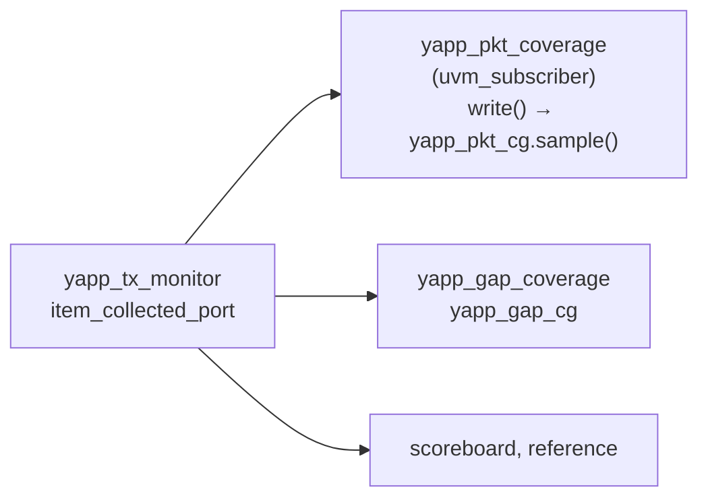

# Lab 10 — A simple functional coverage model *(optional)*

[Open on the project map →](../project-map.md#view=classes&node=cls:yapp_pkt_coverage){ .pm-link }


**Directory:** `labs/lab10_cov` · **Changed:** `yapp_project/uvc/yapp/yapp_pkt_coverage.sv` (covergroup, a subscriber of the monitor),
`yapp_project/uvc/yapp/yapp_tx_agent.sv` (builds and connects it),
`yapp_project/uvc/yapp/yapp_tx_seqs.sv` (`yapp_coverage_seq`), `tb/router_test_lib.sv`, `run.f` (`-coverage U`)

## Objective

Learn where coverage lives in a UVM environment (the course puts it in the
monitor; this repository next to it, in a subscriber of the monitor), write a
covergroup for three requirements, find the holes and close them with better
stimulus.

## Concepts

* A **covergroup** is a set of **coverpoints**; every coverpoint sorts the
  sampled value into **bins**. A **cross** pairs the bins of two coverpoints.
  `sample()` is called by the testbench, here once per collected packet.
* The monitor is the right source: it reports what the DUT really received,
  whatever the sequence intended. A `uvm_subscriber` with an `analysis_export`
  hangs on the monitor's `m_item_collected_port` and samples in `write()`.
* **Holes** are bins no run hit; **closing** them means writing stimulus that
  reaches them (`yapp_coverage_seq`) — the regression merges every run.
* The general picture (what coverage answers, the vocabulary, the
  coverage-driven loop) is on [Functional coverage](../uvm/coverage.md).



## Requirements

| Req | Statement |
|---|---|
| REQ1 | all packet lengths were sent: bins for min, small, medium, large, max |
| REQ2 | every address received a packet — **including the illegal address 3** |
| REQ3 | every length bin was sent to every legal address **with a parity error** |

## Solution

### 1. The covergroup in `yapp_pkt_coverage`

The Cadence lab writes the covergroup **inside the monitor**. This repository
puts it in its own file: `yapp_pkt_coverage`, a `uvm_subscriber
#(yapp_packet)` that the agent connects to the monitor's
`m_item_collected_port`. The bins are the same, so the percentage is the same;
the monitor only observes and publishes, and the coverage model can be
replaced or left out without touching it (see
[Functional coverage](../components/coverage.md#where-the-covergroups-live)).

```systemverilog
covergroup yapp_pkt_cg with function sample(bit[5:0] length,
                                            bit[1:0] addr,
                                            parity_type_e parity_type);
  option.per_instance = 1;
  length_cp : coverpoint length {
    bins MIN    = {1};
    bins SMALL  = {[2:10]};
    bins MEDIUM = {[11:40]};
    bins LARGE  = {[41:62]};
    bins MAX    = {63};
  }
  addr_cp : coverpoint addr {
    bins legal[]      = {[0:2]};
    bins illegal_addr = {3};
  }
  parity_cp : coverpoint parity_type {
    bins good = {PARITY_TYPE_GOOD};
    bins bad  = {PARITY_TYPE_BAD};
  }
  len_x_addr_x_parity : cross length_cp, addr_cp, parity_cp {
    ignore_bins good_parity  = binsof(parity_cp) intersect {PARITY_TYPE_GOOD};
    ignore_bins illegal_addr = binsof(addr_cp.illegal_addr);
  }
endgroup

function yapp_pkt_coverage::new(string name, uvm_component parent);
  super.new(name, parent);
  yapp_pkt_cg = new();              // a class covergroup is created with new()
endfunction

function void yapp_pkt_coverage::write(yapp_packet t);   // every packet the monitor publishes
  yapp_pkt_cg.sample(t.m_length, t.m_addr, t.m_parity_type);
endfunction

// yapp_tx_agent::connect_phase
m_monitor.m_item_collected_port.connect(m_pkt_cov.analysis_export);
```

### 2. Stimulus that closes the model — `yapp_coverage_seq`

Every length bucket × every address (0..3) × good/bad parity = 40 packets.
The packet's `c_addr_legal` constraint is switched off to reach address 3.

```systemverilog
task yapp_coverage_seq::body();
  int lengths[5] = '{1, 5, 20, 50, 63};   // one value inside each bin
  for (int a = 0; a < 4; a++)
    foreach (lengths[i])
      for (int bad = 0; bad < 2; bad++) begin
        req = yapp_packet::type_id::create("req");
        req.c_addr_legal.constraint_mode(0);        // before randomize(): allow addr 3
        if (!req.randomize() with { req.m_addr == a; req.m_length == lengths[i];
                                    req.m_parity_type == (bad ? PARITY_TYPE_BAD : PARITY_TYPE_GOOD); })
          `uvm_error(get_type_name(), "Randomization failed")
        start_item(req);
        finish_item(req);
      end
endtask : body
```

The constraint is switched off on the object *before* `randomize()`, which is
why the sequence randomizes first and only then does `start_item` /
`finish_item`.

### 3. `coverage_test`

Full-size packets (no override), `yapp_coverage_seq` on the YAPP sequencer,
channels and clock as usual. `maxpktsize` keeps its reset value 63, so only
the address-3 packets are dropped (the reference model expects that).

### 4. `run.f`

```
-coverage U        // collect functional coverage
-covoverwrite
```

## Run

```bash
make run TEST=router_simple_mcseq_test   # see the holes
make run TEST=coverage_test              # close them
make gui TEST=coverage_test              # Windows -> Tools -> Coverage
imc -load cov_work/scope/coverage_test   # or IMC standalone
```

With Verilator every run writes its bins to a coverage database;
`make regress` then `make sim-report` merges them into `coverage.md` and an
HTML page (see [Functional coverage](../components/coverage.md#seeing-the-results-verilator)).

In IMC: *Verification Hierarchy → uvm_pkg → … yapp_pkt_coverage* → right-click →
*Cover Group Analysis* → *Items* of `yapp_pkt_cg`.

**Expected:** with `router_simple_mcseq_test` (short packets) `LARGE`, `MAX`
and `illegal_addr` are empty and most of the cross is uncovered; the
collector's report line (`YAPP packet coverage: ... coverage N%`) shows the
percentage. With `coverage_test` all 5 length bins, all
4 address bins, both parity values and all 15 cross bins are hit: 100%.

## Checkpoint questions

??? question "Why is the covergroup fed by the monitor and not by the sequence or the driver?"
    The monitor records what *actually* went across the interface — including
    traffic from other sources, dropped or corrupted items — and it exists in
    passive agents too. Sequences only know what they *intended* to send. The
    collector subscribes to the monitor, so it sees exactly that.

??? question "Why `bins illegal_addr = {3}` and not `illegal_bins`?"
    `illegal_bins` turns every hit into an error. REQ2 asks whether address 3
    was *exercised*, so it must be a counted bin.

??? question "What do the `ignore_bins` in the cross achieve?"
    They remove combinations that are not part of REQ3 (good parity, illegal
    address) from the denominator, so 100% means exactly "every size to every
    legal address with a parity error".

??? question "Why `option.per_instance = 1`?"
    Coverage is reported per collector instance rather than merged for the type.
    With one YAPP agent it makes no difference, but a UVC with several
    instances (the channel monitor) would want it.

## What changed since the previous lab

```bash
diff labs/lab06_vif/sv/yapp_tx_monitor.sv yapp_project/uvc/yapp/yapp_tx_monitor.sv   # analysis port, gap in packet_delay
cat yapp_project/uvc/yapp/yapp_pkt_coverage.sv                                         # the covergroup
diff -r labs/lab09_sbc/tb labs/lab10_cov/tb
```
