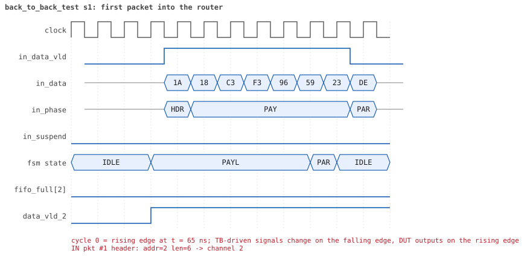
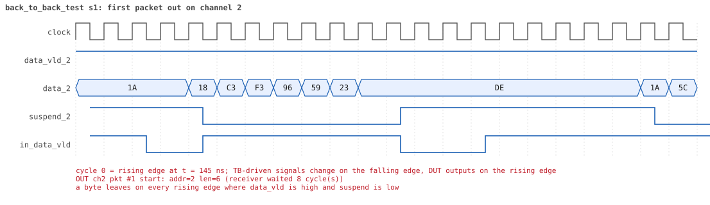

# back_to_back_test

<!-- generated by scripts/project_map/build.py from yapp_project/regression/runs.json -- run the regression, `make sim-report ONLY=yapp_project OUT=yapp_project/regression`, then `make map`; do not edit this file -->

[Back to the regression results →](index.md){ .pm-link } [On the project map →](../project-map.md#view=plan&node=cls:back_to_back_test){ .pm-link }

**4 of 4 seeds passed** · lab: test plan · extends `reg_function_test` · 19 coverage bins hit.

Test plan: the input port with the shortest gap -- a header in the cycle right after the parity byte -- and gaps of 1, 2 and 3 cycles.

## Seeds

| Seed | Result | Sim time | Wall | In / fwd / drop | Out ch0/1/2 | Suspends | Errors | Log | Timeline | Waves |
|---|---|---|---|---|---|---|---|---|---|---|
| 1 | pass | 3us | 1.0 s | 24 / 24 / 0 | 5/5/14 | 0 | 0 | [log ↗](https://github.com/tamirgabgab/Qcom-Mentoring/blob/main/yapp_project/regression/yapp_project_tb/back_to_back_test_s1/back_to_back_test_s1.log) | [timeline ↗](https://github.com/tamirgabgab/Qcom-Mentoring/blob/main/yapp_project/regression/yapp_project_tb/back_to_back_test_s1/timeline.md) | [Surfer ↗](https://app.surfer-project.org/?load_url=https%3A%2F%2Fraw.githubusercontent.com%2Ftamirgabgab%2FQcom-Mentoring%2Fmain%2Fyapp_project%2Fregression%2Fyapp_project_tb%2Fback_to_back_test_s1%2Fback_to_back_test_s1.fst&startup_commands=run_command_file_from_url%20https%3A%2F%2Fraw.githubusercontent.com%2Ftamirgabgab%2FQcom-Mentoring%2Fmain%2Fyapp_project%2Ftb%2Fyapp_router.sucl) [.fst](https://github.com/tamirgabgab/Qcom-Mentoring/blob/main/yapp_project/regression/yapp_project_tb/back_to_back_test_s1/back_to_back_test_s1.fst) |
| 2 | pass | 3us | 1.1 s | 24 / 24 / 0 | 7/6/11 | 0 | 0 | [log ↗](https://github.com/tamirgabgab/Qcom-Mentoring/blob/main/yapp_project/regression/yapp_project_tb/back_to_back_test_s2/back_to_back_test_s2.log) | [timeline ↗](https://github.com/tamirgabgab/Qcom-Mentoring/blob/main/yapp_project/regression/yapp_project_tb/back_to_back_test_s2/timeline.md) | [Surfer ↗](https://app.surfer-project.org/?load_url=https%3A%2F%2Fraw.githubusercontent.com%2Ftamirgabgab%2FQcom-Mentoring%2Fmain%2Fyapp_project%2Fregression%2Fyapp_project_tb%2Fback_to_back_test_s2%2Fback_to_back_test_s2.fst&startup_commands=run_command_file_from_url%20https%3A%2F%2Fraw.githubusercontent.com%2Ftamirgabgab%2FQcom-Mentoring%2Fmain%2Fyapp_project%2Ftb%2Fyapp_router.sucl) [.fst](https://github.com/tamirgabgab/Qcom-Mentoring/blob/main/yapp_project/regression/yapp_project_tb/back_to_back_test_s2/back_to_back_test_s2.fst) |
| 3 | pass | 3us | 1.0 s | 24 / 24 / 0 | 5/3/16 | 0 | 0 | [log ↗](https://github.com/tamirgabgab/Qcom-Mentoring/blob/main/yapp_project/regression/yapp_project_tb/back_to_back_test_s3/back_to_back_test_s3.log) | [timeline ↗](https://github.com/tamirgabgab/Qcom-Mentoring/blob/main/yapp_project/regression/yapp_project_tb/back_to_back_test_s3/timeline.md) | [Surfer ↗](https://app.surfer-project.org/?load_url=https%3A%2F%2Fraw.githubusercontent.com%2Ftamirgabgab%2FQcom-Mentoring%2Fmain%2Fyapp_project%2Fregression%2Fyapp_project_tb%2Fback_to_back_test_s3%2Fback_to_back_test_s3.fst&startup_commands=run_command_file_from_url%20https%3A%2F%2Fraw.githubusercontent.com%2Ftamirgabgab%2FQcom-Mentoring%2Fmain%2Fyapp_project%2Ftb%2Fyapp_router.sucl) [.fst](https://github.com/tamirgabgab/Qcom-Mentoring/blob/main/yapp_project/regression/yapp_project_tb/back_to_back_test_s3/back_to_back_test_s3.fst) |
| 4 | pass | 3us | 1.2 s | 24 / 24 / 0 | 5/8/11 | 1 | 0 | [log ↗](https://github.com/tamirgabgab/Qcom-Mentoring/blob/main/yapp_project/regression/yapp_project_tb/back_to_back_test_s4/back_to_back_test_s4.log) | [timeline ↗](https://github.com/tamirgabgab/Qcom-Mentoring/blob/main/yapp_project/regression/yapp_project_tb/back_to_back_test_s4/timeline.md) | [Surfer ↗](https://app.surfer-project.org/?load_url=https%3A%2F%2Fraw.githubusercontent.com%2Ftamirgabgab%2FQcom-Mentoring%2Fmain%2Fyapp_project%2Fregression%2Fyapp_project_tb%2Fback_to_back_test_s4%2Fback_to_back_test_s4.fst&startup_commands=run_command_file_from_url%20https%3A%2F%2Fraw.githubusercontent.com%2Ftamirgabgab%2FQcom-Mentoring%2Fmain%2Fyapp_project%2Ftb%2Fyapp_router.sucl) [.fst](https://github.com/tamirgabgab/Qcom-Mentoring/blob/main/yapp_project/regression/yapp_project_tb/back_to_back_test_s4/back_to_back_test_s4.fst) |

## The plan of the test

1. **yapp_gap_seq** — 24 short packets to random legal addresses, gaps 3, then 1, 2, 3, 0 in turn (packet_delay = idle cycles)
2. **measured gaps** — the YAPP monitor's idle-cycle count per class (0, 1, 2, 3+) equals what the sequence asked for
3. **gap coverage** — yapp_gap_cg (gap_cp: back_to_back, one, two, longer) at 100 %
4. **scoreboard** — 24 matched, 0 unexpected

Expected:

- `gap class 0: 5 packets, as planned` and likewise 6, 6, 6 for classes 1..3; monitor report `YAPP gaps: 5 back to back, 6 of 1 cycle, 6 of 2, 6 longer`, and `YAPP gap coverage: 23 gaps sampled, coverage 100.0%`.

## Test plan items this test verifies

- [ROUTE-04](../test-plan.md#route---routing) — Packets back to back with the minimum gap (covered)

## Seed 1: what happened

- YAPP driver sent **24** packet(s) (0 with bad parity); the input monitor saw 24.
- Router: **24** forwarded, **0** dropped.
- Packets out: ch0 **5**, ch1 **5**, ch2 **14**.
- Scoreboard: 24 matched, 0 mismatched, 0 unexpected.
- Back-pressure: in_suspend asserted **0** time(s).
- Error pulses: 0.
- HBUS: 0 write(s), 0 read(s).

### Stages

| time (ns) | stage |
|---|---|
| 0 | 1. yapp_gap_seq: 24 packets with gaps of 0, 1, 2 and more cycles between them |
| 2415 | 2. the gap classes the monitor measured match the plan of the sequence, gap coverage 100% |

### Pictures

The moments the report draws from the signal trace of this run (the same pictures are in the run's folder of the report).

**reset and the first cycles**

**first packet into the router**

**first packet out on channel 2**

Run it yourself: `make sim TEST=back_to_back_test SEED=1 WAVES=1` in `yapp_project/tb`, or `make run-project TEST=back_to_back_test` with Xcelium.
