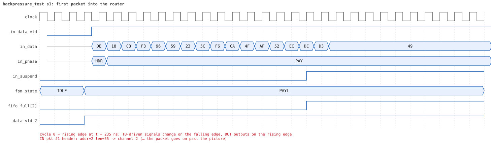
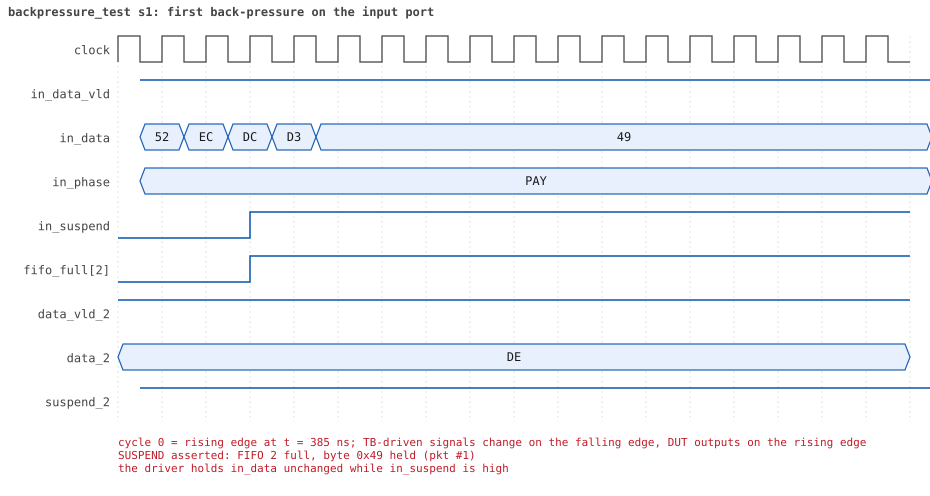

# backpressure_test

<!-- generated by scripts/project_map/build.py from yapp_project/regression/runs.json -- run the regression, `make sim-report ONLY=yapp_project OUT=yapp_project/regression`, then `make map`; do not edit this file -->

[Back to the regression results →](index.md){ .pm-link } [On the project map →](../project-map.md#view=plan&node=cls:backpressure_test){ .pm-link }

**4 of 4 seeds passed** · lab: test plan · extends `reg_function_test` · 15 coverage bins hit.

Test plan: the YAPP handshake under back-pressure -- slow receivers fill the 16-byte channel FIFOs, the router stalls the input with in_suspend and no byte is lost.

## Seeds

| Seed | Result | Sim time | Wall | In / fwd / drop | Out ch0/1/2 | Suspends | Errors | Log | Timeline | Waves |
|---|---|---|---|---|---|---|---|---|---|---|
| 1 | pass | 6us | 0.7 s | 6 / 6 / 0 | 2/1/3 | 6 | 0 | [log ↗](https://github.com/tamirgabgab/Qcom-Mentoring/blob/main/yapp_project/regression/yapp_project_tb/backpressure_test_s1/backpressure_test_s1.log) | [timeline ↗](https://github.com/tamirgabgab/Qcom-Mentoring/blob/main/yapp_project/regression/yapp_project_tb/backpressure_test_s1/timeline.md) | [Surfer ↗](https://app.surfer-project.org/?load_url=https%3A%2F%2Fraw.githubusercontent.com%2Ftamirgabgab%2FQcom-Mentoring%2Fmain%2Fyapp_project%2Fregression%2Fyapp_project_tb%2Fbackpressure_test_s1%2Fbackpressure_test_s1.fst&startup_commands=run_command_file_from_url%20https%3A%2F%2Fraw.githubusercontent.com%2Ftamirgabgab%2FQcom-Mentoring%2Fmain%2Fyapp_project%2Ftb%2Fyapp_router.sucl) [.fst](https://github.com/tamirgabgab/Qcom-Mentoring/blob/main/yapp_project/regression/yapp_project_tb/backpressure_test_s1/backpressure_test_s1.fst) |
| 2 | pass | 8us | 0.8 s | 6 / 6 / 0 | 0/4/2 | 10 | 0 | [log ↗](https://github.com/tamirgabgab/Qcom-Mentoring/blob/main/yapp_project/regression/yapp_project_tb/backpressure_test_s2/backpressure_test_s2.log) | [timeline ↗](https://github.com/tamirgabgab/Qcom-Mentoring/blob/main/yapp_project/regression/yapp_project_tb/backpressure_test_s2/timeline.md) | [Surfer ↗](https://app.surfer-project.org/?load_url=https%3A%2F%2Fraw.githubusercontent.com%2Ftamirgabgab%2FQcom-Mentoring%2Fmain%2Fyapp_project%2Fregression%2Fyapp_project_tb%2Fbackpressure_test_s2%2Fbackpressure_test_s2.fst&startup_commands=run_command_file_from_url%20https%3A%2F%2Fraw.githubusercontent.com%2Ftamirgabgab%2FQcom-Mentoring%2Fmain%2Fyapp_project%2Ftb%2Fyapp_router.sucl) [.fst](https://github.com/tamirgabgab/Qcom-Mentoring/blob/main/yapp_project/regression/yapp_project_tb/backpressure_test_s2/backpressure_test_s2.fst) |
| 3 | pass | 6us | 0.7 s | 6 / 6 / 0 | 2/1/3 | 7 | 0 | [log ↗](https://github.com/tamirgabgab/Qcom-Mentoring/blob/main/yapp_project/regression/yapp_project_tb/backpressure_test_s3/backpressure_test_s3.log) | [timeline ↗](https://github.com/tamirgabgab/Qcom-Mentoring/blob/main/yapp_project/regression/yapp_project_tb/backpressure_test_s3/timeline.md) | [Surfer ↗](https://app.surfer-project.org/?load_url=https%3A%2F%2Fraw.githubusercontent.com%2Ftamirgabgab%2FQcom-Mentoring%2Fmain%2Fyapp_project%2Fregression%2Fyapp_project_tb%2Fbackpressure_test_s3%2Fbackpressure_test_s3.fst&startup_commands=run_command_file_from_url%20https%3A%2F%2Fraw.githubusercontent.com%2Ftamirgabgab%2FQcom-Mentoring%2Fmain%2Fyapp_project%2Ftb%2Fyapp_router.sucl) [.fst](https://github.com/tamirgabgab/Qcom-Mentoring/blob/main/yapp_project/regression/yapp_project_tb/backpressure_test_s3/backpressure_test_s3.fst) |
| 4 | pass | 6us | 0.7 s | 6 / 6 / 0 | 4/1/1 | 7 | 0 | [log ↗](https://github.com/tamirgabgab/Qcom-Mentoring/blob/main/yapp_project/regression/yapp_project_tb/backpressure_test_s4/backpressure_test_s4.log) | [timeline ↗](https://github.com/tamirgabgab/Qcom-Mentoring/blob/main/yapp_project/regression/yapp_project_tb/backpressure_test_s4/timeline.md) | [Surfer ↗](https://app.surfer-project.org/?load_url=https%3A%2F%2Fraw.githubusercontent.com%2Ftamirgabgab%2FQcom-Mentoring%2Fmain%2Fyapp_project%2Fregression%2Fyapp_project_tb%2Fbackpressure_test_s4%2Fbackpressure_test_s4.fst&startup_commands=run_command_file_from_url%20https%3A%2F%2Fraw.githubusercontent.com%2Ftamirgabgab%2FQcom-Mentoring%2Fmain%2Fyapp_project%2Ftb%2Fyapp_router.sucl) [.fst](https://github.com/tamirgabgab/Qcom-Mentoring/blob/main/yapp_project/regression/yapp_project_tb/backpressure_test_s4/backpressure_test_s4.fst) |

## The plan of the test

1. **slow receivers** — channel_rx_slow_seq (response delay 20..40 cycles) on chan0..2 instead of channel_rx_resp_seq
2. **6 long packets** — yapp_pkt_seq, 40..63 bytes, random legal addresses
3. **in_suspend rose** — a thread counts the rising edges of in_suspend on the YAPP interface: at least one
4. **scoreboard** — 6 matched, 0 mismatched, 0 unexpected: every byte arrived exactly once
5. **no bad parity** — the YAPP monitor saw no parity error: a held byte stayed held

Expected:

- `in_suspend rose N times` with N > 0 (a 63-byte packet stalls for roughly the response delay), scoreboard `matched 6, mismatched 0, unexpected 0`.
- In the waveform: in_suspend high while suspend_x is still high and the FIFO count is 16; in_data frozen meanwhile.

## Test plan items this test verifies

- [ROUTE-02](../test-plan.md#route---routing) — Payload and parity arrive unchanged (covered)
- [ROUTE-03](../test-plan.md#route---routing) — Order is kept per channel, channels are independent (covered)
- [PKT-02](../test-plan.md#pkt---packet-format) — Every payload length 1..63, including both extremes (covered)
- [IN-03](../test-plan.md#in---input-port-protocol) — in_suspend: the input holds while the target FIFO is full (covered)
- [OUT-02](../test-plan.md#out---output-port-protocol) — The receiver may answer late: the header is held (covered)
- [OUT-03](../test-plan.md#out---output-port-protocol) — The FIFO is 16 bytes deep (covered)
- [OUT-04](../test-plan.md#out---output-port-protocol) — suspend_x is re-asserted at the parity byte: the next packet waits (covered)
- [OUT-05](../test-plan.md#out---output-port-protocol) — All three channels busy at the same time (covered)

## Seed 1: what happened

- YAPP driver sent **6** packet(s) (0 with bad parity); the input monitor saw 6.
- Router: **6** forwarded, **0** dropped.
- Packets out: ch0 **2**, ch1 **1**, ch2 **3**.
- Scoreboard: 6 matched, 0 mismatched, 0 unexpected.
- Back-pressure: in_suspend asserted **6** time(s), longest hold 32 cycle(s).
- Error pulses: 0.
- HBUS: 0 write(s), 0 read(s).

### Stages

| time (ns) | stage |
|---|---|
| 0 | 1. slow receivers (channel_rx_slow_seq): 6 packets of 40..63 bytes fill the 16-byte FIFOs |
| 6135 | 2. checks: in_suspend rose, 6 packets matched, nothing unexpected, no bad parity |

### Pictures

The moments the report draws from the signal trace of this run (the same pictures are in the run's folder of the report).

**reset and the first cycles**

**first packet into the router**

**first packet out on channel 2**

**first back-pressure on the input port**

Run it yourself: `make sim TEST=backpressure_test SEED=1 WAVES=1` in `yapp_project/tb`, or `make run-project TEST=backpressure_test` with Xcelium.
