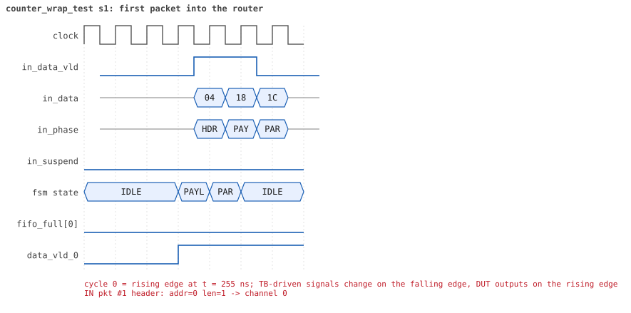
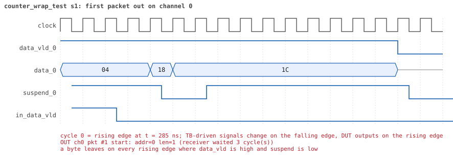
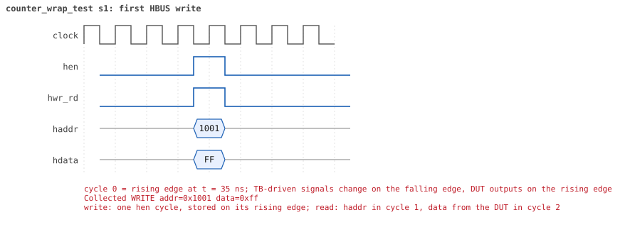
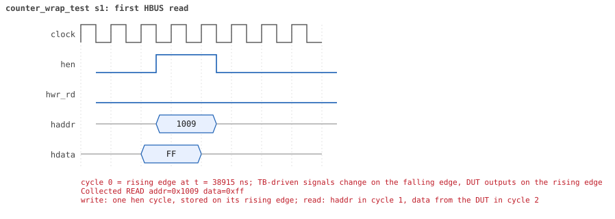

# counter_wrap_test

<!-- generated by scripts/project_map/build.py from yapp_project/regression/runs.json -- run the regression, `make sim-report ONLY=yapp_project OUT=yapp_project/regression`, then `make map`; do not edit this file -->

[Back to the regression results →](index.md){ .pm-link } [On the project map →](../project-map.md#view=plan&node=cls:counter_wrap_test){ .pm-link }

**4 of 4 seeds passed** · lab: test plan · extends `reg_function_test` · 64 coverage bins hit.

Test plan: an 8-bit counter wraps from 255 to 0 -- the specification is silent, the Decisions of dut/spec.md fix the choice.

## Seeds

| Seed | Result | Sim time | Wall | In / fwd / drop | Out ch0/1/2 | Suspends | Errors | Log | Timeline | Waves |
|---|---|---|---|---|---|---|---|---|---|---|
| 1 | pass | 40us | 14.6 s | 257 / 257 / 0 | 257/0/0 | 0 | 0 | [log ↗](https://github.com/tamirgabgab/Qcom-Mentoring/blob/main/yapp_project/regression/yapp_project_tb/counter_wrap_test_s1/counter_wrap_test_s1.log) | [timeline ↗](https://github.com/tamirgabgab/Qcom-Mentoring/blob/main/yapp_project/regression/yapp_project_tb/counter_wrap_test_s1/timeline.md) | [Surfer ↗](https://app.surfer-project.org/?load_url=https%3A%2F%2Fraw.githubusercontent.com%2Ftamirgabgab%2FQcom-Mentoring%2Fmain%2Fyapp_project%2Fregression%2Fyapp_project_tb%2Fcounter_wrap_test_s1%2Fcounter_wrap_test_s1.fst&startup_commands=run_command_file_from_url%20https%3A%2F%2Fraw.githubusercontent.com%2Ftamirgabgab%2FQcom-Mentoring%2Fmain%2Fyapp_project%2Ftb%2Fyapp_router.sucl) [.fst](https://github.com/tamirgabgab/Qcom-Mentoring/blob/main/yapp_project/regression/yapp_project_tb/counter_wrap_test_s1/counter_wrap_test_s1.fst) |
| 2 | pass | 42us | 14.8 s | 257 / 257 / 0 | 257/0/0 | 0 | 0 | [log ↗](https://github.com/tamirgabgab/Qcom-Mentoring/blob/main/yapp_project/regression/yapp_project_tb/counter_wrap_test_s2/counter_wrap_test_s2.log) | [timeline ↗](https://github.com/tamirgabgab/Qcom-Mentoring/blob/main/yapp_project/regression/yapp_project_tb/counter_wrap_test_s2/timeline.md) | [Surfer ↗](https://app.surfer-project.org/?load_url=https%3A%2F%2Fraw.githubusercontent.com%2Ftamirgabgab%2FQcom-Mentoring%2Fmain%2Fyapp_project%2Fregression%2Fyapp_project_tb%2Fcounter_wrap_test_s2%2Fcounter_wrap_test_s2.fst&startup_commands=run_command_file_from_url%20https%3A%2F%2Fraw.githubusercontent.com%2Ftamirgabgab%2FQcom-Mentoring%2Fmain%2Fyapp_project%2Ftb%2Fyapp_router.sucl) [.fst](https://github.com/tamirgabgab/Qcom-Mentoring/blob/main/yapp_project/regression/yapp_project_tb/counter_wrap_test_s2/counter_wrap_test_s2.fst) |
| 3 | pass | 43us | 14.6 s | 257 / 257 / 0 | 257/0/0 | 0 | 0 | [log ↗](https://github.com/tamirgabgab/Qcom-Mentoring/blob/main/yapp_project/regression/yapp_project_tb/counter_wrap_test_s3/counter_wrap_test_s3.log) | [timeline ↗](https://github.com/tamirgabgab/Qcom-Mentoring/blob/main/yapp_project/regression/yapp_project_tb/counter_wrap_test_s3/timeline.md) | [Surfer ↗](https://app.surfer-project.org/?load_url=https%3A%2F%2Fraw.githubusercontent.com%2Ftamirgabgab%2FQcom-Mentoring%2Fmain%2Fyapp_project%2Fregression%2Fyapp_project_tb%2Fcounter_wrap_test_s3%2Fcounter_wrap_test_s3.fst&startup_commands=run_command_file_from_url%20https%3A%2F%2Fraw.githubusercontent.com%2Ftamirgabgab%2FQcom-Mentoring%2Fmain%2Fyapp_project%2Ftb%2Fyapp_router.sucl) [.fst](https://github.com/tamirgabgab/Qcom-Mentoring/blob/main/yapp_project/regression/yapp_project_tb/counter_wrap_test_s3/counter_wrap_test_s3.fst) |
| 4 | pass | 42us | 15.2 s | 257 / 257 / 0 | 257/0/0 | 0 | 0 | [log ↗](https://github.com/tamirgabgab/Qcom-Mentoring/blob/main/yapp_project/regression/yapp_project_tb/counter_wrap_test_s4/counter_wrap_test_s4.log) | [timeline ↗](https://github.com/tamirgabgab/Qcom-Mentoring/blob/main/yapp_project/regression/yapp_project_tb/counter_wrap_test_s4/timeline.md) | [Surfer ↗](https://app.surfer-project.org/?load_url=https%3A%2F%2Fraw.githubusercontent.com%2Ftamirgabgab%2FQcom-Mentoring%2Fmain%2Fyapp_project%2Fregression%2Fyapp_project_tb%2Fcounter_wrap_test_s4%2Fcounter_wrap_test_s4.fst&startup_commands=run_command_file_from_url%20https%3A%2F%2Fraw.githubusercontent.com%2Ftamirgabgab%2FQcom-Mentoring%2Fmain%2Fyapp_project%2Ftb%2Fyapp_router.sucl) [.fst](https://github.com/tamirgabgab/Qcom-Mentoring/blob/main/yapp_project/regression/yapp_project_tb/counter_wrap_test_s4/counter_wrap_test_s4.fst) |

## The plan of the test

1. **en_reg = 0xff** — router and every counter on
2. **255 packets** — yapp_pkt_seq, one byte each, all to address 0
3. **255** — addr0_cnt_reg reads 255
4. **1 packet** — the 256th
5. **wrapped** — addr0_cnt_reg reads 0, not 255
6. **1 packet** — the 257th
7. **counts on** — addr0_cnt_reg reads 1; the other counters 0; scoreboard matched 257

Expected:

- `addr0_cnt_reg reads 255 as expected`, `addr0_cnt_reg reads 0 as expected`, `addr0_cnt_reg reads 1 as expected`; scoreboard `packets matched : 257`.

## Test plan items this test verifies

- [CNT-06](../test-plan.md#cnt---counters) — Counter overflow after 255 packets (covered)

## Seed 1: what happened

- YAPP driver sent **257** packet(s) (0 with bad parity); the input monitor saw 257.
- Router: **257** forwarded, **0** dropped.
- Packets out: ch0 **257**, ch1 **0**, ch2 **0**.
- Scoreboard: 257 matched, 0 mismatched, 0 unexpected.
- Back-pressure: in_suspend asserted **0** time(s).
- Error pulses: 0.
- HBUS: 1 write(s), 8 read(s).

### Stages

| time (ns) | stage |
|---|---|
| 70 | 1. 255 one-byte packets to address 0: addr0_cnt_reg reaches 255 |
| 38950 | 2. the 256th packet wraps addr0_cnt_reg to 0 |
| 39200 | 3. one more packet: the counter goes on from 0 |
| 39670 | 4. the other counters are untouched and the scoreboard matched all 257 packets |

### Pictures

The moments the report draws from the signal trace of this run (the same pictures are in the run's folder of the report).

**reset and the first cycles**

**first packet into the router**

**first packet out on channel 0**

**first HBUS write**

**first HBUS read**

Run it yourself: `make sim TEST=counter_wrap_test SEED=1 WAVES=1` in `yapp_project/tb`, or `make run-project TEST=counter_wrap_test` with Xcelium.
