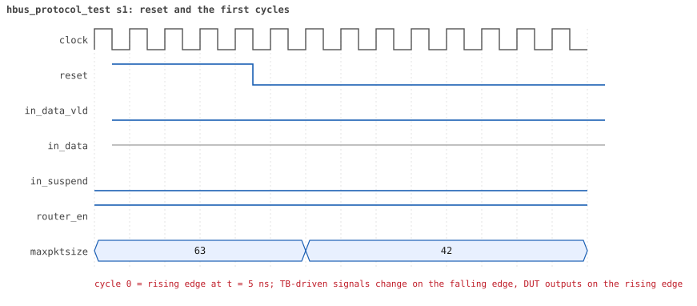
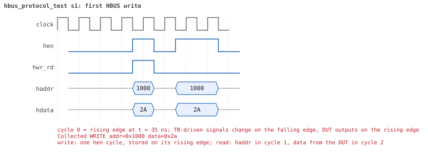
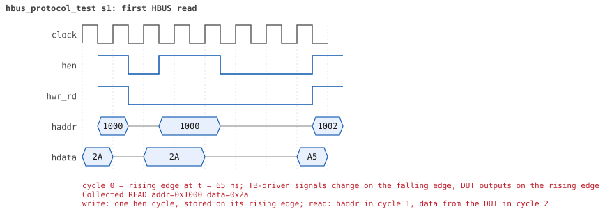

# hbus_protocol_test

<!-- generated by scripts/project_map/build.py from yapp_project/regression/runs.json -- run the regression, `make sim-report ONLY=yapp_project OUT=yapp_project/regression`, then `make map`; do not edit this file -->

[Back to the regression results →](index.md){ .pm-link } [On the project map →](../project-map.md#view=plan&node=cls:hbus_protocol_test){ .pm-link }

**4 of 4 seeds passed** · lab: test plan · extends `reg_access_test` · 57 coverage bins hit.

Test plan: the host port on the wire -- one-cycle writes, two-cycle reads, tri-state after the access, unmapped addresses -- with raw HBUS sequences, no register model.

## Seeds

| Seed | Result | Sim time | Wall | In / fwd / drop | Out ch0/1/2 | Suspends | Errors | Log | Timeline | Waves |
|---|---|---|---|---|---|---|---|---|---|---|
| 1 | pass | 790ns | 0.5 s | 0 / 0 / 0 | 0/0/0 | 0 | 0 | [log ↗](https://github.com/tamirgabgab/Qcom-Mentoring/blob/main/yapp_project/regression/yapp_project_tb/hbus_protocol_test_s1/hbus_protocol_test_s1.log) | [timeline ↗](https://github.com/tamirgabgab/Qcom-Mentoring/blob/main/yapp_project/regression/yapp_project_tb/hbus_protocol_test_s1/timeline.md) | [Surfer ↗](https://app.surfer-project.org/?load_url=https%3A%2F%2Fraw.githubusercontent.com%2Ftamirgabgab%2FQcom-Mentoring%2Fmain%2Fyapp_project%2Fregression%2Fyapp_project_tb%2Fhbus_protocol_test_s1%2Fhbus_protocol_test_s1.fst&startup_commands=run_command_file_from_url%20https%3A%2F%2Fraw.githubusercontent.com%2Ftamirgabgab%2FQcom-Mentoring%2Fmain%2Fyapp_project%2Ftb%2Fyapp_router.sucl) [.fst](https://github.com/tamirgabgab/Qcom-Mentoring/blob/main/yapp_project/regression/yapp_project_tb/hbus_protocol_test_s1/hbus_protocol_test_s1.fst) |
| 2 | pass | 790ns | 0.5 s | 0 / 0 / 0 | 0/0/0 | 0 | 0 | [log ↗](https://github.com/tamirgabgab/Qcom-Mentoring/blob/main/yapp_project/regression/yapp_project_tb/hbus_protocol_test_s2/hbus_protocol_test_s2.log) | [timeline ↗](https://github.com/tamirgabgab/Qcom-Mentoring/blob/main/yapp_project/regression/yapp_project_tb/hbus_protocol_test_s2/timeline.md) | [Surfer ↗](https://app.surfer-project.org/?load_url=https%3A%2F%2Fraw.githubusercontent.com%2Ftamirgabgab%2FQcom-Mentoring%2Fmain%2Fyapp_project%2Fregression%2Fyapp_project_tb%2Fhbus_protocol_test_s2%2Fhbus_protocol_test_s2.fst&startup_commands=run_command_file_from_url%20https%3A%2F%2Fraw.githubusercontent.com%2Ftamirgabgab%2FQcom-Mentoring%2Fmain%2Fyapp_project%2Ftb%2Fyapp_router.sucl) [.fst](https://github.com/tamirgabgab/Qcom-Mentoring/blob/main/yapp_project/regression/yapp_project_tb/hbus_protocol_test_s2/hbus_protocol_test_s2.fst) |
| 3 | pass | 790ns | 0.5 s | 0 / 0 / 0 | 0/0/0 | 0 | 0 | [log ↗](https://github.com/tamirgabgab/Qcom-Mentoring/blob/main/yapp_project/regression/yapp_project_tb/hbus_protocol_test_s3/hbus_protocol_test_s3.log) | [timeline ↗](https://github.com/tamirgabgab/Qcom-Mentoring/blob/main/yapp_project/regression/yapp_project_tb/hbus_protocol_test_s3/timeline.md) | [Surfer ↗](https://app.surfer-project.org/?load_url=https%3A%2F%2Fraw.githubusercontent.com%2Ftamirgabgab%2FQcom-Mentoring%2Fmain%2Fyapp_project%2Fregression%2Fyapp_project_tb%2Fhbus_protocol_test_s3%2Fhbus_protocol_test_s3.fst&startup_commands=run_command_file_from_url%20https%3A%2F%2Fraw.githubusercontent.com%2Ftamirgabgab%2FQcom-Mentoring%2Fmain%2Fyapp_project%2Ftb%2Fyapp_router.sucl) [.fst](https://github.com/tamirgabgab/Qcom-Mentoring/blob/main/yapp_project/regression/yapp_project_tb/hbus_protocol_test_s3/hbus_protocol_test_s3.fst) |
| 4 | pass | 790ns | 0.5 s | 0 / 0 / 0 | 0/0/0 | 0 | 0 | [log ↗](https://github.com/tamirgabgab/Qcom-Mentoring/blob/main/yapp_project/regression/yapp_project_tb/hbus_protocol_test_s4/hbus_protocol_test_s4.log) | [timeline ↗](https://github.com/tamirgabgab/Qcom-Mentoring/blob/main/yapp_project/regression/yapp_project_tb/hbus_protocol_test_s4/timeline.md) | [Surfer ↗](https://app.surfer-project.org/?load_url=https%3A%2F%2Fraw.githubusercontent.com%2Ftamirgabgab%2FQcom-Mentoring%2Fmain%2Fyapp_project%2Fregression%2Fyapp_project_tb%2Fhbus_protocol_test_s4%2Fhbus_protocol_test_s4.fst&startup_commands=run_command_file_from_url%20https%3A%2F%2Fraw.githubusercontent.com%2Ftamirgabgab%2FQcom-Mentoring%2Fmain%2Fyapp_project%2Ftb%2Fyapp_router.sucl) [.fst](https://github.com/tamirgabgab/Qcom-Mentoring/blob/main/yapp_project/regression/yapp_project_tb/hbus_protocol_test_s4/hbus_protocol_test_s4.fst) |

## The plan of the test

1. **write 0x2a** — hbus_write_seq to ctrl_reg (0x1000)
2. **read it back** — hbus_read_seq: the value lands in rd.data
3. **value and monitor** — rd.data == 0x2a; the HBUS monitor counted one write and one read
4. **tri-state** — two edges after the read hdata_w reads 'z
5. **unmapped addresses** — write 0xa5 then read 0x1002, 0x1003, 0x1007, 0x1008, 0x100c, 0x100e, 0x100f, 0x1050
6. **read 0x00** — every unmapped address reads 0x00
7. **write a RO address** — 0x77 to parity_err_cnt_reg (0x1004), read back
8. **ignored** — reads 0x00; ctrl_reg restored to 0x3f

Expected:

- HBUS monitor: `Collected WRITE addr=0x1000 data=0x2a`, `Collected READ addr=0x1000 data=0x2a`, then 8 write/read pairs with `data=0x00` on the reads.
- `hdata tri-stated after the read`, `8 unmapped addresses read 0x00`, `UVM_ERROR : 0`.

## Test plan items this test verifies

- [REG-03](../test-plan.md#reg---registers) — RO registers ignore writes (covered)
- [REG-05](../test-plan.md#reg---registers) — Unmapped addresses read 0x00 and ignore writes (covered)
- [HBUS-01](../test-plan.md#hbus---host-port-hbus) — Write: hen and hwr_rd for one cycle, data latched on the rising edge (covered)
- [HBUS-02](../test-plan.md#hbus---host-port-hbus) — Read: haddr sampled in cycle 1, hdata driven by the DUT in cycle 2 (covered)
- [HBUS-03](../test-plan.md#hbus---host-port-hbus) — hdata is tri-stated when hen drops (covered)

## Seed 1: what happened

- YAPP driver sent **0** packet(s) (0 with bad parity); the input monitor saw 0.
- Router: **0** forwarded, **0** dropped.
- Packets out: ch0 **0**, ch1 **0**, ch2 **0**.
- Scoreboard: 0 matched, 0 mismatched, 0 unexpected.
- Back-pressure: in_suspend asserted **0** time(s).
- Error pulses: 0.
- HBUS: 11 write(s), 10 read(s).

### Stages

| time (ns) | stage |
|---|---|
| 0 | 1. raw HBUS write 0x2a to ctrl_reg, read it back, the monitor counts one of each |
| 115 | 2. after the read the DUT releases hdata (tri-state) |
| 125 | 3. 8 unmapped addresses: a write is ignored, a read returns 0x00 |
| 520 | 4. a raw write to the read-only parity_err_cnt_reg is ignored |

### Pictures

The moments the report draws from the signal trace of this run (the same pictures are in the run's folder of the report).

**reset and the first cycles**

**first HBUS write**

**first HBUS read**

Run it yourself: `make sim TEST=hbus_protocol_test SEED=1 WAVES=1` in `yapp_project/tb`, or `make run-project TEST=hbus_protocol_test` with Xcelium.
