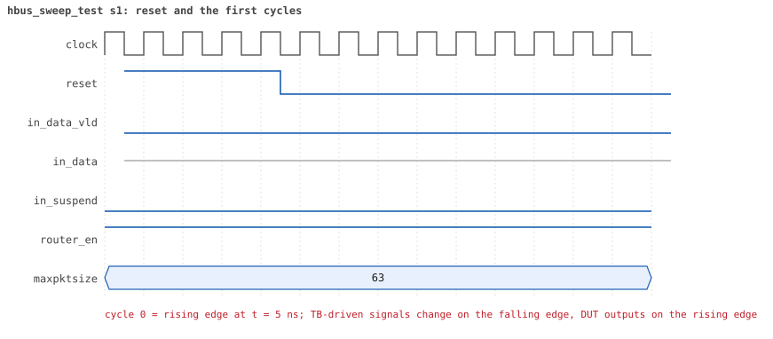
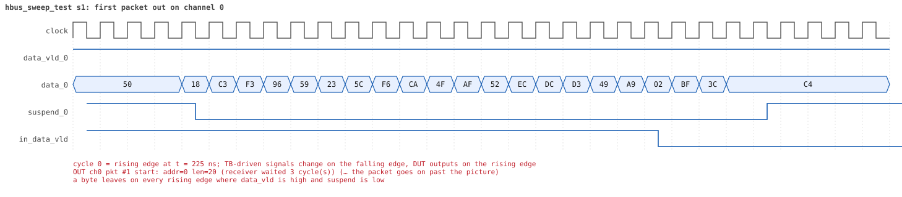
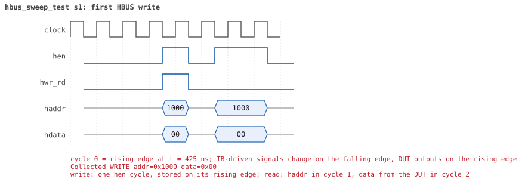
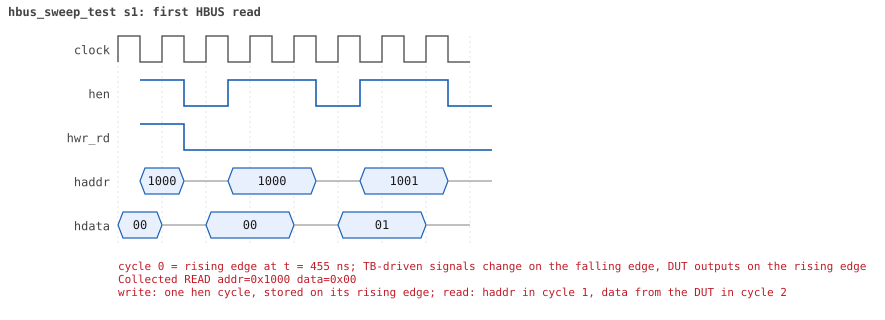

# hbus_sweep_test

<!-- generated by scripts/project_map/build.py from yapp_project/regression/runs.json -- run the regression, `make sim-report ONLY=yapp_project OUT=yapp_project/regression`, then `make map`; do not edit this file -->

[Back to the regression results →](index.md){ .pm-link } [On the project map →](../project-map.md#view=plan&node=cls:hbus_sweep_test){ .pm-link }

**4 of 4 seeds passed** · lab: test plan · extends `base_test` · 197 coverage bins hit, 4 only by this test.

Test plan: the HBUS side of the coverage -- every address of the router read and written, checked against the reference model, until the four HBUS collectors reach 100 %.

## Seeds

| Seed | Result | Sim time | Wall | In / fwd / drop | Out ch0/1/2 | Suspends | Errors | Log | Timeline | Waves |
|---|---|---|---|---|---|---|---|---|---|---|
| 1 | pass | 314us | 119.5 s | 1021 / 1 / 1020 | 1/0/0 | 0 | 0 | [log ↗](https://github.com/tamirgabgab/Qcom-Mentoring/blob/main/yapp_project/regression/yapp_project_tb/hbus_sweep_test_s1/hbus_sweep_test_s1.log) | [timeline ↗](https://github.com/tamirgabgab/Qcom-Mentoring/blob/main/yapp_project/regression/yapp_project_tb/hbus_sweep_test_s1/timeline.md) | [Surfer ↗](https://app.surfer-project.org/?load_url=https%3A%2F%2Fraw.githubusercontent.com%2Ftamirgabgab%2FQcom-Mentoring%2Fmain%2Fyapp_project%2Fregression%2Fyapp_project_tb%2Fhbus_sweep_test_s1%2Fhbus_sweep_test_s1.fst&startup_commands=run_command_file_from_url%20https%3A%2F%2Fraw.githubusercontent.com%2Ftamirgabgab%2FQcom-Mentoring%2Fmain%2Fyapp_project%2Ftb%2Fyapp_router.sucl) [.fst](https://github.com/tamirgabgab/Qcom-Mentoring/blob/main/yapp_project/regression/yapp_project_tb/hbus_sweep_test_s1/hbus_sweep_test_s1.fst) |
| 2 | pass | 314us | 116.4 s | 1021 / 1 / 1020 | 1/0/0 | 0 | 0 | [log ↗](https://github.com/tamirgabgab/Qcom-Mentoring/blob/main/yapp_project/regression/yapp_project_tb/hbus_sweep_test_s2/hbus_sweep_test_s2.log) | [timeline ↗](https://github.com/tamirgabgab/Qcom-Mentoring/blob/main/yapp_project/regression/yapp_project_tb/hbus_sweep_test_s2/timeline.md) | [Surfer ↗](https://app.surfer-project.org/?load_url=https%3A%2F%2Fraw.githubusercontent.com%2Ftamirgabgab%2FQcom-Mentoring%2Fmain%2Fyapp_project%2Fregression%2Fyapp_project_tb%2Fhbus_sweep_test_s2%2Fhbus_sweep_test_s2.fst&startup_commands=run_command_file_from_url%20https%3A%2F%2Fraw.githubusercontent.com%2Ftamirgabgab%2FQcom-Mentoring%2Fmain%2Fyapp_project%2Ftb%2Fyapp_router.sucl) [.fst](https://github.com/tamirgabgab/Qcom-Mentoring/blob/main/yapp_project/regression/yapp_project_tb/hbus_sweep_test_s2/hbus_sweep_test_s2.fst) |
| 3 | pass | 319us | 117.3 s | 1021 / 1 / 1020 | 1/0/0 | 0 | 0 | [log ↗](https://github.com/tamirgabgab/Qcom-Mentoring/blob/main/yapp_project/regression/yapp_project_tb/hbus_sweep_test_s3/hbus_sweep_test_s3.log) | [timeline ↗](https://github.com/tamirgabgab/Qcom-Mentoring/blob/main/yapp_project/regression/yapp_project_tb/hbus_sweep_test_s3/timeline.md) | [Surfer ↗](https://app.surfer-project.org/?load_url=https%3A%2F%2Fraw.githubusercontent.com%2Ftamirgabgab%2FQcom-Mentoring%2Fmain%2Fyapp_project%2Fregression%2Fyapp_project_tb%2Fhbus_sweep_test_s3%2Fhbus_sweep_test_s3.fst&startup_commands=run_command_file_from_url%20https%3A%2F%2Fraw.githubusercontent.com%2Ftamirgabgab%2FQcom-Mentoring%2Fmain%2Fyapp_project%2Ftb%2Fyapp_router.sucl) [.fst](https://github.com/tamirgabgab/Qcom-Mentoring/blob/main/yapp_project/regression/yapp_project_tb/hbus_sweep_test_s3/hbus_sweep_test_s3.fst) |
| 4 | pass | 315us | 108.6 s | 1021 / 1 / 1020 | 1/0/0 | 0 | 0 | [log ↗](https://github.com/tamirgabgab/Qcom-Mentoring/blob/main/yapp_project/regression/yapp_project_tb/hbus_sweep_test_s4/hbus_sweep_test_s4.log) | [timeline ↗](https://github.com/tamirgabgab/Qcom-Mentoring/blob/main/yapp_project/regression/yapp_project_tb/hbus_sweep_test_s4/timeline.md) | [Surfer ↗](https://app.surfer-project.org/?load_url=https%3A%2F%2Fraw.githubusercontent.com%2Ftamirgabgab%2FQcom-Mentoring%2Fmain%2Fyapp_project%2Fregression%2Fyapp_project_tb%2Fhbus_sweep_test_s4%2Fhbus_sweep_test_s4.fst&startup_commands=run_command_file_from_url%20https%3A%2F%2Fraw.githubusercontent.com%2Ftamirgabgab%2FQcom-Mentoring%2Fmain%2Fyapp_project%2Ftb%2Fyapp_router.sucl) [.fst](https://github.com/tamirgabgab/Qcom-Mentoring/blob/main/yapp_project/regression/yapp_project_tb/hbus_sweep_test_s4/hbus_sweep_test_s4.fst) |

## The plan of the test

1. **check_reads = 1** — router_reference compares every HBUS read with its model
2. **1 packet** — 20 bytes to address 0, so yapp_pkt_mem holds known bytes
3. **0x1000..0x100f** — registers and holes: write 0x00 / 0xff / 0x55 / 0xaa, read the whole window back after each write
4. **walking bits** — ctrl_reg and en_reg: walking one and walking zero
5. **yapp_pkt_mem** — every byte written (read-only): the reads still return the packet
6. **0x1050..0x10ff** — edges and 6 addresses in between: writes ignored, reads 0
7. **yapp_mem** — every byte written and read back with 0x00, 0xff, 0x55, 0xaa and a random value
8. **1020 packets** — maxpktsize = 1, 2-byte packets with bad parity (dropped); en_reg 0x17 / 0x21 / 0x41 / 0x81, 255 to each address
9. **counters** — the six counters read before, after 100 and after 255 packets: 0, in between, 255
10. **coverage** — hbus_addr_cg, hbus_bits_cg, hbus_data_cg, hbus_counter_cg all at 100 %

Expected:

- `STAGE: done: 3585 HBUS reads checked against the model, 0 mismatches`; `HBUS address map coverage 100%` and likewise for the bits, the data patterns and the counter values.

## Test plan items this test verifies

- [REG-05](../test-plan.md#reg---registers) — Unmapped addresses read 0x00 and ignore writes (covered)
- [CNT-06](../test-plan.md#cnt---counters) — Counter overflow after 255 packets (covered)
- [MEM-02](../test-plan.md#mem---memories) — yapp_pkt_mem is read-only (covered)
- [COV-04](../test-plan.md#cov---functional-coverage) — HBUS: every address of the router read and written (covered)
- [COV-05](../test-plan.md#cov---functional-coverage) — HBUS: every bit of ctrl_reg and en_reg written as 0 and as 1 (covered)
- [COV-06](../test-plan.md#cov---functional-coverage) — HBUS: data patterns in yapp_mem (covered)
- [COV-07](../test-plan.md#cov---functional-coverage) — HBUS: every counter read at 0, in between and at 255 (covered)

## Seed 1: what happened

- YAPP driver quiet in this test (verbosity UVM_NONE); the input monitor saw **1021** packet(s).
- Router: **1** forwarded, **1020** dropped (1020 oversized).
- Packets out: ch0 **1**, ch1 **0**, ch2 **0**.
- Scoreboard: 1 matched, 0 mismatched, 0 unexpected.
- Back-pressure: in_suspend asserted **0** time(s).
- Error pulses: 1020.
- HBUS: 1459 write(s), 3628 read(s).

### Stages

| time (ns) | stage |
|---|---|
| 0 | 1. one 20-byte packet to address 0, so yapp_pkt_mem holds known bytes |
| 440 | 2. every address 0x1000..0x100f, registers and holes: write 0x00, 0xff, 0x55, 0xaa, read the window back |
| 32480 | 3. ctrl_reg and en_reg: walking one and walking zero |
| 34120 | 4. yapp_pkt_mem (read-only): write every byte, the reads still return the packet |
| 68040 | 5. the unmapped range 0x1050..0x10ff: the edges and 6 addresses in between, write and read 0 |
| 72280 | 6. yapp_mem: every byte written and read back with 0x00, 0xff, 0x55, 0xaa and a random value |
| 136280 | 7. the counters at 0, in between and at 255: maxpktsize = 1, 2-byte packets with bad parity |
| 136480 | 7.1 en_reg = 0x17: 255 packets to address 0, counters read after 100 and after 255 |
| 181870 | 7.2 en_reg = 0x21: 255 packets to address 1, counters read after 100 and after 255 |
| 225370 | 7.3 en_reg = 0x41: 255 packets to address 2, counters read after 100 and after 255 |
| 269320 | 7.4 en_reg = 0x81: 255 packets to address 3, counters read after 100 and after 255 |
| 313270 | 8. ctrl_reg and en_reg back to their reset values, every register read |
| 313730 | sweep done: 1021 packets, 3628 HBUS reads |
| 314225 | 9. the four HBUS coverage collectors are at 100 % and every read matched the model |
| 314225 | done: 3585 HBUS reads checked against the model, 0 mismatches, 43 memory bytes never written |

### Pictures

The moments the report draws from the signal trace of this run (the same pictures are in the run's folder of the report).

**reset and the first cycles**

**first packet into the router**

**first packet out on channel 0**

**first error pulse after a bad-parity packet**

**first HBUS write**

**first HBUS read**

Run it yourself: `make sim TEST=hbus_sweep_test SEED=1 WAVES=1` in `yapp_project/tb`, or `make run-project TEST=hbus_sweep_test` with Xcelium.
