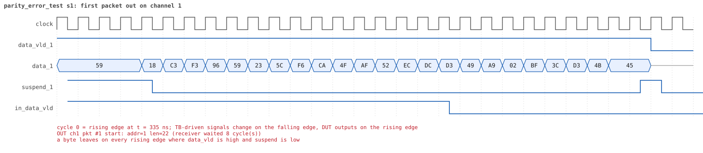
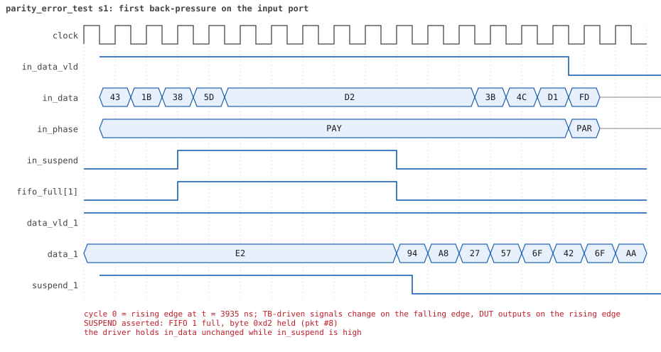
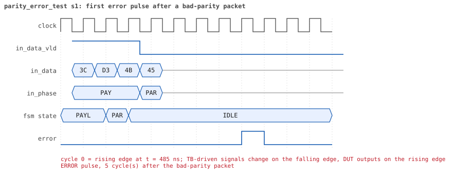
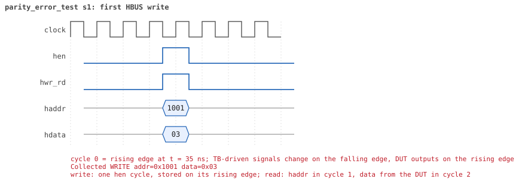

# parity_error_test

<!-- generated by scripts/project_map/build.py from yapp_project/regression/runs.json -- run the regression, `make sim-report ONLY=yapp_project OUT=yapp_project/regression`, then `make map`; do not edit this file -->

[Back to the regression results →](index.md){ .pm-link } [On the project map →](../project-map.md#view=plan&node=cls:parity_error_test){ .pm-link }

**4 of 4 seeds passed** · lab: test plan · extends `reg_function_test` · 60 coverage bins hit.

Test plan: what a wrong parity byte does -- the counter counts it (when enabled), error pulses 1..10 cycles later, and the packet is still delivered.

## Seeds

| Seed | Result | Sim time | Wall | In / fwd / drop | Out ch0/1/2 | Suspends | Errors | Log | Timeline | Waves |
|---|---|---|---|---|---|---|---|---|---|---|
| 1 | pass | 7us | 0.8 s | 12 / 12 / 0 | 2/3/7 | 1 | 0 | [log ↗](https://github.com/tamirgabgab/Qcom-Mentoring/blob/main/yapp_project/regression/yapp_project_tb/parity_error_test_s1/parity_error_test_s1.log) | [timeline ↗](https://github.com/tamirgabgab/Qcom-Mentoring/blob/main/yapp_project/regression/yapp_project_tb/parity_error_test_s1/timeline.md) | [Surfer ↗](https://app.surfer-project.org/?load_url=https%3A%2F%2Fraw.githubusercontent.com%2Ftamirgabgab%2FQcom-Mentoring%2Fmain%2Fyapp_project%2Fregression%2Fyapp_project_tb%2Fparity_error_test_s1%2Fparity_error_test_s1.fst&startup_commands=run_command_file_from_url%20https%3A%2F%2Fraw.githubusercontent.com%2Ftamirgabgab%2FQcom-Mentoring%2Fmain%2Fyapp_project%2Ftb%2Fyapp_router.sucl) [.fst](https://github.com/tamirgabgab/Qcom-Mentoring/blob/main/yapp_project/regression/yapp_project_tb/parity_error_test_s1/parity_error_test_s1.fst) |
| 2 | pass | 7us | 0.8 s | 12 / 12 / 0 | 1/8/3 | 1 | 0 | [log ↗](https://github.com/tamirgabgab/Qcom-Mentoring/blob/main/yapp_project/regression/yapp_project_tb/parity_error_test_s2/parity_error_test_s2.log) | [timeline ↗](https://github.com/tamirgabgab/Qcom-Mentoring/blob/main/yapp_project/regression/yapp_project_tb/parity_error_test_s2/timeline.md) | [Surfer ↗](https://app.surfer-project.org/?load_url=https%3A%2F%2Fraw.githubusercontent.com%2Ftamirgabgab%2FQcom-Mentoring%2Fmain%2Fyapp_project%2Fregression%2Fyapp_project_tb%2Fparity_error_test_s2%2Fparity_error_test_s2.fst&startup_commands=run_command_file_from_url%20https%3A%2F%2Fraw.githubusercontent.com%2Ftamirgabgab%2FQcom-Mentoring%2Fmain%2Fyapp_project%2Ftb%2Fyapp_router.sucl) [.fst](https://github.com/tamirgabgab/Qcom-Mentoring/blob/main/yapp_project/regression/yapp_project_tb/parity_error_test_s2/parity_error_test_s2.fst) |
| 3 | pass | 7us | 0.8 s | 12 / 12 / 0 | 2/1/9 | 2 | 0 | [log ↗](https://github.com/tamirgabgab/Qcom-Mentoring/blob/main/yapp_project/regression/yapp_project_tb/parity_error_test_s3/parity_error_test_s3.log) | [timeline ↗](https://github.com/tamirgabgab/Qcom-Mentoring/blob/main/yapp_project/regression/yapp_project_tb/parity_error_test_s3/timeline.md) | [Surfer ↗](https://app.surfer-project.org/?load_url=https%3A%2F%2Fraw.githubusercontent.com%2Ftamirgabgab%2FQcom-Mentoring%2Fmain%2Fyapp_project%2Fregression%2Fyapp_project_tb%2Fparity_error_test_s3%2Fparity_error_test_s3.fst&startup_commands=run_command_file_from_url%20https%3A%2F%2Fraw.githubusercontent.com%2Ftamirgabgab%2FQcom-Mentoring%2Fmain%2Fyapp_project%2Ftb%2Fyapp_router.sucl) [.fst](https://github.com/tamirgabgab/Qcom-Mentoring/blob/main/yapp_project/regression/yapp_project_tb/parity_error_test_s3/parity_error_test_s3.fst) |
| 4 | pass | 8us | 0.9 s | 12 / 12 / 0 | 8/2/2 | 2 | 0 | [log ↗](https://github.com/tamirgabgab/Qcom-Mentoring/blob/main/yapp_project/regression/yapp_project_tb/parity_error_test_s4/parity_error_test_s4.log) | [timeline ↗](https://github.com/tamirgabgab/Qcom-Mentoring/blob/main/yapp_project/regression/yapp_project_tb/parity_error_test_s4/timeline.md) | [Surfer ↗](https://app.surfer-project.org/?load_url=https%3A%2F%2Fraw.githubusercontent.com%2Ftamirgabgab%2FQcom-Mentoring%2Fmain%2Fyapp_project%2Fregression%2Fyapp_project_tb%2Fparity_error_test_s4%2Fparity_error_test_s4.fst&startup_commands=run_command_file_from_url%20https%3A%2F%2Fraw.githubusercontent.com%2Ftamirgabgab%2FQcom-Mentoring%2Fmain%2Fyapp_project%2Ftb%2Fyapp_router.sucl) [.fst](https://github.com/tamirgabgab/Qcom-Mentoring/blob/main/yapp_project/regression/yapp_project_tb/parity_error_test_s4/parity_error_test_s4.fst) |

## The plan of the test

1. **error_pulse_checker** — a subscriber of the YAPP monitor that times every error pulse against the last bad packet
2. **en_reg = 0x03** — router on, parity counter on
3. **8 bad packets** — yapp_pkt_seq with m_pkt_parity == PARITY_TYPE_BAD, random address and length
4. **count and pulses** — parity_err_cnt_reg == 8; 8 pulses, each 1..10 cycles after its packet; scoreboard matched 8
5. **en_reg = 0x01** — parity counter off
6. **4 bad packets** — same sequence
7. **frozen count** — counter still 8; 12 pulses in total, none outside the window

Expected:

- `error pulse K cycles after the bad packet` twelve times with K in 1..10; `parity_err_cnt_reg reads 8 as expected` twice.
- The channel monitors print the packets with `parity_type CHANNEL_PARITY_TYPE_BAD` -- the router forwards them; `UVM_ERROR : 0`.

## Test plan items this test verifies

- [PKT-05](../test-plan.md#pkt---packet-format) — A wrong parity byte is detected -- and the packet still delivered (covered)
- [IN-04](../test-plan.md#in---input-port-protocol) — error asserts 1 to 10 cycles after a bad-parity packet (covered)
- [CNT-01](../test-plan.md#cnt---counters) — A counter counts only while its enable bit is set (covered)
- [CNT-03](../test-plan.md#cnt---counters) — parity_err_cnt_reg counts the bad-parity packets (covered)

## Seed 1: what happened

- YAPP driver sent **12** packet(s) (12 with bad parity); the input monitor saw 12.
- Router: **12** forwarded, **0** dropped.
- Packets out: ch0 **2**, ch1 **3**, ch2 **7**.
- Scoreboard: 12 matched, 0 mismatched, 0 unexpected.
- Back-pressure: in_suspend asserted **1** time(s), longest hold 7 cycle(s).
- Error pulses: 12.
- HBUS: 2 write(s), 2 read(s).

### Stages

| time (ns) | stage |
|---|---|
| 0 | 1. en_reg=0x03 (parity counter on): 8 bad-parity packets, 8 pulses, counter 8, all delivered |
| 4380 | 2. en_reg=0x01 (counter off): 4 more bad packets, pulses still come, counter stays 8 |

### Pictures

The moments the report draws from the signal trace of this run (the same pictures are in the run's folder of the report).

**reset and the first cycles**

**first packet into the router**

**first packet out on channel 1**

**first back-pressure on the input port**

**first error pulse after a bad-parity packet**

**first HBUS write**

**first HBUS read**

Run it yourself: `make sim TEST=parity_error_test SEED=1 WAVES=1` in `yapp_project/tb`, or `make run-project TEST=parity_error_test` with Xcelium.
