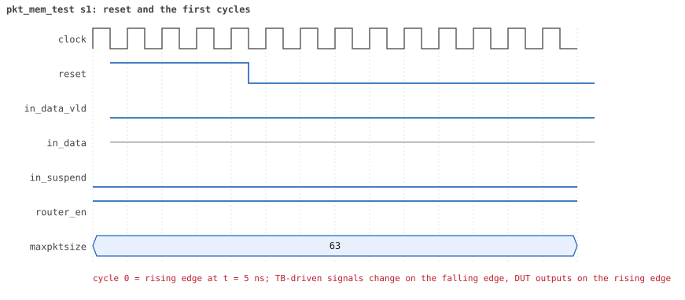

# pkt_mem_test

<!-- generated by scripts/project_map/build.py from yapp_project/regression/runs.json -- run the regression, `make sim-report ONLY=yapp_project OUT=yapp_project/regression`, then `make map`; do not edit this file -->

[Back to the regression results →](index.md){ .pm-link } [On the project map →](../project-map.md#view=plan&node=cls:pkt_mem_test){ .pm-link }

**4 of 4 seeds passed** · lab: test plan · extends `reg_function_test` · 52 coverage bins hit.

Test plan: the packet memory and mem_size_reg hold the last packet, byte by byte, even when the packet was dropped.

## Seeds

| Seed | Result | Sim time | Wall | In / fwd / drop | Out ch0/1/2 | Suspends | Errors | Log | Timeline | Waves |
|---|---|---|---|---|---|---|---|---|---|---|
| 1 | pass | 2us | 0.3 s | 2 / 1 / 1 | 0/1/0 | 0 | 0 | [log ↗](https://github.com/tamirgabgab/Qcom-Mentoring/blob/main/yapp_project/regression/yapp_project_tb/pkt_mem_test_s1/pkt_mem_test_s1.log) | [timeline ↗](https://github.com/tamirgabgab/Qcom-Mentoring/blob/main/yapp_project/regression/yapp_project_tb/pkt_mem_test_s1/timeline.md) | [Surfer ↗](https://app.surfer-project.org/?load_url=https%3A%2F%2Fraw.githubusercontent.com%2Ftamirgabgab%2FQcom-Mentoring%2Fmain%2Fyapp_project%2Fregression%2Fyapp_project_tb%2Fpkt_mem_test_s1%2Fpkt_mem_test_s1.fst&startup_commands=run_command_file_from_url%20https%3A%2F%2Fraw.githubusercontent.com%2Ftamirgabgab%2FQcom-Mentoring%2Fmain%2Fyapp_project%2Ftb%2Fyapp_router.sucl) [.fst](https://github.com/tamirgabgab/Qcom-Mentoring/blob/main/yapp_project/regression/yapp_project_tb/pkt_mem_test_s1/pkt_mem_test_s1.fst) |
| 2 | pass | 2us | 0.4 s | 2 / 1 / 1 | 0/1/0 | 0 | 0 | [log ↗](https://github.com/tamirgabgab/Qcom-Mentoring/blob/main/yapp_project/regression/yapp_project_tb/pkt_mem_test_s2/pkt_mem_test_s2.log) | [timeline ↗](https://github.com/tamirgabgab/Qcom-Mentoring/blob/main/yapp_project/regression/yapp_project_tb/pkt_mem_test_s2/timeline.md) | [Surfer ↗](https://app.surfer-project.org/?load_url=https%3A%2F%2Fraw.githubusercontent.com%2Ftamirgabgab%2FQcom-Mentoring%2Fmain%2Fyapp_project%2Fregression%2Fyapp_project_tb%2Fpkt_mem_test_s2%2Fpkt_mem_test_s2.fst&startup_commands=run_command_file_from_url%20https%3A%2F%2Fraw.githubusercontent.com%2Ftamirgabgab%2FQcom-Mentoring%2Fmain%2Fyapp_project%2Ftb%2Fyapp_router.sucl) [.fst](https://github.com/tamirgabgab/Qcom-Mentoring/blob/main/yapp_project/regression/yapp_project_tb/pkt_mem_test_s2/pkt_mem_test_s2.fst) |
| 3 | pass | 2us | 0.4 s | 2 / 1 / 1 | 0/1/0 | 0 | 0 | [log ↗](https://github.com/tamirgabgab/Qcom-Mentoring/blob/main/yapp_project/regression/yapp_project_tb/pkt_mem_test_s3/pkt_mem_test_s3.log) | [timeline ↗](https://github.com/tamirgabgab/Qcom-Mentoring/blob/main/yapp_project/regression/yapp_project_tb/pkt_mem_test_s3/timeline.md) | [Surfer ↗](https://app.surfer-project.org/?load_url=https%3A%2F%2Fraw.githubusercontent.com%2Ftamirgabgab%2FQcom-Mentoring%2Fmain%2Fyapp_project%2Fregression%2Fyapp_project_tb%2Fpkt_mem_test_s3%2Fpkt_mem_test_s3.fst&startup_commands=run_command_file_from_url%20https%3A%2F%2Fraw.githubusercontent.com%2Ftamirgabgab%2FQcom-Mentoring%2Fmain%2Fyapp_project%2Ftb%2Fyapp_router.sucl) [.fst](https://github.com/tamirgabgab/Qcom-Mentoring/blob/main/yapp_project/regression/yapp_project_tb/pkt_mem_test_s3/pkt_mem_test_s3.fst) |
| 4 | pass | 2us | 0.4 s | 2 / 1 / 1 | 0/1/0 | 0 | 0 | [log ↗](https://github.com/tamirgabgab/Qcom-Mentoring/blob/main/yapp_project/regression/yapp_project_tb/pkt_mem_test_s4/pkt_mem_test_s4.log) | [timeline ↗](https://github.com/tamirgabgab/Qcom-Mentoring/blob/main/yapp_project/regression/yapp_project_tb/pkt_mem_test_s4/timeline.md) | [Surfer ↗](https://app.surfer-project.org/?load_url=https%3A%2F%2Fraw.githubusercontent.com%2Ftamirgabgab%2FQcom-Mentoring%2Fmain%2Fyapp_project%2Fregression%2Fyapp_project_tb%2Fpkt_mem_test_s4%2Fpkt_mem_test_s4.fst&startup_commands=run_command_file_from_url%20https%3A%2F%2Fraw.githubusercontent.com%2Ftamirgabgab%2FQcom-Mentoring%2Fmain%2Fyapp_project%2Ftb%2Fyapp_router.sucl) [.fst](https://github.com/tamirgabgab/Qcom-Mentoring/blob/main/yapp_project/regression/yapp_project_tb/pkt_mem_test_s4/pkt_mem_test_s4.fst) |

## The plan of the test

1. **one packet** — yapp_pkt_seq: address 1, 20 payload bytes, good parity
2. **mem_size_reg == 20** — front-door read through the register model
3. **yapp_pkt_mem** — [0] == header {length, addr}, [1..20] == the payload the sequence left in req
4. **write to 0x1010** — a raw hbus_write_seq to the packet memory
5. **read-only** — yapp_pkt_mem[0] still holds the header
6. **maxpktsize = 5** — ctrl_reg = 5
7. **9-byte packet** — dropped as oversized
8. **still stored** — mem_size_reg == 9 and the bytes are there (a received packet is stored, forwarded or not)

Expected:

- `packet (addr 1, length 20) stored byte by byte`, `write to yapp_pkt_mem ignored, as it should be`, then `ROUTER DROPS PACKET addr=2 length=9` followed by `packet (addr 2, length 9) stored byte by byte`.
- 22 reads of 0x1010..0x1025 in the HBUS monitor log for the first packet; `UVM_ERROR : 0`.

## Test plan items this test verifies

- [IN-02](../test-plan.md#in---input-port-protocol) — in_data_vld is low with the parity byte (covered)
- [REG-06](../test-plan.md#reg---registers) — mem_size_reg holds the payload length of the last packet (covered)
- [MEM-01](../test-plan.md#mem---memories) — yapp_pkt_mem holds the last packet, byte by byte (covered)
- [MEM-02](../test-plan.md#mem---memories) — yapp_pkt_mem is read-only (covered)
- [MEM-03](../test-plan.md#mem---memories) — A dropped packet is still stored (covered)

## Seed 1: what happened

- YAPP driver sent **2** packet(s) (0 with bad parity); the input monitor saw 2.
- Router: **1** forwarded, **1** dropped (1 oversized).
- Packets out: ch0 **0**, ch1 **1**, ch2 **0**.
- Scoreboard: 1 matched, 0 mismatched, 0 unexpected.
- Back-pressure: in_suspend asserted **0** time(s).
- Error pulses: 0.
- HBUS: 3 write(s), 34 read(s).

### Stages

| time (ns) | stage |
|---|---|
| 0 | 1. one packet (addr 1, 20 bytes): mem_size_reg and yapp_pkt_mem hold it byte by byte |
| 1140 | 2. a raw HBUS write to yapp_pkt_mem[0] is ignored (read-only memory) |
| 1190 | 3. ctrl_reg=5, then a 9-byte packet: dropped as oversized but still stored |

### Pictures

The moments the report draws from the signal trace of this run (the same pictures are in the run's folder of the report).

**reset and the first cycles**

**first packet into the router**

**first packet out on channel 1**

**first HBUS write**

**first HBUS read**

Run it yourself: `make sim TEST=pkt_mem_test SEED=1 WAVES=1` in `yapp_project/tb`, or `make run-project TEST=pkt_mem_test` with Xcelium.
