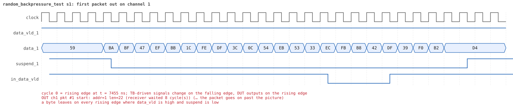
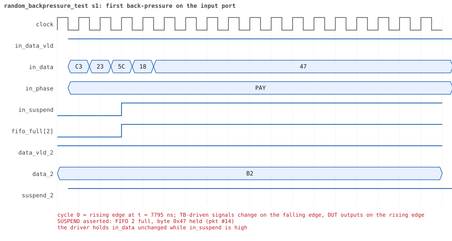
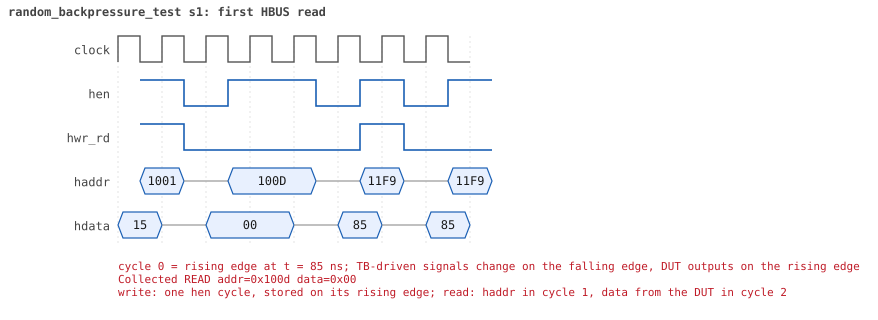

# random_backpressure_test

<!-- generated by scripts/project_map/build.py from yapp_project/regression/runs.json -- run the regression, `make sim-report ONLY=yapp_project OUT=yapp_project/regression`, then `make map`; do not edit this file -->

[Back to the regression results →](index.md){ .pm-link } [On the project map →](../project-map.md#view=plan&node=cls:random_backpressure_test){ .pm-link }

**8 of 8 seeds passed** · lab: test plan · extends `random_test` · 159 coverage bins hit.

Random tests: back-pressure on a random mix of channels -- slow and stalling receivers against long packets sent back to back.

## Seeds

| Seed | Result | Sim time | Wall | In / fwd / drop | Out ch0/1/2 | Suspends | Errors | Log | Timeline | Waves |
|---|---|---|---|---|---|---|---|---|---|---|
| 1 | pass | 18us | 8.2 s | 25 / 8 / 17 | 2/1/5 | 8 | 0 | [log ↗](https://github.com/tamirgabgab/Qcom-Mentoring/blob/main/yapp_project/regression/yapp_project_tb/random_backpressure_test_s1/random_backpressure_test_s1.log) | [timeline ↗](https://github.com/tamirgabgab/Qcom-Mentoring/blob/main/yapp_project/regression/yapp_project_tb/random_backpressure_test_s1/timeline.md) | [Surfer ↗](https://app.surfer-project.org/?load_url=https%3A%2F%2Fraw.githubusercontent.com%2Ftamirgabgab%2FQcom-Mentoring%2Fmain%2Fyapp_project%2Fregression%2Fyapp_project_tb%2Frandom_backpressure_test_s1%2Frandom_backpressure_test_s1.fst&startup_commands=run_command_file_from_url%20https%3A%2F%2Fraw.githubusercontent.com%2Ftamirgabgab%2FQcom-Mentoring%2Fmain%2Fyapp_project%2Ftb%2Fyapp_router.sucl) [.fst](https://github.com/tamirgabgab/Qcom-Mentoring/blob/main/yapp_project/regression/yapp_project_tb/random_backpressure_test_s1/random_backpressure_test_s1.fst) |
| 2 | pass | 44us | 17.4 s | 83 / 25 / 58 | 5/7/13 | 17 | 0 | [log ↗](https://github.com/tamirgabgab/Qcom-Mentoring/blob/main/yapp_project/regression/yapp_project_tb/random_backpressure_test_s2/random_backpressure_test_s2.log) | [timeline ↗](https://github.com/tamirgabgab/Qcom-Mentoring/blob/main/yapp_project/regression/yapp_project_tb/random_backpressure_test_s2/timeline.md) | [Surfer ↗](https://app.surfer-project.org/?load_url=https%3A%2F%2Fraw.githubusercontent.com%2Ftamirgabgab%2FQcom-Mentoring%2Fmain%2Fyapp_project%2Fregression%2Fyapp_project_tb%2Frandom_backpressure_test_s2%2Frandom_backpressure_test_s2.fst&startup_commands=run_command_file_from_url%20https%3A%2F%2Fraw.githubusercontent.com%2Ftamirgabgab%2FQcom-Mentoring%2Fmain%2Fyapp_project%2Ftb%2Fyapp_router.sucl) [.fst](https://github.com/tamirgabgab/Qcom-Mentoring/blob/main/yapp_project/regression/yapp_project_tb/random_backpressure_test_s2/random_backpressure_test_s2.fst) |
| 3 | pass | 13us | 6.6 s | 23 / 5 / 18 | 2/0/3 | 0 | 0 | [log ↗](https://github.com/tamirgabgab/Qcom-Mentoring/blob/main/yapp_project/regression/yapp_project_tb/random_backpressure_test_s3/random_backpressure_test_s3.log) | [timeline ↗](https://github.com/tamirgabgab/Qcom-Mentoring/blob/main/yapp_project/regression/yapp_project_tb/random_backpressure_test_s3/timeline.md) | [Surfer ↗](https://app.surfer-project.org/?load_url=https%3A%2F%2Fraw.githubusercontent.com%2Ftamirgabgab%2FQcom-Mentoring%2Fmain%2Fyapp_project%2Fregression%2Fyapp_project_tb%2Frandom_backpressure_test_s3%2Frandom_backpressure_test_s3.fst&startup_commands=run_command_file_from_url%20https%3A%2F%2Fraw.githubusercontent.com%2Ftamirgabgab%2FQcom-Mentoring%2Fmain%2Fyapp_project%2Ftb%2Fyapp_router.sucl) [.fst](https://github.com/tamirgabgab/Qcom-Mentoring/blob/main/yapp_project/regression/yapp_project_tb/random_backpressure_test_s3/random_backpressure_test_s3.fst) |
| 4 | pass | 17us | 7.6 s | 31 / 2 / 29 | 0/1/1 | 0 | 0 | [log ↗](https://github.com/tamirgabgab/Qcom-Mentoring/blob/main/yapp_project/regression/yapp_project_tb/random_backpressure_test_s4/random_backpressure_test_s4.log) | [timeline ↗](https://github.com/tamirgabgab/Qcom-Mentoring/blob/main/yapp_project/regression/yapp_project_tb/random_backpressure_test_s4/timeline.md) | [Surfer ↗](https://app.surfer-project.org/?load_url=https%3A%2F%2Fraw.githubusercontent.com%2Ftamirgabgab%2FQcom-Mentoring%2Fmain%2Fyapp_project%2Fregression%2Fyapp_project_tb%2Frandom_backpressure_test_s4%2Frandom_backpressure_test_s4.fst&startup_commands=run_command_file_from_url%20https%3A%2F%2Fraw.githubusercontent.com%2Ftamirgabgab%2FQcom-Mentoring%2Fmain%2Fyapp_project%2Ftb%2Fyapp_router.sucl) [.fst](https://github.com/tamirgabgab/Qcom-Mentoring/blob/main/yapp_project/regression/yapp_project_tb/random_backpressure_test_s4/random_backpressure_test_s4.fst) |
| 5 | pass | 40us | 17.9 s | 85 / 46 / 39 | 12/10/24 | 4 | 0 | [log ↗](https://github.com/tamirgabgab/Qcom-Mentoring/blob/main/yapp_project/regression/yapp_project_tb/random_backpressure_test_s5/random_backpressure_test_s5.log) | [timeline ↗](https://github.com/tamirgabgab/Qcom-Mentoring/blob/main/yapp_project/regression/yapp_project_tb/random_backpressure_test_s5/timeline.md) | [Surfer ↗](https://app.surfer-project.org/?load_url=https%3A%2F%2Fraw.githubusercontent.com%2Ftamirgabgab%2FQcom-Mentoring%2Fmain%2Fyapp_project%2Fregression%2Fyapp_project_tb%2Frandom_backpressure_test_s5%2Frandom_backpressure_test_s5.fst&startup_commands=run_command_file_from_url%20https%3A%2F%2Fraw.githubusercontent.com%2Ftamirgabgab%2FQcom-Mentoring%2Fmain%2Fyapp_project%2Ftb%2Fyapp_router.sucl) [.fst](https://github.com/tamirgabgab/Qcom-Mentoring/blob/main/yapp_project/regression/yapp_project_tb/random_backpressure_test_s5/random_backpressure_test_s5.fst) |
| 6 | pass | 19us | 6.6 s | 30 / 12 / 18 | 1/1/10 | 9 | 0 | [log ↗](https://github.com/tamirgabgab/Qcom-Mentoring/blob/main/yapp_project/regression/yapp_project_tb/random_backpressure_test_s6/random_backpressure_test_s6.log) | [timeline ↗](https://github.com/tamirgabgab/Qcom-Mentoring/blob/main/yapp_project/regression/yapp_project_tb/random_backpressure_test_s6/timeline.md) | [Surfer ↗](https://app.surfer-project.org/?load_url=https%3A%2F%2Fraw.githubusercontent.com%2Ftamirgabgab%2FQcom-Mentoring%2Fmain%2Fyapp_project%2Fregression%2Fyapp_project_tb%2Frandom_backpressure_test_s6%2Frandom_backpressure_test_s6.fst&startup_commands=run_command_file_from_url%20https%3A%2F%2Fraw.githubusercontent.com%2Ftamirgabgab%2FQcom-Mentoring%2Fmain%2Fyapp_project%2Ftb%2Fyapp_router.sucl) [.fst](https://github.com/tamirgabgab/Qcom-Mentoring/blob/main/yapp_project/regression/yapp_project_tb/random_backpressure_test_s6/random_backpressure_test_s6.fst) |
| 7 | pass | 13us | 6.8 s | 18 / 3 / 15 | 0/0/3 | 0 | 0 | [log ↗](https://github.com/tamirgabgab/Qcom-Mentoring/blob/main/yapp_project/regression/yapp_project_tb/random_backpressure_test_s7/random_backpressure_test_s7.log) | [timeline ↗](https://github.com/tamirgabgab/Qcom-Mentoring/blob/main/yapp_project/regression/yapp_project_tb/random_backpressure_test_s7/timeline.md) | [Surfer ↗](https://app.surfer-project.org/?load_url=https%3A%2F%2Fraw.githubusercontent.com%2Ftamirgabgab%2FQcom-Mentoring%2Fmain%2Fyapp_project%2Fregression%2Fyapp_project_tb%2Frandom_backpressure_test_s7%2Frandom_backpressure_test_s7.fst&startup_commands=run_command_file_from_url%20https%3A%2F%2Fraw.githubusercontent.com%2Ftamirgabgab%2FQcom-Mentoring%2Fmain%2Fyapp_project%2Ftb%2Fyapp_router.sucl) [.fst](https://github.com/tamirgabgab/Qcom-Mentoring/blob/main/yapp_project/regression/yapp_project_tb/random_backpressure_test_s7/random_backpressure_test_s7.fst) |
| 8 | pass | 37us | 13.1 s | 75 / 17 / 58 | 1/7/9 | 2 | 0 | [log ↗](https://github.com/tamirgabgab/Qcom-Mentoring/blob/main/yapp_project/regression/yapp_project_tb/random_backpressure_test_s8/random_backpressure_test_s8.log) | [timeline ↗](https://github.com/tamirgabgab/Qcom-Mentoring/blob/main/yapp_project/regression/yapp_project_tb/random_backpressure_test_s8/timeline.md) | [Surfer ↗](https://app.surfer-project.org/?load_url=https%3A%2F%2Fraw.githubusercontent.com%2Ftamirgabgab%2FQcom-Mentoring%2Fmain%2Fyapp_project%2Fregression%2Fyapp_project_tb%2Frandom_backpressure_test_s8%2Frandom_backpressure_test_s8.fst&startup_commands=run_command_file_from_url%20https%3A%2F%2Fraw.githubusercontent.com%2Ftamirgabgab%2FQcom-Mentoring%2Fmain%2Fyapp_project%2Ftb%2Fyapp_router.sucl) [.fst](https://github.com/tamirgabgab/Qcom-Mentoring/blob/main/yapp_project/regression/yapp_project_tb/random_backpressure_test_s8/random_backpressure_test_s8.fst) |

## The plan of the test

1. **receivers** — mostly CHANNEL_RX_PROFILE_SLOW / CHANNEL_RX_PROFILE_STALLY, one in four fast or normal
2. **knobs** — router on, maxpktsize mostly mid-range, 60% of packets 40..63 bytes, 70% back to back
3. **as random_test** — every byte out once and in order (scoreboard), nothing left at the end

Expected:

- `[DUT] SUSPEND asserted` lines in the log; scoreboard matches equal the packets the reference forwarded.

## Test plan items this test verifies

- [ROUTE-03](../test-plan.md#route---routing) — Order is kept per channel, channels are independent (covered)
- [IN-03](../test-plan.md#in---input-port-protocol) — in_suspend: the input holds while the target FIFO is full (covered)
- [OUT-02](../test-plan.md#out---output-port-protocol) — The receiver may answer late: the header is held (covered)
- [OUT-05](../test-plan.md#out---output-port-protocol) — All three channels busy at the same time (covered)
- [RND-04](../test-plan.md#rnd---random-scenarios) — Receivers that stall, per channel (covered)

## Seed 1: what happened

- YAPP driver sent **25** packet(s) (0 with bad parity); the input monitor saw 25.
- Router: **8** forwarded, **17** dropped (17 oversized).
- Packets out: ch0 **2**, ch1 **1**, ch2 **5**.
- Scoreboard: 8 matched, 0 mismatched, 0 unexpected.
- Back-pressure: in_suspend asserted **8** time(s), longest hold 34 cycle(s).
- Error pulses: 0.
- HBUS: 25 write(s), 108 read(s).

### Stages

| time (ns) | stage |
|---|---|
| 0 | receivers: ch0 RX_SLOW, ch1 RX_STALLY, ch2 RX_SLOW |
| 0 | random scenario: 25 packets in 6 bursts |
| 200 | burst 1/6: ctrl=0x05 (maxpktsize 5) en=0x15 (router on, counter enables 0001010), 4 packet(s) |
| 2530 | burst 1/6 sent: addr0..3 0/0/4/0, bad parity 0, gap 0 3, length 46..63 |
| 2710 | burst 2/6: ctrl=0x46 (maxpktsize 6) en=0xf9 (router on, counter enables 1111100), 4 packet(s) |
| 4550 | burst 2/6 sent: addr0..3 1/0/3/0, bad parity 0, gap 0 3, length 39..47 |
| 4780 | burst 3/6: ctrl=0xc1 (maxpktsize 1) en=0xe3 (router on, counter enables 1110001), 4 packet(s) |
| 7030 | burst 3/6 sent: addr0..3 1/2/1/0, bad parity 0, gap 0 2, length 17..63 |
| 7390 | burst 4/6: ctrl=0x2c (maxpktsize 44) en=0x87 (router on, counter enables 1000011), 4 packet(s) |
| 9420 | burst 4/6 sent: addr0..3 0/2/2/0, bad parity 0, gap 0 2, length 22..49 |
| 9710 | burst 5/6: ctrl=0x3b (maxpktsize 59) en=0xff (router on, counter enables 1111111), 5 packet(s) |
| 12550 | burst 5/6 sent: addr0..3 2/0/3/0, bad parity 0, gap 0 4, length 23..62 |
| 12890 | burst 6/6: ctrl=0xbd (maxpktsize 61) en=0xff (router on, counter enables 1111111), 4 packet(s) |
| 15740 | burst 6/6 sent: addr0..3 0/0/4/0, bad parity 0, gap 0 3, length 18..63 |
| 15740 | final reads: every register and the stored packet, checked against the reference model |
| 18045 | done: 25 packets (8 forwarded, 17 dropped), 0 storm burst(s), 8 scoreboard matches, 107 HBUS reads checked, 0 error pulses for 0 bad packets |

### Pictures

The moments the report draws from the signal trace of this run (the same pictures are in the run's folder of the report).

**reset and the first cycles**

**first packet into the router**

**first packet out on channel 1**

**first back-pressure on the input port**

**first HBUS write**

**first HBUS read**

Run it yourself: `make sim TEST=random_backpressure_test SEED=1 WAVES=1` in `yapp_project/tb`, or `make run-project TEST=random_backpressure_test` with Xcelium.
