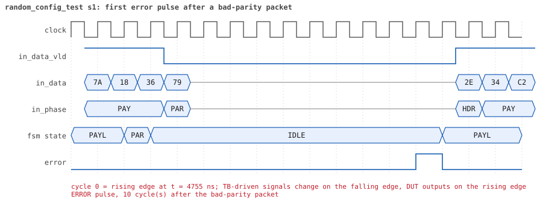

# random_config_test

<!-- generated by scripts/project_map/build.py from yapp_project/regression/runs.json -- run the regression, `make sim-report ONLY=yapp_project OUT=yapp_project/regression`, then `make map`; do not edit this file -->

[Back to the regression results →](index.md){ .pm-link } [On the project map →](../project-map.md#view=plan&node=cls:random_config_test){ .pm-link }

**8 of 8 seeds passed** · lab: test plan · extends `random_test` · 179 coverage bins hit.

Random tests: the configuration space -- every maxpktsize edge, the router off, mixed counter enables -- under many short bursts.

## Seeds

| Seed | Result | Sim time | Wall | In / fwd / drop | Out ch0/1/2 | Suspends | Errors | Log | Timeline | Waves |
|---|---|---|---|---|---|---|---|---|---|---|
| 1 | pass | 15us | 8.9 s | 22 / 6 / 16 | 2/2/2 | 0 | 0 | [log ↗](https://github.com/tamirgabgab/Qcom-Mentoring/blob/main/yapp_project/regression/yapp_project_tb/random_config_test_s1/random_config_test_s1.log) | [timeline ↗](https://github.com/tamirgabgab/Qcom-Mentoring/blob/main/yapp_project/regression/yapp_project_tb/random_config_test_s1/timeline.md) | [Surfer ↗](https://app.surfer-project.org/?load_url=https%3A%2F%2Fraw.githubusercontent.com%2Ftamirgabgab%2FQcom-Mentoring%2Fmain%2Fyapp_project%2Fregression%2Fyapp_project_tb%2Frandom_config_test_s1%2Frandom_config_test_s1.fst&startup_commands=run_command_file_from_url%20https%3A%2F%2Fraw.githubusercontent.com%2Ftamirgabgab%2FQcom-Mentoring%2Fmain%2Fyapp_project%2Ftb%2Fyapp_router.sucl) [.fst](https://github.com/tamirgabgab/Qcom-Mentoring/blob/main/yapp_project/regression/yapp_project_tb/random_config_test_s1/random_config_test_s1.fst) |
| 2 | pass | 30us | 13.9 s | 50 / 11 / 39 | 2/4/5 | 6 | 0 | [log ↗](https://github.com/tamirgabgab/Qcom-Mentoring/blob/main/yapp_project/regression/yapp_project_tb/random_config_test_s2/random_config_test_s2.log) | [timeline ↗](https://github.com/tamirgabgab/Qcom-Mentoring/blob/main/yapp_project/regression/yapp_project_tb/random_config_test_s2/timeline.md) | [Surfer ↗](https://app.surfer-project.org/?load_url=https%3A%2F%2Fraw.githubusercontent.com%2Ftamirgabgab%2FQcom-Mentoring%2Fmain%2Fyapp_project%2Fregression%2Fyapp_project_tb%2Frandom_config_test_s2%2Frandom_config_test_s2.fst&startup_commands=run_command_file_from_url%20https%3A%2F%2Fraw.githubusercontent.com%2Ftamirgabgab%2FQcom-Mentoring%2Fmain%2Fyapp_project%2Ftb%2Fyapp_router.sucl) [.fst](https://github.com/tamirgabgab/Qcom-Mentoring/blob/main/yapp_project/regression/yapp_project_tb/random_config_test_s2/random_config_test_s2.fst) |
| 3 | pass | 44us | 20.6 s | 89 / 28 / 61 | 9/6/13 | 1 | 0 | [log ↗](https://github.com/tamirgabgab/Qcom-Mentoring/blob/main/yapp_project/regression/yapp_project_tb/random_config_test_s3/random_config_test_s3.log) | [timeline ↗](https://github.com/tamirgabgab/Qcom-Mentoring/blob/main/yapp_project/regression/yapp_project_tb/random_config_test_s3/timeline.md) | [Surfer ↗](https://app.surfer-project.org/?load_url=https%3A%2F%2Fraw.githubusercontent.com%2Ftamirgabgab%2FQcom-Mentoring%2Fmain%2Fyapp_project%2Fregression%2Fyapp_project_tb%2Frandom_config_test_s3%2Frandom_config_test_s3.fst&startup_commands=run_command_file_from_url%20https%3A%2F%2Fraw.githubusercontent.com%2Ftamirgabgab%2FQcom-Mentoring%2Fmain%2Fyapp_project%2Ftb%2Fyapp_router.sucl) [.fst](https://github.com/tamirgabgab/Qcom-Mentoring/blob/main/yapp_project/regression/yapp_project_tb/random_config_test_s3/random_config_test_s3.fst) |
| 4 | pass | 40us | 17.9 s | 81 / 26 / 55 | 2/6/18 | 4 | 0 | [log ↗](https://github.com/tamirgabgab/Qcom-Mentoring/blob/main/yapp_project/regression/yapp_project_tb/random_config_test_s4/random_config_test_s4.log) | [timeline ↗](https://github.com/tamirgabgab/Qcom-Mentoring/blob/main/yapp_project/regression/yapp_project_tb/random_config_test_s4/timeline.md) | [Surfer ↗](https://app.surfer-project.org/?load_url=https%3A%2F%2Fraw.githubusercontent.com%2Ftamirgabgab%2FQcom-Mentoring%2Fmain%2Fyapp_project%2Fregression%2Fyapp_project_tb%2Frandom_config_test_s4%2Frandom_config_test_s4.fst&startup_commands=run_command_file_from_url%20https%3A%2F%2Fraw.githubusercontent.com%2Ftamirgabgab%2FQcom-Mentoring%2Fmain%2Fyapp_project%2Ftb%2Fyapp_router.sucl) [.fst](https://github.com/tamirgabgab/Qcom-Mentoring/blob/main/yapp_project/regression/yapp_project_tb/random_config_test_s4/random_config_test_s4.fst) |
| 5 | pass | 19us | 9.9 s | 36 / 6 / 30 | 2/1/3 | 0 | 0 | [log ↗](https://github.com/tamirgabgab/Qcom-Mentoring/blob/main/yapp_project/regression/yapp_project_tb/random_config_test_s5/random_config_test_s5.log) | [timeline ↗](https://github.com/tamirgabgab/Qcom-Mentoring/blob/main/yapp_project/regression/yapp_project_tb/random_config_test_s5/timeline.md) | [Surfer ↗](https://app.surfer-project.org/?load_url=https%3A%2F%2Fraw.githubusercontent.com%2Ftamirgabgab%2FQcom-Mentoring%2Fmain%2Fyapp_project%2Fregression%2Fyapp_project_tb%2Frandom_config_test_s5%2Frandom_config_test_s5.fst&startup_commands=run_command_file_from_url%20https%3A%2F%2Fraw.githubusercontent.com%2Ftamirgabgab%2FQcom-Mentoring%2Fmain%2Fyapp_project%2Ftb%2Fyapp_router.sucl) [.fst](https://github.com/tamirgabgab/Qcom-Mentoring/blob/main/yapp_project/regression/yapp_project_tb/random_config_test_s5/random_config_test_s5.fst) |
| 6 | pass | 18us | 9.8 s | 24 / 11 / 13 | 3/4/4 | 4 | 0 | [log ↗](https://github.com/tamirgabgab/Qcom-Mentoring/blob/main/yapp_project/regression/yapp_project_tb/random_config_test_s6/random_config_test_s6.log) | [timeline ↗](https://github.com/tamirgabgab/Qcom-Mentoring/blob/main/yapp_project/regression/yapp_project_tb/random_config_test_s6/timeline.md) | [Surfer ↗](https://app.surfer-project.org/?load_url=https%3A%2F%2Fraw.githubusercontent.com%2Ftamirgabgab%2FQcom-Mentoring%2Fmain%2Fyapp_project%2Fregression%2Fyapp_project_tb%2Frandom_config_test_s6%2Frandom_config_test_s6.fst&startup_commands=run_command_file_from_url%20https%3A%2F%2Fraw.githubusercontent.com%2Ftamirgabgab%2FQcom-Mentoring%2Fmain%2Fyapp_project%2Ftb%2Fyapp_router.sucl) [.fst](https://github.com/tamirgabgab/Qcom-Mentoring/blob/main/yapp_project/regression/yapp_project_tb/random_config_test_s6/random_config_test_s6.fst) |
| 7 | pass | 47us | 20.5 s | 89 / 37 / 52 | 5/10/22 | 0 | 0 | [log ↗](https://github.com/tamirgabgab/Qcom-Mentoring/blob/main/yapp_project/regression/yapp_project_tb/random_config_test_s7/random_config_test_s7.log) | [timeline ↗](https://github.com/tamirgabgab/Qcom-Mentoring/blob/main/yapp_project/regression/yapp_project_tb/random_config_test_s7/timeline.md) | [Surfer ↗](https://app.surfer-project.org/?load_url=https%3A%2F%2Fraw.githubusercontent.com%2Ftamirgabgab%2FQcom-Mentoring%2Fmain%2Fyapp_project%2Fregression%2Fyapp_project_tb%2Frandom_config_test_s7%2Frandom_config_test_s7.fst&startup_commands=run_command_file_from_url%20https%3A%2F%2Fraw.githubusercontent.com%2Ftamirgabgab%2FQcom-Mentoring%2Fmain%2Fyapp_project%2Ftb%2Fyapp_router.sucl) [.fst](https://github.com/tamirgabgab/Qcom-Mentoring/blob/main/yapp_project/regression/yapp_project_tb/random_config_test_s7/random_config_test_s7.fst) |
| 8 | pass | 49us | 22.7 s | 95 / 26 / 69 | 11/3/12 | 5 | 0 | [log ↗](https://github.com/tamirgabgab/Qcom-Mentoring/blob/main/yapp_project/regression/yapp_project_tb/random_config_test_s8/random_config_test_s8.log) | [timeline ↗](https://github.com/tamirgabgab/Qcom-Mentoring/blob/main/yapp_project/regression/yapp_project_tb/random_config_test_s8/timeline.md) | [Surfer ↗](https://app.surfer-project.org/?load_url=https%3A%2F%2Fraw.githubusercontent.com%2Ftamirgabgab%2FQcom-Mentoring%2Fmain%2Fyapp_project%2Fregression%2Fyapp_project_tb%2Frandom_config_test_s8%2Frandom_config_test_s8.fst&startup_commands=run_command_file_from_url%20https%3A%2F%2Fraw.githubusercontent.com%2Ftamirgabgab%2FQcom-Mentoring%2Fmain%2Fyapp_project%2Ftb%2Fyapp_router.sucl) [.fst](https://github.com/tamirgabgab/Qcom-Mentoring/blob/main/yapp_project/regression/yapp_project_tb/random_config_test_s8/random_config_test_s8.fst) |

## The plan of the test

1. **knobs** — 4..8 bursts, maxpktsize 0/1/62/63 70% of the time, router off 20%, address 3 15%, lengths at the boundaries 70%
2. **as random_test** — every read against the reference model; scoreboard; error pulses

Expected:

- The `router_coverage` report shows maxpktsize 0 and 1 and lengths equal to max and max+1 reached; the reference report `0 mismatches`.

## Test plan items this test verifies

- [PKT-03](../test-plan.md#pkt---packet-format) — Address 3 is illegal (covered)
- [DROP-01](../test-plan.md#drop---drop-rules) — length > maxpktsize drops the whole packet (covered)
- [DROP-02](../test-plan.md#drop---drop-rules) — router_en = 0 drops every packet (covered)
- [DROP-03](../test-plan.md#drop---drop-rules) — Address 3 drops the packet (covered)
- [DROP-04](../test-plan.md#drop---drop-rules) — An oversized packet to address 3 counts in both counters (covered)
- [CNT-01](../test-plan.md#cnt---counters) — A counter counts only while its enable bit is set (covered)
- [CNT-02](../test-plan.md#cnt---counters) — addrN_cnt_reg counts every received packet with address N (covered)
- [CNT-04](../test-plan.md#cnt---counters) — oversized_pkt_cnt_reg counts packets longer than maxpktsize (covered)
- [CNT-05](../test-plan.md#cnt---counters) — addr3_cnt_reg counts packets to address 3 (covered)
- [MEM-03](../test-plan.md#mem---memories) — A dropped packet is still stored (covered)
- [RND-01](../test-plan.md#rnd---random-scenarios) — Random configuration between bursts (covered)
- [RND-03](../test-plan.md#rnd---random-scenarios) — Bad parity on dropped and ignored packets (covered)

## Seed 1: what happened

- YAPP driver sent **22** packet(s) (4 with bad parity); the input monitor saw 22.
- Router: **6** forwarded, **16** dropped (9 oversized, 7 router disabled).
- Packets out: ch0 **2**, ch1 **2**, ch2 **2**.
- Scoreboard: 6 matched, 0 mismatched, 0 unexpected.
- Back-pressure: in_suspend asserted **0** time(s).
- Error pulses: 2.
- HBUS: 50 write(s), 114 read(s).

### Stages

| time (ns) | stage |
|---|---|
| 0 | receivers: ch0 RX_STALLY, ch1 RX_FAST, ch2 RX_STALLY |
| 0 | random scenario: 22 packets in 8 bursts |
| 530 | burst 1/8: ctrl=0x00 (maxpktsize 0) en=0xff (router on, counter enables 1111111), 3 packet(s) |
| 2140 | burst 1/8 sent: addr0..3 2/1/0/0, bad parity 0, gap 0 1, length 32..63 |
| 2510 | burst 2/8: ctrl=0x40 (maxpktsize 0) en=0x01 (router on, counter enables 0000000), 2 packet(s) |
| 3940 | burst 2/8 sent: addr0..3 1/0/1/0, bad parity 0, gap 0 1, length 63..63 |
| 4210 | burst 3/8: ctrl=0x22 (maxpktsize 34) en=0xff (router on, counter enables 1111111), 2 packet(s) |
| 5020 | burst 3/8 sent: addr0..3 0/1/1/0, bad parity 1, gap 0 0, length 11..35 |
| 5370 | burst 4/8: ctrl=0x40 (maxpktsize 0) en=0xfe (router OFF, counter enables 1111111), 3 packet(s) |
| 6760 | burst 4/8 sent: addr0..3 0/1/0/2, bad parity 1, gap 0 0, length 1..63 |
| 7180 | burst 5/8: ctrl=0x16 (maxpktsize 22) en=0xf5 (router on, counter enables 1111010), 3 packet(s) |
| 8820 | burst 5/8 sent: addr0..3 0/1/1/1, bad parity 0, gap 0 0, length 21..63 |
| 9100 | burst 6/8: ctrl=0x3e (maxpktsize 62) en=0xff (router on, counter enables 1111111), 2 packet(s) |
| 10120 | burst 6/8 sent: addr0..3 1/1/0/0, bad parity 0, gap 0 1, length 21..63 |
| 10400 | burst 7/8: ctrl=0xef (maxpktsize 47) en=0xff (router on, counter enables 1111111), 3 packet(s) |
| 11850 | burst 7/8 sent: addr0..3 2/0/1/0, bad parity 1, gap 0 0, length 41..47 |
| 12140 | burst 8/8: ctrl=0x51 (maxpktsize 17) en=0xc6 (router OFF, counter enables 1100011), 4 packet(s) |
| 12810 | burst 8/8 sent: addr0..3 0/1/1/2, bad parity 1, gap 0 1, length 1..17 |
| 12810 | final reads: every register and the stored packet, checked against the reference model |
| 14605 | done: 22 packets (6 forwarded, 16 dropped), 0 storm burst(s), 6 scoreboard matches, 114 HBUS reads checked, 2 error pulses for 2 bad packets |

### Pictures

The moments the report draws from the signal trace of this run (the same pictures are in the run's folder of the report).

**reset and the first cycles**

**first packet into the router**

**first packet out on channel 2**

**first error pulse after a bad-parity packet**

**first HBUS write**

**first HBUS read**

Run it yourself: `make sim TEST=random_config_test SEED=1 WAVES=1` in `yapp_project/tb`, or `make run-project TEST=random_config_test` with Xcelium.
