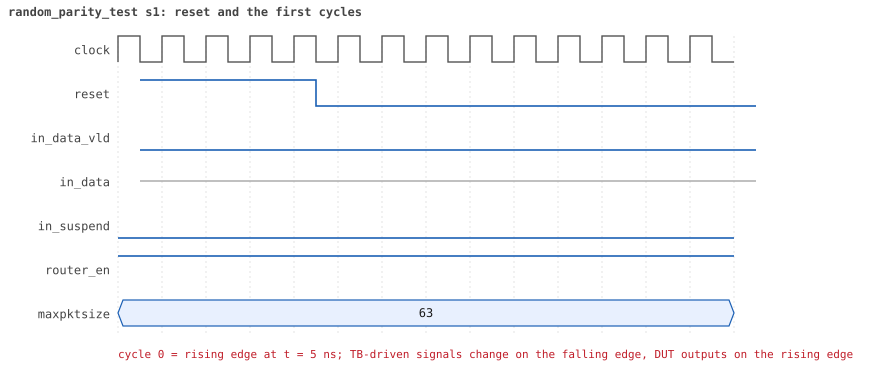
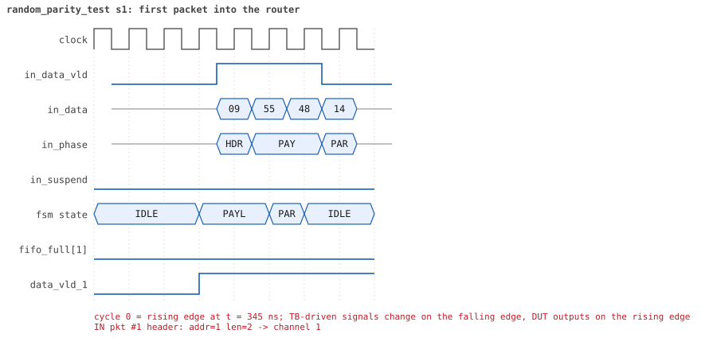
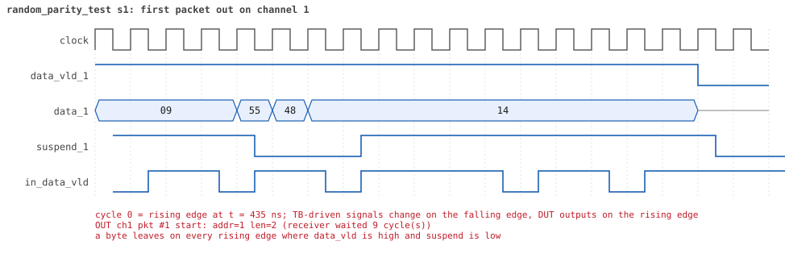
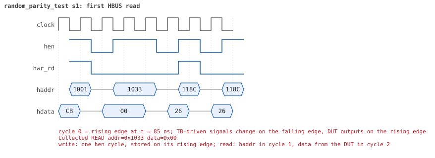

# random_parity_test

<!-- generated by scripts/project_map/build.py from yapp_project/regression/runs.json -- run the regression, `make sim-report ONLY=yapp_project OUT=yapp_project/regression`, then `make map`; do not edit this file -->

[Back to the regression results →](index.md){ .pm-link } [On the project map →](../project-map.md#view=plan&node=cls:random_parity_test){ .pm-link }

**8 of 8 seeds passed** · lab: test plan · extends `random_test` · 173 coverage bins hit.

Random tests: bad parity where it can happen -- forwarded, dropped (address 3, oversized) and ignored (router off) -- and storms of overlapping bad packets.

## Seeds

| Seed | Result | Sim time | Wall | In / fwd / drop | Out ch0/1/2 | Suspends | Errors | Log | Timeline | Waves |
|---|---|---|---|---|---|---|---|---|---|---|
| 1 | pass | 26us | 19.2 s | 94 / 43 / 51 | 10/15/18 | 2 | 0 | [log ↗](https://github.com/tamirgabgab/Qcom-Mentoring/blob/main/yapp_project/regression/yapp_project_tb/random_parity_test_s1/random_parity_test_s1.log) | [timeline ↗](https://github.com/tamirgabgab/Qcom-Mentoring/blob/main/yapp_project/regression/yapp_project_tb/random_parity_test_s1/timeline.md) | [Surfer ↗](https://app.surfer-project.org/?load_url=https%3A%2F%2Fraw.githubusercontent.com%2Ftamirgabgab%2FQcom-Mentoring%2Fmain%2Fyapp_project%2Fregression%2Fyapp_project_tb%2Frandom_parity_test_s1%2Frandom_parity_test_s1.fst&startup_commands=run_command_file_from_url%20https%3A%2F%2Fraw.githubusercontent.com%2Ftamirgabgab%2FQcom-Mentoring%2Fmain%2Fyapp_project%2Ftb%2Fyapp_router.sucl) [.fst](https://github.com/tamirgabgab/Qcom-Mentoring/blob/main/yapp_project/regression/yapp_project_tb/random_parity_test_s1/random_parity_test_s1.fst) |
| 2 | pass | 29us | 18.6 s | 95 / 56 / 39 | 13/22/21 | 10 | 0 | [log ↗](https://github.com/tamirgabgab/Qcom-Mentoring/blob/main/yapp_project/regression/yapp_project_tb/random_parity_test_s2/random_parity_test_s2.log) | [timeline ↗](https://github.com/tamirgabgab/Qcom-Mentoring/blob/main/yapp_project/regression/yapp_project_tb/random_parity_test_s2/timeline.md) | [Surfer ↗](https://app.surfer-project.org/?load_url=https%3A%2F%2Fraw.githubusercontent.com%2Ftamirgabgab%2FQcom-Mentoring%2Fmain%2Fyapp_project%2Fregression%2Fyapp_project_tb%2Frandom_parity_test_s2%2Frandom_parity_test_s2.fst&startup_commands=run_command_file_from_url%20https%3A%2F%2Fraw.githubusercontent.com%2Ftamirgabgab%2FQcom-Mentoring%2Fmain%2Fyapp_project%2Ftb%2Fyapp_router.sucl) [.fst](https://github.com/tamirgabgab/Qcom-Mentoring/blob/main/yapp_project/regression/yapp_project_tb/random_parity_test_s2/random_parity_test_s2.fst) |
| 3 | pass | 10us | 9.0 s | 41 / 27 / 14 | 7/8/12 | 0 | 0 | [log ↗](https://github.com/tamirgabgab/Qcom-Mentoring/blob/main/yapp_project/regression/yapp_project_tb/random_parity_test_s3/random_parity_test_s3.log) | [timeline ↗](https://github.com/tamirgabgab/Qcom-Mentoring/blob/main/yapp_project/regression/yapp_project_tb/random_parity_test_s3/timeline.md) | [Surfer ↗](https://app.surfer-project.org/?load_url=https%3A%2F%2Fraw.githubusercontent.com%2Ftamirgabgab%2FQcom-Mentoring%2Fmain%2Fyapp_project%2Fregression%2Fyapp_project_tb%2Frandom_parity_test_s3%2Frandom_parity_test_s3.fst&startup_commands=run_command_file_from_url%20https%3A%2F%2Fraw.githubusercontent.com%2Ftamirgabgab%2FQcom-Mentoring%2Fmain%2Fyapp_project%2Ftb%2Fyapp_router.sucl) [.fst](https://github.com/tamirgabgab/Qcom-Mentoring/blob/main/yapp_project/regression/yapp_project_tb/random_parity_test_s3/random_parity_test_s3.fst) |
| 4 | pass | 11us | 11.9 s | 56 / 38 / 18 | 9/8/21 | 3 | 0 | [log ↗](https://github.com/tamirgabgab/Qcom-Mentoring/blob/main/yapp_project/regression/yapp_project_tb/random_parity_test_s4/random_parity_test_s4.log) | [timeline ↗](https://github.com/tamirgabgab/Qcom-Mentoring/blob/main/yapp_project/regression/yapp_project_tb/random_parity_test_s4/timeline.md) | [Surfer ↗](https://app.surfer-project.org/?load_url=https%3A%2F%2Fraw.githubusercontent.com%2Ftamirgabgab%2FQcom-Mentoring%2Fmain%2Fyapp_project%2Fregression%2Fyapp_project_tb%2Frandom_parity_test_s4%2Frandom_parity_test_s4.fst&startup_commands=run_command_file_from_url%20https%3A%2F%2Fraw.githubusercontent.com%2Ftamirgabgab%2FQcom-Mentoring%2Fmain%2Fyapp_project%2Ftb%2Fyapp_router.sucl) [.fst](https://github.com/tamirgabgab/Qcom-Mentoring/blob/main/yapp_project/regression/yapp_project_tb/random_parity_test_s4/random_parity_test_s4.fst) |
| 5 | pass | 16us | 9.8 s | 48 / 10 / 38 | 2/2/6 | 2 | 0 | [log ↗](https://github.com/tamirgabgab/Qcom-Mentoring/blob/main/yapp_project/regression/yapp_project_tb/random_parity_test_s5/random_parity_test_s5.log) | [timeline ↗](https://github.com/tamirgabgab/Qcom-Mentoring/blob/main/yapp_project/regression/yapp_project_tb/random_parity_test_s5/timeline.md) | [Surfer ↗](https://app.surfer-project.org/?load_url=https%3A%2F%2Fraw.githubusercontent.com%2Ftamirgabgab%2FQcom-Mentoring%2Fmain%2Fyapp_project%2Fregression%2Fyapp_project_tb%2Frandom_parity_test_s5%2Frandom_parity_test_s5.fst&startup_commands=run_command_file_from_url%20https%3A%2F%2Fraw.githubusercontent.com%2Ftamirgabgab%2FQcom-Mentoring%2Fmain%2Fyapp_project%2Ftb%2Fyapp_router.sucl) [.fst](https://github.com/tamirgabgab/Qcom-Mentoring/blob/main/yapp_project/regression/yapp_project_tb/random_parity_test_s5/random_parity_test_s5.fst) |
| 6 | pass | 27us | 16.5 s | 83 / 40 / 43 | 6/10/24 | 5 | 0 | [log ↗](https://github.com/tamirgabgab/Qcom-Mentoring/blob/main/yapp_project/regression/yapp_project_tb/random_parity_test_s6/random_parity_test_s6.log) | [timeline ↗](https://github.com/tamirgabgab/Qcom-Mentoring/blob/main/yapp_project/regression/yapp_project_tb/random_parity_test_s6/timeline.md) | [Surfer ↗](https://app.surfer-project.org/?load_url=https%3A%2F%2Fraw.githubusercontent.com%2Ftamirgabgab%2FQcom-Mentoring%2Fmain%2Fyapp_project%2Fregression%2Fyapp_project_tb%2Frandom_parity_test_s6%2Frandom_parity_test_s6.fst&startup_commands=run_command_file_from_url%20https%3A%2F%2Fraw.githubusercontent.com%2Ftamirgabgab%2FQcom-Mentoring%2Fmain%2Fyapp_project%2Ftb%2Fyapp_router.sucl) [.fst](https://github.com/tamirgabgab/Qcom-Mentoring/blob/main/yapp_project/regression/yapp_project_tb/random_parity_test_s6/random_parity_test_s6.fst) |
| 7 | pass | 10us | 6.0 s | 14 / 2 / 12 | 0/1/1 | 0 | 0 | [log ↗](https://github.com/tamirgabgab/Qcom-Mentoring/blob/main/yapp_project/regression/yapp_project_tb/random_parity_test_s7/random_parity_test_s7.log) | [timeline ↗](https://github.com/tamirgabgab/Qcom-Mentoring/blob/main/yapp_project/regression/yapp_project_tb/random_parity_test_s7/timeline.md) | [Surfer ↗](https://app.surfer-project.org/?load_url=https%3A%2F%2Fraw.githubusercontent.com%2Ftamirgabgab%2FQcom-Mentoring%2Fmain%2Fyapp_project%2Fregression%2Fyapp_project_tb%2Frandom_parity_test_s7%2Frandom_parity_test_s7.fst&startup_commands=run_command_file_from_url%20https%3A%2F%2Fraw.githubusercontent.com%2Ftamirgabgab%2FQcom-Mentoring%2Fmain%2Fyapp_project%2Ftb%2Fyapp_router.sucl) [.fst](https://github.com/tamirgabgab/Qcom-Mentoring/blob/main/yapp_project/regression/yapp_project_tb/random_parity_test_s7/random_parity_test_s7.fst) |
| 8 | pass | 17us | 11.5 s | 55 / 13 / 42 | 7/1/5 | 0 | 0 | [log ↗](https://github.com/tamirgabgab/Qcom-Mentoring/blob/main/yapp_project/regression/yapp_project_tb/random_parity_test_s8/random_parity_test_s8.log) | [timeline ↗](https://github.com/tamirgabgab/Qcom-Mentoring/blob/main/yapp_project/regression/yapp_project_tb/random_parity_test_s8/timeline.md) | [Surfer ↗](https://app.surfer-project.org/?load_url=https%3A%2F%2Fraw.githubusercontent.com%2Ftamirgabgab%2FQcom-Mentoring%2Fmain%2Fyapp_project%2Fregression%2Fyapp_project_tb%2Frandom_parity_test_s8%2Frandom_parity_test_s8.fst&startup_commands=run_command_file_from_url%20https%3A%2F%2Fraw.githubusercontent.com%2Ftamirgabgab%2FQcom-Mentoring%2Fmain%2Fyapp_project%2Ftb%2Fyapp_router.sucl) [.fst](https://github.com/tamirgabgab/Qcom-Mentoring/blob/main/yapp_project/regression/yapp_project_tb/random_parity_test_s8/random_parity_test_s8.fst) |

## The plan of the test

1. **knobs** — 30..60% bad parity, address 3 15%, router off 15%, half of the bursts are storms
2. **storms** — 1..3-byte packets, 90% back to back, half with bad parity: a new bad packet ends before the previous pulse
3. **error pulses** — error_pulse_checker: every bad packet received while enabled gets its own pulse 1..10 cycles later
4. **parity counter** — parity_err_cnt_reg against the reference model, with its enable bit

Expected:

- `error pulse report: N bad packets, N pulses, 0 outside 1..10 cycles, at most k owed at once` with k of 2 or more; `[DUT] ERROR pulse ... (1 more owed)` lines.

## Test plan items this test verifies

- [PKT-05](../test-plan.md#pkt---packet-format) — A wrong parity byte is detected -- and the packet still delivered (covered)
- [IN-04](../test-plan.md#in---input-port-protocol) — error asserts 1 to 10 cycles after a bad-parity packet (covered)
- [CNT-03](../test-plan.md#cnt---counters) — parity_err_cnt_reg counts the bad-parity packets (covered)
- [RND-02](../test-plan.md#rnd---random-scenarios) — One error pulse per bad packet when bad packets overlap (covered)
- [RND-03](../test-plan.md#rnd---random-scenarios) — Bad parity on dropped and ignored packets (covered)

## Seed 1: what happened

- YAPP driver sent **94** packet(s) (34 with bad parity); the input monitor saw 94.
- Router: **43** forwarded, **51** dropped (9 illegal address 3, 42 oversized).
- Packets out: ch0 **10**, ch1 **15**, ch2 **18**.
- Scoreboard: 43 matched, 0 mismatched, 0 unexpected.
- Back-pressure: in_suspend asserted **2** time(s), longest hold 97 cycle(s).
- Error pulses: 34.
- HBUS: 28 write(s), 44 read(s).

### Stages

| time (ns) | stage |
|---|---|
| 0 | receivers: ch0 RX_STALLY, ch1 RX_FAST, ch2 RX_STALLY |
| 0 | random scenario: 94 packets in 6 bursts |
| 360 | burst 1/6: ctrl=0x3f (maxpktsize 63) en=0xcb (router on, counter enables 1100101), 16 packet(s) -- storm: 1..3-byte packets back to back, half with bad parity |
| 2000 | burst 1/6 sent: addr0..3 1/5/6/4, bad parity 4, gap 0 12, length 1..3 |
| 2230 | burst 2/6: ctrl=0xb0 (maxpktsize 48) en=0xa9 (router on, counter enables 1010100), 15 packet(s) |
| 9460 | burst 2/6 sent: addr0..3 4/4/6/1, bad parity 2, gap 0 7, length 1..63 |
| 9630 | burst 3/6: ctrl=0xbe (maxpktsize 62) en=0x05 (router on, counter enables 0000010), 16 packet(s) |
| 17330 | burst 3/6 sent: addr0..3 4/4/6/2, bad parity 5, gap 0 8, length 1..63 |
| 17590 | burst 4/6: ctrl=0x02 (maxpktsize 2) en=0xad (router on, counter enables 1010110), 15 packet(s) |
| 22990 | burst 4/6 sent: addr0..3 2/3/8/2, bad parity 7, gap 0 10, length 1..63 |
| 23320 | burst 5/6: ctrl=0xa6 (maxpktsize 38) en=0xd1 (router on, counter enables 1101000), 16 packet(s) -- storm: 1..3-byte packets back to back, half with bad parity |
| 24010 | burst 5/6 sent: addr0..3 2/6/6/2, bad parity 11, gap 0 14, length 1..3 |
| 24230 | burst 6/6: ctrl=0x00 (maxpktsize 0) en=0x01 (router on, counter enables 0000000), 16 packet(s) -- storm: 1..3-byte packets back to back, half with bad parity |
| 24880 | burst 6/6 sent: addr0..3 1/3/9/3, bad parity 5, gap 0 13, length 1..3 |
| 24880 | final reads: every register and the stored packet, checked against the reference model |
| 25355 | done: 94 packets (43 forwarded, 51 dropped), 3 storm burst(s), 43 scoreboard matches, 41 HBUS reads checked, 34 error pulses for 34 bad packets |

### Pictures

The moments the report draws from the signal trace of this run (the same pictures are in the run's folder of the report).

**reset and the first cycles**

**first packet into the router**

**first packet out on channel 1**

**first back-pressure on the input port**

**first error pulse after a bad-parity packet**

**first HBUS write**

**first HBUS read**

Run it yourself: `make sim TEST=random_parity_test SEED=1 WAVES=1` in `yapp_project/tb`, or `make run-project TEST=random_parity_test` with Xcelium.
