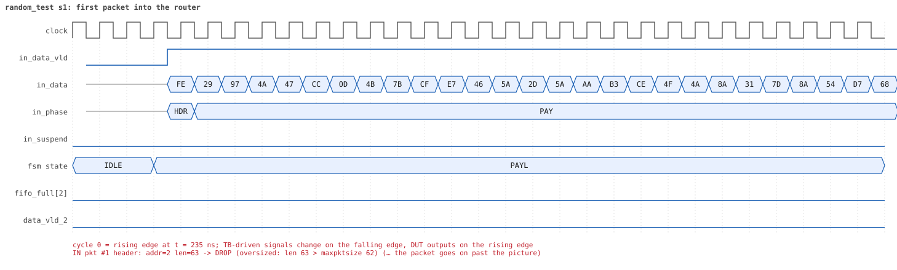
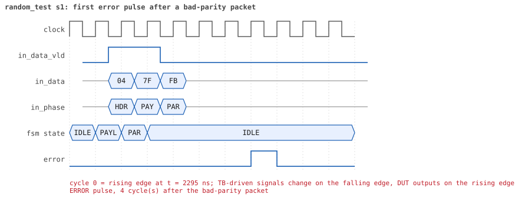

# random_test

<!-- generated by scripts/project_map/build.py from yapp_project/regression/runs.json -- run the regression, `make sim-report ONLY=yapp_project OUT=yapp_project/regression`, then `make map`; do not edit this file -->

[Back to the regression results →](index.md){ .pm-link } [On the project map →](../project-map.md#view=plan&node=cls:random_test){ .pm-link }

**8 of 8 seeds passed** · lab: test plan · extends `base_test` · 169 coverage bins hit.

Random tests: the seed decides the shape of the test, and every result is checked automatically -- no expected value is written by hand.

## Seeds

| Seed | Result | Sim time | Wall | In / fwd / drop | Out ch0/1/2 | Suspends | Errors | Log | Timeline | Waves |
|---|---|---|---|---|---|---|---|---|---|---|
| 1 | pass | 12us | 6.5 s | 22 / 7 / 15 | 2/1/4 | 0 | 0 | [log ↗](https://github.com/tamirgabgab/Qcom-Mentoring/blob/main/yapp_project/regression/yapp_project_tb/random_test_s1/random_test_s1.log) | [timeline ↗](https://github.com/tamirgabgab/Qcom-Mentoring/blob/main/yapp_project/regression/yapp_project_tb/random_test_s1/timeline.md) | [Surfer ↗](https://app.surfer-project.org/?load_url=https%3A%2F%2Fraw.githubusercontent.com%2Ftamirgabgab%2FQcom-Mentoring%2Fmain%2Fyapp_project%2Fregression%2Fyapp_project_tb%2Frandom_test_s1%2Frandom_test_s1.fst&startup_commands=run_command_file_from_url%20https%3A%2F%2Fraw.githubusercontent.com%2Ftamirgabgab%2FQcom-Mentoring%2Fmain%2Fyapp_project%2Ftb%2Fyapp_router.sucl) [.fst](https://github.com/tamirgabgab/Qcom-Mentoring/blob/main/yapp_project/regression/yapp_project_tb/random_test_s1/random_test_s1.fst) |
| 2 | pass | 25us | 11.8 s | 50 / 12 / 38 | 4/2/6 | 10 | 0 | [log ↗](https://github.com/tamirgabgab/Qcom-Mentoring/blob/main/yapp_project/regression/yapp_project_tb/random_test_s2/random_test_s2.log) | [timeline ↗](https://github.com/tamirgabgab/Qcom-Mentoring/blob/main/yapp_project/regression/yapp_project_tb/random_test_s2/timeline.md) | [Surfer ↗](https://app.surfer-project.org/?load_url=https%3A%2F%2Fraw.githubusercontent.com%2Ftamirgabgab%2FQcom-Mentoring%2Fmain%2Fyapp_project%2Fregression%2Fyapp_project_tb%2Frandom_test_s2%2Frandom_test_s2.fst&startup_commands=run_command_file_from_url%20https%3A%2F%2Fraw.githubusercontent.com%2Ftamirgabgab%2FQcom-Mentoring%2Fmain%2Fyapp_project%2Ftb%2Fyapp_router.sucl) [.fst](https://github.com/tamirgabgab/Qcom-Mentoring/blob/main/yapp_project/regression/yapp_project_tb/random_test_s2/random_test_s2.fst) |
| 3 | pass | 47us | 17.2 s | 89 / 53 / 36 | 14/13/26 | 8 | 0 | [log ↗](https://github.com/tamirgabgab/Qcom-Mentoring/blob/main/yapp_project/regression/yapp_project_tb/random_test_s3/random_test_s3.log) | [timeline ↗](https://github.com/tamirgabgab/Qcom-Mentoring/blob/main/yapp_project/regression/yapp_project_tb/random_test_s3/timeline.md) | [Surfer ↗](https://app.surfer-project.org/?load_url=https%3A%2F%2Fraw.githubusercontent.com%2Ftamirgabgab%2FQcom-Mentoring%2Fmain%2Fyapp_project%2Fregression%2Fyapp_project_tb%2Frandom_test_s3%2Frandom_test_s3.fst&startup_commands=run_command_file_from_url%20https%3A%2F%2Fraw.githubusercontent.com%2Ftamirgabgab%2FQcom-Mentoring%2Fmain%2Fyapp_project%2Ftb%2Fyapp_router.sucl) [.fst](https://github.com/tamirgabgab/Qcom-Mentoring/blob/main/yapp_project/regression/yapp_project_tb/random_test_s3/random_test_s3.fst) |
| 4 | pass | 36us | 14.7 s | 81 / 7 / 74 | 1/2/4 | 0 | 0 | [log ↗](https://github.com/tamirgabgab/Qcom-Mentoring/blob/main/yapp_project/regression/yapp_project_tb/random_test_s4/random_test_s4.log) | [timeline ↗](https://github.com/tamirgabgab/Qcom-Mentoring/blob/main/yapp_project/regression/yapp_project_tb/random_test_s4/timeline.md) | [Surfer ↗](https://app.surfer-project.org/?load_url=https%3A%2F%2Fraw.githubusercontent.com%2Ftamirgabgab%2FQcom-Mentoring%2Fmain%2Fyapp_project%2Fregression%2Fyapp_project_tb%2Frandom_test_s4%2Frandom_test_s4.fst&startup_commands=run_command_file_from_url%20https%3A%2F%2Fraw.githubusercontent.com%2Ftamirgabgab%2FQcom-Mentoring%2Fmain%2Fyapp_project%2Ftb%2Fyapp_router.sucl) [.fst](https://github.com/tamirgabgab/Qcom-Mentoring/blob/main/yapp_project/regression/yapp_project_tb/random_test_s4/random_test_s4.fst) |
| 5 | pass | 16us | 7.2 s | 36 / 21 / 15 | 9/6/6 | 5 | 0 | [log ↗](https://github.com/tamirgabgab/Qcom-Mentoring/blob/main/yapp_project/regression/yapp_project_tb/random_test_s5/random_test_s5.log) | [timeline ↗](https://github.com/tamirgabgab/Qcom-Mentoring/blob/main/yapp_project/regression/yapp_project_tb/random_test_s5/timeline.md) | [Surfer ↗](https://app.surfer-project.org/?load_url=https%3A%2F%2Fraw.githubusercontent.com%2Ftamirgabgab%2FQcom-Mentoring%2Fmain%2Fyapp_project%2Fregression%2Fyapp_project_tb%2Frandom_test_s5%2Frandom_test_s5.fst&startup_commands=run_command_file_from_url%20https%3A%2F%2Fraw.githubusercontent.com%2Ftamirgabgab%2FQcom-Mentoring%2Fmain%2Fyapp_project%2Ftb%2Fyapp_router.sucl) [.fst](https://github.com/tamirgabgab/Qcom-Mentoring/blob/main/yapp_project/regression/yapp_project_tb/random_test_s5/random_test_s5.fst) |
| 6 | pass | 15us | 6.2 s | 24 / 8 / 16 | 0/2/6 | 4 | 0 | [log ↗](https://github.com/tamirgabgab/Qcom-Mentoring/blob/main/yapp_project/regression/yapp_project_tb/random_test_s6/random_test_s6.log) | [timeline ↗](https://github.com/tamirgabgab/Qcom-Mentoring/blob/main/yapp_project/regression/yapp_project_tb/random_test_s6/timeline.md) | [Surfer ↗](https://app.surfer-project.org/?load_url=https%3A%2F%2Fraw.githubusercontent.com%2Ftamirgabgab%2FQcom-Mentoring%2Fmain%2Fyapp_project%2Fregression%2Fyapp_project_tb%2Frandom_test_s6%2Frandom_test_s6.fst&startup_commands=run_command_file_from_url%20https%3A%2F%2Fraw.githubusercontent.com%2Ftamirgabgab%2FQcom-Mentoring%2Fmain%2Fyapp_project%2Ftb%2Fyapp_router.sucl) [.fst](https://github.com/tamirgabgab/Qcom-Mentoring/blob/main/yapp_project/regression/yapp_project_tb/random_test_s6/random_test_s6.fst) |
| 7 | pass | 44us | 18.5 s | 89 / 24 / 65 | 6/5/13 | 0 | 0 | [log ↗](https://github.com/tamirgabgab/Qcom-Mentoring/blob/main/yapp_project/regression/yapp_project_tb/random_test_s7/random_test_s7.log) | [timeline ↗](https://github.com/tamirgabgab/Qcom-Mentoring/blob/main/yapp_project/regression/yapp_project_tb/random_test_s7/timeline.md) | [Surfer ↗](https://app.surfer-project.org/?load_url=https%3A%2F%2Fraw.githubusercontent.com%2Ftamirgabgab%2FQcom-Mentoring%2Fmain%2Fyapp_project%2Fregression%2Fyapp_project_tb%2Frandom_test_s7%2Frandom_test_s7.fst&startup_commands=run_command_file_from_url%20https%3A%2F%2Fraw.githubusercontent.com%2Ftamirgabgab%2FQcom-Mentoring%2Fmain%2Fyapp_project%2Ftb%2Fyapp_router.sucl) [.fst](https://github.com/tamirgabgab/Qcom-Mentoring/blob/main/yapp_project/regression/yapp_project_tb/random_test_s7/random_test_s7.fst) |
| 8 | pass | 46us | 19.9 s | 95 / 55 / 40 | 12/16/27 | 16 | 0 | [log ↗](https://github.com/tamirgabgab/Qcom-Mentoring/blob/main/yapp_project/regression/yapp_project_tb/random_test_s8/random_test_s8.log) | [timeline ↗](https://github.com/tamirgabgab/Qcom-Mentoring/blob/main/yapp_project/regression/yapp_project_tb/random_test_s8/timeline.md) | [Surfer ↗](https://app.surfer-project.org/?load_url=https%3A%2F%2Fraw.githubusercontent.com%2Ftamirgabgab%2FQcom-Mentoring%2Fmain%2Fyapp_project%2Fregression%2Fyapp_project_tb%2Frandom_test_s8%2Frandom_test_s8.fst&startup_commands=run_command_file_from_url%20https%3A%2F%2Fraw.githubusercontent.com%2Ftamirgabgab%2FQcom-Mentoring%2Fmain%2Fyapp_project%2Ftb%2Fyapp_router.sucl) [.fst](https://github.com/tamirgabgab/Qcom-Mentoring/blob/main/yapp_project/regression/yapp_project_tb/random_test_s8/random_test_s8.fst) |

## The plan of the test

1. **receivers** — channel_rx_random_seq per channel, each with a random profile: fast, normal, slow, stalling
2. **check_reads = 1** — router_reference compares every HBUS read with its model; error_pulse_checker on the YAPP monitor
3. **router_random_mcseq** — 10..100 packets in 2..6 bursts on tb.mcseqr
4. **per burst** — random ctrl_reg (maxpktsize, 0/1/62/63 often) and en_reg (router on/off, counter-enable mask) over the HBUS
5. **random reads** — counters, mem_size_reg, yapp_pkt_mem bytes, unmapped addresses, yapp_mem write + read back
6. **burst** — yapp_random_burst_seq: address 0..3, lengths around maxpktsize, bad parity, gaps 0..20
7. **final reads** — every register and yapp_pkt_mem[0..mem_size], against the model
8. **always on** — scoreboard per packet and nothing left at the end; one error pulse per bad packet

Expected:

- A `STAGE: burst k/n: ctrl=... en=...` line per burst and `STAGE: done: N packets (F forwarded, D dropped) ... R HBUS reads checked, P error pulses for P bad packets`.
- Reference report: `HBUS reads checked against the model: R (0 mismatches ...)`; the `router_coverage` report shows the configuration coverage it reached.

## Test plan items this test verifies

- [PKT-02](../test-plan.md#pkt---packet-format) — Every payload length 1..63, including both extremes (covered)
- [REG-05](../test-plan.md#reg---registers) — Unmapped addresses read 0x00 and ignore writes (covered)
- [REG-06](../test-plan.md#reg---registers) — mem_size_reg holds the payload length of the last packet (covered)
- [MEM-01](../test-plan.md#mem---memories) — yapp_pkt_mem holds the last packet, byte by byte (covered)
- [RND-01](../test-plan.md#rnd---random-scenarios) — Random configuration between bursts (covered)
- [RND-04](../test-plan.md#rnd---random-scenarios) — Receivers that stall, per channel (covered)
- [COV-04](../test-plan.md#cov---functional-coverage) — HBUS: every address of the router read and written (covered)

## Seed 1: what happened

- YAPP driver sent **22** packet(s) (3 with bad parity); the input monitor saw 22.
- Router: **7** forwarded, **15** dropped (7 oversized, 8 router disabled).
- Packets out: ch0 **2**, ch1 **1**, ch2 **4**.
- Scoreboard: 7 matched, 0 mismatched, 0 unexpected.
- Back-pressure: in_suspend asserted **0** time(s).
- Error pulses: 2.
- HBUS: 30 write(s), 78 read(s).

### Stages

| time (ns) | stage |
|---|---|
| 0 | receivers: ch0 RX_STALLY, ch1 RX_FAST, ch2 RX_STALLY |
| 0 | random scenario: 22 packets in 6 bursts |
| 250 | burst 1/6: ctrl=0x3e (maxpktsize 62) en=0xb3 (router on, counter enables 1011001), 4 packet(s) |
| 2330 | burst 1/6 sent: addr0..3 2/0/2/0, bad parity 1, gap 0 1, length 1..63 |
| 2620 | burst 2/6: ctrl=0x12 (maxpktsize 18) en=0xfe (router OFF, counter enables 1111111), 3 packet(s) |
| 4340 | burst 2/6 sent: addr0..3 0/0/3/0, bad parity 0, gap 0 1, length 40..63 |
| 4540 | burst 3/6: ctrl=0xf4 (maxpktsize 52) en=0x73 (router on, counter enables 0111001), 3 packet(s) |
| 5770 | burst 3/6 sent: addr0..3 0/1/2/0, bad parity 1, gap 0 2, length 16..52 |
| 6100 | burst 4/6: ctrl=0xc1 (maxpktsize 1) en=0x33 (router on, counter enables 0011001), 3 packet(s) |
| 6810 | burst 4/6 sent: addr0..3 1/1/1/0, bad parity 0, gap 0 0, length 2..50 |
| 7150 | burst 5/6: ctrl=0xe4 (maxpktsize 36) en=0xc3 (router on, counter enables 1100001), 4 packet(s) |
| 8790 | burst 5/6 sent: addr0..3 1/1/2/0, bad parity 0, gap 0 1, length 1..57 |
| 8960 | burst 6/6: ctrl=0x1f (maxpktsize 31) en=0x22 (router OFF, counter enables 0010001), 5 packet(s) |
| 10290 | burst 6/6 sent: addr0..3 1/1/2/1, bad parity 1, gap 0 2, length 1..37 |
| 10290 | final reads: every register and the stored packet, checked against the reference model |
| 11815 | done: 22 packets (7 forwarded, 15 dropped), 0 storm burst(s), 7 scoreboard matches, 78 HBUS reads checked, 2 error pulses for 2 bad packets |

### Pictures

The moments the report draws from the signal trace of this run (the same pictures are in the run's folder of the report).

**reset and the first cycles**

**first packet into the router**

**first packet out on channel 2**

**first error pulse after a bad-parity packet**

**first HBUS write**

**first HBUS read**

Run it yourself: `make sim TEST=random_test SEED=1 WAVES=1` in `yapp_project/tb`, or `make run-project TEST=random_test` with Xcelium.
