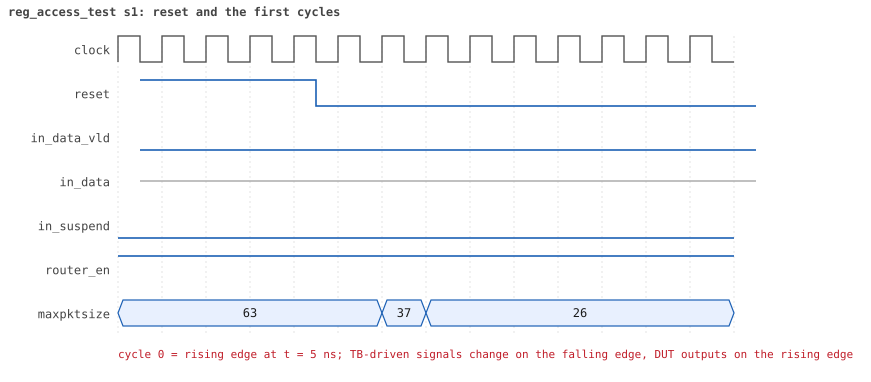

# reg_access_test

<!-- generated by scripts/project_map/build.py from yapp_project/regression/runs.json -- run the regression, `make sim-report ONLY=yapp_project OUT=yapp_project/regression`, then `make map`; do not edit this file -->

[Back to the regression results →](index.md){ .pm-link } [On the project map →](../project-map.md#view=plan&node=cls:reg_access_test){ .pm-link }

**4 of 4 seeds passed** · lab: [11C](../labs/lab11c.md) · extends `base_test` · 30 coverage bins hit.

Lab 11C: hand-written front-door and backdoor checks on one RW and one RO register.

## Seeds

| Seed | Result | Sim time | Wall | In / fwd / drop | Out ch0/1/2 | Suspends | Errors | Log | Timeline | Waves |
|---|---|---|---|---|---|---|---|---|---|---|
| 1 | pass | 350ns | 0.2 s | 0 / 0 / 0 | 0/0/0 | 0 | 0 | [log ↗](https://github.com/tamirgabgab/Qcom-Mentoring/blob/main/yapp_project/regression/yapp_project_tb/reg_access_test_s1/reg_access_test_s1.log) | [timeline ↗](https://github.com/tamirgabgab/Qcom-Mentoring/blob/main/yapp_project/regression/yapp_project_tb/reg_access_test_s1/timeline.md) | [Surfer ↗](https://app.surfer-project.org/?load_url=https%3A%2F%2Fraw.githubusercontent.com%2Ftamirgabgab%2FQcom-Mentoring%2Fmain%2Fyapp_project%2Fregression%2Fyapp_project_tb%2Freg_access_test_s1%2Freg_access_test_s1.fst&startup_commands=run_command_file_from_url%20https%3A%2F%2Fraw.githubusercontent.com%2Ftamirgabgab%2FQcom-Mentoring%2Fmain%2Fyapp_project%2Ftb%2Fyapp_router.sucl) [.fst](https://github.com/tamirgabgab/Qcom-Mentoring/blob/main/yapp_project/regression/yapp_project_tb/reg_access_test_s1/reg_access_test_s1.fst) |
| 2 | pass | 350ns | 0.2 s | 0 / 0 / 0 | 0/0/0 | 0 | 0 | [log ↗](https://github.com/tamirgabgab/Qcom-Mentoring/blob/main/yapp_project/regression/yapp_project_tb/reg_access_test_s2/reg_access_test_s2.log) | [timeline ↗](https://github.com/tamirgabgab/Qcom-Mentoring/blob/main/yapp_project/regression/yapp_project_tb/reg_access_test_s2/timeline.md) | [Surfer ↗](https://app.surfer-project.org/?load_url=https%3A%2F%2Fraw.githubusercontent.com%2Ftamirgabgab%2FQcom-Mentoring%2Fmain%2Fyapp_project%2Fregression%2Fyapp_project_tb%2Freg_access_test_s2%2Freg_access_test_s2.fst&startup_commands=run_command_file_from_url%20https%3A%2F%2Fraw.githubusercontent.com%2Ftamirgabgab%2FQcom-Mentoring%2Fmain%2Fyapp_project%2Ftb%2Fyapp_router.sucl) [.fst](https://github.com/tamirgabgab/Qcom-Mentoring/blob/main/yapp_project/regression/yapp_project_tb/reg_access_test_s2/reg_access_test_s2.fst) |
| 3 | pass | 350ns | 0.2 s | 0 / 0 / 0 | 0/0/0 | 0 | 0 | [log ↗](https://github.com/tamirgabgab/Qcom-Mentoring/blob/main/yapp_project/regression/yapp_project_tb/reg_access_test_s3/reg_access_test_s3.log) | [timeline ↗](https://github.com/tamirgabgab/Qcom-Mentoring/blob/main/yapp_project/regression/yapp_project_tb/reg_access_test_s3/timeline.md) | [Surfer ↗](https://app.surfer-project.org/?load_url=https%3A%2F%2Fraw.githubusercontent.com%2Ftamirgabgab%2FQcom-Mentoring%2Fmain%2Fyapp_project%2Fregression%2Fyapp_project_tb%2Freg_access_test_s3%2Freg_access_test_s3.fst&startup_commands=run_command_file_from_url%20https%3A%2F%2Fraw.githubusercontent.com%2Ftamirgabgab%2FQcom-Mentoring%2Fmain%2Fyapp_project%2Ftb%2Fyapp_router.sucl) [.fst](https://github.com/tamirgabgab/Qcom-Mentoring/blob/main/yapp_project/regression/yapp_project_tb/reg_access_test_s3/reg_access_test_s3.fst) |
| 4 | pass | 350ns | 0.2 s | 0 / 0 / 0 | 0/0/0 | 0 | 0 | [log ↗](https://github.com/tamirgabgab/Qcom-Mentoring/blob/main/yapp_project/regression/yapp_project_tb/reg_access_test_s4/reg_access_test_s4.log) | [timeline ↗](https://github.com/tamirgabgab/Qcom-Mentoring/blob/main/yapp_project/regression/yapp_project_tb/reg_access_test_s4/timeline.md) | [Surfer ↗](https://app.surfer-project.org/?load_url=https%3A%2F%2Fraw.githubusercontent.com%2Ftamirgabgab%2FQcom-Mentoring%2Fmain%2Fyapp_project%2Fregression%2Fyapp_project_tb%2Freg_access_test_s4%2Freg_access_test_s4.fst&startup_commands=run_command_file_from_url%20https%3A%2F%2Fraw.githubusercontent.com%2Ftamirgabgab%2FQcom-Mentoring%2Fmain%2Fyapp_project%2Ftb%2Fyapp_router.sucl) [.fst](https://github.com/tamirgabgab/Qcom-Mentoring/blob/main/yapp_project/regression/yapp_project_tb/reg_access_test_s4/reg_access_test_s4.fst) |

## The plan of the test

1. **default sequences** — clock and channel sequences; regs = tb.yapp_rm.router_yapp_regs in connect_phase
2. **clk10_rst5_seq** — clock and reset
3. **RW: ctrl_reg** — write 0x25 (front door) -> peek == 0x25; poke 0x1a -> read == 0x1a
4. **RO: addr0_cnt_reg** — poke 0x5a -> read == 0x5a; write 0x33 (front door, ignored) -> peek still 0x5a

Expected:

- Eight [REG_ACCESS] lines; the RO write produces an HBUS `WRITE addr=0x1009` in the monitor log but the following peek still returns 0x5a.
- UVM_ERROR : 0.

## Test plan items this test verifies

- [REG-02](../test-plan.md#reg---registers) — RW registers: every bit can be written and read back (covered)
- [REG-03](../test-plan.md#reg---registers) — RO registers ignore writes (covered)
- [REG-04](../test-plan.md#reg---registers) — Front door and backdoor see the same flip-flops (covered)
- [HBUS-01](../test-plan.md#hbus---host-port-hbus) — Write: hen and hwr_rd for one cycle, data latched on the rising edge (covered)
- [HBUS-02](../test-plan.md#hbus---host-port-hbus) — Read: haddr sampled in cycle 1, hdata driven by the DUT in cycle 2 (covered)

## Seed 1: what happened

- YAPP driver sent **0** packet(s) (0 with bad parity); the input monitor saw 0.
- Router: **0** forwarded, **0** dropped.
- Packets out: ch0 **0**, ch1 **0**, ch2 **0**.
- Scoreboard: 0 matched, 0 mismatched, 0 unexpected.
- Back-pressure: in_suspend asserted **0** time(s).
- Error pulses: 0.
- HBUS: 2 write(s), 2 read(s).

### Stages

| time (ns) | stage |
|---|---|
| 0 | RW register ctrl_reg: front-door write 0x25, peek, poke 0x1a, front-door read |
| 100 | RO register addr0_cnt_reg: poke 0x5a, front-door read, write 0x33 must be ignored |

### Pictures

The moments the report draws from the signal trace of this run (the same pictures are in the run's folder of the report).

**reset and the first cycles**

**first HBUS write**

**first HBUS read**

Run it yourself: `make sim TEST=reg_access_test SEED=1 WAVES=1` in `yapp_project/tb`, or `make run-project TEST=reg_access_test` with Xcelium.
