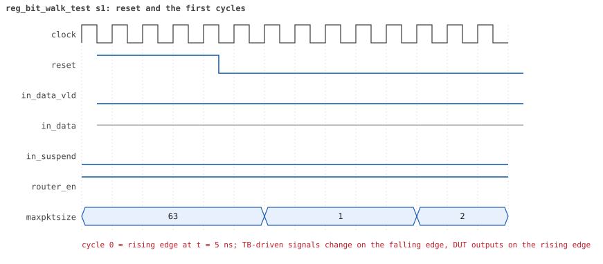
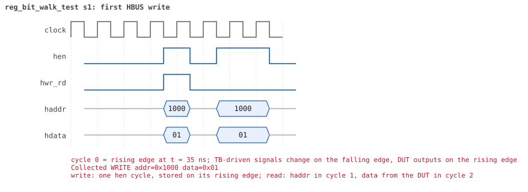
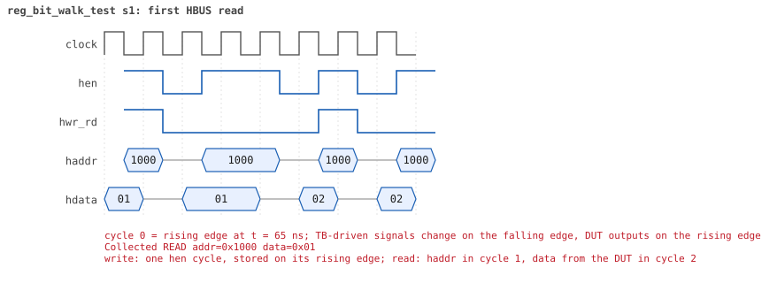

# reg_bit_walk_test

<!-- generated by scripts/project_map/build.py from yapp_project/regression/runs.json -- run the regression, `make sim-report ONLY=yapp_project OUT=yapp_project/regression`, then `make map`; do not edit this file -->

[Back to the regression results →](index.md){ .pm-link } [On the project map →](../project-map.md#view=plan&node=cls:reg_bit_walk_test){ .pm-link }

**4 of 4 seeds passed** · lab: test plan · extends `reg_access_test` · 93 coverage bins hit.

Test plan: every bit of every register obeys its policy -- walking ones and zeros through the RW registers, writes ignored by the RO ones.

## Seeds

| Seed | Result | Sim time | Wall | In / fwd / drop | Out ch0/1/2 | Suspends | Errors | Log | Timeline | Waves |
|---|---|---|---|---|---|---|---|---|---|---|
| 1 | pass | 3us | 0.2 s | 0 / 0 / 0 | 0/0/0 | 0 | 0 | [log ↗](https://github.com/tamirgabgab/Qcom-Mentoring/blob/main/yapp_project/regression/yapp_project_tb/reg_bit_walk_test_s1/reg_bit_walk_test_s1.log) | [timeline ↗](https://github.com/tamirgabgab/Qcom-Mentoring/blob/main/yapp_project/regression/yapp_project_tb/reg_bit_walk_test_s1/timeline.md) | [Surfer ↗](https://app.surfer-project.org/?load_url=https%3A%2F%2Fraw.githubusercontent.com%2Ftamirgabgab%2FQcom-Mentoring%2Fmain%2Fyapp_project%2Fregression%2Fyapp_project_tb%2Freg_bit_walk_test_s1%2Freg_bit_walk_test_s1.fst&startup_commands=run_command_file_from_url%20https%3A%2F%2Fraw.githubusercontent.com%2Ftamirgabgab%2FQcom-Mentoring%2Fmain%2Fyapp_project%2Ftb%2Fyapp_router.sucl) [.fst](https://github.com/tamirgabgab/Qcom-Mentoring/blob/main/yapp_project/regression/yapp_project_tb/reg_bit_walk_test_s1/reg_bit_walk_test_s1.fst) |
| 2 | pass | 3us | 0.2 s | 0 / 0 / 0 | 0/0/0 | 0 | 0 | [log ↗](https://github.com/tamirgabgab/Qcom-Mentoring/blob/main/yapp_project/regression/yapp_project_tb/reg_bit_walk_test_s2/reg_bit_walk_test_s2.log) | [timeline ↗](https://github.com/tamirgabgab/Qcom-Mentoring/blob/main/yapp_project/regression/yapp_project_tb/reg_bit_walk_test_s2/timeline.md) | [Surfer ↗](https://app.surfer-project.org/?load_url=https%3A%2F%2Fraw.githubusercontent.com%2Ftamirgabgab%2FQcom-Mentoring%2Fmain%2Fyapp_project%2Fregression%2Fyapp_project_tb%2Freg_bit_walk_test_s2%2Freg_bit_walk_test_s2.fst&startup_commands=run_command_file_from_url%20https%3A%2F%2Fraw.githubusercontent.com%2Ftamirgabgab%2FQcom-Mentoring%2Fmain%2Fyapp_project%2Ftb%2Fyapp_router.sucl) [.fst](https://github.com/tamirgabgab/Qcom-Mentoring/blob/main/yapp_project/regression/yapp_project_tb/reg_bit_walk_test_s2/reg_bit_walk_test_s2.fst) |
| 3 | pass | 3us | 0.2 s | 0 / 0 / 0 | 0/0/0 | 0 | 0 | [log ↗](https://github.com/tamirgabgab/Qcom-Mentoring/blob/main/yapp_project/regression/yapp_project_tb/reg_bit_walk_test_s3/reg_bit_walk_test_s3.log) | [timeline ↗](https://github.com/tamirgabgab/Qcom-Mentoring/blob/main/yapp_project/regression/yapp_project_tb/reg_bit_walk_test_s3/timeline.md) | [Surfer ↗](https://app.surfer-project.org/?load_url=https%3A%2F%2Fraw.githubusercontent.com%2Ftamirgabgab%2FQcom-Mentoring%2Fmain%2Fyapp_project%2Fregression%2Fyapp_project_tb%2Freg_bit_walk_test_s3%2Freg_bit_walk_test_s3.fst&startup_commands=run_command_file_from_url%20https%3A%2F%2Fraw.githubusercontent.com%2Ftamirgabgab%2FQcom-Mentoring%2Fmain%2Fyapp_project%2Ftb%2Fyapp_router.sucl) [.fst](https://github.com/tamirgabgab/Qcom-Mentoring/blob/main/yapp_project/regression/yapp_project_tb/reg_bit_walk_test_s3/reg_bit_walk_test_s3.fst) |
| 4 | pass | 3us | 0.2 s | 0 / 0 / 0 | 0/0/0 | 0 | 0 | [log ↗](https://github.com/tamirgabgab/Qcom-Mentoring/blob/main/yapp_project/regression/yapp_project_tb/reg_bit_walk_test_s4/reg_bit_walk_test_s4.log) | [timeline ↗](https://github.com/tamirgabgab/Qcom-Mentoring/blob/main/yapp_project/regression/yapp_project_tb/reg_bit_walk_test_s4/timeline.md) | [Surfer ↗](https://app.surfer-project.org/?load_url=https%3A%2F%2Fraw.githubusercontent.com%2Ftamirgabgab%2FQcom-Mentoring%2Fmain%2Fyapp_project%2Fregression%2Fyapp_project_tb%2Freg_bit_walk_test_s4%2Freg_bit_walk_test_s4.fst&startup_commands=run_command_file_from_url%20https%3A%2F%2Fraw.githubusercontent.com%2Ftamirgabgab%2FQcom-Mentoring%2Fmain%2Fyapp_project%2Ftb%2Fyapp_router.sucl) [.fst](https://github.com/tamirgabgab/Qcom-Mentoring/blob/main/yapp_project/regression/yapp_project_tb/reg_bit_walk_test_s4/reg_bit_walk_test_s4.fst) |

## The plan of the test

1. **introspection** — get_registers() and find() split the model into RW and RO queues
2. **RW patterns** — for ctrl_reg and en_reg: 0x01 << b, ~(0x01 << b), 0x00, 0xff, 0xaa, 0x55 -- 20 patterns each
3. **read and peek** — after every write the front-door read and the backdoor peek both return the pattern
4. **RO registers** — poke 0x00 / write 0xff / peek, then poke 0xff / write 0x00 / peek, on all 7 counters and mem_size_reg
5. **RO unchanged** — check_ro_register: the write did nothing
6. **restore** — ctrl_reg = 0x3f, en_reg = 0x01

Expected:

- `--- RW register ctrl_reg: walking ones and zeros ---` then the same for en_reg; at UVM_HIGH one line per pattern.
- `--- RO register ... ---` blocks with `front-door write ... (RO: must be ignored)` and a matching peek; `UVM_ERROR : 0`. The reserved bits ctrl_reg[7:6] and en_reg[3] hold what was written (they are RW in the router).

## Test plan items this test verifies

- [REG-02](../test-plan.md#reg---registers) — RW registers: every bit can be written and read back (covered)
- [REG-03](../test-plan.md#reg---registers) — RO registers ignore writes (covered)
- [HBUS-04](../test-plan.md#hbus---host-port-hbus) — Back-to-back accesses (covered)
- [COV-05](../test-plan.md#cov---functional-coverage) — HBUS: every bit of ctrl_reg and en_reg written as 0 and as 1 (covered)

## Seed 1: what happened

- YAPP driver sent **0** packet(s) (0 with bad parity); the input monitor saw 0.
- Router: **0** forwarded, **0** dropped.
- Packets out: ch0 **0**, ch1 **0**, ch2 **0**.
- Scoreboard: 0 matched, 0 mismatched, 0 unexpected.
- Back-pressure: in_suspend asserted **0** time(s).
- Error pulses: 0.
- HBUS: 56 write(s), 54 read(s).

### Stages

| time (ns) | stage |
|---|---|
| 0 | RW register ctrl_reg: walking ones, walking zeros, 0x00 0xff 0xaa 0x55 |
| 1050 | RW register en_reg: walking ones, walking zeros, 0x00 0xff 0xaa 0x55 |
| 2050 | RO register parity_err_cnt_reg: poke 0x00, front-door read, write 0xff must be ignored |
| 2100 | RO register parity_err_cnt_reg: poke 0xff, front-door read, write 0x00 must be ignored |
| 2150 | RO register oversized_pkt_cnt_reg: poke 0x00, front-door read, write 0xff must be ignored |
| 2200 | RO register oversized_pkt_cnt_reg: poke 0xff, front-door read, write 0x00 must be ignored |
| 2250 | RO register addr3_cnt_reg: poke 0x00, front-door read, write 0xff must be ignored |
| 2300 | RO register addr3_cnt_reg: poke 0xff, front-door read, write 0x00 must be ignored |
| 2350 | RO register addr0_cnt_reg: poke 0x00, front-door read, write 0xff must be ignored |
| 2400 | RO register addr0_cnt_reg: poke 0xff, front-door read, write 0x00 must be ignored |
| 2450 | RO register addr1_cnt_reg: poke 0x00, front-door read, write 0xff must be ignored |
| 2500 | RO register addr1_cnt_reg: poke 0xff, front-door read, write 0x00 must be ignored |
| 2550 | RO register addr2_cnt_reg: poke 0x00, front-door read, write 0xff must be ignored |
| 2600 | RO register addr2_cnt_reg: poke 0xff, front-door read, write 0x00 must be ignored |
| 2650 | RO register mem_size_reg: poke 0x00, front-door read, write 0xff must be ignored |
| 2700 | RO register mem_size_reg: poke 0xff, front-door read, write 0x00 must be ignored |
| 2750 | ctrl_reg and en_reg back to their reset values |

### Pictures

The moments the report draws from the signal trace of this run (the same pictures are in the run's folder of the report).

**reset and the first cycles**

**first HBUS write**

**first HBUS read**

Run it yourself: `make sim TEST=reg_bit_walk_test SEED=1 WAVES=1` in `yapp_project/tb`, or `make run-project TEST=reg_bit_walk_test` with Xcelium.
