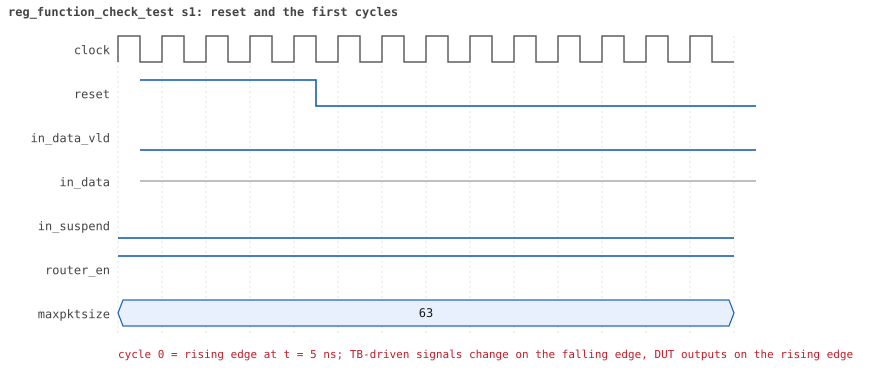
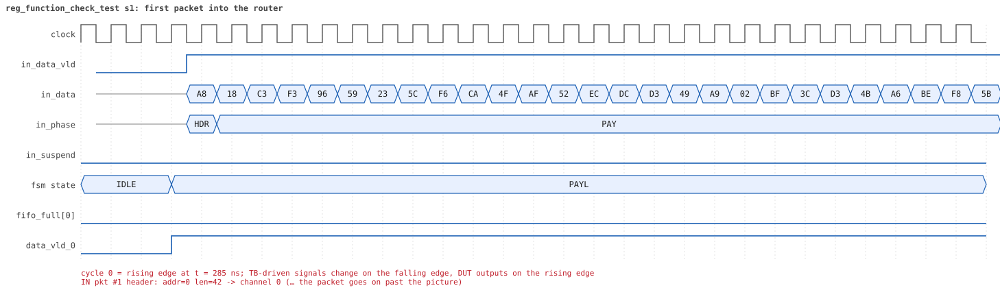
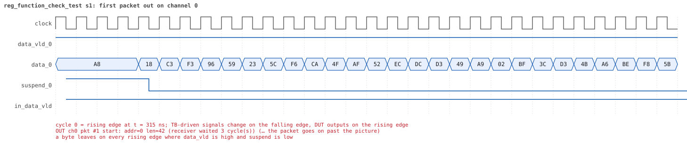
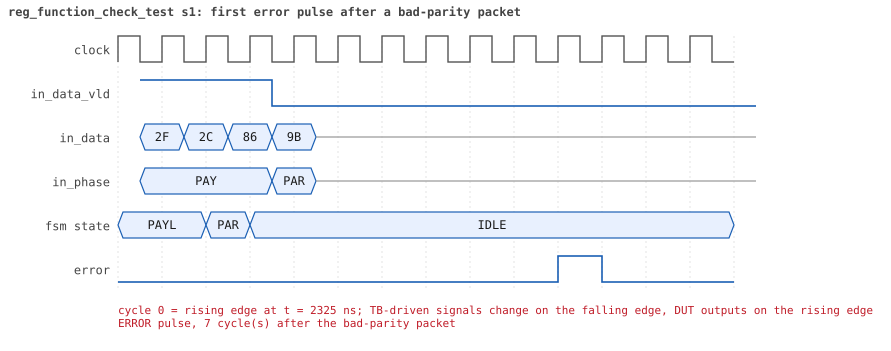
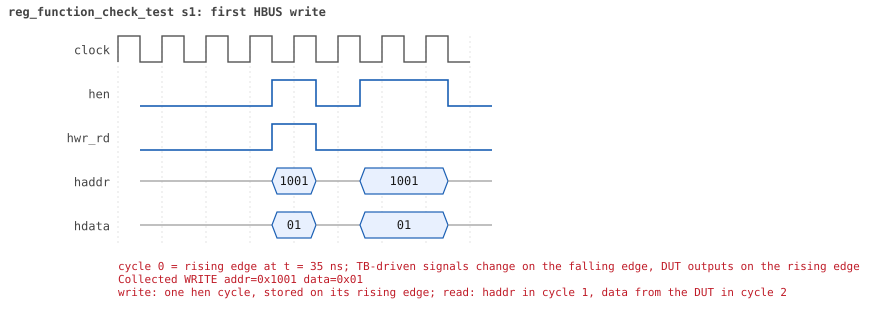
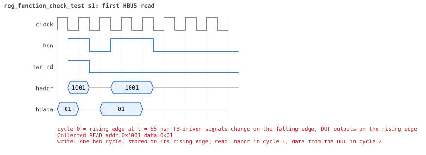

# reg_function_check_test

<!-- generated by scripts/project_map/build.py from yapp_project/regression/runs.json -- run the regression, `make sim-report ONLY=yapp_project OUT=yapp_project/regression`, then `make map`; do not edit this file -->

[Back to the regression results →](index.md){ .pm-link } [On the project map →](../project-map.md#view=plan&node=cls:reg_function_check_test){ .pm-link }

**4 of 4 seeds passed** · lab: [11C](../labs/lab11c.md) · extends `reg_function_test` · 90 coverage bins hit.

Lab 11C (optional): the same test with the model checking every read itself.

## Seeds

| Seed | Result | Sim time | Wall | In / fwd / drop | Out ch0/1/2 | Suspends | Errors | Log | Timeline | Waves |
|---|---|---|---|---|---|---|---|---|---|---|
| 1 | pass | 5us | 0.7 s | 9 / 9 / 0 | 3/3/3 | 0 | 0 | [log ↗](https://github.com/tamirgabgab/Qcom-Mentoring/blob/main/yapp_project/regression/yapp_project_tb/reg_function_check_test_s1/reg_function_check_test_s1.log) | [timeline ↗](https://github.com/tamirgabgab/Qcom-Mentoring/blob/main/yapp_project/regression/yapp_project_tb/reg_function_check_test_s1/timeline.md) | [Surfer ↗](https://app.surfer-project.org/?load_url=https%3A%2F%2Fraw.githubusercontent.com%2Ftamirgabgab%2FQcom-Mentoring%2Fmain%2Fyapp_project%2Fregression%2Fyapp_project_tb%2Freg_function_check_test_s1%2Freg_function_check_test_s1.fst&startup_commands=run_command_file_from_url%20https%3A%2F%2Fraw.githubusercontent.com%2Ftamirgabgab%2FQcom-Mentoring%2Fmain%2Fyapp_project%2Ftb%2Fyapp_router.sucl) [.fst](https://github.com/tamirgabgab/Qcom-Mentoring/blob/main/yapp_project/regression/yapp_project_tb/reg_function_check_test_s1/reg_function_check_test_s1.fst) |
| 2 | pass | 5us | 0.7 s | 9 / 9 / 0 | 3/3/3 | 0 | 0 | [log ↗](https://github.com/tamirgabgab/Qcom-Mentoring/blob/main/yapp_project/regression/yapp_project_tb/reg_function_check_test_s2/reg_function_check_test_s2.log) | [timeline ↗](https://github.com/tamirgabgab/Qcom-Mentoring/blob/main/yapp_project/regression/yapp_project_tb/reg_function_check_test_s2/timeline.md) | [Surfer ↗](https://app.surfer-project.org/?load_url=https%3A%2F%2Fraw.githubusercontent.com%2Ftamirgabgab%2FQcom-Mentoring%2Fmain%2Fyapp_project%2Fregression%2Fyapp_project_tb%2Freg_function_check_test_s2%2Freg_function_check_test_s2.fst&startup_commands=run_command_file_from_url%20https%3A%2F%2Fraw.githubusercontent.com%2Ftamirgabgab%2FQcom-Mentoring%2Fmain%2Fyapp_project%2Ftb%2Fyapp_router.sucl) [.fst](https://github.com/tamirgabgab/Qcom-Mentoring/blob/main/yapp_project/regression/yapp_project_tb/reg_function_check_test_s2/reg_function_check_test_s2.fst) |
| 3 | pass | 5us | 0.7 s | 9 / 9 / 0 | 3/3/3 | 0 | 0 | [log ↗](https://github.com/tamirgabgab/Qcom-Mentoring/blob/main/yapp_project/regression/yapp_project_tb/reg_function_check_test_s3/reg_function_check_test_s3.log) | [timeline ↗](https://github.com/tamirgabgab/Qcom-Mentoring/blob/main/yapp_project/regression/yapp_project_tb/reg_function_check_test_s3/timeline.md) | [Surfer ↗](https://app.surfer-project.org/?load_url=https%3A%2F%2Fraw.githubusercontent.com%2Ftamirgabgab%2FQcom-Mentoring%2Fmain%2Fyapp_project%2Fregression%2Fyapp_project_tb%2Freg_function_check_test_s3%2Freg_function_check_test_s3.fst&startup_commands=run_command_file_from_url%20https%3A%2F%2Fraw.githubusercontent.com%2Ftamirgabgab%2FQcom-Mentoring%2Fmain%2Fyapp_project%2Ftb%2Fyapp_router.sucl) [.fst](https://github.com/tamirgabgab/Qcom-Mentoring/blob/main/yapp_project/regression/yapp_project_tb/reg_function_check_test_s3/reg_function_check_test_s3.fst) |
| 4 | pass | 4us | 0.6 s | 9 / 9 / 0 | 3/3/3 | 0 | 0 | [log ↗](https://github.com/tamirgabgab/Qcom-Mentoring/blob/main/yapp_project/regression/yapp_project_tb/reg_function_check_test_s4/reg_function_check_test_s4.log) | [timeline ↗](https://github.com/tamirgabgab/Qcom-Mentoring/blob/main/yapp_project/regression/yapp_project_tb/reg_function_check_test_s4/timeline.md) | [Surfer ↗](https://app.surfer-project.org/?load_url=https%3A%2F%2Fraw.githubusercontent.com%2Ftamirgabgab%2FQcom-Mentoring%2Fmain%2Fyapp_project%2Fregression%2Fyapp_project_tb%2Freg_function_check_test_s4%2Freg_function_check_test_s4.fst&startup_commands=run_command_file_from_url%20https%3A%2F%2Fraw.githubusercontent.com%2Ftamirgabgab%2FQcom-Mentoring%2Fmain%2Fyapp_project%2Ftb%2Fyapp_router.sucl) [.fst](https://github.com/tamirgabgab/Qcom-Mentoring/blob/main/yapp_project/regression/yapp_project_tb/reg_function_check_test_s4/reg_function_check_test_s4.fst) |

## The plan of the test

1. **set_check_on_read(1)** — on default_map at the start of run_phase
2. **reg_function_test** — the same two steps: en_reg = 0x01, 3 packets; en_reg = 0xff, 6 packets
3. **predict + read** — check_counter() loads the mirror with predict(expected), then read() compares the DUT value with it

Expected:

- Same values as reg_function_test, 0 errors.
- Comment out predict() to see the check-on-read errors: RO counters move without bus traffic, so the mirror is stale.

## Test plan items this test verifies

- [REG-07](../test-plan.md#reg---registers) — Automatic checking on read (check_on_read + predict) (covered)

## Seed 1: what happened

- YAPP driver sent **9** packet(s) (2 with bad parity); the input monitor saw 9.
- Router: **9** forwarded, **0** dropped.
- Packets out: ch0 **3**, ch1 **3**, ch2 **3**.
- Scoreboard: 9 matched, 0 mismatched, 0 unexpected.
- Back-pressure: in_suspend asserted **0** time(s).
- Error pulses: 2.
- HBUS: 2 write(s), 11 read(s).

### Stages

| time (ns) | stage |
|---|---|
| 0 | check_on_read: every front-door read is compared with the value the model predicts |
| 0 | 1. en_reg=0x01 (router on, counters off): 3 packets, the address counters stay 0 |
| 1800 | 2. en_reg=0xff (every counter on): 6 packets, 2 per address, counters follow the traffic |

### Pictures

The moments the report draws from the signal trace of this run (the same pictures are in the run's folder of the report).

**reset and the first cycles**

**first packet into the router**

**first packet out on channel 0**

**first error pulse after a bad-parity packet**

**first HBUS write**

**first HBUS read**

Run it yourself: `make sim TEST=reg_function_check_test SEED=1 WAVES=1` in `yapp_project/tb`, or `make run-project TEST=reg_function_check_test` with Xcelium.
