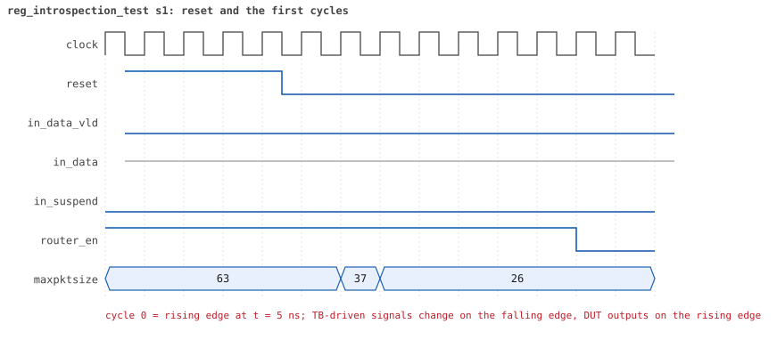
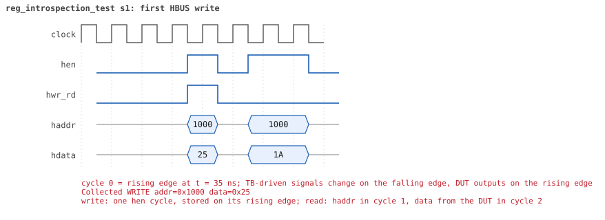
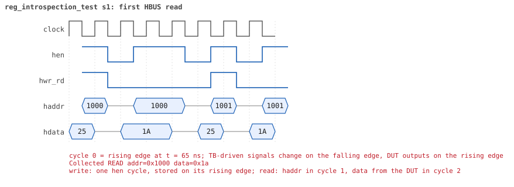

# reg_introspection_test

<!-- generated by scripts/project_map/build.py from yapp_project/regression/runs.json -- run the regression, `make sim-report ONLY=yapp_project OUT=yapp_project/regression`, then `make map`; do not edit this file -->

[Back to the regression results →](index.md){ .pm-link } [On the project map →](../project-map.md#view=plan&node=cls:reg_introspection_test){ .pm-link }

**4 of 4 seeds passed** · lab: [11C](../labs/lab11c.md) · extends `reg_access_test` · 70 coverage bins hit.

Lab 11C (optional): the model tells the test which registers are RW and which are RO, then every one is checked.

## Seeds

| Seed | Result | Sim time | Wall | In / fwd / drop | Out ch0/1/2 | Suspends | Errors | Log | Timeline | Waves |
|---|---|---|---|---|---|---|---|---|---|---|
| 1 | pass | 700ns | 0.2 s | 0 / 0 / 0 | 0/0/0 | 0 | 0 | [log ↗](https://github.com/tamirgabgab/Qcom-Mentoring/blob/main/yapp_project/regression/yapp_project_tb/reg_introspection_test_s1/reg_introspection_test_s1.log) | [timeline ↗](https://github.com/tamirgabgab/Qcom-Mentoring/blob/main/yapp_project/regression/yapp_project_tb/reg_introspection_test_s1/timeline.md) | [Surfer ↗](https://app.surfer-project.org/?load_url=https%3A%2F%2Fraw.githubusercontent.com%2Ftamirgabgab%2FQcom-Mentoring%2Fmain%2Fyapp_project%2Fregression%2Fyapp_project_tb%2Freg_introspection_test_s1%2Freg_introspection_test_s1.fst&startup_commands=run_command_file_from_url%20https%3A%2F%2Fraw.githubusercontent.com%2Ftamirgabgab%2FQcom-Mentoring%2Fmain%2Fyapp_project%2Ftb%2Fyapp_router.sucl) [.fst](https://github.com/tamirgabgab/Qcom-Mentoring/blob/main/yapp_project/regression/yapp_project_tb/reg_introspection_test_s1/reg_introspection_test_s1.fst) |
| 2 | pass | 700ns | 0.2 s | 0 / 0 / 0 | 0/0/0 | 0 | 0 | [log ↗](https://github.com/tamirgabgab/Qcom-Mentoring/blob/main/yapp_project/regression/yapp_project_tb/reg_introspection_test_s2/reg_introspection_test_s2.log) | [timeline ↗](https://github.com/tamirgabgab/Qcom-Mentoring/blob/main/yapp_project/regression/yapp_project_tb/reg_introspection_test_s2/timeline.md) | [Surfer ↗](https://app.surfer-project.org/?load_url=https%3A%2F%2Fraw.githubusercontent.com%2Ftamirgabgab%2FQcom-Mentoring%2Fmain%2Fyapp_project%2Fregression%2Fyapp_project_tb%2Freg_introspection_test_s2%2Freg_introspection_test_s2.fst&startup_commands=run_command_file_from_url%20https%3A%2F%2Fraw.githubusercontent.com%2Ftamirgabgab%2FQcom-Mentoring%2Fmain%2Fyapp_project%2Ftb%2Fyapp_router.sucl) [.fst](https://github.com/tamirgabgab/Qcom-Mentoring/blob/main/yapp_project/regression/yapp_project_tb/reg_introspection_test_s2/reg_introspection_test_s2.fst) |
| 3 | pass | 700ns | 0.2 s | 0 / 0 / 0 | 0/0/0 | 0 | 0 | [log ↗](https://github.com/tamirgabgab/Qcom-Mentoring/blob/main/yapp_project/regression/yapp_project_tb/reg_introspection_test_s3/reg_introspection_test_s3.log) | [timeline ↗](https://github.com/tamirgabgab/Qcom-Mentoring/blob/main/yapp_project/regression/yapp_project_tb/reg_introspection_test_s3/timeline.md) | [Surfer ↗](https://app.surfer-project.org/?load_url=https%3A%2F%2Fraw.githubusercontent.com%2Ftamirgabgab%2FQcom-Mentoring%2Fmain%2Fyapp_project%2Fregression%2Fyapp_project_tb%2Freg_introspection_test_s3%2Freg_introspection_test_s3.fst&startup_commands=run_command_file_from_url%20https%3A%2F%2Fraw.githubusercontent.com%2Ftamirgabgab%2FQcom-Mentoring%2Fmain%2Fyapp_project%2Ftb%2Fyapp_router.sucl) [.fst](https://github.com/tamirgabgab/Qcom-Mentoring/blob/main/yapp_project/regression/yapp_project_tb/reg_introspection_test_s3/reg_introspection_test_s3.fst) |
| 4 | pass | 700ns | 0.2 s | 0 / 0 / 0 | 0/0/0 | 0 | 0 | [log ↗](https://github.com/tamirgabgab/Qcom-Mentoring/blob/main/yapp_project/regression/yapp_project_tb/reg_introspection_test_s4/reg_introspection_test_s4.log) | [timeline ↗](https://github.com/tamirgabgab/Qcom-Mentoring/blob/main/yapp_project/regression/yapp_project_tb/reg_introspection_test_s4/timeline.md) | [Surfer ↗](https://app.surfer-project.org/?load_url=https%3A%2F%2Fraw.githubusercontent.com%2Ftamirgabgab%2FQcom-Mentoring%2Fmain%2Fyapp_project%2Fregression%2Fyapp_project_tb%2Freg_introspection_test_s4%2Freg_introspection_test_s4.fst&startup_commands=run_command_file_from_url%20https%3A%2F%2Fraw.githubusercontent.com%2Ftamirgabgab%2FQcom-Mentoring%2Fmain%2Fyapp_project%2Ftb%2Fyapp_router.sucl) [.fst](https://github.com/tamirgabgab/Qcom-Mentoring/blob/main/yapp_project/regression/yapp_project_tb/reg_introspection_test_s4/reg_introspection_test_s4.fst) |

## The plan of the test

1. **default sequences** — as reg_access_test
2. **clk10_rst5_seq** — clock and reset
3. **introspection** — get_registers(all_q); find() with get_rights() == RW / RO
4. **RW checks** — check_rw_register on ctrl_reg and en_reg
5. **RO checks** — check_ro_register on the six counters and mem_size_reg

Expected:

- `RW register: ctrl_reg @ 0x1000`, `RW register: en_reg @ 0x1001`, seven `RO register:` lines, then the access checks for all nine registers, 0 errors.

## Test plan items this test verifies

- [REG-03](../test-plan.md#reg---registers) — RO registers ignore writes (covered)
- [REG-04](../test-plan.md#reg---registers) — Front door and backdoor see the same flip-flops (covered)
- [TB-08](../test-plan.md#tb---testbench-mechanics) — The register model describes itself (covered)

## Seed 1: what happened

- YAPP driver sent **0** packet(s) (0 with bad parity); the input monitor saw 0.
- Router: **0** forwarded, **0** dropped.
- Packets out: ch0 **0**, ch1 **0**, ch2 **0**.
- Scoreboard: 0 matched, 0 mismatched, 0 unexpected.
- Back-pressure: in_suspend asserted **0** time(s).
- Error pulses: 0.
- HBUS: 9 write(s), 9 read(s).

### Stages

| time (ns) | stage |
|---|---|
| 0 | list every register of the model by access rights, then check each one |
| 0 | RW register ctrl_reg: front-door write 0x25, peek, poke 0x1a, front-door read |
| 100 | RW register en_reg: front-door write 0x25, peek, poke 0x1a, front-door read |
| 150 | RO register parity_err_cnt_reg: poke 0x5a, front-door read, write 0x33 must be ignored |
| 200 | RO register oversized_pkt_cnt_reg: poke 0x5a, front-door read, write 0x33 must be ignored |
| 250 | RO register addr3_cnt_reg: poke 0x5a, front-door read, write 0x33 must be ignored |
| 300 | RO register addr0_cnt_reg: poke 0x5a, front-door read, write 0x33 must be ignored |
| 350 | RO register addr1_cnt_reg: poke 0x5a, front-door read, write 0x33 must be ignored |
| 400 | RO register addr2_cnt_reg: poke 0x5a, front-door read, write 0x33 must be ignored |
| 450 | RO register mem_size_reg: poke 0x5a, front-door read, write 0x33 must be ignored |

### Pictures

The moments the report draws from the signal trace of this run (the same pictures are in the run's folder of the report).

**reset and the first cycles**

**first HBUS write**

**first HBUS read**

Run it yourself: `make sim TEST=reg_introspection_test SEED=1 WAVES=1` in `yapp_project/tb`, or `make run-project TEST=reg_introspection_test` with Xcelium.
