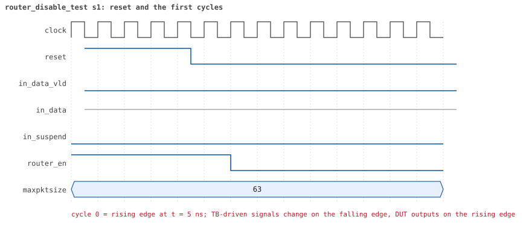
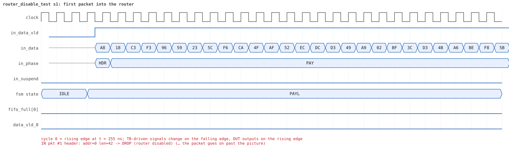
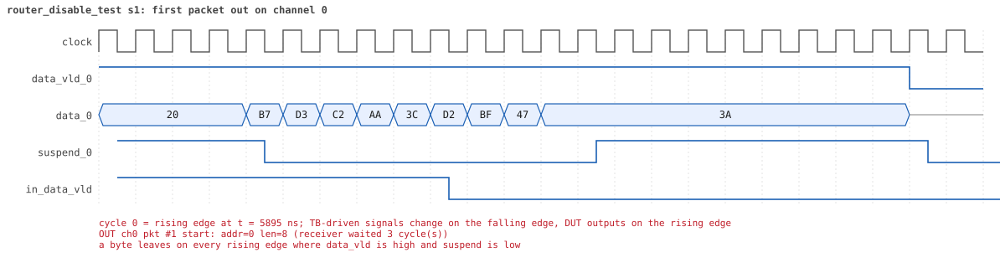
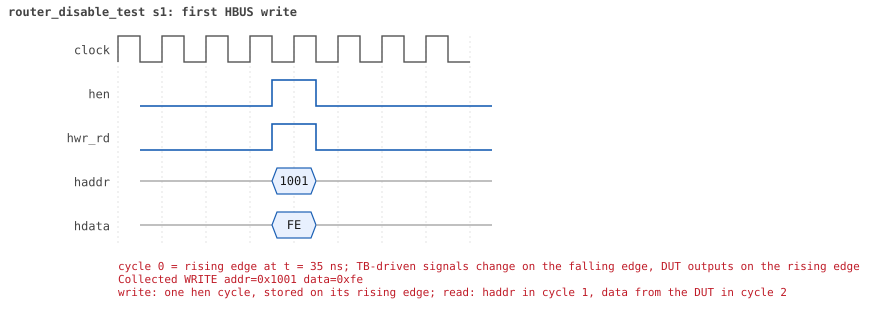
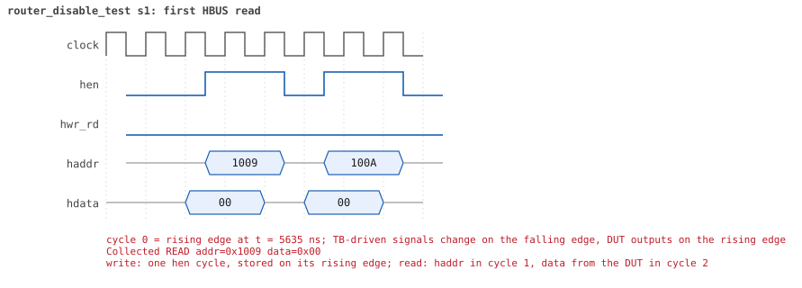

# router_disable_test

<!-- generated by scripts/project_map/build.py from yapp_project/regression/runs.json -- run the regression, `make sim-report ONLY=yapp_project OUT=yapp_project/regression`, then `make map`; do not edit this file -->

[Back to the regression results →](index.md){ .pm-link } [On the project map →](../project-map.md#view=plan&node=cls:router_disable_test){ .pm-link }

**4 of 4 seeds passed** · lab: test plan · extends `reg_function_test` · 80 coverage bins hit.

Test plan: router_en = 0 makes the router deaf -- nothing reaches a channel, nothing is counted, nothing is stored; traffic resumes when it is enabled again.

## Seeds

| Seed | Result | Sim time | Wall | In / fwd / drop | Out ch0/1/2 | Suspends | Errors | Log | Timeline | Waves |
|---|---|---|---|---|---|---|---|---|---|---|
| 1 | pass | 8us | 0.6 s | 6 / 3 / 3 | 1/1/1 | 0 | 0 | [log ↗](https://github.com/tamirgabgab/Qcom-Mentoring/blob/main/yapp_project/regression/yapp_project_tb/router_disable_test_s1/router_disable_test_s1.log) | [timeline ↗](https://github.com/tamirgabgab/Qcom-Mentoring/blob/main/yapp_project/regression/yapp_project_tb/router_disable_test_s1/timeline.md) | [Surfer ↗](https://app.surfer-project.org/?load_url=https%3A%2F%2Fraw.githubusercontent.com%2Ftamirgabgab%2FQcom-Mentoring%2Fmain%2Fyapp_project%2Fregression%2Fyapp_project_tb%2Frouter_disable_test_s1%2Frouter_disable_test_s1.fst&startup_commands=run_command_file_from_url%20https%3A%2F%2Fraw.githubusercontent.com%2Ftamirgabgab%2FQcom-Mentoring%2Fmain%2Fyapp_project%2Ftb%2Fyapp_router.sucl) [.fst](https://github.com/tamirgabgab/Qcom-Mentoring/blob/main/yapp_project/regression/yapp_project_tb/router_disable_test_s1/router_disable_test_s1.fst) |
| 2 | pass | 8us | 0.6 s | 6 / 3 / 3 | 1/1/1 | 0 | 0 | [log ↗](https://github.com/tamirgabgab/Qcom-Mentoring/blob/main/yapp_project/regression/yapp_project_tb/router_disable_test_s2/router_disable_test_s2.log) | [timeline ↗](https://github.com/tamirgabgab/Qcom-Mentoring/blob/main/yapp_project/regression/yapp_project_tb/router_disable_test_s2/timeline.md) | [Surfer ↗](https://app.surfer-project.org/?load_url=https%3A%2F%2Fraw.githubusercontent.com%2Ftamirgabgab%2FQcom-Mentoring%2Fmain%2Fyapp_project%2Fregression%2Fyapp_project_tb%2Frouter_disable_test_s2%2Frouter_disable_test_s2.fst&startup_commands=run_command_file_from_url%20https%3A%2F%2Fraw.githubusercontent.com%2Ftamirgabgab%2FQcom-Mentoring%2Fmain%2Fyapp_project%2Ftb%2Fyapp_router.sucl) [.fst](https://github.com/tamirgabgab/Qcom-Mentoring/blob/main/yapp_project/regression/yapp_project_tb/router_disable_test_s2/router_disable_test_s2.fst) |
| 3 | pass | 8us | 0.6 s | 6 / 3 / 3 | 1/1/1 | 0 | 0 | [log ↗](https://github.com/tamirgabgab/Qcom-Mentoring/blob/main/yapp_project/regression/yapp_project_tb/router_disable_test_s3/router_disable_test_s3.log) | [timeline ↗](https://github.com/tamirgabgab/Qcom-Mentoring/blob/main/yapp_project/regression/yapp_project_tb/router_disable_test_s3/timeline.md) | [Surfer ↗](https://app.surfer-project.org/?load_url=https%3A%2F%2Fraw.githubusercontent.com%2Ftamirgabgab%2FQcom-Mentoring%2Fmain%2Fyapp_project%2Fregression%2Fyapp_project_tb%2Frouter_disable_test_s3%2Frouter_disable_test_s3.fst&startup_commands=run_command_file_from_url%20https%3A%2F%2Fraw.githubusercontent.com%2Ftamirgabgab%2FQcom-Mentoring%2Fmain%2Fyapp_project%2Ftb%2Fyapp_router.sucl) [.fst](https://github.com/tamirgabgab/Qcom-Mentoring/blob/main/yapp_project/regression/yapp_project_tb/router_disable_test_s3/router_disable_test_s3.fst) |
| 4 | pass | 7us | 0.6 s | 6 / 3 / 3 | 1/1/1 | 0 | 0 | [log ↗](https://github.com/tamirgabgab/Qcom-Mentoring/blob/main/yapp_project/regression/yapp_project_tb/router_disable_test_s4/router_disable_test_s4.log) | [timeline ↗](https://github.com/tamirgabgab/Qcom-Mentoring/blob/main/yapp_project/regression/yapp_project_tb/router_disable_test_s4/timeline.md) | [Surfer ↗](https://app.surfer-project.org/?load_url=https%3A%2F%2Fraw.githubusercontent.com%2Ftamirgabgab%2FQcom-Mentoring%2Fmain%2Fyapp_project%2Fregression%2Fyapp_project_tb%2Frouter_disable_test_s4%2Frouter_disable_test_s4.fst&startup_commands=run_command_file_from_url%20https%3A%2F%2Fraw.githubusercontent.com%2Ftamirgabgab%2FQcom-Mentoring%2Fmain%2Fyapp_project%2Ftb%2Fyapp_router.sucl) [.fst](https://github.com/tamirgabgab/Qcom-Mentoring/blob/main/yapp_project/regression/yapp_project_tb/router_disable_test_s4/router_disable_test_s4.fst) |

## The plan of the test

1. **default sequences** — clock and channel sequences (inherited from reg_access_test)
2. **en_reg = 0xfe** — front door: router off, every counter on
3. **yapp_012_seq** — 3 packets, one per channel, into a disabled router
4. **nothing delivered** — channel monitors collected nothing; the reference model reports 3 dropped (router disabled)
5. **counters stay 0** — addr0..3, parity, oversized and mem_size_reg all read 0
6. **en_reg = 0xff** — router on, counters on
7. **yapp_012_seq** — 3 packets again
8. **traffic resumes** — 3 packets on the channels, addr0/1/2 counters read 1

Expected:

- `router_en = 0: no packet reached a channel`, the reference model's `Packet dropped: router disabled` three times, and `ROUTER DROPS PACKET ... (router disabled)` from the RTL.
- Every `check_counter` line says `reads 0 as expected` after the first run and `reads 1` for addr0/1/2 after the second; `UVM_ERROR : 0`.

## Test plan items this test verifies

- [DROP-02](../test-plan.md#drop---drop-rules) — router_en = 0 drops every packet (covered)
- [HBUS-05](../test-plan.md#hbus---host-port-hbus) — The register model's front door is HBUS traffic (covered)

## Seed 1: what happened

- YAPP driver sent **6** packet(s) (0 with bad parity); the input monitor saw 6.
- Router: **3** forwarded, **3** dropped (3 router disabled).
- Packets out: ch0 **1**, ch1 **1**, ch2 **1**.
- Scoreboard: 3 matched, 0 mismatched, 0 unexpected.
- Back-pressure: in_suspend asserted **0** time(s).
- Error pulses: 0.
- HBUS: 2 write(s), 11 read(s).

### Stages

| time (ns) | stage |
|---|---|
| 0 | 1. en_reg=0xfe (router_en=0, counters on): 3 packets into a deaf router |
| 5850 | 2. en_reg=0xff (router_en=1): 3 packets, traffic and counters resume |

### Pictures

The moments the report draws from the signal trace of this run (the same pictures are in the run's folder of the report).

**reset and the first cycles**

**first packet into the router**

**first packet out on channel 0**

**first HBUS write**

**first HBUS read**

Run it yourself: `make sim TEST=router_disable_test SEED=1 WAVES=1` in `yapp_project/tb`, or `make run-project TEST=router_disable_test` with Xcelium.
