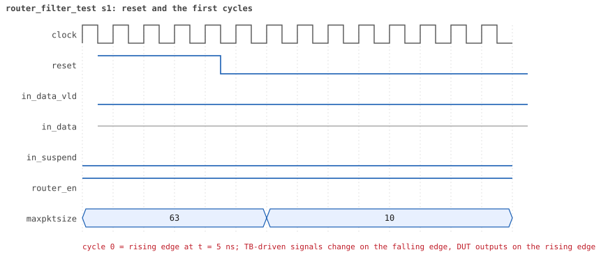
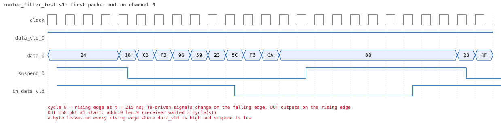
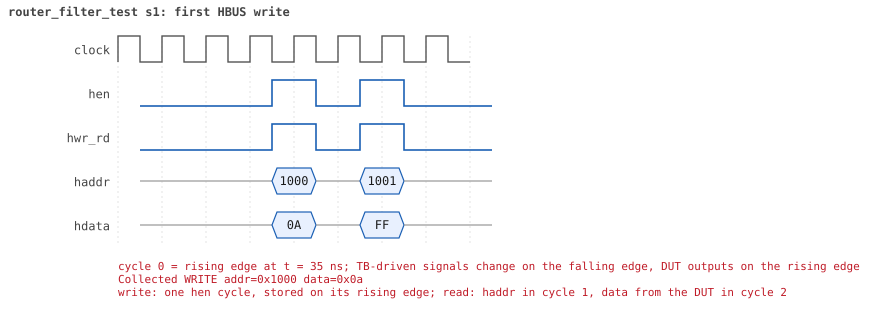

# router_filter_test

<!-- generated by scripts/project_map/build.py from yapp_project/regression/runs.json -- run the regression, `make sim-report ONLY=yapp_project OUT=yapp_project/regression`, then `make map`; do not edit this file -->

[Back to the regression results →](index.md){ .pm-link } [On the project map →](../project-map.md#view=plan&node=cls:router_filter_test){ .pm-link }

**4 of 4 seeds passed** · lab: test plan · extends `reg_function_test` · 99 coverage bins hit.

Test plan: the drop rules around the maxpktsize limit and the counters behind them, with the counters enabled and then disabled.

## Seeds

| Seed | Result | Sim time | Wall | In / fwd / drop | Out ch0/1/2 | Suspends | Errors | Log | Timeline | Waves |
|---|---|---|---|---|---|---|---|---|---|---|
| 1 | pass | 12us | 1.6 s | 32 / 12 / 20 | 4/4/4 | 0 | 0 | [log ↗](https://github.com/tamirgabgab/Qcom-Mentoring/blob/main/yapp_project/regression/yapp_project_tb/router_filter_test_s1/router_filter_test_s1.log) | [timeline ↗](https://github.com/tamirgabgab/Qcom-Mentoring/blob/main/yapp_project/regression/yapp_project_tb/router_filter_test_s1/timeline.md) | [Surfer ↗](https://app.surfer-project.org/?load_url=https%3A%2F%2Fraw.githubusercontent.com%2Ftamirgabgab%2FQcom-Mentoring%2Fmain%2Fyapp_project%2Fregression%2Fyapp_project_tb%2Frouter_filter_test_s1%2Frouter_filter_test_s1.fst&startup_commands=run_command_file_from_url%20https%3A%2F%2Fraw.githubusercontent.com%2Ftamirgabgab%2FQcom-Mentoring%2Fmain%2Fyapp_project%2Ftb%2Fyapp_router.sucl) [.fst](https://github.com/tamirgabgab/Qcom-Mentoring/blob/main/yapp_project/regression/yapp_project_tb/router_filter_test_s1/router_filter_test_s1.fst) |
| 2 | pass | 13us | 1.6 s | 32 / 12 / 20 | 4/4/4 | 0 | 0 | [log ↗](https://github.com/tamirgabgab/Qcom-Mentoring/blob/main/yapp_project/regression/yapp_project_tb/router_filter_test_s2/router_filter_test_s2.log) | [timeline ↗](https://github.com/tamirgabgab/Qcom-Mentoring/blob/main/yapp_project/regression/yapp_project_tb/router_filter_test_s2/timeline.md) | [Surfer ↗](https://app.surfer-project.org/?load_url=https%3A%2F%2Fraw.githubusercontent.com%2Ftamirgabgab%2FQcom-Mentoring%2Fmain%2Fyapp_project%2Fregression%2Fyapp_project_tb%2Frouter_filter_test_s2%2Frouter_filter_test_s2.fst&startup_commands=run_command_file_from_url%20https%3A%2F%2Fraw.githubusercontent.com%2Ftamirgabgab%2FQcom-Mentoring%2Fmain%2Fyapp_project%2Ftb%2Fyapp_router.sucl) [.fst](https://github.com/tamirgabgab/Qcom-Mentoring/blob/main/yapp_project/regression/yapp_project_tb/router_filter_test_s2/router_filter_test_s2.fst) |
| 3 | pass | 13us | 1.7 s | 32 / 12 / 20 | 4/4/4 | 0 | 0 | [log ↗](https://github.com/tamirgabgab/Qcom-Mentoring/blob/main/yapp_project/regression/yapp_project_tb/router_filter_test_s3/router_filter_test_s3.log) | [timeline ↗](https://github.com/tamirgabgab/Qcom-Mentoring/blob/main/yapp_project/regression/yapp_project_tb/router_filter_test_s3/timeline.md) | [Surfer ↗](https://app.surfer-project.org/?load_url=https%3A%2F%2Fraw.githubusercontent.com%2Ftamirgabgab%2FQcom-Mentoring%2Fmain%2Fyapp_project%2Fregression%2Fyapp_project_tb%2Frouter_filter_test_s3%2Frouter_filter_test_s3.fst&startup_commands=run_command_file_from_url%20https%3A%2F%2Fraw.githubusercontent.com%2Ftamirgabgab%2FQcom-Mentoring%2Fmain%2Fyapp_project%2Ftb%2Fyapp_router.sucl) [.fst](https://github.com/tamirgabgab/Qcom-Mentoring/blob/main/yapp_project/regression/yapp_project_tb/router_filter_test_s3/router_filter_test_s3.fst) |
| 4 | pass | 13us | 1.6 s | 32 / 12 / 20 | 4/4/4 | 0 | 0 | [log ↗](https://github.com/tamirgabgab/Qcom-Mentoring/blob/main/yapp_project/regression/yapp_project_tb/router_filter_test_s4/router_filter_test_s4.log) | [timeline ↗](https://github.com/tamirgabgab/Qcom-Mentoring/blob/main/yapp_project/regression/yapp_project_tb/router_filter_test_s4/timeline.md) | [Surfer ↗](https://app.surfer-project.org/?load_url=https%3A%2F%2Fraw.githubusercontent.com%2Ftamirgabgab%2FQcom-Mentoring%2Fmain%2Fyapp_project%2Fregression%2Fyapp_project_tb%2Frouter_filter_test_s4%2Frouter_filter_test_s4.fst&startup_commands=run_command_file_from_url%20https%3A%2F%2Fraw.githubusercontent.com%2Ftamirgabgab%2FQcom-Mentoring%2Fmain%2Fyapp_project%2Ftb%2Fyapp_router.sucl) [.fst](https://github.com/tamirgabgab/Qcom-Mentoring/blob/main/yapp_project/regression/yapp_project_tb/router_filter_test_s4/router_filter_test_s4.fst) |

## The plan of the test

1. **maxpktsize = 10** — ctrl_reg = 10 through the front door; en_reg = 0xff
2. **yapp_boundary_seq** — lengths 9, 10, 11 and 63 to every address 0..3: 16 packets
3. **scoreboard** — only legal, non-oversized packets are matched (6); none unexpected
4. **counters** — oversized == 8, addr3 == 4, addr0/1/2 == 4 each (dropped ones included), parity == 0
5. **en_reg = 0x01** — every counter off, router on
6. **yapp_boundary_seq** — the same 16 packets
7. **frozen counters** — same drops (6 matched again), every counter unchanged

Expected:

- `ROUTER DROPS PACKET ... length > maxpktsize` for the 11- and 63-byte packets to addresses 0..2, `... illegal address` for the four address-3 packets.
- `oversized_pkt_cnt_reg reads 8 as expected`, `addr3_cnt_reg reads 4`, `addr0_cnt_reg reads 4` (and 1, 2) after the first pass and unchanged after the second; scoreboard matched 12, unexpected 0.

## Test plan items this test verifies

- [ROUTE-01](../test-plan.md#route---routing) — The address selects the output channel (covered)
- [ROUTE-02](../test-plan.md#route---routing) — Payload and parity arrive unchanged (covered)
- [ROUTE-03](../test-plan.md#route---routing) — Order is kept per channel, channels are independent (covered)
- [PKT-03](../test-plan.md#pkt---packet-format) — Address 3 is illegal (covered)
- [PKT-04](../test-plan.md#pkt---packet-format) — Even bitwise parity over header and payload (covered)
- [OUT-04](../test-plan.md#out---output-port-protocol) — suspend_x is re-asserted at the parity byte: the next packet waits (covered)
- [DROP-01](../test-plan.md#drop---drop-rules) — length > maxpktsize drops the whole packet (covered)
- [DROP-03](../test-plan.md#drop---drop-rules) — Address 3 drops the packet (covered)
- [DROP-04](../test-plan.md#drop---drop-rules) — An oversized packet to address 3 counts in both counters (covered)
- [CNT-01](../test-plan.md#cnt---counters) — A counter counts only while its enable bit is set (covered)
- [CNT-02](../test-plan.md#cnt---counters) — addrN_cnt_reg counts every received packet with address N (covered)
- [CNT-04](../test-plan.md#cnt---counters) — oversized_pkt_cnt_reg counts packets longer than maxpktsize (covered)
- [CNT-05](../test-plan.md#cnt---counters) — addr3_cnt_reg counts packets to address 3 (covered)
- [HBUS-05](../test-plan.md#hbus---host-port-hbus) — The register model's front door is HBUS traffic (covered)

## Seed 1: what happened

- YAPP driver sent **32** packet(s) (0 with bad parity); the input monitor saw 32.
- Router: **12** forwarded, **20** dropped (16 oversized, 4 illegal address 3).
- Packets out: ch0 **4**, ch1 **4**, ch2 **4**.
- Scoreboard: 12 matched, 0 mismatched, 0 unexpected.
- Back-pressure: in_suspend asserted **0** time(s).
- Error pulses: 0.
- HBUS: 4 write(s), 11 read(s).

### Stages

| time (ns) | stage |
|---|---|
| 0 | ctrl_reg=10: maxpktsize is 10 for the boundary sequence |
| 70 | 1. en_reg=0xff: lengths 9/10/11/63 to every address, drops counted |
| 6150 | 2. en_reg=0x01: the same traffic, the same drops, the counters do not move |
| 11910 | ctrl_reg back to 0x3f |

### Pictures

The moments the report draws from the signal trace of this run (the same pictures are in the run's folder of the report).

**reset and the first cycles**

**first packet into the router**

**first packet out on channel 0**

**first HBUS write**

**first HBUS read**

Run it yourself: `make sim TEST=router_filter_test SEED=1 WAVES=1` in `yapp_project/tb`, or `make run-project TEST=router_filter_test` with Xcelium.
