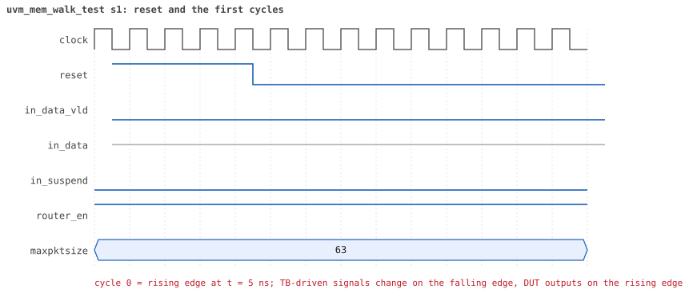
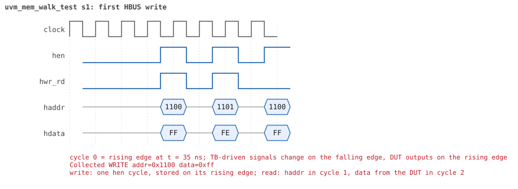
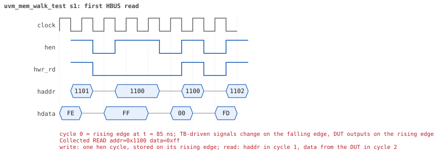

# uvm_mem_walk_test

<!-- generated by scripts/project_map/build.py from yapp_project/regression/runs.json -- run the regression, `make sim-report ONLY=yapp_project OUT=yapp_project/regression`, then `make map`; do not edit this file -->

[Back to the regression results →](index.md){ .pm-link } [On the project map →](../project-map.md#view=plan&node=cls:uvm_mem_walk_test){ .pm-link }

**4 of 4 seeds passed** · lab: [11B](../labs/lab11b.md) · extends `base_test` · 28 coverage bins hit.

Lab 11B: the built-in memory sequence walks yapp_mem; the RO yapp_pkt_mem is skipped.

## Seeds

| Seed | Result | Sim time | Wall | In / fwd / drop | Out ch0/1/2 | Suspends | Errors | Log | Timeline | Waves |
|---|---|---|---|---|---|---|---|---|---|---|
| 1 | pass | 18us | 0.5 s | 0 / 0 / 0 | 0/0/0 | 0 | 0 | [log ↗](https://github.com/tamirgabgab/Qcom-Mentoring/blob/main/yapp_project/regression/yapp_project_tb/uvm_mem_walk_test_s1/uvm_mem_walk_test_s1.log) | [timeline ↗](https://github.com/tamirgabgab/Qcom-Mentoring/blob/main/yapp_project/regression/yapp_project_tb/uvm_mem_walk_test_s1/timeline.md) | [Surfer ↗](https://app.surfer-project.org/?load_url=https%3A%2F%2Fraw.githubusercontent.com%2Ftamirgabgab%2FQcom-Mentoring%2Fmain%2Fyapp_project%2Fregression%2Fyapp_project_tb%2Fuvm_mem_walk_test_s1%2Fuvm_mem_walk_test_s1.fst&startup_commands=run_command_file_from_url%20https%3A%2F%2Fraw.githubusercontent.com%2Ftamirgabgab%2FQcom-Mentoring%2Fmain%2Fyapp_project%2Ftb%2Fyapp_router.sucl) [.fst](https://github.com/tamirgabgab/Qcom-Mentoring/blob/main/yapp_project/regression/yapp_project_tb/uvm_mem_walk_test_s1/uvm_mem_walk_test_s1.fst) |
| 2 | pass | 18us | 0.6 s | 0 / 0 / 0 | 0/0/0 | 0 | 0 | [log ↗](https://github.com/tamirgabgab/Qcom-Mentoring/blob/main/yapp_project/regression/yapp_project_tb/uvm_mem_walk_test_s2/uvm_mem_walk_test_s2.log) | [timeline ↗](https://github.com/tamirgabgab/Qcom-Mentoring/blob/main/yapp_project/regression/yapp_project_tb/uvm_mem_walk_test_s2/timeline.md) | [Surfer ↗](https://app.surfer-project.org/?load_url=https%3A%2F%2Fraw.githubusercontent.com%2Ftamirgabgab%2FQcom-Mentoring%2Fmain%2Fyapp_project%2Fregression%2Fyapp_project_tb%2Fuvm_mem_walk_test_s2%2Fuvm_mem_walk_test_s2.fst&startup_commands=run_command_file_from_url%20https%3A%2F%2Fraw.githubusercontent.com%2Ftamirgabgab%2FQcom-Mentoring%2Fmain%2Fyapp_project%2Ftb%2Fyapp_router.sucl) [.fst](https://github.com/tamirgabgab/Qcom-Mentoring/blob/main/yapp_project/regression/yapp_project_tb/uvm_mem_walk_test_s2/uvm_mem_walk_test_s2.fst) |
| 3 | pass | 18us | 0.5 s | 0 / 0 / 0 | 0/0/0 | 0 | 0 | [log ↗](https://github.com/tamirgabgab/Qcom-Mentoring/blob/main/yapp_project/regression/yapp_project_tb/uvm_mem_walk_test_s3/uvm_mem_walk_test_s3.log) | [timeline ↗](https://github.com/tamirgabgab/Qcom-Mentoring/blob/main/yapp_project/regression/yapp_project_tb/uvm_mem_walk_test_s3/timeline.md) | [Surfer ↗](https://app.surfer-project.org/?load_url=https%3A%2F%2Fraw.githubusercontent.com%2Ftamirgabgab%2FQcom-Mentoring%2Fmain%2Fyapp_project%2Fregression%2Fyapp_project_tb%2Fuvm_mem_walk_test_s3%2Fuvm_mem_walk_test_s3.fst&startup_commands=run_command_file_from_url%20https%3A%2F%2Fraw.githubusercontent.com%2Ftamirgabgab%2FQcom-Mentoring%2Fmain%2Fyapp_project%2Ftb%2Fyapp_router.sucl) [.fst](https://github.com/tamirgabgab/Qcom-Mentoring/blob/main/yapp_project/regression/yapp_project_tb/uvm_mem_walk_test_s3/uvm_mem_walk_test_s3.fst) |
| 4 | pass | 18us | 0.6 s | 0 / 0 / 0 | 0/0/0 | 0 | 0 | [log ↗](https://github.com/tamirgabgab/Qcom-Mentoring/blob/main/yapp_project/regression/yapp_project_tb/uvm_mem_walk_test_s4/uvm_mem_walk_test_s4.log) | [timeline ↗](https://github.com/tamirgabgab/Qcom-Mentoring/blob/main/yapp_project/regression/yapp_project_tb/uvm_mem_walk_test_s4/timeline.md) | [Surfer ↗](https://app.surfer-project.org/?load_url=https%3A%2F%2Fraw.githubusercontent.com%2Ftamirgabgab%2FQcom-Mentoring%2Fmain%2Fyapp_project%2Fregression%2Fyapp_project_tb%2Fuvm_mem_walk_test_s4%2Fuvm_mem_walk_test_s4.fst&startup_commands=run_command_file_from_url%20https%3A%2F%2Fraw.githubusercontent.com%2Ftamirgabgab%2FQcom-Mentoring%2Fmain%2Fyapp_project%2Ftb%2Fyapp_router.sucl) [.fst](https://github.com/tamirgabgab/Qcom-Mentoring/blob/main/yapp_project/regression/yapp_project_tb/uvm_mem_walk_test_s4/uvm_mem_walk_test_s4.fst) |

## The plan of the test

1. **default sequences** — clock and channel sequences
2. **clk10_rst5_seq** — clock and reset
3. **uvm_mem_walk_seq** — model = tb.yapp_rm: writes a pattern through yapp_mem and reads it back
4. **built-in compare** — every read compared with what was written; yapp_pkt_mem (RO) is skipped

Expected:

- HBUS traffic over 0x1100..0x11ff only; the HBUS report says 511 writes, 255 reads.
- With `-define INJECT_ERROR`: `UVM_ERROR ... [uvm_mem_walk_seq] Memory ... read back as ... instead of ...` at 0x112a.

## Test plan items this test verifies

- [MEM-04](../test-plan.md#mem---memories) — yapp_mem: every byte can be written and read back (covered)
- [HBUS-04](../test-plan.md#hbus---host-port-hbus) — Back-to-back accesses (covered)

## Seed 1: what happened

- YAPP driver sent **0** packet(s) (0 with bad parity); the input monitor saw 0.
- Router: **0** forwarded, **0** dropped.
- Packets out: ch0 **0**, ch1 **0**, ch2 **0**.
- Scoreboard: 0 matched, 0 mismatched, 0 unexpected.
- Back-pressure: in_suspend asserted **0** time(s).
- Error pulses: 0.
- HBUS: 511 write(s), 256 read(s).

### Stages

| time (ns) | stage |
|---|---|
| 0 | uvm_mem_walk_seq: write and read back every location of every memory of the model |

### Pictures

The moments the report draws from the signal trace of this run (the same pictures are in the run's folder of the report).

**reset and the first cycles**

**first HBUS write**

**first HBUS read**

Run it yourself: `make sim TEST=uvm_mem_walk_test SEED=1 WAVES=1` in `yapp_project/tb`, or `make run-project TEST=uvm_mem_walk_test` with Xcelium.
