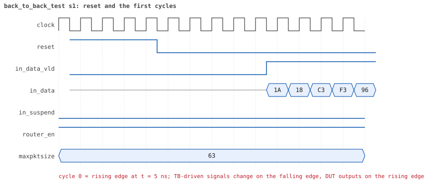

# back_to_back_test  seed 1

**Result:** PASSED (0 UVM_ERROR, 0 UVM_WARNING, 0 UVM_FATAL) · bench `yapp_project_tb` · sim time 3us · log `back_to_back_test_s1.log`

Waves: `back_to_back_test_s1.fst` (GTKWave, Surfer or the VS Code wave viewer); signal trace: `signals.csv`.

## Summary

- YAPP driver sent **24** packet(s) (0 with bad parity); the input monitor saw 24.
- Router: **24** forwarded, **0** dropped.
- Packets out: ch0 **5**, ch1 **5**, ch2 **14**.
- Scoreboard: 24 matched, 0 mismatched, 0 unexpected.
- Back-pressure: in_suspend asserted **0** time(s).
- Error pulses: 0.
- HBUS: 0 write(s), 0 read(s).

## Stages

| time (ns) | stage |
|---|---|
| 0 | 1. yapp_gap_seq: 24 packets with gaps of 0, 1, 2 and more cycles between them |
| 2415 | 2. the gap classes the monitor measured match the plan of the sequence, gap coverage 100% |

## Pictures

**reset and the first cycles**

**first packet into the router**

**first packet out on channel 2**

## Timeline

273 events (the same list is in `timeline.csv`).

| time (ns) | who | event |
|---|---|---|
| 0 | yapp monitor | YAPP monitor running |
| 0 | **test** | STAGE: 1. yapp_gap_seq: 24 packets with gaps of 0, 1, 2 and more cycles between them |
| 0 | clk/rst driver | Starting clock (period 10) and holding reset for 5 cycles |
| 0 | **DUT** | RESET asserted |
| 50 | **DUT** | RESET released: router_en=1 maxpktsize=63 |
| 50 | yapp driver | TX pkt #1: addr=2 len=6 parity=good delay=3 |
| 95 | **DUT** | IN  pkt #1 header: addr=2 len=6 -> channel 2 |
| 165 | **DUT** | IN  pkt #1 complete: addr=2 len=6 parity=ok forwarded, 8 bytes in 8 cycles (held 0) |
| 165 | yapp monitor | RX pkt #1 on the input: addr=2 len=6 parity=good gap=4 |
| 165 | reference | Packet forwarded: addr=2 len=6 -> channel 2 |
| 170 | yapp driver | TX pkt #1 accepted by the DUT |
| 170 | yapp driver | TX pkt #2: addr=2 len=6 parity=good delay=1 |
| 185 | **DUT** | IN  pkt #2 header: addr=2 len=6 -> channel 2 |
| 185 | **DUT** | OUT ch2 pkt #1 start: addr=2 len=6 (receiver waited 8 cycle(s)) |
| 250 | ch2 driver | ch2: packet consumed (response delay 8) |
| 255 | **DUT** | IN  pkt #2 complete: addr=2 len=6 parity=ok forwarded, 8 bytes in 8 cycles (held 0) |
| 255 | yapp monitor | RX pkt #2 on the input: addr=2 len=6 parity=good gap=1 |
| 255 | reference | Packet forwarded: addr=2 len=6 -> channel 2 |
| 260 | yapp driver | TX pkt #2 accepted by the DUT |
| 260 | yapp driver | TX pkt #3: addr=2 len=8 parity=good delay=2 |
| 285 | **DUT** | IN  pkt #3 header: addr=2 len=8 -> channel 2 |
| 345 | **DUT** | OUT ch2 pkt #1 done: 8 bytes in 17 cycles |
| 345 | ch2 monitor | ch2 RX pkt #1: addr=2 len=6 parity=good |
| 345 | scoreboard | ch2 pkt matched: addr=2 len=6 (1 matched so far) |
| 355 | **DUT** | OUT ch2 pkt #2 start: addr=2 len=6 (receiver waited 0 cycle(s)) |
| 375 | **DUT** | IN  pkt #3 complete: addr=2 len=8 parity=ok forwarded, 10 bytes in 10 cycles (held 0) |
| 375 | yapp monitor | RX pkt #3 on the input: addr=2 len=8 parity=good gap=2 |
| 375 | reference | Packet forwarded: addr=2 len=8 -> channel 2 |
| 380 | yapp driver | TX pkt #3 accepted by the DUT |
| 380 | yapp driver | TX pkt #4: addr=2 len=8 parity=good delay=3 |
| 415 | **DUT** | IN  pkt #4 header: addr=2 len=8 -> channel 2 |
| 425 | **DUT** | OUT ch2 pkt #2 done: 8 bytes in 8 cycles |
| 425 | ch2 monitor | ch2 RX pkt #2: addr=2 len=6 parity=good |
| 425 | scoreboard | ch2 pkt matched: addr=2 len=6 (2 matched so far) |
| 435 | **DUT** | OUT ch2 pkt #3 start: addr=2 len=8 (receiver waited 0 cycle(s)) |
| 505 | **DUT** | IN  pkt #4 complete: addr=2 len=8 parity=ok forwarded, 10 bytes in 10 cycles (held 0) |
| 505 | yapp monitor | RX pkt #4 on the input: addr=2 len=8 parity=good gap=3 |
| 505 | reference | Packet forwarded: addr=2 len=8 -> channel 2 |
| 510 | yapp driver | TX pkt #4 accepted by the DUT |
| 510 | yapp driver | TX pkt #5: addr=2 len=2 parity=good delay=0 |
| 515 | **DUT** | IN  pkt #5 header: addr=2 len=2 -> channel 2 |
| 525 | **DUT** | OUT ch2 pkt #3 done: 10 bytes in 10 cycles |
| 525 | ch2 monitor | ch2 RX pkt #3: addr=2 len=8 parity=good |
| 525 | scoreboard | ch2 pkt matched: addr=2 len=8 (3 matched so far) |
| 535 | **DUT** | OUT ch2 pkt #4 start: addr=2 len=8 (receiver waited 0 cycle(s)) |
| 545 | **DUT** | IN  pkt #5 complete: addr=2 len=2 parity=ok forwarded, 4 bytes in 4 cycles (held 0) |
| 545 | yapp monitor | RX pkt #5 on the input: addr=2 len=2 parity=good gap=0 |
| 545 | reference | Packet forwarded: addr=2 len=2 -> channel 2 |
| 550 | yapp driver | TX pkt #5 accepted by the DUT |
| 550 | yapp driver | TX pkt #6: addr=2 len=8 parity=good delay=1 |
| 565 | **DUT** | IN  pkt #6 header: addr=2 len=8 -> channel 2 |
| 625 | **DUT** | OUT ch2 pkt #4 done: 10 bytes in 10 cycles |
| 625 | ch2 monitor | ch2 RX pkt #4: addr=2 len=8 parity=good |
| 625 | scoreboard | ch2 pkt matched: addr=2 len=8 (4 matched so far) |
| 635 | **DUT** | OUT ch2 pkt #5 start: addr=2 len=2 (receiver waited 0 cycle(s)) |
| 655 | **DUT** | IN  pkt #6 complete: addr=2 len=8 parity=ok forwarded, 10 bytes in 10 cycles (held 0) |
| 655 | yapp monitor | RX pkt #6 on the input: addr=2 len=8 parity=good gap=1 |
| 655 | reference | Packet forwarded: addr=2 len=8 -> channel 2 |
| 660 | yapp driver | TX pkt #6 accepted by the DUT |
| 660 | yapp driver | TX pkt #7: addr=2 len=8 parity=good delay=2 |
| 665 | **DUT** | OUT ch2 pkt #5 done: 4 bytes in 4 cycles |
| 665 | ch2 monitor | ch2 RX pkt #5: addr=2 len=2 parity=good |
| 665 | scoreboard | ch2 pkt matched: addr=2 len=2 (5 matched so far) |
| 675 | **DUT** | OUT ch2 pkt #6 start: addr=2 len=8 (receiver waited 0 cycle(s)) |
| 685 | **DUT** | IN  pkt #7 header: addr=2 len=8 -> channel 2 |
| 765 | **DUT** | OUT ch2 pkt #6 done: 10 bytes in 10 cycles |
| 765 | ch2 monitor | ch2 RX pkt #6: addr=2 len=8 parity=good |
| 765 | scoreboard | ch2 pkt matched: addr=2 len=8 (6 matched so far) |
| 775 | **DUT** | IN  pkt #7 complete: addr=2 len=8 parity=ok forwarded, 10 bytes in 10 cycles (held 0) |
| 775 | **DUT** | OUT ch2 pkt #7 start: addr=2 len=8 (receiver waited 0 cycle(s)) |
| 775 | yapp monitor | RX pkt #7 on the input: addr=2 len=8 parity=good gap=2 |
| 775 | reference | Packet forwarded: addr=2 len=8 -> channel 2 |
| 780 | yapp driver | TX pkt #7 accepted by the DUT |
| 780 | yapp driver | TX pkt #8: addr=2 len=8 parity=good delay=3 |
| 815 | **DUT** | IN  pkt #8 header: addr=2 len=8 -> channel 2 |
| 865 | **DUT** | OUT ch2 pkt #7 done: 10 bytes in 10 cycles |
| 865 | ch2 monitor | ch2 RX pkt #7: addr=2 len=8 parity=good |
| 865 | scoreboard | ch2 pkt matched: addr=2 len=8 (7 matched so far) |
| 875 | **DUT** | OUT ch2 pkt #8 start: addr=2 len=8 (receiver waited 0 cycle(s)) |
| 900 | ch2 driver | ch2: packet consumed (response delay 8) |
| 905 | **DUT** | IN  pkt #8 complete: addr=2 len=8 parity=ok forwarded, 10 bytes in 10 cycles (held 0) |
| 905 | yapp monitor | RX pkt #8 on the input: addr=2 len=8 parity=good gap=3 |
| 905 | reference | Packet forwarded: addr=2 len=8 -> channel 2 |
| 910 | yapp driver | TX pkt #8 accepted by the DUT |
| 910 | yapp driver | TX pkt #9: addr=1 len=8 parity=good delay=0 |
| 915 | **DUT** | IN  pkt #9 header: addr=1 len=8 -> channel 1 |
| 1005 | **DUT** | IN  pkt #9 complete: addr=1 len=8 parity=ok forwarded, 10 bytes in 10 cycles (held 0) |
| 1005 | **DUT** | OUT ch1 pkt #1 start: addr=1 len=8 (receiver waited 8 cycle(s)) |
| 1005 | yapp monitor | RX pkt #9 on the input: addr=1 len=8 parity=good gap=0 |
| 1005 | reference | Packet forwarded: addr=1 len=8 -> channel 1 |
| 1010 | yapp driver | TX pkt #9 accepted by the DUT |
| 1010 | yapp driver | TX pkt #10: addr=1 len=8 parity=good delay=1 |
| 1025 | **DUT** | IN  pkt #10 header: addr=1 len=8 -> channel 1 |
| 1075 | **DUT** | OUT ch2 pkt #8 done: 10 bytes in 21 cycles |
| 1075 | ch2 monitor | ch2 RX pkt #8: addr=2 len=8 parity=good |
| 1075 | scoreboard | ch2 pkt matched: addr=2 len=8 (8 matched so far) |
| 1090 | ch1 driver | ch1: packet consumed (response delay 8) |
| 1105 | **DUT** | OUT ch1 pkt #1 done: 10 bytes in 11 cycles |
| 1105 | ch1 monitor | ch1 RX pkt #1: addr=1 len=8 parity=good |
| 1105 | scoreboard | ch1 pkt matched: addr=1 len=8 (9 matched so far) |
| 1115 | **DUT** | IN  pkt #10 complete: addr=1 len=8 parity=ok forwarded, 10 bytes in 10 cycles (held 0) |
| 1115 | **DUT** | OUT ch1 pkt #2 start: addr=1 len=8 (receiver waited 0 cycle(s)) |
| 1115 | yapp monitor | RX pkt #10 on the input: addr=1 len=8 parity=good gap=1 |
| 1115 | reference | Packet forwarded: addr=1 len=8 -> channel 1 |
| 1120 | yapp driver | TX pkt #10 accepted by the DUT |
| 1120 | yapp driver | TX pkt #11: addr=2 len=1 parity=good delay=2 |
| 1145 | **DUT** | IN  pkt #11 header: addr=2 len=1 -> channel 2 |
| 1155 | **DUT** | OUT ch2 pkt #9 start: addr=2 len=1 (receiver waited 0 cycle(s)) |
| 1165 | **DUT** | IN  pkt #11 complete: addr=2 len=1 parity=ok forwarded, 3 bytes in 3 cycles (held 0) |
| 1165 | yapp monitor | RX pkt #11 on the input: addr=2 len=1 parity=good gap=2 |
| 1165 | reference | Packet forwarded: addr=2 len=1 -> channel 2 |
| 1170 | yapp driver | TX pkt #11 accepted by the DUT |
| 1170 | yapp driver | TX pkt #12: addr=0 len=8 parity=good delay=3 |
| 1175 | **DUT** | OUT ch2 pkt #9 done: 3 bytes in 3 cycles |
| 1175 | ch2 monitor | ch2 RX pkt #9: addr=2 len=1 parity=good |
| 1175 | scoreboard | ch2 pkt matched: addr=2 len=1 (10 matched so far) |
| 1205 | **DUT** | IN  pkt #12 header: addr=0 len=8 -> channel 0 |
| 1205 | **DUT** | OUT ch1 pkt #2 done: 10 bytes in 10 cycles |
| 1205 | ch1 monitor | ch1 RX pkt #2: addr=1 len=8 parity=good |
| 1205 | scoreboard | ch1 pkt matched: addr=1 len=8 (11 matched so far) |
| 1245 | **DUT** | OUT ch0 pkt #1 start: addr=0 len=8 (receiver waited 3 cycle(s)) |
| 1260 | ch2 driver | ch2: packet consumed (response delay 10) |
| 1295 | **DUT** | IN  pkt #12 complete: addr=0 len=8 parity=ok forwarded, 10 bytes in 10 cycles (held 0) |
| 1295 | yapp monitor | RX pkt #12 on the input: addr=0 len=8 parity=good gap=3 |
| 1295 | reference | Packet forwarded: addr=0 len=8 -> channel 0 |
| 1300 | yapp driver | TX pkt #12 accepted by the DUT |
| 1300 | yapp driver | TX pkt #13: addr=0 len=1 parity=good delay=0 |
| 1305 | **DUT** | IN  pkt #13 header: addr=0 len=1 -> channel 0 |
| 1325 | **DUT** | IN  pkt #13 complete: addr=0 len=1 parity=ok forwarded, 3 bytes in 3 cycles (held 0) |
| 1325 | yapp monitor | RX pkt #13 on the input: addr=0 len=1 parity=good gap=0 |
| 1325 | reference | Packet forwarded: addr=0 len=1 -> channel 0 |
| 1330 | ch0 driver | ch0: packet consumed (response delay 3) |
| 1330 | ch1 driver | ch1: packet consumed (response delay 0) |
| 1330 | yapp driver | TX pkt #13 accepted by the DUT |
| 1330 | yapp driver | TX pkt #14: addr=2 len=3 parity=good delay=1 |
| 1345 | **DUT** | IN  pkt #14 header: addr=2 len=3 -> channel 2 |
| 1385 | **DUT** | IN  pkt #14 complete: addr=2 len=3 parity=ok forwarded, 5 bytes in 5 cycles (held 0) |
| 1385 | yapp monitor | RX pkt #14 on the input: addr=2 len=3 parity=good gap=1 |
| 1385 | reference | Packet forwarded: addr=2 len=3 -> channel 2 |
| 1390 | yapp driver | TX pkt #14 accepted by the DUT |
| 1390 | yapp driver | TX pkt #15: addr=2 len=1 parity=good delay=2 |
| 1415 | **DUT** | IN  pkt #15 header: addr=2 len=1 -> channel 2 |
| 1415 | **DUT** | OUT ch2 pkt #10 start: addr=2 len=3 (receiver waited 6 cycle(s)) |
| 1425 | **DUT** | OUT ch0 pkt #1 done: 10 bytes in 19 cycles |
| 1425 | ch0 monitor | ch0 RX pkt #1: addr=0 len=8 parity=good |
| 1425 | scoreboard | ch0 pkt matched: addr=0 len=8 (12 matched so far) |
| 1435 | **DUT** | IN  pkt #15 complete: addr=2 len=1 parity=ok forwarded, 3 bytes in 3 cycles (held 0) |
| 1435 | **DUT** | OUT ch0 pkt #2 start: addr=0 len=1 (receiver waited 0 cycle(s)) |
| 1435 | yapp monitor | RX pkt #15 on the input: addr=2 len=1 parity=good gap=2 |
| 1435 | reference | Packet forwarded: addr=2 len=1 -> channel 2 |
| 1440 | yapp driver | TX pkt #15 accepted by the DUT |
| 1440 | yapp driver | TX pkt #16: addr=0 len=3 parity=good delay=3 |
| 1450 | ch2 driver | ch2: packet consumed (response delay 6) |
| 1455 | **DUT** | OUT ch0 pkt #2 done: 3 bytes in 3 cycles |
| 1455 | ch0 monitor | ch0 RX pkt #2: addr=0 len=1 parity=good |
| 1455 | scoreboard | ch0 pkt matched: addr=0 len=1 (13 matched so far) |
| 1475 | **DUT** | IN  pkt #16 header: addr=0 len=3 -> channel 0 |
| 1485 | **DUT** | OUT ch0 pkt #3 start: addr=0 len=3 (receiver waited 0 cycle(s)) |
| 1495 | **DUT** | OUT ch2 pkt #10 done: 5 bytes in 9 cycles |
| 1495 | ch2 monitor | ch2 RX pkt #10: addr=2 len=3 parity=good |
| 1495 | scoreboard | ch2 pkt matched: addr=2 len=3 (14 matched so far) |
| 1505 | **DUT** | OUT ch2 pkt #11 start: addr=2 len=1 (receiver waited 0 cycle(s)) |
| 1515 | **DUT** | IN  pkt #16 complete: addr=0 len=3 parity=ok forwarded, 5 bytes in 5 cycles (held 0) |
| 1515 | yapp monitor | RX pkt #16 on the input: addr=0 len=3 parity=good gap=3 |
| 1515 | reference | Packet forwarded: addr=0 len=3 -> channel 0 |
| 1520 | yapp driver | TX pkt #16 accepted by the DUT |
| 1520 | yapp driver | TX pkt #17: addr=0 len=8 parity=good delay=0 |
| 1525 | **DUT** | IN  pkt #17 header: addr=0 len=8 -> channel 0 |
| 1525 | **DUT** | OUT ch0 pkt #3 done: 5 bytes in 5 cycles |
| 1525 | **DUT** | OUT ch2 pkt #11 done: 3 bytes in 3 cycles |
| 1525 | ch0 monitor | ch0 RX pkt #3: addr=0 len=3 parity=good |
| 1525 | scoreboard | ch0 pkt matched: addr=0 len=3 (15 matched so far) |
| 1525 | ch2 monitor | ch2 RX pkt #11: addr=2 len=1 parity=good |
| 1525 | scoreboard | ch2 pkt matched: addr=2 len=1 (16 matched so far) |
| 1535 | **DUT** | OUT ch0 pkt #4 start: addr=0 len=8 (receiver waited 0 cycle(s)) |
| 1615 | **DUT** | IN  pkt #17 complete: addr=0 len=8 parity=ok forwarded, 10 bytes in 10 cycles (held 0) |
| 1615 | yapp monitor | RX pkt #17 on the input: addr=0 len=8 parity=good gap=0 |
| 1615 | reference | Packet forwarded: addr=0 len=8 -> channel 0 |
| 1620 | yapp driver | TX pkt #17 accepted by the DUT |
| 1620 | yapp driver | TX pkt #18: addr=2 len=8 parity=good delay=1 |
| 1625 | **DUT** | OUT ch0 pkt #4 done: 10 bytes in 10 cycles |
| 1625 | ch0 monitor | ch0 RX pkt #4: addr=0 len=8 parity=good |
| 1625 | scoreboard | ch0 pkt matched: addr=0 len=8 (17 matched so far) |
| 1635 | **DUT** | IN  pkt #18 header: addr=2 len=8 -> channel 2 |
| 1645 | **DUT** | OUT ch2 pkt #12 start: addr=2 len=8 (receiver waited 0 cycle(s)) |
| 1725 | **DUT** | IN  pkt #18 complete: addr=2 len=8 parity=ok forwarded, 10 bytes in 10 cycles (held 0) |
| 1725 | yapp monitor | RX pkt #18 on the input: addr=2 len=8 parity=good gap=1 |
| 1725 | reference | Packet forwarded: addr=2 len=8 -> channel 2 |
| 1730 | ch0 driver | ch0: packet consumed (response delay 8) |
| 1730 | yapp driver | TX pkt #18 accepted by the DUT |
| 1730 | yapp driver | TX pkt #19: addr=1 len=1 parity=good delay=2 |
| 1735 | **DUT** | OUT ch2 pkt #12 done: 10 bytes in 10 cycles |
| 1735 | ch2 monitor | ch2 RX pkt #12: addr=2 len=8 parity=good |
| 1735 | scoreboard | ch2 pkt matched: addr=2 len=8 (18 matched so far) |
| 1755 | **DUT** | IN  pkt #19 header: addr=1 len=1 -> channel 1 |
| 1775 | **DUT** | IN  pkt #19 complete: addr=1 len=1 parity=ok forwarded, 3 bytes in 3 cycles (held 0) |
| 1775 | yapp monitor | RX pkt #19 on the input: addr=1 len=1 parity=good gap=2 |
| 1775 | reference | Packet forwarded: addr=1 len=1 -> channel 1 |
| 1780 | yapp driver | TX pkt #19 accepted by the DUT |
| 1780 | yapp driver | TX pkt #20: addr=1 len=6 parity=good delay=3 |
| 1815 | **DUT** | IN  pkt #20 header: addr=1 len=6 -> channel 1 |
| 1825 | **DUT** | OUT ch1 pkt #3 start: addr=1 len=1 (receiver waited 6 cycle(s)) |
| 1840 | ch1 driver | ch1: packet consumed (response delay 6) |
| 1885 | **DUT** | IN  pkt #20 complete: addr=1 len=6 parity=ok forwarded, 8 bytes in 8 cycles (held 0) |
| 1885 | yapp monitor | RX pkt #20 on the input: addr=1 len=6 parity=good gap=3 |
| 1885 | reference | Packet forwarded: addr=1 len=6 -> channel 1 |
| 1890 | yapp driver | TX pkt #20 accepted by the DUT |
| 1890 | yapp driver | TX pkt #21: addr=0 len=8 parity=good delay=0 |
| 1895 | **DUT** | IN  pkt #21 header: addr=0 len=8 -> channel 0 |
| 1910 | ch2 driver | ch2: packet consumed (response delay 3) |
| 1955 | **DUT** | OUT ch0 pkt #5 start: addr=0 len=8 (receiver waited 5 cycle(s)) |
| 1955 | **DUT** | OUT ch1 pkt #3 done: 3 bytes in 14 cycles |
| 1955 | ch1 monitor | ch1 RX pkt #3: addr=1 len=1 parity=good |
| 1955 | scoreboard | ch1 pkt matched: addr=1 len=1 (19 matched so far) |
| 1965 | **DUT** | OUT ch1 pkt #4 start: addr=1 len=6 (receiver waited 0 cycle(s)) |
| 1985 | **DUT** | IN  pkt #21 complete: addr=0 len=8 parity=ok forwarded, 10 bytes in 10 cycles (held 0) |
| 1985 | yapp monitor | RX pkt #21 on the input: addr=0 len=8 parity=good gap=0 |
| 1985 | reference | Packet forwarded: addr=0 len=8 -> channel 0 |
| 1990 | yapp driver | TX pkt #21 accepted by the DUT |
| 1990 | yapp driver | TX pkt #22: addr=1 len=7 parity=good delay=1 |
| 2005 | **DUT** | IN  pkt #22 header: addr=1 len=7 -> channel 1 |
| 2035 | **DUT** | OUT ch1 pkt #4 done: 8 bytes in 8 cycles |
| 2035 | ch1 monitor | ch1 RX pkt #4: addr=1 len=6 parity=good |
| 2035 | scoreboard | ch1 pkt matched: addr=1 len=6 (20 matched so far) |
| 2040 | ch0 driver | ch0: packet consumed (response delay 5) |
| 2045 | **DUT** | OUT ch1 pkt #5 start: addr=1 len=7 (receiver waited 0 cycle(s)) |
| 2075 | **DUT** | OUT ch0 pkt #5 done: 10 bytes in 13 cycles |
| 2075 | ch0 monitor | ch0 RX pkt #5: addr=0 len=8 parity=good |
| 2075 | scoreboard | ch0 pkt matched: addr=0 len=8 (21 matched so far) |
| 2085 | **DUT** | IN  pkt #22 complete: addr=1 len=7 parity=ok forwarded, 9 bytes in 9 cycles (held 0) |
| 2085 | yapp monitor | RX pkt #22 on the input: addr=1 len=7 parity=good gap=1 |
| 2085 | reference | Packet forwarded: addr=1 len=7 -> channel 1 |
| 2090 | yapp driver | TX pkt #22 accepted by the DUT |
| 2090 | yapp driver | TX pkt #23: addr=2 len=3 parity=good delay=2 |
| 2115 | **DUT** | IN  pkt #23 header: addr=2 len=3 -> channel 2 |
| 2120 | ch0 driver | ch0: packet consumed (response delay 2) |
| 2125 | **DUT** | OUT ch1 pkt #5 done: 9 bytes in 9 cycles |
| 2125 | ch1 monitor | ch1 RX pkt #5: addr=1 len=7 parity=good |
| 2125 | scoreboard | ch1 pkt matched: addr=1 len=7 (22 matched so far) |
| 2155 | **DUT** | IN  pkt #23 complete: addr=2 len=3 parity=ok forwarded, 5 bytes in 5 cycles (held 0) |
| 2155 | yapp monitor | RX pkt #23 on the input: addr=2 len=3 parity=good gap=2 |
| 2155 | reference | Packet forwarded: addr=2 len=3 -> channel 2 |
| 2160 | yapp driver | TX pkt #23 accepted by the DUT |
| 2160 | yapp driver | TX pkt #24: addr=2 len=8 parity=good delay=3 |
| 2185 | **DUT** | OUT ch2 pkt #13 start: addr=2 len=3 (receiver waited 6 cycle(s)) |
| 2195 | **DUT** | IN  pkt #24 header: addr=2 len=8 -> channel 2 |
| 2220 | ch2 driver | ch2: packet consumed (response delay 6) |
| 2285 | **DUT** | IN  pkt #24 complete: addr=2 len=8 parity=ok forwarded, 10 bytes in 10 cycles (held 0) |
| 2285 | yapp monitor | RX pkt #24 on the input: addr=2 len=8 parity=good gap=3 |
| 2285 | reference | Packet forwarded: addr=2 len=8 -> channel 2 |
| 2290 | yapp driver | TX pkt #24 accepted by the DUT |
| 2315 | **DUT** | OUT ch2 pkt #13 done: 5 bytes in 14 cycles |
| 2315 | ch2 monitor | ch2 RX pkt #13: addr=2 len=3 parity=good |
| 2315 | scoreboard | ch2 pkt matched: addr=2 len=3 (23 matched so far) |
| 2325 | **DUT** | OUT ch2 pkt #14 start: addr=2 len=8 (receiver waited 0 cycle(s)) |
| 2415 | **DUT** | OUT ch2 pkt #14 done: 10 bytes in 10 cycles |
| 2415 | ch2 monitor | ch2 RX pkt #14: addr=2 len=8 parity=good |
| 2415 | scoreboard | ch2 pkt matched: addr=2 len=8 (24 matched so far) |
| 2415 | **test** | STAGE: 2. the gap classes the monitor measured match the plan of the sequence, gap coverage 100% |
| 2415 | **test** | gap class 0: 5 packets, as planned |
| 2415 | **test** | gap class 1: 6 packets, as planned |
| 2415 | **test** | gap class 2: 6 packets, as planned |
| 2415 | **test** | gap class 3: 6 packets, as planned |
| 2580 | ch1 driver | ch1: packet consumed (response delay 10) |
| 2615 | ch0 monitor | Channel 0 report: 5 packets collected |
| 2615 | ch1 monitor | Channel 1 report: 5 packets collected |
| 2615 | ch2 monitor | Channel 2 report: 14 packets collected |
| 2615 | hbus monitor | HBUS report: 0 writes, 0 reads |
| 2615 | reference |  |
| 2615 | scoreboard |  |
| 2615 | yapp driver | YAPP driver report: 24 packets sent |
| 2615 | yapp monitor | YAPP monitor report: 24 packets collected, coverage 30.0% |
| 2615 | yapp monitor | YAPP gaps: 5 back to back, 6 of 1 cycle, 6 of 2, 6 longer (gap coverage 100.0%) |
