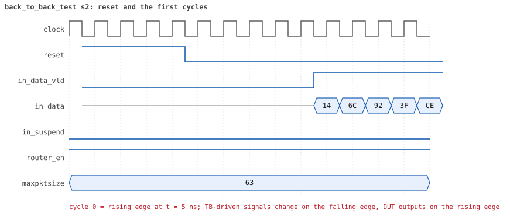
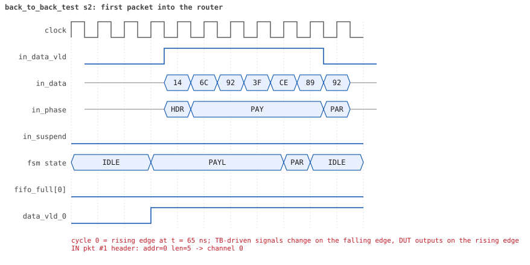
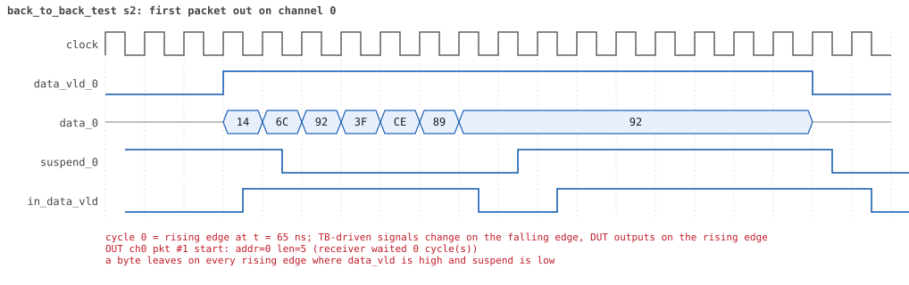

# back_to_back_test seed 2

**Result:** PASSED (0 UVM_ERROR, 0 UVM_WARNING, 0 UVM_FATAL) · bench `yapp_project_tb` · sim time 3us · wall 1.1 s · log [`back_to_back_test_s2.log`](back_to_back_test_s2.log)

Waves: `back_to_back_test_s2.fst` (GTKWave, Surfer or the VS Code wave viewer).
[Open the waves in Surfer](https://app.surfer-project.org/?load_url=https%3A%2F%2Fraw.githubusercontent.com%2Ftamirgabgab%2FQcom-Mentoring%2Fmain%2Fyapp_project%2Fregression%2Fyapp_project_tb%2Fback_to_back_test_s2%2Fback_to_back_test_s2.fst&startup_commands=run_command_file_from_url%20https%3A%2F%2Fraw.githubusercontent.com%2Ftamirgabgab%2FQcom-Mentoring%2Fmain%2Fyapp_project%2Ftb%2Fyapp_router.sucl) (web app, the signals already in groups: `yapp_project/tb/yapp_router.sucl`).

## Summary

- YAPP driver sent **24** packet(s) (0 with bad parity); the input monitor saw 24.
- Router: **24** forwarded, **0** dropped.
- Packets out: ch0 **7**, ch1 **6**, ch2 **11**.
- Scoreboard: 24 matched, 0 mismatched, 0 unexpected.
- Back-pressure: in_suspend asserted **0** time(s).
- Error pulses: 0.
- HBUS: 0 write(s), 0 read(s).

## Stages

| time (ns) | stage |
|---|---|
| 0 | 1. yapp_gap_seq: 24 packets with gaps of 0, 1, 2 and more cycles between them |
| 2325 | 2. the gap classes the monitor measured match the plan of the sequence, gap coverage 100% |

## Pictures

**reset and the first cycles**

**first packet into the router**

**first packet out on channel 0**

## Timeline

286 events.

| time (ns) | who | event |
|---|---|---|
| 0 | yapp monitor | YAPP monitor running |
| 0 | **test** | STAGE: 1. yapp_gap_seq: 24 packets with gaps of 0, 1, 2 and more cycles between them |
| 0 | clk/rst driver | Starting clock (period 10) and holding reset for 5 cycles |
| 0 | **DUT** | RESET asserted |
| 50 | **DUT** | RESET released: router_en=1 maxpktsize=63 |
| 50 | yapp driver | TX pkt #1: addr=0 len=5 parity=good delay=3 |
| 95 | **DUT** | IN  pkt #1 header: addr=0 len=5 -> channel 0 |
| 105 | **DUT** | OUT ch0 pkt #1 start: addr=0 len=5 (receiver waited 0 cycle(s)) |
| 155 | **DUT** | IN  pkt #1 complete: addr=0 len=5 parity=ok forwarded, 7 bytes in 7 cycles (held 0) |
| 155 | yapp monitor | RX pkt #1 on the input: addr=0 len=5 parity=good gap=4 |
| 155 | reference | Packet forwarded: addr=0 len=5 -> channel 0 |
| 160 | ch0 driver | ch0: packet consumed (response delay 0) |
| 160 | yapp driver | TX pkt #1 accepted by the DUT |
| 160 | yapp driver | TX pkt #2: addr=2 len=7 parity=good delay=1 |
| 175 | **DUT** | IN  pkt #2 header: addr=2 len=7 -> channel 2 |
| 245 | **DUT** | OUT ch0 pkt #1 done: 7 bytes in 15 cycles |
| 245 | ch0 monitor | ch0 RX pkt #1: addr=0 len=5 parity=good |
| 245 | scoreboard | ch0 pkt matched: addr=0 len=5 (1 matched so far) |
| 255 | **DUT** | IN  pkt #2 complete: addr=2 len=7 parity=ok forwarded, 9 bytes in 9 cycles (held 0) |
| 255 | yapp monitor | RX pkt #2 on the input: addr=2 len=7 parity=good gap=1 |
| 255 | reference | Packet forwarded: addr=2 len=7 -> channel 2 |
| 260 | yapp driver | TX pkt #2 accepted by the DUT |
| 260 | yapp driver | TX pkt #3: addr=2 len=8 parity=good delay=2 |
| 285 | **DUT** | IN  pkt #3 header: addr=2 len=8 -> channel 2 |
| 285 | **DUT** | OUT ch2 pkt #1 start: addr=2 len=7 (receiver waited 10 cycle(s)) |
| 360 | ch2 driver | ch2: packet consumed (response delay 10) |
| 375 | **DUT** | IN  pkt #3 complete: addr=2 len=8 parity=ok forwarded, 10 bytes in 10 cycles (held 0) |
| 375 | yapp monitor | RX pkt #3 on the input: addr=2 len=8 parity=good gap=2 |
| 375 | reference | Packet forwarded: addr=2 len=8 -> channel 2 |
| 380 | yapp driver | TX pkt #3 accepted by the DUT |
| 380 | yapp driver | TX pkt #4: addr=0 len=8 parity=good delay=3 |
| 415 | **DUT** | IN  pkt #4 header: addr=0 len=8 -> channel 0 |
| 425 | **DUT** | OUT ch0 pkt #2 start: addr=0 len=8 (receiver waited 0 cycle(s)) |
| 475 | **DUT** | OUT ch2 pkt #1 done: 9 bytes in 20 cycles |
| 475 | ch2 monitor | ch2 RX pkt #1: addr=2 len=7 parity=good |
| 475 | scoreboard | ch2 pkt matched: addr=2 len=7 (2 matched so far) |
| 485 | **DUT** | OUT ch2 pkt #2 start: addr=2 len=8 (receiver waited 0 cycle(s)) |
| 505 | **DUT** | IN  pkt #4 complete: addr=0 len=8 parity=ok forwarded, 10 bytes in 10 cycles (held 0) |
| 505 | yapp monitor | RX pkt #4 on the input: addr=0 len=8 parity=good gap=3 |
| 505 | reference | Packet forwarded: addr=0 len=8 -> channel 0 |
| 510 | yapp driver | TX pkt #4 accepted by the DUT |
| 510 | yapp driver | TX pkt #5: addr=1 len=8 parity=good delay=0 |
| 515 | **DUT** | IN  pkt #5 header: addr=1 len=8 -> channel 1 |
| 515 | **DUT** | OUT ch0 pkt #2 done: 10 bytes in 10 cycles |
| 515 | ch0 monitor | ch0 RX pkt #2: addr=0 len=8 parity=good |
| 515 | scoreboard | ch0 pkt matched: addr=0 len=8 (3 matched so far) |
| 545 | **DUT** | OUT ch1 pkt #1 start: addr=1 len=8 (receiver waited 2 cycle(s)) |
| 575 | **DUT** | OUT ch2 pkt #2 done: 10 bytes in 10 cycles |
| 575 | ch2 monitor | ch2 RX pkt #2: addr=2 len=8 parity=good |
| 575 | scoreboard | ch2 pkt matched: addr=2 len=8 (4 matched so far) |
| 605 | **DUT** | IN  pkt #5 complete: addr=1 len=8 parity=ok forwarded, 10 bytes in 10 cycles (held 0) |
| 605 | yapp monitor | RX pkt #5 on the input: addr=1 len=8 parity=good gap=0 |
| 605 | reference | Packet forwarded: addr=1 len=8 -> channel 1 |
| 610 | ch0 driver | ch0: packet consumed (response delay 7) |
| 610 | yapp driver | TX pkt #5 accepted by the DUT |
| 610 | yapp driver | TX pkt #6: addr=2 len=1 parity=good delay=1 |
| 625 | **DUT** | IN  pkt #6 header: addr=2 len=1 -> channel 2 |
| 630 | ch1 driver | ch1: packet consumed (response delay 2) |
| 635 | **DUT** | OUT ch2 pkt #3 start: addr=2 len=1 (receiver waited 0 cycle(s)) |
| 645 | **DUT** | IN  pkt #6 complete: addr=2 len=1 parity=ok forwarded, 3 bytes in 3 cycles (held 0) |
| 645 | yapp monitor | RX pkt #6 on the input: addr=2 len=1 parity=good gap=1 |
| 645 | reference | Packet forwarded: addr=2 len=1 -> channel 2 |
| 650 | yapp driver | TX pkt #6 accepted by the DUT |
| 650 | yapp driver | TX pkt #7: addr=2 len=3 parity=good delay=2 |
| 655 | **DUT** | OUT ch2 pkt #3 done: 3 bytes in 3 cycles |
| 655 | ch2 monitor | ch2 RX pkt #3: addr=2 len=1 parity=good |
| 655 | scoreboard | ch2 pkt matched: addr=2 len=1 (5 matched so far) |
| 675 | **DUT** | IN  pkt #7 header: addr=2 len=3 -> channel 2 |
| 685 | **DUT** | OUT ch2 pkt #4 start: addr=2 len=3 (receiver waited 0 cycle(s)) |
| 715 | **DUT** | IN  pkt #7 complete: addr=2 len=3 parity=ok forwarded, 5 bytes in 5 cycles (held 0) |
| 715 | **DUT** | OUT ch1 pkt #1 done: 10 bytes in 18 cycles |
| 715 | ch1 monitor | ch1 RX pkt #1: addr=1 len=8 parity=good |
| 715 | scoreboard | ch1 pkt matched: addr=1 len=8 (6 matched so far) |
| 715 | yapp monitor | RX pkt #7 on the input: addr=2 len=3 parity=good gap=2 |
| 715 | reference | Packet forwarded: addr=2 len=3 -> channel 2 |
| 720 | yapp driver | TX pkt #7 accepted by the DUT |
| 720 | yapp driver | TX pkt #8: addr=2 len=8 parity=good delay=3 |
| 725 | **DUT** | OUT ch2 pkt #4 done: 5 bytes in 5 cycles |
| 725 | ch2 monitor | ch2 RX pkt #4: addr=2 len=3 parity=good |
| 725 | scoreboard | ch2 pkt matched: addr=2 len=3 (7 matched so far) |
| 740 | ch2 driver | ch2: packet consumed (response delay 10) |
| 755 | **DUT** | IN  pkt #8 header: addr=2 len=8 -> channel 2 |
| 760 | ch1 driver | ch1: packet consumed (response delay 7) |
| 805 | **DUT** | OUT ch2 pkt #5 start: addr=2 len=8 (receiver waited 4 cycle(s)) |
| 845 | **DUT** | IN  pkt #8 complete: addr=2 len=8 parity=ok forwarded, 10 bytes in 10 cycles (held 0) |
| 845 | yapp monitor | RX pkt #8 on the input: addr=2 len=8 parity=good gap=3 |
| 845 | reference | Packet forwarded: addr=2 len=8 -> channel 2 |
| 850 | yapp driver | TX pkt #8 accepted by the DUT |
| 850 | yapp driver | TX pkt #9: addr=1 len=2 parity=good delay=0 |
| 855 | **DUT** | IN  pkt #9 header: addr=1 len=2 -> channel 1 |
| 885 | **DUT** | IN  pkt #9 complete: addr=1 len=2 parity=ok forwarded, 4 bytes in 4 cycles (held 0) |
| 885 | yapp monitor | RX pkt #9 on the input: addr=1 len=2 parity=good gap=0 |
| 885 | reference | Packet forwarded: addr=1 len=2 -> channel 1 |
| 890 | ch2 driver | ch2: packet consumed (response delay 4) |
| 890 | yapp driver | TX pkt #9 accepted by the DUT |
| 890 | yapp driver | TX pkt #10: addr=1 len=8 parity=good delay=1 |
| 905 | **DUT** | IN  pkt #10 header: addr=1 len=8 -> channel 1 |
| 955 | **DUT** | OUT ch1 pkt #2 start: addr=1 len=2 (receiver waited 9 cycle(s)) |
| 980 | ch1 driver | ch1: packet consumed (response delay 9) |
| 985 | **DUT** | OUT ch2 pkt #5 done: 10 bytes in 19 cycles |
| 985 | ch2 monitor | ch2 RX pkt #5: addr=2 len=8 parity=good |
| 985 | scoreboard | ch2 pkt matched: addr=2 len=8 (8 matched so far) |
| 995 | **DUT** | IN  pkt #10 complete: addr=1 len=8 parity=ok forwarded, 10 bytes in 10 cycles (held 0) |
| 995 | yapp monitor | RX pkt #10 on the input: addr=1 len=8 parity=good gap=1 |
| 995 | reference | Packet forwarded: addr=1 len=8 -> channel 1 |
| 1000 | yapp driver | TX pkt #10 accepted by the DUT |
| 1000 | yapp driver | TX pkt #11: addr=0 len=8 parity=good delay=2 |
| 1025 | **DUT** | IN  pkt #11 header: addr=0 len=8 -> channel 0 |
| 1075 | **DUT** | OUT ch1 pkt #2 done: 4 bytes in 13 cycles |
| 1075 | ch1 monitor | ch1 RX pkt #2: addr=1 len=2 parity=good |
| 1075 | scoreboard | ch1 pkt matched: addr=1 len=2 (9 matched so far) |
| 1085 | **DUT** | OUT ch0 pkt #3 start: addr=0 len=8 (receiver waited 5 cycle(s)) |
| 1085 | **DUT** | OUT ch1 pkt #3 start: addr=1 len=8 (receiver waited 0 cycle(s)) |
| 1115 | **DUT** | IN  pkt #11 complete: addr=0 len=8 parity=ok forwarded, 10 bytes in 10 cycles (held 0) |
| 1115 | yapp monitor | RX pkt #11 on the input: addr=0 len=8 parity=good gap=2 |
| 1115 | reference | Packet forwarded: addr=0 len=8 -> channel 0 |
| 1120 | yapp driver | TX pkt #11 accepted by the DUT |
| 1120 | yapp driver | TX pkt #12: addr=1 len=8 parity=good delay=3 |
| 1155 | **DUT** | IN  pkt #12 header: addr=1 len=8 -> channel 1 |
| 1170 | ch0 driver | ch0: packet consumed (response delay 5) |
| 1170 | ch2 driver | ch2: packet consumed (response delay 8) |
| 1175 | **DUT** | OUT ch1 pkt #3 done: 10 bytes in 10 cycles |
| 1175 | ch1 monitor | ch1 RX pkt #3: addr=1 len=8 parity=good |
| 1175 | scoreboard | ch1 pkt matched: addr=1 len=8 (10 matched so far) |
| 1185 | **DUT** | OUT ch1 pkt #4 start: addr=1 len=8 (receiver waited 0 cycle(s)) |
| 1245 | **DUT** | IN  pkt #12 complete: addr=1 len=8 parity=ok forwarded, 10 bytes in 10 cycles (held 0) |
| 1245 | yapp monitor | RX pkt #12 on the input: addr=1 len=8 parity=good gap=3 |
| 1245 | reference | Packet forwarded: addr=1 len=8 -> channel 1 |
| 1250 | yapp driver | TX pkt #12 accepted by the DUT |
| 1250 | yapp driver | TX pkt #13: addr=2 len=3 parity=good delay=0 |
| 1255 | **DUT** | IN  pkt #13 header: addr=2 len=3 -> channel 2 |
| 1275 | **DUT** | OUT ch1 pkt #4 done: 10 bytes in 10 cycles |
| 1275 | ch1 monitor | ch1 RX pkt #4: addr=1 len=8 parity=good |
| 1275 | scoreboard | ch1 pkt matched: addr=1 len=8 (11 matched so far) |
| 1285 | **DUT** | OUT ch0 pkt #3 done: 10 bytes in 21 cycles |
| 1285 | ch0 monitor | ch0 RX pkt #3: addr=0 len=8 parity=good |
| 1285 | scoreboard | ch0 pkt matched: addr=0 len=8 (12 matched so far) |
| 1295 | **DUT** | IN  pkt #13 complete: addr=2 len=3 parity=ok forwarded, 5 bytes in 5 cycles (held 0) |
| 1295 | **DUT** | OUT ch2 pkt #6 start: addr=2 len=3 (receiver waited 3 cycle(s)) |
| 1295 | yapp monitor | RX pkt #13 on the input: addr=2 len=3 parity=good gap=0 |
| 1295 | reference | Packet forwarded: addr=2 len=3 -> channel 2 |
| 1300 | yapp driver | TX pkt #13 accepted by the DUT |
| 1300 | yapp driver | TX pkt #14: addr=0 len=4 parity=good delay=1 |
| 1315 | **DUT** | IN  pkt #14 header: addr=0 len=4 -> channel 0 |
| 1325 | **DUT** | OUT ch0 pkt #4 start: addr=0 len=4 (receiver waited 0 cycle(s)) |
| 1330 | ch2 driver | ch2: packet consumed (response delay 3) |
| 1365 | **DUT** | IN  pkt #14 complete: addr=0 len=4 parity=ok forwarded, 6 bytes in 6 cycles (held 0) |
| 1365 | yapp monitor | RX pkt #14 on the input: addr=0 len=4 parity=good gap=1 |
| 1365 | reference | Packet forwarded: addr=0 len=4 -> channel 0 |
| 1370 | yapp driver | TX pkt #14 accepted by the DUT |
| 1370 | yapp driver | TX pkt #15: addr=2 len=2 parity=good delay=2 |
| 1375 | **DUT** | OUT ch0 pkt #4 done: 6 bytes in 6 cycles |
| 1375 | ch0 monitor | ch0 RX pkt #4: addr=0 len=4 parity=good |
| 1375 | scoreboard | ch0 pkt matched: addr=0 len=4 (13 matched so far) |
| 1390 | ch0 driver | ch0: packet consumed (response delay 10) |
| 1395 | **DUT** | IN  pkt #15 header: addr=2 len=2 -> channel 2 |
| 1425 | **DUT** | IN  pkt #15 complete: addr=2 len=2 parity=ok forwarded, 4 bytes in 4 cycles (held 0) |
| 1425 | yapp monitor | RX pkt #15 on the input: addr=2 len=2 parity=good gap=2 |
| 1425 | reference | Packet forwarded: addr=2 len=2 -> channel 2 |
| 1430 | yapp driver | TX pkt #15 accepted by the DUT |
| 1430 | yapp driver | TX pkt #16: addr=0 len=7 parity=good delay=3 |
| 1445 | **DUT** | OUT ch2 pkt #6 done: 5 bytes in 16 cycles |
| 1445 | ch2 monitor | ch2 RX pkt #6: addr=2 len=3 parity=good |
| 1445 | scoreboard | ch2 pkt matched: addr=2 len=3 (14 matched so far) |
| 1455 | **DUT** | OUT ch2 pkt #7 start: addr=2 len=2 (receiver waited 0 cycle(s)) |
| 1465 | **DUT** | IN  pkt #16 header: addr=0 len=7 -> channel 0 |
| 1485 | **DUT** | OUT ch2 pkt #7 done: 4 bytes in 4 cycles |
| 1485 | ch2 monitor | ch2 RX pkt #7: addr=2 len=2 parity=good |
| 1485 | scoreboard | ch2 pkt matched: addr=2 len=2 (15 matched so far) |
| 1495 | **DUT** | OUT ch0 pkt #5 start: addr=0 len=7 (receiver waited 2 cycle(s)) |
| 1545 | **DUT** | IN  pkt #16 complete: addr=0 len=7 parity=ok forwarded, 9 bytes in 9 cycles (held 0) |
| 1545 | yapp monitor | RX pkt #16 on the input: addr=0 len=7 parity=good gap=3 |
| 1545 | reference | Packet forwarded: addr=0 len=7 -> channel 0 |
| 1550 | yapp driver | TX pkt #16 accepted by the DUT |
| 1550 | yapp driver | TX pkt #17: addr=2 len=2 parity=good delay=0 |
| 1555 | **DUT** | IN  pkt #17 header: addr=2 len=2 -> channel 2 |
| 1565 | **DUT** | OUT ch2 pkt #8 start: addr=2 len=2 (receiver waited 0 cycle(s)) |
| 1570 | ch1 driver | ch1: packet consumed (response delay 8) |
| 1570 | ch0 driver | ch0: packet consumed (response delay 2) |
| 1585 | **DUT** | IN  pkt #17 complete: addr=2 len=2 parity=ok forwarded, 4 bytes in 4 cycles (held 0) |
| 1585 | yapp monitor | RX pkt #17 on the input: addr=2 len=2 parity=good gap=0 |
| 1585 | reference | Packet forwarded: addr=2 len=2 -> channel 2 |
| 1590 | yapp driver | TX pkt #17 accepted by the DUT |
| 1590 | yapp driver | TX pkt #18: addr=2 len=6 parity=good delay=1 |
| 1595 | **DUT** | OUT ch2 pkt #8 done: 4 bytes in 4 cycles |
| 1595 | ch2 monitor | ch2 RX pkt #8: addr=2 len=2 parity=good |
| 1595 | scoreboard | ch2 pkt matched: addr=2 len=2 (16 matched so far) |
| 1605 | **DUT** | IN  pkt #18 header: addr=2 len=6 -> channel 2 |
| 1615 | **DUT** | OUT ch2 pkt #9 start: addr=2 len=6 (receiver waited 0 cycle(s)) |
| 1675 | **DUT** | IN  pkt #18 complete: addr=2 len=6 parity=ok forwarded, 8 bytes in 8 cycles (held 0) |
| 1675 | yapp monitor | RX pkt #18 on the input: addr=2 len=6 parity=good gap=1 |
| 1675 | reference | Packet forwarded: addr=2 len=6 -> channel 2 |
| 1680 | yapp driver | TX pkt #18 accepted by the DUT |
| 1680 | yapp driver | TX pkt #19: addr=1 len=8 parity=good delay=2 |
| 1685 | **DUT** | OUT ch0 pkt #5 done: 9 bytes in 20 cycles |
| 1685 | **DUT** | OUT ch2 pkt #9 done: 8 bytes in 8 cycles |
| 1685 | ch0 monitor | ch0 RX pkt #5: addr=0 len=7 parity=good |
| 1685 | scoreboard | ch0 pkt matched: addr=0 len=7 (17 matched so far) |
| 1685 | ch2 monitor | ch2 RX pkt #9: addr=2 len=6 parity=good |
| 1685 | scoreboard | ch2 pkt matched: addr=2 len=6 (18 matched so far) |
| 1705 | **DUT** | IN  pkt #19 header: addr=1 len=8 -> channel 1 |
| 1725 | **DUT** | OUT ch1 pkt #5 start: addr=1 len=8 (receiver waited 1 cycle(s)) |
| 1795 | **DUT** | IN  pkt #19 complete: addr=1 len=8 parity=ok forwarded, 10 bytes in 10 cycles (held 0) |
| 1795 | yapp monitor | RX pkt #19 on the input: addr=1 len=8 parity=good gap=2 |
| 1795 | reference | Packet forwarded: addr=1 len=8 -> channel 1 |
| 1800 | yapp driver | TX pkt #19 accepted by the DUT |
| 1800 | yapp driver | TX pkt #20: addr=2 len=6 parity=good delay=3 |
| 1810 | ch1 driver | ch1: packet consumed (response delay 1) |
| 1835 | **DUT** | IN  pkt #20 header: addr=2 len=6 -> channel 2 |
| 1845 | **DUT** | OUT ch2 pkt #10 start: addr=2 len=6 (receiver waited 0 cycle(s)) |
| 1905 | **DUT** | IN  pkt #20 complete: addr=2 len=6 parity=ok forwarded, 8 bytes in 8 cycles (held 0) |
| 1905 | yapp monitor | RX pkt #20 on the input: addr=2 len=6 parity=good gap=3 |
| 1905 | reference | Packet forwarded: addr=2 len=6 -> channel 2 |
| 1910 | yapp driver | TX pkt #20 accepted by the DUT |
| 1910 | yapp driver | TX pkt #21: addr=0 len=8 parity=good delay=0 |
| 1915 | **DUT** | IN  pkt #21 header: addr=0 len=8 -> channel 0 |
| 1915 | **DUT** | OUT ch1 pkt #5 done: 10 bytes in 20 cycles |
| 1915 | **DUT** | OUT ch2 pkt #10 done: 8 bytes in 8 cycles |
| 1915 | ch1 monitor | ch1 RX pkt #5: addr=1 len=8 parity=good |
| 1915 | scoreboard | ch1 pkt matched: addr=1 len=8 (19 matched so far) |
| 1915 | ch2 monitor | ch2 RX pkt #10: addr=2 len=6 parity=good |
| 1915 | scoreboard | ch2 pkt matched: addr=2 len=6 (20 matched so far) |
| 1925 | **DUT** | OUT ch0 pkt #6 start: addr=0 len=8 (receiver waited 0 cycle(s)) |
| 2005 | **DUT** | IN  pkt #21 complete: addr=0 len=8 parity=ok forwarded, 10 bytes in 10 cycles (held 0) |
| 2005 | yapp monitor | RX pkt #21 on the input: addr=0 len=8 parity=good gap=0 |
| 2005 | reference | Packet forwarded: addr=0 len=8 -> channel 0 |
| 2010 | yapp driver | TX pkt #21 accepted by the DUT |
| 2010 | yapp driver | TX pkt #22: addr=2 len=2 parity=good delay=1 |
| 2015 | **DUT** | OUT ch0 pkt #6 done: 10 bytes in 10 cycles |
| 2015 | ch0 monitor | ch0 RX pkt #6: addr=0 len=8 parity=good |
| 2015 | scoreboard | ch0 pkt matched: addr=0 len=8 (21 matched so far) |
| 2025 | **DUT** | IN  pkt #22 header: addr=2 len=2 -> channel 2 |
| 2035 | **DUT** | OUT ch2 pkt #11 start: addr=2 len=2 (receiver waited 0 cycle(s)) |
| 2050 | ch2 driver | ch2: packet consumed (response delay 10) |
| 2055 | **DUT** | IN  pkt #22 complete: addr=2 len=2 parity=ok forwarded, 4 bytes in 4 cycles (held 0) |
| 2055 | yapp monitor | RX pkt #22 on the input: addr=2 len=2 parity=good gap=1 |
| 2055 | reference | Packet forwarded: addr=2 len=2 -> channel 2 |
| 2060 | yapp driver | TX pkt #22 accepted by the DUT |
| 2060 | yapp driver | TX pkt #23: addr=0 len=2 parity=good delay=2 |
| 2080 | ch0 driver | ch0: packet consumed (response delay 10) |
| 2085 | **DUT** | IN  pkt #23 header: addr=0 len=2 -> channel 0 |
| 2115 | **DUT** | IN  pkt #23 complete: addr=0 len=2 parity=ok forwarded, 4 bytes in 4 cycles (held 0) |
| 2115 | yapp monitor | RX pkt #23 on the input: addr=0 len=2 parity=good gap=2 |
| 2115 | reference | Packet forwarded: addr=0 len=2 -> channel 0 |
| 2120 | yapp driver | TX pkt #23 accepted by the DUT |
| 2120 | yapp driver | TX pkt #24: addr=1 len=1 parity=good delay=3 |
| 2155 | **DUT** | IN  pkt #24 header: addr=1 len=1 -> channel 1 |
| 2165 | **DUT** | OUT ch1 pkt #6 start: addr=1 len=1 (receiver waited 0 cycle(s)) |
| 2175 | **DUT** | IN  pkt #24 complete: addr=1 len=1 parity=ok forwarded, 3 bytes in 3 cycles (held 0) |
| 2175 | **DUT** | OUT ch2 pkt #11 done: 4 bytes in 15 cycles |
| 2175 | ch2 monitor | ch2 RX pkt #11: addr=2 len=2 parity=good |
| 2175 | scoreboard | ch2 pkt matched: addr=2 len=2 (22 matched so far) |
| 2175 | yapp monitor | RX pkt #24 on the input: addr=1 len=1 parity=good gap=3 |
| 2175 | reference | Packet forwarded: addr=1 len=1 -> channel 1 |
| 2180 | yapp driver | TX pkt #24 accepted by the DUT |
| 2185 | **DUT** | OUT ch1 pkt #6 done: 3 bytes in 3 cycles |
| 2185 | ch1 monitor | ch1 RX pkt #6: addr=1 len=1 parity=good |
| 2185 | scoreboard | ch1 pkt matched: addr=1 len=1 (23 matched so far) |
| 2195 | **DUT** | OUT ch0 pkt #7 start: addr=0 len=2 (receiver waited 10 cycle(s)) |
| 2220 | ch0 driver | ch0: packet consumed (response delay 10) |
| 2325 | **DUT** | OUT ch0 pkt #7 done: 4 bytes in 14 cycles |
| 2325 | ch0 monitor | ch0 RX pkt #7: addr=0 len=2 parity=good |
| 2325 | scoreboard | ch0 pkt matched: addr=0 len=2 (24 matched so far) |
| 2325 | **test** | STAGE: 2. the gap classes the monitor measured match the plan of the sequence, gap coverage 100% |
| 2325 | **test** | gap class 0: 5 packets, as planned |
| 2325 | **test** | gap class 1: 6 packets, as planned |
| 2325 | **test** | gap class 2: 6 packets, as planned |
| 2325 | **test** | gap class 3: 6 packets, as planned |
| 2330 | ch1 driver | ch1: packet consumed (response delay 9) |
| 2510 | ch0 driver | ch0: packet consumed (response delay 9) |
| 2525 | ch0 monitor | Channel 0 report: 7 packets collected |
| 2525 | ch1 monitor | Channel 1 report: 6 packets collected |
| 2525 | ch2 monitor | Channel 2 report: 11 packets collected |
| 2525 | hbus monitor | HBUS report: 0 writes, 0 reads |
| 2525 | coverage | Coverage of the router configuration: 26.1% · maxpktsize 0 / 1 / 2..61 / 62 / 63 : 0 / 0 / 0 / 0 / 24 packets · length < max / = max / max+1 / > max+1 : 24 / 0 / 0 / 0 · forwarded good / bad : 24 / 0 · dropped address 3 good / bad : 0 / 0 · dropped oversized good / bad : 0 / 0 · counter enables none / mixed / all : 24 / 0 / 0 |
| 2525 | coverage | HBUS address coverage: 0 accesses sampled, coverage 0.0% |
| 2525 | coverage | HBUS register bits coverage: 0 writes to ctrl_reg/en_reg, coverage 0.0% |
| 2525 | coverage | HBUS counter value coverage: 0 counter reads sampled, coverage 0.0% |
| 2525 | coverage | HBUS yapp_mem data coverage: 0 accesses sampled, coverage 0.0% |
| 2525 | reference | --- Reference model report --- · forwarded to scoreboard : 24 · dropped (router disabled) : 0 · dropped (oversized) : 0 · dropped (address 3) : 0 · counters parity/oversized/addr0..3 : 0 / 0 / 0 0 0 0 |
| 2525 | scoreboard | --- Scoreboard report --- · packets received : 24 · packets matched : 24 · packets mismatched: 0 · packets unexpected: 0 · packets to addr 3 : 0 · left in queue 0/1/2: 0 / 0 / 0 |
| 2525 | yapp driver | YAPP driver report: 24 packets sent |
| 2525 | coverage | YAPP gap coverage: 23 gaps sampled, coverage 100.0% |
| 2525 | yapp monitor | YAPP monitor report: 24 packets collected, 0 with bad parity |
| 2525 | yapp monitor | YAPP gaps: 5 back to back, 6 of 1 cycle, 6 of 2, 6 longer |
| 2525 | coverage | YAPP packet coverage: 24 packets sampled, coverage 30.0% |
