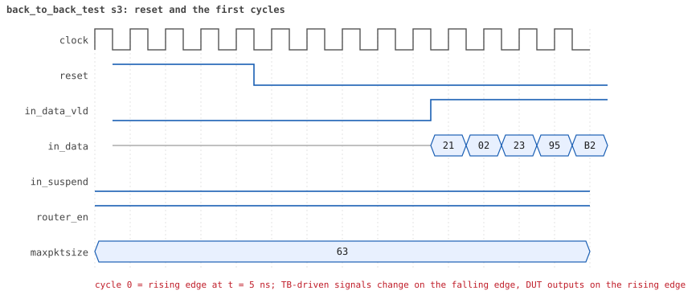
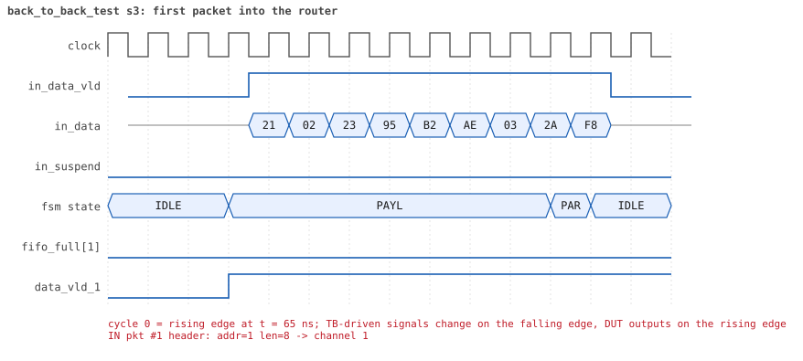
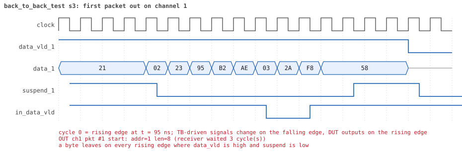

# back_to_back_test  seed 3

**Result:** PASSED (0 UVM_ERROR, 0 UVM_WARNING, 0 UVM_FATAL) · bench `yapp_project_tb` · sim time 3us · log `back_to_back_test_s3.log`

Waves: `back_to_back_test_s3.fst` (GTKWave, Surfer or the VS Code wave viewer); signal trace: `signals.csv`.

## Summary

- YAPP driver sent **24** packet(s) (0 with bad parity); the input monitor saw 24.
- Router: **24** forwarded, **0** dropped.
- Packets out: ch0 **5**, ch1 **3**, ch2 **16**.
- Scoreboard: 24 matched, 0 mismatched, 0 unexpected.
- Back-pressure: in_suspend asserted **0** time(s).
- Error pulses: 0.
- HBUS: 0 write(s), 0 read(s).

## Stages

| time (ns) | stage |
|---|---|
| 0 | 1. yapp_gap_seq: 24 packets with gaps of 0, 1, 2 and more cycles between them |
| 2625 | 2. the gap classes the monitor measured match the plan of the sequence, gap coverage 100% |

## Pictures

**reset and the first cycles**

**first packet into the router**

**first packet out on channel 1**

## Timeline

277 events (the same list is in `timeline.csv`).

| time (ns) | who | event |
|---|---|---|
| 0 | yapp monitor | YAPP monitor running |
| 0 | **test** | STAGE: 1. yapp_gap_seq: 24 packets with gaps of 0, 1, 2 and more cycles between them |
| 0 | clk/rst driver | Starting clock (period 10) and holding reset for 5 cycles |
| 0 | **DUT** | RESET asserted |
| 50 | **DUT** | RESET released: router_en=1 maxpktsize=63 |
| 50 | yapp driver | TX pkt #1: addr=1 len=8 parity=good delay=3 |
| 95 | **DUT** | IN  pkt #1 header: addr=1 len=8 -> channel 1 |
| 135 | **DUT** | OUT ch1 pkt #1 start: addr=1 len=8 (receiver waited 3 cycle(s)) |
| 185 | **DUT** | IN  pkt #1 complete: addr=1 len=8 parity=ok forwarded, 10 bytes in 10 cycles (held 0) |
| 185 | yapp monitor | RX pkt #1 on the input: addr=1 len=8 parity=good gap=4 |
| 185 | reference | Packet forwarded: addr=1 len=8 -> channel 1 |
| 190 | yapp driver | TX pkt #1 accepted by the DUT |
| 190 | yapp driver | TX pkt #2: addr=2 len=8 parity=good delay=1 |
| 205 | **DUT** | IN  pkt #2 header: addr=2 len=8 -> channel 2 |
| 220 | ch1 driver | ch1: packet consumed (response delay 3) |
| 255 | **DUT** | OUT ch1 pkt #1 done: 10 bytes in 13 cycles |
| 255 | ch1 monitor | ch1 RX pkt #1: addr=1 len=8 parity=good |
| 255 | scoreboard | ch1 pkt matched: addr=1 len=8 (1 matched so far) |
| 285 | **DUT** | OUT ch2 pkt #1 start: addr=2 len=8 (receiver waited 7 cycle(s)) |
| 295 | **DUT** | IN  pkt #2 complete: addr=2 len=8 parity=ok forwarded, 10 bytes in 10 cycles (held 0) |
| 295 | yapp monitor | RX pkt #2 on the input: addr=2 len=8 parity=good gap=1 |
| 295 | reference | Packet forwarded: addr=2 len=8 -> channel 2 |
| 300 | yapp driver | TX pkt #2 accepted by the DUT |
| 300 | yapp driver | TX pkt #3: addr=0 len=5 parity=good delay=2 |
| 325 | **DUT** | IN  pkt #3 header: addr=0 len=5 -> channel 0 |
| 370 | ch2 driver | ch2: packet consumed (response delay 7) |
| 385 | **DUT** | IN  pkt #3 complete: addr=0 len=5 parity=ok forwarded, 7 bytes in 7 cycles (held 0) |
| 385 | yapp monitor | RX pkt #3 on the input: addr=0 len=5 parity=good gap=2 |
| 385 | reference | Packet forwarded: addr=0 len=5 -> channel 0 |
| 390 | yapp driver | TX pkt #3 accepted by the DUT |
| 390 | yapp driver | TX pkt #4: addr=2 len=8 parity=good delay=3 |
| 425 | **DUT** | IN  pkt #4 header: addr=2 len=8 -> channel 2 |
| 425 | **DUT** | OUT ch0 pkt #1 start: addr=0 len=5 (receiver waited 9 cycle(s)) |
| 425 | **DUT** | OUT ch2 pkt #1 done: 10 bytes in 15 cycles |
| 425 | ch2 monitor | ch2 RX pkt #1: addr=2 len=8 parity=good |
| 425 | scoreboard | ch2 pkt matched: addr=2 len=8 (2 matched so far) |
| 435 | **DUT** | OUT ch2 pkt #2 start: addr=2 len=8 (receiver waited 0 cycle(s)) |
| 480 | ch0 driver | ch0: packet consumed (response delay 9) |
| 480 | ch1 driver | ch1: packet consumed (response delay 2) |
| 505 | **DUT** | OUT ch0 pkt #1 done: 7 bytes in 9 cycles |
| 505 | ch0 monitor | ch0 RX pkt #1: addr=0 len=5 parity=good |
| 505 | scoreboard | ch0 pkt matched: addr=0 len=5 (3 matched so far) |
| 515 | **DUT** | IN  pkt #4 complete: addr=2 len=8 parity=ok forwarded, 10 bytes in 10 cycles (held 0) |
| 515 | yapp monitor | RX pkt #4 on the input: addr=2 len=8 parity=good gap=3 |
| 515 | reference | Packet forwarded: addr=2 len=8 -> channel 2 |
| 520 | yapp driver | TX pkt #4 accepted by the DUT |
| 520 | yapp driver | TX pkt #5: addr=0 len=1 parity=good delay=0 |
| 525 | **DUT** | IN  pkt #5 header: addr=0 len=1 -> channel 0 |
| 525 | **DUT** | OUT ch2 pkt #2 done: 10 bytes in 10 cycles |
| 525 | ch2 monitor | ch2 RX pkt #2: addr=2 len=8 parity=good |
| 525 | scoreboard | ch2 pkt matched: addr=2 len=8 (4 matched so far) |
| 535 | **DUT** | OUT ch0 pkt #2 start: addr=0 len=1 (receiver waited 0 cycle(s)) |
| 545 | **DUT** | IN  pkt #5 complete: addr=0 len=1 parity=ok forwarded, 3 bytes in 3 cycles (held 0) |
| 545 | yapp monitor | RX pkt #5 on the input: addr=0 len=1 parity=good gap=0 |
| 545 | reference | Packet forwarded: addr=0 len=1 -> channel 0 |
| 550 | yapp driver | TX pkt #5 accepted by the DUT |
| 550 | yapp driver | TX pkt #6: addr=2 len=2 parity=good delay=1 |
| 555 | **DUT** | OUT ch0 pkt #2 done: 3 bytes in 3 cycles |
| 555 | ch0 monitor | ch0 RX pkt #2: addr=0 len=1 parity=good |
| 555 | scoreboard | ch0 pkt matched: addr=0 len=1 (5 matched so far) |
| 565 | **DUT** | IN  pkt #6 header: addr=2 len=2 -> channel 2 |
| 575 | **DUT** | OUT ch2 pkt #3 start: addr=2 len=2 (receiver waited 0 cycle(s)) |
| 595 | **DUT** | IN  pkt #6 complete: addr=2 len=2 parity=ok forwarded, 4 bytes in 4 cycles (held 0) |
| 595 | yapp monitor | RX pkt #6 on the input: addr=2 len=2 parity=good gap=1 |
| 595 | reference | Packet forwarded: addr=2 len=2 -> channel 2 |
| 600 | yapp driver | TX pkt #6 accepted by the DUT |
| 600 | yapp driver | TX pkt #7: addr=2 len=8 parity=good delay=2 |
| 605 | **DUT** | OUT ch2 pkt #3 done: 4 bytes in 4 cycles |
| 605 | ch2 monitor | ch2 RX pkt #3: addr=2 len=2 parity=good |
| 605 | scoreboard | ch2 pkt matched: addr=2 len=2 (6 matched so far) |
| 625 | **DUT** | IN  pkt #7 header: addr=2 len=8 -> channel 2 |
| 635 | **DUT** | OUT ch2 pkt #4 start: addr=2 len=8 (receiver waited 0 cycle(s)) |
| 680 | ch0 driver | ch0: packet consumed (response delay 1) |
| 715 | **DUT** | IN  pkt #7 complete: addr=2 len=8 parity=ok forwarded, 10 bytes in 10 cycles (held 0) |
| 715 | yapp monitor | RX pkt #7 on the input: addr=2 len=8 parity=good gap=2 |
| 715 | reference | Packet forwarded: addr=2 len=8 -> channel 2 |
| 720 | yapp driver | TX pkt #7 accepted by the DUT |
| 720 | yapp driver | TX pkt #8: addr=1 len=8 parity=good delay=3 |
| 725 | **DUT** | OUT ch2 pkt #4 done: 10 bytes in 10 cycles |
| 725 | ch2 monitor | ch2 RX pkt #4: addr=2 len=8 parity=good |
| 725 | scoreboard | ch2 pkt matched: addr=2 len=8 (7 matched so far) |
| 755 | **DUT** | IN  pkt #8 header: addr=1 len=8 -> channel 1 |
| 825 | **DUT** | OUT ch1 pkt #2 start: addr=1 len=8 (receiver waited 6 cycle(s)) |
| 845 | **DUT** | IN  pkt #8 complete: addr=1 len=8 parity=ok forwarded, 10 bytes in 10 cycles (held 0) |
| 845 | yapp monitor | RX pkt #8 on the input: addr=1 len=8 parity=good gap=3 |
| 845 | reference | Packet forwarded: addr=1 len=8 -> channel 1 |
| 850 | yapp driver | TX pkt #8 accepted by the DUT |
| 850 | yapp driver | TX pkt #9: addr=2 len=8 parity=good delay=0 |
| 855 | **DUT** | IN  pkt #9 header: addr=2 len=8 -> channel 2 |
| 865 | **DUT** | OUT ch2 pkt #5 start: addr=2 len=8 (receiver waited 0 cycle(s)) |
| 910 | ch1 driver | ch1: packet consumed (response delay 6) |
| 945 | **DUT** | IN  pkt #9 complete: addr=2 len=8 parity=ok forwarded, 10 bytes in 10 cycles (held 0) |
| 945 | yapp monitor | RX pkt #9 on the input: addr=2 len=8 parity=good gap=0 |
| 945 | reference | Packet forwarded: addr=2 len=8 -> channel 2 |
| 950 | yapp driver | TX pkt #9 accepted by the DUT |
| 950 | yapp driver | TX pkt #10: addr=2 len=1 parity=good delay=1 |
| 955 | **DUT** | OUT ch2 pkt #5 done: 10 bytes in 10 cycles |
| 955 | ch2 monitor | ch2 RX pkt #5: addr=2 len=8 parity=good |
| 955 | scoreboard | ch2 pkt matched: addr=2 len=8 (8 matched so far) |
| 965 | **DUT** | IN  pkt #10 header: addr=2 len=1 -> channel 2 |
| 975 | **DUT** | OUT ch2 pkt #6 start: addr=2 len=1 (receiver waited 0 cycle(s)) |
| 985 | **DUT** | IN  pkt #10 complete: addr=2 len=1 parity=ok forwarded, 3 bytes in 3 cycles (held 0) |
| 985 | yapp monitor | RX pkt #10 on the input: addr=2 len=1 parity=good gap=1 |
| 985 | reference | Packet forwarded: addr=2 len=1 -> channel 2 |
| 990 | yapp driver | TX pkt #10 accepted by the DUT |
| 990 | yapp driver | TX pkt #11: addr=0 len=7 parity=good delay=2 |
| 995 | **DUT** | OUT ch2 pkt #6 done: 3 bytes in 3 cycles |
| 995 | ch2 monitor | ch2 RX pkt #6: addr=2 len=1 parity=good |
| 995 | scoreboard | ch2 pkt matched: addr=2 len=1 (9 matched so far) |
| 1015 | **DUT** | IN  pkt #11 header: addr=0 len=7 -> channel 0 |
| 1025 | **DUT** | OUT ch1 pkt #2 done: 10 bytes in 21 cycles |
| 1025 | ch1 monitor | ch1 RX pkt #2: addr=1 len=8 parity=good |
| 1025 | scoreboard | ch1 pkt matched: addr=1 len=8 (10 matched so far) |
| 1030 | ch1 driver | ch1: packet consumed (response delay 10) |
| 1050 | ch2 driver | ch2: packet consumed (response delay 4) |
| 1085 | **DUT** | OUT ch0 pkt #3 start: addr=0 len=7 (receiver waited 6 cycle(s)) |
| 1095 | **DUT** | IN  pkt #11 complete: addr=0 len=7 parity=ok forwarded, 9 bytes in 9 cycles (held 0) |
| 1095 | yapp monitor | RX pkt #11 on the input: addr=0 len=7 parity=good gap=2 |
| 1095 | reference | Packet forwarded: addr=0 len=7 -> channel 0 |
| 1100 | yapp driver | TX pkt #11 accepted by the DUT |
| 1100 | yapp driver | TX pkt #12: addr=2 len=8 parity=good delay=3 |
| 1135 | **DUT** | IN  pkt #12 header: addr=2 len=8 -> channel 2 |
| 1160 | ch0 driver | ch0: packet consumed (response delay 6) |
| 1175 | **DUT** | OUT ch2 pkt #7 start: addr=2 len=8 (receiver waited 3 cycle(s)) |
| 1225 | **DUT** | IN  pkt #12 complete: addr=2 len=8 parity=ok forwarded, 10 bytes in 10 cycles (held 0) |
| 1225 | yapp monitor | RX pkt #12 on the input: addr=2 len=8 parity=good gap=3 |
| 1225 | reference | Packet forwarded: addr=2 len=8 -> channel 2 |
| 1230 | yapp driver | TX pkt #12 accepted by the DUT |
| 1230 | yapp driver | TX pkt #13: addr=0 len=8 parity=good delay=0 |
| 1235 | **DUT** | IN  pkt #13 header: addr=0 len=8 -> channel 0 |
| 1255 | **DUT** | OUT ch0 pkt #3 done: 9 bytes in 18 cycles |
| 1255 | ch0 monitor | ch0 RX pkt #3: addr=0 len=7 parity=good |
| 1255 | scoreboard | ch0 pkt matched: addr=0 len=7 (11 matched so far) |
| 1260 | ch2 driver | ch2: packet consumed (response delay 3) |
| 1265 | **DUT** | OUT ch0 pkt #4 start: addr=0 len=8 (receiver waited 0 cycle(s)) |
| 1325 | **DUT** | IN  pkt #13 complete: addr=0 len=8 parity=ok forwarded, 10 bytes in 10 cycles (held 0) |
| 1325 | yapp monitor | RX pkt #13 on the input: addr=0 len=8 parity=good gap=0 |
| 1325 | reference | Packet forwarded: addr=0 len=8 -> channel 0 |
| 1330 | yapp driver | TX pkt #13 accepted by the DUT |
| 1330 | yapp driver | TX pkt #14: addr=1 len=8 parity=good delay=1 |
| 1345 | **DUT** | IN  pkt #14 header: addr=1 len=8 -> channel 1 |
| 1355 | **DUT** | OUT ch0 pkt #4 done: 10 bytes in 10 cycles |
| 1355 | ch0 monitor | ch0 RX pkt #4: addr=0 len=8 parity=good |
| 1355 | scoreboard | ch0 pkt matched: addr=0 len=8 (12 matched so far) |
| 1375 | **DUT** | OUT ch2 pkt #7 done: 10 bytes in 21 cycles |
| 1375 | ch2 monitor | ch2 RX pkt #7: addr=2 len=8 parity=good |
| 1375 | scoreboard | ch2 pkt matched: addr=2 len=8 (13 matched so far) |
| 1385 | **DUT** | OUT ch1 pkt #3 start: addr=1 len=8 (receiver waited 3 cycle(s)) |
| 1435 | **DUT** | IN  pkt #14 complete: addr=1 len=8 parity=ok forwarded, 10 bytes in 10 cycles (held 0) |
| 1435 | yapp monitor | RX pkt #14 on the input: addr=1 len=8 parity=good gap=1 |
| 1435 | reference | Packet forwarded: addr=1 len=8 -> channel 1 |
| 1440 | yapp driver | TX pkt #14 accepted by the DUT |
| 1440 | yapp driver | TX pkt #15: addr=2 len=6 parity=good delay=2 |
| 1465 | **DUT** | IN  pkt #15 header: addr=2 len=6 -> channel 2 |
| 1470 | ch1 driver | ch1: packet consumed (response delay 3) |
| 1475 | **DUT** | OUT ch2 pkt #8 start: addr=2 len=6 (receiver waited 0 cycle(s)) |
| 1525 | **DUT** | OUT ch1 pkt #3 done: 10 bytes in 15 cycles |
| 1525 | ch1 monitor | ch1 RX pkt #3: addr=1 len=8 parity=good |
| 1525 | scoreboard | ch1 pkt matched: addr=1 len=8 (14 matched so far) |
| 1535 | **DUT** | IN  pkt #15 complete: addr=2 len=6 parity=ok forwarded, 8 bytes in 8 cycles (held 0) |
| 1535 | yapp monitor | RX pkt #15 on the input: addr=2 len=6 parity=good gap=2 |
| 1535 | reference | Packet forwarded: addr=2 len=6 -> channel 2 |
| 1540 | yapp driver | TX pkt #15 accepted by the DUT |
| 1540 | yapp driver | TX pkt #16: addr=2 len=8 parity=good delay=3 |
| 1545 | **DUT** | OUT ch2 pkt #8 done: 8 bytes in 8 cycles |
| 1545 | ch2 monitor | ch2 RX pkt #8: addr=2 len=6 parity=good |
| 1545 | scoreboard | ch2 pkt matched: addr=2 len=6 (15 matched so far) |
| 1575 | **DUT** | IN  pkt #16 header: addr=2 len=8 -> channel 2 |
| 1585 | **DUT** | OUT ch2 pkt #9 start: addr=2 len=8 (receiver waited 0 cycle(s)) |
| 1600 | ch2 driver | ch2: packet consumed (response delay 10) |
| 1620 | ch0 driver | ch0: packet consumed (response delay 8) |
| 1665 | **DUT** | IN  pkt #16 complete: addr=2 len=8 parity=ok forwarded, 10 bytes in 10 cycles (held 0) |
| 1665 | yapp monitor | RX pkt #16 on the input: addr=2 len=8 parity=good gap=3 |
| 1665 | reference | Packet forwarded: addr=2 len=8 -> channel 2 |
| 1670 | yapp driver | TX pkt #16 accepted by the DUT |
| 1670 | yapp driver | TX pkt #17: addr=2 len=8 parity=good delay=0 |
| 1675 | **DUT** | IN  pkt #17 header: addr=2 len=8 -> channel 2 |
| 1755 | **DUT** | OUT ch2 pkt #9 done: 10 bytes in 18 cycles |
| 1755 | ch2 monitor | ch2 RX pkt #9: addr=2 len=8 parity=good |
| 1755 | scoreboard | ch2 pkt matched: addr=2 len=8 (16 matched so far) |
| 1765 | **DUT** | IN  pkt #17 complete: addr=2 len=8 parity=ok forwarded, 10 bytes in 10 cycles (held 0) |
| 1765 | **DUT** | OUT ch2 pkt #10 start: addr=2 len=8 (receiver waited 0 cycle(s)) |
| 1765 | yapp monitor | RX pkt #17 on the input: addr=2 len=8 parity=good gap=0 |
| 1765 | reference | Packet forwarded: addr=2 len=8 -> channel 2 |
| 1770 | yapp driver | TX pkt #17 accepted by the DUT |
| 1770 | yapp driver | TX pkt #18: addr=2 len=1 parity=good delay=1 |
| 1785 | **DUT** | IN  pkt #18 header: addr=2 len=1 -> channel 2 |
| 1800 | ch1 driver | ch1: packet consumed (response delay 4) |
| 1805 | **DUT** | IN  pkt #18 complete: addr=2 len=1 parity=ok forwarded, 3 bytes in 3 cycles (held 0) |
| 1805 | yapp monitor | RX pkt #18 on the input: addr=2 len=1 parity=good gap=1 |
| 1805 | reference | Packet forwarded: addr=2 len=1 -> channel 2 |
| 1810 | yapp driver | TX pkt #18 accepted by the DUT |
| 1810 | yapp driver | TX pkt #19: addr=2 len=8 parity=good delay=2 |
| 1835 | **DUT** | IN  pkt #19 header: addr=2 len=8 -> channel 2 |
| 1855 | **DUT** | OUT ch2 pkt #10 done: 10 bytes in 10 cycles |
| 1855 | ch2 monitor | ch2 RX pkt #10: addr=2 len=8 parity=good |
| 1855 | scoreboard | ch2 pkt matched: addr=2 len=8 (17 matched so far) |
| 1865 | **DUT** | OUT ch2 pkt #11 start: addr=2 len=1 (receiver waited 0 cycle(s)) |
| 1885 | **DUT** | OUT ch2 pkt #11 done: 3 bytes in 3 cycles |
| 1885 | ch2 monitor | ch2 RX pkt #11: addr=2 len=1 parity=good |
| 1885 | scoreboard | ch2 pkt matched: addr=2 len=1 (18 matched so far) |
| 1895 | **DUT** | OUT ch2 pkt #12 start: addr=2 len=8 (receiver waited 0 cycle(s)) |
| 1925 | **DUT** | IN  pkt #19 complete: addr=2 len=8 parity=ok forwarded, 10 bytes in 10 cycles (held 0) |
| 1925 | yapp monitor | RX pkt #19 on the input: addr=2 len=8 parity=good gap=2 |
| 1925 | reference | Packet forwarded: addr=2 len=8 -> channel 2 |
| 1930 | yapp driver | TX pkt #19 accepted by the DUT |
| 1930 | yapp driver | TX pkt #20: addr=0 len=8 parity=good delay=3 |
| 1965 | **DUT** | IN  pkt #20 header: addr=0 len=8 -> channel 0 |
| 1985 | **DUT** | OUT ch2 pkt #12 done: 10 bytes in 10 cycles |
| 1985 | ch2 monitor | ch2 RX pkt #12: addr=2 len=8 parity=good |
| 1985 | scoreboard | ch2 pkt matched: addr=2 len=8 (19 matched so far) |
| 2045 | **DUT** | OUT ch0 pkt #5 start: addr=0 len=8 (receiver waited 7 cycle(s)) |
| 2055 | **DUT** | IN  pkt #20 complete: addr=0 len=8 parity=ok forwarded, 10 bytes in 10 cycles (held 0) |
| 2055 | yapp monitor | RX pkt #20 on the input: addr=0 len=8 parity=good gap=3 |
| 2055 | reference | Packet forwarded: addr=0 len=8 -> channel 0 |
| 2060 | yapp driver | TX pkt #20 accepted by the DUT |
| 2060 | yapp driver | TX pkt #21: addr=2 len=8 parity=good delay=0 |
| 2065 | **DUT** | IN  pkt #21 header: addr=2 len=8 -> channel 2 |
| 2075 | **DUT** | OUT ch2 pkt #13 start: addr=2 len=8 (receiver waited 0 cycle(s)) |
| 2130 | ch0 driver | ch0: packet consumed (response delay 7) |
| 2155 | **DUT** | IN  pkt #21 complete: addr=2 len=8 parity=ok forwarded, 10 bytes in 10 cycles (held 0) |
| 2155 | yapp monitor | RX pkt #21 on the input: addr=2 len=8 parity=good gap=0 |
| 2155 | reference | Packet forwarded: addr=2 len=8 -> channel 2 |
| 2160 | yapp driver | TX pkt #21 accepted by the DUT |
| 2160 | yapp driver | TX pkt #22: addr=2 len=6 parity=good delay=1 |
| 2165 | **DUT** | OUT ch2 pkt #13 done: 10 bytes in 10 cycles |
| 2165 | ch2 monitor | ch2 RX pkt #13: addr=2 len=8 parity=good |
| 2165 | scoreboard | ch2 pkt matched: addr=2 len=8 (20 matched so far) |
| 2170 | ch2 driver | ch2: packet consumed (response delay 7) |
| 2175 | **DUT** | IN  pkt #22 header: addr=2 len=6 -> channel 2 |
| 2245 | **DUT** | IN  pkt #22 complete: addr=2 len=6 parity=ok forwarded, 8 bytes in 8 cycles (held 0) |
| 2245 | **DUT** | OUT ch0 pkt #5 done: 10 bytes in 21 cycles |
| 2245 | ch0 monitor | ch0 RX pkt #5: addr=0 len=8 parity=good |
| 2245 | scoreboard | ch0 pkt matched: addr=0 len=8 (21 matched so far) |
| 2245 | yapp monitor | RX pkt #22 on the input: addr=2 len=6 parity=good gap=1 |
| 2245 | reference | Packet forwarded: addr=2 len=6 -> channel 2 |
| 2250 | yapp driver | TX pkt #22 accepted by the DUT |
| 2250 | yapp driver | TX pkt #23: addr=2 len=8 parity=good delay=2 |
| 2275 | **DUT** | IN  pkt #23 header: addr=2 len=8 -> channel 2 |
| 2275 | **DUT** | OUT ch2 pkt #14 start: addr=2 len=6 (receiver waited 9 cycle(s)) |
| 2340 | ch2 driver | ch2: packet consumed (response delay 9) |
| 2365 | **DUT** | IN  pkt #23 complete: addr=2 len=8 parity=ok forwarded, 10 bytes in 10 cycles (held 0) |
| 2365 | yapp monitor | RX pkt #23 on the input: addr=2 len=8 parity=good gap=2 |
| 2365 | reference | Packet forwarded: addr=2 len=8 -> channel 2 |
| 2370 | yapp driver | TX pkt #23 accepted by the DUT |
| 2370 | yapp driver | TX pkt #24: addr=2 len=8 parity=good delay=3 |
| 2380 | ch0 driver | ch0: packet consumed (response delay 10) |
| 2405 | **DUT** | IN  pkt #24 header: addr=2 len=8 -> channel 2 |
| 2425 | **DUT** | OUT ch2 pkt #14 done: 8 bytes in 16 cycles |
| 2425 | ch2 monitor | ch2 RX pkt #14: addr=2 len=6 parity=good |
| 2425 | scoreboard | ch2 pkt matched: addr=2 len=6 (22 matched so far) |
| 2435 | **DUT** | OUT ch2 pkt #15 start: addr=2 len=8 (receiver waited 0 cycle(s)) |
| 2495 | **DUT** | IN  pkt #24 complete: addr=2 len=8 parity=ok forwarded, 10 bytes in 10 cycles (held 0) |
| 2495 | yapp monitor | RX pkt #24 on the input: addr=2 len=8 parity=good gap=3 |
| 2495 | reference | Packet forwarded: addr=2 len=8 -> channel 2 |
| 2500 | yapp driver | TX pkt #24 accepted by the DUT |
| 2525 | **DUT** | OUT ch2 pkt #15 done: 10 bytes in 10 cycles |
| 2525 | ch2 monitor | ch2 RX pkt #15: addr=2 len=8 parity=good |
| 2525 | scoreboard | ch2 pkt matched: addr=2 len=8 (23 matched so far) |
| 2535 | **DUT** | OUT ch2 pkt #16 start: addr=2 len=8 (receiver waited 0 cycle(s)) |
| 2625 | **DUT** | OUT ch2 pkt #16 done: 10 bytes in 10 cycles |
| 2625 | ch2 monitor | ch2 RX pkt #16: addr=2 len=8 parity=good |
| 2625 | scoreboard | ch2 pkt matched: addr=2 len=8 (24 matched so far) |
| 2625 | **test** | STAGE: 2. the gap classes the monitor measured match the plan of the sequence, gap coverage 100% |
| 2625 | **test** | gap class 0: 5 packets, as planned |
| 2625 | **test** | gap class 1: 6 packets, as planned |
| 2625 | **test** | gap class 2: 6 packets, as planned |
| 2625 | **test** | gap class 3: 6 packets, as planned |
| 2825 | ch0 monitor | Channel 0 report: 5 packets collected |
| 2825 | ch1 monitor | Channel 1 report: 3 packets collected |
| 2825 | ch2 monitor | Channel 2 report: 16 packets collected |
| 2825 | hbus monitor | HBUS report: 0 writes, 0 reads |
| 2825 | reference |  |
| 2825 | scoreboard |  |
| 2825 | yapp driver | YAPP driver report: 24 packets sent |
| 2825 | yapp monitor | YAPP monitor report: 24 packets collected, coverage 30.0% |
| 2825 | yapp monitor | YAPP gaps: 5 back to back, 6 of 1 cycle, 6 of 2, 6 longer (gap coverage 100.0%) |
