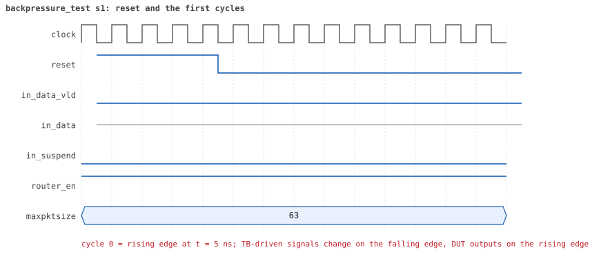
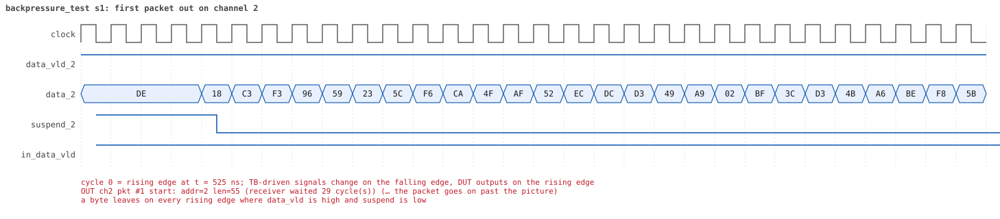
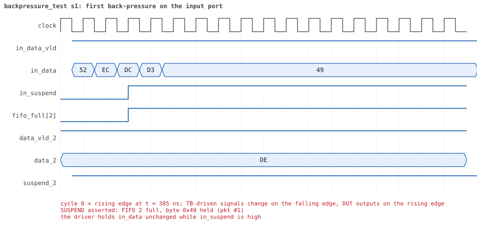

# backpressure_test  seed 1

**Result:** PASSED (0 UVM_ERROR, 0 UVM_WARNING, 0 UVM_FATAL) · bench `yapp_project_tb` · sim time 6us · log `backpressure_test_s1.log`

Waves: `backpressure_test_s1.fst` (GTKWave, Surfer or the VS Code wave viewer); signal trace: `signals.csv`.
[Open the waves in Surfer](https://app.surfer-project.org/?load_url=https%3A%2F%2Fraw.githubusercontent.com%2Ftamirgabgab%2FQcom-Mentoring%2Fmain%2Fyapp_project%2Fregression%2Fyapp_project_tb%2Fbackpressure_test_s1%2Fbackpressure_test_s1.fst&startup_commands=run_command_file_from_url%20https%3A%2F%2Fraw.githubusercontent.com%2Ftamirgabgab%2FQcom-Mentoring%2Fmain%2Fyapp_project%2Ftb%2Fyapp_router.sucl) (web app, the signals already in groups: `yapp_project/tb/yapp_router.sucl`).

## Summary

- YAPP driver sent **6** packet(s) (0 with bad parity); the input monitor saw 6.
- Router: **6** forwarded, **0** dropped.
- Packets out: ch0 **2**, ch1 **1**, ch2 **3**.
- Scoreboard: 6 matched, 0 mismatched, 0 unexpected.
- Back-pressure: in_suspend asserted **6** time(s), longest hold 32 cycle(s).
- Error pulses: 0.
- HBUS: 0 write(s), 0 read(s).

## Stages

| time (ns) | stage |
|---|---|
| 0 | 1. slow receivers (channel_rx_slow_seq): 6 packets of 40..63 bytes fill the 16-byte FIFOs |
| 6135 | 2. checks: in_suspend rose, 6 packets matched, nothing unexpected, no bad parity |

## Pictures

**reset and the first cycles**

**first packet into the router**

**first packet out on channel 2**

**first back-pressure on the input port**

## Timeline

100 events (the same list is in `timeline.csv`).

| time (ns) | who | event |
|---|---|---|
| 0 | yapp monitor | YAPP monitor running |
| 0 | **test** | STAGE: 1. slow receivers (channel_rx_slow_seq): 6 packets of 40..63 bytes fill the 16-byte FIFOs |
| 0 | clk/rst driver | Starting clock (period 10) and holding reset for 5 cycles |
| 0 | **DUT** | RESET asserted |
| 50 | **DUT** | RESET released: router_en=1 maxpktsize=63 |
| 50 | yapp driver | TX pkt #1: addr=2 len=55 parity=good delay=20 |
| 265 | **DUT** | IN  pkt #1 header: addr=2 len=55 -> channel 2 |
| 425 | **DUT** | SUSPEND asserted: FIFO 2 full, byte 0x49 held (pkt #1) |
| 565 | **DUT** | OUT ch2 pkt #1 start: addr=2 len=55 (receiver waited 29 cycle(s)) |
| 575 | **DUT** | SUSPEND released after 15 cycle(s) |
| 975 | **DUT** | IN  pkt #1 complete: addr=2 len=55 parity=ok forwarded, 57 bytes in 72 cycles (held 15) |
| 975 | yapp monitor | RX pkt #1 on the input: addr=2 len=55 parity=good gap=21 |
| 975 | reference | Packet forwarded: addr=2 len=55 -> channel 2 |
| 980 | yapp driver | TX pkt #1 accepted by the DUT |
| 980 | yapp driver | TX pkt #2: addr=0 len=42 parity=good delay=19 |
| 1120 | ch2 driver | ch2: packet consumed (response delay 29) |
| 1175 | **DUT** | IN  pkt #2 header: addr=0 len=42 -> channel 0 |
| 1335 | **DUT** | SUSPEND asserted: FIFO 0 full, byte 0x1f held (pkt #2) |
| 1345 | **DUT** | OUT ch2 pkt #1 done: 57 bytes in 79 cycles |
| 1345 | ch2 monitor | ch2 RX pkt #1: addr=2 len=55 parity=good |
| 1345 | scoreboard | ch2 pkt matched: addr=2 len=55 (1 matched so far) |
| 1395 | **DUT** | OUT ch0 pkt #1 start: addr=0 len=42 (receiver waited 21 cycle(s)) |
| 1405 | **DUT** | SUSPEND released after 7 cycle(s) |
| 1675 | **DUT** | IN  pkt #2 complete: addr=0 len=42 parity=ok forwarded, 44 bytes in 51 cycles (held 7) |
| 1675 | yapp monitor | RX pkt #2 on the input: addr=0 len=42 parity=good gap=19 |
| 1675 | reference | Packet forwarded: addr=0 len=42 -> channel 0 |
| 1680 | yapp driver | TX pkt #2 accepted by the DUT |
| 1680 | yapp driver | TX pkt #3: addr=2 len=58 parity=good delay=4 |
| 1725 | **DUT** | IN  pkt #3 header: addr=2 len=58 -> channel 2 |
| 1735 | **DUT** | OUT ch2 pkt #2 start: addr=2 len=58 (receiver waited 0 cycle(s)) |
| 1820 | ch0 driver | ch0: packet consumed (response delay 21) |
| 1900 | ch2 driver | ch2: packet consumed (response delay 21) |
| 2055 | **DUT** | SUSPEND asserted: FIFO 2 full, byte 0xd3 held (pkt #3) |
| 2165 | **DUT** | SUSPEND released after 11 cycle(s) |
| 2215 | **DUT** | OUT ch0 pkt #1 done: 44 bytes in 83 cycles |
| 2215 | ch0 monitor | ch0 RX pkt #1: addr=0 len=42 parity=good |
| 2215 | scoreboard | ch0 pkt matched: addr=0 len=42 (2 matched so far) |
| 2425 | **DUT** | IN  pkt #3 complete: addr=2 len=58 parity=ok forwarded, 60 bytes in 71 cycles (held 11) |
| 2425 | yapp monitor | RX pkt #3 on the input: addr=2 len=58 parity=good gap=4 |
| 2425 | reference | Packet forwarded: addr=2 len=58 -> channel 2 |
| 2430 | yapp driver | TX pkt #3 accepted by the DUT |
| 2430 | yapp driver | TX pkt #4: addr=2 len=62 parity=good delay=9 |
| 2525 | **DUT** | IN  pkt #4 header: addr=2 len=62 -> channel 2 |
| 2575 | **DUT** | OUT ch2 pkt #2 done: 60 bytes in 85 cycles |
| 2575 | ch2 monitor | ch2 RX pkt #2: addr=2 len=58 parity=good |
| 2575 | scoreboard | ch2 pkt matched: addr=2 len=58 (3 matched so far) |
| 2585 | **DUT** | OUT ch2 pkt #3 start: addr=2 len=62 (receiver waited 0 cycle(s)) |
| 2670 | ch2 driver | ch2: packet consumed (response delay 24) |
| 2740 | ch0 driver | ch0: packet consumed (response delay 38) |
| 2775 | **DUT** | SUSPEND asserted: FIFO 2 full, byte 0x15 held (pkt #4) |
| 3095 | **DUT** | SUSPEND released after 32 cycle(s) |
| 3475 | **DUT** | IN  pkt #4 complete: addr=2 len=62 parity=ok forwarded, 64 bytes in 96 cycles (held 32) |
| 3475 | yapp monitor | RX pkt #4 on the input: addr=2 len=62 parity=good gap=9 |
| 3475 | reference | Packet forwarded: addr=2 len=62 -> channel 2 |
| 3480 | yapp driver | TX pkt #4 accepted by the DUT |
| 3480 | yapp driver | TX pkt #5: addr=0 len=57 parity=good delay=20 |
| 3625 | **DUT** | OUT ch2 pkt #3 done: 64 bytes in 105 cycles |
| 3625 | ch2 monitor | ch2 RX pkt #3: addr=2 len=62 parity=good |
| 3625 | scoreboard | ch2 pkt matched: addr=2 len=62 (4 matched so far) |
| 3660 | ch2 driver | ch2: packet consumed (response delay 40) |
| 3685 | **DUT** | IN  pkt #5 header: addr=0 len=57 -> channel 0 |
| 3845 | **DUT** | SUSPEND asserted: FIFO 0 full, byte 0x88 held (pkt #5) |
| 4095 | **DUT** | OUT ch0 pkt #2 start: addr=0 len=57 (receiver waited 40 cycle(s)) |
| 4105 | **DUT** | SUSPEND released after 26 cycle(s) |
| 4525 | **DUT** | IN  pkt #5 complete: addr=0 len=57 parity=ok forwarded, 59 bytes in 85 cycles (held 26) |
| 4525 | yapp monitor | RX pkt #5 on the input: addr=0 len=57 parity=good gap=20 |
| 4525 | reference | Packet forwarded: addr=0 len=57 -> channel 0 |
| 4530 | yapp driver | TX pkt #5 accepted by the DUT |
| 4530 | yapp driver | TX pkt #6: addr=1 len=62 parity=good delay=17 |
| 4670 | ch0 driver | ch0: packet consumed (response delay 40) |
| 4705 | **DUT** | IN  pkt #6 header: addr=1 len=62 -> channel 1 |
| 4865 | **DUT** | SUSPEND asserted: FIFO 1 full, byte 0x7e held (pkt #6) |
| 4895 | **DUT** | OUT ch0 pkt #2 done: 59 bytes in 81 cycles |
| 4895 | ch0 monitor | ch0 RX pkt #2: addr=0 len=57 parity=good |
| 4895 | scoreboard | ch0 pkt matched: addr=0 len=57 (5 matched so far) |
| 5115 | **DUT** | OUT ch1 pkt #1 start: addr=1 len=62 (receiver waited 40 cycle(s)) |
| 5125 | **DUT** | SUSPEND released after 26 cycle(s) |
| 5370 | ch0 driver | ch0: packet consumed (response delay 21) |
| 5595 | **DUT** | IN  pkt #6 complete: addr=1 len=62 parity=ok forwarded, 64 bytes in 90 cycles (held 26) |
| 5595 | yapp monitor | RX pkt #6 on the input: addr=1 len=62 parity=good gap=17 |
| 5595 | reference | Packet forwarded: addr=1 len=62 -> channel 1 |
| 5600 | yapp driver | TX pkt #6 accepted by the DUT |
| 5740 | ch1 driver | ch1: packet consumed (response delay 40) |
| 6135 | **DUT** | OUT ch1 pkt #1 done: 64 bytes in 103 cycles |
| 6135 | ch1 monitor | ch1 RX pkt #1: addr=1 len=62 parity=good |
| 6135 | scoreboard | ch1 pkt matched: addr=1 len=62 (6 matched so far) |
| 6135 | **test** | STAGE: 2. checks: in_suspend rose, 6 packets matched, nothing unexpected, no bad parity |
| 6135 | **test** | in_suspend rose 6 times |
| 6335 | ch0 monitor | Channel 0 report: 2 packets collected |
| 6335 | ch1 monitor | Channel 1 report: 1 packets collected |
| 6335 | ch2 monitor | Channel 2 report: 3 packets collected |
| 6335 | hbus monitor | HBUS report: 0 writes, 0 reads |
| 6335 | coverage | Coverage of the router configuration: 26.1% |
| 6335 | reference |  |
| 6335 | scoreboard |  |
| 6335 | yapp driver | YAPP driver report: 6 packets sent |
| 6335 | coverage | YAPP gap coverage: 5 gaps sampled, coverage 25.0% |
| 6335 | yapp monitor | YAPP monitor report: 6 packets collected, 0 with bad parity |
| 6335 | yapp monitor | YAPP gaps: 0 back to back, 0 of 1 cycle, 0 of 2, 5 longer |
| 6335 | coverage | YAPP packet coverage: 6 packets sampled, coverage 26.7% |
