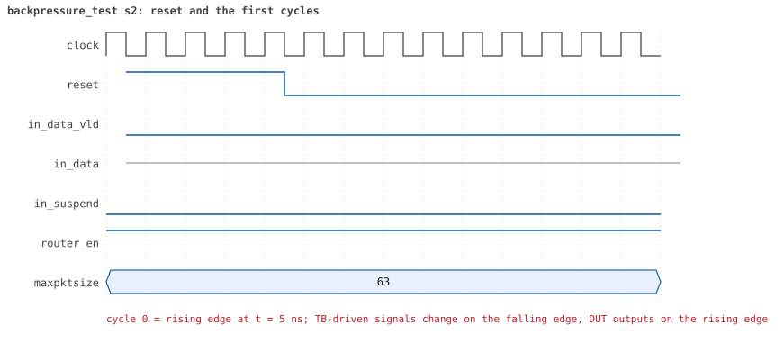
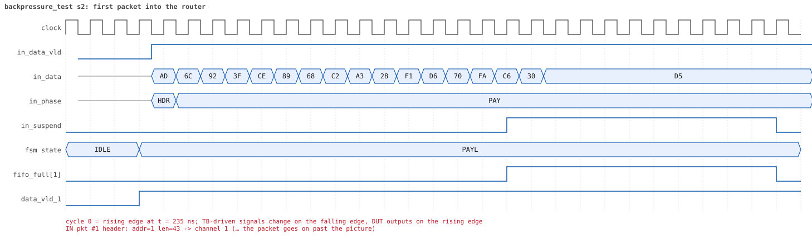
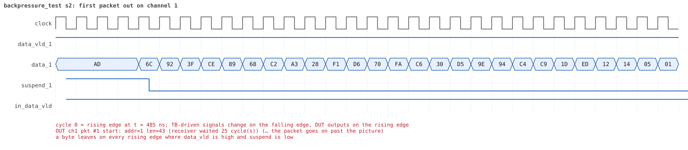
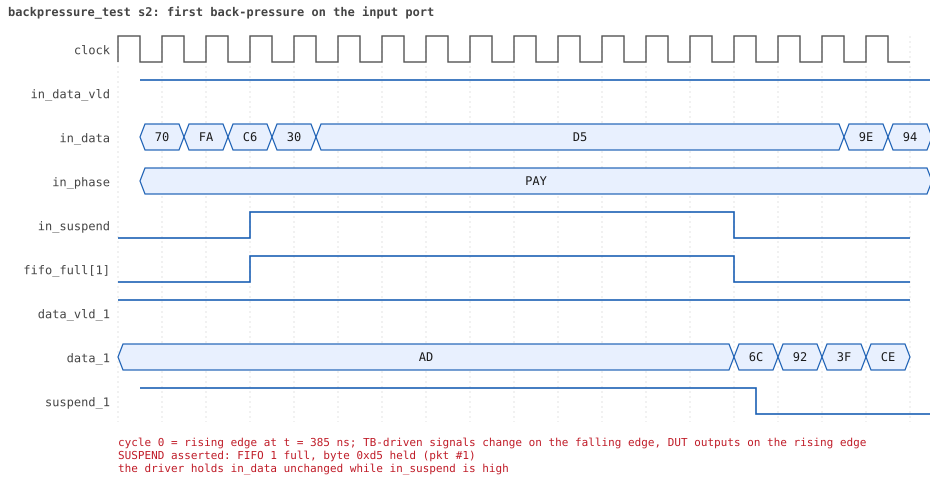

# backpressure_test seed 2

**Result:** PASSED (0 UVM_ERROR, 0 UVM_WARNING, 0 UVM_FATAL) · bench `yapp_project_tb` · sim time 8us · wall 0.8 s · log [`backpressure_test_s2.log`](backpressure_test_s2.log)

Waves: `backpressure_test_s2.fst` (GTKWave, Surfer or the VS Code wave viewer).
[Open the waves in Surfer](https://app.surfer-project.org/?load_url=https%3A%2F%2Fraw.githubusercontent.com%2Ftamirgabgab%2FQcom-Mentoring%2Fmain%2Fyapp_project%2Fregression%2Fyapp_project_tb%2Fbackpressure_test_s2%2Fbackpressure_test_s2.fst&startup_commands=run_command_file_from_url%20https%3A%2F%2Fraw.githubusercontent.com%2Ftamirgabgab%2FQcom-Mentoring%2Fmain%2Fyapp_project%2Ftb%2Fyapp_router.sucl) (web app, the signals already in groups: `yapp_project/tb/yapp_router.sucl`).

## Summary

- YAPP driver sent **6** packet(s) (0 with bad parity); the input monitor saw 6.
- Router: **6** forwarded, **0** dropped.
- Packets out: ch0 **0**, ch1 **4**, ch2 **2**.
- Scoreboard: 6 matched, 0 mismatched, 0 unexpected.
- Back-pressure: in_suspend asserted **10** time(s), longest hold 41 cycle(s).
- Error pulses: 0.
- HBUS: 0 write(s), 0 read(s).

## Stages

| time (ns) | stage |
|---|---|
| 0 | 1. slow receivers (channel_rx_slow_seq): 6 packets of 40..63 bytes fill the 16-byte FIFOs |
| 7495 | 2. checks: in_suspend rose, 6 packets matched, nothing unexpected, no bad parity |

## Pictures

**reset and the first cycles**

**first packet into the router**

**first packet out on channel 1**

**first back-pressure on the input port**

## Timeline

114 events.

| time (ns) | who | event |
|---|---|---|
| 0 | yapp monitor | YAPP monitor running |
| 0 | **test** | STAGE: 1. slow receivers (channel_rx_slow_seq): 6 packets of 40..63 bytes fill the 16-byte FIFOs |
| 0 | clk/rst driver | Starting clock (period 10) and holding reset for 5 cycles |
| 0 | **DUT** | RESET asserted |
| 50 | **DUT** | RESET released: router_en=1 maxpktsize=63 |
| 50 | yapp driver | TX pkt #1: addr=1 len=43 parity=good delay=20 |
| 265 | **DUT** | IN  pkt #1 header: addr=1 len=43 -> channel 1 |
| 425 | **DUT** | SUSPEND asserted: FIFO 1 full, byte 0xd5 held (pkt #1) |
| 525 | **DUT** | OUT ch1 pkt #1 start: addr=1 len=43 (receiver waited 25 cycle(s)) |
| 535 | **DUT** | SUSPEND released after 11 cycle(s) |
| 815 | **DUT** | IN  pkt #1 complete: addr=1 len=43 parity=ok forwarded, 45 bytes in 56 cycles (held 11) |
| 815 | yapp monitor | RX pkt #1 on the input: addr=1 len=43 parity=good gap=21 |
| 815 | reference | Packet forwarded: addr=1 len=43 -> channel 1 |
| 820 | yapp driver | TX pkt #1 accepted by the DUT |
| 820 | yapp driver | TX pkt #2: addr=1 len=62 parity=good delay=11 |
| 935 | **DUT** | IN  pkt #2 header: addr=1 len=62 -> channel 1 |
| 960 | ch1 driver | ch1: packet consumed (response delay 25) |
| 1085 | **DUT** | SUSPEND asserted: FIFO 1 full, byte 0x18 held (pkt #2) |
| 1375 | **DUT** | OUT ch1 pkt #1 done: 45 bytes in 86 cycles |
| 1375 | ch1 monitor | ch1 RX pkt #1: addr=1 len=43 parity=good |
| 1375 | scoreboard | ch1 pkt matched: addr=1 len=43 (1 matched so far) |
| 1385 | **DUT** | SUSPEND released after 30 cycle(s) |
| 1385 | **DUT** | OUT ch1 pkt #2 start: addr=1 len=62 (receiver waited 0 cycle(s)) |
| 1470 | ch1 driver | ch1: packet consumed (response delay 40) |
| 1485 | **DUT** | SUSPEND asserted: FIFO 1 full, byte 0x0d held (pkt #2) |
| 1895 | **DUT** | SUSPEND released after 41 cycle(s) |
| 2220 | ch1 driver | ch1: packet consumed (response delay 40) |
| 2235 | **DUT** | SUSPEND asserted: FIFO 1 full, byte 0x85 held (pkt #2) |
| 2645 | **DUT** | SUSPEND released after 41 cycle(s) |
| 2685 | **DUT** | IN  pkt #2 complete: addr=1 len=62 parity=ok forwarded, 64 bytes in 176 cycles (held 112) |
| 2685 | yapp monitor | RX pkt #2 on the input: addr=1 len=62 parity=good gap=11 |
| 2685 | reference | Packet forwarded: addr=1 len=62 -> channel 1 |
| 2690 | yapp driver | TX pkt #2 accepted by the DUT |
| 2690 | yapp driver | TX pkt #3: addr=2 len=59 parity=good delay=8 |
| 2760 | ch1 driver | ch1: packet consumed (response delay 40) |
| 2775 | **DUT** | IN  pkt #3 header: addr=2 len=59 -> channel 2 |
| 2935 | **DUT** | SUSPEND asserted: FIFO 2 full, byte 0x16 held (pkt #3) |
| 3095 | **DUT** | OUT ch2 pkt #1 start: addr=2 len=59 (receiver waited 31 cycle(s)) |
| 3105 | **DUT** | SUSPEND released after 17 cycle(s) |
| 3125 | **DUT** | OUT ch1 pkt #2 done: 64 bytes in 175 cycles |
| 3125 | ch1 monitor | ch1 RX pkt #2: addr=1 len=62 parity=good |
| 3125 | scoreboard | ch1 pkt matched: addr=1 len=62 (2 matched so far) |
| 3490 | ch1 driver | ch1: packet consumed (response delay 28) |
| 3545 | **DUT** | IN  pkt #3 complete: addr=2 len=59 parity=ok forwarded, 61 bytes in 78 cycles (held 17) |
| 3545 | yapp monitor | RX pkt #3 on the input: addr=2 len=59 parity=good gap=8 |
| 3545 | reference | Packet forwarded: addr=2 len=59 -> channel 2 |
| 3550 | yapp driver | TX pkt #3 accepted by the DUT |
| 3550 | yapp driver | TX pkt #4: addr=2 len=49 parity=good delay=20 |
| 3690 | ch2 driver | ch2: packet consumed (response delay 31) |
| 3755 | **DUT** | IN  pkt #4 header: addr=2 len=49 -> channel 2 |
| 3905 | **DUT** | SUSPEND asserted: FIFO 2 full, byte 0x6b held (pkt #4) |
| 4045 | **DUT** | OUT ch2 pkt #1 done: 61 bytes in 96 cycles |
| 4045 | ch2 monitor | ch2 RX pkt #1: addr=2 len=59 parity=good |
| 4045 | scoreboard | ch2 pkt matched: addr=2 len=59 (3 matched so far) |
| 4055 | **DUT** | SUSPEND released after 15 cycle(s) |
| 4055 | **DUT** | OUT ch2 pkt #2 start: addr=2 len=49 (receiver waited 0 cycle(s)) |
| 4405 | **DUT** | IN  pkt #4 complete: addr=2 len=49 parity=ok forwarded, 51 bytes in 66 cycles (held 15) |
| 4405 | yapp monitor | RX pkt #4 on the input: addr=2 len=49 parity=good gap=20 |
| 4405 | reference | Packet forwarded: addr=2 len=49 -> channel 2 |
| 4410 | yapp driver | TX pkt #4 accepted by the DUT |
| 4410 | yapp driver | TX pkt #5: addr=1 len=62 parity=good delay=16 |
| 4555 | **DUT** | OUT ch2 pkt #2 done: 51 bytes in 51 cycles |
| 4555 | ch2 monitor | ch2 RX pkt #2: addr=2 len=49 parity=good |
| 4555 | scoreboard | ch2 pkt matched: addr=2 len=49 (4 matched so far) |
| 4575 | **DUT** | IN  pkt #5 header: addr=1 len=62 -> channel 1 |
| 4630 | ch2 driver | ch2: packet consumed (response delay 34) |
| 4735 | **DUT** | SUSPEND asserted: FIFO 1 full, byte 0xc0 held (pkt #5) |
| 4855 | **DUT** | OUT ch1 pkt #3 start: addr=1 len=62 (receiver waited 27 cycle(s)) |
| 4865 | **DUT** | SUSPEND released after 13 cycle(s) |
| 5335 | **DUT** | IN  pkt #5 complete: addr=1 len=62 parity=ok forwarded, 64 bytes in 77 cycles (held 13) |
| 5335 | yapp monitor | RX pkt #5 on the input: addr=1 len=62 parity=good gap=16 |
| 5335 | reference | Packet forwarded: addr=1 len=62 -> channel 1 |
| 5340 | yapp driver | TX pkt #5 accepted by the DUT |
| 5340 | yapp driver | TX pkt #6: addr=1 len=47 parity=good delay=14 |
| 5480 | ch1 driver | ch1: packet consumed (response delay 27) |
| 5485 | **DUT** | IN  pkt #6 header: addr=1 len=47 -> channel 1 |
| 5635 | **DUT** | SUSPEND asserted: FIFO 1 full, byte 0x5c held (pkt #6) |
| 5895 | **DUT** | OUT ch1 pkt #3 done: 64 bytes in 105 cycles |
| 5895 | ch1 monitor | ch1 RX pkt #3: addr=1 len=62 parity=good |
| 5895 | scoreboard | ch1 pkt matched: addr=1 len=62 (5 matched so far) |
| 5905 | **DUT** | SUSPEND released after 27 cycle(s) |
| 5905 | **DUT** | OUT ch1 pkt #4 start: addr=1 len=47 (receiver waited 0 cycle(s)) |
| 6120 | ch1 driver | ch1: packet consumed (response delay 40) |
| 6135 | **DUT** | SUSPEND asserted: FIFO 1 full, byte 0x86 held (pkt #6) |
| 6545 | **DUT** | SUSPEND released after 41 cycle(s) |
| 6630 | ch1 driver | ch1: packet consumed (response delay 40) |
| 6645 | **DUT** | SUSPEND asserted: FIFO 1 full, byte 0x52 held (pkt #6) |
| 7055 | **DUT** | IN  pkt #6 complete: addr=1 len=47 parity=ok forwarded, 49 bytes in 158 cycles (held 109) |
| 7055 | **DUT** | SUSPEND released after 41 cycle(s) |
| 7055 | yapp monitor | RX pkt #6 on the input: addr=1 len=47 parity=good gap=14 |
| 7055 | reference | Packet forwarded: addr=1 len=47 -> channel 1 |
| 7060 | yapp driver | TX pkt #6 accepted by the DUT |
| 7160 | ch1 driver | ch1: packet consumed (response delay 40) |
| 7495 | **DUT** | OUT ch1 pkt #4 done: 49 bytes in 160 cycles |
| 7495 | ch1 monitor | ch1 RX pkt #4: addr=1 len=47 parity=good |
| 7495 | scoreboard | ch1 pkt matched: addr=1 len=47 (6 matched so far) |
| 7495 | **test** | STAGE: 2. checks: in_suspend rose, 6 packets matched, nothing unexpected, no bad parity |
| 7495 | **test** | in_suspend rose 10 times |
| 7695 | ch0 monitor | Channel 0 report: 0 packets collected |
| 7695 | ch1 monitor | Channel 1 report: 4 packets collected |
| 7695 | ch2 monitor | Channel 2 report: 2 packets collected |
| 7695 | hbus monitor | HBUS report: 0 writes, 0 reads |
| 7695 | coverage | Coverage of the router configuration: 26.1% · maxpktsize 0 / 1 / 2..61 / 62 / 63 : 0 / 0 / 0 / 0 / 6 packets · length < max / = max / max+1 / > max+1 : 6 / 0 / 0 / 0 · forwarded good / bad : 6 / 0 · dropped address 3 good / bad : 0 / 0 · dropped oversized good / bad : 0 / 0 · counter enables none / mixed / all : 6 / 0 / 0 |
| 7695 | coverage | HBUS address coverage: 0 accesses sampled, coverage 0.0% |
| 7695 | coverage | HBUS register bits coverage: 0 writes to ctrl_reg/en_reg, coverage 0.0% |
| 7695 | coverage | HBUS counter value coverage: 0 counter reads sampled, coverage 0.0% |
| 7695 | coverage | HBUS yapp_mem data coverage: 0 accesses sampled, coverage 0.0% |
| 7695 | reference | --- Reference model report --- · forwarded to scoreboard : 6 · dropped (router disabled) : 0 · dropped (oversized) : 0 · dropped (address 3) : 0 · counters parity/oversized/addr0..3 : 0 / 0 / 0 0 0 0 |
| 7695 | scoreboard | --- Scoreboard report --- · packets received : 6 · packets matched : 6 · packets mismatched: 0 · packets unexpected: 0 · packets to addr 3 : 0 · left in queue 0/1/2: 0 / 0 / 0 |
| 7695 | yapp driver | YAPP driver report: 6 packets sent |
| 7695 | coverage | YAPP gap coverage: 5 gaps sampled, coverage 25.0% |
| 7695 | yapp monitor | YAPP monitor report: 6 packets collected, 0 with bad parity |
| 7695 | yapp monitor | YAPP gaps: 0 back to back, 0 of 1 cycle, 0 of 2, 5 longer |
| 7695 | coverage | YAPP packet coverage: 6 packets sampled, coverage 20.0% |
