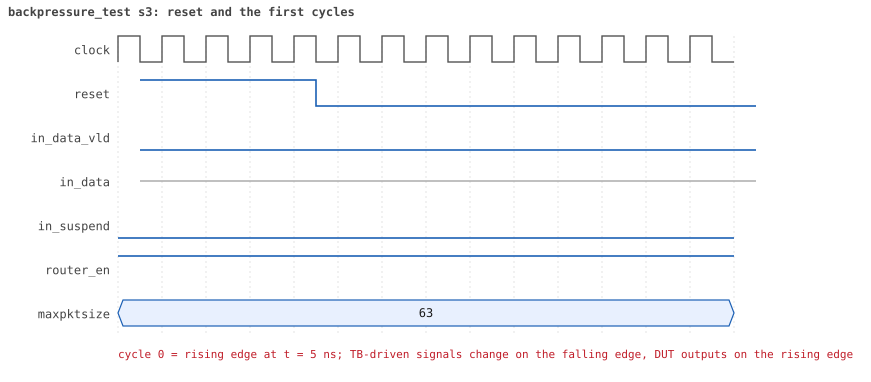
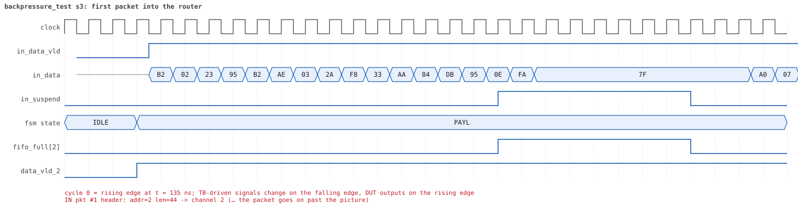
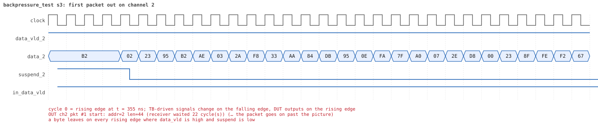
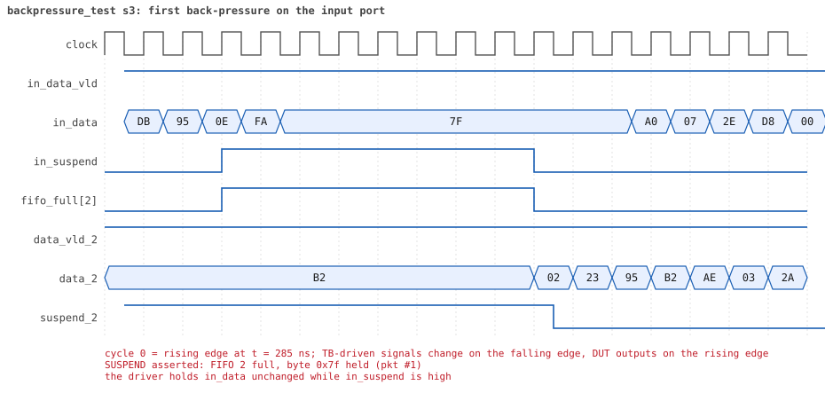

# backpressure_test seed 3

**Result:** PASSED (0 UVM_ERROR, 0 UVM_WARNING, 0 UVM_FATAL) · bench `yapp_project_tb` · sim time 6us · wall 0.7 s · log [`backpressure_test_s3.log`](backpressure_test_s3.log)

Waves: `backpressure_test_s3.fst` (GTKWave, Surfer or the VS Code wave viewer).
[Open the waves in Surfer](https://app.surfer-project.org/?load_url=https%3A%2F%2Fraw.githubusercontent.com%2Ftamirgabgab%2FQcom-Mentoring%2Fmain%2Fyapp_project%2Fregression%2Fyapp_project_tb%2Fbackpressure_test_s3%2Fbackpressure_test_s3.fst&startup_commands=run_command_file_from_url%20https%3A%2F%2Fraw.githubusercontent.com%2Ftamirgabgab%2FQcom-Mentoring%2Fmain%2Fyapp_project%2Ftb%2Fyapp_router.sucl) (web app, the signals already in groups: `yapp_project/tb/yapp_router.sucl`).

## Summary

- YAPP driver sent **6** packet(s) (0 with bad parity); the input monitor saw 6.
- Router: **6** forwarded, **0** dropped.
- Packets out: ch0 **2**, ch1 **1**, ch2 **3**.
- Scoreboard: 6 matched, 0 mismatched, 0 unexpected.
- Back-pressure: in_suspend asserted **7** time(s), longest hold 26 cycle(s).
- Error pulses: 0.
- HBUS: 0 write(s), 0 read(s).

## Stages

| time (ns) | stage |
|---|---|
| 0 | 1. slow receivers (channel_rx_slow_seq): 6 packets of 40..63 bytes fill the 16-byte FIFOs |
| 5585 | 2. checks: in_suspend rose, 6 packets matched, nothing unexpected, no bad parity |

## Pictures

**reset and the first cycles**

**first packet into the router**

**first packet out on channel 2**

**first back-pressure on the input port**

## Timeline

108 events.

| time (ns) | who | event |
|---|---|---|
| 0 | yapp monitor | YAPP monitor running |
| 0 | **test** | STAGE: 1. slow receivers (channel_rx_slow_seq): 6 packets of 40..63 bytes fill the 16-byte FIFOs |
| 0 | clk/rst driver | Starting clock (period 10) and holding reset for 5 cycles |
| 0 | **DUT** | RESET asserted |
| 50 | **DUT** | RESET released: router_en=1 maxpktsize=63 |
| 50 | yapp driver | TX pkt #1: addr=2 len=44 parity=good delay=10 |
| 165 | **DUT** | IN  pkt #1 header: addr=2 len=44 -> channel 2 |
| 325 | **DUT** | SUSPEND asserted: FIFO 2 full, byte 0x7f held (pkt #1) |
| 395 | **DUT** | OUT ch2 pkt #1 start: addr=2 len=44 (receiver waited 22 cycle(s)) |
| 405 | **DUT** | SUSPEND released after 8 cycle(s) |
| 695 | **DUT** | IN  pkt #1 complete: addr=2 len=44 parity=ok forwarded, 46 bytes in 54 cycles (held 8) |
| 695 | yapp monitor | RX pkt #1 on the input: addr=2 len=44 parity=good gap=11 |
| 695 | reference | Packet forwarded: addr=2 len=44 -> channel 2 |
| 700 | yapp driver | TX pkt #1 accepted by the DUT |
| 700 | yapp driver | TX pkt #2: addr=0 len=42 parity=good delay=20 |
| 840 | ch2 driver | ch2: packet consumed (response delay 22) |
| 905 | **DUT** | IN  pkt #2 header: addr=0 len=42 -> channel 0 |
| 1065 | **DUT** | SUSPEND asserted: FIFO 0 full, byte 0xea held (pkt #2) |
| 1085 | **DUT** | OUT ch2 pkt #1 done: 46 bytes in 70 cycles |
| 1085 | ch2 monitor | ch2 RX pkt #1: addr=2 len=44 parity=good |
| 1085 | scoreboard | ch2 pkt matched: addr=2 len=44 (1 matched so far) |
| 1115 | **DUT** | OUT ch0 pkt #1 start: addr=0 len=42 (receiver waited 20 cycle(s)) |
| 1125 | **DUT** | SUSPEND released after 6 cycle(s) |
| 1380 | ch2 driver | ch2: packet consumed (response delay 23) |
| 1395 | **DUT** | IN  pkt #2 complete: addr=0 len=42 parity=ok forwarded, 44 bytes in 50 cycles (held 6) |
| 1395 | yapp monitor | RX pkt #2 on the input: addr=0 len=42 parity=good gap=20 |
| 1395 | reference | Packet forwarded: addr=0 len=42 -> channel 0 |
| 1400 | yapp driver | TX pkt #2 accepted by the DUT |
| 1400 | yapp driver | TX pkt #3: addr=2 len=49 parity=good delay=19 |
| 1540 | ch0 driver | ch0: packet consumed (response delay 20) |
| 1595 | **DUT** | IN  pkt #3 header: addr=2 len=49 -> channel 2 |
| 1755 | **DUT** | SUSPEND asserted: FIFO 2 full, byte 0x12 held (pkt #3) |
| 1825 | **DUT** | OUT ch0 pkt #1 done: 44 bytes in 72 cycles |
| 1825 | ch0 monitor | ch0 RX pkt #1: addr=0 len=42 parity=good |
| 1825 | scoreboard | ch0 pkt matched: addr=0 len=42 (2 matched so far) |
| 1915 | **DUT** | OUT ch2 pkt #2 start: addr=2 len=49 (receiver waited 31 cycle(s)) |
| 1925 | **DUT** | SUSPEND released after 17 cycle(s) |
| 2210 | ch0 driver | ch0: packet consumed (response delay 27) |
| 2265 | **DUT** | IN  pkt #3 complete: addr=2 len=49 parity=ok forwarded, 51 bytes in 68 cycles (held 17) |
| 2265 | yapp monitor | RX pkt #3 on the input: addr=2 len=49 parity=good gap=19 |
| 2265 | reference | Packet forwarded: addr=2 len=49 -> channel 2 |
| 2270 | yapp driver | TX pkt #3 accepted by the DUT |
| 2270 | yapp driver | TX pkt #4: addr=2 len=45 parity=good delay=19 |
| 2410 | ch2 driver | ch2: packet consumed (response delay 31) |
| 2465 | **DUT** | IN  pkt #4 header: addr=2 len=45 -> channel 2 |
| 2615 | **DUT** | SUSPEND asserted: FIFO 2 full, byte 0x86 held (pkt #4) |
| 2825 | **DUT** | OUT ch2 pkt #2 done: 51 bytes in 92 cycles |
| 2825 | ch2 monitor | ch2 RX pkt #2: addr=2 len=49 parity=good |
| 2825 | scoreboard | ch2 pkt matched: addr=2 len=49 (3 matched so far) |
| 2835 | **DUT** | SUSPEND released after 22 cycle(s) |
| 2835 | **DUT** | OUT ch2 pkt #3 start: addr=2 len=45 (receiver waited 0 cycle(s)) |
| 2900 | ch2 driver | ch2: packet consumed (response delay 40) |
| 2915 | **DUT** | SUSPEND asserted: FIFO 2 full, byte 0xbb held (pkt #4) |
| 3165 | **DUT** | SUSPEND released after 25 cycle(s) |
| 3395 | **DUT** | IN  pkt #4 complete: addr=2 len=45 parity=ok forwarded, 47 bytes in 94 cycles (held 47) |
| 3395 | yapp monitor | RX pkt #4 on the input: addr=2 len=45 parity=good gap=19 |
| 3395 | reference | Packet forwarded: addr=2 len=45 -> channel 2 |
| 3400 | yapp driver | TX pkt #4 accepted by the DUT |
| 3400 | yapp driver | TX pkt #5: addr=0 len=50 parity=good delay=19 |
| 3545 | **DUT** | OUT ch2 pkt #3 done: 47 bytes in 72 cycles |
| 3545 | ch2 monitor | ch2 RX pkt #3: addr=2 len=45 parity=good |
| 3545 | scoreboard | ch2 pkt matched: addr=2 len=45 (4 matched so far) |
| 3595 | **DUT** | IN  pkt #5 header: addr=0 len=50 -> channel 0 |
| 3650 | ch2 driver | ch2: packet consumed (response delay 24) |
| 3755 | **DUT** | SUSPEND asserted: FIFO 0 full, byte 0xb7 held (pkt #5) |
| 3935 | **DUT** | OUT ch0 pkt #2 start: addr=0 len=50 (receiver waited 33 cycle(s)) |
| 3945 | **DUT** | SUSPEND released after 19 cycle(s) |
| 4295 | **DUT** | IN  pkt #5 complete: addr=0 len=50 parity=ok forwarded, 52 bytes in 71 cycles (held 19) |
| 4295 | yapp monitor | RX pkt #5 on the input: addr=0 len=50 parity=good gap=19 |
| 4295 | reference | Packet forwarded: addr=0 len=50 -> channel 0 |
| 4300 | yapp driver | TX pkt #5 accepted by the DUT |
| 4300 | yapp driver | TX pkt #6: addr=1 len=45 parity=good delay=16 |
| 4440 | ch0 driver | ch0: packet consumed (response delay 33) |
| 4465 | **DUT** | IN  pkt #6 header: addr=1 len=45 -> channel 1 |
| 4625 | **DUT** | SUSPEND asserted: FIFO 1 full, byte 0x07 held (pkt #6) |
| 4735 | **DUT** | OUT ch0 pkt #2 done: 52 bytes in 81 cycles |
| 4735 | ch0 monitor | ch0 RX pkt #2: addr=0 len=50 parity=good |
| 4735 | scoreboard | ch0 pkt matched: addr=0 len=50 (5 matched so far) |
| 4875 | **DUT** | OUT ch1 pkt #1 start: addr=1 len=45 (receiver waited 40 cycle(s)) |
| 4885 | **DUT** | SUSPEND released after 26 cycle(s) |
| 5150 | ch0 driver | ch0: packet consumed (response delay 28) |
| 5185 | **DUT** | IN  pkt #6 complete: addr=1 len=45 parity=ok forwarded, 47 bytes in 73 cycles (held 26) |
| 5185 | yapp monitor | RX pkt #6 on the input: addr=1 len=45 parity=good gap=16 |
| 5185 | reference | Packet forwarded: addr=1 len=45 -> channel 1 |
| 5190 | yapp driver | TX pkt #6 accepted by the DUT |
| 5330 | ch1 driver | ch1: packet consumed (response delay 40) |
| 5585 | **DUT** | OUT ch1 pkt #1 done: 47 bytes in 72 cycles |
| 5585 | ch1 monitor | ch1 RX pkt #1: addr=1 len=45 parity=good |
| 5585 | scoreboard | ch1 pkt matched: addr=1 len=45 (6 matched so far) |
| 5585 | **test** | STAGE: 2. checks: in_suspend rose, 6 packets matched, nothing unexpected, no bad parity |
| 5585 | **test** | in_suspend rose 7 times |
| 5780 | ch1 driver | ch1: packet consumed (response delay 24) |
| 5785 | ch0 monitor | Channel 0 report: 2 packets collected |
| 5785 | ch1 monitor | Channel 1 report: 1 packets collected |
| 5785 | ch2 monitor | Channel 2 report: 3 packets collected |
| 5785 | hbus monitor | HBUS report: 0 writes, 0 reads |
| 5785 | coverage | Coverage of the router configuration: 26.1% · maxpktsize 0 / 1 / 2..61 / 62 / 63 : 0 / 0 / 0 / 0 / 6 packets · length < max / = max / max+1 / > max+1 : 6 / 0 / 0 / 0 · forwarded good / bad : 6 / 0 · dropped address 3 good / bad : 0 / 0 · dropped oversized good / bad : 0 / 0 · counter enables none / mixed / all : 6 / 0 / 0 |
| 5785 | coverage | HBUS address coverage: 0 accesses sampled, coverage 0.0% |
| 5785 | coverage | HBUS register bits coverage: 0 writes to ctrl_reg/en_reg, coverage 0.0% |
| 5785 | coverage | HBUS counter value coverage: 0 counter reads sampled, coverage 0.0% |
| 5785 | coverage | HBUS yapp_mem data coverage: 0 accesses sampled, coverage 0.0% |
| 5785 | reference | --- Reference model report --- · forwarded to scoreboard : 6 · dropped (router disabled) : 0 · dropped (oversized) : 0 · dropped (address 3) : 0 · counters parity/oversized/addr0..3 : 0 / 0 / 0 0 0 0 |
| 5785 | scoreboard | --- Scoreboard report --- · packets received : 6 · packets matched : 6 · packets mismatched: 0 · packets unexpected: 0 · packets to addr 3 : 0 · left in queue 0/1/2: 0 / 0 / 0 |
| 5785 | yapp driver | YAPP driver report: 6 packets sent |
| 5785 | coverage | YAPP gap coverage: 5 gaps sampled, coverage 25.0% |
| 5785 | yapp monitor | YAPP monitor report: 6 packets collected, 0 with bad parity |
| 5785 | yapp monitor | YAPP gaps: 0 back to back, 0 of 1 cycle, 0 of 2, 5 longer |
| 5785 | coverage | YAPP packet coverage: 6 packets sampled, coverage 26.7% |
