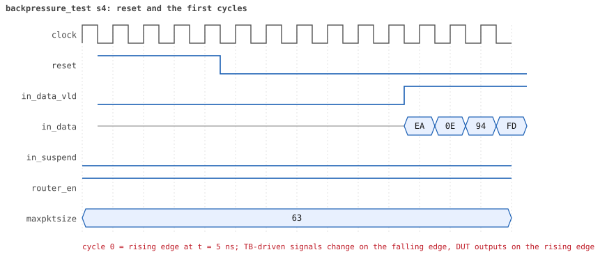
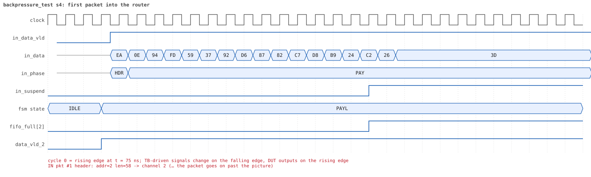
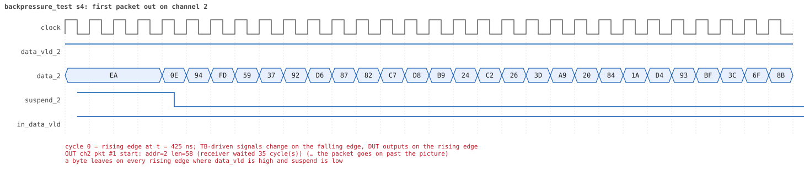
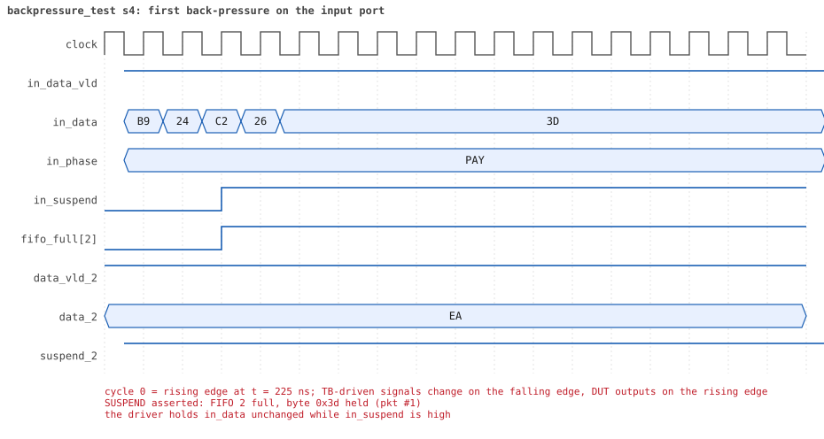

# backpressure_test seed 4

**Result:** PASSED (0 UVM_ERROR, 0 UVM_WARNING, 0 UVM_FATAL) · bench `yapp_project_tb` · sim time 6us · wall 0.7 s · log [`backpressure_test_s4.log`](backpressure_test_s4.log)

Waves: `backpressure_test_s4.fst` (GTKWave, Surfer or the VS Code wave viewer).
[Open the waves in Surfer](https://app.surfer-project.org/?load_url=https%3A%2F%2Fraw.githubusercontent.com%2Ftamirgabgab%2FQcom-Mentoring%2Fmain%2Fyapp_project%2Fregression%2Fyapp_project_tb%2Fbackpressure_test_s4%2Fbackpressure_test_s4.fst&startup_commands=run_command_file_from_url%20https%3A%2F%2Fraw.githubusercontent.com%2Ftamirgabgab%2FQcom-Mentoring%2Fmain%2Fyapp_project%2Ftb%2Fyapp_router.sucl) (web app, the signals already in groups: `yapp_project/tb/yapp_router.sucl`).

## Summary

- YAPP driver sent **6** packet(s) (0 with bad parity); the input monitor saw 6.
- Router: **6** forwarded, **0** dropped.
- Packets out: ch0 **4**, ch1 **1**, ch2 **1**.
- Scoreboard: 6 matched, 0 mismatched, 0 unexpected.
- Back-pressure: in_suspend asserted **7** time(s), longest hold 37 cycle(s).
- Error pulses: 0.
- HBUS: 0 write(s), 0 read(s).

## Stages

| time (ns) | stage |
|---|---|
| 0 | 1. slow receivers (channel_rx_slow_seq): 6 packets of 40..63 bytes fill the 16-byte FIFOs |
| 5815 | 2. checks: in_suspend rose, 6 packets matched, nothing unexpected, no bad parity |

## Pictures

**reset and the first cycles**

**first packet into the router**

**first packet out on channel 2**

**first back-pressure on the input port**

## Timeline

106 events.

| time (ns) | who | event |
|---|---|---|
| 0 | yapp monitor | YAPP monitor running |
| 0 | **test** | STAGE: 1. slow receivers (channel_rx_slow_seq): 6 packets of 40..63 bytes fill the 16-byte FIFOs |
| 0 | clk/rst driver | Starting clock (period 10) and holding reset for 5 cycles |
| 0 | **DUT** | RESET asserted |
| 50 | **DUT** | RESET released: router_en=1 maxpktsize=63 |
| 50 | yapp driver | TX pkt #1: addr=2 len=58 parity=good delay=4 |
| 105 | **DUT** | IN  pkt #1 header: addr=2 len=58 -> channel 2 |
| 265 | **DUT** | SUSPEND asserted: FIFO 2 full, byte 0x3d held (pkt #1) |
| 465 | **DUT** | OUT ch2 pkt #1 start: addr=2 len=58 (receiver waited 35 cycle(s)) |
| 475 | **DUT** | SUSPEND released after 21 cycle(s) |
| 905 | **DUT** | IN  pkt #1 complete: addr=2 len=58 parity=ok forwarded, 60 bytes in 81 cycles (held 21) |
| 905 | yapp monitor | RX pkt #1 on the input: addr=2 len=58 parity=good gap=5 |
| 905 | reference | Packet forwarded: addr=2 len=58 -> channel 2 |
| 910 | yapp driver | TX pkt #1 accepted by the DUT |
| 910 | yapp driver | TX pkt #2: addr=1 len=58 parity=good delay=19 |
| 1050 | ch2 driver | ch2: packet consumed (response delay 35) |
| 1105 | **DUT** | IN  pkt #2 header: addr=1 len=58 -> channel 1 |
| 1265 | **DUT** | SUSPEND asserted: FIFO 1 full, byte 0x5f held (pkt #2) |
| 1355 | **DUT** | OUT ch2 pkt #1 done: 60 bytes in 90 cycles |
| 1355 | ch2 monitor | ch2 RX pkt #1: addr=2 len=58 parity=good |
| 1355 | scoreboard | ch2 pkt matched: addr=2 len=58 (1 matched so far) |
| 1370 | ch2 driver | ch2: packet consumed (response delay 29) |
| 1415 | **DUT** | OUT ch1 pkt #1 start: addr=1 len=58 (receiver waited 30 cycle(s)) |
| 1425 | **DUT** | SUSPEND released after 16 cycle(s) |
| 1855 | **DUT** | IN  pkt #2 complete: addr=1 len=58 parity=ok forwarded, 60 bytes in 76 cycles (held 16) |
| 1855 | yapp monitor | RX pkt #2 on the input: addr=1 len=58 parity=good gap=19 |
| 1855 | reference | Packet forwarded: addr=1 len=58 -> channel 1 |
| 1860 | yapp driver | TX pkt #2 accepted by the DUT |
| 1860 | yapp driver | TX pkt #3: addr=0 len=60 parity=good delay=20 |
| 2000 | ch1 driver | ch1: packet consumed (response delay 30) |
| 2065 | **DUT** | IN  pkt #3 header: addr=0 len=60 -> channel 0 |
| 2225 | **DUT** | SUSPEND asserted: FIFO 0 full, byte 0xd2 held (pkt #3) |
| 2355 | **DUT** | OUT ch0 pkt #1 start: addr=0 len=60 (receiver waited 28 cycle(s)) |
| 2365 | **DUT** | SUSPEND released after 14 cycle(s) |
| 2415 | **DUT** | OUT ch1 pkt #1 done: 60 bytes in 101 cycles |
| 2415 | ch1 monitor | ch1 RX pkt #1: addr=1 len=58 parity=good |
| 2415 | scoreboard | ch1 pkt matched: addr=1 len=58 (2 matched so far) |
| 2810 | ch1 driver | ch1: packet consumed (response delay 40) |
| 2815 | **DUT** | IN  pkt #3 complete: addr=0 len=60 parity=ok forwarded, 62 bytes in 76 cycles (held 14) |
| 2815 | yapp monitor | RX pkt #3 on the input: addr=0 len=60 parity=good gap=20 |
| 2815 | reference | Packet forwarded: addr=0 len=60 -> channel 0 |
| 2820 | yapp driver | TX pkt #3 accepted by the DUT |
| 2820 | yapp driver | TX pkt #4: addr=0 len=44 parity=good delay=12 |
| 2945 | **DUT** | IN  pkt #4 header: addr=0 len=44 -> channel 0 |
| 2960 | ch0 driver | ch0: packet consumed (response delay 28) |
| 3095 | **DUT** | SUSPEND asserted: FIFO 0 full, byte 0x72 held (pkt #4) |
| 3195 | **DUT** | OUT ch0 pkt #1 done: 62 bytes in 85 cycles |
| 3195 | ch0 monitor | ch0 RX pkt #1: addr=0 len=60 parity=good |
| 3195 | scoreboard | ch0 pkt matched: addr=0 len=60 (3 matched so far) |
| 3205 | **DUT** | SUSPEND released after 11 cycle(s) |
| 3205 | **DUT** | OUT ch0 pkt #2 start: addr=0 len=44 (receiver waited 0 cycle(s)) |
| 3505 | **DUT** | IN  pkt #4 complete: addr=0 len=44 parity=ok forwarded, 46 bytes in 57 cycles (held 11) |
| 3505 | yapp monitor | RX pkt #4 on the input: addr=0 len=44 parity=good gap=12 |
| 3505 | reference | Packet forwarded: addr=0 len=44 -> channel 0 |
| 3510 | yapp driver | TX pkt #4 accepted by the DUT |
| 3510 | yapp driver | TX pkt #5: addr=0 len=53 parity=good delay=20 |
| 3655 | **DUT** | OUT ch0 pkt #2 done: 46 bytes in 46 cycles |
| 3655 | ch0 monitor | ch0 RX pkt #2: addr=0 len=44 parity=good |
| 3655 | scoreboard | ch0 pkt matched: addr=0 len=44 (4 matched so far) |
| 3710 | ch0 driver | ch0: packet consumed (response delay 22) |
| 3715 | **DUT** | IN  pkt #5 header: addr=0 len=53 -> channel 0 |
| 3875 | **DUT** | SUSPEND asserted: FIFO 0 full, byte 0x0d held (pkt #5) |
| 4045 | **DUT** | OUT ch0 pkt #3 start: addr=0 len=53 (receiver waited 32 cycle(s)) |
| 4055 | **DUT** | SUSPEND released after 18 cycle(s) |
| 4435 | **DUT** | IN  pkt #5 complete: addr=0 len=53 parity=ok forwarded, 55 bytes in 73 cycles (held 18) |
| 4435 | yapp monitor | RX pkt #5 on the input: addr=0 len=53 parity=good gap=20 |
| 4435 | reference | Packet forwarded: addr=0 len=53 -> channel 0 |
| 4440 | yapp driver | TX pkt #5 accepted by the DUT |
| 4440 | yapp driver | TX pkt #6: addr=0 len=57 parity=good delay=4 |
| 4485 | **DUT** | IN  pkt #6 header: addr=0 len=57 -> channel 0 |
| 4580 | ch0 driver | ch0: packet consumed (response delay 32) |
| 4635 | **DUT** | SUSPEND asserted: FIFO 0 full, byte 0xb5 held (pkt #6) |
| 4995 | **DUT** | OUT ch0 pkt #3 done: 55 bytes in 96 cycles |
| 4995 | ch0 monitor | ch0 RX pkt #3: addr=0 len=53 parity=good |
| 4995 | scoreboard | ch0 pkt matched: addr=0 len=53 (5 matched so far) |
| 5005 | **DUT** | SUSPEND released after 37 cycle(s) |
| 5005 | **DUT** | OUT ch0 pkt #4 start: addr=0 len=57 (receiver waited 0 cycle(s)) |
| 5340 | ch0 driver | ch0: packet consumed (response delay 40) |
| 5355 | **DUT** | SUSPEND asserted: FIFO 0 full, byte 0x71 held (pkt #6) |
| 5585 | **DUT** | SUSPEND released after 23 cycle(s) |
| 5665 | **DUT** | IN  pkt #6 complete: addr=0 len=57 parity=ok forwarded, 59 bytes in 119 cycles (held 60) |
| 5665 | yapp monitor | RX pkt #6 on the input: addr=0 len=57 parity=good gap=4 |
| 5665 | reference | Packet forwarded: addr=0 len=57 -> channel 0 |
| 5670 | yapp driver | TX pkt #6 accepted by the DUT |
| 5815 | **DUT** | OUT ch0 pkt #4 done: 59 bytes in 82 cycles |
| 5815 | ch0 monitor | ch0 RX pkt #4: addr=0 len=57 parity=good |
| 5815 | scoreboard | ch0 pkt matched: addr=0 len=57 (6 matched so far) |
| 5815 | **test** | STAGE: 2. checks: in_suspend rose, 6 packets matched, nothing unexpected, no bad parity |
| 5815 | **test** | in_suspend rose 7 times |
| 5970 | ch0 driver | ch0: packet consumed (response delay 22) |
| 6015 | ch0 monitor | Channel 0 report: 4 packets collected |
| 6015 | ch1 monitor | Channel 1 report: 1 packets collected |
| 6015 | ch2 monitor | Channel 2 report: 1 packets collected |
| 6015 | hbus monitor | HBUS report: 0 writes, 0 reads |
| 6015 | coverage | Coverage of the router configuration: 26.1% · maxpktsize 0 / 1 / 2..61 / 62 / 63 : 0 / 0 / 0 / 0 / 6 packets · length < max / = max / max+1 / > max+1 : 6 / 0 / 0 / 0 · forwarded good / bad : 6 / 0 · dropped address 3 good / bad : 0 / 0 · dropped oversized good / bad : 0 / 0 · counter enables none / mixed / all : 6 / 0 / 0 |
| 6015 | coverage | HBUS address coverage: 0 accesses sampled, coverage 0.0% |
| 6015 | coverage | HBUS register bits coverage: 0 writes to ctrl_reg/en_reg, coverage 0.0% |
| 6015 | coverage | HBUS counter value coverage: 0 counter reads sampled, coverage 0.0% |
| 6015 | coverage | HBUS yapp_mem data coverage: 0 accesses sampled, coverage 0.0% |
| 6015 | reference | --- Reference model report --- · forwarded to scoreboard : 6 · dropped (router disabled) : 0 · dropped (oversized) : 0 · dropped (address 3) : 0 · counters parity/oversized/addr0..3 : 0 / 0 / 0 0 0 0 |
| 6015 | scoreboard | --- Scoreboard report --- · packets received : 6 · packets matched : 6 · packets mismatched: 0 · packets unexpected: 0 · packets to addr 3 : 0 · left in queue 0/1/2: 0 / 0 / 0 |
| 6015 | yapp driver | YAPP driver report: 6 packets sent |
| 6015 | coverage | YAPP gap coverage: 5 gaps sampled, coverage 25.0% |
| 6015 | yapp monitor | YAPP monitor report: 6 packets collected, 0 with bad parity |
| 6015 | yapp monitor | YAPP gaps: 0 back to back, 0 of 1 cycle, 0 of 2, 5 longer |
| 6015 | coverage | YAPP packet coverage: 6 packets sampled, coverage 26.7% |
