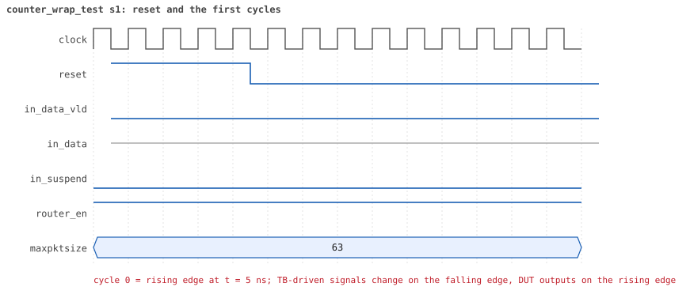
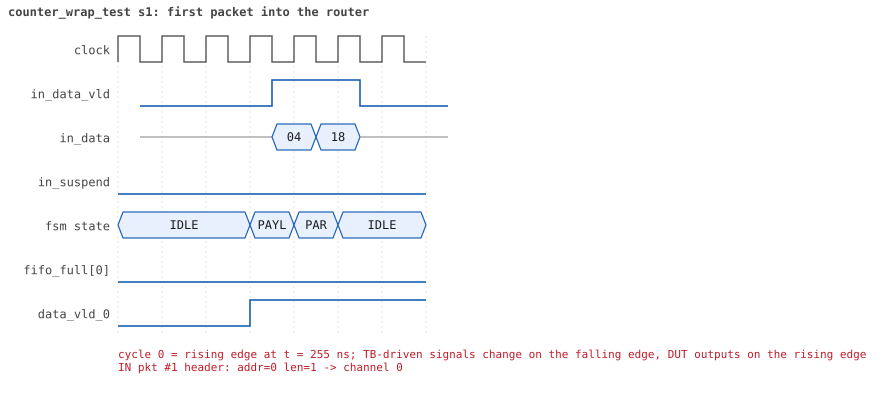

# counter_wrap_test  seed 1

**Result:** PASSED (0 UVM_ERROR, 0 UVM_WARNING, 0 UVM_FATAL) · bench `yapp_project_tb` · sim time 40us · log `counter_wrap_test_s1.log`

Waves: `counter_wrap_test_s1.fst` (GTKWave, Surfer or the VS Code wave viewer); signal trace: `signals.csv`.
[Open the waves in Surfer](https://app.surfer-project.org/?load_url=https%3A%2F%2Fraw.githubusercontent.com%2Ftamirgabgab%2FQcom-Mentoring%2Fmain%2Fyapp_project%2Fregression%2Fyapp_project_tb%2Fcounter_wrap_test_s1%2Fcounter_wrap_test_s1.fst&startup_commands=run_command_file_from_url%20https%3A%2F%2Fraw.githubusercontent.com%2Ftamirgabgab%2FQcom-Mentoring%2Fmain%2Fyapp_project%2Ftb%2Fyapp_router.sucl) (web app, the signals already in groups: `yapp_project/tb/yapp_router.sucl`).

## Summary

- YAPP driver sent **257** packet(s) (0 with bad parity); the input monitor saw 257.
- Router: **257** forwarded, **0** dropped.
- Packets out: ch0 **257**, ch1 **0**, ch2 **0**.
- Scoreboard: 257 matched, 0 mismatched, 0 unexpected.
- Back-pressure: in_suspend asserted **0** time(s).
- Error pulses: 0.
- HBUS: 1 write(s), 8 read(s).

## Stages

| time (ns) | stage |
|---|---|
| 70 | 1. 255 one-byte packets to address 0: addr0_cnt_reg reaches 255 |
| 38950 | 2. the 256th packet wraps addr0_cnt_reg to 0 |
| 39200 | 3. one more packet: the counter goes on from 0 |
| 39670 | 4. the other counters are untouched and the scoreboard matched all 257 packets |

## Pictures

**reset and the first cycles**

**first packet into the router**

**first packet out on channel 0**

**first HBUS write**

**first HBUS read**

## Timeline

2758 events (the same list is in `timeline.csv`).

| time (ns) | who | event |
|---|---|---|
| 0 | yapp monitor | YAPP monitor running |
| 0 | clk/rst driver | Starting clock (period 10) and holding reset for 5 cycles |
| 0 | **DUT** | RESET asserted |
| 50 | **DUT** | RESET released: router_en=1 maxpktsize=63 |
| 70 | hbus driver | Executed WRITE addr=0x1001 data=0xff |
| 70 | **test** | STAGE: 1. 255 one-byte packets to address 0: addr0_cnt_reg reaches 255 |
| 70 | yapp driver | TX pkt #1: addr=0 len=1 parity=good delay=20 |
| 75 | hbus monitor | Collected WRITE addr=0x1001 data=0xff |
| 75 | reference | router_en is now 1 (en_reg 0xff) |
| 285 | **DUT** | IN  pkt #1 header: addr=0 len=1 -> channel 0 |
| 305 | **DUT** | IN  pkt #1 complete: addr=0 len=1 parity=ok forwarded, 3 bytes in 3 cycles (held 0) |
| 305 | yapp monitor | RX pkt #1 on the input: addr=0 len=1 parity=good gap=23 |
| 305 | reference | Packet forwarded: addr=0 len=1 -> channel 0 |
| 310 | yapp driver | TX pkt #1 accepted by the DUT |
| 310 | yapp driver | TX pkt #2: addr=0 len=1 parity=good delay=19 |
| 325 | **DUT** | OUT ch0 pkt #1 start: addr=0 len=1 (receiver waited 3 cycle(s)) |
| 340 | ch0 driver | ch0: packet consumed (response delay 3) |
| 435 | **DUT** | OUT ch0 pkt #1 done: 3 bytes in 12 cycles |
| 435 | ch0 monitor | ch0 RX pkt #1: addr=0 len=1 parity=good |
| 435 | scoreboard | ch0 pkt matched: addr=0 len=1 (1 matched so far) |
| 505 | **DUT** | IN  pkt #2 header: addr=0 len=1 -> channel 0 |
| 510 | ch0 driver | ch0: packet consumed (response delay 8) |
| 525 | **DUT** | IN  pkt #2 complete: addr=0 len=1 parity=ok forwarded, 3 bytes in 3 cycles (held 0) |
| 525 | yapp monitor | RX pkt #2 on the input: addr=0 len=1 parity=good gap=19 |
| 525 | reference | Packet forwarded: addr=0 len=1 -> channel 0 |
| 530 | yapp driver | TX pkt #2 accepted by the DUT |
| 530 | yapp driver | TX pkt #3: addr=0 len=1 parity=good delay=4 |
| 575 | **DUT** | IN  pkt #3 header: addr=0 len=1 -> channel 0 |
| 575 | **DUT** | OUT ch0 pkt #2 start: addr=0 len=1 (receiver waited 6 cycle(s)) |
| 590 | ch0 driver | ch0: packet consumed (response delay 5) |
| 595 | **DUT** | IN  pkt #3 complete: addr=0 len=1 parity=ok forwarded, 3 bytes in 3 cycles (held 0) |
| 595 | yapp monitor | RX pkt #3 on the input: addr=0 len=1 parity=good gap=4 |
| 595 | reference | Packet forwarded: addr=0 len=1 -> channel 0 |
| 600 | yapp driver | TX pkt #3 accepted by the DUT |
| 600 | yapp driver | TX pkt #4: addr=0 len=1 parity=good delay=9 |
| 625 | **DUT** | OUT ch0 pkt #2 done: 3 bytes in 6 cycles |
| 625 | ch0 monitor | ch0 RX pkt #2: addr=0 len=1 parity=good |
| 625 | scoreboard | ch0 pkt matched: addr=0 len=1 (2 matched so far) |
| 635 | **DUT** | OUT ch0 pkt #3 start: addr=0 len=1 (receiver waited 0 cycle(s)) |
| 655 | **DUT** | OUT ch0 pkt #3 done: 3 bytes in 3 cycles |
| 655 | ch0 monitor | ch0 RX pkt #3: addr=0 len=1 parity=good |
| 655 | scoreboard | ch0 pkt matched: addr=0 len=1 (3 matched so far) |
| 695 | **DUT** | IN  pkt #4 header: addr=0 len=1 -> channel 0 |
| 705 | **DUT** | OUT ch0 pkt #4 start: addr=0 len=1 (receiver waited 0 cycle(s)) |
| 715 | **DUT** | IN  pkt #4 complete: addr=0 len=1 parity=ok forwarded, 3 bytes in 3 cycles (held 0) |
| 715 | yapp monitor | RX pkt #4 on the input: addr=0 len=1 parity=good gap=9 |
| 715 | reference | Packet forwarded: addr=0 len=1 -> channel 0 |
| 720 | yapp driver | TX pkt #4 accepted by the DUT |
| 720 | yapp driver | TX pkt #5: addr=0 len=1 parity=good delay=20 |
| 725 | **DUT** | OUT ch0 pkt #4 done: 3 bytes in 3 cycles |
| 725 | ch0 monitor | ch0 RX pkt #4: addr=0 len=1 parity=good |
| 725 | scoreboard | ch0 pkt matched: addr=0 len=1 (4 matched so far) |
| 925 | **DUT** | IN  pkt #5 header: addr=0 len=1 -> channel 0 |
| 935 | **DUT** | OUT ch0 pkt #5 start: addr=0 len=1 (receiver waited 0 cycle(s)) |
| 945 | **DUT** | IN  pkt #5 complete: addr=0 len=1 parity=ok forwarded, 3 bytes in 3 cycles (held 0) |
| 945 | yapp monitor | RX pkt #5 on the input: addr=0 len=1 parity=good gap=20 |
| 945 | reference | Packet forwarded: addr=0 len=1 -> channel 0 |
| 950 | yapp driver | TX pkt #5 accepted by the DUT |
| 950 | yapp driver | TX pkt #6: addr=0 len=1 parity=good delay=17 |
| 955 | **DUT** | OUT ch0 pkt #5 done: 3 bytes in 3 cycles |
| 955 | ch0 monitor | ch0 RX pkt #5: addr=0 len=1 parity=good |
| 955 | scoreboard | ch0 pkt matched: addr=0 len=1 (5 matched so far) |
| 1120 | ch0 driver | ch0: packet consumed (response delay 2) |
| 1125 | **DUT** | IN  pkt #6 header: addr=0 len=1 -> channel 0 |
| 1145 | **DUT** | IN  pkt #6 complete: addr=0 len=1 parity=ok forwarded, 3 bytes in 3 cycles (held 0) |
| 1145 | yapp monitor | RX pkt #6 on the input: addr=0 len=1 parity=good gap=17 |
| 1145 | reference | Packet forwarded: addr=0 len=1 -> channel 0 |
| 1150 | yapp driver | TX pkt #6 accepted by the DUT |
| 1150 | yapp driver | TX pkt #7: addr=0 len=1 parity=good delay=4 |
| 1195 | **DUT** | IN  pkt #7 header: addr=0 len=1 -> channel 0 |
| 1215 | **DUT** | IN  pkt #7 complete: addr=0 len=1 parity=ok forwarded, 3 bytes in 3 cycles (held 0) |
| 1215 | yapp monitor | RX pkt #7 on the input: addr=0 len=1 parity=good gap=4 |
| 1215 | reference | Packet forwarded: addr=0 len=1 -> channel 0 |
| 1220 | yapp driver | TX pkt #7 accepted by the DUT |
| 1220 | yapp driver | TX pkt #8: addr=0 len=1 parity=good delay=3 |
| 1225 | **DUT** | OUT ch0 pkt #6 start: addr=0 len=1 (receiver waited 9 cycle(s)) |
| 1240 | ch0 driver | ch0: packet consumed (response delay 9) |
| 1255 | **DUT** | IN  pkt #8 header: addr=0 len=1 -> channel 0 |
| 1275 | **DUT** | IN  pkt #8 complete: addr=0 len=1 parity=ok forwarded, 3 bytes in 3 cycles (held 0) |
| 1275 | yapp monitor | RX pkt #8 on the input: addr=0 len=1 parity=good gap=3 |
| 1275 | reference | Packet forwarded: addr=0 len=1 -> channel 0 |
| 1280 | yapp driver | TX pkt #8 accepted by the DUT |
| 1280 | yapp driver | TX pkt #9: addr=0 len=1 parity=good delay=1 |
| 1295 | **DUT** | IN  pkt #9 header: addr=0 len=1 -> channel 0 |
| 1315 | **DUT** | IN  pkt #9 complete: addr=0 len=1 parity=ok forwarded, 3 bytes in 3 cycles (held 0) |
| 1315 | yapp monitor | RX pkt #9 on the input: addr=0 len=1 parity=good gap=1 |
| 1315 | reference | Packet forwarded: addr=0 len=1 -> channel 0 |
| 1320 | yapp driver | TX pkt #9 accepted by the DUT |
| 1320 | yapp driver | TX pkt #10: addr=0 len=1 parity=good delay=16 |
| 1355 | **DUT** | OUT ch0 pkt #6 done: 3 bytes in 14 cycles |
| 1355 | ch0 monitor | ch0 RX pkt #6: addr=0 len=1 parity=good |
| 1355 | scoreboard | ch0 pkt matched: addr=0 len=1 (6 matched so far) |
| 1365 | **DUT** | OUT ch0 pkt #7 start: addr=0 len=1 (receiver waited 0 cycle(s)) |
| 1385 | **DUT** | OUT ch0 pkt #7 done: 3 bytes in 3 cycles |
| 1385 | ch0 monitor | ch0 RX pkt #7: addr=0 len=1 parity=good |
| 1385 | scoreboard | ch0 pkt matched: addr=0 len=1 (7 matched so far) |
| 1395 | **DUT** | OUT ch0 pkt #8 start: addr=0 len=1 (receiver waited 0 cycle(s)) |
| 1415 | **DUT** | OUT ch0 pkt #8 done: 3 bytes in 3 cycles |
| 1415 | ch0 monitor | ch0 RX pkt #8: addr=0 len=1 parity=good |
| 1415 | scoreboard | ch0 pkt matched: addr=0 len=1 (8 matched so far) |
| 1425 | **DUT** | OUT ch0 pkt #9 start: addr=0 len=1 (receiver waited 0 cycle(s)) |
| 1445 | **DUT** | OUT ch0 pkt #9 done: 3 bytes in 3 cycles |
| 1445 | ch0 monitor | ch0 RX pkt #9: addr=0 len=1 parity=good |
| 1445 | scoreboard | ch0 pkt matched: addr=0 len=1 (9 matched so far) |
| 1450 | ch0 driver | ch0: packet consumed (response delay 10) |
| 1485 | **DUT** | IN  pkt #10 header: addr=0 len=1 -> channel 0 |
| 1505 | **DUT** | IN  pkt #10 complete: addr=0 len=1 parity=ok forwarded, 3 bytes in 3 cycles (held 0) |
| 1505 | yapp monitor | RX pkt #10 on the input: addr=0 len=1 parity=good gap=16 |
| 1505 | reference | Packet forwarded: addr=0 len=1 -> channel 0 |
| 1510 | yapp driver | TX pkt #10 accepted by the DUT |
| 1510 | yapp driver | TX pkt #11: addr=0 len=1 parity=good delay=2 |
| 1535 | **DUT** | IN  pkt #11 header: addr=0 len=1 -> channel 0 |
| 1555 | **DUT** | IN  pkt #11 complete: addr=0 len=1 parity=ok forwarded, 3 bytes in 3 cycles (held 0) |
| 1555 | yapp monitor | RX pkt #11 on the input: addr=0 len=1 parity=good gap=2 |
| 1555 | reference | Packet forwarded: addr=0 len=1 -> channel 0 |
| 1560 | yapp driver | TX pkt #11 accepted by the DUT |
| 1560 | yapp driver | TX pkt #12: addr=0 len=1 parity=good delay=20 |
| 1575 | **DUT** | OUT ch0 pkt #10 start: addr=0 len=1 (receiver waited 8 cycle(s)) |
| 1590 | ch0 driver | ch0: packet consumed (response delay 8) |
| 1705 | **DUT** | OUT ch0 pkt #10 done: 3 bytes in 14 cycles |
| 1705 | ch0 monitor | ch0 RX pkt #10: addr=0 len=1 parity=good |
| 1705 | scoreboard | ch0 pkt matched: addr=0 len=1 (10 matched so far) |
| 1715 | **DUT** | OUT ch0 pkt #11 start: addr=0 len=1 (receiver waited 0 cycle(s)) |
| 1735 | **DUT** | OUT ch0 pkt #11 done: 3 bytes in 3 cycles |
| 1735 | ch0 monitor | ch0 RX pkt #11: addr=0 len=1 parity=good |
| 1735 | scoreboard | ch0 pkt matched: addr=0 len=1 (11 matched so far) |
| 1765 | **DUT** | IN  pkt #12 header: addr=0 len=1 -> channel 0 |
| 1775 | **DUT** | OUT ch0 pkt #12 start: addr=0 len=1 (receiver waited 0 cycle(s)) |
| 1785 | **DUT** | IN  pkt #12 complete: addr=0 len=1 parity=ok forwarded, 3 bytes in 3 cycles (held 0) |
| 1785 | yapp monitor | RX pkt #12 on the input: addr=0 len=1 parity=good gap=20 |
| 1785 | reference | Packet forwarded: addr=0 len=1 -> channel 0 |
| 1790 | yapp driver | TX pkt #12 accepted by the DUT |
| 1790 | yapp driver | TX pkt #13: addr=0 len=1 parity=good delay=20 |
| 1795 | **DUT** | OUT ch0 pkt #12 done: 3 bytes in 3 cycles |
| 1795 | ch0 monitor | ch0 RX pkt #12: addr=0 len=1 parity=good |
| 1795 | scoreboard | ch0 pkt matched: addr=0 len=1 (12 matched so far) |
| 1890 | ch0 driver | ch0: packet consumed (response delay 10) |
| 1995 | **DUT** | IN  pkt #13 header: addr=0 len=1 -> channel 0 |
| 2015 | **DUT** | IN  pkt #13 complete: addr=0 len=1 parity=ok forwarded, 3 bytes in 3 cycles (held 0) |
| 2015 | yapp monitor | RX pkt #13 on the input: addr=0 len=1 parity=good gap=20 |
| 2015 | reference | Packet forwarded: addr=0 len=1 -> channel 0 |
| 2020 | yapp driver | TX pkt #13 accepted by the DUT |
| 2020 | yapp driver | TX pkt #14: addr=0 len=1 parity=good delay=2 |
| 2045 | **DUT** | IN  pkt #14 header: addr=0 len=1 -> channel 0 |
| 2045 | **DUT** | OUT ch0 pkt #13 start: addr=0 len=1 (receiver waited 4 cycle(s)) |
| 2060 | ch0 driver | ch0: packet consumed (response delay 4) |
| 2065 | **DUT** | IN  pkt #14 complete: addr=0 len=1 parity=ok forwarded, 3 bytes in 3 cycles (held 0) |
| 2065 | yapp monitor | RX pkt #14 on the input: addr=0 len=1 parity=good gap=2 |
| 2065 | reference | Packet forwarded: addr=0 len=1 -> channel 0 |
| 2070 | yapp driver | TX pkt #14 accepted by the DUT |
| 2070 | yapp driver | TX pkt #15: addr=0 len=1 parity=good delay=19 |
| 2155 | **DUT** | OUT ch0 pkt #13 done: 3 bytes in 12 cycles |
| 2155 | ch0 monitor | ch0 RX pkt #13: addr=0 len=1 parity=good |
| 2155 | scoreboard | ch0 pkt matched: addr=0 len=1 (13 matched so far) |
| 2165 | **DUT** | OUT ch0 pkt #14 start: addr=0 len=1 (receiver waited 0 cycle(s)) |
| 2185 | **DUT** | OUT ch0 pkt #14 done: 3 bytes in 3 cycles |
| 2185 | ch0 monitor | ch0 RX pkt #14: addr=0 len=1 parity=good |
| 2185 | scoreboard | ch0 pkt matched: addr=0 len=1 (14 matched so far) |
| 2265 | **DUT** | IN  pkt #15 header: addr=0 len=1 -> channel 0 |
| 2275 | **DUT** | OUT ch0 pkt #15 start: addr=0 len=1 (receiver waited 0 cycle(s)) |
| 2285 | **DUT** | IN  pkt #15 complete: addr=0 len=1 parity=ok forwarded, 3 bytes in 3 cycles (held 0) |
| 2285 | yapp monitor | RX pkt #15 on the input: addr=0 len=1 parity=good gap=19 |
| 2285 | reference | Packet forwarded: addr=0 len=1 -> channel 0 |
| 2290 | yapp driver | TX pkt #15 accepted by the DUT |
| 2290 | yapp driver | TX pkt #16: addr=0 len=1 parity=good delay=3 |
| 2295 | **DUT** | OUT ch0 pkt #15 done: 3 bytes in 3 cycles |
| 2295 | ch0 monitor | ch0 RX pkt #15: addr=0 len=1 parity=good |
| 2295 | scoreboard | ch0 pkt matched: addr=0 len=1 (15 matched so far) |
| 2325 | **DUT** | IN  pkt #16 header: addr=0 len=1 -> channel 0 |
| 2335 | **DUT** | OUT ch0 pkt #16 start: addr=0 len=1 (receiver waited 0 cycle(s)) |
| 2345 | **DUT** | IN  pkt #16 complete: addr=0 len=1 parity=ok forwarded, 3 bytes in 3 cycles (held 0) |
| 2345 | yapp monitor | RX pkt #16 on the input: addr=0 len=1 parity=good gap=3 |
| 2345 | reference | Packet forwarded: addr=0 len=1 -> channel 0 |
| 2350 | yapp driver | TX pkt #16 accepted by the DUT |
| 2350 | yapp driver | TX pkt #17: addr=0 len=1 parity=good delay=20 |
| 2355 | **DUT** | OUT ch0 pkt #16 done: 3 bytes in 3 cycles |
| 2355 | ch0 monitor | ch0 RX pkt #16: addr=0 len=1 parity=good |
| 2355 | scoreboard | ch0 pkt matched: addr=0 len=1 (16 matched so far) |
| 2555 | **DUT** | IN  pkt #17 header: addr=0 len=1 -> channel 0 |
| 2565 | **DUT** | OUT ch0 pkt #17 start: addr=0 len=1 (receiver waited 0 cycle(s)) |
| 2575 | **DUT** | IN  pkt #17 complete: addr=0 len=1 parity=ok forwarded, 3 bytes in 3 cycles (held 0) |
| 2575 | yapp monitor | RX pkt #17 on the input: addr=0 len=1 parity=good gap=20 |
| 2575 | reference | Packet forwarded: addr=0 len=1 -> channel 0 |
| 2580 | yapp driver | TX pkt #17 accepted by the DUT |
| 2580 | yapp driver | TX pkt #18: addr=0 len=1 parity=good delay=14 |
| 2585 | **DUT** | OUT ch0 pkt #17 done: 3 bytes in 3 cycles |
| 2585 | ch0 monitor | ch0 RX pkt #17: addr=0 len=1 parity=good |
| 2585 | scoreboard | ch0 pkt matched: addr=0 len=1 (17 matched so far) |
| 2725 | **DUT** | IN  pkt #18 header: addr=0 len=1 -> channel 0 |
| 2735 | **DUT** | OUT ch0 pkt #18 start: addr=0 len=1 (receiver waited 0 cycle(s)) |
| 2740 | ch0 driver | ch0: packet consumed (response delay 8) |
| 2745 | **DUT** | IN  pkt #18 complete: addr=0 len=1 parity=ok forwarded, 3 bytes in 3 cycles (held 0) |
| 2745 | yapp monitor | RX pkt #18 on the input: addr=0 len=1 parity=good gap=14 |
| 2745 | reference | Packet forwarded: addr=0 len=1 -> channel 0 |
| 2750 | yapp driver | TX pkt #18 accepted by the DUT |
| 2750 | yapp driver | TX pkt #19: addr=0 len=1 parity=good delay=12 |
| 2800 | ch0 driver | ch0: packet consumed (response delay 4) |
| 2875 | **DUT** | IN  pkt #19 header: addr=0 len=1 -> channel 0 |
| 2895 | **DUT** | IN  pkt #19 complete: addr=0 len=1 parity=ok forwarded, 3 bytes in 3 cycles (held 0) |
| 2895 | yapp monitor | RX pkt #19 on the input: addr=0 len=1 parity=good gap=12 |
| 2895 | reference | Packet forwarded: addr=0 len=1 -> channel 0 |
| 2900 | yapp driver | TX pkt #19 accepted by the DUT |
| 2900 | yapp driver | TX pkt #20: addr=0 len=1 parity=good delay=4 |
| 2915 | **DUT** | OUT ch0 pkt #18 done: 3 bytes in 19 cycles |
| 2915 | ch0 monitor | ch0 RX pkt #18: addr=0 len=1 parity=good |
| 2915 | scoreboard | ch0 pkt matched: addr=0 len=1 (18 matched so far) |
| 2925 | **DUT** | OUT ch0 pkt #19 start: addr=0 len=1 (receiver waited 0 cycle(s)) |
| 2930 | ch0 driver | ch0: packet consumed (response delay 10) |
| 2945 | **DUT** | IN  pkt #20 header: addr=0 len=1 -> channel 0 |
| 2965 | **DUT** | IN  pkt #20 complete: addr=0 len=1 parity=ok forwarded, 3 bytes in 3 cycles (held 0) |
| 2965 | yapp monitor | RX pkt #20 on the input: addr=0 len=1 parity=good gap=4 |
| 2965 | reference | Packet forwarded: addr=0 len=1 -> channel 0 |
| 2970 | yapp driver | TX pkt #20 accepted by the DUT |
| 2970 | yapp driver | TX pkt #21: addr=0 len=1 parity=good delay=16 |
| 3055 | **DUT** | OUT ch0 pkt #19 done: 3 bytes in 14 cycles |
| 3055 | ch0 monitor | ch0 RX pkt #19: addr=0 len=1 parity=good |
| 3055 | scoreboard | ch0 pkt matched: addr=0 len=1 (19 matched so far) |
| 3065 | **DUT** | OUT ch0 pkt #20 start: addr=0 len=1 (receiver waited 0 cycle(s)) |
| 3085 | **DUT** | OUT ch0 pkt #20 done: 3 bytes in 3 cycles |
| 3085 | ch0 monitor | ch0 RX pkt #20: addr=0 len=1 parity=good |
| 3085 | scoreboard | ch0 pkt matched: addr=0 len=1 (20 matched so far) |
| 3135 | **DUT** | IN  pkt #21 header: addr=0 len=1 -> channel 0 |
| 3145 | **DUT** | OUT ch0 pkt #21 start: addr=0 len=1 (receiver waited 0 cycle(s)) |
| 3155 | **DUT** | IN  pkt #21 complete: addr=0 len=1 parity=ok forwarded, 3 bytes in 3 cycles (held 0) |
| 3155 | yapp monitor | RX pkt #21 on the input: addr=0 len=1 parity=good gap=16 |
| 3155 | reference | Packet forwarded: addr=0 len=1 -> channel 0 |
| 3160 | yapp driver | TX pkt #21 accepted by the DUT |
| 3160 | yapp driver | TX pkt #22: addr=0 len=1 parity=good delay=19 |
| 3165 | **DUT** | OUT ch0 pkt #21 done: 3 bytes in 3 cycles |
| 3165 | ch0 monitor | ch0 RX pkt #21: addr=0 len=1 parity=good |
| 3165 | scoreboard | ch0 pkt matched: addr=0 len=1 (21 matched so far) |
| 3355 | **DUT** | IN  pkt #22 header: addr=0 len=1 -> channel 0 |
| 3365 | **DUT** | OUT ch0 pkt #22 start: addr=0 len=1 (receiver waited 0 cycle(s)) |
| 3375 | **DUT** | IN  pkt #22 complete: addr=0 len=1 parity=ok forwarded, 3 bytes in 3 cycles (held 0) |
| 3375 | yapp monitor | RX pkt #22 on the input: addr=0 len=1 parity=good gap=19 |
| 3375 | reference | Packet forwarded: addr=0 len=1 -> channel 0 |
| 3380 | yapp driver | TX pkt #22 accepted by the DUT |
| 3380 | yapp driver | TX pkt #23: addr=0 len=1 parity=good delay=9 |
| 3385 | **DUT** | OUT ch0 pkt #22 done: 3 bytes in 3 cycles |
| 3385 | ch0 monitor | ch0 RX pkt #22: addr=0 len=1 parity=good |
| 3385 | scoreboard | ch0 pkt matched: addr=0 len=1 (22 matched so far) |
| 3475 | **DUT** | IN  pkt #23 header: addr=0 len=1 -> channel 0 |
| 3485 | **DUT** | OUT ch0 pkt #23 start: addr=0 len=1 (receiver waited 0 cycle(s)) |
| 3495 | **DUT** | IN  pkt #23 complete: addr=0 len=1 parity=ok forwarded, 3 bytes in 3 cycles (held 0) |
| 3495 | yapp monitor | RX pkt #23 on the input: addr=0 len=1 parity=good gap=9 |
| 3495 | reference | Packet forwarded: addr=0 len=1 -> channel 0 |
| 3500 | yapp driver | TX pkt #23 accepted by the DUT |
| 3500 | yapp driver | TX pkt #24: addr=0 len=1 parity=good delay=9 |
| 3505 | **DUT** | OUT ch0 pkt #23 done: 3 bytes in 3 cycles |
| 3505 | ch0 monitor | ch0 RX pkt #23: addr=0 len=1 parity=good |
| 3505 | scoreboard | ch0 pkt matched: addr=0 len=1 (23 matched so far) |
| 3520 | ch0 driver | ch0: packet consumed (response delay 10) |
| 3595 | **DUT** | IN  pkt #24 header: addr=0 len=1 -> channel 0 |
| 3615 | **DUT** | IN  pkt #24 complete: addr=0 len=1 parity=ok forwarded, 3 bytes in 3 cycles (held 0) |
| 3615 | yapp monitor | RX pkt #24 on the input: addr=0 len=1 parity=good gap=9 |
| 3615 | reference | Packet forwarded: addr=0 len=1 -> channel 0 |
| 3620 | yapp driver | TX pkt #24 accepted by the DUT |
| 3620 | yapp driver | TX pkt #25: addr=0 len=1 parity=good delay=20 |
| 3665 | **DUT** | OUT ch0 pkt #24 start: addr=0 len=1 (receiver waited 6 cycle(s)) |
| 3680 | ch0 driver | ch0: packet consumed (response delay 6) |
| 3745 | **DUT** | OUT ch0 pkt #24 done: 3 bytes in 9 cycles |
| 3745 | ch0 monitor | ch0 RX pkt #24: addr=0 len=1 parity=good |
| 3745 | scoreboard | ch0 pkt matched: addr=0 len=1 (24 matched so far) |
| 3825 | **DUT** | IN  pkt #25 header: addr=0 len=1 -> channel 0 |
| 3835 | **DUT** | OUT ch0 pkt #25 start: addr=0 len=1 (receiver waited 0 cycle(s)) |
| 3845 | **DUT** | IN  pkt #25 complete: addr=0 len=1 parity=ok forwarded, 3 bytes in 3 cycles (held 0) |
| 3845 | yapp monitor | RX pkt #25 on the input: addr=0 len=1 parity=good gap=20 |
| 3845 | reference | Packet forwarded: addr=0 len=1 -> channel 0 |
| 3850 | yapp driver | TX pkt #25 accepted by the DUT |
| 3850 | yapp driver | TX pkt #26: addr=0 len=1 parity=good delay=12 |
| 3855 | **DUT** | OUT ch0 pkt #25 done: 3 bytes in 3 cycles |
| 3855 | ch0 monitor | ch0 RX pkt #25: addr=0 len=1 parity=good |
| 3855 | scoreboard | ch0 pkt matched: addr=0 len=1 (25 matched so far) |
| 3975 | **DUT** | IN  pkt #26 header: addr=0 len=1 -> channel 0 |
| 3985 | **DUT** | OUT ch0 pkt #26 start: addr=0 len=1 (receiver waited 0 cycle(s)) |
| 3995 | **DUT** | IN  pkt #26 complete: addr=0 len=1 parity=ok forwarded, 3 bytes in 3 cycles (held 0) |
| 3995 | yapp monitor | RX pkt #26 on the input: addr=0 len=1 parity=good gap=12 |
| 3995 | reference | Packet forwarded: addr=0 len=1 -> channel 0 |
| 4000 | yapp driver | TX pkt #26 accepted by the DUT |
| 4000 | yapp driver | TX pkt #27: addr=0 len=1 parity=good delay=10 |
| 4005 | **DUT** | OUT ch0 pkt #26 done: 3 bytes in 3 cycles |
| 4005 | ch0 monitor | ch0 RX pkt #26: addr=0 len=1 parity=good |
| 4005 | scoreboard | ch0 pkt matched: addr=0 len=1 (26 matched so far) |
| 4105 | **DUT** | IN  pkt #27 header: addr=0 len=1 -> channel 0 |
| 4115 | **DUT** | OUT ch0 pkt #27 start: addr=0 len=1 (receiver waited 0 cycle(s)) |
| 4125 | **DUT** | IN  pkt #27 complete: addr=0 len=1 parity=ok forwarded, 3 bytes in 3 cycles (held 0) |
| 4125 | yapp monitor | RX pkt #27 on the input: addr=0 len=1 parity=good gap=10 |
| 4125 | reference | Packet forwarded: addr=0 len=1 -> channel 0 |
| 4130 | yapp driver | TX pkt #27 accepted by the DUT |
| 4130 | yapp driver | TX pkt #28: addr=0 len=1 parity=good delay=13 |
| 4135 | **DUT** | OUT ch0 pkt #27 done: 3 bytes in 3 cycles |
| 4135 | ch0 monitor | ch0 RX pkt #27: addr=0 len=1 parity=good |
| 4135 | scoreboard | ch0 pkt matched: addr=0 len=1 (27 matched so far) |
| 4210 | ch0 driver | ch0: packet consumed (response delay 5) |
| 4265 | **DUT** | IN  pkt #28 header: addr=0 len=1 -> channel 0 |
| 4285 | **DUT** | IN  pkt #28 complete: addr=0 len=1 parity=ok forwarded, 3 bytes in 3 cycles (held 0) |
| 4285 | yapp monitor | RX pkt #28 on the input: addr=0 len=1 parity=good gap=13 |
| 4285 | reference | Packet forwarded: addr=0 len=1 -> channel 0 |
| 4290 | yapp driver | TX pkt #28 accepted by the DUT |
| 4290 | yapp driver | TX pkt #29: addr=0 len=1 parity=good delay=6 |
| 4355 | **DUT** | IN  pkt #29 header: addr=0 len=1 -> channel 0 |
| 4375 | **DUT** | IN  pkt #29 complete: addr=0 len=1 parity=ok forwarded, 3 bytes in 3 cycles (held 0) |
| 4375 | **DUT** | OUT ch0 pkt #28 start: addr=0 len=1 (receiver waited 10 cycle(s)) |
| 4375 | yapp monitor | RX pkt #29 on the input: addr=0 len=1 parity=good gap=6 |
| 4375 | reference | Packet forwarded: addr=0 len=1 -> channel 0 |
| 4380 | yapp driver | TX pkt #29 accepted by the DUT |
| 4380 | yapp driver | TX pkt #30: addr=0 len=1 parity=good delay=1 |
| 4390 | ch0 driver | ch0: packet consumed (response delay 10) |
| 4395 | **DUT** | IN  pkt #30 header: addr=0 len=1 -> channel 0 |
| 4415 | **DUT** | IN  pkt #30 complete: addr=0 len=1 parity=ok forwarded, 3 bytes in 3 cycles (held 0) |
| 4415 | yapp monitor | RX pkt #30 on the input: addr=0 len=1 parity=good gap=1 |
| 4415 | reference | Packet forwarded: addr=0 len=1 -> channel 0 |
| 4420 | yapp driver | TX pkt #30 accepted by the DUT |
| 4420 | yapp driver | TX pkt #31: addr=0 len=1 parity=good delay=6 |
| 4485 | **DUT** | IN  pkt #31 header: addr=0 len=1 -> channel 0 |
| 4505 | **DUT** | IN  pkt #31 complete: addr=0 len=1 parity=ok forwarded, 3 bytes in 3 cycles (held 0) |
| 4505 | **DUT** | OUT ch0 pkt #28 done: 3 bytes in 14 cycles |
| 4505 | ch0 monitor | ch0 RX pkt #28: addr=0 len=1 parity=good |
| 4505 | scoreboard | ch0 pkt matched: addr=0 len=1 (28 matched so far) |
| 4505 | yapp monitor | RX pkt #31 on the input: addr=0 len=1 parity=good gap=6 |
| 4505 | reference | Packet forwarded: addr=0 len=1 -> channel 0 |
| 4510 | yapp driver | TX pkt #31 accepted by the DUT |
| 4510 | yapp driver | TX pkt #32: addr=0 len=1 parity=good delay=17 |
| 4515 | **DUT** | OUT ch0 pkt #29 start: addr=0 len=1 (receiver waited 0 cycle(s)) |
| 4535 | **DUT** | OUT ch0 pkt #29 done: 3 bytes in 3 cycles |
| 4535 | ch0 monitor | ch0 RX pkt #29: addr=0 len=1 parity=good |
| 4535 | scoreboard | ch0 pkt matched: addr=0 len=1 (29 matched so far) |
| 4545 | **DUT** | OUT ch0 pkt #30 start: addr=0 len=1 (receiver waited 0 cycle(s)) |
| 4565 | **DUT** | OUT ch0 pkt #30 done: 3 bytes in 3 cycles |
| 4565 | ch0 monitor | ch0 RX pkt #30: addr=0 len=1 parity=good |
| 4565 | scoreboard | ch0 pkt matched: addr=0 len=1 (30 matched so far) |
| 4575 | **DUT** | OUT ch0 pkt #31 start: addr=0 len=1 (receiver waited 0 cycle(s)) |
| 4595 | **DUT** | OUT ch0 pkt #31 done: 3 bytes in 3 cycles |
| 4595 | ch0 monitor | ch0 RX pkt #31: addr=0 len=1 parity=good |
| 4595 | scoreboard | ch0 pkt matched: addr=0 len=1 (31 matched so far) |
| 4685 | **DUT** | IN  pkt #32 header: addr=0 len=1 -> channel 0 |
| 4695 | **DUT** | OUT ch0 pkt #32 start: addr=0 len=1 (receiver waited 0 cycle(s)) |
| 4705 | **DUT** | IN  pkt #32 complete: addr=0 len=1 parity=ok forwarded, 3 bytes in 3 cycles (held 0) |
| 4705 | yapp monitor | RX pkt #32 on the input: addr=0 len=1 parity=good gap=17 |
| 4705 | reference | Packet forwarded: addr=0 len=1 -> channel 0 |
| 4710 | yapp driver | TX pkt #32 accepted by the DUT |
| 4710 | yapp driver | TX pkt #33: addr=0 len=1 parity=good delay=6 |
| 4715 | **DUT** | OUT ch0 pkt #32 done: 3 bytes in 3 cycles |
| 4715 | ch0 monitor | ch0 RX pkt #32: addr=0 len=1 parity=good |
| 4715 | scoreboard | ch0 pkt matched: addr=0 len=1 (32 matched so far) |
| 4775 | **DUT** | IN  pkt #33 header: addr=0 len=1 -> channel 0 |
| 4785 | **DUT** | OUT ch0 pkt #33 start: addr=0 len=1 (receiver waited 0 cycle(s)) |
| 4795 | **DUT** | IN  pkt #33 complete: addr=0 len=1 parity=ok forwarded, 3 bytes in 3 cycles (held 0) |
| 4795 | yapp monitor | RX pkt #33 on the input: addr=0 len=1 parity=good gap=6 |
| 4795 | reference | Packet forwarded: addr=0 len=1 -> channel 0 |
| 4800 | yapp driver | TX pkt #33 accepted by the DUT |
| 4800 | yapp driver | TX pkt #34: addr=0 len=1 parity=good delay=20 |
| 4805 | **DUT** | OUT ch0 pkt #33 done: 3 bytes in 3 cycles |
| 4805 | ch0 monitor | ch0 RX pkt #33: addr=0 len=1 parity=good |
| 4805 | scoreboard | ch0 pkt matched: addr=0 len=1 (33 matched so far) |
| 4820 | ch0 driver | ch0: packet consumed (response delay 10) |
| 5005 | **DUT** | IN  pkt #34 header: addr=0 len=1 -> channel 0 |
| 5025 | **DUT** | IN  pkt #34 complete: addr=0 len=1 parity=ok forwarded, 3 bytes in 3 cycles (held 0) |
| 5025 | yapp monitor | RX pkt #34 on the input: addr=0 len=1 parity=good gap=20 |
| 5025 | reference | Packet forwarded: addr=0 len=1 -> channel 0 |
| 5030 | yapp driver | TX pkt #34 accepted by the DUT |
| 5030 | yapp driver | TX pkt #35: addr=0 len=1 parity=good delay=16 |
| 5055 | **DUT** | OUT ch0 pkt #34 start: addr=0 len=1 (receiver waited 4 cycle(s)) |
| 5070 | ch0 driver | ch0: packet consumed (response delay 4) |
| 5145 | **DUT** | OUT ch0 pkt #34 done: 3 bytes in 10 cycles |
| 5145 | ch0 monitor | ch0 RX pkt #34: addr=0 len=1 parity=good |
| 5145 | scoreboard | ch0 pkt matched: addr=0 len=1 (34 matched so far) |
| 5195 | **DUT** | IN  pkt #35 header: addr=0 len=1 -> channel 0 |
| 5205 | **DUT** | OUT ch0 pkt #35 start: addr=0 len=1 (receiver waited 0 cycle(s)) |
| 5215 | **DUT** | IN  pkt #35 complete: addr=0 len=1 parity=ok forwarded, 3 bytes in 3 cycles (held 0) |
| 5215 | yapp monitor | RX pkt #35 on the input: addr=0 len=1 parity=good gap=16 |
| 5215 | reference | Packet forwarded: addr=0 len=1 -> channel 0 |
| 5220 | yapp driver | TX pkt #35 accepted by the DUT |
| 5220 | yapp driver | TX pkt #36: addr=0 len=1 parity=good delay=20 |
| 5225 | **DUT** | OUT ch0 pkt #35 done: 3 bytes in 3 cycles |
| 5225 | ch0 monitor | ch0 RX pkt #35: addr=0 len=1 parity=good |
| 5225 | scoreboard | ch0 pkt matched: addr=0 len=1 (35 matched so far) |
| 5425 | **DUT** | IN  pkt #36 header: addr=0 len=1 -> channel 0 |
| 5435 | **DUT** | OUT ch0 pkt #36 start: addr=0 len=1 (receiver waited 0 cycle(s)) |
| 5445 | **DUT** | IN  pkt #36 complete: addr=0 len=1 parity=ok forwarded, 3 bytes in 3 cycles (held 0) |
| 5445 | yapp monitor | RX pkt #36 on the input: addr=0 len=1 parity=good gap=20 |
| 5445 | reference | Packet forwarded: addr=0 len=1 -> channel 0 |
| 5450 | yapp driver | TX pkt #36 accepted by the DUT |
| 5450 | yapp driver | TX pkt #37: addr=0 len=1 parity=good delay=6 |
| 5455 | **DUT** | OUT ch0 pkt #36 done: 3 bytes in 3 cycles |
| 5455 | ch0 monitor | ch0 RX pkt #36: addr=0 len=1 parity=good |
| 5455 | scoreboard | ch0 pkt matched: addr=0 len=1 (36 matched so far) |
| 5515 | **DUT** | IN  pkt #37 header: addr=0 len=1 -> channel 0 |
| 5525 | **DUT** | OUT ch0 pkt #37 start: addr=0 len=1 (receiver waited 0 cycle(s)) |
| 5535 | **DUT** | IN  pkt #37 complete: addr=0 len=1 parity=ok forwarded, 3 bytes in 3 cycles (held 0) |
| 5535 | yapp monitor | RX pkt #37 on the input: addr=0 len=1 parity=good gap=6 |
| 5535 | reference | Packet forwarded: addr=0 len=1 -> channel 0 |
| 5540 | yapp driver | TX pkt #37 accepted by the DUT |
| 5540 | yapp driver | TX pkt #38: addr=0 len=1 parity=good delay=1 |
| 5545 | **DUT** | OUT ch0 pkt #37 done: 3 bytes in 3 cycles |
| 5545 | ch0 monitor | ch0 RX pkt #37: addr=0 len=1 parity=good |
| 5545 | scoreboard | ch0 pkt matched: addr=0 len=1 (37 matched so far) |
| 5555 | **DUT** | IN  pkt #38 header: addr=0 len=1 -> channel 0 |
| 5565 | **DUT** | OUT ch0 pkt #38 start: addr=0 len=1 (receiver waited 0 cycle(s)) |
| 5575 | **DUT** | IN  pkt #38 complete: addr=0 len=1 parity=ok forwarded, 3 bytes in 3 cycles (held 0) |
| 5575 | yapp monitor | RX pkt #38 on the input: addr=0 len=1 parity=good gap=1 |
| 5575 | reference | Packet forwarded: addr=0 len=1 -> channel 0 |
| 5580 | yapp driver | TX pkt #38 accepted by the DUT |
| 5580 | yapp driver | TX pkt #39: addr=0 len=1 parity=good delay=17 |
| 5585 | **DUT** | OUT ch0 pkt #38 done: 3 bytes in 3 cycles |
| 5585 | ch0 monitor | ch0 RX pkt #38: addr=0 len=1 parity=good |
| 5585 | scoreboard | ch0 pkt matched: addr=0 len=1 (38 matched so far) |
| 5620 | ch0 driver | ch0: packet consumed (response delay 6) |
| 5755 | **DUT** | IN  pkt #39 header: addr=0 len=1 -> channel 0 |
| 5775 | **DUT** | IN  pkt #39 complete: addr=0 len=1 parity=ok forwarded, 3 bytes in 3 cycles (held 0) |
| 5775 | yapp monitor | RX pkt #39 on the input: addr=0 len=1 parity=good gap=17 |
| 5775 | reference | Packet forwarded: addr=0 len=1 -> channel 0 |
| 5780 | yapp driver | TX pkt #39 accepted by the DUT |
| 5780 | yapp driver | TX pkt #40: addr=0 len=1 parity=good delay=19 |
| 5845 | **DUT** | OUT ch0 pkt #39 start: addr=0 len=1 (receiver waited 8 cycle(s)) |
| 5860 | ch0 driver | ch0: packet consumed (response delay 8) |
| 5955 | **DUT** | OUT ch0 pkt #39 done: 3 bytes in 12 cycles |
| 5955 | ch0 monitor | ch0 RX pkt #39: addr=0 len=1 parity=good |
| 5955 | scoreboard | ch0 pkt matched: addr=0 len=1 (39 matched so far) |
| 5975 | **DUT** | IN  pkt #40 header: addr=0 len=1 -> channel 0 |
| 5985 | **DUT** | OUT ch0 pkt #40 start: addr=0 len=1 (receiver waited 0 cycle(s)) |
| 5995 | **DUT** | IN  pkt #40 complete: addr=0 len=1 parity=ok forwarded, 3 bytes in 3 cycles (held 0) |
| 5995 | yapp monitor | RX pkt #40 on the input: addr=0 len=1 parity=good gap=19 |
| 5995 | reference | Packet forwarded: addr=0 len=1 -> channel 0 |
| 6000 | yapp driver | TX pkt #40 accepted by the DUT |
| 6000 | yapp driver | TX pkt #41: addr=0 len=1 parity=good delay=12 |
| 6005 | **DUT** | OUT ch0 pkt #40 done: 3 bytes in 3 cycles |
| 6005 | ch0 monitor | ch0 RX pkt #40: addr=0 len=1 parity=good |
| 6005 | scoreboard | ch0 pkt matched: addr=0 len=1 (40 matched so far) |
| 6125 | **DUT** | IN  pkt #41 header: addr=0 len=1 -> channel 0 |
| 6135 | **DUT** | OUT ch0 pkt #41 start: addr=0 len=1 (receiver waited 0 cycle(s)) |
| 6145 | **DUT** | IN  pkt #41 complete: addr=0 len=1 parity=ok forwarded, 3 bytes in 3 cycles (held 0) |
| 6145 | yapp monitor | RX pkt #41 on the input: addr=0 len=1 parity=good gap=12 |
| 6145 | reference | Packet forwarded: addr=0 len=1 -> channel 0 |
| 6150 | yapp driver | TX pkt #41 accepted by the DUT |
| 6150 | yapp driver | TX pkt #42: addr=0 len=1 parity=good delay=9 |
| 6155 | **DUT** | OUT ch0 pkt #41 done: 3 bytes in 3 cycles |
| 6155 | ch0 monitor | ch0 RX pkt #41: addr=0 len=1 parity=good |
| 6155 | scoreboard | ch0 pkt matched: addr=0 len=1 (41 matched so far) |
| 6230 | ch0 driver | ch0: packet consumed (response delay 8) |
| 6245 | **DUT** | IN  pkt #42 header: addr=0 len=1 -> channel 0 |
| 6265 | **DUT** | IN  pkt #42 complete: addr=0 len=1 parity=ok forwarded, 3 bytes in 3 cycles (held 0) |
| 6265 | yapp monitor | RX pkt #42 on the input: addr=0 len=1 parity=good gap=9 |
| 6265 | reference | Packet forwarded: addr=0 len=1 -> channel 0 |
| 6270 | yapp driver | TX pkt #42 accepted by the DUT |
| 6270 | yapp driver | TX pkt #43: addr=0 len=1 parity=good delay=1 |
| 6285 | **DUT** | IN  pkt #43 header: addr=0 len=1 -> channel 0 |
| 6285 | **DUT** | OUT ch0 pkt #42 start: addr=0 len=1 (receiver waited 3 cycle(s)) |
| 6300 | ch0 driver | ch0: packet consumed (response delay 3) |
| 6305 | **DUT** | IN  pkt #43 complete: addr=0 len=1 parity=ok forwarded, 3 bytes in 3 cycles (held 0) |
| 6305 | yapp monitor | RX pkt #43 on the input: addr=0 len=1 parity=good gap=1 |
| 6305 | reference | Packet forwarded: addr=0 len=1 -> channel 0 |
| 6310 | yapp driver | TX pkt #43 accepted by the DUT |
| 6310 | yapp driver | TX pkt #44: addr=0 len=1 parity=good delay=20 |
| 6415 | **DUT** | OUT ch0 pkt #42 done: 3 bytes in 14 cycles |
| 6415 | ch0 monitor | ch0 RX pkt #42: addr=0 len=1 parity=good |
| 6415 | scoreboard | ch0 pkt matched: addr=0 len=1 (42 matched so far) |
| 6425 | **DUT** | OUT ch0 pkt #43 start: addr=0 len=1 (receiver waited 0 cycle(s)) |
| 6445 | **DUT** | OUT ch0 pkt #43 done: 3 bytes in 3 cycles |
| 6445 | ch0 monitor | ch0 RX pkt #43: addr=0 len=1 parity=good |
| 6445 | scoreboard | ch0 pkt matched: addr=0 len=1 (43 matched so far) |
| 6515 | **DUT** | IN  pkt #44 header: addr=0 len=1 -> channel 0 |
| 6525 | **DUT** | OUT ch0 pkt #44 start: addr=0 len=1 (receiver waited 0 cycle(s)) |
| 6535 | **DUT** | IN  pkt #44 complete: addr=0 len=1 parity=ok forwarded, 3 bytes in 3 cycles (held 0) |
| 6535 | yapp monitor | RX pkt #44 on the input: addr=0 len=1 parity=good gap=20 |
| 6535 | reference | Packet forwarded: addr=0 len=1 -> channel 0 |
| 6540 | yapp driver | TX pkt #44 accepted by the DUT |
| 6540 | yapp driver | TX pkt #45: addr=0 len=1 parity=good delay=5 |
| 6545 | **DUT** | OUT ch0 pkt #44 done: 3 bytes in 3 cycles |
| 6545 | ch0 monitor | ch0 RX pkt #44: addr=0 len=1 parity=good |
| 6545 | scoreboard | ch0 pkt matched: addr=0 len=1 (44 matched so far) |
| 6595 | **DUT** | IN  pkt #45 header: addr=0 len=1 -> channel 0 |
| 6605 | **DUT** | OUT ch0 pkt #45 start: addr=0 len=1 (receiver waited 0 cycle(s)) |
| 6615 | **DUT** | IN  pkt #45 complete: addr=0 len=1 parity=ok forwarded, 3 bytes in 3 cycles (held 0) |
| 6615 | yapp monitor | RX pkt #45 on the input: addr=0 len=1 parity=good gap=5 |
| 6615 | reference | Packet forwarded: addr=0 len=1 -> channel 0 |
| 6620 | yapp driver | TX pkt #45 accepted by the DUT |
| 6620 | yapp driver | TX pkt #46: addr=0 len=1 parity=good delay=2 |
| 6625 | **DUT** | OUT ch0 pkt #45 done: 3 bytes in 3 cycles |
| 6625 | ch0 monitor | ch0 RX pkt #45: addr=0 len=1 parity=good |
| 6625 | scoreboard | ch0 pkt matched: addr=0 len=1 (45 matched so far) |
| 6645 | **DUT** | IN  pkt #46 header: addr=0 len=1 -> channel 0 |
| 6655 | **DUT** | OUT ch0 pkt #46 start: addr=0 len=1 (receiver waited 0 cycle(s)) |
| 6665 | **DUT** | IN  pkt #46 complete: addr=0 len=1 parity=ok forwarded, 3 bytes in 3 cycles (held 0) |
| 6665 | yapp monitor | RX pkt #46 on the input: addr=0 len=1 parity=good gap=2 |
| 6665 | reference | Packet forwarded: addr=0 len=1 -> channel 0 |
| 6670 | yapp driver | TX pkt #46 accepted by the DUT |
| 6670 | yapp driver | TX pkt #47: addr=0 len=1 parity=good delay=20 |
| 6675 | **DUT** | OUT ch0 pkt #46 done: 3 bytes in 3 cycles |
| 6675 | ch0 monitor | ch0 RX pkt #46: addr=0 len=1 parity=good |
| 6675 | scoreboard | ch0 pkt matched: addr=0 len=1 (46 matched so far) |
| 6820 | ch0 driver | ch0: packet consumed (response delay 10) |
| 6875 | **DUT** | IN  pkt #47 header: addr=0 len=1 -> channel 0 |
| 6895 | **DUT** | IN  pkt #47 complete: addr=0 len=1 parity=ok forwarded, 3 bytes in 3 cycles (held 0) |
| 6895 | yapp monitor | RX pkt #47 on the input: addr=0 len=1 parity=good gap=20 |
| 6895 | reference | Packet forwarded: addr=0 len=1 -> channel 0 |
| 6900 | yapp driver | TX pkt #47 accepted by the DUT |
| 6900 | yapp driver | TX pkt #48: addr=0 len=1 parity=good delay=1 |
| 6915 | **DUT** | IN  pkt #48 header: addr=0 len=1 -> channel 0 |
| 6935 | **DUT** | IN  pkt #48 complete: addr=0 len=1 parity=ok forwarded, 3 bytes in 3 cycles (held 0) |
| 6935 | yapp monitor | RX pkt #48 on the input: addr=0 len=1 parity=good gap=1 |
| 6935 | reference | Packet forwarded: addr=0 len=1 -> channel 0 |
| 6940 | yapp driver | TX pkt #48 accepted by the DUT |
| 6940 | yapp driver | TX pkt #49: addr=0 len=1 parity=good delay=13 |
| 6985 | **DUT** | OUT ch0 pkt #47 start: addr=0 len=1 (receiver waited 10 cycle(s)) |
| 7000 | ch0 driver | ch0: packet consumed (response delay 10) |
| 7075 | **DUT** | IN  pkt #49 header: addr=0 len=1 -> channel 0 |
| 7095 | **DUT** | IN  pkt #49 complete: addr=0 len=1 parity=ok forwarded, 3 bytes in 3 cycles (held 0) |
| 7095 | yapp monitor | RX pkt #49 on the input: addr=0 len=1 parity=good gap=13 |
| 7095 | reference | Packet forwarded: addr=0 len=1 -> channel 0 |
| 7100 | yapp driver | TX pkt #49 accepted by the DUT |
| 7100 | yapp driver | TX pkt #50: addr=0 len=1 parity=good delay=18 |
| 7115 | **DUT** | OUT ch0 pkt #47 done: 3 bytes in 14 cycles |
| 7115 | ch0 monitor | ch0 RX pkt #47: addr=0 len=1 parity=good |
| 7115 | scoreboard | ch0 pkt matched: addr=0 len=1 (47 matched so far) |
| 7125 | **DUT** | OUT ch0 pkt #48 start: addr=0 len=1 (receiver waited 0 cycle(s)) |
| 7145 | **DUT** | OUT ch0 pkt #48 done: 3 bytes in 3 cycles |
| 7145 | ch0 monitor | ch0 RX pkt #48: addr=0 len=1 parity=good |
| 7145 | scoreboard | ch0 pkt matched: addr=0 len=1 (48 matched so far) |
| 7155 | **DUT** | OUT ch0 pkt #49 start: addr=0 len=1 (receiver waited 0 cycle(s)) |
| 7175 | **DUT** | OUT ch0 pkt #49 done: 3 bytes in 3 cycles |
| 7175 | ch0 monitor | ch0 RX pkt #49: addr=0 len=1 parity=good |
| 7175 | scoreboard | ch0 pkt matched: addr=0 len=1 (49 matched so far) |
| 7285 | **DUT** | IN  pkt #50 header: addr=0 len=1 -> channel 0 |
| 7295 | **DUT** | OUT ch0 pkt #50 start: addr=0 len=1 (receiver waited 0 cycle(s)) |
| 7305 | **DUT** | IN  pkt #50 complete: addr=0 len=1 parity=ok forwarded, 3 bytes in 3 cycles (held 0) |
| 7305 | yapp monitor | RX pkt #50 on the input: addr=0 len=1 parity=good gap=18 |
| 7305 | reference | Packet forwarded: addr=0 len=1 -> channel 0 |
| 7310 | yapp driver | TX pkt #50 accepted by the DUT |
| 7310 | yapp driver | TX pkt #51: addr=0 len=1 parity=good delay=1 |
| 7315 | **DUT** | OUT ch0 pkt #50 done: 3 bytes in 3 cycles |
| 7315 | ch0 monitor | ch0 RX pkt #50: addr=0 len=1 parity=good |
| 7315 | scoreboard | ch0 pkt matched: addr=0 len=1 (50 matched so far) |
| 7325 | **DUT** | IN  pkt #51 header: addr=0 len=1 -> channel 0 |
| 7335 | **DUT** | OUT ch0 pkt #51 start: addr=0 len=1 (receiver waited 0 cycle(s)) |
| 7345 | **DUT** | IN  pkt #51 complete: addr=0 len=1 parity=ok forwarded, 3 bytes in 3 cycles (held 0) |
| 7345 | yapp monitor | RX pkt #51 on the input: addr=0 len=1 parity=good gap=1 |
| 7345 | reference | Packet forwarded: addr=0 len=1 -> channel 0 |
| 7350 | yapp driver | TX pkt #51 accepted by the DUT |
| 7350 | yapp driver | TX pkt #52: addr=0 len=1 parity=good delay=8 |
| 7355 | **DUT** | OUT ch0 pkt #51 done: 3 bytes in 3 cycles |
| 7355 | ch0 monitor | ch0 RX pkt #51: addr=0 len=1 parity=good |
| 7355 | scoreboard | ch0 pkt matched: addr=0 len=1 (51 matched so far) |
| 7435 | **DUT** | IN  pkt #52 header: addr=0 len=1 -> channel 0 |
| 7445 | **DUT** | OUT ch0 pkt #52 start: addr=0 len=1 (receiver waited 0 cycle(s)) |
| 7455 | **DUT** | IN  pkt #52 complete: addr=0 len=1 parity=ok forwarded, 3 bytes in 3 cycles (held 0) |
| 7455 | yapp monitor | RX pkt #52 on the input: addr=0 len=1 parity=good gap=8 |
| 7455 | reference | Packet forwarded: addr=0 len=1 -> channel 0 |
| 7460 | yapp driver | TX pkt #52 accepted by the DUT |
| 7460 | yapp driver | TX pkt #53: addr=0 len=1 parity=good delay=18 |
| 7465 | **DUT** | OUT ch0 pkt #52 done: 3 bytes in 3 cycles |
| 7465 | ch0 monitor | ch0 RX pkt #52: addr=0 len=1 parity=good |
| 7465 | scoreboard | ch0 pkt matched: addr=0 len=1 (52 matched so far) |
| 7510 | ch0 driver | ch0: packet consumed (response delay 10) |
| 7645 | **DUT** | IN  pkt #53 header: addr=0 len=1 -> channel 0 |
| 7665 | **DUT** | IN  pkt #53 complete: addr=0 len=1 parity=ok forwarded, 3 bytes in 3 cycles (held 0) |
| 7665 | yapp monitor | RX pkt #53 on the input: addr=0 len=1 parity=good gap=18 |
| 7665 | reference | Packet forwarded: addr=0 len=1 -> channel 0 |
| 7670 | yapp driver | TX pkt #53 accepted by the DUT |
| 7670 | yapp driver | TX pkt #54: addr=0 len=1 parity=good delay=20 |
| 7695 | **DUT** | OUT ch0 pkt #53 start: addr=0 len=1 (receiver waited 4 cycle(s)) |
| 7710 | ch0 driver | ch0: packet consumed (response delay 4) |
| 7825 | **DUT** | OUT ch0 pkt #53 done: 3 bytes in 14 cycles |
| 7825 | ch0 monitor | ch0 RX pkt #53: addr=0 len=1 parity=good |
| 7825 | scoreboard | ch0 pkt matched: addr=0 len=1 (53 matched so far) |
| 7875 | **DUT** | IN  pkt #54 header: addr=0 len=1 -> channel 0 |
| 7885 | **DUT** | OUT ch0 pkt #54 start: addr=0 len=1 (receiver waited 0 cycle(s)) |
| 7895 | **DUT** | IN  pkt #54 complete: addr=0 len=1 parity=ok forwarded, 3 bytes in 3 cycles (held 0) |
| 7895 | yapp monitor | RX pkt #54 on the input: addr=0 len=1 parity=good gap=20 |
| 7895 | reference | Packet forwarded: addr=0 len=1 -> channel 0 |
| 7900 | yapp driver | TX pkt #54 accepted by the DUT |
| 7900 | yapp driver | TX pkt #55: addr=0 len=1 parity=good delay=20 |
| 7905 | **DUT** | OUT ch0 pkt #54 done: 3 bytes in 3 cycles |
| 7905 | ch0 monitor | ch0 RX pkt #54: addr=0 len=1 parity=good |
| 7905 | scoreboard | ch0 pkt matched: addr=0 len=1 (54 matched so far) |
| 7910 | ch0 driver | ch0: packet consumed (response delay 10) |
| 8105 | **DUT** | IN  pkt #55 header: addr=0 len=1 -> channel 0 |
| 8125 | **DUT** | IN  pkt #55 complete: addr=0 len=1 parity=ok forwarded, 3 bytes in 3 cycles (held 0) |
| 8125 | yapp monitor | RX pkt #55 on the input: addr=0 len=1 parity=good gap=20 |
| 8125 | reference | Packet forwarded: addr=0 len=1 -> channel 0 |
| 8130 | yapp driver | TX pkt #55 accepted by the DUT |
| 8130 | yapp driver | TX pkt #56: addr=0 len=1 parity=good delay=12 |
| 8175 | **DUT** | OUT ch0 pkt #55 start: addr=0 len=1 (receiver waited 6 cycle(s)) |
| 8190 | ch0 driver | ch0: packet consumed (response delay 6) |
| 8215 | **DUT** | OUT ch0 pkt #55 done: 3 bytes in 5 cycles |
| 8215 | ch0 monitor | ch0 RX pkt #55: addr=0 len=1 parity=good |
| 8215 | scoreboard | ch0 pkt matched: addr=0 len=1 (55 matched so far) |
| 8255 | **DUT** | IN  pkt #56 header: addr=0 len=1 -> channel 0 |
| 8265 | **DUT** | OUT ch0 pkt #56 start: addr=0 len=1 (receiver waited 0 cycle(s)) |
| 8275 | **DUT** | IN  pkt #56 complete: addr=0 len=1 parity=ok forwarded, 3 bytes in 3 cycles (held 0) |
| 8275 | yapp monitor | RX pkt #56 on the input: addr=0 len=1 parity=good gap=12 |
| 8275 | reference | Packet forwarded: addr=0 len=1 -> channel 0 |
| 8280 | yapp driver | TX pkt #56 accepted by the DUT |
| 8280 | yapp driver | TX pkt #57: addr=0 len=1 parity=good delay=1 |
| 8285 | **DUT** | OUT ch0 pkt #56 done: 3 bytes in 3 cycles |
| 8285 | ch0 monitor | ch0 RX pkt #56: addr=0 len=1 parity=good |
| 8285 | scoreboard | ch0 pkt matched: addr=0 len=1 (56 matched so far) |
| 8295 | **DUT** | IN  pkt #57 header: addr=0 len=1 -> channel 0 |
| 8305 | **DUT** | OUT ch0 pkt #57 start: addr=0 len=1 (receiver waited 0 cycle(s)) |
| 8315 | **DUT** | IN  pkt #57 complete: addr=0 len=1 parity=ok forwarded, 3 bytes in 3 cycles (held 0) |
| 8315 | yapp monitor | RX pkt #57 on the input: addr=0 len=1 parity=good gap=1 |
| 8315 | reference | Packet forwarded: addr=0 len=1 -> channel 0 |
| 8320 | yapp driver | TX pkt #57 accepted by the DUT |
| 8320 | yapp driver | TX pkt #58: addr=0 len=1 parity=good delay=3 |
| 8325 | **DUT** | OUT ch0 pkt #57 done: 3 bytes in 3 cycles |
| 8325 | ch0 monitor | ch0 RX pkt #57: addr=0 len=1 parity=good |
| 8325 | scoreboard | ch0 pkt matched: addr=0 len=1 (57 matched so far) |
| 8355 | **DUT** | IN  pkt #58 header: addr=0 len=1 -> channel 0 |
| 8360 | ch0 driver | ch0: packet consumed (response delay 1) |
| 8375 | **DUT** | IN  pkt #58 complete: addr=0 len=1 parity=ok forwarded, 3 bytes in 3 cycles (held 0) |
| 8375 | yapp monitor | RX pkt #58 on the input: addr=0 len=1 parity=good gap=3 |
| 8375 | reference | Packet forwarded: addr=0 len=1 -> channel 0 |
| 8380 | yapp driver | TX pkt #58 accepted by the DUT |
| 8380 | yapp driver | TX pkt #59: addr=0 len=1 parity=good delay=19 |
| 8435 | **DUT** | OUT ch0 pkt #58 start: addr=0 len=1 (receiver waited 7 cycle(s)) |
| 8450 | ch0 driver | ch0: packet consumed (response delay 6) |
| 8515 | **DUT** | OUT ch0 pkt #58 done: 3 bytes in 9 cycles |
| 8515 | ch0 monitor | ch0 RX pkt #58: addr=0 len=1 parity=good |
| 8515 | scoreboard | ch0 pkt matched: addr=0 len=1 (58 matched so far) |
| 8575 | **DUT** | IN  pkt #59 header: addr=0 len=1 -> channel 0 |
| 8585 | **DUT** | OUT ch0 pkt #59 start: addr=0 len=1 (receiver waited 0 cycle(s)) |
| 8595 | **DUT** | IN  pkt #59 complete: addr=0 len=1 parity=ok forwarded, 3 bytes in 3 cycles (held 0) |
| 8595 | yapp monitor | RX pkt #59 on the input: addr=0 len=1 parity=good gap=19 |
| 8595 | reference | Packet forwarded: addr=0 len=1 -> channel 0 |
| 8600 | yapp driver | TX pkt #59 accepted by the DUT |
| 8600 | yapp driver | TX pkt #60: addr=0 len=1 parity=good delay=1 |
| 8605 | **DUT** | OUT ch0 pkt #59 done: 3 bytes in 3 cycles |
| 8605 | ch0 monitor | ch0 RX pkt #59: addr=0 len=1 parity=good |
| 8605 | scoreboard | ch0 pkt matched: addr=0 len=1 (59 matched so far) |
| 8615 | **DUT** | IN  pkt #60 header: addr=0 len=1 -> channel 0 |
| 8625 | **DUT** | OUT ch0 pkt #60 start: addr=0 len=1 (receiver waited 0 cycle(s)) |
| 8635 | **DUT** | IN  pkt #60 complete: addr=0 len=1 parity=ok forwarded, 3 bytes in 3 cycles (held 0) |
| 8635 | yapp monitor | RX pkt #60 on the input: addr=0 len=1 parity=good gap=1 |
| 8635 | reference | Packet forwarded: addr=0 len=1 -> channel 0 |
| 8640 | yapp driver | TX pkt #60 accepted by the DUT |
| 8640 | yapp driver | TX pkt #61: addr=0 len=1 parity=good delay=18 |
| 8645 | **DUT** | OUT ch0 pkt #60 done: 3 bytes in 3 cycles |
| 8645 | ch0 monitor | ch0 RX pkt #60: addr=0 len=1 parity=good |
| 8645 | scoreboard | ch0 pkt matched: addr=0 len=1 (60 matched so far) |
| 8800 | ch0 driver | ch0: packet consumed (response delay 5) |
| 8825 | **DUT** | IN  pkt #61 header: addr=0 len=1 -> channel 0 |
| 8845 | **DUT** | IN  pkt #61 complete: addr=0 len=1 parity=ok forwarded, 3 bytes in 3 cycles (held 0) |
| 8845 | yapp monitor | RX pkt #61 on the input: addr=0 len=1 parity=good gap=18 |
| 8845 | reference | Packet forwarded: addr=0 len=1 -> channel 0 |
| 8850 | yapp driver | TX pkt #61 accepted by the DUT |
| 8850 | yapp driver | TX pkt #62: addr=0 len=1 parity=good delay=6 |
| 8895 | **DUT** | OUT ch0 pkt #61 start: addr=0 len=1 (receiver waited 6 cycle(s)) |
| 8910 | ch0 driver | ch0: packet consumed (response delay 6) |
| 8915 | **DUT** | IN  pkt #62 header: addr=0 len=1 -> channel 0 |
| 8935 | **DUT** | IN  pkt #62 complete: addr=0 len=1 parity=ok forwarded, 3 bytes in 3 cycles (held 0) |
| 8935 | yapp monitor | RX pkt #62 on the input: addr=0 len=1 parity=good gap=6 |
| 8935 | reference | Packet forwarded: addr=0 len=1 -> channel 0 |
| 8940 | yapp driver | TX pkt #62 accepted by the DUT |
| 8940 | yapp driver | TX pkt #63: addr=0 len=1 parity=good delay=16 |
| 8955 | **DUT** | OUT ch0 pkt #61 done: 3 bytes in 7 cycles |
| 8955 | ch0 monitor | ch0 RX pkt #61: addr=0 len=1 parity=good |
| 8955 | scoreboard | ch0 pkt matched: addr=0 len=1 (61 matched so far) |
| 8965 | **DUT** | OUT ch0 pkt #62 start: addr=0 len=1 (receiver waited 0 cycle(s)) |
| 8985 | **DUT** | OUT ch0 pkt #62 done: 3 bytes in 3 cycles |
| 8985 | ch0 monitor | ch0 RX pkt #62: addr=0 len=1 parity=good |
| 8985 | scoreboard | ch0 pkt matched: addr=0 len=1 (62 matched so far) |
| 9105 | **DUT** | IN  pkt #63 header: addr=0 len=1 -> channel 0 |
| 9115 | **DUT** | OUT ch0 pkt #63 start: addr=0 len=1 (receiver waited 0 cycle(s)) |
| 9125 | **DUT** | IN  pkt #63 complete: addr=0 len=1 parity=ok forwarded, 3 bytes in 3 cycles (held 0) |
| 9125 | yapp monitor | RX pkt #63 on the input: addr=0 len=1 parity=good gap=16 |
| 9125 | reference | Packet forwarded: addr=0 len=1 -> channel 0 |
| 9130 | ch0 driver | ch0: packet consumed (response delay 3) |
| 9130 | yapp driver | TX pkt #63 accepted by the DUT |
| 9130 | yapp driver | TX pkt #64: addr=0 len=1 parity=good delay=5 |
| 9185 | **DUT** | IN  pkt #64 header: addr=0 len=1 -> channel 0 |
| 9205 | **DUT** | IN  pkt #64 complete: addr=0 len=1 parity=ok forwarded, 3 bytes in 3 cycles (held 0) |
| 9205 | yapp monitor | RX pkt #64 on the input: addr=0 len=1 parity=good gap=5 |
| 9205 | reference | Packet forwarded: addr=0 len=1 -> channel 0 |
| 9210 | yapp driver | TX pkt #64 accepted by the DUT |
| 9210 | yapp driver | TX pkt #65: addr=0 len=1 parity=good delay=13 |
| 9235 | **DUT** | OUT ch0 pkt #63 done: 3 bytes in 13 cycles |
| 9235 | ch0 monitor | ch0 RX pkt #63: addr=0 len=1 parity=good |
| 9235 | scoreboard | ch0 pkt matched: addr=0 len=1 (63 matched so far) |
| 9245 | **DUT** | OUT ch0 pkt #64 start: addr=0 len=1 (receiver waited 0 cycle(s)) |
| 9265 | **DUT** | OUT ch0 pkt #64 done: 3 bytes in 3 cycles |
| 9265 | ch0 monitor | ch0 RX pkt #64: addr=0 len=1 parity=good |
| 9265 | scoreboard | ch0 pkt matched: addr=0 len=1 (64 matched so far) |
| 9345 | **DUT** | IN  pkt #65 header: addr=0 len=1 -> channel 0 |
| 9355 | **DUT** | OUT ch0 pkt #65 start: addr=0 len=1 (receiver waited 0 cycle(s)) |
| 9365 | **DUT** | IN  pkt #65 complete: addr=0 len=1 parity=ok forwarded, 3 bytes in 3 cycles (held 0) |
| 9365 | yapp monitor | RX pkt #65 on the input: addr=0 len=1 parity=good gap=13 |
| 9365 | reference | Packet forwarded: addr=0 len=1 -> channel 0 |
| 9370 | yapp driver | TX pkt #65 accepted by the DUT |
| 9370 | yapp driver | TX pkt #66: addr=0 len=1 parity=good delay=12 |
| 9375 | **DUT** | OUT ch0 pkt #65 done: 3 bytes in 3 cycles |
| 9375 | ch0 monitor | ch0 RX pkt #65: addr=0 len=1 parity=good |
| 9375 | scoreboard | ch0 pkt matched: addr=0 len=1 (65 matched so far) |
| 9495 | **DUT** | IN  pkt #66 header: addr=0 len=1 -> channel 0 |
| 9505 | **DUT** | OUT ch0 pkt #66 start: addr=0 len=1 (receiver waited 0 cycle(s)) |
| 9515 | **DUT** | IN  pkt #66 complete: addr=0 len=1 parity=ok forwarded, 3 bytes in 3 cycles (held 0) |
| 9515 | yapp monitor | RX pkt #66 on the input: addr=0 len=1 parity=good gap=12 |
| 9515 | reference | Packet forwarded: addr=0 len=1 -> channel 0 |
| 9520 | yapp driver | TX pkt #66 accepted by the DUT |
| 9520 | yapp driver | TX pkt #67: addr=0 len=1 parity=good delay=17 |
| 9525 | **DUT** | OUT ch0 pkt #66 done: 3 bytes in 3 cycles |
| 9525 | ch0 monitor | ch0 RX pkt #66: addr=0 len=1 parity=good |
| 9525 | scoreboard | ch0 pkt matched: addr=0 len=1 (66 matched so far) |
| 9695 | **DUT** | IN  pkt #67 header: addr=0 len=1 -> channel 0 |
| 9705 | **DUT** | OUT ch0 pkt #67 start: addr=0 len=1 (receiver waited 0 cycle(s)) |
| 9715 | **DUT** | IN  pkt #67 complete: addr=0 len=1 parity=ok forwarded, 3 bytes in 3 cycles (held 0) |
| 9715 | yapp monitor | RX pkt #67 on the input: addr=0 len=1 parity=good gap=17 |
| 9715 | reference | Packet forwarded: addr=0 len=1 -> channel 0 |
| 9720 | yapp driver | TX pkt #67 accepted by the DUT |
| 9720 | yapp driver | TX pkt #68: addr=0 len=1 parity=good delay=11 |
| 9725 | **DUT** | OUT ch0 pkt #67 done: 3 bytes in 3 cycles |
| 9725 | ch0 monitor | ch0 RX pkt #67: addr=0 len=1 parity=good |
| 9725 | scoreboard | ch0 pkt matched: addr=0 len=1 (67 matched so far) |
| 9780 | ch0 driver | ch0: packet consumed (response delay 9) |
| 9835 | **DUT** | IN  pkt #68 header: addr=0 len=1 -> channel 0 |
| 9845 | **DUT** | OUT ch0 pkt #68 start: addr=0 len=1 (receiver waited 0 cycle(s)) |
| 9855 | **DUT** | IN  pkt #68 complete: addr=0 len=1 parity=ok forwarded, 3 bytes in 3 cycles (held 0) |
| 9855 | yapp monitor | RX pkt #68 on the input: addr=0 len=1 parity=good gap=11 |
| 9855 | reference | Packet forwarded: addr=0 len=1 -> channel 0 |
| 9860 | ch0 driver | ch0: packet consumed (response delay 0) |
| 9860 | yapp driver | TX pkt #68 accepted by the DUT |
| 9860 | yapp driver | TX pkt #69: addr=0 len=1 parity=good delay=7 |
| 9935 | **DUT** | IN  pkt #69 header: addr=0 len=1 -> channel 0 |
| 9955 | **DUT** | IN  pkt #69 complete: addr=0 len=1 parity=ok forwarded, 3 bytes in 3 cycles (held 0) |
| 9955 | yapp monitor | RX pkt #69 on the input: addr=0 len=1 parity=good gap=7 |
| 9955 | reference | Packet forwarded: addr=0 len=1 -> channel 0 |
| 9960 | yapp driver | TX pkt #69 accepted by the DUT |
| 9960 | yapp driver | TX pkt #70: addr=0 len=1 parity=good delay=7 |
| 9975 | **DUT** | OUT ch0 pkt #68 done: 3 bytes in 14 cycles |
| 9975 | ch0 monitor | ch0 RX pkt #68: addr=0 len=1 parity=good |
| 9975 | scoreboard | ch0 pkt matched: addr=0 len=1 (68 matched so far) |
| 9985 | **DUT** | OUT ch0 pkt #69 start: addr=0 len=1 (receiver waited 0 cycle(s)) |
| 10005 | **DUT** | OUT ch0 pkt #69 done: 3 bytes in 3 cycles |
| 10005 | ch0 monitor | ch0 RX pkt #69: addr=0 len=1 parity=good |
| 10005 | scoreboard | ch0 pkt matched: addr=0 len=1 (69 matched so far) |
| 10035 | **DUT** | IN  pkt #70 header: addr=0 len=1 -> channel 0 |
| 10045 | **DUT** | OUT ch0 pkt #70 start: addr=0 len=1 (receiver waited 0 cycle(s)) |
| 10055 | **DUT** | IN  pkt #70 complete: addr=0 len=1 parity=ok forwarded, 3 bytes in 3 cycles (held 0) |
| 10055 | yapp monitor | RX pkt #70 on the input: addr=0 len=1 parity=good gap=7 |
| 10055 | reference | Packet forwarded: addr=0 len=1 -> channel 0 |
| 10060 | yapp driver | TX pkt #70 accepted by the DUT |
| 10060 | yapp driver | TX pkt #71: addr=0 len=1 parity=good delay=4 |
| 10065 | **DUT** | OUT ch0 pkt #70 done: 3 bytes in 3 cycles |
| 10065 | ch0 monitor | ch0 RX pkt #70: addr=0 len=1 parity=good |
| 10065 | scoreboard | ch0 pkt matched: addr=0 len=1 (70 matched so far) |
| 10105 | **DUT** | IN  pkt #71 header: addr=0 len=1 -> channel 0 |
| 10115 | **DUT** | OUT ch0 pkt #71 start: addr=0 len=1 (receiver waited 0 cycle(s)) |
| 10125 | **DUT** | IN  pkt #71 complete: addr=0 len=1 parity=ok forwarded, 3 bytes in 3 cycles (held 0) |
| 10125 | yapp monitor | RX pkt #71 on the input: addr=0 len=1 parity=good gap=4 |
| 10125 | reference | Packet forwarded: addr=0 len=1 -> channel 0 |
| 10130 | yapp driver | TX pkt #71 accepted by the DUT |
| 10130 | yapp driver | TX pkt #72: addr=0 len=1 parity=good delay=1 |
| 10135 | **DUT** | OUT ch0 pkt #71 done: 3 bytes in 3 cycles |
| 10135 | ch0 monitor | ch0 RX pkt #71: addr=0 len=1 parity=good |
| 10135 | scoreboard | ch0 pkt matched: addr=0 len=1 (71 matched so far) |
| 10145 | **DUT** | IN  pkt #72 header: addr=0 len=1 -> channel 0 |
| 10155 | **DUT** | OUT ch0 pkt #72 start: addr=0 len=1 (receiver waited 0 cycle(s)) |
| 10165 | **DUT** | IN  pkt #72 complete: addr=0 len=1 parity=ok forwarded, 3 bytes in 3 cycles (held 0) |
| 10165 | yapp monitor | RX pkt #72 on the input: addr=0 len=1 parity=good gap=1 |
| 10165 | reference | Packet forwarded: addr=0 len=1 -> channel 0 |
| 10170 | yapp driver | TX pkt #72 accepted by the DUT |
| 10170 | yapp driver | TX pkt #73: addr=0 len=1 parity=good delay=14 |
| 10175 | **DUT** | OUT ch0 pkt #72 done: 3 bytes in 3 cycles |
| 10175 | ch0 monitor | ch0 RX pkt #72: addr=0 len=1 parity=good |
| 10175 | scoreboard | ch0 pkt matched: addr=0 len=1 (72 matched so far) |
| 10250 | ch0 driver | ch0: packet consumed (response delay 10) |
| 10315 | **DUT** | IN  pkt #73 header: addr=0 len=1 -> channel 0 |
| 10335 | **DUT** | IN  pkt #73 complete: addr=0 len=1 parity=ok forwarded, 3 bytes in 3 cycles (held 0) |
| 10335 | yapp monitor | RX pkt #73 on the input: addr=0 len=1 parity=good gap=14 |
| 10335 | reference | Packet forwarded: addr=0 len=1 -> channel 0 |
| 10340 | yapp driver | TX pkt #73 accepted by the DUT |
| 10340 | yapp driver | TX pkt #74: addr=0 len=1 parity=good delay=4 |
| 10345 | **DUT** | OUT ch0 pkt #73 start: addr=0 len=1 (receiver waited 2 cycle(s)) |
| 10360 | ch0 driver | ch0: packet consumed (response delay 2) |
| 10385 | **DUT** | IN  pkt #74 header: addr=0 len=1 -> channel 0 |
| 10405 | **DUT** | IN  pkt #74 complete: addr=0 len=1 parity=ok forwarded, 3 bytes in 3 cycles (held 0) |
| 10405 | yapp monitor | RX pkt #74 on the input: addr=0 len=1 parity=good gap=4 |
| 10405 | reference | Packet forwarded: addr=0 len=1 -> channel 0 |
| 10410 | yapp driver | TX pkt #74 accepted by the DUT |
| 10410 | yapp driver | TX pkt #75: addr=0 len=1 parity=good delay=15 |
| 10455 | **DUT** | OUT ch0 pkt #73 done: 3 bytes in 12 cycles |
| 10455 | ch0 monitor | ch0 RX pkt #73: addr=0 len=1 parity=good |
| 10455 | scoreboard | ch0 pkt matched: addr=0 len=1 (73 matched so far) |
| 10460 | ch0 driver | ch0: packet consumed (response delay 8) |
| 10495 | **DUT** | OUT ch0 pkt #74 start: addr=0 len=1 (receiver waited 3 cycle(s)) |
| 10510 | ch0 driver | ch0: packet consumed (response delay 2) |
| 10565 | **DUT** | IN  pkt #75 header: addr=0 len=1 -> channel 0 |
| 10585 | **DUT** | IN  pkt #75 complete: addr=0 len=1 parity=ok forwarded, 3 bytes in 3 cycles (held 0) |
| 10585 | yapp monitor | RX pkt #75 on the input: addr=0 len=1 parity=good gap=15 |
| 10585 | reference | Packet forwarded: addr=0 len=1 -> channel 0 |
| 10590 | yapp driver | TX pkt #75 accepted by the DUT |
| 10590 | yapp driver | TX pkt #76: addr=0 len=1 parity=good delay=20 |
| 10605 | **DUT** | OUT ch0 pkt #74 done: 3 bytes in 12 cycles |
| 10605 | ch0 monitor | ch0 RX pkt #74: addr=0 len=1 parity=good |
| 10605 | scoreboard | ch0 pkt matched: addr=0 len=1 (74 matched so far) |
| 10615 | **DUT** | OUT ch0 pkt #75 start: addr=0 len=1 (receiver waited 0 cycle(s)) |
| 10635 | **DUT** | OUT ch0 pkt #75 done: 3 bytes in 3 cycles |
| 10635 | ch0 monitor | ch0 RX pkt #75: addr=0 len=1 parity=good |
| 10635 | scoreboard | ch0 pkt matched: addr=0 len=1 (75 matched so far) |
| 10710 | ch0 driver | ch0: packet consumed (response delay 8) |
| 10795 | **DUT** | IN  pkt #76 header: addr=0 len=1 -> channel 0 |
| 10815 | **DUT** | IN  pkt #76 complete: addr=0 len=1 parity=ok forwarded, 3 bytes in 3 cycles (held 0) |
| 10815 | yapp monitor | RX pkt #76 on the input: addr=0 len=1 parity=good gap=20 |
| 10815 | reference | Packet forwarded: addr=0 len=1 -> channel 0 |
| 10820 | yapp driver | TX pkt #76 accepted by the DUT |
| 10820 | yapp driver | TX pkt #77: addr=0 len=1 parity=good delay=6 |
| 10845 | **DUT** | OUT ch0 pkt #76 start: addr=0 len=1 (receiver waited 4 cycle(s)) |
| 10860 | ch0 driver | ch0: packet consumed (response delay 4) |
| 10885 | **DUT** | IN  pkt #77 header: addr=0 len=1 -> channel 0 |
| 10905 | **DUT** | IN  pkt #77 complete: addr=0 len=1 parity=ok forwarded, 3 bytes in 3 cycles (held 0) |
| 10905 | yapp monitor | RX pkt #77 on the input: addr=0 len=1 parity=good gap=6 |
| 10905 | reference | Packet forwarded: addr=0 len=1 -> channel 0 |
| 10910 | yapp driver | TX pkt #77 accepted by the DUT |
| 10910 | yapp driver | TX pkt #78: addr=0 len=1 parity=good delay=20 |
| 10955 | **DUT** | OUT ch0 pkt #76 done: 3 bytes in 12 cycles |
| 10955 | ch0 monitor | ch0 RX pkt #76: addr=0 len=1 parity=good |
| 10955 | scoreboard | ch0 pkt matched: addr=0 len=1 (76 matched so far) |
| 10965 | **DUT** | OUT ch0 pkt #77 start: addr=0 len=1 (receiver waited 0 cycle(s)) |
| 10985 | **DUT** | OUT ch0 pkt #77 done: 3 bytes in 3 cycles |
| 10985 | ch0 monitor | ch0 RX pkt #77: addr=0 len=1 parity=good |
| 10985 | scoreboard | ch0 pkt matched: addr=0 len=1 (77 matched so far) |
| 11115 | **DUT** | IN  pkt #78 header: addr=0 len=1 -> channel 0 |
| 11125 | **DUT** | OUT ch0 pkt #78 start: addr=0 len=1 (receiver waited 0 cycle(s)) |
| 11135 | **DUT** | IN  pkt #78 complete: addr=0 len=1 parity=ok forwarded, 3 bytes in 3 cycles (held 0) |
| 11135 | yapp monitor | RX pkt #78 on the input: addr=0 len=1 parity=good gap=20 |
| 11135 | reference | Packet forwarded: addr=0 len=1 -> channel 0 |
| 11140 | yapp driver | TX pkt #78 accepted by the DUT |
| 11140 | yapp driver | TX pkt #79: addr=0 len=1 parity=good delay=8 |
| 11145 | **DUT** | OUT ch0 pkt #78 done: 3 bytes in 3 cycles |
| 11145 | ch0 monitor | ch0 RX pkt #78: addr=0 len=1 parity=good |
| 11145 | scoreboard | ch0 pkt matched: addr=0 len=1 (78 matched so far) |
| 11160 | ch0 driver | ch0: packet consumed (response delay 8) |
| 11225 | **DUT** | IN  pkt #79 header: addr=0 len=1 -> channel 0 |
| 11245 | **DUT** | IN  pkt #79 complete: addr=0 len=1 parity=ok forwarded, 3 bytes in 3 cycles (held 0) |
| 11245 | yapp monitor | RX pkt #79 on the input: addr=0 len=1 parity=good gap=8 |
| 11245 | reference | Packet forwarded: addr=0 len=1 -> channel 0 |
| 11250 | yapp driver | TX pkt #79 accepted by the DUT |
| 11250 | yapp driver | TX pkt #80: addr=0 len=1 parity=good delay=18 |
| 11325 | **DUT** | OUT ch0 pkt #79 start: addr=0 len=1 (receiver waited 9 cycle(s)) |
| 11340 | ch0 driver | ch0: packet consumed (response delay 9) |
| 11405 | **DUT** | OUT ch0 pkt #79 done: 3 bytes in 9 cycles |
| 11405 | ch0 monitor | ch0 RX pkt #79: addr=0 len=1 parity=good |
| 11405 | scoreboard | ch0 pkt matched: addr=0 len=1 (79 matched so far) |
| 11435 | **DUT** | IN  pkt #80 header: addr=0 len=1 -> channel 0 |
| 11445 | **DUT** | OUT ch0 pkt #80 start: addr=0 len=1 (receiver waited 0 cycle(s)) |
| 11455 | **DUT** | IN  pkt #80 complete: addr=0 len=1 parity=ok forwarded, 3 bytes in 3 cycles (held 0) |
| 11455 | yapp monitor | RX pkt #80 on the input: addr=0 len=1 parity=good gap=18 |
| 11455 | reference | Packet forwarded: addr=0 len=1 -> channel 0 |
| 11460 | yapp driver | TX pkt #80 accepted by the DUT |
| 11460 | yapp driver | TX pkt #81: addr=0 len=1 parity=good delay=13 |
| 11465 | **DUT** | OUT ch0 pkt #80 done: 3 bytes in 3 cycles |
| 11465 | ch0 monitor | ch0 RX pkt #80: addr=0 len=1 parity=good |
| 11465 | scoreboard | ch0 pkt matched: addr=0 len=1 (80 matched so far) |
| 11500 | ch0 driver | ch0: packet consumed (response delay 5) |
| 11595 | **DUT** | IN  pkt #81 header: addr=0 len=1 -> channel 0 |
| 11615 | **DUT** | IN  pkt #81 complete: addr=0 len=1 parity=ok forwarded, 3 bytes in 3 cycles (held 0) |
| 11615 | yapp monitor | RX pkt #81 on the input: addr=0 len=1 parity=good gap=13 |
| 11615 | reference | Packet forwarded: addr=0 len=1 -> channel 0 |
| 11620 | yapp driver | TX pkt #81 accepted by the DUT |
| 11620 | yapp driver | TX pkt #82: addr=0 len=1 parity=good delay=19 |
| 11705 | **DUT** | OUT ch0 pkt #81 start: addr=0 len=1 (receiver waited 10 cycle(s)) |
| 11720 | ch0 driver | ch0: packet consumed (response delay 10) |
| 11815 | **DUT** | IN  pkt #82 header: addr=0 len=1 -> channel 0 |
| 11825 | **DUT** | OUT ch0 pkt #81 done: 3 bytes in 13 cycles |
| 11825 | ch0 monitor | ch0 RX pkt #81: addr=0 len=1 parity=good |
| 11825 | scoreboard | ch0 pkt matched: addr=0 len=1 (81 matched so far) |
| 11835 | **DUT** | IN  pkt #82 complete: addr=0 len=1 parity=ok forwarded, 3 bytes in 3 cycles (held 0) |
| 11835 | **DUT** | OUT ch0 pkt #82 start: addr=0 len=1 (receiver waited 0 cycle(s)) |
| 11835 | yapp monitor | RX pkt #82 on the input: addr=0 len=1 parity=good gap=19 |
| 11835 | reference | Packet forwarded: addr=0 len=1 -> channel 0 |
| 11840 | yapp driver | TX pkt #82 accepted by the DUT |
| 11840 | yapp driver | TX pkt #83: addr=0 len=1 parity=good delay=2 |
| 11855 | **DUT** | OUT ch0 pkt #82 done: 3 bytes in 3 cycles |
| 11855 | ch0 monitor | ch0 RX pkt #82: addr=0 len=1 parity=good |
| 11855 | scoreboard | ch0 pkt matched: addr=0 len=1 (82 matched so far) |
| 11865 | **DUT** | IN  pkt #83 header: addr=0 len=1 -> channel 0 |
| 11875 | **DUT** | OUT ch0 pkt #83 start: addr=0 len=1 (receiver waited 0 cycle(s)) |
| 11885 | **DUT** | IN  pkt #83 complete: addr=0 len=1 parity=ok forwarded, 3 bytes in 3 cycles (held 0) |
| 11885 | yapp monitor | RX pkt #83 on the input: addr=0 len=1 parity=good gap=2 |
| 11885 | reference | Packet forwarded: addr=0 len=1 -> channel 0 |
| 11890 | yapp driver | TX pkt #83 accepted by the DUT |
| 11890 | yapp driver | TX pkt #84: addr=0 len=1 parity=good delay=2 |
| 11895 | **DUT** | OUT ch0 pkt #83 done: 3 bytes in 3 cycles |
| 11895 | ch0 monitor | ch0 RX pkt #83: addr=0 len=1 parity=good |
| 11895 | scoreboard | ch0 pkt matched: addr=0 len=1 (83 matched so far) |
| 11915 | **DUT** | IN  pkt #84 header: addr=0 len=1 -> channel 0 |
| 11925 | **DUT** | OUT ch0 pkt #84 start: addr=0 len=1 (receiver waited 0 cycle(s)) |
| 11935 | **DUT** | IN  pkt #84 complete: addr=0 len=1 parity=ok forwarded, 3 bytes in 3 cycles (held 0) |
| 11935 | yapp monitor | RX pkt #84 on the input: addr=0 len=1 parity=good gap=2 |
| 11935 | reference | Packet forwarded: addr=0 len=1 -> channel 0 |
| 11940 | yapp driver | TX pkt #84 accepted by the DUT |
| 11940 | yapp driver | TX pkt #85: addr=0 len=1 parity=good delay=20 |
| 11945 | **DUT** | OUT ch0 pkt #84 done: 3 bytes in 3 cycles |
| 11945 | ch0 monitor | ch0 RX pkt #84: addr=0 len=1 parity=good |
| 11945 | scoreboard | ch0 pkt matched: addr=0 len=1 (84 matched so far) |
| 12110 | ch0 driver | ch0: packet consumed (response delay 9) |
| 12145 | **DUT** | IN  pkt #85 header: addr=0 len=1 -> channel 0 |
| 12165 | **DUT** | IN  pkt #85 complete: addr=0 len=1 parity=ok forwarded, 3 bytes in 3 cycles (held 0) |
| 12165 | yapp monitor | RX pkt #85 on the input: addr=0 len=1 parity=good gap=20 |
| 12165 | reference | Packet forwarded: addr=0 len=1 -> channel 0 |
| 12170 | yapp driver | TX pkt #85 accepted by the DUT |
| 12170 | yapp driver | TX pkt #86: addr=0 len=1 parity=good delay=5 |
| 12225 | **DUT** | IN  pkt #86 header: addr=0 len=1 -> channel 0 |
| 12245 | **DUT** | IN  pkt #86 complete: addr=0 len=1 parity=ok forwarded, 3 bytes in 3 cycles (held 0) |
| 12245 | yapp monitor | RX pkt #86 on the input: addr=0 len=1 parity=good gap=5 |
| 12245 | reference | Packet forwarded: addr=0 len=1 -> channel 0 |
| 12250 | yapp driver | TX pkt #86 accepted by the DUT |
| 12250 | yapp driver | TX pkt #87: addr=0 len=1 parity=good delay=1 |
| 12255 | **DUT** | OUT ch0 pkt #85 start: addr=0 len=1 (receiver waited 10 cycle(s)) |
| 12265 | **DUT** | IN  pkt #87 header: addr=0 len=1 -> channel 0 |
| 12270 | ch0 driver | ch0: packet consumed (response delay 10) |
| 12285 | **DUT** | IN  pkt #87 complete: addr=0 len=1 parity=ok forwarded, 3 bytes in 3 cycles (held 0) |
| 12285 | yapp monitor | RX pkt #87 on the input: addr=0 len=1 parity=good gap=1 |
| 12285 | reference | Packet forwarded: addr=0 len=1 -> channel 0 |
| 12290 | yapp driver | TX pkt #87 accepted by the DUT |
| 12290 | yapp driver | TX pkt #88: addr=0 len=1 parity=good delay=12 |
| 12315 | **DUT** | OUT ch0 pkt #85 done: 3 bytes in 7 cycles |
| 12315 | ch0 monitor | ch0 RX pkt #85: addr=0 len=1 parity=good |
| 12315 | scoreboard | ch0 pkt matched: addr=0 len=1 (85 matched so far) |
| 12325 | **DUT** | OUT ch0 pkt #86 start: addr=0 len=1 (receiver waited 0 cycle(s)) |
| 12345 | **DUT** | OUT ch0 pkt #86 done: 3 bytes in 3 cycles |
| 12345 | ch0 monitor | ch0 RX pkt #86: addr=0 len=1 parity=good |
| 12345 | scoreboard | ch0 pkt matched: addr=0 len=1 (86 matched so far) |
| 12355 | **DUT** | OUT ch0 pkt #87 start: addr=0 len=1 (receiver waited 0 cycle(s)) |
| 12375 | **DUT** | OUT ch0 pkt #87 done: 3 bytes in 3 cycles |
| 12375 | ch0 monitor | ch0 RX pkt #87: addr=0 len=1 parity=good |
| 12375 | scoreboard | ch0 pkt matched: addr=0 len=1 (87 matched so far) |
| 12415 | **DUT** | IN  pkt #88 header: addr=0 len=1 -> channel 0 |
| 12425 | **DUT** | OUT ch0 pkt #88 start: addr=0 len=1 (receiver waited 0 cycle(s)) |
| 12435 | **DUT** | IN  pkt #88 complete: addr=0 len=1 parity=ok forwarded, 3 bytes in 3 cycles (held 0) |
| 12435 | yapp monitor | RX pkt #88 on the input: addr=0 len=1 parity=good gap=12 |
| 12435 | reference | Packet forwarded: addr=0 len=1 -> channel 0 |
| 12440 | yapp driver | TX pkt #88 accepted by the DUT |
| 12440 | yapp driver | TX pkt #89: addr=0 len=1 parity=good delay=20 |
| 12445 | **DUT** | OUT ch0 pkt #88 done: 3 bytes in 3 cycles |
| 12445 | ch0 monitor | ch0 RX pkt #88: addr=0 len=1 parity=good |
| 12445 | scoreboard | ch0 pkt matched: addr=0 len=1 (88 matched so far) |
| 12640 | ch0 driver | ch0: packet consumed (response delay 3) |
| 12645 | **DUT** | IN  pkt #89 header: addr=0 len=1 -> channel 0 |
| 12665 | **DUT** | IN  pkt #89 complete: addr=0 len=1 parity=ok forwarded, 3 bytes in 3 cycles (held 0) |
| 12665 | yapp monitor | RX pkt #89 on the input: addr=0 len=1 parity=good gap=20 |
| 12665 | reference | Packet forwarded: addr=0 len=1 -> channel 0 |
| 12670 | yapp driver | TX pkt #89 accepted by the DUT |
| 12670 | yapp driver | TX pkt #90: addr=0 len=1 parity=good delay=20 |
| 12745 | **DUT** | OUT ch0 pkt #89 start: addr=0 len=1 (receiver waited 9 cycle(s)) |
| 12760 | ch0 driver | ch0: packet consumed (response delay 9) |
| 12865 | **DUT** | OUT ch0 pkt #89 done: 3 bytes in 13 cycles |
| 12865 | ch0 monitor | ch0 RX pkt #89: addr=0 len=1 parity=good |
| 12865 | scoreboard | ch0 pkt matched: addr=0 len=1 (89 matched so far) |
| 12875 | **DUT** | IN  pkt #90 header: addr=0 len=1 -> channel 0 |
| 12885 | **DUT** | OUT ch0 pkt #90 start: addr=0 len=1 (receiver waited 0 cycle(s)) |
| 12895 | **DUT** | IN  pkt #90 complete: addr=0 len=1 parity=ok forwarded, 3 bytes in 3 cycles (held 0) |
| 12895 | yapp monitor | RX pkt #90 on the input: addr=0 len=1 parity=good gap=20 |
| 12895 | reference | Packet forwarded: addr=0 len=1 -> channel 0 |
| 12900 | yapp driver | TX pkt #90 accepted by the DUT |
| 12900 | yapp driver | TX pkt #91: addr=0 len=1 parity=good delay=19 |
| 12905 | **DUT** | OUT ch0 pkt #90 done: 3 bytes in 3 cycles |
| 12905 | ch0 monitor | ch0 RX pkt #90: addr=0 len=1 parity=good |
| 12905 | scoreboard | ch0 pkt matched: addr=0 len=1 (90 matched so far) |
| 13040 | ch0 driver | ch0: packet consumed (response delay 9) |
| 13095 | **DUT** | IN  pkt #91 header: addr=0 len=1 -> channel 0 |
| 13115 | **DUT** | IN  pkt #91 complete: addr=0 len=1 parity=ok forwarded, 3 bytes in 3 cycles (held 0) |
| 13115 | yapp monitor | RX pkt #91 on the input: addr=0 len=1 parity=good gap=19 |
| 13115 | reference | Packet forwarded: addr=0 len=1 -> channel 0 |
| 13120 | yapp driver | TX pkt #91 accepted by the DUT |
| 13120 | yapp driver | TX pkt #92: addr=0 len=1 parity=good delay=19 |
| 13205 | **DUT** | OUT ch0 pkt #91 start: addr=0 len=1 (receiver waited 10 cycle(s)) |
| 13220 | ch0 driver | ch0: packet consumed (response delay 10) |
| 13315 | **DUT** | IN  pkt #92 header: addr=0 len=1 -> channel 0 |
| 13335 | **DUT** | IN  pkt #92 complete: addr=0 len=1 parity=ok forwarded, 3 bytes in 3 cycles (held 0) |
| 13335 | **DUT** | OUT ch0 pkt #91 done: 3 bytes in 14 cycles |
| 13335 | ch0 monitor | ch0 RX pkt #91: addr=0 len=1 parity=good |
| 13335 | scoreboard | ch0 pkt matched: addr=0 len=1 (91 matched so far) |
| 13335 | yapp monitor | RX pkt #92 on the input: addr=0 len=1 parity=good gap=19 |
| 13335 | reference | Packet forwarded: addr=0 len=1 -> channel 0 |
| 13340 | yapp driver | TX pkt #92 accepted by the DUT |
| 13340 | yapp driver | TX pkt #93: addr=0 len=1 parity=good delay=20 |
| 13345 | **DUT** | OUT ch0 pkt #92 start: addr=0 len=1 (receiver waited 0 cycle(s)) |
| 13365 | **DUT** | OUT ch0 pkt #92 done: 3 bytes in 3 cycles |
| 13365 | ch0 monitor | ch0 RX pkt #92: addr=0 len=1 parity=good |
| 13365 | scoreboard | ch0 pkt matched: addr=0 len=1 (92 matched so far) |
| 13545 | **DUT** | IN  pkt #93 header: addr=0 len=1 -> channel 0 |
| 13555 | **DUT** | OUT ch0 pkt #93 start: addr=0 len=1 (receiver waited 0 cycle(s)) |
| 13565 | **DUT** | IN  pkt #93 complete: addr=0 len=1 parity=ok forwarded, 3 bytes in 3 cycles (held 0) |
| 13565 | yapp monitor | RX pkt #93 on the input: addr=0 len=1 parity=good gap=20 |
| 13565 | reference | Packet forwarded: addr=0 len=1 -> channel 0 |
| 13570 | yapp driver | TX pkt #93 accepted by the DUT |
| 13570 | yapp driver | TX pkt #94: addr=0 len=1 parity=good delay=20 |
| 13575 | **DUT** | OUT ch0 pkt #93 done: 3 bytes in 3 cycles |
| 13575 | ch0 monitor | ch0 RX pkt #93: addr=0 len=1 parity=good |
| 13575 | scoreboard | ch0 pkt matched: addr=0 len=1 (93 matched so far) |
| 13690 | ch0 driver | ch0: packet consumed (response delay 10) |
| 13775 | **DUT** | IN  pkt #94 header: addr=0 len=1 -> channel 0 |
| 13795 | **DUT** | IN  pkt #94 complete: addr=0 len=1 parity=ok forwarded, 3 bytes in 3 cycles (held 0) |
| 13795 | yapp monitor | RX pkt #94 on the input: addr=0 len=1 parity=good gap=20 |
| 13795 | reference | Packet forwarded: addr=0 len=1 -> channel 0 |
| 13800 | yapp driver | TX pkt #94 accepted by the DUT |
| 13800 | yapp driver | TX pkt #95: addr=0 len=1 parity=good delay=4 |
| 13845 | **DUT** | IN  pkt #95 header: addr=0 len=1 -> channel 0 |
| 13865 | **DUT** | IN  pkt #95 complete: addr=0 len=1 parity=ok forwarded, 3 bytes in 3 cycles (held 0) |
| 13865 | yapp monitor | RX pkt #95 on the input: addr=0 len=1 parity=good gap=4 |
| 13865 | reference | Packet forwarded: addr=0 len=1 -> channel 0 |
| 13870 | yapp driver | TX pkt #95 accepted by the DUT |
| 13870 | yapp driver | TX pkt #96: addr=0 len=1 parity=good delay=3 |
| 13885 | **DUT** | OUT ch0 pkt #94 start: addr=0 len=1 (receiver waited 10 cycle(s)) |
| 13900 | ch0 driver | ch0: packet consumed (response delay 10) |
| 13905 | **DUT** | IN  pkt #96 header: addr=0 len=1 -> channel 0 |
| 13925 | **DUT** | IN  pkt #96 complete: addr=0 len=1 parity=ok forwarded, 3 bytes in 3 cycles (held 0) |
| 13925 | yapp monitor | RX pkt #96 on the input: addr=0 len=1 parity=good gap=3 |
| 13925 | reference | Packet forwarded: addr=0 len=1 -> channel 0 |
| 13930 | yapp driver | TX pkt #96 accepted by the DUT |
| 13930 | yapp driver | TX pkt #97: addr=0 len=1 parity=good delay=20 |
| 14015 | **DUT** | OUT ch0 pkt #94 done: 3 bytes in 14 cycles |
| 14015 | ch0 monitor | ch0 RX pkt #94: addr=0 len=1 parity=good |
| 14015 | scoreboard | ch0 pkt matched: addr=0 len=1 (94 matched so far) |
| 14025 | **DUT** | OUT ch0 pkt #95 start: addr=0 len=1 (receiver waited 0 cycle(s)) |
| 14045 | **DUT** | OUT ch0 pkt #95 done: 3 bytes in 3 cycles |
| 14045 | ch0 monitor | ch0 RX pkt #95: addr=0 len=1 parity=good |
| 14045 | scoreboard | ch0 pkt matched: addr=0 len=1 (95 matched so far) |
| 14055 | **DUT** | OUT ch0 pkt #96 start: addr=0 len=1 (receiver waited 0 cycle(s)) |
| 14075 | **DUT** | OUT ch0 pkt #96 done: 3 bytes in 3 cycles |
| 14075 | ch0 monitor | ch0 RX pkt #96: addr=0 len=1 parity=good |
| 14075 | scoreboard | ch0 pkt matched: addr=0 len=1 (96 matched so far) |
| 14135 | **DUT** | IN  pkt #97 header: addr=0 len=1 -> channel 0 |
| 14145 | **DUT** | OUT ch0 pkt #97 start: addr=0 len=1 (receiver waited 0 cycle(s)) |
| 14155 | **DUT** | IN  pkt #97 complete: addr=0 len=1 parity=ok forwarded, 3 bytes in 3 cycles (held 0) |
| 14155 | yapp monitor | RX pkt #97 on the input: addr=0 len=1 parity=good gap=20 |
| 14155 | reference | Packet forwarded: addr=0 len=1 -> channel 0 |
| 14160 | yapp driver | TX pkt #97 accepted by the DUT |
| 14160 | yapp driver | TX pkt #98: addr=0 len=1 parity=good delay=12 |
| 14165 | **DUT** | OUT ch0 pkt #97 done: 3 bytes in 3 cycles |
| 14165 | ch0 monitor | ch0 RX pkt #97: addr=0 len=1 parity=good |
| 14165 | scoreboard | ch0 pkt matched: addr=0 len=1 (97 matched so far) |
| 14280 | ch0 driver | ch0: packet consumed (response delay 10) |
| 14285 | **DUT** | IN  pkt #98 header: addr=0 len=1 -> channel 0 |
| 14305 | **DUT** | IN  pkt #98 complete: addr=0 len=1 parity=ok forwarded, 3 bytes in 3 cycles (held 0) |
| 14305 | yapp monitor | RX pkt #98 on the input: addr=0 len=1 parity=good gap=12 |
| 14305 | reference | Packet forwarded: addr=0 len=1 -> channel 0 |
| 14310 | yapp driver | TX pkt #98 accepted by the DUT |
| 14310 | yapp driver | TX pkt #99: addr=0 len=1 parity=good delay=18 |
| 14395 | **DUT** | OUT ch0 pkt #98 start: addr=0 len=1 (receiver waited 10 cycle(s)) |
| 14410 | ch0 driver | ch0: packet consumed (response delay 10) |
| 14455 | **DUT** | OUT ch0 pkt #98 done: 3 bytes in 7 cycles |
| 14455 | ch0 monitor | ch0 RX pkt #98: addr=0 len=1 parity=good |
| 14455 | scoreboard | ch0 pkt matched: addr=0 len=1 (98 matched so far) |
| 14495 | **DUT** | IN  pkt #99 header: addr=0 len=1 -> channel 0 |
| 14505 | **DUT** | OUT ch0 pkt #99 start: addr=0 len=1 (receiver waited 0 cycle(s)) |
| 14515 | **DUT** | IN  pkt #99 complete: addr=0 len=1 parity=ok forwarded, 3 bytes in 3 cycles (held 0) |
| 14515 | yapp monitor | RX pkt #99 on the input: addr=0 len=1 parity=good gap=18 |
| 14515 | reference | Packet forwarded: addr=0 len=1 -> channel 0 |
| 14520 | yapp driver | TX pkt #99 accepted by the DUT |
| 14520 | yapp driver | TX pkt #100: addr=0 len=1 parity=good delay=1 |
| 14525 | **DUT** | OUT ch0 pkt #99 done: 3 bytes in 3 cycles |
| 14525 | ch0 monitor | ch0 RX pkt #99: addr=0 len=1 parity=good |
| 14525 | scoreboard | ch0 pkt matched: addr=0 len=1 (99 matched so far) |
| 14535 | **DUT** | IN  pkt #100 header: addr=0 len=1 -> channel 0 |
| 14545 | **DUT** | OUT ch0 pkt #100 start: addr=0 len=1 (receiver waited 0 cycle(s)) |
| 14555 | **DUT** | IN  pkt #100 complete: addr=0 len=1 parity=ok forwarded, 3 bytes in 3 cycles (held 0) |
| 14555 | yapp monitor | RX pkt #100 on the input: addr=0 len=1 parity=good gap=1 |
| 14555 | reference | Packet forwarded: addr=0 len=1 -> channel 0 |
| 14560 | yapp driver | TX pkt #100 accepted by the DUT |
| 14560 | yapp driver | TX pkt #101: addr=0 len=1 parity=good delay=16 |
| 14565 | **DUT** | OUT ch0 pkt #100 done: 3 bytes in 3 cycles |
| 14565 | ch0 monitor | ch0 RX pkt #100: addr=0 len=1 parity=good |
| 14565 | scoreboard | ch0 pkt matched: addr=0 len=1 (100 matched so far) |
| 14725 | **DUT** | IN  pkt #101 header: addr=0 len=1 -> channel 0 |
| 14735 | **DUT** | OUT ch0 pkt #101 start: addr=0 len=1 (receiver waited 0 cycle(s)) |
| 14745 | **DUT** | IN  pkt #101 complete: addr=0 len=1 parity=ok forwarded, 3 bytes in 3 cycles (held 0) |
| 14745 | yapp monitor | RX pkt #101 on the input: addr=0 len=1 parity=good gap=16 |
| 14745 | reference | Packet forwarded: addr=0 len=1 -> channel 0 |
| 14750 | yapp driver | TX pkt #101 accepted by the DUT |
| 14750 | yapp driver | TX pkt #102: addr=0 len=1 parity=good delay=16 |
| 14755 | **DUT** | OUT ch0 pkt #101 done: 3 bytes in 3 cycles |
| 14755 | ch0 monitor | ch0 RX pkt #101: addr=0 len=1 parity=good |
| 14755 | scoreboard | ch0 pkt matched: addr=0 len=1 (101 matched so far) |
| 14830 | ch0 driver | ch0: packet consumed (response delay 3) |
| 14915 | **DUT** | IN  pkt #102 header: addr=0 len=1 -> channel 0 |
| 14935 | **DUT** | IN  pkt #102 complete: addr=0 len=1 parity=ok forwarded, 3 bytes in 3 cycles (held 0) |
| 14935 | yapp monitor | RX pkt #102 on the input: addr=0 len=1 parity=good gap=16 |
| 14935 | reference | Packet forwarded: addr=0 len=1 -> channel 0 |
| 14940 | yapp driver | TX pkt #102 accepted by the DUT |
| 14940 | yapp driver | TX pkt #103: addr=0 len=1 parity=good delay=20 |
| 14995 | **DUT** | OUT ch0 pkt #102 start: addr=0 len=1 (receiver waited 7 cycle(s)) |
| 15010 | ch0 driver | ch0: packet consumed (response delay 7) |
| 15115 | **DUT** | OUT ch0 pkt #102 done: 3 bytes in 13 cycles |
| 15115 | ch0 monitor | ch0 RX pkt #102: addr=0 len=1 parity=good |
| 15115 | scoreboard | ch0 pkt matched: addr=0 len=1 (102 matched so far) |
| 15145 | **DUT** | IN  pkt #103 header: addr=0 len=1 -> channel 0 |
| 15155 | **DUT** | OUT ch0 pkt #103 start: addr=0 len=1 (receiver waited 0 cycle(s)) |
| 15165 | **DUT** | IN  pkt #103 complete: addr=0 len=1 parity=ok forwarded, 3 bytes in 3 cycles (held 0) |
| 15165 | yapp monitor | RX pkt #103 on the input: addr=0 len=1 parity=good gap=20 |
| 15165 | reference | Packet forwarded: addr=0 len=1 -> channel 0 |
| 15170 | yapp driver | TX pkt #103 accepted by the DUT |
| 15170 | yapp driver | TX pkt #104: addr=0 len=1 parity=good delay=20 |
| 15175 | **DUT** | OUT ch0 pkt #103 done: 3 bytes in 3 cycles |
| 15175 | ch0 monitor | ch0 RX pkt #103: addr=0 len=1 parity=good |
| 15175 | scoreboard | ch0 pkt matched: addr=0 len=1 (103 matched so far) |
| 15180 | ch0 driver | ch0: packet consumed (response delay 9) |
| 15375 | **DUT** | IN  pkt #104 header: addr=0 len=1 -> channel 0 |
| 15395 | **DUT** | IN  pkt #104 complete: addr=0 len=1 parity=ok forwarded, 3 bytes in 3 cycles (held 0) |
| 15395 | yapp monitor | RX pkt #104 on the input: addr=0 len=1 parity=good gap=20 |
| 15395 | reference | Packet forwarded: addr=0 len=1 -> channel 0 |
| 15400 | yapp driver | TX pkt #104 accepted by the DUT |
| 15400 | yapp driver | TX pkt #105: addr=0 len=1 parity=good delay=4 |
| 15405 | **DUT** | OUT ch0 pkt #104 start: addr=0 len=1 (receiver waited 2 cycle(s)) |
| 15420 | ch0 driver | ch0: packet consumed (response delay 2) |
| 15445 | **DUT** | IN  pkt #105 header: addr=0 len=1 -> channel 0 |
| 15465 | **DUT** | IN  pkt #105 complete: addr=0 len=1 parity=ok forwarded, 3 bytes in 3 cycles (held 0) |
| 15465 | yapp monitor | RX pkt #105 on the input: addr=0 len=1 parity=good gap=4 |
| 15465 | reference | Packet forwarded: addr=0 len=1 -> channel 0 |
| 15470 | yapp driver | TX pkt #105 accepted by the DUT |
| 15470 | yapp driver | TX pkt #106: addr=0 len=1 parity=good delay=20 |
| 15525 | **DUT** | OUT ch0 pkt #104 done: 3 bytes in 13 cycles |
| 15525 | ch0 monitor | ch0 RX pkt #104: addr=0 len=1 parity=good |
| 15525 | scoreboard | ch0 pkt matched: addr=0 len=1 (104 matched so far) |
| 15535 | **DUT** | OUT ch0 pkt #105 start: addr=0 len=1 (receiver waited 0 cycle(s)) |
| 15555 | **DUT** | OUT ch0 pkt #105 done: 3 bytes in 3 cycles |
| 15555 | ch0 monitor | ch0 RX pkt #105: addr=0 len=1 parity=good |
| 15555 | scoreboard | ch0 pkt matched: addr=0 len=1 (105 matched so far) |
| 15675 | **DUT** | IN  pkt #106 header: addr=0 len=1 -> channel 0 |
| 15685 | **DUT** | OUT ch0 pkt #106 start: addr=0 len=1 (receiver waited 0 cycle(s)) |
| 15695 | **DUT** | IN  pkt #106 complete: addr=0 len=1 parity=ok forwarded, 3 bytes in 3 cycles (held 0) |
| 15695 | yapp monitor | RX pkt #106 on the input: addr=0 len=1 parity=good gap=20 |
| 15695 | reference | Packet forwarded: addr=0 len=1 -> channel 0 |
| 15700 | yapp driver | TX pkt #106 accepted by the DUT |
| 15700 | yapp driver | TX pkt #107: addr=0 len=1 parity=good delay=19 |
| 15705 | **DUT** | OUT ch0 pkt #106 done: 3 bytes in 3 cycles |
| 15705 | ch0 monitor | ch0 RX pkt #106: addr=0 len=1 parity=good |
| 15705 | scoreboard | ch0 pkt matched: addr=0 len=1 (106 matched so far) |
| 15895 | **DUT** | IN  pkt #107 header: addr=0 len=1 -> channel 0 |
| 15905 | **DUT** | OUT ch0 pkt #107 start: addr=0 len=1 (receiver waited 0 cycle(s)) |
| 15915 | **DUT** | IN  pkt #107 complete: addr=0 len=1 parity=ok forwarded, 3 bytes in 3 cycles (held 0) |
| 15915 | yapp monitor | RX pkt #107 on the input: addr=0 len=1 parity=good gap=19 |
| 15915 | reference | Packet forwarded: addr=0 len=1 -> channel 0 |
| 15920 | yapp driver | TX pkt #107 accepted by the DUT |
| 15920 | yapp driver | TX pkt #108: addr=0 len=1 parity=good delay=1 |
| 15925 | **DUT** | OUT ch0 pkt #107 done: 3 bytes in 3 cycles |
| 15925 | ch0 monitor | ch0 RX pkt #107: addr=0 len=1 parity=good |
| 15925 | scoreboard | ch0 pkt matched: addr=0 len=1 (107 matched so far) |
| 15935 | **DUT** | IN  pkt #108 header: addr=0 len=1 -> channel 0 |
| 15945 | **DUT** | OUT ch0 pkt #108 start: addr=0 len=1 (receiver waited 0 cycle(s)) |
| 15955 | **DUT** | IN  pkt #108 complete: addr=0 len=1 parity=ok forwarded, 3 bytes in 3 cycles (held 0) |
| 15955 | yapp monitor | RX pkt #108 on the input: addr=0 len=1 parity=good gap=1 |
| 15955 | reference | Packet forwarded: addr=0 len=1 -> channel 0 |
| 15960 | yapp driver | TX pkt #108 accepted by the DUT |
| 15960 | yapp driver | TX pkt #109: addr=0 len=1 parity=good delay=20 |
| 15965 | **DUT** | OUT ch0 pkt #108 done: 3 bytes in 3 cycles |
| 15965 | ch0 monitor | ch0 RX pkt #108: addr=0 len=1 parity=good |
| 15965 | scoreboard | ch0 pkt matched: addr=0 len=1 (108 matched so far) |
| 16150 | ch0 driver | ch0: packet consumed (response delay 9) |
| 16165 | **DUT** | IN  pkt #109 header: addr=0 len=1 -> channel 0 |
| 16185 | **DUT** | IN  pkt #109 complete: addr=0 len=1 parity=ok forwarded, 3 bytes in 3 cycles (held 0) |
| 16185 | yapp monitor | RX pkt #109 on the input: addr=0 len=1 parity=good gap=20 |
| 16185 | reference | Packet forwarded: addr=0 len=1 -> channel 0 |
| 16190 | yapp driver | TX pkt #109 accepted by the DUT |
| 16190 | yapp driver | TX pkt #110: addr=0 len=1 parity=good delay=20 |
| 16275 | **DUT** | OUT ch0 pkt #109 start: addr=0 len=1 (receiver waited 10 cycle(s)) |
| 16290 | ch0 driver | ch0: packet consumed (response delay 10) |
| 16395 | **DUT** | IN  pkt #110 header: addr=0 len=1 -> channel 0 |
| 16405 | **DUT** | OUT ch0 pkt #109 done: 3 bytes in 14 cycles |
| 16405 | ch0 monitor | ch0 RX pkt #109: addr=0 len=1 parity=good |
| 16405 | scoreboard | ch0 pkt matched: addr=0 len=1 (109 matched so far) |
| 16415 | **DUT** | IN  pkt #110 complete: addr=0 len=1 parity=ok forwarded, 3 bytes in 3 cycles (held 0) |
| 16415 | **DUT** | OUT ch0 pkt #110 start: addr=0 len=1 (receiver waited 0 cycle(s)) |
| 16415 | yapp monitor | RX pkt #110 on the input: addr=0 len=1 parity=good gap=20 |
| 16415 | reference | Packet forwarded: addr=0 len=1 -> channel 0 |
| 16420 | yapp driver | TX pkt #110 accepted by the DUT |
| 16420 | yapp driver | TX pkt #111: addr=0 len=1 parity=good delay=6 |
| 16435 | **DUT** | OUT ch0 pkt #110 done: 3 bytes in 3 cycles |
| 16435 | ch0 monitor | ch0 RX pkt #110: addr=0 len=1 parity=good |
| 16435 | scoreboard | ch0 pkt matched: addr=0 len=1 (110 matched so far) |
| 16485 | **DUT** | IN  pkt #111 header: addr=0 len=1 -> channel 0 |
| 16495 | **DUT** | OUT ch0 pkt #111 start: addr=0 len=1 (receiver waited 0 cycle(s)) |
| 16505 | **DUT** | IN  pkt #111 complete: addr=0 len=1 parity=ok forwarded, 3 bytes in 3 cycles (held 0) |
| 16505 | yapp monitor | RX pkt #111 on the input: addr=0 len=1 parity=good gap=6 |
| 16505 | reference | Packet forwarded: addr=0 len=1 -> channel 0 |
| 16510 | yapp driver | TX pkt #111 accepted by the DUT |
| 16510 | yapp driver | TX pkt #112: addr=0 len=1 parity=good delay=20 |
| 16515 | **DUT** | OUT ch0 pkt #111 done: 3 bytes in 3 cycles |
| 16515 | ch0 monitor | ch0 RX pkt #111: addr=0 len=1 parity=good |
| 16515 | scoreboard | ch0 pkt matched: addr=0 len=1 (111 matched so far) |
| 16715 | **DUT** | IN  pkt #112 header: addr=0 len=1 -> channel 0 |
| 16725 | **DUT** | OUT ch0 pkt #112 start: addr=0 len=1 (receiver waited 0 cycle(s)) |
| 16735 | **DUT** | IN  pkt #112 complete: addr=0 len=1 parity=ok forwarded, 3 bytes in 3 cycles (held 0) |
| 16735 | yapp monitor | RX pkt #112 on the input: addr=0 len=1 parity=good gap=20 |
| 16735 | reference | Packet forwarded: addr=0 len=1 -> channel 0 |
| 16740 | yapp driver | TX pkt #112 accepted by the DUT |
| 16740 | yapp driver | TX pkt #113: addr=0 len=1 parity=good delay=20 |
| 16745 | **DUT** | OUT ch0 pkt #112 done: 3 bytes in 3 cycles |
| 16745 | ch0 monitor | ch0 RX pkt #112: addr=0 len=1 parity=good |
| 16745 | scoreboard | ch0 pkt matched: addr=0 len=1 (112 matched so far) |
| 16920 | ch0 driver | ch0: packet consumed (response delay 10) |
| 16945 | **DUT** | IN  pkt #113 header: addr=0 len=1 -> channel 0 |
| 16965 | **DUT** | IN  pkt #113 complete: addr=0 len=1 parity=ok forwarded, 3 bytes in 3 cycles (held 0) |
| 16965 | yapp monitor | RX pkt #113 on the input: addr=0 len=1 parity=good gap=20 |
| 16965 | reference | Packet forwarded: addr=0 len=1 -> channel 0 |
| 16970 | yapp driver | TX pkt #113 accepted by the DUT |
| 16970 | yapp driver | TX pkt #114: addr=0 len=1 parity=good delay=9 |
| 16975 | **DUT** | OUT ch0 pkt #113 start: addr=0 len=1 (receiver waited 2 cycle(s)) |
| 16990 | ch0 driver | ch0: packet consumed (response delay 2) |
| 17065 | **DUT** | IN  pkt #114 header: addr=0 len=1 -> channel 0 |
| 17085 | **DUT** | IN  pkt #114 complete: addr=0 len=1 parity=ok forwarded, 3 bytes in 3 cycles (held 0) |
| 17085 | **DUT** | OUT ch0 pkt #113 done: 3 bytes in 12 cycles |
| 17085 | ch0 monitor | ch0 RX pkt #113: addr=0 len=1 parity=good |
| 17085 | scoreboard | ch0 pkt matched: addr=0 len=1 (113 matched so far) |
| 17085 | yapp monitor | RX pkt #114 on the input: addr=0 len=1 parity=good gap=9 |
| 17085 | reference | Packet forwarded: addr=0 len=1 -> channel 0 |
| 17090 | yapp driver | TX pkt #114 accepted by the DUT |
| 17090 | yapp driver | TX pkt #115: addr=0 len=1 parity=good delay=18 |
| 17095 | **DUT** | OUT ch0 pkt #114 start: addr=0 len=1 (receiver waited 0 cycle(s)) |
| 17115 | **DUT** | OUT ch0 pkt #114 done: 3 bytes in 3 cycles |
| 17115 | ch0 monitor | ch0 RX pkt #114: addr=0 len=1 parity=good |
| 17115 | scoreboard | ch0 pkt matched: addr=0 len=1 (114 matched so far) |
| 17275 | **DUT** | IN  pkt #115 header: addr=0 len=1 -> channel 0 |
| 17285 | **DUT** | OUT ch0 pkt #115 start: addr=0 len=1 (receiver waited 0 cycle(s)) |
| 17295 | **DUT** | IN  pkt #115 complete: addr=0 len=1 parity=ok forwarded, 3 bytes in 3 cycles (held 0) |
| 17295 | yapp monitor | RX pkt #115 on the input: addr=0 len=1 parity=good gap=18 |
| 17295 | reference | Packet forwarded: addr=0 len=1 -> channel 0 |
| 17300 | yapp driver | TX pkt #115 accepted by the DUT |
| 17300 | yapp driver | TX pkt #116: addr=0 len=1 parity=good delay=16 |
| 17305 | **DUT** | OUT ch0 pkt #115 done: 3 bytes in 3 cycles |
| 17305 | ch0 monitor | ch0 RX pkt #115: addr=0 len=1 parity=good |
| 17305 | scoreboard | ch0 pkt matched: addr=0 len=1 (115 matched so far) |
| 17465 | **DUT** | IN  pkt #116 header: addr=0 len=1 -> channel 0 |
| 17475 | **DUT** | OUT ch0 pkt #116 start: addr=0 len=1 (receiver waited 0 cycle(s)) |
| 17485 | **DUT** | IN  pkt #116 complete: addr=0 len=1 parity=ok forwarded, 3 bytes in 3 cycles (held 0) |
| 17485 | yapp monitor | RX pkt #116 on the input: addr=0 len=1 parity=good gap=16 |
| 17485 | reference | Packet forwarded: addr=0 len=1 -> channel 0 |
| 17490 | yapp driver | TX pkt #116 accepted by the DUT |
| 17490 | yapp driver | TX pkt #117: addr=0 len=1 parity=good delay=4 |
| 17495 | **DUT** | OUT ch0 pkt #116 done: 3 bytes in 3 cycles |
| 17495 | ch0 monitor | ch0 RX pkt #116: addr=0 len=1 parity=good |
| 17495 | scoreboard | ch0 pkt matched: addr=0 len=1 (116 matched so far) |
| 17535 | **DUT** | IN  pkt #117 header: addr=0 len=1 -> channel 0 |
| 17545 | **DUT** | OUT ch0 pkt #117 start: addr=0 len=1 (receiver waited 0 cycle(s)) |
| 17555 | **DUT** | IN  pkt #117 complete: addr=0 len=1 parity=ok forwarded, 3 bytes in 3 cycles (held 0) |
| 17555 | yapp monitor | RX pkt #117 on the input: addr=0 len=1 parity=good gap=4 |
| 17555 | reference | Packet forwarded: addr=0 len=1 -> channel 0 |
| 17560 | yapp driver | TX pkt #117 accepted by the DUT |
| 17560 | yapp driver | TX pkt #118: addr=0 len=1 parity=good delay=15 |
| 17565 | **DUT** | OUT ch0 pkt #117 done: 3 bytes in 3 cycles |
| 17565 | ch0 monitor | ch0 RX pkt #117: addr=0 len=1 parity=good |
| 17565 | scoreboard | ch0 pkt matched: addr=0 len=1 (117 matched so far) |
| 17640 | ch0 driver | ch0: packet consumed (response delay 8) |
| 17715 | **DUT** | IN  pkt #118 header: addr=0 len=1 -> channel 0 |
| 17735 | **DUT** | IN  pkt #118 complete: addr=0 len=1 parity=ok forwarded, 3 bytes in 3 cycles (held 0) |
| 17735 | yapp monitor | RX pkt #118 on the input: addr=0 len=1 parity=good gap=15 |
| 17735 | reference | Packet forwarded: addr=0 len=1 -> channel 0 |
| 17740 | yapp driver | TX pkt #118 accepted by the DUT |
| 17740 | yapp driver | TX pkt #119: addr=0 len=1 parity=good delay=16 |
| 17765 | **DUT** | OUT ch0 pkt #118 start: addr=0 len=1 (receiver waited 4 cycle(s)) |
| 17780 | ch0 driver | ch0: packet consumed (response delay 4) |
| 17805 | **DUT** | OUT ch0 pkt #118 done: 3 bytes in 5 cycles |
| 17805 | ch0 monitor | ch0 RX pkt #118: addr=0 len=1 parity=good |
| 17805 | scoreboard | ch0 pkt matched: addr=0 len=1 (118 matched so far) |
| 17900 | ch0 driver | ch0: packet consumed (response delay 1) |
| 17905 | **DUT** | IN  pkt #119 header: addr=0 len=1 -> channel 0 |
| 17925 | **DUT** | IN  pkt #119 complete: addr=0 len=1 parity=ok forwarded, 3 bytes in 3 cycles (held 0) |
| 17925 | yapp monitor | RX pkt #119 on the input: addr=0 len=1 parity=good gap=16 |
| 17925 | reference | Packet forwarded: addr=0 len=1 -> channel 0 |
| 17930 | yapp driver | TX pkt #119 accepted by the DUT |
| 17930 | yapp driver | TX pkt #120: addr=0 len=1 parity=good delay=16 |
| 17975 | **DUT** | OUT ch0 pkt #119 start: addr=0 len=1 (receiver waited 6 cycle(s)) |
| 17990 | ch0 driver | ch0: packet consumed (response delay 6) |
| 18095 | **DUT** | IN  pkt #120 header: addr=0 len=1 -> channel 0 |
| 18095 | **DUT** | OUT ch0 pkt #119 done: 3 bytes in 13 cycles |
| 18095 | ch0 monitor | ch0 RX pkt #119: addr=0 len=1 parity=good |
| 18095 | scoreboard | ch0 pkt matched: addr=0 len=1 (119 matched so far) |
| 18105 | **DUT** | OUT ch0 pkt #120 start: addr=0 len=1 (receiver waited 0 cycle(s)) |
| 18115 | **DUT** | IN  pkt #120 complete: addr=0 len=1 parity=ok forwarded, 3 bytes in 3 cycles (held 0) |
| 18115 | yapp monitor | RX pkt #120 on the input: addr=0 len=1 parity=good gap=16 |
| 18115 | reference | Packet forwarded: addr=0 len=1 -> channel 0 |
| 18120 | yapp driver | TX pkt #120 accepted by the DUT |
| 18120 | yapp driver | TX pkt #121: addr=0 len=1 parity=good delay=18 |
| 18125 | **DUT** | OUT ch0 pkt #120 done: 3 bytes in 3 cycles |
| 18125 | ch0 monitor | ch0 RX pkt #120: addr=0 len=1 parity=good |
| 18125 | scoreboard | ch0 pkt matched: addr=0 len=1 (120 matched so far) |
| 18305 | **DUT** | IN  pkt #121 header: addr=0 len=1 -> channel 0 |
| 18315 | **DUT** | OUT ch0 pkt #121 start: addr=0 len=1 (receiver waited 0 cycle(s)) |
| 18325 | **DUT** | IN  pkt #121 complete: addr=0 len=1 parity=ok forwarded, 3 bytes in 3 cycles (held 0) |
| 18325 | yapp monitor | RX pkt #121 on the input: addr=0 len=1 parity=good gap=18 |
| 18325 | reference | Packet forwarded: addr=0 len=1 -> channel 0 |
| 18330 | yapp driver | TX pkt #121 accepted by the DUT |
| 18330 | yapp driver | TX pkt #122: addr=0 len=1 parity=good delay=15 |
| 18335 | **DUT** | OUT ch0 pkt #121 done: 3 bytes in 3 cycles |
| 18335 | ch0 monitor | ch0 RX pkt #121: addr=0 len=1 parity=good |
| 18335 | scoreboard | ch0 pkt matched: addr=0 len=1 (121 matched so far) |
| 18485 | **DUT** | IN  pkt #122 header: addr=0 len=1 -> channel 0 |
| 18495 | **DUT** | OUT ch0 pkt #122 start: addr=0 len=1 (receiver waited 0 cycle(s)) |
| 18505 | **DUT** | IN  pkt #122 complete: addr=0 len=1 parity=ok forwarded, 3 bytes in 3 cycles (held 0) |
| 18505 | yapp monitor | RX pkt #122 on the input: addr=0 len=1 parity=good gap=15 |
| 18505 | reference | Packet forwarded: addr=0 len=1 -> channel 0 |
| 18510 | yapp driver | TX pkt #122 accepted by the DUT |
| 18510 | yapp driver | TX pkt #123: addr=0 len=1 parity=good delay=16 |
| 18515 | **DUT** | OUT ch0 pkt #122 done: 3 bytes in 3 cycles |
| 18515 | ch0 monitor | ch0 RX pkt #122: addr=0 len=1 parity=good |
| 18515 | scoreboard | ch0 pkt matched: addr=0 len=1 (122 matched so far) |
| 18560 | ch0 driver | ch0: packet consumed (response delay 9) |
| 18675 | **DUT** | IN  pkt #123 header: addr=0 len=1 -> channel 0 |
| 18695 | **DUT** | IN  pkt #123 complete: addr=0 len=1 parity=ok forwarded, 3 bytes in 3 cycles (held 0) |
| 18695 | yapp monitor | RX pkt #123 on the input: addr=0 len=1 parity=good gap=16 |
| 18695 | reference | Packet forwarded: addr=0 len=1 -> channel 0 |
| 18700 | yapp driver | TX pkt #123 accepted by the DUT |
| 18700 | yapp driver | TX pkt #124: addr=0 len=1 parity=good delay=14 |
| 18775 | **DUT** | OUT ch0 pkt #123 start: addr=0 len=1 (receiver waited 9 cycle(s)) |
| 18790 | ch0 driver | ch0: packet consumed (response delay 9) |
| 18845 | **DUT** | IN  pkt #124 header: addr=0 len=1 -> channel 0 |
| 18865 | **DUT** | IN  pkt #124 complete: addr=0 len=1 parity=ok forwarded, 3 bytes in 3 cycles (held 0) |
| 18865 | yapp monitor | RX pkt #124 on the input: addr=0 len=1 parity=good gap=14 |
| 18865 | reference | Packet forwarded: addr=0 len=1 -> channel 0 |
| 18870 | yapp driver | TX pkt #124 accepted by the DUT |
| 18870 | yapp driver | TX pkt #125: addr=0 len=1 parity=good delay=6 |
| 18905 | **DUT** | OUT ch0 pkt #123 done: 3 bytes in 14 cycles |
| 18905 | ch0 monitor | ch0 RX pkt #123: addr=0 len=1 parity=good |
| 18905 | scoreboard | ch0 pkt matched: addr=0 len=1 (123 matched so far) |
| 18915 | **DUT** | OUT ch0 pkt #124 start: addr=0 len=1 (receiver waited 0 cycle(s)) |
| 18935 | **DUT** | IN  pkt #125 header: addr=0 len=1 -> channel 0 |
| 18935 | **DUT** | OUT ch0 pkt #124 done: 3 bytes in 3 cycles |
| 18935 | ch0 monitor | ch0 RX pkt #124: addr=0 len=1 parity=good |
| 18935 | scoreboard | ch0 pkt matched: addr=0 len=1 (124 matched so far) |
| 18945 | **DUT** | OUT ch0 pkt #125 start: addr=0 len=1 (receiver waited 0 cycle(s)) |
| 18955 | **DUT** | IN  pkt #125 complete: addr=0 len=1 parity=ok forwarded, 3 bytes in 3 cycles (held 0) |
| 18955 | yapp monitor | RX pkt #125 on the input: addr=0 len=1 parity=good gap=6 |
| 18955 | reference | Packet forwarded: addr=0 len=1 -> channel 0 |
| 18960 | yapp driver | TX pkt #125 accepted by the DUT |
| 18960 | yapp driver | TX pkt #126: addr=0 len=1 parity=good delay=20 |
| 18965 | **DUT** | OUT ch0 pkt #125 done: 3 bytes in 3 cycles |
| 18965 | ch0 monitor | ch0 RX pkt #125: addr=0 len=1 parity=good |
| 18965 | scoreboard | ch0 pkt matched: addr=0 len=1 (125 matched so far) |
| 19165 | **DUT** | IN  pkt #126 header: addr=0 len=1 -> channel 0 |
| 19175 | **DUT** | OUT ch0 pkt #126 start: addr=0 len=1 (receiver waited 0 cycle(s)) |
| 19185 | **DUT** | IN  pkt #126 complete: addr=0 len=1 parity=ok forwarded, 3 bytes in 3 cycles (held 0) |
| 19185 | yapp monitor | RX pkt #126 on the input: addr=0 len=1 parity=good gap=20 |
| 19185 | reference | Packet forwarded: addr=0 len=1 -> channel 0 |
| 19190 | yapp driver | TX pkt #126 accepted by the DUT |
| 19190 | yapp driver | TX pkt #127: addr=0 len=1 parity=good delay=14 |
| 19195 | **DUT** | OUT ch0 pkt #126 done: 3 bytes in 3 cycles |
| 19195 | ch0 monitor | ch0 RX pkt #126: addr=0 len=1 parity=good |
| 19195 | scoreboard | ch0 pkt matched: addr=0 len=1 (126 matched so far) |
| 19250 | ch0 driver | ch0: packet consumed (response delay 10) |
| 19335 | **DUT** | IN  pkt #127 header: addr=0 len=1 -> channel 0 |
| 19355 | **DUT** | IN  pkt #127 complete: addr=0 len=1 parity=ok forwarded, 3 bytes in 3 cycles (held 0) |
| 19355 | yapp monitor | RX pkt #127 on the input: addr=0 len=1 parity=good gap=14 |
| 19355 | reference | Packet forwarded: addr=0 len=1 -> channel 0 |
| 19360 | yapp driver | TX pkt #127 accepted by the DUT |
| 19360 | yapp driver | TX pkt #128: addr=0 len=1 parity=good delay=7 |
| 19435 | **DUT** | IN  pkt #128 header: addr=0 len=1 -> channel 0 |
| 19445 | **DUT** | OUT ch0 pkt #127 start: addr=0 len=1 (receiver waited 10 cycle(s)) |
| 19455 | **DUT** | IN  pkt #128 complete: addr=0 len=1 parity=ok forwarded, 3 bytes in 3 cycles (held 0) |
| 19455 | yapp monitor | RX pkt #128 on the input: addr=0 len=1 parity=good gap=7 |
| 19455 | reference | Packet forwarded: addr=0 len=1 -> channel 0 |
| 19460 | ch0 driver | ch0: packet consumed (response delay 10) |
| 19460 | yapp driver | TX pkt #128 accepted by the DUT |
| 19460 | yapp driver | TX pkt #129: addr=0 len=1 parity=good delay=16 |
| 19515 | **DUT** | OUT ch0 pkt #127 done: 3 bytes in 8 cycles |
| 19515 | ch0 monitor | ch0 RX pkt #127: addr=0 len=1 parity=good |
| 19515 | scoreboard | ch0 pkt matched: addr=0 len=1 (127 matched so far) |
| 19525 | **DUT** | OUT ch0 pkt #128 start: addr=0 len=1 (receiver waited 0 cycle(s)) |
| 19530 | ch0 driver | ch0: packet consumed (response delay 4) |
| 19625 | **DUT** | IN  pkt #129 header: addr=0 len=1 -> channel 0 |
| 19625 | **DUT** | OUT ch0 pkt #128 done: 3 bytes in 11 cycles |
| 19625 | ch0 monitor | ch0 RX pkt #128: addr=0 len=1 parity=good |
| 19625 | scoreboard | ch0 pkt matched: addr=0 len=1 (128 matched so far) |
| 19635 | **DUT** | OUT ch0 pkt #129 start: addr=0 len=1 (receiver waited 0 cycle(s)) |
| 19645 | **DUT** | IN  pkt #129 complete: addr=0 len=1 parity=ok forwarded, 3 bytes in 3 cycles (held 0) |
| 19645 | yapp monitor | RX pkt #129 on the input: addr=0 len=1 parity=good gap=16 |
| 19645 | reference | Packet forwarded: addr=0 len=1 -> channel 0 |
| 19650 | yapp driver | TX pkt #129 accepted by the DUT |
| 19650 | yapp driver | TX pkt #130: addr=0 len=1 parity=good delay=8 |
| 19655 | **DUT** | OUT ch0 pkt #129 done: 3 bytes in 3 cycles |
| 19655 | ch0 monitor | ch0 RX pkt #129: addr=0 len=1 parity=good |
| 19655 | scoreboard | ch0 pkt matched: addr=0 len=1 (129 matched so far) |
| 19735 | **DUT** | IN  pkt #130 header: addr=0 len=1 -> channel 0 |
| 19745 | **DUT** | OUT ch0 pkt #130 start: addr=0 len=1 (receiver waited 0 cycle(s)) |
| 19755 | **DUT** | IN  pkt #130 complete: addr=0 len=1 parity=ok forwarded, 3 bytes in 3 cycles (held 0) |
| 19755 | yapp monitor | RX pkt #130 on the input: addr=0 len=1 parity=good gap=8 |
| 19755 | reference | Packet forwarded: addr=0 len=1 -> channel 0 |
| 19760 | yapp driver | TX pkt #130 accepted by the DUT |
| 19760 | yapp driver | TX pkt #131: addr=0 len=1 parity=good delay=15 |
| 19765 | **DUT** | OUT ch0 pkt #130 done: 3 bytes in 3 cycles |
| 19765 | ch0 monitor | ch0 RX pkt #130: addr=0 len=1 parity=good |
| 19765 | scoreboard | ch0 pkt matched: addr=0 len=1 (130 matched so far) |
| 19915 | **DUT** | IN  pkt #131 header: addr=0 len=1 -> channel 0 |
| 19925 | **DUT** | OUT ch0 pkt #131 start: addr=0 len=1 (receiver waited 0 cycle(s)) |
| 19935 | **DUT** | IN  pkt #131 complete: addr=0 len=1 parity=ok forwarded, 3 bytes in 3 cycles (held 0) |
| 19935 | yapp monitor | RX pkt #131 on the input: addr=0 len=1 parity=good gap=15 |
| 19935 | reference | Packet forwarded: addr=0 len=1 -> channel 0 |
| 19940 | yapp driver | TX pkt #131 accepted by the DUT |
| 19940 | yapp driver | TX pkt #132: addr=0 len=1 parity=good delay=16 |
| 19945 | **DUT** | OUT ch0 pkt #131 done: 3 bytes in 3 cycles |
| 19945 | ch0 monitor | ch0 RX pkt #131: addr=0 len=1 parity=good |
| 19945 | scoreboard | ch0 pkt matched: addr=0 len=1 (131 matched so far) |
| 19950 | ch0 driver | ch0: packet consumed (response delay 7) |
| 20105 | **DUT** | IN  pkt #132 header: addr=0 len=1 -> channel 0 |
| 20125 | **DUT** | IN  pkt #132 complete: addr=0 len=1 parity=ok forwarded, 3 bytes in 3 cycles (held 0) |
| 20125 | yapp monitor | RX pkt #132 on the input: addr=0 len=1 parity=good gap=16 |
| 20125 | reference | Packet forwarded: addr=0 len=1 -> channel 0 |
| 20130 | yapp driver | TX pkt #132 accepted by the DUT |
| 20130 | yapp driver | TX pkt #133: addr=0 len=1 parity=good delay=17 |
| 20215 | **DUT** | OUT ch0 pkt #132 start: addr=0 len=1 (receiver waited 10 cycle(s)) |
| 20230 | ch0 driver | ch0: packet consumed (response delay 10) |
| 20255 | **DUT** | OUT ch0 pkt #132 done: 3 bytes in 5 cycles |
| 20255 | ch0 monitor | ch0 RX pkt #132: addr=0 len=1 parity=good |
| 20255 | scoreboard | ch0 pkt matched: addr=0 len=1 (132 matched so far) |
| 20305 | **DUT** | IN  pkt #133 header: addr=0 len=1 -> channel 0 |
| 20315 | **DUT** | OUT ch0 pkt #133 start: addr=0 len=1 (receiver waited 0 cycle(s)) |
| 20325 | **DUT** | IN  pkt #133 complete: addr=0 len=1 parity=ok forwarded, 3 bytes in 3 cycles (held 0) |
| 20325 | yapp monitor | RX pkt #133 on the input: addr=0 len=1 parity=good gap=17 |
| 20325 | reference | Packet forwarded: addr=0 len=1 -> channel 0 |
| 20330 | yapp driver | TX pkt #133 accepted by the DUT |
| 20330 | yapp driver | TX pkt #134: addr=0 len=1 parity=good delay=7 |
| 20335 | **DUT** | OUT ch0 pkt #133 done: 3 bytes in 3 cycles |
| 20335 | ch0 monitor | ch0 RX pkt #133: addr=0 len=1 parity=good |
| 20335 | scoreboard | ch0 pkt matched: addr=0 len=1 (133 matched so far) |
| 20405 | **DUT** | IN  pkt #134 header: addr=0 len=1 -> channel 0 |
| 20415 | **DUT** | OUT ch0 pkt #134 start: addr=0 len=1 (receiver waited 0 cycle(s)) |
| 20425 | **DUT** | IN  pkt #134 complete: addr=0 len=1 parity=ok forwarded, 3 bytes in 3 cycles (held 0) |
| 20425 | yapp monitor | RX pkt #134 on the input: addr=0 len=1 parity=good gap=7 |
| 20425 | reference | Packet forwarded: addr=0 len=1 -> channel 0 |
| 20430 | yapp driver | TX pkt #134 accepted by the DUT |
| 20430 | yapp driver | TX pkt #135: addr=0 len=1 parity=good delay=19 |
| 20435 | **DUT** | OUT ch0 pkt #134 done: 3 bytes in 3 cycles |
| 20435 | ch0 monitor | ch0 RX pkt #134: addr=0 len=1 parity=good |
| 20435 | scoreboard | ch0 pkt matched: addr=0 len=1 (134 matched so far) |
| 20625 | **DUT** | IN  pkt #135 header: addr=0 len=1 -> channel 0 |
| 20635 | **DUT** | OUT ch0 pkt #135 start: addr=0 len=1 (receiver waited 0 cycle(s)) |
| 20645 | **DUT** | IN  pkt #135 complete: addr=0 len=1 parity=ok forwarded, 3 bytes in 3 cycles (held 0) |
| 20645 | yapp monitor | RX pkt #135 on the input: addr=0 len=1 parity=good gap=19 |
| 20645 | reference | Packet forwarded: addr=0 len=1 -> channel 0 |
| 20650 | yapp driver | TX pkt #135 accepted by the DUT |
| 20650 | yapp driver | TX pkt #136: addr=0 len=1 parity=good delay=3 |
| 20655 | **DUT** | OUT ch0 pkt #135 done: 3 bytes in 3 cycles |
| 20655 | ch0 monitor | ch0 RX pkt #135: addr=0 len=1 parity=good |
| 20655 | scoreboard | ch0 pkt matched: addr=0 len=1 (135 matched so far) |
| 20685 | **DUT** | IN  pkt #136 header: addr=0 len=1 -> channel 0 |
| 20690 | ch0 driver | ch0: packet consumed (response delay 1) |
| 20705 | **DUT** | IN  pkt #136 complete: addr=0 len=1 parity=ok forwarded, 3 bytes in 3 cycles (held 0) |
| 20705 | yapp monitor | RX pkt #136 on the input: addr=0 len=1 parity=good gap=3 |
| 20705 | reference | Packet forwarded: addr=0 len=1 -> channel 0 |
| 20710 | yapp driver | TX pkt #136 accepted by the DUT |
| 20710 | yapp driver | TX pkt #137: addr=0 len=1 parity=good delay=20 |
| 20795 | **DUT** | OUT ch0 pkt #136 start: addr=0 len=1 (receiver waited 10 cycle(s)) |
| 20810 | ch0 driver | ch0: packet consumed (response delay 9) |
| 20915 | **DUT** | IN  pkt #137 header: addr=0 len=1 -> channel 0 |
| 20915 | **DUT** | OUT ch0 pkt #136 done: 3 bytes in 13 cycles |
| 20915 | ch0 monitor | ch0 RX pkt #136: addr=0 len=1 parity=good |
| 20915 | scoreboard | ch0 pkt matched: addr=0 len=1 (136 matched so far) |
| 20925 | **DUT** | OUT ch0 pkt #137 start: addr=0 len=1 (receiver waited 0 cycle(s)) |
| 20935 | **DUT** | IN  pkt #137 complete: addr=0 len=1 parity=ok forwarded, 3 bytes in 3 cycles (held 0) |
| 20935 | yapp monitor | RX pkt #137 on the input: addr=0 len=1 parity=good gap=20 |
| 20935 | reference | Packet forwarded: addr=0 len=1 -> channel 0 |
| 20940 | yapp driver | TX pkt #137 accepted by the DUT |
| 20940 | yapp driver | TX pkt #138: addr=0 len=1 parity=good delay=6 |
| 20945 | **DUT** | OUT ch0 pkt #137 done: 3 bytes in 3 cycles |
| 20945 | ch0 monitor | ch0 RX pkt #137: addr=0 len=1 parity=good |
| 20945 | scoreboard | ch0 pkt matched: addr=0 len=1 (137 matched so far) |
| 21005 | **DUT** | IN  pkt #138 header: addr=0 len=1 -> channel 0 |
| 21015 | **DUT** | OUT ch0 pkt #138 start: addr=0 len=1 (receiver waited 0 cycle(s)) |
| 21025 | **DUT** | IN  pkt #138 complete: addr=0 len=1 parity=ok forwarded, 3 bytes in 3 cycles (held 0) |
| 21025 | yapp monitor | RX pkt #138 on the input: addr=0 len=1 parity=good gap=6 |
| 21025 | reference | Packet forwarded: addr=0 len=1 -> channel 0 |
| 21030 | yapp driver | TX pkt #138 accepted by the DUT |
| 21030 | yapp driver | TX pkt #139: addr=0 len=1 parity=good delay=1 |
| 21035 | **DUT** | OUT ch0 pkt #138 done: 3 bytes in 3 cycles |
| 21035 | ch0 monitor | ch0 RX pkt #138: addr=0 len=1 parity=good |
| 21035 | scoreboard | ch0 pkt matched: addr=0 len=1 (138 matched so far) |
| 21045 | **DUT** | IN  pkt #139 header: addr=0 len=1 -> channel 0 |
| 21055 | **DUT** | OUT ch0 pkt #139 start: addr=0 len=1 (receiver waited 0 cycle(s)) |
| 21065 | **DUT** | IN  pkt #139 complete: addr=0 len=1 parity=ok forwarded, 3 bytes in 3 cycles (held 0) |
| 21065 | yapp monitor | RX pkt #139 on the input: addr=0 len=1 parity=good gap=1 |
| 21065 | reference | Packet forwarded: addr=0 len=1 -> channel 0 |
| 21070 | yapp driver | TX pkt #139 accepted by the DUT |
| 21070 | yapp driver | TX pkt #140: addr=0 len=1 parity=good delay=11 |
| 21075 | **DUT** | OUT ch0 pkt #139 done: 3 bytes in 3 cycles |
| 21075 | ch0 monitor | ch0 RX pkt #139: addr=0 len=1 parity=good |
| 21075 | scoreboard | ch0 pkt matched: addr=0 len=1 (139 matched so far) |
| 21080 | ch0 driver | ch0: packet consumed (response delay 9) |
| 21185 | **DUT** | IN  pkt #140 header: addr=0 len=1 -> channel 0 |
| 21205 | **DUT** | IN  pkt #140 complete: addr=0 len=1 parity=ok forwarded, 3 bytes in 3 cycles (held 0) |
| 21205 | yapp monitor | RX pkt #140 on the input: addr=0 len=1 parity=good gap=11 |
| 21205 | reference | Packet forwarded: addr=0 len=1 -> channel 0 |
| 21210 | yapp driver | TX pkt #140 accepted by the DUT |
| 21210 | yapp driver | TX pkt #141: addr=0 len=1 parity=good delay=20 |
| 21265 | **DUT** | OUT ch0 pkt #140 start: addr=0 len=1 (receiver waited 7 cycle(s)) |
| 21280 | ch0 driver | ch0: packet consumed (response delay 7) |
| 21395 | **DUT** | OUT ch0 pkt #140 done: 3 bytes in 14 cycles |
| 21395 | ch0 monitor | ch0 RX pkt #140: addr=0 len=1 parity=good |
| 21395 | scoreboard | ch0 pkt matched: addr=0 len=1 (140 matched so far) |
| 21415 | **DUT** | IN  pkt #141 header: addr=0 len=1 -> channel 0 |
| 21425 | **DUT** | OUT ch0 pkt #141 start: addr=0 len=1 (receiver waited 0 cycle(s)) |
| 21435 | **DUT** | IN  pkt #141 complete: addr=0 len=1 parity=ok forwarded, 3 bytes in 3 cycles (held 0) |
| 21435 | yapp monitor | RX pkt #141 on the input: addr=0 len=1 parity=good gap=20 |
| 21435 | reference | Packet forwarded: addr=0 len=1 -> channel 0 |
| 21440 | yapp driver | TX pkt #141 accepted by the DUT |
| 21440 | yapp driver | TX pkt #142: addr=0 len=1 parity=good delay=17 |
| 21445 | **DUT** | OUT ch0 pkt #141 done: 3 bytes in 3 cycles |
| 21445 | ch0 monitor | ch0 RX pkt #141: addr=0 len=1 parity=good |
| 21445 | scoreboard | ch0 pkt matched: addr=0 len=1 (141 matched so far) |
| 21615 | **DUT** | IN  pkt #142 header: addr=0 len=1 -> channel 0 |
| 21625 | **DUT** | OUT ch0 pkt #142 start: addr=0 len=1 (receiver waited 0 cycle(s)) |
| 21635 | **DUT** | IN  pkt #142 complete: addr=0 len=1 parity=ok forwarded, 3 bytes in 3 cycles (held 0) |
| 21635 | yapp monitor | RX pkt #142 on the input: addr=0 len=1 parity=good gap=17 |
| 21635 | reference | Packet forwarded: addr=0 len=1 -> channel 0 |
| 21640 | yapp driver | TX pkt #142 accepted by the DUT |
| 21640 | yapp driver | TX pkt #143: addr=0 len=1 parity=good delay=6 |
| 21645 | **DUT** | OUT ch0 pkt #142 done: 3 bytes in 3 cycles |
| 21645 | ch0 monitor | ch0 RX pkt #142: addr=0 len=1 parity=good |
| 21645 | scoreboard | ch0 pkt matched: addr=0 len=1 (142 matched so far) |
| 21705 | **DUT** | IN  pkt #143 header: addr=0 len=1 -> channel 0 |
| 21715 | **DUT** | OUT ch0 pkt #143 start: addr=0 len=1 (receiver waited 0 cycle(s)) |
| 21725 | **DUT** | IN  pkt #143 complete: addr=0 len=1 parity=ok forwarded, 3 bytes in 3 cycles (held 0) |
| 21725 | yapp monitor | RX pkt #143 on the input: addr=0 len=1 parity=good gap=6 |
| 21725 | reference | Packet forwarded: addr=0 len=1 -> channel 0 |
| 21730 | yapp driver | TX pkt #143 accepted by the DUT |
| 21730 | yapp driver | TX pkt #144: addr=0 len=1 parity=good delay=1 |
| 21735 | **DUT** | OUT ch0 pkt #143 done: 3 bytes in 3 cycles |
| 21735 | ch0 monitor | ch0 RX pkt #143: addr=0 len=1 parity=good |
| 21735 | scoreboard | ch0 pkt matched: addr=0 len=1 (143 matched so far) |
| 21745 | **DUT** | IN  pkt #144 header: addr=0 len=1 -> channel 0 |
| 21755 | **DUT** | OUT ch0 pkt #144 start: addr=0 len=1 (receiver waited 0 cycle(s)) |
| 21765 | **DUT** | IN  pkt #144 complete: addr=0 len=1 parity=ok forwarded, 3 bytes in 3 cycles (held 0) |
| 21765 | yapp monitor | RX pkt #144 on the input: addr=0 len=1 parity=good gap=1 |
| 21765 | reference | Packet forwarded: addr=0 len=1 -> channel 0 |
| 21770 | yapp driver | TX pkt #144 accepted by the DUT |
| 21770 | yapp driver | TX pkt #145: addr=0 len=1 parity=good delay=17 |
| 21775 | **DUT** | OUT ch0 pkt #144 done: 3 bytes in 3 cycles |
| 21775 | ch0 monitor | ch0 RX pkt #144: addr=0 len=1 parity=good |
| 21775 | scoreboard | ch0 pkt matched: addr=0 len=1 (144 matched so far) |
| 21945 | **DUT** | IN  pkt #145 header: addr=0 len=1 -> channel 0 |
| 21955 | **DUT** | OUT ch0 pkt #145 start: addr=0 len=1 (receiver waited 0 cycle(s)) |
| 21965 | **DUT** | IN  pkt #145 complete: addr=0 len=1 parity=ok forwarded, 3 bytes in 3 cycles (held 0) |
| 21965 | yapp monitor | RX pkt #145 on the input: addr=0 len=1 parity=good gap=17 |
| 21965 | reference | Packet forwarded: addr=0 len=1 -> channel 0 |
| 21970 | yapp driver | TX pkt #145 accepted by the DUT |
| 21970 | yapp driver | TX pkt #146: addr=0 len=1 parity=good delay=10 |
| 21975 | **DUT** | OUT ch0 pkt #145 done: 3 bytes in 3 cycles |
| 21975 | ch0 monitor | ch0 RX pkt #145: addr=0 len=1 parity=good |
| 21975 | scoreboard | ch0 pkt matched: addr=0 len=1 (145 matched so far) |
| 21980 | ch0 driver | ch0: packet consumed (response delay 10) |
| 22075 | **DUT** | IN  pkt #146 header: addr=0 len=1 -> channel 0 |
| 22095 | **DUT** | IN  pkt #146 complete: addr=0 len=1 parity=ok forwarded, 3 bytes in 3 cycles (held 0) |
| 22095 | yapp monitor | RX pkt #146 on the input: addr=0 len=1 parity=good gap=10 |
| 22095 | reference | Packet forwarded: addr=0 len=1 -> channel 0 |
| 22100 | yapp driver | TX pkt #146 accepted by the DUT |
| 22100 | yapp driver | TX pkt #147: addr=0 len=1 parity=good delay=20 |
| 22155 | **DUT** | OUT ch0 pkt #146 start: addr=0 len=1 (receiver waited 7 cycle(s)) |
| 22170 | ch0 driver | ch0: packet consumed (response delay 7) |
| 22265 | **DUT** | OUT ch0 pkt #146 done: 3 bytes in 12 cycles |
| 22265 | ch0 monitor | ch0 RX pkt #146: addr=0 len=1 parity=good |
| 22265 | scoreboard | ch0 pkt matched: addr=0 len=1 (146 matched so far) |
| 22305 | **DUT** | IN  pkt #147 header: addr=0 len=1 -> channel 0 |
| 22315 | **DUT** | OUT ch0 pkt #147 start: addr=0 len=1 (receiver waited 0 cycle(s)) |
| 22325 | **DUT** | IN  pkt #147 complete: addr=0 len=1 parity=ok forwarded, 3 bytes in 3 cycles (held 0) |
| 22325 | yapp monitor | RX pkt #147 on the input: addr=0 len=1 parity=good gap=20 |
| 22325 | reference | Packet forwarded: addr=0 len=1 -> channel 0 |
| 22330 | yapp driver | TX pkt #147 accepted by the DUT |
| 22330 | yapp driver | TX pkt #148: addr=0 len=1 parity=good delay=2 |
| 22335 | **DUT** | OUT ch0 pkt #147 done: 3 bytes in 3 cycles |
| 22335 | ch0 monitor | ch0 RX pkt #147: addr=0 len=1 parity=good |
| 22335 | scoreboard | ch0 pkt matched: addr=0 len=1 (147 matched so far) |
| 22355 | **DUT** | IN  pkt #148 header: addr=0 len=1 -> channel 0 |
| 22365 | **DUT** | OUT ch0 pkt #148 start: addr=0 len=1 (receiver waited 0 cycle(s)) |
| 22375 | **DUT** | IN  pkt #148 complete: addr=0 len=1 parity=ok forwarded, 3 bytes in 3 cycles (held 0) |
| 22375 | yapp monitor | RX pkt #148 on the input: addr=0 len=1 parity=good gap=2 |
| 22375 | reference | Packet forwarded: addr=0 len=1 -> channel 0 |
| 22380 | yapp driver | TX pkt #148 accepted by the DUT |
| 22380 | yapp driver | TX pkt #149: addr=0 len=1 parity=good delay=17 |
| 22385 | **DUT** | OUT ch0 pkt #148 done: 3 bytes in 3 cycles |
| 22385 | ch0 monitor | ch0 RX pkt #148: addr=0 len=1 parity=good |
| 22385 | scoreboard | ch0 pkt matched: addr=0 len=1 (148 matched so far) |
| 22555 | **DUT** | IN  pkt #149 header: addr=0 len=1 -> channel 0 |
| 22565 | **DUT** | OUT ch0 pkt #149 start: addr=0 len=1 (receiver waited 0 cycle(s)) |
| 22575 | **DUT** | IN  pkt #149 complete: addr=0 len=1 parity=ok forwarded, 3 bytes in 3 cycles (held 0) |
| 22575 | yapp monitor | RX pkt #149 on the input: addr=0 len=1 parity=good gap=17 |
| 22575 | reference | Packet forwarded: addr=0 len=1 -> channel 0 |
| 22580 | yapp driver | TX pkt #149 accepted by the DUT |
| 22580 | yapp driver | TX pkt #150: addr=0 len=1 parity=good delay=15 |
| 22585 | **DUT** | OUT ch0 pkt #149 done: 3 bytes in 3 cycles |
| 22585 | ch0 monitor | ch0 RX pkt #149: addr=0 len=1 parity=good |
| 22585 | scoreboard | ch0 pkt matched: addr=0 len=1 (149 matched so far) |
| 22590 | ch0 driver | ch0: packet consumed (response delay 8) |
| 22735 | **DUT** | IN  pkt #150 header: addr=0 len=1 -> channel 0 |
| 22755 | **DUT** | IN  pkt #150 complete: addr=0 len=1 parity=ok forwarded, 3 bytes in 3 cycles (held 0) |
| 22755 | yapp monitor | RX pkt #150 on the input: addr=0 len=1 parity=good gap=15 |
| 22755 | reference | Packet forwarded: addr=0 len=1 -> channel 0 |
| 22760 | yapp driver | TX pkt #150 accepted by the DUT |
| 22760 | yapp driver | TX pkt #151: addr=0 len=1 parity=good delay=3 |
| 22775 | **DUT** | OUT ch0 pkt #150 start: addr=0 len=1 (receiver waited 3 cycle(s)) |
| 22790 | ch0 driver | ch0: packet consumed (response delay 3) |
| 22795 | **DUT** | IN  pkt #151 header: addr=0 len=1 -> channel 0 |
| 22815 | **DUT** | IN  pkt #151 complete: addr=0 len=1 parity=ok forwarded, 3 bytes in 3 cycles (held 0) |
| 22815 | yapp monitor | RX pkt #151 on the input: addr=0 len=1 parity=good gap=3 |
| 22815 | reference | Packet forwarded: addr=0 len=1 -> channel 0 |
| 22820 | yapp driver | TX pkt #151 accepted by the DUT |
| 22820 | yapp driver | TX pkt #152: addr=0 len=1 parity=good delay=12 |
| 22905 | **DUT** | OUT ch0 pkt #150 done: 3 bytes in 14 cycles |
| 22905 | ch0 monitor | ch0 RX pkt #150: addr=0 len=1 parity=good |
| 22905 | scoreboard | ch0 pkt matched: addr=0 len=1 (150 matched so far) |
| 22915 | **DUT** | OUT ch0 pkt #151 start: addr=0 len=1 (receiver waited 0 cycle(s)) |
| 22935 | **DUT** | OUT ch0 pkt #151 done: 3 bytes in 3 cycles |
| 22935 | ch0 monitor | ch0 RX pkt #151: addr=0 len=1 parity=good |
| 22935 | scoreboard | ch0 pkt matched: addr=0 len=1 (151 matched so far) |
| 22945 | **DUT** | IN  pkt #152 header: addr=0 len=1 -> channel 0 |
| 22955 | **DUT** | OUT ch0 pkt #152 start: addr=0 len=1 (receiver waited 0 cycle(s)) |
| 22965 | **DUT** | IN  pkt #152 complete: addr=0 len=1 parity=ok forwarded, 3 bytes in 3 cycles (held 0) |
| 22965 | yapp monitor | RX pkt #152 on the input: addr=0 len=1 parity=good gap=12 |
| 22965 | reference | Packet forwarded: addr=0 len=1 -> channel 0 |
| 22970 | yapp driver | TX pkt #152 accepted by the DUT |
| 22970 | yapp driver | TX pkt #153: addr=0 len=1 parity=good delay=14 |
| 22975 | **DUT** | OUT ch0 pkt #152 done: 3 bytes in 3 cycles |
| 22975 | ch0 monitor | ch0 RX pkt #152: addr=0 len=1 parity=good |
| 22975 | scoreboard | ch0 pkt matched: addr=0 len=1 (152 matched so far) |
| 23115 | **DUT** | IN  pkt #153 header: addr=0 len=1 -> channel 0 |
| 23125 | **DUT** | OUT ch0 pkt #153 start: addr=0 len=1 (receiver waited 0 cycle(s)) |
| 23135 | **DUT** | IN  pkt #153 complete: addr=0 len=1 parity=ok forwarded, 3 bytes in 3 cycles (held 0) |
| 23135 | yapp monitor | RX pkt #153 on the input: addr=0 len=1 parity=good gap=14 |
| 23135 | reference | Packet forwarded: addr=0 len=1 -> channel 0 |
| 23140 | yapp driver | TX pkt #153 accepted by the DUT |
| 23140 | yapp driver | TX pkt #154: addr=0 len=1 parity=good delay=18 |
| 23145 | **DUT** | OUT ch0 pkt #153 done: 3 bytes in 3 cycles |
| 23145 | ch0 monitor | ch0 RX pkt #153: addr=0 len=1 parity=good |
| 23145 | scoreboard | ch0 pkt matched: addr=0 len=1 (153 matched so far) |
| 23325 | **DUT** | IN  pkt #154 header: addr=0 len=1 -> channel 0 |
| 23330 | ch0 driver | ch0: packet consumed (response delay 10) |
| 23345 | **DUT** | IN  pkt #154 complete: addr=0 len=1 parity=ok forwarded, 3 bytes in 3 cycles (held 0) |
| 23345 | yapp monitor | RX pkt #154 on the input: addr=0 len=1 parity=good gap=18 |
| 23345 | reference | Packet forwarded: addr=0 len=1 -> channel 0 |
| 23350 | yapp driver | TX pkt #154 accepted by the DUT |
| 23350 | yapp driver | TX pkt #155: addr=0 len=1 parity=good delay=2 |
| 23375 | **DUT** | IN  pkt #155 header: addr=0 len=1 -> channel 0 |
| 23375 | **DUT** | OUT ch0 pkt #154 start: addr=0 len=1 (receiver waited 4 cycle(s)) |
| 23390 | ch0 driver | ch0: packet consumed (response delay 3) |
| 23395 | **DUT** | IN  pkt #155 complete: addr=0 len=1 parity=ok forwarded, 3 bytes in 3 cycles (held 0) |
| 23395 | yapp monitor | RX pkt #155 on the input: addr=0 len=1 parity=good gap=2 |
| 23395 | reference | Packet forwarded: addr=0 len=1 -> channel 0 |
| 23400 | yapp driver | TX pkt #155 accepted by the DUT |
| 23400 | yapp driver | TX pkt #156: addr=0 len=1 parity=good delay=4 |
| 23445 | **DUT** | IN  pkt #156 header: addr=0 len=1 -> channel 0 |
| 23465 | **DUT** | IN  pkt #156 complete: addr=0 len=1 parity=ok forwarded, 3 bytes in 3 cycles (held 0) |
| 23465 | **DUT** | OUT ch0 pkt #154 done: 3 bytes in 10 cycles |
| 23465 | ch0 monitor | ch0 RX pkt #154: addr=0 len=1 parity=good |
| 23465 | scoreboard | ch0 pkt matched: addr=0 len=1 (154 matched so far) |
| 23465 | yapp monitor | RX pkt #156 on the input: addr=0 len=1 parity=good gap=4 |
| 23465 | reference | Packet forwarded: addr=0 len=1 -> channel 0 |
| 23470 | yapp driver | TX pkt #156 accepted by the DUT |
| 23470 | yapp driver | TX pkt #157: addr=0 len=1 parity=good delay=3 |
| 23475 | **DUT** | OUT ch0 pkt #155 start: addr=0 len=1 (receiver waited 0 cycle(s)) |
| 23495 | **DUT** | OUT ch0 pkt #155 done: 3 bytes in 3 cycles |
| 23495 | ch0 monitor | ch0 RX pkt #155: addr=0 len=1 parity=good |
| 23495 | scoreboard | ch0 pkt matched: addr=0 len=1 (155 matched so far) |
| 23505 | **DUT** | IN  pkt #157 header: addr=0 len=1 -> channel 0 |
| 23505 | **DUT** | OUT ch0 pkt #156 start: addr=0 len=1 (receiver waited 0 cycle(s)) |
| 23525 | **DUT** | IN  pkt #157 complete: addr=0 len=1 parity=ok forwarded, 3 bytes in 3 cycles (held 0) |
| 23525 | **DUT** | OUT ch0 pkt #156 done: 3 bytes in 3 cycles |
| 23525 | ch0 monitor | ch0 RX pkt #156: addr=0 len=1 parity=good |
| 23525 | scoreboard | ch0 pkt matched: addr=0 len=1 (156 matched so far) |
| 23525 | yapp monitor | RX pkt #157 on the input: addr=0 len=1 parity=good gap=3 |
| 23525 | reference | Packet forwarded: addr=0 len=1 -> channel 0 |
| 23530 | yapp driver | TX pkt #157 accepted by the DUT |
| 23530 | yapp driver | TX pkt #158: addr=0 len=1 parity=good delay=18 |
| 23535 | **DUT** | OUT ch0 pkt #157 start: addr=0 len=1 (receiver waited 0 cycle(s)) |
| 23555 | **DUT** | OUT ch0 pkt #157 done: 3 bytes in 3 cycles |
| 23555 | ch0 monitor | ch0 RX pkt #157: addr=0 len=1 parity=good |
| 23555 | scoreboard | ch0 pkt matched: addr=0 len=1 (157 matched so far) |
| 23715 | **DUT** | IN  pkt #158 header: addr=0 len=1 -> channel 0 |
| 23725 | **DUT** | OUT ch0 pkt #158 start: addr=0 len=1 (receiver waited 0 cycle(s)) |
| 23735 | **DUT** | IN  pkt #158 complete: addr=0 len=1 parity=ok forwarded, 3 bytes in 3 cycles (held 0) |
| 23735 | yapp monitor | RX pkt #158 on the input: addr=0 len=1 parity=good gap=18 |
| 23735 | reference | Packet forwarded: addr=0 len=1 -> channel 0 |
| 23740 | yapp driver | TX pkt #158 accepted by the DUT |
| 23740 | yapp driver | TX pkt #159: addr=0 len=1 parity=good delay=20 |
| 23745 | **DUT** | OUT ch0 pkt #158 done: 3 bytes in 3 cycles |
| 23745 | ch0 monitor | ch0 RX pkt #158: addr=0 len=1 parity=good |
| 23745 | scoreboard | ch0 pkt matched: addr=0 len=1 (158 matched so far) |
| 23945 | **DUT** | IN  pkt #159 header: addr=0 len=1 -> channel 0 |
| 23955 | **DUT** | OUT ch0 pkt #159 start: addr=0 len=1 (receiver waited 0 cycle(s)) |
| 23965 | **DUT** | IN  pkt #159 complete: addr=0 len=1 parity=ok forwarded, 3 bytes in 3 cycles (held 0) |
| 23965 | yapp monitor | RX pkt #159 on the input: addr=0 len=1 parity=good gap=20 |
| 23965 | reference | Packet forwarded: addr=0 len=1 -> channel 0 |
| 23970 | yapp driver | TX pkt #159 accepted by the DUT |
| 23970 | yapp driver | TX pkt #160: addr=0 len=1 parity=good delay=7 |
| 23975 | **DUT** | OUT ch0 pkt #159 done: 3 bytes in 3 cycles |
| 23975 | ch0 monitor | ch0 RX pkt #159: addr=0 len=1 parity=good |
| 23975 | scoreboard | ch0 pkt matched: addr=0 len=1 (159 matched so far) |
| 24045 | **DUT** | IN  pkt #160 header: addr=0 len=1 -> channel 0 |
| 24055 | **DUT** | OUT ch0 pkt #160 start: addr=0 len=1 (receiver waited 0 cycle(s)) |
| 24060 | ch0 driver | ch0: packet consumed (response delay 6) |
| 24065 | **DUT** | IN  pkt #160 complete: addr=0 len=1 parity=ok forwarded, 3 bytes in 3 cycles (held 0) |
| 24065 | yapp monitor | RX pkt #160 on the input: addr=0 len=1 parity=good gap=7 |
| 24065 | reference | Packet forwarded: addr=0 len=1 -> channel 0 |
| 24070 | yapp driver | TX pkt #160 accepted by the DUT |
| 24070 | yapp driver | TX pkt #161: addr=0 len=1 parity=good delay=20 |
| 24185 | **DUT** | OUT ch0 pkt #160 done: 3 bytes in 14 cycles |
| 24185 | ch0 monitor | ch0 RX pkt #160: addr=0 len=1 parity=good |
| 24185 | scoreboard | ch0 pkt matched: addr=0 len=1 (160 matched so far) |
| 24220 | ch0 driver | ch0: packet consumed (response delay 10) |
| 24275 | **DUT** | IN  pkt #161 header: addr=0 len=1 -> channel 0 |
| 24295 | **DUT** | IN  pkt #161 complete: addr=0 len=1 parity=ok forwarded, 3 bytes in 3 cycles (held 0) |
| 24295 | yapp monitor | RX pkt #161 on the input: addr=0 len=1 parity=good gap=20 |
| 24295 | reference | Packet forwarded: addr=0 len=1 -> channel 0 |
| 24300 | yapp driver | TX pkt #161 accepted by the DUT |
| 24300 | yapp driver | TX pkt #162: addr=0 len=1 parity=good delay=20 |
| 24365 | **DUT** | OUT ch0 pkt #161 start: addr=0 len=1 (receiver waited 8 cycle(s)) |
| 24380 | ch0 driver | ch0: packet consumed (response delay 8) |
| 24475 | **DUT** | OUT ch0 pkt #161 done: 3 bytes in 12 cycles |
| 24475 | ch0 monitor | ch0 RX pkt #161: addr=0 len=1 parity=good |
| 24475 | scoreboard | ch0 pkt matched: addr=0 len=1 (161 matched so far) |
| 24505 | **DUT** | IN  pkt #162 header: addr=0 len=1 -> channel 0 |
| 24515 | **DUT** | OUT ch0 pkt #162 start: addr=0 len=1 (receiver waited 0 cycle(s)) |
| 24525 | **DUT** | IN  pkt #162 complete: addr=0 len=1 parity=ok forwarded, 3 bytes in 3 cycles (held 0) |
| 24525 | yapp monitor | RX pkt #162 on the input: addr=0 len=1 parity=good gap=20 |
| 24525 | reference | Packet forwarded: addr=0 len=1 -> channel 0 |
| 24530 | yapp driver | TX pkt #162 accepted by the DUT |
| 24530 | yapp driver | TX pkt #163: addr=0 len=1 parity=good delay=16 |
| 24535 | **DUT** | OUT ch0 pkt #162 done: 3 bytes in 3 cycles |
| 24535 | ch0 monitor | ch0 RX pkt #162: addr=0 len=1 parity=good |
| 24535 | scoreboard | ch0 pkt matched: addr=0 len=1 (162 matched so far) |
| 24680 | ch0 driver | ch0: packet consumed (response delay 8) |
| 24695 | **DUT** | IN  pkt #163 header: addr=0 len=1 -> channel 0 |
| 24715 | **DUT** | IN  pkt #163 complete: addr=0 len=1 parity=ok forwarded, 3 bytes in 3 cycles (held 0) |
| 24715 | yapp monitor | RX pkt #163 on the input: addr=0 len=1 parity=good gap=16 |
| 24715 | reference | Packet forwarded: addr=0 len=1 -> channel 0 |
| 24720 | yapp driver | TX pkt #163 accepted by the DUT |
| 24720 | yapp driver | TX pkt #164: addr=0 len=1 parity=good delay=18 |
| 24795 | **DUT** | OUT ch0 pkt #163 start: addr=0 len=1 (receiver waited 9 cycle(s)) |
| 24810 | ch0 driver | ch0: packet consumed (response delay 9) |
| 24905 | **DUT** | IN  pkt #164 header: addr=0 len=1 -> channel 0 |
| 24925 | **DUT** | IN  pkt #164 complete: addr=0 len=1 parity=ok forwarded, 3 bytes in 3 cycles (held 0) |
| 24925 | **DUT** | OUT ch0 pkt #163 done: 3 bytes in 14 cycles |
| 24925 | ch0 monitor | ch0 RX pkt #163: addr=0 len=1 parity=good |
| 24925 | scoreboard | ch0 pkt matched: addr=0 len=1 (163 matched so far) |
| 24925 | yapp monitor | RX pkt #164 on the input: addr=0 len=1 parity=good gap=18 |
| 24925 | reference | Packet forwarded: addr=0 len=1 -> channel 0 |
| 24930 | yapp driver | TX pkt #164 accepted by the DUT |
| 24930 | yapp driver | TX pkt #165: addr=0 len=1 parity=good delay=16 |
| 24935 | **DUT** | OUT ch0 pkt #164 start: addr=0 len=1 (receiver waited 0 cycle(s)) |
| 24940 | ch0 driver | ch0: packet consumed (response delay 10) |
| 25045 | **DUT** | OUT ch0 pkt #164 done: 3 bytes in 12 cycles |
| 25045 | ch0 monitor | ch0 RX pkt #164: addr=0 len=1 parity=good |
| 25045 | scoreboard | ch0 pkt matched: addr=0 len=1 (164 matched so far) |
| 25095 | **DUT** | IN  pkt #165 header: addr=0 len=1 -> channel 0 |
| 25105 | **DUT** | OUT ch0 pkt #165 start: addr=0 len=1 (receiver waited 0 cycle(s)) |
| 25115 | **DUT** | IN  pkt #165 complete: addr=0 len=1 parity=ok forwarded, 3 bytes in 3 cycles (held 0) |
| 25115 | yapp monitor | RX pkt #165 on the input: addr=0 len=1 parity=good gap=16 |
| 25115 | reference | Packet forwarded: addr=0 len=1 -> channel 0 |
| 25120 | yapp driver | TX pkt #165 accepted by the DUT |
| 25120 | yapp driver | TX pkt #166: addr=0 len=1 parity=good delay=2 |
| 25125 | **DUT** | OUT ch0 pkt #165 done: 3 bytes in 3 cycles |
| 25125 | ch0 monitor | ch0 RX pkt #165: addr=0 len=1 parity=good |
| 25125 | scoreboard | ch0 pkt matched: addr=0 len=1 (165 matched so far) |
| 25145 | **DUT** | IN  pkt #166 header: addr=0 len=1 -> channel 0 |
| 25155 | **DUT** | OUT ch0 pkt #166 start: addr=0 len=1 (receiver waited 0 cycle(s)) |
| 25165 | **DUT** | IN  pkt #166 complete: addr=0 len=1 parity=ok forwarded, 3 bytes in 3 cycles (held 0) |
| 25165 | yapp monitor | RX pkt #166 on the input: addr=0 len=1 parity=good gap=2 |
| 25165 | reference | Packet forwarded: addr=0 len=1 -> channel 0 |
| 25170 | yapp driver | TX pkt #166 accepted by the DUT |
| 25170 | yapp driver | TX pkt #167: addr=0 len=1 parity=good delay=8 |
| 25175 | **DUT** | OUT ch0 pkt #166 done: 3 bytes in 3 cycles |
| 25175 | ch0 monitor | ch0 RX pkt #166: addr=0 len=1 parity=good |
| 25175 | scoreboard | ch0 pkt matched: addr=0 len=1 (166 matched so far) |
| 25255 | **DUT** | IN  pkt #167 header: addr=0 len=1 -> channel 0 |
| 25265 | **DUT** | OUT ch0 pkt #167 start: addr=0 len=1 (receiver waited 0 cycle(s)) |
| 25275 | **DUT** | IN  pkt #167 complete: addr=0 len=1 parity=ok forwarded, 3 bytes in 3 cycles (held 0) |
| 25275 | yapp monitor | RX pkt #167 on the input: addr=0 len=1 parity=good gap=8 |
| 25275 | reference | Packet forwarded: addr=0 len=1 -> channel 0 |
| 25280 | yapp driver | TX pkt #167 accepted by the DUT |
| 25280 | yapp driver | TX pkt #168: addr=0 len=1 parity=good delay=10 |
| 25285 | **DUT** | OUT ch0 pkt #167 done: 3 bytes in 3 cycles |
| 25285 | ch0 monitor | ch0 RX pkt #167: addr=0 len=1 parity=good |
| 25285 | scoreboard | ch0 pkt matched: addr=0 len=1 (167 matched so far) |
| 25385 | **DUT** | IN  pkt #168 header: addr=0 len=1 -> channel 0 |
| 25395 | **DUT** | OUT ch0 pkt #168 start: addr=0 len=1 (receiver waited 0 cycle(s)) |
| 25405 | **DUT** | IN  pkt #168 complete: addr=0 len=1 parity=ok forwarded, 3 bytes in 3 cycles (held 0) |
| 25405 | yapp monitor | RX pkt #168 on the input: addr=0 len=1 parity=good gap=10 |
| 25405 | reference | Packet forwarded: addr=0 len=1 -> channel 0 |
| 25410 | yapp driver | TX pkt #168 accepted by the DUT |
| 25410 | yapp driver | TX pkt #169: addr=0 len=1 parity=good delay=7 |
| 25415 | **DUT** | OUT ch0 pkt #168 done: 3 bytes in 3 cycles |
| 25415 | ch0 monitor | ch0 RX pkt #168: addr=0 len=1 parity=good |
| 25415 | scoreboard | ch0 pkt matched: addr=0 len=1 (168 matched so far) |
| 25485 | **DUT** | IN  pkt #169 header: addr=0 len=1 -> channel 0 |
| 25495 | **DUT** | OUT ch0 pkt #169 start: addr=0 len=1 (receiver waited 0 cycle(s)) |
| 25505 | **DUT** | IN  pkt #169 complete: addr=0 len=1 parity=ok forwarded, 3 bytes in 3 cycles (held 0) |
| 25505 | yapp monitor | RX pkt #169 on the input: addr=0 len=1 parity=good gap=7 |
| 25505 | reference | Packet forwarded: addr=0 len=1 -> channel 0 |
| 25510 | yapp driver | TX pkt #169 accepted by the DUT |
| 25510 | yapp driver | TX pkt #170: addr=0 len=1 parity=good delay=20 |
| 25515 | **DUT** | OUT ch0 pkt #169 done: 3 bytes in 3 cycles |
| 25515 | ch0 monitor | ch0 RX pkt #169: addr=0 len=1 parity=good |
| 25515 | scoreboard | ch0 pkt matched: addr=0 len=1 (169 matched so far) |
| 25610 | ch0 driver | ch0: packet consumed (response delay 8) |
| 25715 | **DUT** | IN  pkt #170 header: addr=0 len=1 -> channel 0 |
| 25735 | **DUT** | IN  pkt #170 complete: addr=0 len=1 parity=ok forwarded, 3 bytes in 3 cycles (held 0) |
| 25735 | yapp monitor | RX pkt #170 on the input: addr=0 len=1 parity=good gap=20 |
| 25735 | reference | Packet forwarded: addr=0 len=1 -> channel 0 |
| 25740 | yapp driver | TX pkt #170 accepted by the DUT |
| 25740 | yapp driver | TX pkt #171: addr=0 len=1 parity=good delay=20 |
| 25775 | **DUT** | OUT ch0 pkt #170 start: addr=0 len=1 (receiver waited 5 cycle(s)) |
| 25790 | ch0 driver | ch0: packet consumed (response delay 5) |
| 25905 | **DUT** | OUT ch0 pkt #170 done: 3 bytes in 14 cycles |
| 25905 | ch0 monitor | ch0 RX pkt #170: addr=0 len=1 parity=good |
| 25905 | scoreboard | ch0 pkt matched: addr=0 len=1 (170 matched so far) |
| 25945 | **DUT** | IN  pkt #171 header: addr=0 len=1 -> channel 0 |
| 25955 | **DUT** | OUT ch0 pkt #171 start: addr=0 len=1 (receiver waited 0 cycle(s)) |
| 25965 | **DUT** | IN  pkt #171 complete: addr=0 len=1 parity=ok forwarded, 3 bytes in 3 cycles (held 0) |
| 25965 | yapp monitor | RX pkt #171 on the input: addr=0 len=1 parity=good gap=20 |
| 25965 | reference | Packet forwarded: addr=0 len=1 -> channel 0 |
| 25970 | yapp driver | TX pkt #171 accepted by the DUT |
| 25970 | yapp driver | TX pkt #172: addr=0 len=1 parity=good delay=18 |
| 25975 | **DUT** | OUT ch0 pkt #171 done: 3 bytes in 3 cycles |
| 25975 | ch0 monitor | ch0 RX pkt #171: addr=0 len=1 parity=good |
| 25975 | scoreboard | ch0 pkt matched: addr=0 len=1 (171 matched so far) |
| 26155 | **DUT** | IN  pkt #172 header: addr=0 len=1 -> channel 0 |
| 26165 | **DUT** | OUT ch0 pkt #172 start: addr=0 len=1 (receiver waited 0 cycle(s)) |
| 26175 | **DUT** | IN  pkt #172 complete: addr=0 len=1 parity=ok forwarded, 3 bytes in 3 cycles (held 0) |
| 26175 | yapp monitor | RX pkt #172 on the input: addr=0 len=1 parity=good gap=18 |
| 26175 | reference | Packet forwarded: addr=0 len=1 -> channel 0 |
| 26180 | yapp driver | TX pkt #172 accepted by the DUT |
| 26180 | yapp driver | TX pkt #173: addr=0 len=1 parity=good delay=17 |
| 26185 | **DUT** | OUT ch0 pkt #172 done: 3 bytes in 3 cycles |
| 26185 | ch0 monitor | ch0 RX pkt #172: addr=0 len=1 parity=good |
| 26185 | scoreboard | ch0 pkt matched: addr=0 len=1 (172 matched so far) |
| 26355 | **DUT** | IN  pkt #173 header: addr=0 len=1 -> channel 0 |
| 26365 | **DUT** | OUT ch0 pkt #173 start: addr=0 len=1 (receiver waited 0 cycle(s)) |
| 26375 | **DUT** | IN  pkt #173 complete: addr=0 len=1 parity=ok forwarded, 3 bytes in 3 cycles (held 0) |
| 26375 | yapp monitor | RX pkt #173 on the input: addr=0 len=1 parity=good gap=17 |
| 26375 | reference | Packet forwarded: addr=0 len=1 -> channel 0 |
| 26380 | yapp driver | TX pkt #173 accepted by the DUT |
| 26380 | yapp driver | TX pkt #174: addr=0 len=1 parity=good delay=20 |
| 26385 | **DUT** | OUT ch0 pkt #173 done: 3 bytes in 3 cycles |
| 26385 | ch0 monitor | ch0 RX pkt #173: addr=0 len=1 parity=good |
| 26385 | scoreboard | ch0 pkt matched: addr=0 len=1 (173 matched so far) |
| 26420 | ch0 driver | ch0: packet consumed (response delay 10) |
| 26585 | **DUT** | IN  pkt #174 header: addr=0 len=1 -> channel 0 |
| 26605 | **DUT** | IN  pkt #174 complete: addr=0 len=1 parity=ok forwarded, 3 bytes in 3 cycles (held 0) |
| 26605 | yapp monitor | RX pkt #174 on the input: addr=0 len=1 parity=good gap=20 |
| 26605 | reference | Packet forwarded: addr=0 len=1 -> channel 0 |
| 26610 | yapp driver | TX pkt #174 accepted by the DUT |
| 26610 | yapp driver | TX pkt #175: addr=0 len=1 parity=good delay=13 |
| 26695 | **DUT** | OUT ch0 pkt #174 start: addr=0 len=1 (receiver waited 10 cycle(s)) |
| 26710 | ch0 driver | ch0: packet consumed (response delay 10) |
| 26745 | **DUT** | IN  pkt #175 header: addr=0 len=1 -> channel 0 |
| 26755 | **DUT** | OUT ch0 pkt #174 done: 3 bytes in 7 cycles |
| 26755 | ch0 monitor | ch0 RX pkt #174: addr=0 len=1 parity=good |
| 26755 | scoreboard | ch0 pkt matched: addr=0 len=1 (174 matched so far) |
| 26765 | **DUT** | IN  pkt #175 complete: addr=0 len=1 parity=ok forwarded, 3 bytes in 3 cycles (held 0) |
| 26765 | **DUT** | OUT ch0 pkt #175 start: addr=0 len=1 (receiver waited 0 cycle(s)) |
| 26765 | yapp monitor | RX pkt #175 on the input: addr=0 len=1 parity=good gap=13 |
| 26765 | reference | Packet forwarded: addr=0 len=1 -> channel 0 |
| 26770 | yapp driver | TX pkt #175 accepted by the DUT |
| 26770 | yapp driver | TX pkt #176: addr=0 len=1 parity=good delay=14 |
| 26785 | **DUT** | OUT ch0 pkt #175 done: 3 bytes in 3 cycles |
| 26785 | ch0 monitor | ch0 RX pkt #175: addr=0 len=1 parity=good |
| 26785 | scoreboard | ch0 pkt matched: addr=0 len=1 (175 matched so far) |
| 26915 | **DUT** | IN  pkt #176 header: addr=0 len=1 -> channel 0 |
| 26925 | **DUT** | OUT ch0 pkt #176 start: addr=0 len=1 (receiver waited 0 cycle(s)) |
| 26935 | **DUT** | IN  pkt #176 complete: addr=0 len=1 parity=ok forwarded, 3 bytes in 3 cycles (held 0) |
| 26935 | yapp monitor | RX pkt #176 on the input: addr=0 len=1 parity=good gap=14 |
| 26935 | reference | Packet forwarded: addr=0 len=1 -> channel 0 |
| 26940 | yapp driver | TX pkt #176 accepted by the DUT |
| 26940 | yapp driver | TX pkt #177: addr=0 len=1 parity=good delay=17 |
| 26945 | **DUT** | OUT ch0 pkt #176 done: 3 bytes in 3 cycles |
| 26945 | ch0 monitor | ch0 RX pkt #176: addr=0 len=1 parity=good |
| 26945 | scoreboard | ch0 pkt matched: addr=0 len=1 (176 matched so far) |
| 27115 | **DUT** | IN  pkt #177 header: addr=0 len=1 -> channel 0 |
| 27125 | **DUT** | OUT ch0 pkt #177 start: addr=0 len=1 (receiver waited 0 cycle(s)) |
| 27135 | **DUT** | IN  pkt #177 complete: addr=0 len=1 parity=ok forwarded, 3 bytes in 3 cycles (held 0) |
| 27135 | yapp monitor | RX pkt #177 on the input: addr=0 len=1 parity=good gap=17 |
| 27135 | reference | Packet forwarded: addr=0 len=1 -> channel 0 |
| 27140 | yapp driver | TX pkt #177 accepted by the DUT |
| 27140 | yapp driver | TX pkt #178: addr=0 len=1 parity=good delay=17 |
| 27145 | **DUT** | OUT ch0 pkt #177 done: 3 bytes in 3 cycles |
| 27145 | ch0 monitor | ch0 RX pkt #177: addr=0 len=1 parity=good |
| 27145 | scoreboard | ch0 pkt matched: addr=0 len=1 (177 matched so far) |
| 27300 | ch0 driver | ch0: packet consumed (response delay 3) |
| 27315 | **DUT** | IN  pkt #178 header: addr=0 len=1 -> channel 0 |
| 27335 | **DUT** | IN  pkt #178 complete: addr=0 len=1 parity=ok forwarded, 3 bytes in 3 cycles (held 0) |
| 27335 | yapp monitor | RX pkt #178 on the input: addr=0 len=1 parity=good gap=17 |
| 27335 | reference | Packet forwarded: addr=0 len=1 -> channel 0 |
| 27340 | yapp driver | TX pkt #178 accepted by the DUT |
| 27340 | yapp driver | TX pkt #179: addr=0 len=1 parity=good delay=2 |
| 27355 | **DUT** | OUT ch0 pkt #178 start: addr=0 len=1 (receiver waited 3 cycle(s)) |
| 27365 | **DUT** | IN  pkt #179 header: addr=0 len=1 -> channel 0 |
| 27370 | ch0 driver | ch0: packet consumed (response delay 3) |
| 27385 | **DUT** | IN  pkt #179 complete: addr=0 len=1 parity=ok forwarded, 3 bytes in 3 cycles (held 0) |
| 27385 | yapp monitor | RX pkt #179 on the input: addr=0 len=1 parity=good gap=2 |
| 27385 | reference | Packet forwarded: addr=0 len=1 -> channel 0 |
| 27390 | yapp driver | TX pkt #179 accepted by the DUT |
| 27390 | yapp driver | TX pkt #180: addr=0 len=1 parity=good delay=18 |
| 27465 | **DUT** | OUT ch0 pkt #178 done: 3 bytes in 12 cycles |
| 27465 | ch0 monitor | ch0 RX pkt #178: addr=0 len=1 parity=good |
| 27465 | scoreboard | ch0 pkt matched: addr=0 len=1 (178 matched so far) |
| 27470 | ch0 driver | ch0: packet consumed (response delay 8) |
| 27485 | **DUT** | OUT ch0 pkt #179 start: addr=0 len=1 (receiver waited 1 cycle(s)) |
| 27500 | ch0 driver | ch0: packet consumed (response delay 0) |
| 27565 | **DUT** | OUT ch0 pkt #179 done: 3 bytes in 9 cycles |
| 27565 | ch0 monitor | ch0 RX pkt #179: addr=0 len=1 parity=good |
| 27565 | scoreboard | ch0 pkt matched: addr=0 len=1 (179 matched so far) |
| 27570 | ch0 driver | ch0: packet consumed (response delay 5) |
| 27575 | **DUT** | IN  pkt #180 header: addr=0 len=1 -> channel 0 |
| 27595 | **DUT** | IN  pkt #180 complete: addr=0 len=1 parity=ok forwarded, 3 bytes in 3 cycles (held 0) |
| 27595 | yapp monitor | RX pkt #180 on the input: addr=0 len=1 parity=good gap=18 |
| 27595 | reference | Packet forwarded: addr=0 len=1 -> channel 0 |
| 27600 | yapp driver | TX pkt #180 accepted by the DUT |
| 27600 | yapp driver | TX pkt #181: addr=0 len=1 parity=good delay=8 |
| 27685 | **DUT** | IN  pkt #181 header: addr=0 len=1 -> channel 0 |
| 27685 | **DUT** | OUT ch0 pkt #180 start: addr=0 len=1 (receiver waited 10 cycle(s)) |
| 27700 | ch0 driver | ch0: packet consumed (response delay 10) |
| 27705 | **DUT** | IN  pkt #181 complete: addr=0 len=1 parity=ok forwarded, 3 bytes in 3 cycles (held 0) |
| 27705 | yapp monitor | RX pkt #181 on the input: addr=0 len=1 parity=good gap=8 |
| 27705 | reference | Packet forwarded: addr=0 len=1 -> channel 0 |
| 27710 | yapp driver | TX pkt #181 accepted by the DUT |
| 27710 | yapp driver | TX pkt #182: addr=0 len=1 parity=good delay=8 |
| 27795 | **DUT** | IN  pkt #182 header: addr=0 len=1 -> channel 0 |
| 27795 | **DUT** | OUT ch0 pkt #180 done: 3 bytes in 12 cycles |
| 27795 | ch0 monitor | ch0 RX pkt #180: addr=0 len=1 parity=good |
| 27795 | scoreboard | ch0 pkt matched: addr=0 len=1 (180 matched so far) |
| 27805 | **DUT** | OUT ch0 pkt #181 start: addr=0 len=1 (receiver waited 0 cycle(s)) |
| 27815 | **DUT** | IN  pkt #182 complete: addr=0 len=1 parity=ok forwarded, 3 bytes in 3 cycles (held 0) |
| 27815 | yapp monitor | RX pkt #182 on the input: addr=0 len=1 parity=good gap=8 |
| 27815 | reference | Packet forwarded: addr=0 len=1 -> channel 0 |
| 27820 | yapp driver | TX pkt #182 accepted by the DUT |
| 27820 | yapp driver | TX pkt #183: addr=0 len=1 parity=good delay=16 |
| 27825 | **DUT** | OUT ch0 pkt #181 done: 3 bytes in 3 cycles |
| 27825 | ch0 monitor | ch0 RX pkt #181: addr=0 len=1 parity=good |
| 27825 | scoreboard | ch0 pkt matched: addr=0 len=1 (181 matched so far) |
| 27835 | **DUT** | OUT ch0 pkt #182 start: addr=0 len=1 (receiver waited 0 cycle(s)) |
| 27840 | ch0 driver | ch0: packet consumed (response delay 8) |
| 27955 | **DUT** | OUT ch0 pkt #182 done: 3 bytes in 13 cycles |
| 27955 | ch0 monitor | ch0 RX pkt #182: addr=0 len=1 parity=good |
| 27955 | scoreboard | ch0 pkt matched: addr=0 len=1 (182 matched so far) |
| 27985 | **DUT** | IN  pkt #183 header: addr=0 len=1 -> channel 0 |
| 27995 | **DUT** | OUT ch0 pkt #183 start: addr=0 len=1 (receiver waited 0 cycle(s)) |
| 28005 | **DUT** | IN  pkt #183 complete: addr=0 len=1 parity=ok forwarded, 3 bytes in 3 cycles (held 0) |
| 28005 | yapp monitor | RX pkt #183 on the input: addr=0 len=1 parity=good gap=16 |
| 28005 | reference | Packet forwarded: addr=0 len=1 -> channel 0 |
| 28010 | yapp driver | TX pkt #183 accepted by the DUT |
| 28010 | yapp driver | TX pkt #184: addr=0 len=1 parity=good delay=1 |
| 28015 | **DUT** | OUT ch0 pkt #183 done: 3 bytes in 3 cycles |
| 28015 | ch0 monitor | ch0 RX pkt #183: addr=0 len=1 parity=good |
| 28015 | scoreboard | ch0 pkt matched: addr=0 len=1 (183 matched so far) |
| 28025 | **DUT** | IN  pkt #184 header: addr=0 len=1 -> channel 0 |
| 28035 | **DUT** | OUT ch0 pkt #184 start: addr=0 len=1 (receiver waited 0 cycle(s)) |
| 28045 | **DUT** | IN  pkt #184 complete: addr=0 len=1 parity=ok forwarded, 3 bytes in 3 cycles (held 0) |
| 28045 | yapp monitor | RX pkt #184 on the input: addr=0 len=1 parity=good gap=1 |
| 28045 | reference | Packet forwarded: addr=0 len=1 -> channel 0 |
| 28050 | yapp driver | TX pkt #184 accepted by the DUT |
| 28050 | yapp driver | TX pkt #185: addr=0 len=1 parity=good delay=18 |
| 28055 | **DUT** | OUT ch0 pkt #184 done: 3 bytes in 3 cycles |
| 28055 | ch0 monitor | ch0 RX pkt #184: addr=0 len=1 parity=good |
| 28055 | scoreboard | ch0 pkt matched: addr=0 len=1 (184 matched so far) |
| 28120 | ch0 driver | ch0: packet consumed (response delay 9) |
| 28235 | **DUT** | IN  pkt #185 header: addr=0 len=1 -> channel 0 |
| 28255 | **DUT** | IN  pkt #185 complete: addr=0 len=1 parity=ok forwarded, 3 bytes in 3 cycles (held 0) |
| 28255 | yapp monitor | RX pkt #185 on the input: addr=0 len=1 parity=good gap=18 |
| 28255 | reference | Packet forwarded: addr=0 len=1 -> channel 0 |
| 28260 | yapp driver | TX pkt #185 accepted by the DUT |
| 28260 | yapp driver | TX pkt #186: addr=0 len=1 parity=good delay=9 |
| 28325 | **DUT** | OUT ch0 pkt #185 start: addr=0 len=1 (receiver waited 8 cycle(s)) |
| 28340 | ch0 driver | ch0: packet consumed (response delay 8) |
| 28355 | **DUT** | IN  pkt #186 header: addr=0 len=1 -> channel 0 |
| 28375 | **DUT** | IN  pkt #186 complete: addr=0 len=1 parity=ok forwarded, 3 bytes in 3 cycles (held 0) |
| 28375 | yapp monitor | RX pkt #186 on the input: addr=0 len=1 parity=good gap=9 |
| 28375 | reference | Packet forwarded: addr=0 len=1 -> channel 0 |
| 28380 | yapp driver | TX pkt #186 accepted by the DUT |
| 28380 | yapp driver | TX pkt #187: addr=0 len=1 parity=good delay=18 |
| 28445 | **DUT** | OUT ch0 pkt #185 done: 3 bytes in 13 cycles |
| 28445 | ch0 monitor | ch0 RX pkt #185: addr=0 len=1 parity=good |
| 28445 | scoreboard | ch0 pkt matched: addr=0 len=1 (185 matched so far) |
| 28455 | **DUT** | OUT ch0 pkt #186 start: addr=0 len=1 (receiver waited 0 cycle(s)) |
| 28475 | **DUT** | OUT ch0 pkt #186 done: 3 bytes in 3 cycles |
| 28475 | ch0 monitor | ch0 RX pkt #186: addr=0 len=1 parity=good |
| 28475 | scoreboard | ch0 pkt matched: addr=0 len=1 (186 matched so far) |
| 28565 | **DUT** | IN  pkt #187 header: addr=0 len=1 -> channel 0 |
| 28570 | ch0 driver | ch0: packet consumed (response delay 9) |
| 28585 | **DUT** | IN  pkt #187 complete: addr=0 len=1 parity=ok forwarded, 3 bytes in 3 cycles (held 0) |
| 28585 | yapp monitor | RX pkt #187 on the input: addr=0 len=1 parity=good gap=18 |
| 28585 | reference | Packet forwarded: addr=0 len=1 -> channel 0 |
| 28590 | yapp driver | TX pkt #187 accepted by the DUT |
| 28590 | yapp driver | TX pkt #188: addr=0 len=1 parity=good delay=11 |
| 28685 | **DUT** | OUT ch0 pkt #187 start: addr=0 len=1 (receiver waited 11 cycle(s)) |
| 28700 | ch0 driver | ch0: packet consumed (response delay 10) |
| 28705 | **DUT** | IN  pkt #188 header: addr=0 len=1 -> channel 0 |
| 28725 | **DUT** | IN  pkt #188 complete: addr=0 len=1 parity=ok forwarded, 3 bytes in 3 cycles (held 0) |
| 28725 | yapp monitor | RX pkt #188 on the input: addr=0 len=1 parity=good gap=11 |
| 28725 | reference | Packet forwarded: addr=0 len=1 -> channel 0 |
| 28730 | yapp driver | TX pkt #188 accepted by the DUT |
| 28730 | yapp driver | TX pkt #189: addr=0 len=1 parity=good delay=20 |
| 28815 | **DUT** | OUT ch0 pkt #187 done: 3 bytes in 14 cycles |
| 28815 | ch0 monitor | ch0 RX pkt #187: addr=0 len=1 parity=good |
| 28815 | scoreboard | ch0 pkt matched: addr=0 len=1 (187 matched so far) |
| 28825 | **DUT** | OUT ch0 pkt #188 start: addr=0 len=1 (receiver waited 0 cycle(s)) |
| 28845 | **DUT** | OUT ch0 pkt #188 done: 3 bytes in 3 cycles |
| 28845 | ch0 monitor | ch0 RX pkt #188: addr=0 len=1 parity=good |
| 28845 | scoreboard | ch0 pkt matched: addr=0 len=1 (188 matched so far) |
| 28935 | **DUT** | IN  pkt #189 header: addr=0 len=1 -> channel 0 |
| 28945 | **DUT** | OUT ch0 pkt #189 start: addr=0 len=1 (receiver waited 0 cycle(s)) |
| 28955 | **DUT** | IN  pkt #189 complete: addr=0 len=1 parity=ok forwarded, 3 bytes in 3 cycles (held 0) |
| 28955 | yapp monitor | RX pkt #189 on the input: addr=0 len=1 parity=good gap=20 |
| 28955 | reference | Packet forwarded: addr=0 len=1 -> channel 0 |
| 28960 | yapp driver | TX pkt #189 accepted by the DUT |
| 28960 | yapp driver | TX pkt #190: addr=0 len=1 parity=good delay=16 |
| 28965 | **DUT** | OUT ch0 pkt #189 done: 3 bytes in 3 cycles |
| 28965 | ch0 monitor | ch0 RX pkt #189: addr=0 len=1 parity=good |
| 28965 | scoreboard | ch0 pkt matched: addr=0 len=1 (189 matched so far) |
| 29125 | **DUT** | IN  pkt #190 header: addr=0 len=1 -> channel 0 |
| 29135 | **DUT** | OUT ch0 pkt #190 start: addr=0 len=1 (receiver waited 0 cycle(s)) |
| 29145 | **DUT** | IN  pkt #190 complete: addr=0 len=1 parity=ok forwarded, 3 bytes in 3 cycles (held 0) |
| 29145 | yapp monitor | RX pkt #190 on the input: addr=0 len=1 parity=good gap=16 |
| 29145 | reference | Packet forwarded: addr=0 len=1 -> channel 0 |
| 29150 | yapp driver | TX pkt #190 accepted by the DUT |
| 29150 | yapp driver | TX pkt #191: addr=0 len=1 parity=good delay=20 |
| 29155 | **DUT** | OUT ch0 pkt #190 done: 3 bytes in 3 cycles |
| 29155 | ch0 monitor | ch0 RX pkt #190: addr=0 len=1 parity=good |
| 29155 | scoreboard | ch0 pkt matched: addr=0 len=1 (190 matched so far) |
| 29200 | ch0 driver | ch0: packet consumed (response delay 10) |
| 29355 | **DUT** | IN  pkt #191 header: addr=0 len=1 -> channel 0 |
| 29375 | **DUT** | IN  pkt #191 complete: addr=0 len=1 parity=ok forwarded, 3 bytes in 3 cycles (held 0) |
| 29375 | yapp monitor | RX pkt #191 on the input: addr=0 len=1 parity=good gap=20 |
| 29375 | reference | Packet forwarded: addr=0 len=1 -> channel 0 |
| 29380 | yapp driver | TX pkt #191 accepted by the DUT |
| 29380 | yapp driver | TX pkt #192: addr=0 len=1 parity=good delay=4 |
| 29425 | **DUT** | IN  pkt #192 header: addr=0 len=1 -> channel 0 |
| 29445 | **DUT** | IN  pkt #192 complete: addr=0 len=1 parity=ok forwarded, 3 bytes in 3 cycles (held 0) |
| 29445 | yapp monitor | RX pkt #192 on the input: addr=0 len=1 parity=good gap=4 |
| 29445 | reference | Packet forwarded: addr=0 len=1 -> channel 0 |
| 29450 | yapp driver | TX pkt #192 accepted by the DUT |
| 29450 | yapp driver | TX pkt #193: addr=0 len=1 parity=good delay=13 |
| 29465 | **DUT** | OUT ch0 pkt #191 start: addr=0 len=1 (receiver waited 10 cycle(s)) |
| 29480 | ch0 driver | ch0: packet consumed (response delay 10) |
| 29585 | **DUT** | IN  pkt #193 header: addr=0 len=1 -> channel 0 |
| 29595 | **DUT** | OUT ch0 pkt #191 done: 3 bytes in 14 cycles |
| 29595 | ch0 monitor | ch0 RX pkt #191: addr=0 len=1 parity=good |
| 29595 | scoreboard | ch0 pkt matched: addr=0 len=1 (191 matched so far) |
| 29605 | **DUT** | IN  pkt #193 complete: addr=0 len=1 parity=ok forwarded, 3 bytes in 3 cycles (held 0) |
| 29605 | **DUT** | OUT ch0 pkt #192 start: addr=0 len=1 (receiver waited 0 cycle(s)) |
| 29605 | yapp monitor | RX pkt #193 on the input: addr=0 len=1 parity=good gap=13 |
| 29605 | reference | Packet forwarded: addr=0 len=1 -> channel 0 |
| 29610 | yapp driver | TX pkt #193 accepted by the DUT |
| 29610 | yapp driver | TX pkt #194: addr=0 len=1 parity=good delay=16 |
| 29625 | **DUT** | OUT ch0 pkt #192 done: 3 bytes in 3 cycles |
| 29625 | ch0 monitor | ch0 RX pkt #192: addr=0 len=1 parity=good |
| 29625 | scoreboard | ch0 pkt matched: addr=0 len=1 (192 matched so far) |
| 29635 | **DUT** | OUT ch0 pkt #193 start: addr=0 len=1 (receiver waited 0 cycle(s)) |
| 29655 | **DUT** | OUT ch0 pkt #193 done: 3 bytes in 3 cycles |
| 29655 | ch0 monitor | ch0 RX pkt #193: addr=0 len=1 parity=good |
| 29655 | scoreboard | ch0 pkt matched: addr=0 len=1 (193 matched so far) |
| 29775 | **DUT** | IN  pkt #194 header: addr=0 len=1 -> channel 0 |
| 29785 | **DUT** | OUT ch0 pkt #194 start: addr=0 len=1 (receiver waited 0 cycle(s)) |
| 29795 | **DUT** | IN  pkt #194 complete: addr=0 len=1 parity=ok forwarded, 3 bytes in 3 cycles (held 0) |
| 29795 | yapp monitor | RX pkt #194 on the input: addr=0 len=1 parity=good gap=16 |
| 29795 | reference | Packet forwarded: addr=0 len=1 -> channel 0 |
| 29800 | yapp driver | TX pkt #194 accepted by the DUT |
| 29800 | yapp driver | TX pkt #195: addr=0 len=1 parity=good delay=13 |
| 29805 | **DUT** | OUT ch0 pkt #194 done: 3 bytes in 3 cycles |
| 29805 | ch0 monitor | ch0 RX pkt #194: addr=0 len=1 parity=good |
| 29805 | scoreboard | ch0 pkt matched: addr=0 len=1 (194 matched so far) |
| 29870 | ch0 driver | ch0: packet consumed (response delay 10) |
| 29935 | **DUT** | IN  pkt #195 header: addr=0 len=1 -> channel 0 |
| 29955 | **DUT** | IN  pkt #195 complete: addr=0 len=1 parity=ok forwarded, 3 bytes in 3 cycles (held 0) |
| 29955 | yapp monitor | RX pkt #195 on the input: addr=0 len=1 parity=good gap=13 |
| 29955 | reference | Packet forwarded: addr=0 len=1 -> channel 0 |
| 29960 | yapp driver | TX pkt #195 accepted by the DUT |
| 29960 | yapp driver | TX pkt #196: addr=0 len=1 parity=good delay=2 |
| 29985 | **DUT** | IN  pkt #196 header: addr=0 len=1 -> channel 0 |
| 29985 | **DUT** | OUT ch0 pkt #195 start: addr=0 len=1 (receiver waited 4 cycle(s)) |
| 30000 | ch0 driver | ch0: packet consumed (response delay 4) |
| 30005 | **DUT** | IN  pkt #196 complete: addr=0 len=1 parity=ok forwarded, 3 bytes in 3 cycles (held 0) |
| 30005 | yapp monitor | RX pkt #196 on the input: addr=0 len=1 parity=good gap=2 |
| 30005 | reference | Packet forwarded: addr=0 len=1 -> channel 0 |
| 30010 | yapp driver | TX pkt #196 accepted by the DUT |
| 30010 | yapp driver | TX pkt #197: addr=0 len=1 parity=good delay=1 |
| 30025 | **DUT** | IN  pkt #197 header: addr=0 len=1 -> channel 0 |
| 30025 | **DUT** | OUT ch0 pkt #195 done: 3 bytes in 5 cycles |
| 30025 | ch0 monitor | ch0 RX pkt #195: addr=0 len=1 parity=good |
| 30025 | scoreboard | ch0 pkt matched: addr=0 len=1 (195 matched so far) |
| 30035 | **DUT** | OUT ch0 pkt #196 start: addr=0 len=1 (receiver waited 0 cycle(s)) |
| 30045 | **DUT** | IN  pkt #197 complete: addr=0 len=1 parity=ok forwarded, 3 bytes in 3 cycles (held 0) |
| 30045 | yapp monitor | RX pkt #197 on the input: addr=0 len=1 parity=good gap=1 |
| 30045 | reference | Packet forwarded: addr=0 len=1 -> channel 0 |
| 30050 | ch0 driver | ch0: packet consumed (response delay 1) |
| 30050 | yapp driver | TX pkt #197 accepted by the DUT |
| 30050 | yapp driver | TX pkt #198: addr=0 len=1 parity=good delay=5 |
| 30105 | **DUT** | IN  pkt #198 header: addr=0 len=1 -> channel 0 |
| 30115 | **DUT** | OUT ch0 pkt #196 done: 3 bytes in 9 cycles |
| 30115 | ch0 monitor | ch0 RX pkt #196: addr=0 len=1 parity=good |
| 30115 | scoreboard | ch0 pkt matched: addr=0 len=1 (196 matched so far) |
| 30125 | **DUT** | IN  pkt #198 complete: addr=0 len=1 parity=ok forwarded, 3 bytes in 3 cycles (held 0) |
| 30125 | **DUT** | OUT ch0 pkt #197 start: addr=0 len=1 (receiver waited 0 cycle(s)) |
| 30125 | yapp monitor | RX pkt #198 on the input: addr=0 len=1 parity=good gap=5 |
| 30125 | reference | Packet forwarded: addr=0 len=1 -> channel 0 |
| 30130 | yapp driver | TX pkt #198 accepted by the DUT |
| 30130 | yapp driver | TX pkt #199: addr=0 len=1 parity=good delay=1 |
| 30145 | **DUT** | IN  pkt #199 header: addr=0 len=1 -> channel 0 |
| 30145 | **DUT** | OUT ch0 pkt #197 done: 3 bytes in 3 cycles |
| 30145 | ch0 monitor | ch0 RX pkt #197: addr=0 len=1 parity=good |
| 30145 | scoreboard | ch0 pkt matched: addr=0 len=1 (197 matched so far) |
| 30155 | **DUT** | OUT ch0 pkt #198 start: addr=0 len=1 (receiver waited 0 cycle(s)) |
| 30165 | **DUT** | IN  pkt #199 complete: addr=0 len=1 parity=ok forwarded, 3 bytes in 3 cycles (held 0) |
| 30165 | yapp monitor | RX pkt #199 on the input: addr=0 len=1 parity=good gap=1 |
| 30165 | reference | Packet forwarded: addr=0 len=1 -> channel 0 |
| 30170 | yapp driver | TX pkt #199 accepted by the DUT |
| 30170 | yapp driver | TX pkt #200: addr=0 len=1 parity=good delay=9 |
| 30175 | **DUT** | OUT ch0 pkt #198 done: 3 bytes in 3 cycles |
| 30175 | ch0 monitor | ch0 RX pkt #198: addr=0 len=1 parity=good |
| 30175 | scoreboard | ch0 pkt matched: addr=0 len=1 (198 matched so far) |
| 30185 | **DUT** | OUT ch0 pkt #199 start: addr=0 len=1 (receiver waited 0 cycle(s)) |
| 30205 | **DUT** | OUT ch0 pkt #199 done: 3 bytes in 3 cycles |
| 30205 | ch0 monitor | ch0 RX pkt #199: addr=0 len=1 parity=good |
| 30205 | scoreboard | ch0 pkt matched: addr=0 len=1 (199 matched so far) |
| 30265 | **DUT** | IN  pkt #200 header: addr=0 len=1 -> channel 0 |
| 30275 | **DUT** | OUT ch0 pkt #200 start: addr=0 len=1 (receiver waited 0 cycle(s)) |
| 30285 | **DUT** | IN  pkt #200 complete: addr=0 len=1 parity=ok forwarded, 3 bytes in 3 cycles (held 0) |
| 30285 | yapp monitor | RX pkt #200 on the input: addr=0 len=1 parity=good gap=9 |
| 30285 | reference | Packet forwarded: addr=0 len=1 -> channel 0 |
| 30290 | yapp driver | TX pkt #200 accepted by the DUT |
| 30290 | yapp driver | TX pkt #201: addr=0 len=1 parity=good delay=17 |
| 30295 | **DUT** | OUT ch0 pkt #200 done: 3 bytes in 3 cycles |
| 30295 | ch0 monitor | ch0 RX pkt #200: addr=0 len=1 parity=good |
| 30295 | scoreboard | ch0 pkt matched: addr=0 len=1 (200 matched so far) |
| 30465 | **DUT** | IN  pkt #201 header: addr=0 len=1 -> channel 0 |
| 30475 | **DUT** | OUT ch0 pkt #201 start: addr=0 len=1 (receiver waited 0 cycle(s)) |
| 30485 | **DUT** | IN  pkt #201 complete: addr=0 len=1 parity=ok forwarded, 3 bytes in 3 cycles (held 0) |
| 30485 | yapp monitor | RX pkt #201 on the input: addr=0 len=1 parity=good gap=17 |
| 30485 | reference | Packet forwarded: addr=0 len=1 -> channel 0 |
| 30490 | yapp driver | TX pkt #201 accepted by the DUT |
| 30490 | yapp driver | TX pkt #202: addr=0 len=1 parity=good delay=20 |
| 30495 | **DUT** | OUT ch0 pkt #201 done: 3 bytes in 3 cycles |
| 30495 | ch0 monitor | ch0 RX pkt #201: addr=0 len=1 parity=good |
| 30495 | scoreboard | ch0 pkt matched: addr=0 len=1 (201 matched so far) |
| 30695 | **DUT** | IN  pkt #202 header: addr=0 len=1 -> channel 0 |
| 30705 | **DUT** | OUT ch0 pkt #202 start: addr=0 len=1 (receiver waited 0 cycle(s)) |
| 30715 | **DUT** | IN  pkt #202 complete: addr=0 len=1 parity=ok forwarded, 3 bytes in 3 cycles (held 0) |
| 30715 | yapp monitor | RX pkt #202 on the input: addr=0 len=1 parity=good gap=20 |
| 30715 | reference | Packet forwarded: addr=0 len=1 -> channel 0 |
| 30720 | yapp driver | TX pkt #202 accepted by the DUT |
| 30720 | yapp driver | TX pkt #203: addr=0 len=1 parity=good delay=15 |
| 30725 | **DUT** | OUT ch0 pkt #202 done: 3 bytes in 3 cycles |
| 30725 | ch0 monitor | ch0 RX pkt #202: addr=0 len=1 parity=good |
| 30725 | scoreboard | ch0 pkt matched: addr=0 len=1 (202 matched so far) |
| 30730 | ch0 driver | ch0: packet consumed (response delay 5) |
| 30875 | **DUT** | IN  pkt #203 header: addr=0 len=1 -> channel 0 |
| 30895 | **DUT** | IN  pkt #203 complete: addr=0 len=1 parity=ok forwarded, 3 bytes in 3 cycles (held 0) |
| 30895 | **DUT** | OUT ch0 pkt #203 start: addr=0 len=1 (receiver waited 1 cycle(s)) |
| 30895 | yapp monitor | RX pkt #203 on the input: addr=0 len=1 parity=good gap=15 |
| 30895 | reference | Packet forwarded: addr=0 len=1 -> channel 0 |
| 30900 | yapp driver | TX pkt #203 accepted by the DUT |
| 30900 | yapp driver | TX pkt #204: addr=0 len=1 parity=good delay=18 |
| 30910 | ch0 driver | ch0: packet consumed (response delay 1) |
| 30965 | **DUT** | OUT ch0 pkt #203 done: 3 bytes in 8 cycles |
| 30965 | ch0 monitor | ch0 RX pkt #203: addr=0 len=1 parity=good |
| 30965 | scoreboard | ch0 pkt matched: addr=0 len=1 (203 matched so far) |
| 31085 | **DUT** | IN  pkt #204 header: addr=0 len=1 -> channel 0 |
| 31095 | **DUT** | OUT ch0 pkt #204 start: addr=0 len=1 (receiver waited 0 cycle(s)) |
| 31105 | **DUT** | IN  pkt #204 complete: addr=0 len=1 parity=ok forwarded, 3 bytes in 3 cycles (held 0) |
| 31105 | yapp monitor | RX pkt #204 on the input: addr=0 len=1 parity=good gap=18 |
| 31105 | reference | Packet forwarded: addr=0 len=1 -> channel 0 |
| 31110 | yapp driver | TX pkt #204 accepted by the DUT |
| 31110 | yapp driver | TX pkt #205: addr=0 len=1 parity=good delay=1 |
| 31115 | **DUT** | OUT ch0 pkt #204 done: 3 bytes in 3 cycles |
| 31115 | ch0 monitor | ch0 RX pkt #204: addr=0 len=1 parity=good |
| 31115 | scoreboard | ch0 pkt matched: addr=0 len=1 (204 matched so far) |
| 31125 | **DUT** | IN  pkt #205 header: addr=0 len=1 -> channel 0 |
| 31135 | **DUT** | OUT ch0 pkt #205 start: addr=0 len=1 (receiver waited 0 cycle(s)) |
| 31145 | **DUT** | IN  pkt #205 complete: addr=0 len=1 parity=ok forwarded, 3 bytes in 3 cycles (held 0) |
| 31145 | yapp monitor | RX pkt #205 on the input: addr=0 len=1 parity=good gap=1 |
| 31145 | reference | Packet forwarded: addr=0 len=1 -> channel 0 |
| 31150 | yapp driver | TX pkt #205 accepted by the DUT |
| 31150 | yapp driver | TX pkt #206: addr=0 len=1 parity=good delay=11 |
| 31155 | **DUT** | OUT ch0 pkt #205 done: 3 bytes in 3 cycles |
| 31155 | ch0 monitor | ch0 RX pkt #205: addr=0 len=1 parity=good |
| 31155 | scoreboard | ch0 pkt matched: addr=0 len=1 (205 matched so far) |
| 31265 | **DUT** | IN  pkt #206 header: addr=0 len=1 -> channel 0 |
| 31275 | **DUT** | OUT ch0 pkt #206 start: addr=0 len=1 (receiver waited 0 cycle(s)) |
| 31285 | **DUT** | IN  pkt #206 complete: addr=0 len=1 parity=ok forwarded, 3 bytes in 3 cycles (held 0) |
| 31285 | yapp monitor | RX pkt #206 on the input: addr=0 len=1 parity=good gap=11 |
| 31285 | reference | Packet forwarded: addr=0 len=1 -> channel 0 |
| 31290 | yapp driver | TX pkt #206 accepted by the DUT |
| 31290 | yapp driver | TX pkt #207: addr=0 len=1 parity=good delay=16 |
| 31295 | **DUT** | OUT ch0 pkt #206 done: 3 bytes in 3 cycles |
| 31295 | ch0 monitor | ch0 RX pkt #206: addr=0 len=1 parity=good |
| 31295 | scoreboard | ch0 pkt matched: addr=0 len=1 (206 matched so far) |
| 31360 | ch0 driver | ch0: packet consumed (response delay 4) |
| 31455 | **DUT** | IN  pkt #207 header: addr=0 len=1 -> channel 0 |
| 31475 | **DUT** | IN  pkt #207 complete: addr=0 len=1 parity=ok forwarded, 3 bytes in 3 cycles (held 0) |
| 31475 | **DUT** | OUT ch0 pkt #207 start: addr=0 len=1 (receiver waited 1 cycle(s)) |
| 31475 | yapp monitor | RX pkt #207 on the input: addr=0 len=1 parity=good gap=16 |
| 31475 | reference | Packet forwarded: addr=0 len=1 -> channel 0 |
| 31480 | yapp driver | TX pkt #207 accepted by the DUT |
| 31480 | yapp driver | TX pkt #208: addr=0 len=1 parity=good delay=20 |
| 31490 | ch0 driver | ch0: packet consumed (response delay 1) |
| 31585 | **DUT** | OUT ch0 pkt #207 done: 3 bytes in 12 cycles |
| 31585 | ch0 monitor | ch0 RX pkt #207: addr=0 len=1 parity=good |
| 31585 | scoreboard | ch0 pkt matched: addr=0 len=1 (207 matched so far) |
| 31685 | **DUT** | IN  pkt #208 header: addr=0 len=1 -> channel 0 |
| 31695 | **DUT** | OUT ch0 pkt #208 start: addr=0 len=1 (receiver waited 0 cycle(s)) |
| 31705 | **DUT** | IN  pkt #208 complete: addr=0 len=1 parity=ok forwarded, 3 bytes in 3 cycles (held 0) |
| 31705 | yapp monitor | RX pkt #208 on the input: addr=0 len=1 parity=good gap=20 |
| 31705 | reference | Packet forwarded: addr=0 len=1 -> channel 0 |
| 31710 | yapp driver | TX pkt #208 accepted by the DUT |
| 31710 | yapp driver | TX pkt #209: addr=0 len=1 parity=good delay=10 |
| 31715 | **DUT** | OUT ch0 pkt #208 done: 3 bytes in 3 cycles |
| 31715 | ch0 monitor | ch0 RX pkt #208: addr=0 len=1 parity=good |
| 31715 | scoreboard | ch0 pkt matched: addr=0 len=1 (208 matched so far) |
| 31815 | **DUT** | IN  pkt #209 header: addr=0 len=1 -> channel 0 |
| 31825 | **DUT** | OUT ch0 pkt #209 start: addr=0 len=1 (receiver waited 0 cycle(s)) |
| 31835 | **DUT** | IN  pkt #209 complete: addr=0 len=1 parity=ok forwarded, 3 bytes in 3 cycles (held 0) |
| 31835 | yapp monitor | RX pkt #209 on the input: addr=0 len=1 parity=good gap=10 |
| 31835 | reference | Packet forwarded: addr=0 len=1 -> channel 0 |
| 31840 | yapp driver | TX pkt #209 accepted by the DUT |
| 31840 | yapp driver | TX pkt #210: addr=0 len=1 parity=good delay=10 |
| 31845 | **DUT** | OUT ch0 pkt #209 done: 3 bytes in 3 cycles |
| 31845 | ch0 monitor | ch0 RX pkt #209: addr=0 len=1 parity=good |
| 31845 | scoreboard | ch0 pkt matched: addr=0 len=1 (209 matched so far) |
| 31945 | **DUT** | IN  pkt #210 header: addr=0 len=1 -> channel 0 |
| 31950 | ch0 driver | ch0: packet consumed (response delay 8) |
| 31965 | **DUT** | IN  pkt #210 complete: addr=0 len=1 parity=ok forwarded, 3 bytes in 3 cycles (held 0) |
| 31965 | yapp monitor | RX pkt #210 on the input: addr=0 len=1 parity=good gap=10 |
| 31965 | reference | Packet forwarded: addr=0 len=1 -> channel 0 |
| 31970 | yapp driver | TX pkt #210 accepted by the DUT |
| 31970 | yapp driver | TX pkt #211: addr=0 len=1 parity=good delay=20 |
| 32065 | **DUT** | OUT ch0 pkt #210 start: addr=0 len=1 (receiver waited 11 cycle(s)) |
| 32080 | ch0 driver | ch0: packet consumed (response delay 10) |
| 32145 | **DUT** | OUT ch0 pkt #210 done: 3 bytes in 9 cycles |
| 32145 | ch0 monitor | ch0 RX pkt #210: addr=0 len=1 parity=good |
| 32145 | scoreboard | ch0 pkt matched: addr=0 len=1 (210 matched so far) |
| 32175 | **DUT** | IN  pkt #211 header: addr=0 len=1 -> channel 0 |
| 32185 | **DUT** | OUT ch0 pkt #211 start: addr=0 len=1 (receiver waited 0 cycle(s)) |
| 32195 | **DUT** | IN  pkt #211 complete: addr=0 len=1 parity=ok forwarded, 3 bytes in 3 cycles (held 0) |
| 32195 | yapp monitor | RX pkt #211 on the input: addr=0 len=1 parity=good gap=20 |
| 32195 | reference | Packet forwarded: addr=0 len=1 -> channel 0 |
| 32200 | yapp driver | TX pkt #211 accepted by the DUT |
| 32200 | yapp driver | TX pkt #212: addr=0 len=1 parity=good delay=11 |
| 32205 | **DUT** | OUT ch0 pkt #211 done: 3 bytes in 3 cycles |
| 32205 | ch0 monitor | ch0 RX pkt #211: addr=0 len=1 parity=good |
| 32205 | scoreboard | ch0 pkt matched: addr=0 len=1 (211 matched so far) |
| 32315 | **DUT** | IN  pkt #212 header: addr=0 len=1 -> channel 0 |
| 32325 | **DUT** | OUT ch0 pkt #212 start: addr=0 len=1 (receiver waited 0 cycle(s)) |
| 32335 | **DUT** | IN  pkt #212 complete: addr=0 len=1 parity=ok forwarded, 3 bytes in 3 cycles (held 0) |
| 32335 | yapp monitor | RX pkt #212 on the input: addr=0 len=1 parity=good gap=11 |
| 32335 | reference | Packet forwarded: addr=0 len=1 -> channel 0 |
| 32340 | yapp driver | TX pkt #212 accepted by the DUT |
| 32340 | yapp driver | TX pkt #213: addr=0 len=1 parity=good delay=18 |
| 32345 | **DUT** | OUT ch0 pkt #212 done: 3 bytes in 3 cycles |
| 32345 | ch0 monitor | ch0 RX pkt #212: addr=0 len=1 parity=good |
| 32345 | scoreboard | ch0 pkt matched: addr=0 len=1 (212 matched so far) |
| 32520 | ch0 driver | ch0: packet consumed (response delay 5) |
| 32525 | **DUT** | IN  pkt #213 header: addr=0 len=1 -> channel 0 |
| 32545 | **DUT** | IN  pkt #213 complete: addr=0 len=1 parity=ok forwarded, 3 bytes in 3 cycles (held 0) |
| 32545 | yapp monitor | RX pkt #213 on the input: addr=0 len=1 parity=good gap=18 |
| 32545 | reference | Packet forwarded: addr=0 len=1 -> channel 0 |
| 32550 | yapp driver | TX pkt #213 accepted by the DUT |
| 32550 | yapp driver | TX pkt #214: addr=0 len=1 parity=good delay=4 |
| 32575 | **DUT** | OUT ch0 pkt #213 start: addr=0 len=1 (receiver waited 4 cycle(s)) |
| 32590 | ch0 driver | ch0: packet consumed (response delay 4) |
| 32595 | **DUT** | IN  pkt #214 header: addr=0 len=1 -> channel 0 |
| 32615 | **DUT** | IN  pkt #214 complete: addr=0 len=1 parity=ok forwarded, 3 bytes in 3 cycles (held 0) |
| 32615 | yapp monitor | RX pkt #214 on the input: addr=0 len=1 parity=good gap=4 |
| 32615 | reference | Packet forwarded: addr=0 len=1 -> channel 0 |
| 32620 | yapp driver | TX pkt #214 accepted by the DUT |
| 32620 | yapp driver | TX pkt #215: addr=0 len=1 parity=good delay=3 |
| 32655 | **DUT** | IN  pkt #215 header: addr=0 len=1 -> channel 0 |
| 32675 | **DUT** | IN  pkt #215 complete: addr=0 len=1 parity=ok forwarded, 3 bytes in 3 cycles (held 0) |
| 32675 | **DUT** | OUT ch0 pkt #213 done: 3 bytes in 11 cycles |
| 32675 | ch0 monitor | ch0 RX pkt #213: addr=0 len=1 parity=good |
| 32675 | scoreboard | ch0 pkt matched: addr=0 len=1 (213 matched so far) |
| 32675 | yapp monitor | RX pkt #215 on the input: addr=0 len=1 parity=good gap=3 |
| 32675 | reference | Packet forwarded: addr=0 len=1 -> channel 0 |
| 32680 | yapp driver | TX pkt #215 accepted by the DUT |
| 32680 | yapp driver | TX pkt #216: addr=0 len=1 parity=good delay=13 |
| 32685 | **DUT** | OUT ch0 pkt #214 start: addr=0 len=1 (receiver waited 0 cycle(s)) |
| 32705 | **DUT** | OUT ch0 pkt #214 done: 3 bytes in 3 cycles |
| 32705 | ch0 monitor | ch0 RX pkt #214: addr=0 len=1 parity=good |
| 32705 | scoreboard | ch0 pkt matched: addr=0 len=1 (214 matched so far) |
| 32715 | **DUT** | OUT ch0 pkt #215 start: addr=0 len=1 (receiver waited 0 cycle(s)) |
| 32735 | **DUT** | OUT ch0 pkt #215 done: 3 bytes in 3 cycles |
| 32735 | ch0 monitor | ch0 RX pkt #215: addr=0 len=1 parity=good |
| 32735 | scoreboard | ch0 pkt matched: addr=0 len=1 (215 matched so far) |
| 32815 | **DUT** | IN  pkt #216 header: addr=0 len=1 -> channel 0 |
| 32825 | **DUT** | OUT ch0 pkt #216 start: addr=0 len=1 (receiver waited 0 cycle(s)) |
| 32835 | **DUT** | IN  pkt #216 complete: addr=0 len=1 parity=ok forwarded, 3 bytes in 3 cycles (held 0) |
| 32835 | yapp monitor | RX pkt #216 on the input: addr=0 len=1 parity=good gap=13 |
| 32835 | reference | Packet forwarded: addr=0 len=1 -> channel 0 |
| 32840 | yapp driver | TX pkt #216 accepted by the DUT |
| 32840 | yapp driver | TX pkt #217: addr=0 len=1 parity=good delay=12 |
| 32845 | **DUT** | OUT ch0 pkt #216 done: 3 bytes in 3 cycles |
| 32845 | ch0 monitor | ch0 RX pkt #216: addr=0 len=1 parity=good |
| 32845 | scoreboard | ch0 pkt matched: addr=0 len=1 (216 matched so far) |
| 32965 | **DUT** | IN  pkt #217 header: addr=0 len=1 -> channel 0 |
| 32975 | **DUT** | OUT ch0 pkt #217 start: addr=0 len=1 (receiver waited 0 cycle(s)) |
| 32985 | **DUT** | IN  pkt #217 complete: addr=0 len=1 parity=ok forwarded, 3 bytes in 3 cycles (held 0) |
| 32985 | yapp monitor | RX pkt #217 on the input: addr=0 len=1 parity=good gap=12 |
| 32985 | reference | Packet forwarded: addr=0 len=1 -> channel 0 |
| 32990 | yapp driver | TX pkt #217 accepted by the DUT |
| 32990 | yapp driver | TX pkt #218: addr=0 len=1 parity=good delay=4 |
| 32995 | **DUT** | OUT ch0 pkt #217 done: 3 bytes in 3 cycles |
| 32995 | ch0 monitor | ch0 RX pkt #217: addr=0 len=1 parity=good |
| 32995 | scoreboard | ch0 pkt matched: addr=0 len=1 (217 matched so far) |
| 33035 | **DUT** | IN  pkt #218 header: addr=0 len=1 -> channel 0 |
| 33045 | **DUT** | OUT ch0 pkt #218 start: addr=0 len=1 (receiver waited 0 cycle(s)) |
| 33055 | **DUT** | IN  pkt #218 complete: addr=0 len=1 parity=ok forwarded, 3 bytes in 3 cycles (held 0) |
| 33055 | yapp monitor | RX pkt #218 on the input: addr=0 len=1 parity=good gap=4 |
| 33055 | reference | Packet forwarded: addr=0 len=1 -> channel 0 |
| 33060 | yapp driver | TX pkt #218 accepted by the DUT |
| 33060 | yapp driver | TX pkt #219: addr=0 len=1 parity=good delay=8 |
| 33065 | **DUT** | OUT ch0 pkt #218 done: 3 bytes in 3 cycles |
| 33065 | ch0 monitor | ch0 RX pkt #218: addr=0 len=1 parity=good |
| 33065 | scoreboard | ch0 pkt matched: addr=0 len=1 (218 matched so far) |
| 33145 | **DUT** | IN  pkt #219 header: addr=0 len=1 -> channel 0 |
| 33155 | **DUT** | OUT ch0 pkt #219 start: addr=0 len=1 (receiver waited 0 cycle(s)) |
| 33160 | ch0 driver | ch0: packet consumed (response delay 7) |
| 33165 | **DUT** | IN  pkt #219 complete: addr=0 len=1 parity=ok forwarded, 3 bytes in 3 cycles (held 0) |
| 33165 | yapp monitor | RX pkt #219 on the input: addr=0 len=1 parity=good gap=8 |
| 33165 | reference | Packet forwarded: addr=0 len=1 -> channel 0 |
| 33170 | yapp driver | TX pkt #219 accepted by the DUT |
| 33170 | yapp driver | TX pkt #220: addr=0 len=1 parity=good delay=20 |
| 33285 | **DUT** | OUT ch0 pkt #219 done: 3 bytes in 14 cycles |
| 33285 | ch0 monitor | ch0 RX pkt #219: addr=0 len=1 parity=good |
| 33285 | scoreboard | ch0 pkt matched: addr=0 len=1 (219 matched so far) |
| 33320 | ch0 driver | ch0: packet consumed (response delay 10) |
| 33375 | **DUT** | IN  pkt #220 header: addr=0 len=1 -> channel 0 |
| 33395 | **DUT** | IN  pkt #220 complete: addr=0 len=1 parity=ok forwarded, 3 bytes in 3 cycles (held 0) |
| 33395 | yapp monitor | RX pkt #220 on the input: addr=0 len=1 parity=good gap=20 |
| 33395 | reference | Packet forwarded: addr=0 len=1 -> channel 0 |
| 33400 | yapp driver | TX pkt #220 accepted by the DUT |
| 33400 | yapp driver | TX pkt #221: addr=0 len=1 parity=good delay=17 |
| 33435 | **DUT** | OUT ch0 pkt #220 start: addr=0 len=1 (receiver waited 5 cycle(s)) |
| 33450 | ch0 driver | ch0: packet consumed (response delay 5) |
| 33565 | **DUT** | OUT ch0 pkt #220 done: 3 bytes in 14 cycles |
| 33565 | ch0 monitor | ch0 RX pkt #220: addr=0 len=1 parity=good |
| 33565 | scoreboard | ch0 pkt matched: addr=0 len=1 (220 matched so far) |
| 33575 | **DUT** | IN  pkt #221 header: addr=0 len=1 -> channel 0 |
| 33585 | **DUT** | OUT ch0 pkt #221 start: addr=0 len=1 (receiver waited 0 cycle(s)) |
| 33595 | **DUT** | IN  pkt #221 complete: addr=0 len=1 parity=ok forwarded, 3 bytes in 3 cycles (held 0) |
| 33595 | yapp monitor | RX pkt #221 on the input: addr=0 len=1 parity=good gap=17 |
| 33595 | reference | Packet forwarded: addr=0 len=1 -> channel 0 |
| 33600 | yapp driver | TX pkt #221 accepted by the DUT |
| 33600 | yapp driver | TX pkt #222: addr=0 len=1 parity=good delay=14 |
| 33605 | **DUT** | OUT ch0 pkt #221 done: 3 bytes in 3 cycles |
| 33605 | ch0 monitor | ch0 RX pkt #221: addr=0 len=1 parity=good |
| 33605 | scoreboard | ch0 pkt matched: addr=0 len=1 (221 matched so far) |
| 33745 | **DUT** | IN  pkt #222 header: addr=0 len=1 -> channel 0 |
| 33755 | **DUT** | OUT ch0 pkt #222 start: addr=0 len=1 (receiver waited 0 cycle(s)) |
| 33765 | **DUT** | IN  pkt #222 complete: addr=0 len=1 parity=ok forwarded, 3 bytes in 3 cycles (held 0) |
| 33765 | yapp monitor | RX pkt #222 on the input: addr=0 len=1 parity=good gap=14 |
| 33765 | reference | Packet forwarded: addr=0 len=1 -> channel 0 |
| 33770 | yapp driver | TX pkt #222 accepted by the DUT |
| 33770 | yapp driver | TX pkt #223: addr=0 len=1 parity=good delay=18 |
| 33775 | **DUT** | OUT ch0 pkt #222 done: 3 bytes in 3 cycles |
| 33775 | ch0 monitor | ch0 RX pkt #222: addr=0 len=1 parity=good |
| 33775 | scoreboard | ch0 pkt matched: addr=0 len=1 (222 matched so far) |
| 33955 | **DUT** | IN  pkt #223 header: addr=0 len=1 -> channel 0 |
| 33965 | **DUT** | OUT ch0 pkt #223 start: addr=0 len=1 (receiver waited 0 cycle(s)) |
| 33975 | **DUT** | IN  pkt #223 complete: addr=0 len=1 parity=ok forwarded, 3 bytes in 3 cycles (held 0) |
| 33975 | yapp monitor | RX pkt #223 on the input: addr=0 len=1 parity=good gap=18 |
| 33975 | reference | Packet forwarded: addr=0 len=1 -> channel 0 |
| 33980 | yapp driver | TX pkt #223 accepted by the DUT |
| 33980 | yapp driver | TX pkt #224: addr=0 len=1 parity=good delay=11 |
| 33985 | **DUT** | OUT ch0 pkt #223 done: 3 bytes in 3 cycles |
| 33985 | ch0 monitor | ch0 RX pkt #223: addr=0 len=1 parity=good |
| 33985 | scoreboard | ch0 pkt matched: addr=0 len=1 (223 matched so far) |
| 34095 | **DUT** | IN  pkt #224 header: addr=0 len=1 -> channel 0 |
| 34105 | **DUT** | OUT ch0 pkt #224 start: addr=0 len=1 (receiver waited 0 cycle(s)) |
| 34115 | **DUT** | IN  pkt #224 complete: addr=0 len=1 parity=ok forwarded, 3 bytes in 3 cycles (held 0) |
| 34115 | yapp monitor | RX pkt #224 on the input: addr=0 len=1 parity=good gap=11 |
| 34115 | reference | Packet forwarded: addr=0 len=1 -> channel 0 |
| 34120 | yapp driver | TX pkt #224 accepted by the DUT |
| 34120 | yapp driver | TX pkt #225: addr=0 len=1 parity=good delay=11 |
| 34125 | **DUT** | OUT ch0 pkt #224 done: 3 bytes in 3 cycles |
| 34125 | ch0 monitor | ch0 RX pkt #224: addr=0 len=1 parity=good |
| 34125 | scoreboard | ch0 pkt matched: addr=0 len=1 (224 matched so far) |
| 34130 | ch0 driver | ch0: packet consumed (response delay 10) |
| 34235 | **DUT** | IN  pkt #225 header: addr=0 len=1 -> channel 0 |
| 34255 | **DUT** | IN  pkt #225 complete: addr=0 len=1 parity=ok forwarded, 3 bytes in 3 cycles (held 0) |
| 34255 | yapp monitor | RX pkt #225 on the input: addr=0 len=1 parity=good gap=11 |
| 34255 | reference | Packet forwarded: addr=0 len=1 -> channel 0 |
| 34260 | yapp driver | TX pkt #225 accepted by the DUT |
| 34260 | yapp driver | TX pkt #226: addr=0 len=1 parity=good delay=14 |
| 34285 | **DUT** | OUT ch0 pkt #225 start: addr=0 len=1 (receiver waited 4 cycle(s)) |
| 34300 | ch0 driver | ch0: packet consumed (response delay 4) |
| 34405 | **DUT** | IN  pkt #226 header: addr=0 len=1 -> channel 0 |
| 34405 | **DUT** | OUT ch0 pkt #225 done: 3 bytes in 13 cycles |
| 34405 | ch0 monitor | ch0 RX pkt #225: addr=0 len=1 parity=good |
| 34405 | scoreboard | ch0 pkt matched: addr=0 len=1 (225 matched so far) |
| 34415 | **DUT** | OUT ch0 pkt #226 start: addr=0 len=1 (receiver waited 0 cycle(s)) |
| 34425 | **DUT** | IN  pkt #226 complete: addr=0 len=1 parity=ok forwarded, 3 bytes in 3 cycles (held 0) |
| 34425 | yapp monitor | RX pkt #226 on the input: addr=0 len=1 parity=good gap=14 |
| 34425 | reference | Packet forwarded: addr=0 len=1 -> channel 0 |
| 34430 | yapp driver | TX pkt #226 accepted by the DUT |
| 34430 | yapp driver | TX pkt #227: addr=0 len=1 parity=good delay=17 |
| 34435 | **DUT** | OUT ch0 pkt #226 done: 3 bytes in 3 cycles |
| 34435 | ch0 monitor | ch0 RX pkt #226: addr=0 len=1 parity=good |
| 34435 | scoreboard | ch0 pkt matched: addr=0 len=1 (226 matched so far) |
| 34605 | **DUT** | IN  pkt #227 header: addr=0 len=1 -> channel 0 |
| 34615 | **DUT** | OUT ch0 pkt #227 start: addr=0 len=1 (receiver waited 0 cycle(s)) |
| 34625 | **DUT** | IN  pkt #227 complete: addr=0 len=1 parity=ok forwarded, 3 bytes in 3 cycles (held 0) |
| 34625 | yapp monitor | RX pkt #227 on the input: addr=0 len=1 parity=good gap=17 |
| 34625 | reference | Packet forwarded: addr=0 len=1 -> channel 0 |
| 34630 | yapp driver | TX pkt #227 accepted by the DUT |
| 34630 | yapp driver | TX pkt #228: addr=0 len=1 parity=good delay=14 |
| 34635 | **DUT** | OUT ch0 pkt #227 done: 3 bytes in 3 cycles |
| 34635 | ch0 monitor | ch0 RX pkt #227: addr=0 len=1 parity=good |
| 34635 | scoreboard | ch0 pkt matched: addr=0 len=1 (227 matched so far) |
| 34775 | **DUT** | IN  pkt #228 header: addr=0 len=1 -> channel 0 |
| 34785 | **DUT** | OUT ch0 pkt #228 start: addr=0 len=1 (receiver waited 0 cycle(s)) |
| 34795 | **DUT** | IN  pkt #228 complete: addr=0 len=1 parity=ok forwarded, 3 bytes in 3 cycles (held 0) |
| 34795 | yapp monitor | RX pkt #228 on the input: addr=0 len=1 parity=good gap=14 |
| 34795 | reference | Packet forwarded: addr=0 len=1 -> channel 0 |
| 34800 | yapp driver | TX pkt #228 accepted by the DUT |
| 34800 | yapp driver | TX pkt #229: addr=0 len=1 parity=good delay=5 |
| 34805 | **DUT** | OUT ch0 pkt #228 done: 3 bytes in 3 cycles |
| 34805 | ch0 monitor | ch0 RX pkt #228: addr=0 len=1 parity=good |
| 34805 | scoreboard | ch0 pkt matched: addr=0 len=1 (228 matched so far) |
| 34855 | **DUT** | IN  pkt #229 header: addr=0 len=1 -> channel 0 |
| 34865 | **DUT** | OUT ch0 pkt #229 start: addr=0 len=1 (receiver waited 0 cycle(s)) |
| 34875 | **DUT** | IN  pkt #229 complete: addr=0 len=1 parity=ok forwarded, 3 bytes in 3 cycles (held 0) |
| 34875 | yapp monitor | RX pkt #229 on the input: addr=0 len=1 parity=good gap=5 |
| 34875 | reference | Packet forwarded: addr=0 len=1 -> channel 0 |
| 34880 | yapp driver | TX pkt #229 accepted by the DUT |
| 34880 | yapp driver | TX pkt #230: addr=0 len=1 parity=good delay=13 |
| 34885 | **DUT** | OUT ch0 pkt #229 done: 3 bytes in 3 cycles |
| 34885 | ch0 monitor | ch0 RX pkt #229: addr=0 len=1 parity=good |
| 34885 | scoreboard | ch0 pkt matched: addr=0 len=1 (229 matched so far) |
| 34960 | ch0 driver | ch0: packet consumed (response delay 9) |
| 35015 | **DUT** | IN  pkt #230 header: addr=0 len=1 -> channel 0 |
| 35035 | **DUT** | IN  pkt #230 complete: addr=0 len=1 parity=ok forwarded, 3 bytes in 3 cycles (held 0) |
| 35035 | yapp monitor | RX pkt #230 on the input: addr=0 len=1 parity=good gap=13 |
| 35035 | reference | Packet forwarded: addr=0 len=1 -> channel 0 |
| 35040 | yapp driver | TX pkt #230 accepted by the DUT |
| 35040 | yapp driver | TX pkt #231: addr=0 len=1 parity=good delay=14 |
| 35095 | **DUT** | OUT ch0 pkt #230 start: addr=0 len=1 (receiver waited 7 cycle(s)) |
| 35110 | ch0 driver | ch0: packet consumed (response delay 7) |
| 35185 | **DUT** | IN  pkt #231 header: addr=0 len=1 -> channel 0 |
| 35195 | **DUT** | OUT ch0 pkt #230 done: 3 bytes in 11 cycles |
| 35195 | ch0 monitor | ch0 RX pkt #230: addr=0 len=1 parity=good |
| 35195 | scoreboard | ch0 pkt matched: addr=0 len=1 (230 matched so far) |
| 35205 | **DUT** | IN  pkt #231 complete: addr=0 len=1 parity=ok forwarded, 3 bytes in 3 cycles (held 0) |
| 35205 | **DUT** | OUT ch0 pkt #231 start: addr=0 len=1 (receiver waited 0 cycle(s)) |
| 35205 | yapp monitor | RX pkt #231 on the input: addr=0 len=1 parity=good gap=14 |
| 35205 | reference | Packet forwarded: addr=0 len=1 -> channel 0 |
| 35210 | yapp driver | TX pkt #231 accepted by the DUT |
| 35210 | yapp driver | TX pkt #232: addr=0 len=1 parity=good delay=1 |
| 35225 | **DUT** | IN  pkt #232 header: addr=0 len=1 -> channel 0 |
| 35225 | **DUT** | OUT ch0 pkt #231 done: 3 bytes in 3 cycles |
| 35225 | ch0 monitor | ch0 RX pkt #231: addr=0 len=1 parity=good |
| 35225 | scoreboard | ch0 pkt matched: addr=0 len=1 (231 matched so far) |
| 35235 | **DUT** | OUT ch0 pkt #232 start: addr=0 len=1 (receiver waited 0 cycle(s)) |
| 35245 | **DUT** | IN  pkt #232 complete: addr=0 len=1 parity=ok forwarded, 3 bytes in 3 cycles (held 0) |
| 35245 | yapp monitor | RX pkt #232 on the input: addr=0 len=1 parity=good gap=1 |
| 35245 | reference | Packet forwarded: addr=0 len=1 -> channel 0 |
| 35250 | yapp driver | TX pkt #232 accepted by the DUT |
| 35250 | yapp driver | TX pkt #233: addr=0 len=1 parity=good delay=18 |
| 35255 | **DUT** | OUT ch0 pkt #232 done: 3 bytes in 3 cycles |
| 35255 | ch0 monitor | ch0 RX pkt #232: addr=0 len=1 parity=good |
| 35255 | scoreboard | ch0 pkt matched: addr=0 len=1 (232 matched so far) |
| 35435 | **DUT** | IN  pkt #233 header: addr=0 len=1 -> channel 0 |
| 35445 | **DUT** | OUT ch0 pkt #233 start: addr=0 len=1 (receiver waited 0 cycle(s)) |
| 35455 | **DUT** | IN  pkt #233 complete: addr=0 len=1 parity=ok forwarded, 3 bytes in 3 cycles (held 0) |
| 35455 | yapp monitor | RX pkt #233 on the input: addr=0 len=1 parity=good gap=18 |
| 35455 | reference | Packet forwarded: addr=0 len=1 -> channel 0 |
| 35460 | yapp driver | TX pkt #233 accepted by the DUT |
| 35460 | yapp driver | TX pkt #234: addr=0 len=1 parity=good delay=20 |
| 35465 | **DUT** | OUT ch0 pkt #233 done: 3 bytes in 3 cycles |
| 35465 | ch0 monitor | ch0 RX pkt #233: addr=0 len=1 parity=good |
| 35465 | scoreboard | ch0 pkt matched: addr=0 len=1 (233 matched so far) |
| 35610 | ch0 driver | ch0: packet consumed (response delay 7) |
| 35665 | **DUT** | IN  pkt #234 header: addr=0 len=1 -> channel 0 |
| 35685 | **DUT** | IN  pkt #234 complete: addr=0 len=1 parity=ok forwarded, 3 bytes in 3 cycles (held 0) |
| 35685 | yapp monitor | RX pkt #234 on the input: addr=0 len=1 parity=good gap=20 |
| 35685 | reference | Packet forwarded: addr=0 len=1 -> channel 0 |
| 35690 | yapp driver | TX pkt #234 accepted by the DUT |
| 35690 | yapp driver | TX pkt #235: addr=0 len=1 parity=good delay=6 |
| 35755 | **DUT** | IN  pkt #235 header: addr=0 len=1 -> channel 0 |
| 35775 | **DUT** | IN  pkt #235 complete: addr=0 len=1 parity=ok forwarded, 3 bytes in 3 cycles (held 0) |
| 35775 | **DUT** | OUT ch0 pkt #234 start: addr=0 len=1 (receiver waited 10 cycle(s)) |
| 35775 | yapp monitor | RX pkt #235 on the input: addr=0 len=1 parity=good gap=6 |
| 35775 | reference | Packet forwarded: addr=0 len=1 -> channel 0 |
| 35780 | yapp driver | TX pkt #235 accepted by the DUT |
| 35780 | yapp driver | TX pkt #236: addr=0 len=1 parity=good delay=5 |
| 35790 | ch0 driver | ch0: packet consumed (response delay 10) |
| 35835 | **DUT** | IN  pkt #236 header: addr=0 len=1 -> channel 0 |
| 35855 | **DUT** | IN  pkt #236 complete: addr=0 len=1 parity=ok forwarded, 3 bytes in 3 cycles (held 0) |
| 35855 | yapp monitor | RX pkt #236 on the input: addr=0 len=1 parity=good gap=5 |
| 35855 | reference | Packet forwarded: addr=0 len=1 -> channel 0 |
| 35860 | yapp driver | TX pkt #236 accepted by the DUT |
| 35860 | yapp driver | TX pkt #237: addr=0 len=1 parity=good delay=14 |
| 35875 | **DUT** | OUT ch0 pkt #234 done: 3 bytes in 11 cycles |
| 35875 | ch0 monitor | ch0 RX pkt #234: addr=0 len=1 parity=good |
| 35875 | scoreboard | ch0 pkt matched: addr=0 len=1 (234 matched so far) |
| 35885 | **DUT** | OUT ch0 pkt #235 start: addr=0 len=1 (receiver waited 0 cycle(s)) |
| 35905 | **DUT** | OUT ch0 pkt #235 done: 3 bytes in 3 cycles |
| 35905 | ch0 monitor | ch0 RX pkt #235: addr=0 len=1 parity=good |
| 35905 | scoreboard | ch0 pkt matched: addr=0 len=1 (235 matched so far) |
| 35915 | **DUT** | OUT ch0 pkt #236 start: addr=0 len=1 (receiver waited 0 cycle(s)) |
| 35935 | **DUT** | OUT ch0 pkt #236 done: 3 bytes in 3 cycles |
| 35935 | ch0 monitor | ch0 RX pkt #236: addr=0 len=1 parity=good |
| 35935 | scoreboard | ch0 pkt matched: addr=0 len=1 (236 matched so far) |
| 36005 | **DUT** | IN  pkt #237 header: addr=0 len=1 -> channel 0 |
| 36015 | **DUT** | OUT ch0 pkt #237 start: addr=0 len=1 (receiver waited 0 cycle(s)) |
| 36025 | **DUT** | IN  pkt #237 complete: addr=0 len=1 parity=ok forwarded, 3 bytes in 3 cycles (held 0) |
| 36025 | yapp monitor | RX pkt #237 on the input: addr=0 len=1 parity=good gap=14 |
| 36025 | reference | Packet forwarded: addr=0 len=1 -> channel 0 |
| 36030 | yapp driver | TX pkt #237 accepted by the DUT |
| 36030 | yapp driver | TX pkt #238: addr=0 len=1 parity=good delay=12 |
| 36035 | **DUT** | OUT ch0 pkt #237 done: 3 bytes in 3 cycles |
| 36035 | ch0 monitor | ch0 RX pkt #237: addr=0 len=1 parity=good |
| 36035 | scoreboard | ch0 pkt matched: addr=0 len=1 (237 matched so far) |
| 36155 | **DUT** | IN  pkt #238 header: addr=0 len=1 -> channel 0 |
| 36165 | **DUT** | OUT ch0 pkt #238 start: addr=0 len=1 (receiver waited 0 cycle(s)) |
| 36175 | **DUT** | IN  pkt #238 complete: addr=0 len=1 parity=ok forwarded, 3 bytes in 3 cycles (held 0) |
| 36175 | yapp monitor | RX pkt #238 on the input: addr=0 len=1 parity=good gap=12 |
| 36175 | reference | Packet forwarded: addr=0 len=1 -> channel 0 |
| 36180 | yapp driver | TX pkt #238 accepted by the DUT |
| 36180 | yapp driver | TX pkt #239: addr=0 len=1 parity=good delay=2 |
| 36185 | **DUT** | OUT ch0 pkt #238 done: 3 bytes in 3 cycles |
| 36185 | ch0 monitor | ch0 RX pkt #238: addr=0 len=1 parity=good |
| 36185 | scoreboard | ch0 pkt matched: addr=0 len=1 (238 matched so far) |
| 36205 | **DUT** | IN  pkt #239 header: addr=0 len=1 -> channel 0 |
| 36215 | **DUT** | OUT ch0 pkt #239 start: addr=0 len=1 (receiver waited 0 cycle(s)) |
| 36225 | **DUT** | IN  pkt #239 complete: addr=0 len=1 parity=ok forwarded, 3 bytes in 3 cycles (held 0) |
| 36225 | yapp monitor | RX pkt #239 on the input: addr=0 len=1 parity=good gap=2 |
| 36225 | reference | Packet forwarded: addr=0 len=1 -> channel 0 |
| 36230 | yapp driver | TX pkt #239 accepted by the DUT |
| 36230 | yapp driver | TX pkt #240: addr=0 len=1 parity=good delay=20 |
| 36235 | **DUT** | OUT ch0 pkt #239 done: 3 bytes in 3 cycles |
| 36235 | ch0 monitor | ch0 RX pkt #239: addr=0 len=1 parity=good |
| 36235 | scoreboard | ch0 pkt matched: addr=0 len=1 (239 matched so far) |
| 36240 | ch0 driver | ch0: packet consumed (response delay 7) |
| 36435 | **DUT** | IN  pkt #240 header: addr=0 len=1 -> channel 0 |
| 36455 | **DUT** | IN  pkt #240 complete: addr=0 len=1 parity=ok forwarded, 3 bytes in 3 cycles (held 0) |
| 36455 | yapp monitor | RX pkt #240 on the input: addr=0 len=1 parity=good gap=20 |
| 36455 | reference | Packet forwarded: addr=0 len=1 -> channel 0 |
| 36460 | yapp driver | TX pkt #240 accepted by the DUT |
| 36460 | yapp driver | TX pkt #241: addr=0 len=1 parity=good delay=16 |
| 36535 | **DUT** | OUT ch0 pkt #240 start: addr=0 len=1 (receiver waited 9 cycle(s)) |
| 36550 | ch0 driver | ch0: packet consumed (response delay 9) |
| 36575 | **DUT** | OUT ch0 pkt #240 done: 3 bytes in 5 cycles |
| 36575 | ch0 monitor | ch0 RX pkt #240: addr=0 len=1 parity=good |
| 36575 | scoreboard | ch0 pkt matched: addr=0 len=1 (240 matched so far) |
| 36625 | **DUT** | IN  pkt #241 header: addr=0 len=1 -> channel 0 |
| 36635 | **DUT** | OUT ch0 pkt #241 start: addr=0 len=1 (receiver waited 0 cycle(s)) |
| 36645 | **DUT** | IN  pkt #241 complete: addr=0 len=1 parity=ok forwarded, 3 bytes in 3 cycles (held 0) |
| 36645 | yapp monitor | RX pkt #241 on the input: addr=0 len=1 parity=good gap=16 |
| 36645 | reference | Packet forwarded: addr=0 len=1 -> channel 0 |
| 36650 | yapp driver | TX pkt #241 accepted by the DUT |
| 36650 | yapp driver | TX pkt #242: addr=0 len=1 parity=good delay=20 |
| 36655 | **DUT** | OUT ch0 pkt #241 done: 3 bytes in 3 cycles |
| 36655 | ch0 monitor | ch0 RX pkt #241: addr=0 len=1 parity=good |
| 36655 | scoreboard | ch0 pkt matched: addr=0 len=1 (241 matched so far) |
| 36855 | **DUT** | IN  pkt #242 header: addr=0 len=1 -> channel 0 |
| 36865 | **DUT** | OUT ch0 pkt #242 start: addr=0 len=1 (receiver waited 0 cycle(s)) |
| 36875 | **DUT** | IN  pkt #242 complete: addr=0 len=1 parity=ok forwarded, 3 bytes in 3 cycles (held 0) |
| 36875 | yapp monitor | RX pkt #242 on the input: addr=0 len=1 parity=good gap=20 |
| 36875 | reference | Packet forwarded: addr=0 len=1 -> channel 0 |
| 36880 | yapp driver | TX pkt #242 accepted by the DUT |
| 36880 | yapp driver | TX pkt #243: addr=0 len=1 parity=good delay=18 |
| 36885 | **DUT** | OUT ch0 pkt #242 done: 3 bytes in 3 cycles |
| 36885 | ch0 monitor | ch0 RX pkt #242: addr=0 len=1 parity=good |
| 36885 | scoreboard | ch0 pkt matched: addr=0 len=1 (242 matched so far) |
| 37065 | **DUT** | IN  pkt #243 header: addr=0 len=1 -> channel 0 |
| 37075 | **DUT** | OUT ch0 pkt #243 start: addr=0 len=1 (receiver waited 0 cycle(s)) |
| 37085 | **DUT** | IN  pkt #243 complete: addr=0 len=1 parity=ok forwarded, 3 bytes in 3 cycles (held 0) |
| 37085 | yapp monitor | RX pkt #243 on the input: addr=0 len=1 parity=good gap=18 |
| 37085 | reference | Packet forwarded: addr=0 len=1 -> channel 0 |
| 37090 | yapp driver | TX pkt #243 accepted by the DUT |
| 37090 | yapp driver | TX pkt #244: addr=0 len=1 parity=good delay=4 |
| 37095 | **DUT** | OUT ch0 pkt #243 done: 3 bytes in 3 cycles |
| 37095 | ch0 monitor | ch0 RX pkt #243: addr=0 len=1 parity=good |
| 37095 | scoreboard | ch0 pkt matched: addr=0 len=1 (243 matched so far) |
| 37130 | ch0 driver | ch0: packet consumed (response delay 1) |
| 37135 | **DUT** | IN  pkt #244 header: addr=0 len=1 -> channel 0 |
| 37155 | **DUT** | IN  pkt #244 complete: addr=0 len=1 parity=ok forwarded, 3 bytes in 3 cycles (held 0) |
| 37155 | yapp monitor | RX pkt #244 on the input: addr=0 len=1 parity=good gap=4 |
| 37155 | reference | Packet forwarded: addr=0 len=1 -> channel 0 |
| 37160 | yapp driver | TX pkt #244 accepted by the DUT |
| 37160 | yapp driver | TX pkt #245: addr=0 len=1 parity=good delay=19 |
| 37225 | **DUT** | OUT ch0 pkt #244 start: addr=0 len=1 (receiver waited 8 cycle(s)) |
| 37240 | ch0 driver | ch0: packet consumed (response delay 8) |
| 37345 | **DUT** | OUT ch0 pkt #244 done: 3 bytes in 13 cycles |
| 37345 | ch0 monitor | ch0 RX pkt #244: addr=0 len=1 parity=good |
| 37345 | scoreboard | ch0 pkt matched: addr=0 len=1 (244 matched so far) |
| 37355 | **DUT** | IN  pkt #245 header: addr=0 len=1 -> channel 0 |
| 37365 | **DUT** | OUT ch0 pkt #245 start: addr=0 len=1 (receiver waited 0 cycle(s)) |
| 37375 | **DUT** | IN  pkt #245 complete: addr=0 len=1 parity=ok forwarded, 3 bytes in 3 cycles (held 0) |
| 37375 | yapp monitor | RX pkt #245 on the input: addr=0 len=1 parity=good gap=19 |
| 37375 | reference | Packet forwarded: addr=0 len=1 -> channel 0 |
| 37380 | yapp driver | TX pkt #245 accepted by the DUT |
| 37380 | yapp driver | TX pkt #246: addr=0 len=1 parity=good delay=12 |
| 37385 | **DUT** | OUT ch0 pkt #245 done: 3 bytes in 3 cycles |
| 37385 | ch0 monitor | ch0 RX pkt #245: addr=0 len=1 parity=good |
| 37385 | scoreboard | ch0 pkt matched: addr=0 len=1 (245 matched so far) |
| 37505 | **DUT** | IN  pkt #246 header: addr=0 len=1 -> channel 0 |
| 37515 | **DUT** | OUT ch0 pkt #246 start: addr=0 len=1 (receiver waited 0 cycle(s)) |
| 37520 | ch0 driver | ch0: packet consumed (response delay 9) |
| 37525 | **DUT** | IN  pkt #246 complete: addr=0 len=1 parity=ok forwarded, 3 bytes in 3 cycles (held 0) |
| 37525 | yapp monitor | RX pkt #246 on the input: addr=0 len=1 parity=good gap=12 |
| 37525 | reference | Packet forwarded: addr=0 len=1 -> channel 0 |
| 37530 | yapp driver | TX pkt #246 accepted by the DUT |
| 37530 | yapp driver | TX pkt #247: addr=0 len=1 parity=good delay=20 |
| 37605 | **DUT** | OUT ch0 pkt #246 done: 3 bytes in 10 cycles |
| 37605 | ch0 monitor | ch0 RX pkt #246: addr=0 len=1 parity=good |
| 37605 | scoreboard | ch0 pkt matched: addr=0 len=1 (246 matched so far) |
| 37735 | **DUT** | IN  pkt #247 header: addr=0 len=1 -> channel 0 |
| 37745 | **DUT** | OUT ch0 pkt #247 start: addr=0 len=1 (receiver waited 0 cycle(s)) |
| 37755 | **DUT** | IN  pkt #247 complete: addr=0 len=1 parity=ok forwarded, 3 bytes in 3 cycles (held 0) |
| 37755 | yapp monitor | RX pkt #247 on the input: addr=0 len=1 parity=good gap=20 |
| 37755 | reference | Packet forwarded: addr=0 len=1 -> channel 0 |
| 37760 | ch0 driver | ch0: packet consumed (response delay 6) |
| 37760 | yapp driver | TX pkt #247 accepted by the DUT |
| 37760 | yapp driver | TX pkt #248: addr=0 len=1 parity=good delay=8 |
| 37845 | **DUT** | IN  pkt #248 header: addr=0 len=1 -> channel 0 |
| 37865 | **DUT** | IN  pkt #248 complete: addr=0 len=1 parity=ok forwarded, 3 bytes in 3 cycles (held 0) |
| 37865 | yapp monitor | RX pkt #248 on the input: addr=0 len=1 parity=good gap=8 |
| 37865 | reference | Packet forwarded: addr=0 len=1 -> channel 0 |
| 37870 | yapp driver | TX pkt #248 accepted by the DUT |
| 37870 | yapp driver | TX pkt #249: addr=0 len=1 parity=good delay=8 |
| 37875 | **DUT** | OUT ch0 pkt #247 done: 3 bytes in 14 cycles |
| 37875 | ch0 monitor | ch0 RX pkt #247: addr=0 len=1 parity=good |
| 37875 | scoreboard | ch0 pkt matched: addr=0 len=1 (247 matched so far) |
| 37885 | **DUT** | OUT ch0 pkt #248 start: addr=0 len=1 (receiver waited 0 cycle(s)) |
| 37905 | **DUT** | OUT ch0 pkt #248 done: 3 bytes in 3 cycles |
| 37905 | ch0 monitor | ch0 RX pkt #248: addr=0 len=1 parity=good |
| 37905 | scoreboard | ch0 pkt matched: addr=0 len=1 (248 matched so far) |
| 37955 | **DUT** | IN  pkt #249 header: addr=0 len=1 -> channel 0 |
| 37965 | **DUT** | OUT ch0 pkt #249 start: addr=0 len=1 (receiver waited 0 cycle(s)) |
| 37975 | **DUT** | IN  pkt #249 complete: addr=0 len=1 parity=ok forwarded, 3 bytes in 3 cycles (held 0) |
| 37975 | yapp monitor | RX pkt #249 on the input: addr=0 len=1 parity=good gap=8 |
| 37975 | reference | Packet forwarded: addr=0 len=1 -> channel 0 |
| 37980 | yapp driver | TX pkt #249 accepted by the DUT |
| 37980 | yapp driver | TX pkt #250: addr=0 len=1 parity=good delay=20 |
| 37985 | **DUT** | OUT ch0 pkt #249 done: 3 bytes in 3 cycles |
| 37985 | ch0 monitor | ch0 RX pkt #249: addr=0 len=1 parity=good |
| 37985 | scoreboard | ch0 pkt matched: addr=0 len=1 (249 matched so far) |
| 38185 | **DUT** | IN  pkt #250 header: addr=0 len=1 -> channel 0 |
| 38195 | **DUT** | OUT ch0 pkt #250 start: addr=0 len=1 (receiver waited 0 cycle(s)) |
| 38205 | **DUT** | IN  pkt #250 complete: addr=0 len=1 parity=ok forwarded, 3 bytes in 3 cycles (held 0) |
| 38205 | yapp monitor | RX pkt #250 on the input: addr=0 len=1 parity=good gap=20 |
| 38205 | reference | Packet forwarded: addr=0 len=1 -> channel 0 |
| 38210 | yapp driver | TX pkt #250 accepted by the DUT |
| 38210 | yapp driver | TX pkt #251: addr=0 len=1 parity=good delay=1 |
| 38215 | **DUT** | OUT ch0 pkt #250 done: 3 bytes in 3 cycles |
| 38215 | ch0 monitor | ch0 RX pkt #250: addr=0 len=1 parity=good |
| 38215 | scoreboard | ch0 pkt matched: addr=0 len=1 (250 matched so far) |
| 38225 | **DUT** | IN  pkt #251 header: addr=0 len=1 -> channel 0 |
| 38235 | **DUT** | OUT ch0 pkt #251 start: addr=0 len=1 (receiver waited 0 cycle(s)) |
| 38245 | **DUT** | IN  pkt #251 complete: addr=0 len=1 parity=ok forwarded, 3 bytes in 3 cycles (held 0) |
| 38245 | yapp monitor | RX pkt #251 on the input: addr=0 len=1 parity=good gap=1 |
| 38245 | reference | Packet forwarded: addr=0 len=1 -> channel 0 |
| 38250 | yapp driver | TX pkt #251 accepted by the DUT |
| 38250 | yapp driver | TX pkt #252: addr=0 len=1 parity=good delay=10 |
| 38255 | **DUT** | OUT ch0 pkt #251 done: 3 bytes in 3 cycles |
| 38255 | ch0 monitor | ch0 RX pkt #251: addr=0 len=1 parity=good |
| 38255 | scoreboard | ch0 pkt matched: addr=0 len=1 (251 matched so far) |
| 38310 | ch0 driver | ch0: packet consumed (response delay 10) |
| 38355 | **DUT** | IN  pkt #252 header: addr=0 len=1 -> channel 0 |
| 38375 | **DUT** | IN  pkt #252 complete: addr=0 len=1 parity=ok forwarded, 3 bytes in 3 cycles (held 0) |
| 38375 | yapp monitor | RX pkt #252 on the input: addr=0 len=1 parity=good gap=10 |
| 38375 | reference | Packet forwarded: addr=0 len=1 -> channel 0 |
| 38380 | yapp driver | TX pkt #252 accepted by the DUT |
| 38380 | yapp driver | TX pkt #253: addr=0 len=1 parity=good delay=20 |
| 38465 | **DUT** | OUT ch0 pkt #252 start: addr=0 len=1 (receiver waited 10 cycle(s)) |
| 38480 | ch0 driver | ch0: packet consumed (response delay 10) |
| 38585 | **DUT** | IN  pkt #253 header: addr=0 len=1 -> channel 0 |
| 38595 | **DUT** | OUT ch0 pkt #252 done: 3 bytes in 14 cycles |
| 38595 | ch0 monitor | ch0 RX pkt #252: addr=0 len=1 parity=good |
| 38595 | scoreboard | ch0 pkt matched: addr=0 len=1 (252 matched so far) |
| 38605 | **DUT** | IN  pkt #253 complete: addr=0 len=1 parity=ok forwarded, 3 bytes in 3 cycles (held 0) |
| 38605 | **DUT** | OUT ch0 pkt #253 start: addr=0 len=1 (receiver waited 0 cycle(s)) |
| 38605 | yapp monitor | RX pkt #253 on the input: addr=0 len=1 parity=good gap=20 |
| 38605 | reference | Packet forwarded: addr=0 len=1 -> channel 0 |
| 38610 | yapp driver | TX pkt #253 accepted by the DUT |
| 38610 | yapp driver | TX pkt #254: addr=0 len=1 parity=good delay=5 |
| 38625 | **DUT** | OUT ch0 pkt #253 done: 3 bytes in 3 cycles |
| 38625 | ch0 monitor | ch0 RX pkt #253: addr=0 len=1 parity=good |
| 38625 | scoreboard | ch0 pkt matched: addr=0 len=1 (253 matched so far) |
| 38665 | **DUT** | IN  pkt #254 header: addr=0 len=1 -> channel 0 |
| 38675 | **DUT** | OUT ch0 pkt #254 start: addr=0 len=1 (receiver waited 0 cycle(s)) |
| 38685 | **DUT** | IN  pkt #254 complete: addr=0 len=1 parity=ok forwarded, 3 bytes in 3 cycles (held 0) |
| 38685 | yapp monitor | RX pkt #254 on the input: addr=0 len=1 parity=good gap=5 |
| 38685 | reference | Packet forwarded: addr=0 len=1 -> channel 0 |
| 38690 | yapp driver | TX pkt #254 accepted by the DUT |
| 38690 | yapp driver | TX pkt #255: addr=0 len=1 parity=good delay=20 |
| 38695 | **DUT** | OUT ch0 pkt #254 done: 3 bytes in 3 cycles |
| 38695 | ch0 monitor | ch0 RX pkt #254: addr=0 len=1 parity=good |
| 38695 | scoreboard | ch0 pkt matched: addr=0 len=1 (254 matched so far) |
| 38895 | **DUT** | IN  pkt #255 header: addr=0 len=1 -> channel 0 |
| 38905 | **DUT** | OUT ch0 pkt #255 start: addr=0 len=1 (receiver waited 0 cycle(s)) |
| 38915 | **DUT** | IN  pkt #255 complete: addr=0 len=1 parity=ok forwarded, 3 bytes in 3 cycles (held 0) |
| 38915 | yapp monitor | RX pkt #255 on the input: addr=0 len=1 parity=good gap=20 |
| 38915 | reference | Packet forwarded: addr=0 len=1 -> channel 0 |
| 38920 | yapp driver | TX pkt #255 accepted by the DUT |
| 38925 | **DUT** | OUT ch0 pkt #255 done: 3 bytes in 3 cycles |
| 38925 | ch0 monitor | ch0 RX pkt #255: addr=0 len=1 parity=good |
| 38925 | scoreboard | ch0 pkt matched: addr=0 len=1 (255 matched so far) |
| 38950 | hbus driver | Executed READ  addr=0x1009 data=0xff |
| 38950 | **test** | addr0_cnt_reg reads 255 as expected |
| 38950 | **test** | STAGE: 2. the 256th packet wraps addr0_cnt_reg to 0 |
| 38950 | yapp driver | TX pkt #256: addr=0 len=1 parity=good delay=18 |
| 38955 | hbus monitor | Collected READ  addr=0x1009 data=0xff |
| 39145 | **DUT** | IN  pkt #256 header: addr=0 len=1 -> channel 0 |
| 39155 | **DUT** | OUT ch0 pkt #256 start: addr=0 len=1 (receiver waited 0 cycle(s)) |
| 39165 | **DUT** | IN  pkt #256 complete: addr=0 len=1 parity=ok forwarded, 3 bytes in 3 cycles (held 0) |
| 39165 | yapp monitor | RX pkt #256 on the input: addr=0 len=1 parity=good gap=22 |
| 39165 | reference | Packet forwarded: addr=0 len=1 -> channel 0 |
| 39170 | yapp driver | TX pkt #256 accepted by the DUT |
| 39175 | **DUT** | OUT ch0 pkt #256 done: 3 bytes in 3 cycles |
| 39175 | ch0 monitor | ch0 RX pkt #256: addr=0 len=1 parity=good |
| 39175 | scoreboard | ch0 pkt matched: addr=0 len=1 (256 matched so far) |
| 39200 | ch0 driver | ch0: packet consumed (response delay 10) |
| 39200 | hbus driver | Executed READ  addr=0x1009 data=0x00 |
| 39200 | **test** | addr0_cnt_reg reads 0 as expected |
| 39200 | **test** | STAGE: 3. one more packet: the counter goes on from 0 |
| 39200 | yapp driver | TX pkt #257: addr=0 len=1 parity=good delay=19 |
| 39205 | hbus monitor | Collected READ  addr=0x1009 data=0x00 |
| 39405 | **DUT** | IN  pkt #257 header: addr=0 len=1 -> channel 0 |
| 39425 | **DUT** | IN  pkt #257 complete: addr=0 len=1 parity=ok forwarded, 3 bytes in 3 cycles (held 0) |
| 39425 | yapp monitor | RX pkt #257 on the input: addr=0 len=1 parity=good gap=23 |
| 39425 | reference | Packet forwarded: addr=0 len=1 -> channel 0 |
| 39430 | yapp driver | TX pkt #257 accepted by the DUT |
| 39515 | **DUT** | OUT ch0 pkt #257 start: addr=0 len=1 (receiver waited 10 cycle(s)) |
| 39530 | ch0 driver | ch0: packet consumed (response delay 10) |
| 39645 | **DUT** | OUT ch0 pkt #257 done: 3 bytes in 14 cycles |
| 39645 | ch0 monitor | ch0 RX pkt #257: addr=0 len=1 parity=good |
| 39645 | scoreboard | ch0 pkt matched: addr=0 len=1 (257 matched so far) |
| 39670 | hbus driver | Executed READ  addr=0x1009 data=0x01 |
| 39670 | **test** | addr0_cnt_reg reads 1 as expected |
| 39670 | **test** | STAGE: 4. the other counters are untouched and the scoreboard matched all 257 packets |
| 39675 | hbus monitor | Collected READ  addr=0x1009 data=0x01 |
| 39700 | hbus driver | Executed READ  addr=0x100a data=0x00 |
| 39700 | **test** | addr1_cnt_reg reads 0 as expected |
| 39705 | hbus monitor | Collected READ  addr=0x100a data=0x00 |
| 39730 | hbus driver | Executed READ  addr=0x100b data=0x00 |
| 39730 | **test** | addr2_cnt_reg reads 0 as expected |
| 39735 | hbus monitor | Collected READ  addr=0x100b data=0x00 |
| 39760 | hbus driver | Executed READ  addr=0x1006 data=0x00 |
| 39760 | **test** | addr3_cnt_reg reads 0 as expected |
| 39765 | hbus monitor | Collected READ  addr=0x1006 data=0x00 |
| 39790 | hbus driver | Executed READ  addr=0x1004 data=0x00 |
| 39790 | **test** | parity_err_cnt_reg reads 0 as expected |
| 39795 | hbus monitor | Collected READ  addr=0x1004 data=0x00 |
| 39820 | hbus driver | Executed READ  addr=0x1005 data=0x00 |
| 39820 | **test** | oversized_pkt_cnt_reg reads 0 as expected |
| 39825 | hbus monitor | Collected READ  addr=0x1005 data=0x00 |
| 40020 | ch0 monitor | Channel 0 report: 257 packets collected |
| 40020 | ch1 monitor | Channel 1 report: 0 packets collected |
| 40020 | ch2 monitor | Channel 2 report: 0 packets collected |
| 40020 | hbus monitor | HBUS report: 1 writes, 8 reads |
| 40020 | coverage | Coverage of the router configuration: 26.1% |
| 40020 | coverage | HBUS address coverage: 9 accesses sampled, coverage 20.8% |
| 40020 | coverage | HBUS register bits coverage: 1 writes to ctrl_reg/en_reg, coverage 40.9% |
| 40020 | coverage | HBUS counter value coverage: 8 counter reads sampled, coverage 63.0% |
| 40020 | coverage | HBUS yapp_mem data coverage: 0 accesses sampled, coverage 0.0% |
| 40020 | reference |  |
| 40020 | scoreboard |  |
| 40020 | yapp driver | YAPP driver report: 257 packets sent |
| 40020 | coverage | YAPP gap coverage: 256 gaps sampled, coverage 75.0% |
| 40020 | yapp monitor | YAPP monitor report: 257 packets collected, 0 with bad parity |
| 40020 | yapp monitor | YAPP gaps: 0 back to back, 20 of 1 cycle, 11 of 2, 225 longer |
| 40020 | coverage | YAPP packet coverage: 257 packets sampled, coverage 13.3% |
