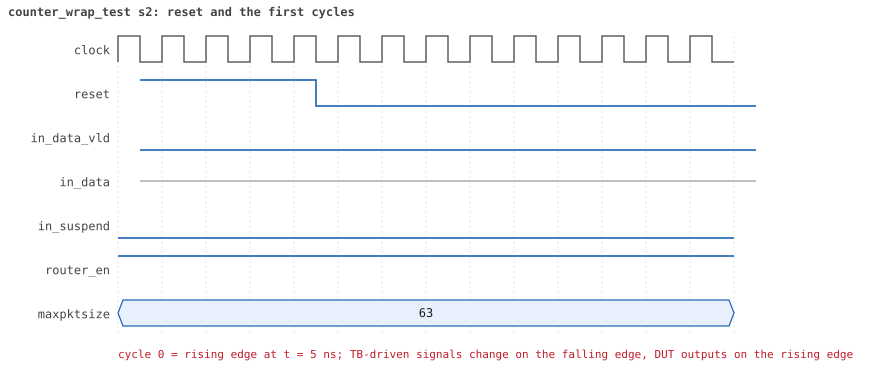
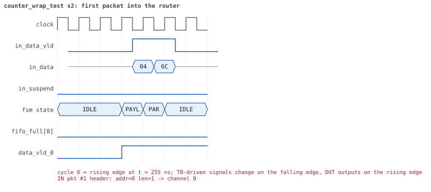
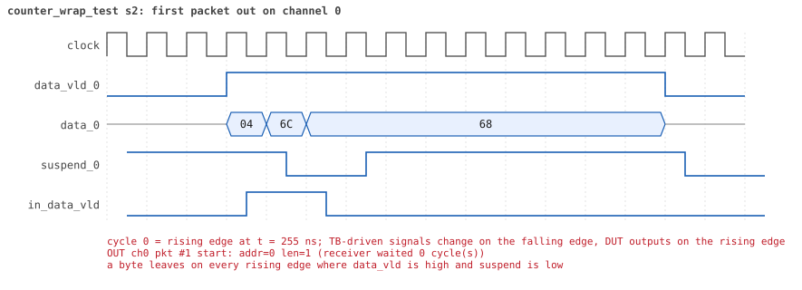
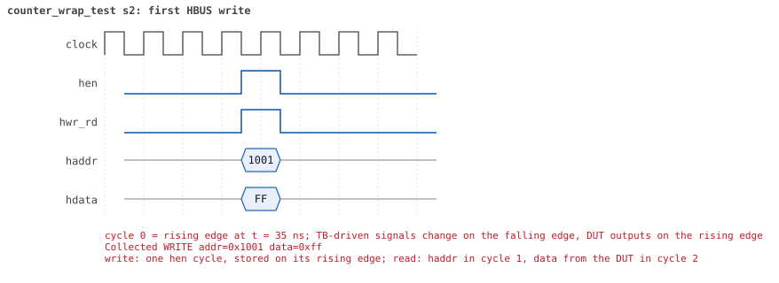
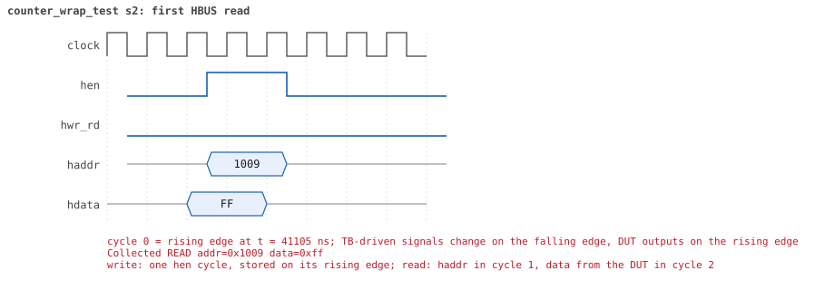

# counter_wrap_test seed 2

**Result:** PASSED (0 UVM_ERROR, 0 UVM_WARNING, 0 UVM_FATAL) · bench `yapp_project_tb` · sim time 42us · wall 14.8 s · log [`counter_wrap_test_s2.log`](counter_wrap_test_s2.log)

Waves: `counter_wrap_test_s2.fst` (GTKWave, Surfer or the VS Code wave viewer).
[Open the waves in Surfer](https://app.surfer-project.org/?load_url=https%3A%2F%2Fraw.githubusercontent.com%2Ftamirgabgab%2FQcom-Mentoring%2Fmain%2Fyapp_project%2Fregression%2Fyapp_project_tb%2Fcounter_wrap_test_s2%2Fcounter_wrap_test_s2.fst&startup_commands=run_command_file_from_url%20https%3A%2F%2Fraw.githubusercontent.com%2Ftamirgabgab%2FQcom-Mentoring%2Fmain%2Fyapp_project%2Ftb%2Fyapp_router.sucl) (web app, the signals already in groups: `yapp_project/tb/yapp_router.sucl`).

## Summary

- YAPP driver sent **257** packet(s) (0 with bad parity); the input monitor saw 257.
- Router: **257** forwarded, **0** dropped.
- Packets out: ch0 **257**, ch1 **0**, ch2 **0**.
- Scoreboard: 257 matched, 0 mismatched, 0 unexpected.
- Back-pressure: in_suspend asserted **0** time(s).
- Error pulses: 0.
- HBUS: 1 write(s), 8 read(s).

## Stages

| time (ns) | stage |
|---|---|
| 70 | 1. 255 one-byte packets to address 0: addr0_cnt_reg reaches 255 |
| 41140 | 2. the 256th packet wraps addr0_cnt_reg to 0 |
| 41460 | 3. one more packet: the counter goes on from 0 |
| 41710 | 4. the other counters are untouched and the scoreboard matched all 257 packets |

## Pictures

**reset and the first cycles**

**first packet into the router**

**first packet out on channel 0**

**first HBUS write**

**first HBUS read**

## Timeline

2770 events; this table keeps the 1576 of the test, the DUT, the host bus, the checkers' reports and every warning or error, and only the first 1500 of those. The full list is in the log.

| time (ns) | who | event |
|---|---|---|
| 0 | **DUT** | RESET asserted |
| 50 | **DUT** | RESET released: router_en=1 maxpktsize=63 |
| 70 | **test** | STAGE: 1. 255 one-byte packets to address 0: addr0_cnt_reg reaches 255 |
| 75 | hbus monitor | Collected WRITE addr=0x1001 data=0xff |
| 75 | reference | router_en is now 1 (en_reg 0xff) |
| 285 | **DUT** | IN  pkt #1 header: addr=0 len=1 -> channel 0 |
| 295 | **DUT** | OUT ch0 pkt #1 start: addr=0 len=1 (receiver waited 0 cycle(s)) |
| 305 | **DUT** | IN  pkt #1 complete: addr=0 len=1 parity=ok forwarded, 3 bytes in 3 cycles (held 0) |
| 305 | reference | Packet forwarded: addr=0 len=1 -> channel 0 |
| 395 | **DUT** | OUT ch0 pkt #1 done: 3 bytes in 11 cycles |
| 395 | scoreboard | ch0 pkt matched: addr=0 len=1 (1 matched so far) |
| 425 | **DUT** | IN  pkt #2 header: addr=0 len=1 -> channel 0 |
| 435 | **DUT** | OUT ch0 pkt #2 start: addr=0 len=1 (receiver waited 0 cycle(s)) |
| 445 | **DUT** | IN  pkt #2 complete: addr=0 len=1 parity=ok forwarded, 3 bytes in 3 cycles (held 0) |
| 445 | reference | Packet forwarded: addr=0 len=1 -> channel 0 |
| 455 | **DUT** | OUT ch0 pkt #2 done: 3 bytes in 3 cycles |
| 455 | scoreboard | ch0 pkt matched: addr=0 len=1 (2 matched so far) |
| 535 | **DUT** | IN  pkt #3 header: addr=0 len=1 -> channel 0 |
| 545 | **DUT** | OUT ch0 pkt #3 start: addr=0 len=1 (receiver waited 0 cycle(s)) |
| 555 | **DUT** | IN  pkt #3 complete: addr=0 len=1 parity=ok forwarded, 3 bytes in 3 cycles (held 0) |
| 555 | reference | Packet forwarded: addr=0 len=1 -> channel 0 |
| 565 | **DUT** | OUT ch0 pkt #3 done: 3 bytes in 3 cycles |
| 565 | scoreboard | ch0 pkt matched: addr=0 len=1 (3 matched so far) |
| 765 | **DUT** | IN  pkt #4 header: addr=0 len=1 -> channel 0 |
| 785 | **DUT** | IN  pkt #4 complete: addr=0 len=1 parity=ok forwarded, 3 bytes in 3 cycles (held 0) |
| 785 | reference | Packet forwarded: addr=0 len=1 -> channel 0 |
| 825 | **DUT** | OUT ch0 pkt #4 start: addr=0 len=1 (receiver waited 5 cycle(s)) |
| 955 | **DUT** | IN  pkt #5 header: addr=0 len=1 -> channel 0 |
| 955 | **DUT** | OUT ch0 pkt #4 done: 3 bytes in 14 cycles |
| 955 | scoreboard | ch0 pkt matched: addr=0 len=1 (4 matched so far) |
| 965 | **DUT** | OUT ch0 pkt #5 start: addr=0 len=1 (receiver waited 0 cycle(s)) |
| 975 | **DUT** | IN  pkt #5 complete: addr=0 len=1 parity=ok forwarded, 3 bytes in 3 cycles (held 0) |
| 975 | reference | Packet forwarded: addr=0 len=1 -> channel 0 |
| 985 | **DUT** | OUT ch0 pkt #5 done: 3 bytes in 3 cycles |
| 985 | scoreboard | ch0 pkt matched: addr=0 len=1 (5 matched so far) |
| 1125 | **DUT** | IN  pkt #6 header: addr=0 len=1 -> channel 0 |
| 1135 | **DUT** | OUT ch0 pkt #6 start: addr=0 len=1 (receiver waited 0 cycle(s)) |
| 1145 | **DUT** | IN  pkt #6 complete: addr=0 len=1 parity=ok forwarded, 3 bytes in 3 cycles (held 0) |
| 1145 | reference | Packet forwarded: addr=0 len=1 -> channel 0 |
| 1155 | **DUT** | OUT ch0 pkt #6 done: 3 bytes in 3 cycles |
| 1155 | scoreboard | ch0 pkt matched: addr=0 len=1 (6 matched so far) |
| 1315 | **DUT** | IN  pkt #7 header: addr=0 len=1 -> channel 0 |
| 1325 | **DUT** | OUT ch0 pkt #7 start: addr=0 len=1 (receiver waited 0 cycle(s)) |
| 1335 | **DUT** | IN  pkt #7 complete: addr=0 len=1 parity=ok forwarded, 3 bytes in 3 cycles (held 0) |
| 1335 | reference | Packet forwarded: addr=0 len=1 -> channel 0 |
| 1345 | **DUT** | OUT ch0 pkt #7 done: 3 bytes in 3 cycles |
| 1345 | scoreboard | ch0 pkt matched: addr=0 len=1 (7 matched so far) |
| 1545 | **DUT** | IN  pkt #8 header: addr=0 len=1 -> channel 0 |
| 1565 | **DUT** | IN  pkt #8 complete: addr=0 len=1 parity=ok forwarded, 3 bytes in 3 cycles (held 0) |
| 1565 | reference | Packet forwarded: addr=0 len=1 -> channel 0 |
| 1575 | **DUT** | OUT ch0 pkt #8 start: addr=0 len=1 (receiver waited 2 cycle(s)) |
| 1705 | **DUT** | OUT ch0 pkt #8 done: 3 bytes in 14 cycles |
| 1705 | scoreboard | ch0 pkt matched: addr=0 len=1 (8 matched so far) |
| 1725 | **DUT** | IN  pkt #9 header: addr=0 len=1 -> channel 0 |
| 1735 | **DUT** | OUT ch0 pkt #9 start: addr=0 len=1 (receiver waited 0 cycle(s)) |
| 1745 | **DUT** | IN  pkt #9 complete: addr=0 len=1 parity=ok forwarded, 3 bytes in 3 cycles (held 0) |
| 1745 | reference | Packet forwarded: addr=0 len=1 -> channel 0 |
| 1755 | **DUT** | OUT ch0 pkt #9 done: 3 bytes in 3 cycles |
| 1755 | scoreboard | ch0 pkt matched: addr=0 len=1 (9 matched so far) |
| 1935 | **DUT** | IN  pkt #10 header: addr=0 len=1 -> channel 0 |
| 1945 | **DUT** | OUT ch0 pkt #10 start: addr=0 len=1 (receiver waited 0 cycle(s)) |
| 1955 | **DUT** | IN  pkt #10 complete: addr=0 len=1 parity=ok forwarded, 3 bytes in 3 cycles (held 0) |
| 1955 | reference | Packet forwarded: addr=0 len=1 -> channel 0 |
| 1965 | **DUT** | OUT ch0 pkt #10 done: 3 bytes in 3 cycles |
| 1965 | scoreboard | ch0 pkt matched: addr=0 len=1 (10 matched so far) |
| 2165 | **DUT** | IN  pkt #11 header: addr=0 len=1 -> channel 0 |
| 2185 | **DUT** | IN  pkt #11 complete: addr=0 len=1 parity=ok forwarded, 3 bytes in 3 cycles (held 0) |
| 2185 | reference | Packet forwarded: addr=0 len=1 -> channel 0 |
| 2275 | **DUT** | OUT ch0 pkt #11 start: addr=0 len=1 (receiver waited 10 cycle(s)) |
| 2355 | **DUT** | IN  pkt #12 header: addr=0 len=1 -> channel 0 |
| 2375 | **DUT** | IN  pkt #12 complete: addr=0 len=1 parity=ok forwarded, 3 bytes in 3 cycles (held 0) |
| 2375 | reference | Packet forwarded: addr=0 len=1 -> channel 0 |
| 2395 | **DUT** | OUT ch0 pkt #11 done: 3 bytes in 13 cycles |
| 2395 | scoreboard | ch0 pkt matched: addr=0 len=1 (11 matched so far) |
| 2405 | **DUT** | OUT ch0 pkt #12 start: addr=0 len=1 (receiver waited 0 cycle(s)) |
| 2425 | **DUT** | OUT ch0 pkt #12 done: 3 bytes in 3 cycles |
| 2425 | scoreboard | ch0 pkt matched: addr=0 len=1 (12 matched so far) |
| 2585 | **DUT** | IN  pkt #13 header: addr=0 len=1 -> channel 0 |
| 2595 | **DUT** | OUT ch0 pkt #13 start: addr=0 len=1 (receiver waited 0 cycle(s)) |
| 2605 | **DUT** | IN  pkt #13 complete: addr=0 len=1 parity=ok forwarded, 3 bytes in 3 cycles (held 0) |
| 2605 | reference | Packet forwarded: addr=0 len=1 -> channel 0 |
| 2615 | **DUT** | OUT ch0 pkt #13 done: 3 bytes in 3 cycles |
| 2615 | scoreboard | ch0 pkt matched: addr=0 len=1 (13 matched so far) |
| 2815 | **DUT** | IN  pkt #14 header: addr=0 len=1 -> channel 0 |
| 2825 | **DUT** | OUT ch0 pkt #14 start: addr=0 len=1 (receiver waited 0 cycle(s)) |
| 2835 | **DUT** | IN  pkt #14 complete: addr=0 len=1 parity=ok forwarded, 3 bytes in 3 cycles (held 0) |
| 2835 | reference | Packet forwarded: addr=0 len=1 -> channel 0 |
| 2845 | **DUT** | OUT ch0 pkt #14 done: 3 bytes in 3 cycles |
| 2845 | scoreboard | ch0 pkt matched: addr=0 len=1 (14 matched so far) |
| 3045 | **DUT** | IN  pkt #15 header: addr=0 len=1 -> channel 0 |
| 3065 | **DUT** | IN  pkt #15 complete: addr=0 len=1 parity=ok forwarded, 3 bytes in 3 cycles (held 0) |
| 3065 | reference | Packet forwarded: addr=0 len=1 -> channel 0 |
| 3145 | **DUT** | OUT ch0 pkt #15 start: addr=0 len=1 (receiver waited 9 cycle(s)) |
| 3265 | **DUT** | OUT ch0 pkt #15 done: 3 bytes in 13 cycles |
| 3265 | scoreboard | ch0 pkt matched: addr=0 len=1 (15 matched so far) |
| 3275 | **DUT** | IN  pkt #16 header: addr=0 len=1 -> channel 0 |
| 3285 | **DUT** | OUT ch0 pkt #16 start: addr=0 len=1 (receiver waited 0 cycle(s)) |
| 3295 | **DUT** | IN  pkt #16 complete: addr=0 len=1 parity=ok forwarded, 3 bytes in 3 cycles (held 0) |
| 3295 | reference | Packet forwarded: addr=0 len=1 -> channel 0 |
| 3305 | **DUT** | OUT ch0 pkt #16 done: 3 bytes in 3 cycles |
| 3305 | scoreboard | ch0 pkt matched: addr=0 len=1 (16 matched so far) |
| 3505 | **DUT** | IN  pkt #17 header: addr=0 len=1 -> channel 0 |
| 3525 | **DUT** | IN  pkt #17 complete: addr=0 len=1 parity=ok forwarded, 3 bytes in 3 cycles (held 0) |
| 3525 | reference | Packet forwarded: addr=0 len=1 -> channel 0 |
| 3615 | **DUT** | OUT ch0 pkt #17 start: addr=0 len=1 (receiver waited 10 cycle(s)) |
| 3685 | **DUT** | OUT ch0 pkt #17 done: 3 bytes in 8 cycles |
| 3685 | scoreboard | ch0 pkt matched: addr=0 len=1 (17 matched so far) |
| 3715 | **DUT** | IN  pkt #18 header: addr=0 len=1 -> channel 0 |
| 3725 | **DUT** | OUT ch0 pkt #18 start: addr=0 len=1 (receiver waited 0 cycle(s)) |
| 3735 | **DUT** | IN  pkt #18 complete: addr=0 len=1 parity=ok forwarded, 3 bytes in 3 cycles (held 0) |
| 3735 | reference | Packet forwarded: addr=0 len=1 -> channel 0 |
| 3745 | **DUT** | OUT ch0 pkt #18 done: 3 bytes in 3 cycles |
| 3745 | scoreboard | ch0 pkt matched: addr=0 len=1 (18 matched so far) |
| 3775 | **DUT** | IN  pkt #19 header: addr=0 len=1 -> channel 0 |
| 3785 | **DUT** | OUT ch0 pkt #19 start: addr=0 len=1 (receiver waited 0 cycle(s)) |
| 3795 | **DUT** | IN  pkt #19 complete: addr=0 len=1 parity=ok forwarded, 3 bytes in 3 cycles (held 0) |
| 3795 | reference | Packet forwarded: addr=0 len=1 -> channel 0 |
| 3805 | **DUT** | OUT ch0 pkt #19 done: 3 bytes in 3 cycles |
| 3805 | scoreboard | ch0 pkt matched: addr=0 len=1 (19 matched so far) |
| 3835 | **DUT** | IN  pkt #20 header: addr=0 len=1 -> channel 0 |
| 3845 | **DUT** | OUT ch0 pkt #20 start: addr=0 len=1 (receiver waited 0 cycle(s)) |
| 3855 | **DUT** | IN  pkt #20 complete: addr=0 len=1 parity=ok forwarded, 3 bytes in 3 cycles (held 0) |
| 3855 | reference | Packet forwarded: addr=0 len=1 -> channel 0 |
| 3865 | **DUT** | OUT ch0 pkt #20 done: 3 bytes in 3 cycles |
| 3865 | scoreboard | ch0 pkt matched: addr=0 len=1 (20 matched so far) |
| 3985 | **DUT** | IN  pkt #21 header: addr=0 len=1 -> channel 0 |
| 3995 | **DUT** | OUT ch0 pkt #21 start: addr=0 len=1 (receiver waited 0 cycle(s)) |
| 4005 | **DUT** | IN  pkt #21 complete: addr=0 len=1 parity=ok forwarded, 3 bytes in 3 cycles (held 0) |
| 4005 | reference | Packet forwarded: addr=0 len=1 -> channel 0 |
| 4015 | **DUT** | OUT ch0 pkt #21 done: 3 bytes in 3 cycles |
| 4015 | scoreboard | ch0 pkt matched: addr=0 len=1 (21 matched so far) |
| 4135 | **DUT** | IN  pkt #22 header: addr=0 len=1 -> channel 0 |
| 4145 | **DUT** | OUT ch0 pkt #22 start: addr=0 len=1 (receiver waited 0 cycle(s)) |
| 4155 | **DUT** | IN  pkt #22 complete: addr=0 len=1 parity=ok forwarded, 3 bytes in 3 cycles (held 0) |
| 4155 | reference | Packet forwarded: addr=0 len=1 -> channel 0 |
| 4255 | **DUT** | OUT ch0 pkt #22 done: 3 bytes in 12 cycles |
| 4255 | scoreboard | ch0 pkt matched: addr=0 len=1 (22 matched so far) |
| 4365 | **DUT** | IN  pkt #23 header: addr=0 len=1 -> channel 0 |
| 4375 | **DUT** | OUT ch0 pkt #23 start: addr=0 len=1 (receiver waited 0 cycle(s)) |
| 4385 | **DUT** | IN  pkt #23 complete: addr=0 len=1 parity=ok forwarded, 3 bytes in 3 cycles (held 0) |
| 4385 | reference | Packet forwarded: addr=0 len=1 -> channel 0 |
| 4395 | **DUT** | OUT ch0 pkt #23 done: 3 bytes in 3 cycles |
| 4395 | scoreboard | ch0 pkt matched: addr=0 len=1 (23 matched so far) |
| 4425 | **DUT** | IN  pkt #24 header: addr=0 len=1 -> channel 0 |
| 4435 | **DUT** | OUT ch0 pkt #24 start: addr=0 len=1 (receiver waited 0 cycle(s)) |
| 4445 | **DUT** | IN  pkt #24 complete: addr=0 len=1 parity=ok forwarded, 3 bytes in 3 cycles (held 0) |
| 4445 | reference | Packet forwarded: addr=0 len=1 -> channel 0 |
| 4455 | **DUT** | OUT ch0 pkt #24 done: 3 bytes in 3 cycles |
| 4455 | scoreboard | ch0 pkt matched: addr=0 len=1 (24 matched so far) |
| 4505 | **DUT** | IN  pkt #25 header: addr=0 len=1 -> channel 0 |
| 4515 | **DUT** | OUT ch0 pkt #25 start: addr=0 len=1 (receiver waited 0 cycle(s)) |
| 4525 | **DUT** | IN  pkt #25 complete: addr=0 len=1 parity=ok forwarded, 3 bytes in 3 cycles (held 0) |
| 4525 | reference | Packet forwarded: addr=0 len=1 -> channel 0 |
| 4535 | **DUT** | OUT ch0 pkt #25 done: 3 bytes in 3 cycles |
| 4535 | scoreboard | ch0 pkt matched: addr=0 len=1 (25 matched so far) |
| 4565 | **DUT** | IN  pkt #26 header: addr=0 len=1 -> channel 0 |
| 4575 | **DUT** | OUT ch0 pkt #26 start: addr=0 len=1 (receiver waited 0 cycle(s)) |
| 4585 | **DUT** | IN  pkt #26 complete: addr=0 len=1 parity=ok forwarded, 3 bytes in 3 cycles (held 0) |
| 4585 | reference | Packet forwarded: addr=0 len=1 -> channel 0 |
| 4595 | **DUT** | OUT ch0 pkt #26 done: 3 bytes in 3 cycles |
| 4595 | scoreboard | ch0 pkt matched: addr=0 len=1 (26 matched so far) |
| 4605 | **DUT** | IN  pkt #27 header: addr=0 len=1 -> channel 0 |
| 4615 | **DUT** | OUT ch0 pkt #27 start: addr=0 len=1 (receiver waited 0 cycle(s)) |
| 4625 | **DUT** | IN  pkt #27 complete: addr=0 len=1 parity=ok forwarded, 3 bytes in 3 cycles (held 0) |
| 4625 | reference | Packet forwarded: addr=0 len=1 -> channel 0 |
| 4635 | **DUT** | OUT ch0 pkt #27 done: 3 bytes in 3 cycles |
| 4635 | scoreboard | ch0 pkt matched: addr=0 len=1 (27 matched so far) |
| 4715 | **DUT** | IN  pkt #28 header: addr=0 len=1 -> channel 0 |
| 4725 | **DUT** | OUT ch0 pkt #28 start: addr=0 len=1 (receiver waited 0 cycle(s)) |
| 4735 | **DUT** | IN  pkt #28 complete: addr=0 len=1 parity=ok forwarded, 3 bytes in 3 cycles (held 0) |
| 4735 | reference | Packet forwarded: addr=0 len=1 -> channel 0 |
| 4745 | **DUT** | OUT ch0 pkt #28 done: 3 bytes in 3 cycles |
| 4745 | scoreboard | ch0 pkt matched: addr=0 len=1 (28 matched so far) |
| 4755 | **DUT** | IN  pkt #29 header: addr=0 len=1 -> channel 0 |
| 4765 | **DUT** | OUT ch0 pkt #29 start: addr=0 len=1 (receiver waited 0 cycle(s)) |
| 4775 | **DUT** | IN  pkt #29 complete: addr=0 len=1 parity=ok forwarded, 3 bytes in 3 cycles (held 0) |
| 4775 | reference | Packet forwarded: addr=0 len=1 -> channel 0 |
| 4785 | **DUT** | OUT ch0 pkt #29 done: 3 bytes in 3 cycles |
| 4785 | scoreboard | ch0 pkt matched: addr=0 len=1 (29 matched so far) |
| 4905 | **DUT** | IN  pkt #30 header: addr=0 len=1 -> channel 0 |
| 4925 | **DUT** | IN  pkt #30 complete: addr=0 len=1 parity=ok forwarded, 3 bytes in 3 cycles (held 0) |
| 4925 | **DUT** | OUT ch0 pkt #30 start: addr=0 len=1 (receiver waited 1 cycle(s)) |
| 4925 | reference | Packet forwarded: addr=0 len=1 -> channel 0 |
| 4955 | **DUT** | OUT ch0 pkt #30 done: 3 bytes in 4 cycles |
| 4955 | scoreboard | ch0 pkt matched: addr=0 len=1 (30 matched so far) |
| 5105 | **DUT** | IN  pkt #31 header: addr=0 len=1 -> channel 0 |
| 5115 | **DUT** | OUT ch0 pkt #31 start: addr=0 len=1 (receiver waited 0 cycle(s)) |
| 5125 | **DUT** | IN  pkt #31 complete: addr=0 len=1 parity=ok forwarded, 3 bytes in 3 cycles (held 0) |
| 5125 | reference | Packet forwarded: addr=0 len=1 -> channel 0 |
| 5135 | **DUT** | OUT ch0 pkt #31 done: 3 bytes in 3 cycles |
| 5135 | scoreboard | ch0 pkt matched: addr=0 len=1 (31 matched so far) |
| 5325 | **DUT** | IN  pkt #32 header: addr=0 len=1 -> channel 0 |
| 5335 | **DUT** | OUT ch0 pkt #32 start: addr=0 len=1 (receiver waited 0 cycle(s)) |
| 5345 | **DUT** | IN  pkt #32 complete: addr=0 len=1 parity=ok forwarded, 3 bytes in 3 cycles (held 0) |
| 5345 | reference | Packet forwarded: addr=0 len=1 -> channel 0 |
| 5365 | **DUT** | IN  pkt #33 header: addr=0 len=1 -> channel 0 |
| 5385 | **DUT** | IN  pkt #33 complete: addr=0 len=1 parity=ok forwarded, 3 bytes in 3 cycles (held 0) |
| 5385 | reference | Packet forwarded: addr=0 len=1 -> channel 0 |
| 5435 | **DUT** | IN  pkt #34 header: addr=0 len=1 -> channel 0 |
| 5455 | **DUT** | IN  pkt #34 complete: addr=0 len=1 parity=ok forwarded, 3 bytes in 3 cycles (held 0) |
| 5455 | reference | Packet forwarded: addr=0 len=1 -> channel 0 |
| 5465 | **DUT** | OUT ch0 pkt #32 done: 3 bytes in 14 cycles |
| 5465 | scoreboard | ch0 pkt matched: addr=0 len=1 (32 matched so far) |
| 5475 | **DUT** | OUT ch0 pkt #33 start: addr=0 len=1 (receiver waited 0 cycle(s)) |
| 5495 | **DUT** | OUT ch0 pkt #33 done: 3 bytes in 3 cycles |
| 5495 | scoreboard | ch0 pkt matched: addr=0 len=1 (33 matched so far) |
| 5505 | **DUT** | OUT ch0 pkt #34 start: addr=0 len=1 (receiver waited 0 cycle(s)) |
| 5525 | **DUT** | OUT ch0 pkt #34 done: 3 bytes in 3 cycles |
| 5525 | scoreboard | ch0 pkt matched: addr=0 len=1 (34 matched so far) |
| 5595 | **DUT** | IN  pkt #35 header: addr=0 len=1 -> channel 0 |
| 5615 | **DUT** | IN  pkt #35 complete: addr=0 len=1 parity=ok forwarded, 3 bytes in 3 cycles (held 0) |
| 5615 | reference | Packet forwarded: addr=0 len=1 -> channel 0 |
| 5685 | **DUT** | OUT ch0 pkt #35 start: addr=0 len=1 (receiver waited 8 cycle(s)) |
| 5775 | **DUT** | IN  pkt #36 header: addr=0 len=1 -> channel 0 |
| 5795 | **DUT** | IN  pkt #36 complete: addr=0 len=1 parity=ok forwarded, 3 bytes in 3 cycles (held 0) |
| 5795 | reference | Packet forwarded: addr=0 len=1 -> channel 0 |
| 5815 | **DUT** | OUT ch0 pkt #35 done: 3 bytes in 14 cycles |
| 5815 | scoreboard | ch0 pkt matched: addr=0 len=1 (35 matched so far) |
| 5825 | **DUT** | OUT ch0 pkt #36 start: addr=0 len=1 (receiver waited 0 cycle(s)) |
| 5845 | **DUT** | OUT ch0 pkt #36 done: 3 bytes in 3 cycles |
| 5845 | scoreboard | ch0 pkt matched: addr=0 len=1 (36 matched so far) |
| 6005 | **DUT** | IN  pkt #37 header: addr=0 len=1 -> channel 0 |
| 6025 | **DUT** | IN  pkt #37 complete: addr=0 len=1 parity=ok forwarded, 3 bytes in 3 cycles (held 0) |
| 6025 | reference | Packet forwarded: addr=0 len=1 -> channel 0 |
| 6065 | **DUT** | IN  pkt #38 header: addr=0 len=1 -> channel 0 |
| 6085 | **DUT** | IN  pkt #38 complete: addr=0 len=1 parity=ok forwarded, 3 bytes in 3 cycles (held 0) |
| 6085 | reference | Packet forwarded: addr=0 len=1 -> channel 0 |
| 6105 | **DUT** | OUT ch0 pkt #37 start: addr=0 len=1 (receiver waited 9 cycle(s)) |
| 6205 | **DUT** | OUT ch0 pkt #37 done: 3 bytes in 11 cycles |
| 6205 | scoreboard | ch0 pkt matched: addr=0 len=1 (37 matched so far) |
| 6215 | **DUT** | OUT ch0 pkt #38 start: addr=0 len=1 (receiver waited 0 cycle(s)) |
| 6235 | **DUT** | OUT ch0 pkt #38 done: 3 bytes in 3 cycles |
| 6235 | scoreboard | ch0 pkt matched: addr=0 len=1 (38 matched so far) |
| 6275 | **DUT** | IN  pkt #39 header: addr=0 len=1 -> channel 0 |
| 6285 | **DUT** | OUT ch0 pkt #39 start: addr=0 len=1 (receiver waited 0 cycle(s)) |
| 6295 | **DUT** | IN  pkt #39 complete: addr=0 len=1 parity=ok forwarded, 3 bytes in 3 cycles (held 0) |
| 6295 | reference | Packet forwarded: addr=0 len=1 -> channel 0 |
| 6305 | **DUT** | OUT ch0 pkt #39 done: 3 bytes in 3 cycles |
| 6305 | scoreboard | ch0 pkt matched: addr=0 len=1 (39 matched so far) |
| 6475 | **DUT** | IN  pkt #40 header: addr=0 len=1 -> channel 0 |
| 6485 | **DUT** | OUT ch0 pkt #40 start: addr=0 len=1 (receiver waited 0 cycle(s)) |
| 6495 | **DUT** | IN  pkt #40 complete: addr=0 len=1 parity=ok forwarded, 3 bytes in 3 cycles (held 0) |
| 6495 | reference | Packet forwarded: addr=0 len=1 -> channel 0 |
| 6505 | **DUT** | OUT ch0 pkt #40 done: 3 bytes in 3 cycles |
| 6505 | scoreboard | ch0 pkt matched: addr=0 len=1 (40 matched so far) |
| 6705 | **DUT** | IN  pkt #41 header: addr=0 len=1 -> channel 0 |
| 6725 | **DUT** | IN  pkt #41 complete: addr=0 len=1 parity=ok forwarded, 3 bytes in 3 cycles (held 0) |
| 6725 | reference | Packet forwarded: addr=0 len=1 -> channel 0 |
| 6775 | **DUT** | OUT ch0 pkt #41 start: addr=0 len=1 (receiver waited 6 cycle(s)) |
| 6815 | **DUT** | OUT ch0 pkt #41 done: 3 bytes in 5 cycles |
| 6815 | scoreboard | ch0 pkt matched: addr=0 len=1 (41 matched so far) |
| 6915 | **DUT** | IN  pkt #42 header: addr=0 len=1 -> channel 0 |
| 6925 | **DUT** | OUT ch0 pkt #42 start: addr=0 len=1 (receiver waited 0 cycle(s)) |
| 6935 | **DUT** | IN  pkt #42 complete: addr=0 len=1 parity=ok forwarded, 3 bytes in 3 cycles (held 0) |
| 6935 | reference | Packet forwarded: addr=0 len=1 -> channel 0 |
| 6945 | **DUT** | OUT ch0 pkt #42 done: 3 bytes in 3 cycles |
| 6945 | scoreboard | ch0 pkt matched: addr=0 len=1 (42 matched so far) |
| 7025 | **DUT** | IN  pkt #43 header: addr=0 len=1 -> channel 0 |
| 7045 | **DUT** | IN  pkt #43 complete: addr=0 len=1 parity=ok forwarded, 3 bytes in 3 cycles (held 0) |
| 7045 | reference | Packet forwarded: addr=0 len=1 -> channel 0 |
| 7125 | **DUT** | IN  pkt #44 header: addr=0 len=1 -> channel 0 |
| 7125 | **DUT** | OUT ch0 pkt #43 start: addr=0 len=1 (receiver waited 9 cycle(s)) |
| 7145 | **DUT** | IN  pkt #44 complete: addr=0 len=1 parity=ok forwarded, 3 bytes in 3 cycles (held 0) |
| 7145 | reference | Packet forwarded: addr=0 len=1 -> channel 0 |
| 7235 | **DUT** | OUT ch0 pkt #43 done: 3 bytes in 12 cycles |
| 7235 | scoreboard | ch0 pkt matched: addr=0 len=1 (43 matched so far) |
| 7245 | **DUT** | OUT ch0 pkt #44 start: addr=0 len=1 (receiver waited 0 cycle(s)) |
| 7265 | **DUT** | OUT ch0 pkt #44 done: 3 bytes in 3 cycles |
| 7265 | scoreboard | ch0 pkt matched: addr=0 len=1 (44 matched so far) |
| 7325 | **DUT** | IN  pkt #45 header: addr=0 len=1 -> channel 0 |
| 7335 | **DUT** | OUT ch0 pkt #45 start: addr=0 len=1 (receiver waited 0 cycle(s)) |
| 7345 | **DUT** | IN  pkt #45 complete: addr=0 len=1 parity=ok forwarded, 3 bytes in 3 cycles (held 0) |
| 7345 | reference | Packet forwarded: addr=0 len=1 -> channel 0 |
| 7355 | **DUT** | OUT ch0 pkt #45 done: 3 bytes in 3 cycles |
| 7355 | scoreboard | ch0 pkt matched: addr=0 len=1 (45 matched so far) |
| 7515 | **DUT** | IN  pkt #46 header: addr=0 len=1 -> channel 0 |
| 7535 | **DUT** | IN  pkt #46 complete: addr=0 len=1 parity=ok forwarded, 3 bytes in 3 cycles (held 0) |
| 7535 | reference | Packet forwarded: addr=0 len=1 -> channel 0 |
| 7625 | **DUT** | OUT ch0 pkt #46 start: addr=0 len=1 (receiver waited 10 cycle(s)) |
| 7745 | **DUT** | IN  pkt #47 header: addr=0 len=1 -> channel 0 |
| 7755 | **DUT** | OUT ch0 pkt #46 done: 3 bytes in 14 cycles |
| 7755 | scoreboard | ch0 pkt matched: addr=0 len=1 (46 matched so far) |
| 7765 | **DUT** | IN  pkt #47 complete: addr=0 len=1 parity=ok forwarded, 3 bytes in 3 cycles (held 0) |
| 7765 | **DUT** | OUT ch0 pkt #47 start: addr=0 len=1 (receiver waited 0 cycle(s)) |
| 7765 | reference | Packet forwarded: addr=0 len=1 -> channel 0 |
| 7785 | **DUT** | OUT ch0 pkt #47 done: 3 bytes in 3 cycles |
| 7785 | scoreboard | ch0 pkt matched: addr=0 len=1 (47 matched so far) |
| 7795 | **DUT** | IN  pkt #48 header: addr=0 len=1 -> channel 0 |
| 7805 | **DUT** | OUT ch0 pkt #48 start: addr=0 len=1 (receiver waited 0 cycle(s)) |
| 7815 | **DUT** | IN  pkt #48 complete: addr=0 len=1 parity=ok forwarded, 3 bytes in 3 cycles (held 0) |
| 7815 | reference | Packet forwarded: addr=0 len=1 -> channel 0 |
| 7825 | **DUT** | OUT ch0 pkt #48 done: 3 bytes in 3 cycles |
| 7825 | scoreboard | ch0 pkt matched: addr=0 len=1 (48 matched so far) |
| 8025 | **DUT** | IN  pkt #49 header: addr=0 len=1 -> channel 0 |
| 8035 | **DUT** | OUT ch0 pkt #49 start: addr=0 len=1 (receiver waited 0 cycle(s)) |
| 8045 | **DUT** | IN  pkt #49 complete: addr=0 len=1 parity=ok forwarded, 3 bytes in 3 cycles (held 0) |
| 8045 | reference | Packet forwarded: addr=0 len=1 -> channel 0 |
| 8055 | **DUT** | OUT ch0 pkt #49 done: 3 bytes in 3 cycles |
| 8055 | scoreboard | ch0 pkt matched: addr=0 len=1 (49 matched so far) |
| 8245 | **DUT** | IN  pkt #50 header: addr=0 len=1 -> channel 0 |
| 8255 | **DUT** | OUT ch0 pkt #50 start: addr=0 len=1 (receiver waited 0 cycle(s)) |
| 8265 | **DUT** | IN  pkt #50 complete: addr=0 len=1 parity=ok forwarded, 3 bytes in 3 cycles (held 0) |
| 8265 | reference | Packet forwarded: addr=0 len=1 -> channel 0 |
| 8275 | **DUT** | OUT ch0 pkt #50 done: 3 bytes in 3 cycles |
| 8275 | scoreboard | ch0 pkt matched: addr=0 len=1 (50 matched so far) |
| 8425 | **DUT** | IN  pkt #51 header: addr=0 len=1 -> channel 0 |
| 8445 | **DUT** | IN  pkt #51 complete: addr=0 len=1 parity=ok forwarded, 3 bytes in 3 cycles (held 0) |
| 8445 | reference | Packet forwarded: addr=0 len=1 -> channel 0 |
| 8465 | **DUT** | OUT ch0 pkt #51 start: addr=0 len=1 (receiver waited 3 cycle(s)) |
| 8575 | **DUT** | OUT ch0 pkt #51 done: 3 bytes in 12 cycles |
| 8575 | scoreboard | ch0 pkt matched: addr=0 len=1 (51 matched so far) |
| 8645 | **DUT** | IN  pkt #52 header: addr=0 len=1 -> channel 0 |
| 8655 | **DUT** | OUT ch0 pkt #52 start: addr=0 len=1 (receiver waited 0 cycle(s)) |
| 8665 | **DUT** | IN  pkt #52 complete: addr=0 len=1 parity=ok forwarded, 3 bytes in 3 cycles (held 0) |
| 8665 | reference | Packet forwarded: addr=0 len=1 -> channel 0 |
| 8675 | **DUT** | OUT ch0 pkt #52 done: 3 bytes in 3 cycles |
| 8675 | scoreboard | ch0 pkt matched: addr=0 len=1 (52 matched so far) |
| 8855 | **DUT** | IN  pkt #53 header: addr=0 len=1 -> channel 0 |
| 8875 | **DUT** | IN  pkt #53 complete: addr=0 len=1 parity=ok forwarded, 3 bytes in 3 cycles (held 0) |
| 8875 | reference | Packet forwarded: addr=0 len=1 -> channel 0 |
| 8935 | **DUT** | OUT ch0 pkt #53 start: addr=0 len=1 (receiver waited 7 cycle(s)) |
| 8945 | **DUT** | IN  pkt #54 header: addr=0 len=1 -> channel 0 |
| 8965 | **DUT** | IN  pkt #54 complete: addr=0 len=1 parity=ok forwarded, 3 bytes in 3 cycles (held 0) |
| 8965 | reference | Packet forwarded: addr=0 len=1 -> channel 0 |
| 9015 | **DUT** | IN  pkt #55 header: addr=0 len=1 -> channel 0 |
| 9035 | **DUT** | IN  pkt #55 complete: addr=0 len=1 parity=ok forwarded, 3 bytes in 3 cycles (held 0) |
| 9035 | **DUT** | OUT ch0 pkt #53 done: 3 bytes in 11 cycles |
| 9035 | scoreboard | ch0 pkt matched: addr=0 len=1 (53 matched so far) |
| 9035 | reference | Packet forwarded: addr=0 len=1 -> channel 0 |
| 9095 | **DUT** | IN  pkt #56 header: addr=0 len=1 -> channel 0 |
| 9105 | **DUT** | OUT ch0 pkt #54 start: addr=0 len=1 (receiver waited 6 cycle(s)) |
| 9115 | **DUT** | IN  pkt #56 complete: addr=0 len=1 parity=ok forwarded, 3 bytes in 3 cycles (held 0) |
| 9115 | reference | Packet forwarded: addr=0 len=1 -> channel 0 |
| 9225 | **DUT** | OUT ch0 pkt #54 done: 3 bytes in 13 cycles |
| 9225 | scoreboard | ch0 pkt matched: addr=0 len=1 (54 matched so far) |
| 9235 | **DUT** | OUT ch0 pkt #55 start: addr=0 len=1 (receiver waited 0 cycle(s)) |
| 9255 | **DUT** | OUT ch0 pkt #55 done: 3 bytes in 3 cycles |
| 9255 | scoreboard | ch0 pkt matched: addr=0 len=1 (55 matched so far) |
| 9265 | **DUT** | OUT ch0 pkt #56 start: addr=0 len=1 (receiver waited 0 cycle(s)) |
| 9285 | **DUT** | OUT ch0 pkt #56 done: 3 bytes in 3 cycles |
| 9285 | scoreboard | ch0 pkt matched: addr=0 len=1 (56 matched so far) |
| 9325 | **DUT** | IN  pkt #57 header: addr=0 len=1 -> channel 0 |
| 9335 | **DUT** | OUT ch0 pkt #57 start: addr=0 len=1 (receiver waited 0 cycle(s)) |
| 9345 | **DUT** | IN  pkt #57 complete: addr=0 len=1 parity=ok forwarded, 3 bytes in 3 cycles (held 0) |
| 9345 | reference | Packet forwarded: addr=0 len=1 -> channel 0 |
| 9365 | **DUT** | IN  pkt #58 header: addr=0 len=1 -> channel 0 |
| 9385 | **DUT** | IN  pkt #58 complete: addr=0 len=1 parity=ok forwarded, 3 bytes in 3 cycles (held 0) |
| 9385 | reference | Packet forwarded: addr=0 len=1 -> channel 0 |
| 9465 | **DUT** | OUT ch0 pkt #57 done: 3 bytes in 14 cycles |
| 9465 | scoreboard | ch0 pkt matched: addr=0 len=1 (57 matched so far) |
| 9475 | **DUT** | OUT ch0 pkt #58 start: addr=0 len=1 (receiver waited 0 cycle(s)) |
| 9495 | **DUT** | OUT ch0 pkt #58 done: 3 bytes in 3 cycles |
| 9495 | scoreboard | ch0 pkt matched: addr=0 len=1 (58 matched so far) |
| 9565 | **DUT** | IN  pkt #59 header: addr=0 len=1 -> channel 0 |
| 9575 | **DUT** | OUT ch0 pkt #59 start: addr=0 len=1 (receiver waited 0 cycle(s)) |
| 9585 | **DUT** | IN  pkt #59 complete: addr=0 len=1 parity=ok forwarded, 3 bytes in 3 cycles (held 0) |
| 9585 | reference | Packet forwarded: addr=0 len=1 -> channel 0 |
| 9595 | **DUT** | OUT ch0 pkt #59 done: 3 bytes in 3 cycles |
| 9595 | scoreboard | ch0 pkt matched: addr=0 len=1 (59 matched so far) |
| 9755 | **DUT** | IN  pkt #60 header: addr=0 len=1 -> channel 0 |
| 9765 | **DUT** | OUT ch0 pkt #60 start: addr=0 len=1 (receiver waited 0 cycle(s)) |
| 9775 | **DUT** | IN  pkt #60 complete: addr=0 len=1 parity=ok forwarded, 3 bytes in 3 cycles (held 0) |
| 9775 | reference | Packet forwarded: addr=0 len=1 -> channel 0 |
| 9785 | **DUT** | OUT ch0 pkt #60 done: 3 bytes in 3 cycles |
| 9785 | scoreboard | ch0 pkt matched: addr=0 len=1 (60 matched so far) |
| 9855 | **DUT** | IN  pkt #61 header: addr=0 len=1 -> channel 0 |
| 9865 | **DUT** | OUT ch0 pkt #61 start: addr=0 len=1 (receiver waited 0 cycle(s)) |
| 9875 | **DUT** | IN  pkt #61 complete: addr=0 len=1 parity=ok forwarded, 3 bytes in 3 cycles (held 0) |
| 9875 | reference | Packet forwarded: addr=0 len=1 -> channel 0 |
| 9885 | **DUT** | OUT ch0 pkt #61 done: 3 bytes in 3 cycles |
| 9885 | scoreboard | ch0 pkt matched: addr=0 len=1 (61 matched so far) |
| 10085 | **DUT** | IN  pkt #62 header: addr=0 len=1 -> channel 0 |
| 10105 | **DUT** | IN  pkt #62 complete: addr=0 len=1 parity=ok forwarded, 3 bytes in 3 cycles (held 0) |
| 10105 | reference | Packet forwarded: addr=0 len=1 -> channel 0 |
| 10175 | **DUT** | OUT ch0 pkt #62 start: addr=0 len=1 (receiver waited 8 cycle(s)) |
| 10265 | **DUT** | IN  pkt #63 header: addr=0 len=1 -> channel 0 |
| 10285 | **DUT** | IN  pkt #63 complete: addr=0 len=1 parity=ok forwarded, 3 bytes in 3 cycles (held 0) |
| 10285 | reference | Packet forwarded: addr=0 len=1 -> channel 0 |
| 10305 | **DUT** | OUT ch0 pkt #62 done: 3 bytes in 14 cycles |
| 10305 | scoreboard | ch0 pkt matched: addr=0 len=1 (62 matched so far) |
| 10315 | **DUT** | OUT ch0 pkt #63 start: addr=0 len=1 (receiver waited 0 cycle(s)) |
| 10335 | **DUT** | OUT ch0 pkt #63 done: 3 bytes in 3 cycles |
| 10335 | scoreboard | ch0 pkt matched: addr=0 len=1 (63 matched so far) |
| 10495 | **DUT** | IN  pkt #64 header: addr=0 len=1 -> channel 0 |
| 10505 | **DUT** | OUT ch0 pkt #64 start: addr=0 len=1 (receiver waited 0 cycle(s)) |
| 10515 | **DUT** | IN  pkt #64 complete: addr=0 len=1 parity=ok forwarded, 3 bytes in 3 cycles (held 0) |
| 10515 | reference | Packet forwarded: addr=0 len=1 -> channel 0 |
| 10525 | **DUT** | OUT ch0 pkt #64 done: 3 bytes in 3 cycles |
| 10525 | scoreboard | ch0 pkt matched: addr=0 len=1 (64 matched so far) |
| 10535 | **DUT** | IN  pkt #65 header: addr=0 len=1 -> channel 0 |
| 10545 | **DUT** | OUT ch0 pkt #65 start: addr=0 len=1 (receiver waited 0 cycle(s)) |
| 10555 | **DUT** | IN  pkt #65 complete: addr=0 len=1 parity=ok forwarded, 3 bytes in 3 cycles (held 0) |
| 10555 | reference | Packet forwarded: addr=0 len=1 -> channel 0 |
| 10565 | **DUT** | OUT ch0 pkt #65 done: 3 bytes in 3 cycles |
| 10565 | scoreboard | ch0 pkt matched: addr=0 len=1 (65 matched so far) |
| 10675 | **DUT** | IN  pkt #66 header: addr=0 len=1 -> channel 0 |
| 10685 | **DUT** | OUT ch0 pkt #66 start: addr=0 len=1 (receiver waited 0 cycle(s)) |
| 10695 | **DUT** | IN  pkt #66 complete: addr=0 len=1 parity=ok forwarded, 3 bytes in 3 cycles (held 0) |
| 10695 | reference | Packet forwarded: addr=0 len=1 -> channel 0 |
| 10705 | **DUT** | OUT ch0 pkt #66 done: 3 bytes in 3 cycles |
| 10705 | scoreboard | ch0 pkt matched: addr=0 len=1 (66 matched so far) |
| 10825 | **DUT** | IN  pkt #67 header: addr=0 len=1 -> channel 0 |
| 10845 | **DUT** | IN  pkt #67 complete: addr=0 len=1 parity=ok forwarded, 3 bytes in 3 cycles (held 0) |
| 10845 | reference | Packet forwarded: addr=0 len=1 -> channel 0 |
| 10935 | **DUT** | OUT ch0 pkt #67 start: addr=0 len=1 (receiver waited 10 cycle(s)) |
| 11055 | **DUT** | IN  pkt #68 header: addr=0 len=1 -> channel 0 |
| 11055 | **DUT** | OUT ch0 pkt #67 done: 3 bytes in 13 cycles |
| 11055 | scoreboard | ch0 pkt matched: addr=0 len=1 (67 matched so far) |
| 11065 | **DUT** | OUT ch0 pkt #68 start: addr=0 len=1 (receiver waited 0 cycle(s)) |
| 11075 | **DUT** | IN  pkt #68 complete: addr=0 len=1 parity=ok forwarded, 3 bytes in 3 cycles (held 0) |
| 11075 | reference | Packet forwarded: addr=0 len=1 -> channel 0 |
| 11085 | **DUT** | OUT ch0 pkt #68 done: 3 bytes in 3 cycles |
| 11085 | scoreboard | ch0 pkt matched: addr=0 len=1 (68 matched so far) |
| 11265 | **DUT** | IN  pkt #69 header: addr=0 len=1 -> channel 0 |
| 11275 | **DUT** | OUT ch0 pkt #69 start: addr=0 len=1 (receiver waited 0 cycle(s)) |
| 11285 | **DUT** | IN  pkt #69 complete: addr=0 len=1 parity=ok forwarded, 3 bytes in 3 cycles (held 0) |
| 11285 | reference | Packet forwarded: addr=0 len=1 -> channel 0 |
| 11295 | **DUT** | OUT ch0 pkt #69 done: 3 bytes in 3 cycles |
| 11295 | scoreboard | ch0 pkt matched: addr=0 len=1 (69 matched so far) |
| 11425 | **DUT** | IN  pkt #70 header: addr=0 len=1 -> channel 0 |
| 11435 | **DUT** | OUT ch0 pkt #70 start: addr=0 len=1 (receiver waited 0 cycle(s)) |
| 11445 | **DUT** | IN  pkt #70 complete: addr=0 len=1 parity=ok forwarded, 3 bytes in 3 cycles (held 0) |
| 11445 | reference | Packet forwarded: addr=0 len=1 -> channel 0 |
| 11455 | **DUT** | OUT ch0 pkt #70 done: 3 bytes in 3 cycles |
| 11455 | scoreboard | ch0 pkt matched: addr=0 len=1 (70 matched so far) |
| 11615 | **DUT** | IN  pkt #71 header: addr=0 len=1 -> channel 0 |
| 11625 | **DUT** | OUT ch0 pkt #71 start: addr=0 len=1 (receiver waited 0 cycle(s)) |
| 11635 | **DUT** | IN  pkt #71 complete: addr=0 len=1 parity=ok forwarded, 3 bytes in 3 cycles (held 0) |
| 11635 | reference | Packet forwarded: addr=0 len=1 -> channel 0 |
| 11645 | **DUT** | OUT ch0 pkt #71 done: 3 bytes in 3 cycles |
| 11645 | scoreboard | ch0 pkt matched: addr=0 len=1 (71 matched so far) |
| 11765 | **DUT** | IN  pkt #72 header: addr=0 len=1 -> channel 0 |
| 11785 | **DUT** | IN  pkt #72 complete: addr=0 len=1 parity=ok forwarded, 3 bytes in 3 cycles (held 0) |
| 11785 | reference | Packet forwarded: addr=0 len=1 -> channel 0 |
| 11865 | **DUT** | OUT ch0 pkt #72 start: addr=0 len=1 (receiver waited 9 cycle(s)) |
| 11975 | **DUT** | IN  pkt #73 header: addr=0 len=1 -> channel 0 |
| 11995 | **DUT** | IN  pkt #73 complete: addr=0 len=1 parity=ok forwarded, 3 bytes in 3 cycles (held 0) |
| 11995 | **DUT** | OUT ch0 pkt #72 done: 3 bytes in 14 cycles |
| 11995 | scoreboard | ch0 pkt matched: addr=0 len=1 (72 matched so far) |
| 11995 | reference | Packet forwarded: addr=0 len=1 -> channel 0 |
| 12005 | **DUT** | OUT ch0 pkt #73 start: addr=0 len=1 (receiver waited 0 cycle(s)) |
| 12025 | **DUT** | OUT ch0 pkt #73 done: 3 bytes in 3 cycles |
| 12025 | scoreboard | ch0 pkt matched: addr=0 len=1 (73 matched so far) |
| 12135 | **DUT** | IN  pkt #74 header: addr=0 len=1 -> channel 0 |
| 12155 | **DUT** | IN  pkt #74 complete: addr=0 len=1 parity=ok forwarded, 3 bytes in 3 cycles (held 0) |
| 12155 | reference | Packet forwarded: addr=0 len=1 -> channel 0 |
| 12235 | **DUT** | OUT ch0 pkt #74 start: addr=0 len=1 (receiver waited 9 cycle(s)) |
| 12305 | **DUT** | IN  pkt #75 header: addr=0 len=1 -> channel 0 |
| 12325 | **DUT** | IN  pkt #75 complete: addr=0 len=1 parity=ok forwarded, 3 bytes in 3 cycles (held 0) |
| 12325 | reference | Packet forwarded: addr=0 len=1 -> channel 0 |
| 12345 | **DUT** | OUT ch0 pkt #74 done: 3 bytes in 12 cycles |
| 12345 | scoreboard | ch0 pkt matched: addr=0 len=1 (74 matched so far) |
| 12355 | **DUT** | OUT ch0 pkt #75 start: addr=0 len=1 (receiver waited 0 cycle(s)) |
| 12375 | **DUT** | OUT ch0 pkt #75 done: 3 bytes in 3 cycles |
| 12375 | scoreboard | ch0 pkt matched: addr=0 len=1 (75 matched so far) |
| 12415 | **DUT** | IN  pkt #76 header: addr=0 len=1 -> channel 0 |
| 12425 | **DUT** | OUT ch0 pkt #76 start: addr=0 len=1 (receiver waited 0 cycle(s)) |
| 12435 | **DUT** | IN  pkt #76 complete: addr=0 len=1 parity=ok forwarded, 3 bytes in 3 cycles (held 0) |
| 12435 | reference | Packet forwarded: addr=0 len=1 -> channel 0 |
| 12445 | **DUT** | OUT ch0 pkt #76 done: 3 bytes in 3 cycles |
| 12445 | scoreboard | ch0 pkt matched: addr=0 len=1 (76 matched so far) |
| 12565 | **DUT** | IN  pkt #77 header: addr=0 len=1 -> channel 0 |
| 12575 | **DUT** | OUT ch0 pkt #77 start: addr=0 len=1 (receiver waited 0 cycle(s)) |
| 12585 | **DUT** | IN  pkt #77 complete: addr=0 len=1 parity=ok forwarded, 3 bytes in 3 cycles (held 0) |
| 12585 | reference | Packet forwarded: addr=0 len=1 -> channel 0 |
| 12595 | **DUT** | OUT ch0 pkt #77 done: 3 bytes in 3 cycles |
| 12595 | scoreboard | ch0 pkt matched: addr=0 len=1 (77 matched so far) |
| 12715 | **DUT** | IN  pkt #78 header: addr=0 len=1 -> channel 0 |
| 12725 | **DUT** | OUT ch0 pkt #78 start: addr=0 len=1 (receiver waited 0 cycle(s)) |
| 12735 | **DUT** | IN  pkt #78 complete: addr=0 len=1 parity=ok forwarded, 3 bytes in 3 cycles (held 0) |
| 12735 | reference | Packet forwarded: addr=0 len=1 -> channel 0 |
| 12745 | **DUT** | OUT ch0 pkt #78 done: 3 bytes in 3 cycles |
| 12745 | scoreboard | ch0 pkt matched: addr=0 len=1 (78 matched so far) |
| 12935 | **DUT** | IN  pkt #79 header: addr=0 len=1 -> channel 0 |
| 12955 | **DUT** | IN  pkt #79 complete: addr=0 len=1 parity=ok forwarded, 3 bytes in 3 cycles (held 0) |
| 12955 | reference | Packet forwarded: addr=0 len=1 -> channel 0 |
| 13015 | **DUT** | OUT ch0 pkt #79 start: addr=0 len=1 (receiver waited 7 cycle(s)) |
| 13065 | **DUT** | OUT ch0 pkt #79 done: 3 bytes in 6 cycles |
| 13065 | scoreboard | ch0 pkt matched: addr=0 len=1 (79 matched so far) |
| 13165 | **DUT** | IN  pkt #80 header: addr=0 len=1 -> channel 0 |
| 13175 | **DUT** | OUT ch0 pkt #80 start: addr=0 len=1 (receiver waited 0 cycle(s)) |
| 13185 | **DUT** | IN  pkt #80 complete: addr=0 len=1 parity=ok forwarded, 3 bytes in 3 cycles (held 0) |
| 13185 | reference | Packet forwarded: addr=0 len=1 -> channel 0 |
| 13195 | **DUT** | OUT ch0 pkt #80 done: 3 bytes in 3 cycles |
| 13195 | scoreboard | ch0 pkt matched: addr=0 len=1 (80 matched so far) |
| 13245 | **DUT** | IN  pkt #81 header: addr=0 len=1 -> channel 0 |
| 13255 | **DUT** | OUT ch0 pkt #81 start: addr=0 len=1 (receiver waited 0 cycle(s)) |
| 13265 | **DUT** | IN  pkt #81 complete: addr=0 len=1 parity=ok forwarded, 3 bytes in 3 cycles (held 0) |
| 13265 | reference | Packet forwarded: addr=0 len=1 -> channel 0 |
| 13275 | **DUT** | OUT ch0 pkt #81 done: 3 bytes in 3 cycles |
| 13275 | scoreboard | ch0 pkt matched: addr=0 len=1 (81 matched so far) |
| 13435 | **DUT** | IN  pkt #82 header: addr=0 len=1 -> channel 0 |
| 13445 | **DUT** | OUT ch0 pkt #82 start: addr=0 len=1 (receiver waited 0 cycle(s)) |
| 13455 | **DUT** | IN  pkt #82 complete: addr=0 len=1 parity=ok forwarded, 3 bytes in 3 cycles (held 0) |
| 13455 | reference | Packet forwarded: addr=0 len=1 -> channel 0 |
| 13465 | **DUT** | OUT ch0 pkt #82 done: 3 bytes in 3 cycles |
| 13465 | scoreboard | ch0 pkt matched: addr=0 len=1 (82 matched so far) |
| 13575 | **DUT** | IN  pkt #83 header: addr=0 len=1 -> channel 0 |
| 13585 | **DUT** | OUT ch0 pkt #83 start: addr=0 len=1 (receiver waited 0 cycle(s)) |
| 13595 | **DUT** | IN  pkt #83 complete: addr=0 len=1 parity=ok forwarded, 3 bytes in 3 cycles (held 0) |
| 13595 | reference | Packet forwarded: addr=0 len=1 -> channel 0 |
| 13605 | **DUT** | OUT ch0 pkt #83 done: 3 bytes in 3 cycles |
| 13605 | scoreboard | ch0 pkt matched: addr=0 len=1 (83 matched so far) |
| 13805 | **DUT** | IN  pkt #84 header: addr=0 len=1 -> channel 0 |
| 13825 | **DUT** | IN  pkt #84 complete: addr=0 len=1 parity=ok forwarded, 3 bytes in 3 cycles (held 0) |
| 13825 | reference | Packet forwarded: addr=0 len=1 -> channel 0 |
| 13865 | **DUT** | IN  pkt #85 header: addr=0 len=1 -> channel 0 |
| 13885 | **DUT** | IN  pkt #85 complete: addr=0 len=1 parity=ok forwarded, 3 bytes in 3 cycles (held 0) |
| 13885 | reference | Packet forwarded: addr=0 len=1 -> channel 0 |
| 13895 | **DUT** | OUT ch0 pkt #84 start: addr=0 len=1 (receiver waited 8 cycle(s)) |
| 13965 | **DUT** | OUT ch0 pkt #84 done: 3 bytes in 8 cycles |
| 13965 | scoreboard | ch0 pkt matched: addr=0 len=1 (84 matched so far) |
| 13975 | **DUT** | OUT ch0 pkt #85 start: addr=0 len=1 (receiver waited 0 cycle(s)) |
| 13995 | **DUT** | OUT ch0 pkt #85 done: 3 bytes in 3 cycles |
| 13995 | scoreboard | ch0 pkt matched: addr=0 len=1 (85 matched so far) |
| 14085 | **DUT** | IN  pkt #86 header: addr=0 len=1 -> channel 0 |
| 14095 | **DUT** | OUT ch0 pkt #86 start: addr=0 len=1 (receiver waited 0 cycle(s)) |
| 14105 | **DUT** | IN  pkt #86 complete: addr=0 len=1 parity=ok forwarded, 3 bytes in 3 cycles (held 0) |
| 14105 | reference | Packet forwarded: addr=0 len=1 -> channel 0 |
| 14115 | **DUT** | OUT ch0 pkt #86 done: 3 bytes in 3 cycles |
| 14115 | scoreboard | ch0 pkt matched: addr=0 len=1 (86 matched so far) |
| 14315 | **DUT** | IN  pkt #87 header: addr=0 len=1 -> channel 0 |
| 14325 | **DUT** | OUT ch0 pkt #87 start: addr=0 len=1 (receiver waited 0 cycle(s)) |
| 14335 | **DUT** | IN  pkt #87 complete: addr=0 len=1 parity=ok forwarded, 3 bytes in 3 cycles (held 0) |
| 14335 | reference | Packet forwarded: addr=0 len=1 -> channel 0 |
| 14345 | **DUT** | OUT ch0 pkt #87 done: 3 bytes in 3 cycles |
| 14345 | scoreboard | ch0 pkt matched: addr=0 len=1 (87 matched so far) |
| 14415 | **DUT** | IN  pkt #88 header: addr=0 len=1 -> channel 0 |
| 14425 | **DUT** | OUT ch0 pkt #88 start: addr=0 len=1 (receiver waited 0 cycle(s)) |
| 14435 | **DUT** | IN  pkt #88 complete: addr=0 len=1 parity=ok forwarded, 3 bytes in 3 cycles (held 0) |
| 14435 | reference | Packet forwarded: addr=0 len=1 -> channel 0 |
| 14445 | **DUT** | OUT ch0 pkt #88 done: 3 bytes in 3 cycles |
| 14445 | scoreboard | ch0 pkt matched: addr=0 len=1 (88 matched so far) |
| 14615 | **DUT** | IN  pkt #89 header: addr=0 len=1 -> channel 0 |
| 14635 | **DUT** | IN  pkt #89 complete: addr=0 len=1 parity=ok forwarded, 3 bytes in 3 cycles (held 0) |
| 14635 | reference | Packet forwarded: addr=0 len=1 -> channel 0 |
| 14725 | **DUT** | OUT ch0 pkt #89 start: addr=0 len=1 (receiver waited 10 cycle(s)) |
| 14815 | **DUT** | IN  pkt #90 header: addr=0 len=1 -> channel 0 |
| 14835 | **DUT** | IN  pkt #90 complete: addr=0 len=1 parity=ok forwarded, 3 bytes in 3 cycles (held 0) |
| 14835 | reference | Packet forwarded: addr=0 len=1 -> channel 0 |
| 14855 | **DUT** | OUT ch0 pkt #89 done: 3 bytes in 14 cycles |
| 14855 | scoreboard | ch0 pkt matched: addr=0 len=1 (89 matched so far) |
| 14865 | **DUT** | OUT ch0 pkt #90 start: addr=0 len=1 (receiver waited 0 cycle(s)) |
| 14885 | **DUT** | OUT ch0 pkt #90 done: 3 bytes in 3 cycles |
| 14885 | scoreboard | ch0 pkt matched: addr=0 len=1 (90 matched so far) |
| 15045 | **DUT** | IN  pkt #91 header: addr=0 len=1 -> channel 0 |
| 15065 | **DUT** | IN  pkt #91 complete: addr=0 len=1 parity=ok forwarded, 3 bytes in 3 cycles (held 0) |
| 15065 | reference | Packet forwarded: addr=0 len=1 -> channel 0 |
| 15105 | **DUT** | OUT ch0 pkt #91 start: addr=0 len=1 (receiver waited 5 cycle(s)) |
| 15165 | **DUT** | IN  pkt #92 header: addr=0 len=1 -> channel 0 |
| 15185 | **DUT** | IN  pkt #92 complete: addr=0 len=1 parity=ok forwarded, 3 bytes in 3 cycles (held 0) |
| 15185 | reference | Packet forwarded: addr=0 len=1 -> channel 0 |
| 15205 | **DUT** | IN  pkt #93 header: addr=0 len=1 -> channel 0 |
| 15225 | **DUT** | IN  pkt #93 complete: addr=0 len=1 parity=ok forwarded, 3 bytes in 3 cycles (held 0) |
| 15225 | reference | Packet forwarded: addr=0 len=1 -> channel 0 |
| 15235 | **DUT** | OUT ch0 pkt #91 done: 3 bytes in 14 cycles |
| 15235 | scoreboard | ch0 pkt matched: addr=0 len=1 (91 matched so far) |
| 15245 | **DUT** | OUT ch0 pkt #92 start: addr=0 len=1 (receiver waited 0 cycle(s)) |
| 15265 | **DUT** | OUT ch0 pkt #92 done: 3 bytes in 3 cycles |
| 15265 | scoreboard | ch0 pkt matched: addr=0 len=1 (92 matched so far) |
| 15275 | **DUT** | OUT ch0 pkt #93 start: addr=0 len=1 (receiver waited 0 cycle(s)) |
| 15295 | **DUT** | OUT ch0 pkt #93 done: 3 bytes in 3 cycles |
| 15295 | scoreboard | ch0 pkt matched: addr=0 len=1 (93 matched so far) |
| 15395 | **DUT** | IN  pkt #94 header: addr=0 len=1 -> channel 0 |
| 15415 | **DUT** | IN  pkt #94 complete: addr=0 len=1 parity=ok forwarded, 3 bytes in 3 cycles (held 0) |
| 15415 | reference | Packet forwarded: addr=0 len=1 -> channel 0 |
| 15445 | **DUT** | OUT ch0 pkt #94 start: addr=0 len=1 (receiver waited 4 cycle(s)) |
| 15505 | **DUT** | OUT ch0 pkt #94 done: 3 bytes in 7 cycles |
| 15505 | scoreboard | ch0 pkt matched: addr=0 len=1 (94 matched so far) |
| 15625 | **DUT** | IN  pkt #95 header: addr=0 len=1 -> channel 0 |
| 15635 | **DUT** | OUT ch0 pkt #95 start: addr=0 len=1 (receiver waited 0 cycle(s)) |
| 15645 | **DUT** | IN  pkt #95 complete: addr=0 len=1 parity=ok forwarded, 3 bytes in 3 cycles (held 0) |
| 15645 | reference | Packet forwarded: addr=0 len=1 -> channel 0 |
| 15655 | **DUT** | OUT ch0 pkt #95 done: 3 bytes in 3 cycles |
| 15655 | scoreboard | ch0 pkt matched: addr=0 len=1 (95 matched so far) |
| 15855 | **DUT** | IN  pkt #96 header: addr=0 len=1 -> channel 0 |
| 15875 | **DUT** | IN  pkt #96 complete: addr=0 len=1 parity=ok forwarded, 3 bytes in 3 cycles (held 0) |
| 15875 | reference | Packet forwarded: addr=0 len=1 -> channel 0 |
| 15895 | **DUT** | OUT ch0 pkt #96 start: addr=0 len=1 (receiver waited 3 cycle(s)) |
| 15935 | **DUT** | OUT ch0 pkt #96 done: 3 bytes in 5 cycles |
| 15935 | scoreboard | ch0 pkt matched: addr=0 len=1 (96 matched so far) |
| 16025 | **DUT** | IN  pkt #97 header: addr=0 len=1 -> channel 0 |
| 16045 | **DUT** | IN  pkt #97 complete: addr=0 len=1 parity=ok forwarded, 3 bytes in 3 cycles (held 0) |
| 16045 | reference | Packet forwarded: addr=0 len=1 -> channel 0 |
| 16085 | **DUT** | OUT ch0 pkt #97 start: addr=0 len=1 (receiver waited 5 cycle(s)) |
| 16105 | **DUT** | IN  pkt #98 header: addr=0 len=1 -> channel 0 |
| 16125 | **DUT** | IN  pkt #98 complete: addr=0 len=1 parity=ok forwarded, 3 bytes in 3 cycles (held 0) |
| 16125 | reference | Packet forwarded: addr=0 len=1 -> channel 0 |
| 16175 | **DUT** | OUT ch0 pkt #97 done: 3 bytes in 10 cycles |
| 16175 | scoreboard | ch0 pkt matched: addr=0 len=1 (97 matched so far) |
| 16185 | **DUT** | OUT ch0 pkt #98 start: addr=0 len=1 (receiver waited 0 cycle(s)) |
| 16205 | **DUT** | OUT ch0 pkt #98 done: 3 bytes in 3 cycles |
| 16205 | scoreboard | ch0 pkt matched: addr=0 len=1 (98 matched so far) |
| 16275 | **DUT** | IN  pkt #99 header: addr=0 len=1 -> channel 0 |
| 16285 | **DUT** | OUT ch0 pkt #99 start: addr=0 len=1 (receiver waited 0 cycle(s)) |
| 16295 | **DUT** | IN  pkt #99 complete: addr=0 len=1 parity=ok forwarded, 3 bytes in 3 cycles (held 0) |
| 16295 | reference | Packet forwarded: addr=0 len=1 -> channel 0 |
| 16345 | **DUT** | IN  pkt #100 header: addr=0 len=1 -> channel 0 |
| 16365 | **DUT** | IN  pkt #100 complete: addr=0 len=1 parity=ok forwarded, 3 bytes in 3 cycles (held 0) |
| 16365 | **DUT** | OUT ch0 pkt #99 done: 3 bytes in 9 cycles |
| 16365 | scoreboard | ch0 pkt matched: addr=0 len=1 (99 matched so far) |
| 16365 | reference | Packet forwarded: addr=0 len=1 -> channel 0 |
| 16375 | **DUT** | OUT ch0 pkt #100 start: addr=0 len=1 (receiver waited 0 cycle(s)) |
| 16395 | **DUT** | OUT ch0 pkt #100 done: 3 bytes in 3 cycles |
| 16395 | scoreboard | ch0 pkt matched: addr=0 len=1 (100 matched so far) |
| 16545 | **DUT** | IN  pkt #101 header: addr=0 len=1 -> channel 0 |
| 16555 | **DUT** | OUT ch0 pkt #101 start: addr=0 len=1 (receiver waited 0 cycle(s)) |
| 16565 | **DUT** | IN  pkt #101 complete: addr=0 len=1 parity=ok forwarded, 3 bytes in 3 cycles (held 0) |
| 16565 | reference | Packet forwarded: addr=0 len=1 -> channel 0 |
| 16575 | **DUT** | OUT ch0 pkt #101 done: 3 bytes in 3 cycles |
| 16575 | scoreboard | ch0 pkt matched: addr=0 len=1 (101 matched so far) |
| 16745 | **DUT** | IN  pkt #102 header: addr=0 len=1 -> channel 0 |
| 16755 | **DUT** | OUT ch0 pkt #102 start: addr=0 len=1 (receiver waited 0 cycle(s)) |
| 16765 | **DUT** | IN  pkt #102 complete: addr=0 len=1 parity=ok forwarded, 3 bytes in 3 cycles (held 0) |
| 16765 | reference | Packet forwarded: addr=0 len=1 -> channel 0 |
| 16775 | **DUT** | OUT ch0 pkt #102 done: 3 bytes in 3 cycles |
| 16775 | scoreboard | ch0 pkt matched: addr=0 len=1 (102 matched so far) |
| 16945 | **DUT** | IN  pkt #103 header: addr=0 len=1 -> channel 0 |
| 16965 | **DUT** | IN  pkt #103 complete: addr=0 len=1 parity=ok forwarded, 3 bytes in 3 cycles (held 0) |
| 16965 | reference | Packet forwarded: addr=0 len=1 -> channel 0 |
| 16995 | **DUT** | IN  pkt #104 header: addr=0 len=1 -> channel 0 |
| 17015 | **DUT** | IN  pkt #104 complete: addr=0 len=1 parity=ok forwarded, 3 bytes in 3 cycles (held 0) |
| 17015 | **DUT** | OUT ch0 pkt #103 start: addr=0 len=1 (receiver waited 6 cycle(s)) |
| 17015 | reference | Packet forwarded: addr=0 len=1 -> channel 0 |
| 17085 | **DUT** | OUT ch0 pkt #103 done: 3 bytes in 8 cycles |
| 17085 | scoreboard | ch0 pkt matched: addr=0 len=1 (103 matched so far) |
| 17095 | **DUT** | OUT ch0 pkt #104 start: addr=0 len=1 (receiver waited 0 cycle(s)) |
| 17115 | **DUT** | OUT ch0 pkt #104 done: 3 bytes in 3 cycles |
| 17115 | scoreboard | ch0 pkt matched: addr=0 len=1 (104 matched so far) |
| 17195 | **DUT** | IN  pkt #105 header: addr=0 len=1 -> channel 0 |
| 17215 | **DUT** | IN  pkt #105 complete: addr=0 len=1 parity=ok forwarded, 3 bytes in 3 cycles (held 0) |
| 17215 | reference | Packet forwarded: addr=0 len=1 -> channel 0 |
| 17255 | **DUT** | OUT ch0 pkt #105 start: addr=0 len=1 (receiver waited 5 cycle(s)) |
| 17305 | **DUT** | IN  pkt #106 header: addr=0 len=1 -> channel 0 |
| 17325 | **DUT** | IN  pkt #106 complete: addr=0 len=1 parity=ok forwarded, 3 bytes in 3 cycles (held 0) |
| 17325 | reference | Packet forwarded: addr=0 len=1 -> channel 0 |
| 17335 | **DUT** | OUT ch0 pkt #105 done: 3 bytes in 9 cycles |
| 17335 | scoreboard | ch0 pkt matched: addr=0 len=1 (105 matched so far) |
| 17345 | **DUT** | OUT ch0 pkt #106 start: addr=0 len=1 (receiver waited 0 cycle(s)) |
| 17365 | **DUT** | OUT ch0 pkt #106 done: 3 bytes in 3 cycles |
| 17365 | scoreboard | ch0 pkt matched: addr=0 len=1 (106 matched so far) |
| 17465 | **DUT** | IN  pkt #107 header: addr=0 len=1 -> channel 0 |
| 17475 | **DUT** | OUT ch0 pkt #107 start: addr=0 len=1 (receiver waited 0 cycle(s)) |
| 17485 | **DUT** | IN  pkt #107 complete: addr=0 len=1 parity=ok forwarded, 3 bytes in 3 cycles (held 0) |
| 17485 | reference | Packet forwarded: addr=0 len=1 -> channel 0 |
| 17495 | **DUT** | OUT ch0 pkt #107 done: 3 bytes in 3 cycles |
| 17495 | scoreboard | ch0 pkt matched: addr=0 len=1 (107 matched so far) |
| 17605 | **DUT** | IN  pkt #108 header: addr=0 len=1 -> channel 0 |
| 17615 | **DUT** | OUT ch0 pkt #108 start: addr=0 len=1 (receiver waited 0 cycle(s)) |
| 17625 | **DUT** | IN  pkt #108 complete: addr=0 len=1 parity=ok forwarded, 3 bytes in 3 cycles (held 0) |
| 17625 | reference | Packet forwarded: addr=0 len=1 -> channel 0 |
| 17705 | **DUT** | IN  pkt #109 header: addr=0 len=1 -> channel 0 |
| 17725 | **DUT** | IN  pkt #109 complete: addr=0 len=1 parity=ok forwarded, 3 bytes in 3 cycles (held 0) |
| 17725 | **DUT** | OUT ch0 pkt #108 done: 3 bytes in 12 cycles |
| 17725 | scoreboard | ch0 pkt matched: addr=0 len=1 (108 matched so far) |
| 17725 | reference | Packet forwarded: addr=0 len=1 -> channel 0 |
| 17735 | **DUT** | OUT ch0 pkt #109 start: addr=0 len=1 (receiver waited 0 cycle(s)) |
| 17755 | **DUT** | OUT ch0 pkt #109 done: 3 bytes in 3 cycles |
| 17755 | scoreboard | ch0 pkt matched: addr=0 len=1 (109 matched so far) |
| 17895 | **DUT** | IN  pkt #110 header: addr=0 len=1 -> channel 0 |
| 17905 | **DUT** | OUT ch0 pkt #110 start: addr=0 len=1 (receiver waited 0 cycle(s)) |
| 17915 | **DUT** | IN  pkt #110 complete: addr=0 len=1 parity=ok forwarded, 3 bytes in 3 cycles (held 0) |
| 17915 | reference | Packet forwarded: addr=0 len=1 -> channel 0 |
| 17925 | **DUT** | OUT ch0 pkt #110 done: 3 bytes in 3 cycles |
| 17925 | scoreboard | ch0 pkt matched: addr=0 len=1 (110 matched so far) |
| 17975 | **DUT** | IN  pkt #111 header: addr=0 len=1 -> channel 0 |
| 17985 | **DUT** | OUT ch0 pkt #111 start: addr=0 len=1 (receiver waited 0 cycle(s)) |
| 17995 | **DUT** | IN  pkt #111 complete: addr=0 len=1 parity=ok forwarded, 3 bytes in 3 cycles (held 0) |
| 17995 | reference | Packet forwarded: addr=0 len=1 -> channel 0 |
| 18005 | **DUT** | OUT ch0 pkt #111 done: 3 bytes in 3 cycles |
| 18005 | scoreboard | ch0 pkt matched: addr=0 len=1 (111 matched so far) |
| 18025 | **DUT** | IN  pkt #112 header: addr=0 len=1 -> channel 0 |
| 18035 | **DUT** | OUT ch0 pkt #112 start: addr=0 len=1 (receiver waited 0 cycle(s)) |
| 18045 | **DUT** | IN  pkt #112 complete: addr=0 len=1 parity=ok forwarded, 3 bytes in 3 cycles (held 0) |
| 18045 | reference | Packet forwarded: addr=0 len=1 -> channel 0 |
| 18055 | **DUT** | OUT ch0 pkt #112 done: 3 bytes in 3 cycles |
| 18055 | scoreboard | ch0 pkt matched: addr=0 len=1 (112 matched so far) |
| 18225 | **DUT** | IN  pkt #113 header: addr=0 len=1 -> channel 0 |
| 18245 | **DUT** | IN  pkt #113 complete: addr=0 len=1 parity=ok forwarded, 3 bytes in 3 cycles (held 0) |
| 18245 | reference | Packet forwarded: addr=0 len=1 -> channel 0 |
| 18315 | **DUT** | OUT ch0 pkt #113 start: addr=0 len=1 (receiver waited 8 cycle(s)) |
| 18445 | **DUT** | OUT ch0 pkt #113 done: 3 bytes in 14 cycles |
| 18445 | scoreboard | ch0 pkt matched: addr=0 len=1 (113 matched so far) |
| 18455 | **DUT** | IN  pkt #114 header: addr=0 len=1 -> channel 0 |
| 18465 | **DUT** | OUT ch0 pkt #114 start: addr=0 len=1 (receiver waited 0 cycle(s)) |
| 18475 | **DUT** | IN  pkt #114 complete: addr=0 len=1 parity=ok forwarded, 3 bytes in 3 cycles (held 0) |
| 18475 | reference | Packet forwarded: addr=0 len=1 -> channel 0 |
| 18485 | **DUT** | OUT ch0 pkt #114 done: 3 bytes in 3 cycles |
| 18485 | scoreboard | ch0 pkt matched: addr=0 len=1 (114 matched so far) |
| 18665 | **DUT** | IN  pkt #115 header: addr=0 len=1 -> channel 0 |
| 18675 | **DUT** | OUT ch0 pkt #115 start: addr=0 len=1 (receiver waited 0 cycle(s)) |
| 18685 | **DUT** | IN  pkt #115 complete: addr=0 len=1 parity=ok forwarded, 3 bytes in 3 cycles (held 0) |
| 18685 | reference | Packet forwarded: addr=0 len=1 -> channel 0 |
| 18695 | **DUT** | OUT ch0 pkt #115 done: 3 bytes in 3 cycles |
| 18695 | scoreboard | ch0 pkt matched: addr=0 len=1 (115 matched so far) |
| 18715 | **DUT** | IN  pkt #116 header: addr=0 len=1 -> channel 0 |
| 18725 | **DUT** | OUT ch0 pkt #116 start: addr=0 len=1 (receiver waited 0 cycle(s)) |
| 18735 | **DUT** | IN  pkt #116 complete: addr=0 len=1 parity=ok forwarded, 3 bytes in 3 cycles (held 0) |
| 18735 | reference | Packet forwarded: addr=0 len=1 -> channel 0 |
| 18745 | **DUT** | OUT ch0 pkt #116 done: 3 bytes in 3 cycles |
| 18745 | scoreboard | ch0 pkt matched: addr=0 len=1 (116 matched so far) |
| 18945 | **DUT** | IN  pkt #117 header: addr=0 len=1 -> channel 0 |
| 18965 | **DUT** | IN  pkt #117 complete: addr=0 len=1 parity=ok forwarded, 3 bytes in 3 cycles (held 0) |
| 18965 | reference | Packet forwarded: addr=0 len=1 -> channel 0 |
| 19055 | **DUT** | OUT ch0 pkt #117 start: addr=0 len=1 (receiver waited 10 cycle(s)) |
| 19165 | **DUT** | IN  pkt #118 header: addr=0 len=1 -> channel 0 |
| 19185 | **DUT** | IN  pkt #118 complete: addr=0 len=1 parity=ok forwarded, 3 bytes in 3 cycles (held 0) |
| 19185 | **DUT** | OUT ch0 pkt #117 done: 3 bytes in 14 cycles |
| 19185 | scoreboard | ch0 pkt matched: addr=0 len=1 (117 matched so far) |
| 19185 | reference | Packet forwarded: addr=0 len=1 -> channel 0 |
| 19195 | **DUT** | OUT ch0 pkt #118 start: addr=0 len=1 (receiver waited 0 cycle(s)) |
| 19215 | **DUT** | OUT ch0 pkt #118 done: 3 bytes in 3 cycles |
| 19215 | scoreboard | ch0 pkt matched: addr=0 len=1 (118 matched so far) |
| 19335 | **DUT** | IN  pkt #119 header: addr=0 len=1 -> channel 0 |
| 19355 | **DUT** | IN  pkt #119 complete: addr=0 len=1 parity=ok forwarded, 3 bytes in 3 cycles (held 0) |
| 19355 | reference | Packet forwarded: addr=0 len=1 -> channel 0 |
| 19375 | **DUT** | OUT ch0 pkt #119 start: addr=0 len=1 (receiver waited 3 cycle(s)) |
| 19505 | **DUT** | OUT ch0 pkt #119 done: 3 bytes in 14 cycles |
| 19505 | scoreboard | ch0 pkt matched: addr=0 len=1 (119 matched so far) |
| 19525 | **DUT** | IN  pkt #120 header: addr=0 len=1 -> channel 0 |
| 19535 | **DUT** | OUT ch0 pkt #120 start: addr=0 len=1 (receiver waited 0 cycle(s)) |
| 19545 | **DUT** | IN  pkt #120 complete: addr=0 len=1 parity=ok forwarded, 3 bytes in 3 cycles (held 0) |
| 19545 | reference | Packet forwarded: addr=0 len=1 -> channel 0 |
| 19555 | **DUT** | OUT ch0 pkt #120 done: 3 bytes in 3 cycles |
| 19555 | scoreboard | ch0 pkt matched: addr=0 len=1 (120 matched so far) |
| 19755 | **DUT** | IN  pkt #121 header: addr=0 len=1 -> channel 0 |
| 19765 | **DUT** | OUT ch0 pkt #121 start: addr=0 len=1 (receiver waited 0 cycle(s)) |
| 19775 | **DUT** | IN  pkt #121 complete: addr=0 len=1 parity=ok forwarded, 3 bytes in 3 cycles (held 0) |
| 19775 | reference | Packet forwarded: addr=0 len=1 -> channel 0 |
| 19785 | **DUT** | OUT ch0 pkt #121 done: 3 bytes in 3 cycles |
| 19785 | scoreboard | ch0 pkt matched: addr=0 len=1 (121 matched so far) |
| 19915 | **DUT** | IN  pkt #122 header: addr=0 len=1 -> channel 0 |
| 19935 | **DUT** | IN  pkt #122 complete: addr=0 len=1 parity=ok forwarded, 3 bytes in 3 cycles (held 0) |
| 19935 | reference | Packet forwarded: addr=0 len=1 -> channel 0 |
| 19955 | **DUT** | IN  pkt #123 header: addr=0 len=1 -> channel 0 |
| 19975 | **DUT** | IN  pkt #123 complete: addr=0 len=1 parity=ok forwarded, 3 bytes in 3 cycles (held 0) |
| 19975 | reference | Packet forwarded: addr=0 len=1 -> channel 0 |
| 20025 | **DUT** | OUT ch0 pkt #122 start: addr=0 len=1 (receiver waited 10 cycle(s)) |
| 20085 | **DUT** | OUT ch0 pkt #122 done: 3 bytes in 7 cycles |
| 20085 | scoreboard | ch0 pkt matched: addr=0 len=1 (122 matched so far) |
| 20095 | **DUT** | OUT ch0 pkt #123 start: addr=0 len=1 (receiver waited 0 cycle(s)) |
| 20115 | **DUT** | OUT ch0 pkt #123 done: 3 bytes in 3 cycles |
| 20115 | scoreboard | ch0 pkt matched: addr=0 len=1 (123 matched so far) |
| 20135 | **DUT** | IN  pkt #124 header: addr=0 len=1 -> channel 0 |
| 20145 | **DUT** | OUT ch0 pkt #124 start: addr=0 len=1 (receiver waited 0 cycle(s)) |
| 20155 | **DUT** | IN  pkt #124 complete: addr=0 len=1 parity=ok forwarded, 3 bytes in 3 cycles (held 0) |
| 20155 | reference | Packet forwarded: addr=0 len=1 -> channel 0 |
| 20165 | **DUT** | OUT ch0 pkt #124 done: 3 bytes in 3 cycles |
| 20165 | scoreboard | ch0 pkt matched: addr=0 len=1 (124 matched so far) |
| 20195 | **DUT** | IN  pkt #125 header: addr=0 len=1 -> channel 0 |
| 20205 | **DUT** | OUT ch0 pkt #125 start: addr=0 len=1 (receiver waited 0 cycle(s)) |
| 20215 | **DUT** | IN  pkt #125 complete: addr=0 len=1 parity=ok forwarded, 3 bytes in 3 cycles (held 0) |
| 20215 | reference | Packet forwarded: addr=0 len=1 -> channel 0 |
| 20225 | **DUT** | OUT ch0 pkt #125 done: 3 bytes in 3 cycles |
| 20225 | scoreboard | ch0 pkt matched: addr=0 len=1 (125 matched so far) |
| 20325 | **DUT** | IN  pkt #126 header: addr=0 len=1 -> channel 0 |
| 20335 | **DUT** | OUT ch0 pkt #126 start: addr=0 len=1 (receiver waited 0 cycle(s)) |
| 20345 | **DUT** | IN  pkt #126 complete: addr=0 len=1 parity=ok forwarded, 3 bytes in 3 cycles (held 0) |
| 20345 | reference | Packet forwarded: addr=0 len=1 -> channel 0 |
| 20355 | **DUT** | OUT ch0 pkt #126 done: 3 bytes in 3 cycles |
| 20355 | scoreboard | ch0 pkt matched: addr=0 len=1 (126 matched so far) |
| 20385 | **DUT** | IN  pkt #127 header: addr=0 len=1 -> channel 0 |
| 20395 | **DUT** | OUT ch0 pkt #127 start: addr=0 len=1 (receiver waited 0 cycle(s)) |
| 20405 | **DUT** | IN  pkt #127 complete: addr=0 len=1 parity=ok forwarded, 3 bytes in 3 cycles (held 0) |
| 20405 | reference | Packet forwarded: addr=0 len=1 -> channel 0 |
| 20415 | **DUT** | OUT ch0 pkt #127 done: 3 bytes in 3 cycles |
| 20415 | scoreboard | ch0 pkt matched: addr=0 len=1 (127 matched so far) |
| 20615 | **DUT** | IN  pkt #128 header: addr=0 len=1 -> channel 0 |
| 20635 | **DUT** | IN  pkt #128 complete: addr=0 len=1 parity=ok forwarded, 3 bytes in 3 cycles (held 0) |
| 20635 | reference | Packet forwarded: addr=0 len=1 -> channel 0 |
| 20715 | **DUT** | OUT ch0 pkt #128 start: addr=0 len=1 (receiver waited 9 cycle(s)) |
| 20725 | **DUT** | IN  pkt #129 header: addr=0 len=1 -> channel 0 |
| 20745 | **DUT** | IN  pkt #129 complete: addr=0 len=1 parity=ok forwarded, 3 bytes in 3 cycles (held 0) |
| 20745 | reference | Packet forwarded: addr=0 len=1 -> channel 0 |
| 20815 | **DUT** | OUT ch0 pkt #128 done: 3 bytes in 11 cycles |
| 20815 | scoreboard | ch0 pkt matched: addr=0 len=1 (128 matched so far) |
| 20825 | **DUT** | OUT ch0 pkt #129 start: addr=0 len=1 (receiver waited 0 cycle(s)) |
| 20845 | **DUT** | OUT ch0 pkt #129 done: 3 bytes in 3 cycles |
| 20845 | scoreboard | ch0 pkt matched: addr=0 len=1 (129 matched so far) |
| 20945 | **DUT** | IN  pkt #130 header: addr=0 len=1 -> channel 0 |
| 20955 | **DUT** | OUT ch0 pkt #130 start: addr=0 len=1 (receiver waited 0 cycle(s)) |
| 20965 | **DUT** | IN  pkt #130 complete: addr=0 len=1 parity=ok forwarded, 3 bytes in 3 cycles (held 0) |
| 20965 | reference | Packet forwarded: addr=0 len=1 -> channel 0 |
| 20975 | **DUT** | OUT ch0 pkt #130 done: 3 bytes in 3 cycles |
| 20975 | scoreboard | ch0 pkt matched: addr=0 len=1 (130 matched so far) |
| 21095 | **DUT** | IN  pkt #131 header: addr=0 len=1 -> channel 0 |
| 21105 | **DUT** | OUT ch0 pkt #131 start: addr=0 len=1 (receiver waited 0 cycle(s)) |
| 21115 | **DUT** | IN  pkt #131 complete: addr=0 len=1 parity=ok forwarded, 3 bytes in 3 cycles (held 0) |
| 21115 | reference | Packet forwarded: addr=0 len=1 -> channel 0 |
| 21125 | **DUT** | OUT ch0 pkt #131 done: 3 bytes in 3 cycles |
| 21125 | scoreboard | ch0 pkt matched: addr=0 len=1 (131 matched so far) |
| 21175 | **DUT** | IN  pkt #132 header: addr=0 len=1 -> channel 0 |
| 21195 | **DUT** | IN  pkt #132 complete: addr=0 len=1 parity=ok forwarded, 3 bytes in 3 cycles (held 0) |
| 21195 | reference | Packet forwarded: addr=0 len=1 -> channel 0 |
| 21245 | **DUT** | IN  pkt #133 header: addr=0 len=1 -> channel 0 |
| 21265 | **DUT** | IN  pkt #133 complete: addr=0 len=1 parity=ok forwarded, 3 bytes in 3 cycles (held 0) |
| 21265 | **DUT** | OUT ch0 pkt #132 start: addr=0 len=1 (receiver waited 8 cycle(s)) |
| 21265 | reference | Packet forwarded: addr=0 len=1 -> channel 0 |
| 21345 | **DUT** | IN  pkt #134 header: addr=0 len=1 -> channel 0 |
| 21365 | **DUT** | IN  pkt #134 complete: addr=0 len=1 parity=ok forwarded, 3 bytes in 3 cycles (held 0) |
| 21365 | reference | Packet forwarded: addr=0 len=1 -> channel 0 |
| 21375 | **DUT** | OUT ch0 pkt #132 done: 3 bytes in 12 cycles |
| 21375 | scoreboard | ch0 pkt matched: addr=0 len=1 (132 matched so far) |
| 21385 | **DUT** | OUT ch0 pkt #133 start: addr=0 len=1 (receiver waited 0 cycle(s)) |
| 21405 | **DUT** | OUT ch0 pkt #133 done: 3 bytes in 3 cycles |
| 21405 | scoreboard | ch0 pkt matched: addr=0 len=1 (133 matched so far) |
| 21415 | **DUT** | OUT ch0 pkt #134 start: addr=0 len=1 (receiver waited 0 cycle(s)) |
| 21435 | **DUT** | OUT ch0 pkt #134 done: 3 bytes in 3 cycles |
| 21435 | scoreboard | ch0 pkt matched: addr=0 len=1 (134 matched so far) |
| 21555 | **DUT** | IN  pkt #135 header: addr=0 len=1 -> channel 0 |
| 21575 | **DUT** | IN  pkt #135 complete: addr=0 len=1 parity=ok forwarded, 3 bytes in 3 cycles (held 0) |
| 21575 | **DUT** | OUT ch0 pkt #135 start: addr=0 len=1 (receiver waited 1 cycle(s)) |
| 21575 | reference | Packet forwarded: addr=0 len=1 -> channel 0 |
| 21665 | **DUT** | OUT ch0 pkt #135 done: 3 bytes in 10 cycles |
| 21665 | scoreboard | ch0 pkt matched: addr=0 len=1 (135 matched so far) |
| 21725 | **DUT** | IN  pkt #136 header: addr=0 len=1 -> channel 0 |
| 21735 | **DUT** | OUT ch0 pkt #136 start: addr=0 len=1 (receiver waited 0 cycle(s)) |
| 21745 | **DUT** | IN  pkt #136 complete: addr=0 len=1 parity=ok forwarded, 3 bytes in 3 cycles (held 0) |
| 21745 | reference | Packet forwarded: addr=0 len=1 -> channel 0 |
| 21755 | **DUT** | OUT ch0 pkt #136 done: 3 bytes in 3 cycles |
| 21755 | scoreboard | ch0 pkt matched: addr=0 len=1 (136 matched so far) |
| 21925 | **DUT** | IN  pkt #137 header: addr=0 len=1 -> channel 0 |
| 21935 | **DUT** | OUT ch0 pkt #137 start: addr=0 len=1 (receiver waited 0 cycle(s)) |
| 21945 | **DUT** | IN  pkt #137 complete: addr=0 len=1 parity=ok forwarded, 3 bytes in 3 cycles (held 0) |
| 21945 | reference | Packet forwarded: addr=0 len=1 -> channel 0 |
| 21955 | **DUT** | OUT ch0 pkt #137 done: 3 bytes in 3 cycles |
| 21955 | scoreboard | ch0 pkt matched: addr=0 len=1 (137 matched so far) |
| 22045 | **DUT** | IN  pkt #138 header: addr=0 len=1 -> channel 0 |
| 22065 | **DUT** | IN  pkt #138 complete: addr=0 len=1 parity=ok forwarded, 3 bytes in 3 cycles (held 0) |
| 22065 | reference | Packet forwarded: addr=0 len=1 -> channel 0 |
| 22135 | **DUT** | OUT ch0 pkt #138 start: addr=0 len=1 (receiver waited 8 cycle(s)) |
| 22165 | **DUT** | OUT ch0 pkt #138 done: 3 bytes in 4 cycles |
| 22165 | scoreboard | ch0 pkt matched: addr=0 len=1 (138 matched so far) |
| 22245 | **DUT** | IN  pkt #139 header: addr=0 len=1 -> channel 0 |
| 22255 | **DUT** | OUT ch0 pkt #139 start: addr=0 len=1 (receiver waited 0 cycle(s)) |
| 22265 | **DUT** | IN  pkt #139 complete: addr=0 len=1 parity=ok forwarded, 3 bytes in 3 cycles (held 0) |
| 22265 | reference | Packet forwarded: addr=0 len=1 -> channel 0 |
| 22275 | **DUT** | OUT ch0 pkt #139 done: 3 bytes in 3 cycles |
| 22275 | scoreboard | ch0 pkt matched: addr=0 len=1 (139 matched so far) |
| 22285 | **DUT** | IN  pkt #140 header: addr=0 len=1 -> channel 0 |
| 22295 | **DUT** | OUT ch0 pkt #140 start: addr=0 len=1 (receiver waited 0 cycle(s)) |
| 22305 | **DUT** | IN  pkt #140 complete: addr=0 len=1 parity=ok forwarded, 3 bytes in 3 cycles (held 0) |
| 22305 | reference | Packet forwarded: addr=0 len=1 -> channel 0 |
| 22315 | **DUT** | OUT ch0 pkt #140 done: 3 bytes in 3 cycles |
| 22315 | scoreboard | ch0 pkt matched: addr=0 len=1 (140 matched so far) |
| 22515 | **DUT** | IN  pkt #141 header: addr=0 len=1 -> channel 0 |
| 22535 | **DUT** | IN  pkt #141 complete: addr=0 len=1 parity=ok forwarded, 3 bytes in 3 cycles (held 0) |
| 22535 | reference | Packet forwarded: addr=0 len=1 -> channel 0 |
| 22605 | **DUT** | IN  pkt #142 header: addr=0 len=1 -> channel 0 |
| 22625 | **DUT** | IN  pkt #142 complete: addr=0 len=1 parity=ok forwarded, 3 bytes in 3 cycles (held 0) |
| 22625 | **DUT** | OUT ch0 pkt #141 start: addr=0 len=1 (receiver waited 10 cycle(s)) |
| 22625 | reference | Packet forwarded: addr=0 len=1 -> channel 0 |
| 22695 | **DUT** | IN  pkt #143 header: addr=0 len=1 -> channel 0 |
| 22715 | **DUT** | IN  pkt #143 complete: addr=0 len=1 parity=ok forwarded, 3 bytes in 3 cycles (held 0) |
| 22715 | reference | Packet forwarded: addr=0 len=1 -> channel 0 |
| 22725 | **DUT** | OUT ch0 pkt #141 done: 3 bytes in 11 cycles |
| 22725 | scoreboard | ch0 pkt matched: addr=0 len=1 (141 matched so far) |
| 22735 | **DUT** | OUT ch0 pkt #142 start: addr=0 len=1 (receiver waited 0 cycle(s)) |
| 22755 | **DUT** | OUT ch0 pkt #142 done: 3 bytes in 3 cycles |
| 22755 | scoreboard | ch0 pkt matched: addr=0 len=1 (142 matched so far) |
| 22765 | **DUT** | OUT ch0 pkt #143 start: addr=0 len=1 (receiver waited 0 cycle(s)) |
| 22785 | **DUT** | OUT ch0 pkt #143 done: 3 bytes in 3 cycles |
| 22785 | scoreboard | ch0 pkt matched: addr=0 len=1 (143 matched so far) |
| 22895 | **DUT** | IN  pkt #144 header: addr=0 len=1 -> channel 0 |
| 22905 | **DUT** | OUT ch0 pkt #144 start: addr=0 len=1 (receiver waited 0 cycle(s)) |
| 22915 | **DUT** | IN  pkt #144 complete: addr=0 len=1 parity=ok forwarded, 3 bytes in 3 cycles (held 0) |
| 22915 | reference | Packet forwarded: addr=0 len=1 -> channel 0 |
| 22925 | **DUT** | OUT ch0 pkt #144 done: 3 bytes in 3 cycles |
| 22925 | scoreboard | ch0 pkt matched: addr=0 len=1 (144 matched so far) |
| 23105 | **DUT** | IN  pkt #145 header: addr=0 len=1 -> channel 0 |
| 23115 | **DUT** | OUT ch0 pkt #145 start: addr=0 len=1 (receiver waited 0 cycle(s)) |
| 23125 | **DUT** | IN  pkt #145 complete: addr=0 len=1 parity=ok forwarded, 3 bytes in 3 cycles (held 0) |
| 23125 | reference | Packet forwarded: addr=0 len=1 -> channel 0 |
| 23135 | **DUT** | OUT ch0 pkt #145 done: 3 bytes in 3 cycles |
| 23135 | scoreboard | ch0 pkt matched: addr=0 len=1 (145 matched so far) |
| 23315 | **DUT** | IN  pkt #146 header: addr=0 len=1 -> channel 0 |
| 23335 | **DUT** | IN  pkt #146 complete: addr=0 len=1 parity=ok forwarded, 3 bytes in 3 cycles (held 0) |
| 23335 | reference | Packet forwarded: addr=0 len=1 -> channel 0 |
| 23435 | **DUT** | OUT ch0 pkt #146 start: addr=0 len=1 (receiver waited 11 cycle(s)) |
| 23465 | **DUT** | OUT ch0 pkt #146 done: 3 bytes in 4 cycles |
| 23465 | scoreboard | ch0 pkt matched: addr=0 len=1 (146 matched so far) |
| 23515 | **DUT** | IN  pkt #147 header: addr=0 len=1 -> channel 0 |
| 23525 | **DUT** | OUT ch0 pkt #147 start: addr=0 len=1 (receiver waited 0 cycle(s)) |
| 23535 | **DUT** | IN  pkt #147 complete: addr=0 len=1 parity=ok forwarded, 3 bytes in 3 cycles (held 0) |
| 23535 | reference | Packet forwarded: addr=0 len=1 -> channel 0 |
| 23545 | **DUT** | OUT ch0 pkt #147 done: 3 bytes in 3 cycles |
| 23545 | scoreboard | ch0 pkt matched: addr=0 len=1 (147 matched so far) |
| 23615 | **DUT** | IN  pkt #148 header: addr=0 len=1 -> channel 0 |
| 23625 | **DUT** | OUT ch0 pkt #148 start: addr=0 len=1 (receiver waited 0 cycle(s)) |
| 23635 | **DUT** | IN  pkt #148 complete: addr=0 len=1 parity=ok forwarded, 3 bytes in 3 cycles (held 0) |
| 23635 | reference | Packet forwarded: addr=0 len=1 -> channel 0 |
| 23645 | **DUT** | OUT ch0 pkt #148 done: 3 bytes in 3 cycles |
| 23645 | scoreboard | ch0 pkt matched: addr=0 len=1 (148 matched so far) |
| 23815 | **DUT** | IN  pkt #149 header: addr=0 len=1 -> channel 0 |
| 23825 | **DUT** | OUT ch0 pkt #149 start: addr=0 len=1 (receiver waited 0 cycle(s)) |
| 23835 | **DUT** | IN  pkt #149 complete: addr=0 len=1 parity=ok forwarded, 3 bytes in 3 cycles (held 0) |
| 23835 | reference | Packet forwarded: addr=0 len=1 -> channel 0 |
| 23845 | **DUT** | OUT ch0 pkt #149 done: 3 bytes in 3 cycles |
| 23845 | scoreboard | ch0 pkt matched: addr=0 len=1 (149 matched so far) |
| 24035 | **DUT** | IN  pkt #150 header: addr=0 len=1 -> channel 0 |
| 24055 | **DUT** | IN  pkt #150 complete: addr=0 len=1 parity=ok forwarded, 3 bytes in 3 cycles (held 0) |
| 24055 | reference | Packet forwarded: addr=0 len=1 -> channel 0 |
| 24145 | **DUT** | OUT ch0 pkt #150 start: addr=0 len=1 (receiver waited 10 cycle(s)) |
| 24235 | **DUT** | IN  pkt #151 header: addr=0 len=1 -> channel 0 |
| 24255 | **DUT** | IN  pkt #151 complete: addr=0 len=1 parity=ok forwarded, 3 bytes in 3 cycles (held 0) |
| 24255 | reference | Packet forwarded: addr=0 len=1 -> channel 0 |
| 24275 | **DUT** | OUT ch0 pkt #150 done: 3 bytes in 14 cycles |
| 24275 | scoreboard | ch0 pkt matched: addr=0 len=1 (150 matched so far) |
| 24285 | **DUT** | OUT ch0 pkt #151 start: addr=0 len=1 (receiver waited 0 cycle(s)) |
| 24305 | **DUT** | OUT ch0 pkt #151 done: 3 bytes in 3 cycles |
| 24305 | scoreboard | ch0 pkt matched: addr=0 len=1 (151 matched so far) |
| 24335 | **DUT** | IN  pkt #152 header: addr=0 len=1 -> channel 0 |
| 24345 | **DUT** | OUT ch0 pkt #152 start: addr=0 len=1 (receiver waited 0 cycle(s)) |
| 24355 | **DUT** | IN  pkt #152 complete: addr=0 len=1 parity=ok forwarded, 3 bytes in 3 cycles (held 0) |
| 24355 | reference | Packet forwarded: addr=0 len=1 -> channel 0 |
| 24365 | **DUT** | OUT ch0 pkt #152 done: 3 bytes in 3 cycles |
| 24365 | scoreboard | ch0 pkt matched: addr=0 len=1 (152 matched so far) |
| 24565 | **DUT** | IN  pkt #153 header: addr=0 len=1 -> channel 0 |
| 24585 | **DUT** | IN  pkt #153 complete: addr=0 len=1 parity=ok forwarded, 3 bytes in 3 cycles (held 0) |
| 24585 | reference | Packet forwarded: addr=0 len=1 -> channel 0 |
| 24675 | **DUT** | OUT ch0 pkt #153 start: addr=0 len=1 (receiver waited 10 cycle(s)) |
| 24705 | **DUT** | OUT ch0 pkt #153 done: 3 bytes in 4 cycles |
| 24705 | scoreboard | ch0 pkt matched: addr=0 len=1 (153 matched so far) |
| 24755 | **DUT** | IN  pkt #154 header: addr=0 len=1 -> channel 0 |
| 24765 | **DUT** | OUT ch0 pkt #154 start: addr=0 len=1 (receiver waited 0 cycle(s)) |
| 24775 | **DUT** | IN  pkt #154 complete: addr=0 len=1 parity=ok forwarded, 3 bytes in 3 cycles (held 0) |
| 24775 | reference | Packet forwarded: addr=0 len=1 -> channel 0 |
| 24785 | **DUT** | OUT ch0 pkt #154 done: 3 bytes in 3 cycles |
| 24785 | scoreboard | ch0 pkt matched: addr=0 len=1 (154 matched so far) |
| 24895 | **DUT** | IN  pkt #155 header: addr=0 len=1 -> channel 0 |
| 24915 | **DUT** | IN  pkt #155 complete: addr=0 len=1 parity=ok forwarded, 3 bytes in 3 cycles (held 0) |
| 24915 | reference | Packet forwarded: addr=0 len=1 -> channel 0 |
| 24965 | **DUT** | OUT ch0 pkt #155 start: addr=0 len=1 (receiver waited 6 cycle(s)) |
| 24975 | **DUT** | IN  pkt #156 header: addr=0 len=1 -> channel 0 |
| 24995 | **DUT** | IN  pkt #156 complete: addr=0 len=1 parity=ok forwarded, 3 bytes in 3 cycles (held 0) |
| 24995 | reference | Packet forwarded: addr=0 len=1 -> channel 0 |
| 25025 | **DUT** | OUT ch0 pkt #155 done: 3 bytes in 7 cycles |
| 25025 | scoreboard | ch0 pkt matched: addr=0 len=1 (155 matched so far) |
| 25035 | **DUT** | OUT ch0 pkt #156 start: addr=0 len=1 (receiver waited 0 cycle(s)) |
| 25055 | **DUT** | OUT ch0 pkt #156 done: 3 bytes in 3 cycles |
| 25055 | scoreboard | ch0 pkt matched: addr=0 len=1 (156 matched so far) |
| 25205 | **DUT** | IN  pkt #157 header: addr=0 len=1 -> channel 0 |
| 25215 | **DUT** | OUT ch0 pkt #157 start: addr=0 len=1 (receiver waited 0 cycle(s)) |
| 25225 | **DUT** | IN  pkt #157 complete: addr=0 len=1 parity=ok forwarded, 3 bytes in 3 cycles (held 0) |
| 25225 | reference | Packet forwarded: addr=0 len=1 -> channel 0 |
| 25235 | **DUT** | OUT ch0 pkt #157 done: 3 bytes in 3 cycles |
| 25235 | scoreboard | ch0 pkt matched: addr=0 len=1 (157 matched so far) |
| 25375 | **DUT** | IN  pkt #158 header: addr=0 len=1 -> channel 0 |
| 25385 | **DUT** | OUT ch0 pkt #158 start: addr=0 len=1 (receiver waited 0 cycle(s)) |
| 25395 | **DUT** | IN  pkt #158 complete: addr=0 len=1 parity=ok forwarded, 3 bytes in 3 cycles (held 0) |
| 25395 | reference | Packet forwarded: addr=0 len=1 -> channel 0 |
| 25405 | **DUT** | OUT ch0 pkt #158 done: 3 bytes in 3 cycles |
| 25405 | scoreboard | ch0 pkt matched: addr=0 len=1 (158 matched so far) |
| 25465 | **DUT** | IN  pkt #159 header: addr=0 len=1 -> channel 0 |
| 25475 | **DUT** | OUT ch0 pkt #159 start: addr=0 len=1 (receiver waited 0 cycle(s)) |
| 25485 | **DUT** | IN  pkt #159 complete: addr=0 len=1 parity=ok forwarded, 3 bytes in 3 cycles (held 0) |
| 25485 | reference | Packet forwarded: addr=0 len=1 -> channel 0 |
| 25495 | **DUT** | OUT ch0 pkt #159 done: 3 bytes in 3 cycles |
| 25495 | scoreboard | ch0 pkt matched: addr=0 len=1 (159 matched so far) |
| 25665 | **DUT** | IN  pkt #160 header: addr=0 len=1 -> channel 0 |
| 25685 | **DUT** | IN  pkt #160 complete: addr=0 len=1 parity=ok forwarded, 3 bytes in 3 cycles (held 0) |
| 25685 | reference | Packet forwarded: addr=0 len=1 -> channel 0 |
| 25715 | **DUT** | IN  pkt #161 header: addr=0 len=1 -> channel 0 |
| 25735 | **DUT** | IN  pkt #161 complete: addr=0 len=1 parity=ok forwarded, 3 bytes in 3 cycles (held 0) |
| 25735 | reference | Packet forwarded: addr=0 len=1 -> channel 0 |
| 25775 | **DUT** | OUT ch0 pkt #160 start: addr=0 len=1 (receiver waited 10 cycle(s)) |
| 25855 | **DUT** | IN  pkt #162 header: addr=0 len=1 -> channel 0 |
| 25875 | **DUT** | IN  pkt #162 complete: addr=0 len=1 parity=ok forwarded, 3 bytes in 3 cycles (held 0) |
| 25875 | reference | Packet forwarded: addr=0 len=1 -> channel 0 |
| 25895 | **DUT** | OUT ch0 pkt #160 done: 3 bytes in 13 cycles |
| 25895 | scoreboard | ch0 pkt matched: addr=0 len=1 (160 matched so far) |
| 25905 | **DUT** | OUT ch0 pkt #161 start: addr=0 len=1 (receiver waited 0 cycle(s)) |
| 25925 | **DUT** | OUT ch0 pkt #161 done: 3 bytes in 3 cycles |
| 25925 | scoreboard | ch0 pkt matched: addr=0 len=1 (161 matched so far) |
| 25935 | **DUT** | OUT ch0 pkt #162 start: addr=0 len=1 (receiver waited 0 cycle(s)) |
| 25955 | **DUT** | OUT ch0 pkt #162 done: 3 bytes in 3 cycles |
| 25955 | scoreboard | ch0 pkt matched: addr=0 len=1 (162 matched so far) |
| 26085 | **DUT** | IN  pkt #163 header: addr=0 len=1 -> channel 0 |
| 26095 | **DUT** | OUT ch0 pkt #163 start: addr=0 len=1 (receiver waited 0 cycle(s)) |
| 26105 | **DUT** | IN  pkt #163 complete: addr=0 len=1 parity=ok forwarded, 3 bytes in 3 cycles (held 0) |
| 26105 | reference | Packet forwarded: addr=0 len=1 -> channel 0 |
| 26225 | **DUT** | OUT ch0 pkt #163 done: 3 bytes in 14 cycles |
| 26225 | scoreboard | ch0 pkt matched: addr=0 len=1 (163 matched so far) |
| 26295 | **DUT** | IN  pkt #164 header: addr=0 len=1 -> channel 0 |
| 26315 | **DUT** | IN  pkt #164 complete: addr=0 len=1 parity=ok forwarded, 3 bytes in 3 cycles (held 0) |
| 26315 | reference | Packet forwarded: addr=0 len=1 -> channel 0 |
| 26375 | **DUT** | OUT ch0 pkt #164 start: addr=0 len=1 (receiver waited 7 cycle(s)) |
| 26505 | **DUT** | OUT ch0 pkt #164 done: 3 bytes in 14 cycles |
| 26505 | scoreboard | ch0 pkt matched: addr=0 len=1 (164 matched so far) |
| 26525 | **DUT** | IN  pkt #165 header: addr=0 len=1 -> channel 0 |
| 26535 | **DUT** | OUT ch0 pkt #165 start: addr=0 len=1 (receiver waited 0 cycle(s)) |
| 26545 | **DUT** | IN  pkt #165 complete: addr=0 len=1 parity=ok forwarded, 3 bytes in 3 cycles (held 0) |
| 26545 | reference | Packet forwarded: addr=0 len=1 -> channel 0 |
| 26555 | **DUT** | OUT ch0 pkt #165 done: 3 bytes in 3 cycles |
| 26555 | scoreboard | ch0 pkt matched: addr=0 len=1 (165 matched so far) |
| 26625 | **DUT** | IN  pkt #166 header: addr=0 len=1 -> channel 0 |
| 26635 | **DUT** | OUT ch0 pkt #166 start: addr=0 len=1 (receiver waited 0 cycle(s)) |
| 26645 | **DUT** | IN  pkt #166 complete: addr=0 len=1 parity=ok forwarded, 3 bytes in 3 cycles (held 0) |
| 26645 | reference | Packet forwarded: addr=0 len=1 -> channel 0 |
| 26655 | **DUT** | OUT ch0 pkt #166 done: 3 bytes in 3 cycles |
| 26655 | scoreboard | ch0 pkt matched: addr=0 len=1 (166 matched so far) |
| 26725 | **DUT** | IN  pkt #167 header: addr=0 len=1 -> channel 0 |
| 26735 | **DUT** | OUT ch0 pkt #167 start: addr=0 len=1 (receiver waited 0 cycle(s)) |
| 26745 | **DUT** | IN  pkt #167 complete: addr=0 len=1 parity=ok forwarded, 3 bytes in 3 cycles (held 0) |
| 26745 | reference | Packet forwarded: addr=0 len=1 -> channel 0 |
| 26755 | **DUT** | OUT ch0 pkt #167 done: 3 bytes in 3 cycles |
| 26755 | scoreboard | ch0 pkt matched: addr=0 len=1 (167 matched so far) |
| 26955 | **DUT** | IN  pkt #168 header: addr=0 len=1 -> channel 0 |
| 26975 | **DUT** | IN  pkt #168 complete: addr=0 len=1 parity=ok forwarded, 3 bytes in 3 cycles (held 0) |
| 26975 | reference | Packet forwarded: addr=0 len=1 -> channel 0 |
| 26985 | **DUT** | OUT ch0 pkt #168 start: addr=0 len=1 (receiver waited 2 cycle(s)) |
| 27055 | **DUT** | OUT ch0 pkt #168 done: 3 bytes in 8 cycles |
| 27055 | scoreboard | ch0 pkt matched: addr=0 len=1 (168 matched so far) |
| 27115 | **DUT** | IN  pkt #169 header: addr=0 len=1 -> channel 0 |
| 27125 | **DUT** | OUT ch0 pkt #169 start: addr=0 len=1 (receiver waited 0 cycle(s)) |
| 27135 | **DUT** | IN  pkt #169 complete: addr=0 len=1 parity=ok forwarded, 3 bytes in 3 cycles (held 0) |
| 27135 | reference | Packet forwarded: addr=0 len=1 -> channel 0 |
| 27145 | **DUT** | OUT ch0 pkt #169 done: 3 bytes in 3 cycles |
| 27145 | scoreboard | ch0 pkt matched: addr=0 len=1 (169 matched so far) |
| 27345 | **DUT** | IN  pkt #170 header: addr=0 len=1 -> channel 0 |
| 27365 | **DUT** | IN  pkt #170 complete: addr=0 len=1 parity=ok forwarded, 3 bytes in 3 cycles (held 0) |
| 27365 | reference | Packet forwarded: addr=0 len=1 -> channel 0 |
| 27435 | **DUT** | OUT ch0 pkt #170 start: addr=0 len=1 (receiver waited 8 cycle(s)) |
| 27445 | **DUT** | IN  pkt #171 header: addr=0 len=1 -> channel 0 |
| 27465 | **DUT** | IN  pkt #171 complete: addr=0 len=1 parity=ok forwarded, 3 bytes in 3 cycles (held 0) |
| 27465 | reference | Packet forwarded: addr=0 len=1 -> channel 0 |
| 27565 | **DUT** | OUT ch0 pkt #170 done: 3 bytes in 14 cycles |
| 27565 | scoreboard | ch0 pkt matched: addr=0 len=1 (170 matched so far) |
| 27575 | **DUT** | OUT ch0 pkt #171 start: addr=0 len=1 (receiver waited 0 cycle(s)) |
| 27595 | **DUT** | OUT ch0 pkt #171 done: 3 bytes in 3 cycles |
| 27595 | scoreboard | ch0 pkt matched: addr=0 len=1 (171 matched so far) |
| 27615 | **DUT** | IN  pkt #172 header: addr=0 len=1 -> channel 0 |
| 27625 | **DUT** | OUT ch0 pkt #172 start: addr=0 len=1 (receiver waited 0 cycle(s)) |
| 27635 | **DUT** | IN  pkt #172 complete: addr=0 len=1 parity=ok forwarded, 3 bytes in 3 cycles (held 0) |
| 27635 | reference | Packet forwarded: addr=0 len=1 -> channel 0 |
| 27645 | **DUT** | OUT ch0 pkt #172 done: 3 bytes in 3 cycles |
| 27645 | scoreboard | ch0 pkt matched: addr=0 len=1 (172 matched so far) |
| 27655 | **DUT** | IN  pkt #173 header: addr=0 len=1 -> channel 0 |
| 27665 | **DUT** | OUT ch0 pkt #173 start: addr=0 len=1 (receiver waited 0 cycle(s)) |
| 27675 | **DUT** | IN  pkt #173 complete: addr=0 len=1 parity=ok forwarded, 3 bytes in 3 cycles (held 0) |
| 27675 | reference | Packet forwarded: addr=0 len=1 -> channel 0 |
| 27685 | **DUT** | OUT ch0 pkt #173 done: 3 bytes in 3 cycles |
| 27685 | scoreboard | ch0 pkt matched: addr=0 len=1 (173 matched so far) |
| 27885 | **DUT** | IN  pkt #174 header: addr=0 len=1 -> channel 0 |
| 27895 | **DUT** | OUT ch0 pkt #174 start: addr=0 len=1 (receiver waited 0 cycle(s)) |
| 27905 | **DUT** | IN  pkt #174 complete: addr=0 len=1 parity=ok forwarded, 3 bytes in 3 cycles (held 0) |
| 27905 | reference | Packet forwarded: addr=0 len=1 -> channel 0 |
| 27915 | **DUT** | OUT ch0 pkt #174 done: 3 bytes in 3 cycles |
| 27915 | scoreboard | ch0 pkt matched: addr=0 len=1 (174 matched so far) |
| 28075 | **DUT** | IN  pkt #175 header: addr=0 len=1 -> channel 0 |
| 28095 | **DUT** | IN  pkt #175 complete: addr=0 len=1 parity=ok forwarded, 3 bytes in 3 cycles (held 0) |
| 28095 | reference | Packet forwarded: addr=0 len=1 -> channel 0 |
| 28105 | **DUT** | OUT ch0 pkt #175 start: addr=0 len=1 (receiver waited 2 cycle(s)) |
| 28185 | **DUT** | OUT ch0 pkt #175 done: 3 bytes in 9 cycles |
| 28185 | scoreboard | ch0 pkt matched: addr=0 len=1 (175 matched so far) |
| 28215 | **DUT** | IN  pkt #176 header: addr=0 len=1 -> channel 0 |
| 28225 | **DUT** | OUT ch0 pkt #176 start: addr=0 len=1 (receiver waited 0 cycle(s)) |
| 28235 | **DUT** | IN  pkt #176 complete: addr=0 len=1 parity=ok forwarded, 3 bytes in 3 cycles (held 0) |
| 28235 | reference | Packet forwarded: addr=0 len=1 -> channel 0 |
| 28245 | **DUT** | OUT ch0 pkt #176 done: 3 bytes in 3 cycles |
| 28245 | scoreboard | ch0 pkt matched: addr=0 len=1 (176 matched so far) |
| 28405 | **DUT** | IN  pkt #177 header: addr=0 len=1 -> channel 0 |
| 28415 | **DUT** | OUT ch0 pkt #177 start: addr=0 len=1 (receiver waited 0 cycle(s)) |
| 28425 | **DUT** | IN  pkt #177 complete: addr=0 len=1 parity=ok forwarded, 3 bytes in 3 cycles (held 0) |
| 28425 | reference | Packet forwarded: addr=0 len=1 -> channel 0 |
| 28435 | **DUT** | OUT ch0 pkt #177 done: 3 bytes in 3 cycles |
| 28435 | scoreboard | ch0 pkt matched: addr=0 len=1 (177 matched so far) |
| 28605 | **DUT** | IN  pkt #178 header: addr=0 len=1 -> channel 0 |
| 28625 | **DUT** | IN  pkt #178 complete: addr=0 len=1 parity=ok forwarded, 3 bytes in 3 cycles (held 0) |
| 28625 | reference | Packet forwarded: addr=0 len=1 -> channel 0 |
| 28645 | **DUT** | IN  pkt #179 header: addr=0 len=1 -> channel 0 |
| 28645 | **DUT** | OUT ch0 pkt #178 start: addr=0 len=1 (receiver waited 3 cycle(s)) |
| 28665 | **DUT** | IN  pkt #179 complete: addr=0 len=1 parity=ok forwarded, 3 bytes in 3 cycles (held 0) |
| 28665 | reference | Packet forwarded: addr=0 len=1 -> channel 0 |
| 28685 | **DUT** | OUT ch0 pkt #178 done: 3 bytes in 5 cycles |
| 28685 | scoreboard | ch0 pkt matched: addr=0 len=1 (178 matched so far) |
| 28695 | **DUT** | OUT ch0 pkt #179 start: addr=0 len=1 (receiver waited 0 cycle(s)) |
| 28715 | **DUT** | OUT ch0 pkt #179 done: 3 bytes in 3 cycles |
| 28715 | scoreboard | ch0 pkt matched: addr=0 len=1 (179 matched so far) |
| 28745 | **DUT** | IN  pkt #180 header: addr=0 len=1 -> channel 0 |
| 28755 | **DUT** | OUT ch0 pkt #180 start: addr=0 len=1 (receiver waited 0 cycle(s)) |
| 28765 | **DUT** | IN  pkt #180 complete: addr=0 len=1 parity=ok forwarded, 3 bytes in 3 cycles (held 0) |
| 28765 | reference | Packet forwarded: addr=0 len=1 -> channel 0 |
| 28775 | **DUT** | OUT ch0 pkt #180 done: 3 bytes in 3 cycles |
| 28775 | scoreboard | ch0 pkt matched: addr=0 len=1 (180 matched so far) |
| 28935 | **DUT** | IN  pkt #181 header: addr=0 len=1 -> channel 0 |
| 28955 | **DUT** | IN  pkt #181 complete: addr=0 len=1 parity=ok forwarded, 3 bytes in 3 cycles (held 0) |
| 28955 | reference | Packet forwarded: addr=0 len=1 -> channel 0 |
| 28975 | **DUT** | IN  pkt #182 header: addr=0 len=1 -> channel 0 |
| 28995 | **DUT** | IN  pkt #182 complete: addr=0 len=1 parity=ok forwarded, 3 bytes in 3 cycles (held 0) |
| 28995 | reference | Packet forwarded: addr=0 len=1 -> channel 0 |
| 29045 | **DUT** | OUT ch0 pkt #181 start: addr=0 len=1 (receiver waited 10 cycle(s)) |
| 29095 | **DUT** | OUT ch0 pkt #181 done: 3 bytes in 6 cycles |
| 29095 | scoreboard | ch0 pkt matched: addr=0 len=1 (181 matched so far) |
| 29105 | **DUT** | OUT ch0 pkt #182 start: addr=0 len=1 (receiver waited 0 cycle(s)) |
| 29125 | **DUT** | OUT ch0 pkt #182 done: 3 bytes in 3 cycles |
| 29125 | scoreboard | ch0 pkt matched: addr=0 len=1 (182 matched so far) |
| 29185 | **DUT** | IN  pkt #183 header: addr=0 len=1 -> channel 0 |
| 29195 | **DUT** | OUT ch0 pkt #183 start: addr=0 len=1 (receiver waited 0 cycle(s)) |
| 29205 | **DUT** | IN  pkt #183 complete: addr=0 len=1 parity=ok forwarded, 3 bytes in 3 cycles (held 0) |
| 29205 | reference | Packet forwarded: addr=0 len=1 -> channel 0 |
| 29215 | **DUT** | OUT ch0 pkt #183 done: 3 bytes in 3 cycles |
| 29215 | scoreboard | ch0 pkt matched: addr=0 len=1 (183 matched so far) |
| 29295 | **DUT** | IN  pkt #184 header: addr=0 len=1 -> channel 0 |
| 29305 | **DUT** | OUT ch0 pkt #184 start: addr=0 len=1 (receiver waited 0 cycle(s)) |
| 29315 | **DUT** | IN  pkt #184 complete: addr=0 len=1 parity=ok forwarded, 3 bytes in 3 cycles (held 0) |
| 29315 | reference | Packet forwarded: addr=0 len=1 -> channel 0 |
| 29325 | **DUT** | OUT ch0 pkt #184 done: 3 bytes in 3 cycles |
| 29325 | scoreboard | ch0 pkt matched: addr=0 len=1 (184 matched so far) |
| 29525 | **DUT** | IN  pkt #185 header: addr=0 len=1 -> channel 0 |
| 29545 | **DUT** | IN  pkt #185 complete: addr=0 len=1 parity=ok forwarded, 3 bytes in 3 cycles (held 0) |
| 29545 | reference | Packet forwarded: addr=0 len=1 -> channel 0 |
| 29575 | **DUT** | OUT ch0 pkt #185 start: addr=0 len=1 (receiver waited 4 cycle(s)) |
| 29645 | **DUT** | OUT ch0 pkt #185 done: 3 bytes in 8 cycles |
| 29645 | scoreboard | ch0 pkt matched: addr=0 len=1 (185 matched so far) |
| 29755 | **DUT** | IN  pkt #186 header: addr=0 len=1 -> channel 0 |
| 29775 | **DUT** | IN  pkt #186 complete: addr=0 len=1 parity=ok forwarded, 3 bytes in 3 cycles (held 0) |
| 29775 | reference | Packet forwarded: addr=0 len=1 -> channel 0 |
| 29835 | **DUT** | OUT ch0 pkt #186 start: addr=0 len=1 (receiver waited 7 cycle(s)) |
| 29905 | **DUT** | IN  pkt #187 header: addr=0 len=1 -> channel 0 |
| 29925 | **DUT** | IN  pkt #187 complete: addr=0 len=1 parity=ok forwarded, 3 bytes in 3 cycles (held 0) |
| 29925 | reference | Packet forwarded: addr=0 len=1 -> channel 0 |
| 29965 | **DUT** | IN  pkt #188 header: addr=0 len=1 -> channel 0 |
| 29965 | **DUT** | OUT ch0 pkt #186 done: 3 bytes in 14 cycles |
| 29965 | scoreboard | ch0 pkt matched: addr=0 len=1 (186 matched so far) |
| 29975 | **DUT** | OUT ch0 pkt #187 start: addr=0 len=1 (receiver waited 0 cycle(s)) |
| 29985 | **DUT** | IN  pkt #188 complete: addr=0 len=1 parity=ok forwarded, 3 bytes in 3 cycles (held 0) |
| 29985 | reference | Packet forwarded: addr=0 len=1 -> channel 0 |
| 29995 | **DUT** | OUT ch0 pkt #187 done: 3 bytes in 3 cycles |
| 29995 | scoreboard | ch0 pkt matched: addr=0 len=1 (187 matched so far) |
| 30005 | **DUT** | OUT ch0 pkt #188 start: addr=0 len=1 (receiver waited 0 cycle(s)) |
| 30025 | **DUT** | OUT ch0 pkt #188 done: 3 bytes in 3 cycles |
| 30025 | scoreboard | ch0 pkt matched: addr=0 len=1 (188 matched so far) |
| 30175 | **DUT** | IN  pkt #189 header: addr=0 len=1 -> channel 0 |
| 30195 | **DUT** | IN  pkt #189 complete: addr=0 len=1 parity=ok forwarded, 3 bytes in 3 cycles (held 0) |
| 30195 | reference | Packet forwarded: addr=0 len=1 -> channel 0 |
| 30285 | **DUT** | OUT ch0 pkt #189 start: addr=0 len=1 (receiver waited 10 cycle(s)) |
| 30355 | **DUT** | OUT ch0 pkt #189 done: 3 bytes in 8 cycles |
| 30355 | scoreboard | ch0 pkt matched: addr=0 len=1 (189 matched so far) |
| 30405 | **DUT** | IN  pkt #190 header: addr=0 len=1 -> channel 0 |
| 30415 | **DUT** | OUT ch0 pkt #190 start: addr=0 len=1 (receiver waited 0 cycle(s)) |
| 30425 | **DUT** | IN  pkt #190 complete: addr=0 len=1 parity=ok forwarded, 3 bytes in 3 cycles (held 0) |
| 30425 | reference | Packet forwarded: addr=0 len=1 -> channel 0 |
| 30435 | **DUT** | OUT ch0 pkt #190 done: 3 bytes in 3 cycles |
| 30435 | scoreboard | ch0 pkt matched: addr=0 len=1 (190 matched so far) |
| 30595 | **DUT** | IN  pkt #191 header: addr=0 len=1 -> channel 0 |
| 30605 | **DUT** | OUT ch0 pkt #191 start: addr=0 len=1 (receiver waited 0 cycle(s)) |
| 30615 | **DUT** | IN  pkt #191 complete: addr=0 len=1 parity=ok forwarded, 3 bytes in 3 cycles (held 0) |
| 30615 | reference | Packet forwarded: addr=0 len=1 -> channel 0 |
| 30625 | **DUT** | OUT ch0 pkt #191 done: 3 bytes in 3 cycles |
| 30625 | scoreboard | ch0 pkt matched: addr=0 len=1 (191 matched so far) |
| 30765 | **DUT** | IN  pkt #192 header: addr=0 len=1 -> channel 0 |
| 30785 | **DUT** | IN  pkt #192 complete: addr=0 len=1 parity=ok forwarded, 3 bytes in 3 cycles (held 0) |
| 30785 | reference | Packet forwarded: addr=0 len=1 -> channel 0 |
| 30795 | **DUT** | OUT ch0 pkt #192 start: addr=0 len=1 (receiver waited 2 cycle(s)) |
| 30845 | **DUT** | OUT ch0 pkt #192 done: 3 bytes in 6 cycles |
| 30845 | scoreboard | ch0 pkt matched: addr=0 len=1 (192 matched so far) |
| 30995 | **DUT** | IN  pkt #193 header: addr=0 len=1 -> channel 0 |
| 31005 | **DUT** | OUT ch0 pkt #193 start: addr=0 len=1 (receiver waited 0 cycle(s)) |
| 31015 | **DUT** | IN  pkt #193 complete: addr=0 len=1 parity=ok forwarded, 3 bytes in 3 cycles (held 0) |
| 31015 | reference | Packet forwarded: addr=0 len=1 -> channel 0 |
| 31025 | **DUT** | OUT ch0 pkt #193 done: 3 bytes in 3 cycles |
| 31025 | scoreboard | ch0 pkt matched: addr=0 len=1 (193 matched so far) |
| 31175 | **DUT** | IN  pkt #194 header: addr=0 len=1 -> channel 0 |
| 31195 | **DUT** | IN  pkt #194 complete: addr=0 len=1 parity=ok forwarded, 3 bytes in 3 cycles (held 0) |
| 31195 | reference | Packet forwarded: addr=0 len=1 -> channel 0 |
| 31285 | **DUT** | OUT ch0 pkt #194 start: addr=0 len=1 (receiver waited 10 cycle(s)) |
| 31345 | **DUT** | OUT ch0 pkt #194 done: 3 bytes in 7 cycles |
| 31345 | scoreboard | ch0 pkt matched: addr=0 len=1 (194 matched so far) |
| 31385 | **DUT** | IN  pkt #195 header: addr=0 len=1 -> channel 0 |
| 31395 | **DUT** | OUT ch0 pkt #195 start: addr=0 len=1 (receiver waited 0 cycle(s)) |
| 31405 | **DUT** | IN  pkt #195 complete: addr=0 len=1 parity=ok forwarded, 3 bytes in 3 cycles (held 0) |
| 31405 | reference | Packet forwarded: addr=0 len=1 -> channel 0 |
| 31415 | **DUT** | OUT ch0 pkt #195 done: 3 bytes in 3 cycles |
| 31415 | scoreboard | ch0 pkt matched: addr=0 len=1 (195 matched so far) |
| 31525 | **DUT** | IN  pkt #196 header: addr=0 len=1 -> channel 0 |
| 31545 | **DUT** | IN  pkt #196 complete: addr=0 len=1 parity=ok forwarded, 3 bytes in 3 cycles (held 0) |
| 31545 | reference | Packet forwarded: addr=0 len=1 -> channel 0 |
| 31585 | **DUT** | IN  pkt #197 header: addr=0 len=1 -> channel 0 |
| 31605 | **DUT** | IN  pkt #197 complete: addr=0 len=1 parity=ok forwarded, 3 bytes in 3 cycles (held 0) |
| 31605 | reference | Packet forwarded: addr=0 len=1 -> channel 0 |
| 31635 | **DUT** | OUT ch0 pkt #196 start: addr=0 len=1 (receiver waited 10 cycle(s)) |
| 31725 | **DUT** | OUT ch0 pkt #196 done: 3 bytes in 10 cycles |
| 31725 | scoreboard | ch0 pkt matched: addr=0 len=1 (196 matched so far) |
| 31735 | **DUT** | OUT ch0 pkt #197 start: addr=0 len=1 (receiver waited 0 cycle(s)) |
| 31755 | **DUT** | OUT ch0 pkt #197 done: 3 bytes in 3 cycles |
| 31755 | scoreboard | ch0 pkt matched: addr=0 len=1 (197 matched so far) |
| 31805 | **DUT** | IN  pkt #198 header: addr=0 len=1 -> channel 0 |
| 31825 | **DUT** | IN  pkt #198 complete: addr=0 len=1 parity=ok forwarded, 3 bytes in 3 cycles (held 0) |
| 31825 | reference | Packet forwarded: addr=0 len=1 -> channel 0 |
| 31905 | **DUT** | OUT ch0 pkt #198 start: addr=0 len=1 (receiver waited 9 cycle(s)) |
| 31975 | **DUT** | OUT ch0 pkt #198 done: 3 bytes in 8 cycles |
| 31975 | scoreboard | ch0 pkt matched: addr=0 len=1 (198 matched so far) |
| 32035 | **DUT** | IN  pkt #199 header: addr=0 len=1 -> channel 0 |
| 32045 | **DUT** | OUT ch0 pkt #199 start: addr=0 len=1 (receiver waited 0 cycle(s)) |
| 32055 | **DUT** | IN  pkt #199 complete: addr=0 len=1 parity=ok forwarded, 3 bytes in 3 cycles (held 0) |
| 32055 | reference | Packet forwarded: addr=0 len=1 -> channel 0 |
| 32065 | **DUT** | OUT ch0 pkt #199 done: 3 bytes in 3 cycles |
| 32065 | scoreboard | ch0 pkt matched: addr=0 len=1 (199 matched so far) |
| 32265 | **DUT** | IN  pkt #200 header: addr=0 len=1 -> channel 0 |
| 32275 | **DUT** | OUT ch0 pkt #200 start: addr=0 len=1 (receiver waited 0 cycle(s)) |
| 32285 | **DUT** | IN  pkt #200 complete: addr=0 len=1 parity=ok forwarded, 3 bytes in 3 cycles (held 0) |
| 32285 | reference | Packet forwarded: addr=0 len=1 -> channel 0 |
| 32295 | **DUT** | OUT ch0 pkt #200 done: 3 bytes in 3 cycles |
| 32295 | scoreboard | ch0 pkt matched: addr=0 len=1 (200 matched so far) |
| 32305 | **DUT** | IN  pkt #201 header: addr=0 len=1 -> channel 0 |
| 32315 | **DUT** | OUT ch0 pkt #201 start: addr=0 len=1 (receiver waited 0 cycle(s)) |
| 32325 | **DUT** | IN  pkt #201 complete: addr=0 len=1 parity=ok forwarded, 3 bytes in 3 cycles (held 0) |
| 32325 | reference | Packet forwarded: addr=0 len=1 -> channel 0 |
| 32335 | **DUT** | OUT ch0 pkt #201 done: 3 bytes in 3 cycles |
| 32335 | scoreboard | ch0 pkt matched: addr=0 len=1 (201 matched so far) |
| 32525 | **DUT** | IN  pkt #202 header: addr=0 len=1 -> channel 0 |
| 32545 | **DUT** | IN  pkt #202 complete: addr=0 len=1 parity=ok forwarded, 3 bytes in 3 cycles (held 0) |
| 32545 | reference | Packet forwarded: addr=0 len=1 -> channel 0 |
| 32585 | **DUT** | OUT ch0 pkt #202 start: addr=0 len=1 (receiver waited 5 cycle(s)) |
| 32625 | **DUT** | IN  pkt #203 header: addr=0 len=1 -> channel 0 |
| 32645 | **DUT** | IN  pkt #203 complete: addr=0 len=1 parity=ok forwarded, 3 bytes in 3 cycles (held 0) |
| 32645 | reference | Packet forwarded: addr=0 len=1 -> channel 0 |
| 32715 | **DUT** | OUT ch0 pkt #202 done: 3 bytes in 14 cycles |
| 32715 | scoreboard | ch0 pkt matched: addr=0 len=1 (202 matched so far) |
| 32725 | **DUT** | OUT ch0 pkt #203 start: addr=0 len=1 (receiver waited 0 cycle(s)) |
| 32745 | **DUT** | OUT ch0 pkt #203 done: 3 bytes in 3 cycles |
| 32745 | scoreboard | ch0 pkt matched: addr=0 len=1 (203 matched so far) |
| 32765 | **DUT** | IN  pkt #204 header: addr=0 len=1 -> channel 0 |
| 32775 | **DUT** | OUT ch0 pkt #204 start: addr=0 len=1 (receiver waited 0 cycle(s)) |
| 32785 | **DUT** | IN  pkt #204 complete: addr=0 len=1 parity=ok forwarded, 3 bytes in 3 cycles (held 0) |
| 32785 | reference | Packet forwarded: addr=0 len=1 -> channel 0 |
| 32795 | **DUT** | OUT ch0 pkt #204 done: 3 bytes in 3 cycles |
| 32795 | scoreboard | ch0 pkt matched: addr=0 len=1 (204 matched so far) |
| 32815 | **DUT** | IN  pkt #205 header: addr=0 len=1 -> channel 0 |
| 32825 | **DUT** | OUT ch0 pkt #205 start: addr=0 len=1 (receiver waited 0 cycle(s)) |
| 32835 | **DUT** | IN  pkt #205 complete: addr=0 len=1 parity=ok forwarded, 3 bytes in 3 cycles (held 0) |
| 32835 | reference | Packet forwarded: addr=0 len=1 -> channel 0 |
| 32845 | **DUT** | OUT ch0 pkt #205 done: 3 bytes in 3 cycles |
| 32845 | scoreboard | ch0 pkt matched: addr=0 len=1 (205 matched so far) |
| 32935 | **DUT** | IN  pkt #206 header: addr=0 len=1 -> channel 0 |
| 32945 | **DUT** | OUT ch0 pkt #206 start: addr=0 len=1 (receiver waited 0 cycle(s)) |
| 32955 | **DUT** | IN  pkt #206 complete: addr=0 len=1 parity=ok forwarded, 3 bytes in 3 cycles (held 0) |
| 32955 | reference | Packet forwarded: addr=0 len=1 -> channel 0 |
| 33005 | **DUT** | OUT ch0 pkt #206 done: 3 bytes in 7 cycles |
| 33005 | scoreboard | ch0 pkt matched: addr=0 len=1 (206 matched so far) |
| 33145 | **DUT** | IN  pkt #207 header: addr=0 len=1 -> channel 0 |
| 33155 | **DUT** | OUT ch0 pkt #207 start: addr=0 len=1 (receiver waited 0 cycle(s)) |
| 33165 | **DUT** | IN  pkt #207 complete: addr=0 len=1 parity=ok forwarded, 3 bytes in 3 cycles (held 0) |
| 33165 | reference | Packet forwarded: addr=0 len=1 -> channel 0 |
| 33175 | **DUT** | OUT ch0 pkt #207 done: 3 bytes in 3 cycles |
| 33175 | scoreboard | ch0 pkt matched: addr=0 len=1 (207 matched so far) |
| 33345 | **DUT** | IN  pkt #208 header: addr=0 len=1 -> channel 0 |
| 33365 | **DUT** | IN  pkt #208 complete: addr=0 len=1 parity=ok forwarded, 3 bytes in 3 cycles (held 0) |
| 33365 | reference | Packet forwarded: addr=0 len=1 -> channel 0 |
| 33455 | **DUT** | OUT ch0 pkt #208 start: addr=0 len=1 (receiver waited 10 cycle(s)) |
| 33505 | **DUT** | IN  pkt #209 header: addr=0 len=1 -> channel 0 |
| 33525 | **DUT** | IN  pkt #209 complete: addr=0 len=1 parity=ok forwarded, 3 bytes in 3 cycles (held 0) |
| 33525 | reference | Packet forwarded: addr=0 len=1 -> channel 0 |
| 33575 | **DUT** | OUT ch0 pkt #208 done: 3 bytes in 13 cycles |
| 33575 | scoreboard | ch0 pkt matched: addr=0 len=1 (208 matched so far) |
| 33585 | **DUT** | OUT ch0 pkt #209 start: addr=0 len=1 (receiver waited 0 cycle(s)) |
| 33605 | **DUT** | OUT ch0 pkt #209 done: 3 bytes in 3 cycles |
| 33605 | scoreboard | ch0 pkt matched: addr=0 len=1 (209 matched so far) |
| 33645 | **DUT** | IN  pkt #210 header: addr=0 len=1 -> channel 0 |
| 33655 | **DUT** | OUT ch0 pkt #210 start: addr=0 len=1 (receiver waited 0 cycle(s)) |
| 33665 | **DUT** | IN  pkt #210 complete: addr=0 len=1 parity=ok forwarded, 3 bytes in 3 cycles (held 0) |
| 33665 | reference | Packet forwarded: addr=0 len=1 -> channel 0 |
| 33675 | **DUT** | OUT ch0 pkt #210 done: 3 bytes in 3 cycles |
| 33675 | scoreboard | ch0 pkt matched: addr=0 len=1 (210 matched so far) |
| 33845 | **DUT** | IN  pkt #211 header: addr=0 len=1 -> channel 0 |
| 33855 | **DUT** | OUT ch0 pkt #211 start: addr=0 len=1 (receiver waited 0 cycle(s)) |
| 33865 | **DUT** | IN  pkt #211 complete: addr=0 len=1 parity=ok forwarded, 3 bytes in 3 cycles (held 0) |
| 33865 | reference | Packet forwarded: addr=0 len=1 -> channel 0 |
| 33875 | **DUT** | OUT ch0 pkt #211 done: 3 bytes in 3 cycles |
| 33875 | scoreboard | ch0 pkt matched: addr=0 len=1 (211 matched so far) |
| 34055 | **DUT** | IN  pkt #212 header: addr=0 len=1 -> channel 0 |
| 34075 | **DUT** | IN  pkt #212 complete: addr=0 len=1 parity=ok forwarded, 3 bytes in 3 cycles (held 0) |
| 34075 | reference | Packet forwarded: addr=0 len=1 -> channel 0 |
| 34165 | **DUT** | OUT ch0 pkt #212 start: addr=0 len=1 (receiver waited 10 cycle(s)) |
| 34195 | **DUT** | IN  pkt #213 header: addr=0 len=1 -> channel 0 |
| 34205 | **DUT** | OUT ch0 pkt #212 done: 3 bytes in 5 cycles |
| 34205 | scoreboard | ch0 pkt matched: addr=0 len=1 (212 matched so far) |
| 34215 | **DUT** | IN  pkt #213 complete: addr=0 len=1 parity=ok forwarded, 3 bytes in 3 cycles (held 0) |
| 34215 | **DUT** | OUT ch0 pkt #213 start: addr=0 len=1 (receiver waited 0 cycle(s)) |
| 34215 | reference | Packet forwarded: addr=0 len=1 -> channel 0 |
| 34235 | **DUT** | OUT ch0 pkt #213 done: 3 bytes in 3 cycles |
| 34235 | scoreboard | ch0 pkt matched: addr=0 len=1 (213 matched so far) |
| 34395 | **DUT** | IN  pkt #214 header: addr=0 len=1 -> channel 0 |
| 34405 | **DUT** | OUT ch0 pkt #214 start: addr=0 len=1 (receiver waited 0 cycle(s)) |
| 34415 | **DUT** | IN  pkt #214 complete: addr=0 len=1 parity=ok forwarded, 3 bytes in 3 cycles (held 0) |
| 34415 | reference | Packet forwarded: addr=0 len=1 -> channel 0 |
| 34425 | **DUT** | OUT ch0 pkt #214 done: 3 bytes in 3 cycles |
| 34425 | scoreboard | ch0 pkt matched: addr=0 len=1 (214 matched so far) |
| 34625 | **DUT** | IN  pkt #215 header: addr=0 len=1 -> channel 0 |
| 34635 | **DUT** | OUT ch0 pkt #215 start: addr=0 len=1 (receiver waited 0 cycle(s)) |
| 34645 | **DUT** | IN  pkt #215 complete: addr=0 len=1 parity=ok forwarded, 3 bytes in 3 cycles (held 0) |
| 34645 | reference | Packet forwarded: addr=0 len=1 -> channel 0 |
| 34765 | **DUT** | OUT ch0 pkt #215 done: 3 bytes in 14 cycles |
| 34765 | scoreboard | ch0 pkt matched: addr=0 len=1 (215 matched so far) |
| 34855 | **DUT** | IN  pkt #216 header: addr=0 len=1 -> channel 0 |
| 34865 | **DUT** | OUT ch0 pkt #216 start: addr=0 len=1 (receiver waited 0 cycle(s)) |
| 34875 | **DUT** | IN  pkt #216 complete: addr=0 len=1 parity=ok forwarded, 3 bytes in 3 cycles (held 0) |
| 34875 | reference | Packet forwarded: addr=0 len=1 -> channel 0 |
| 34885 | **DUT** | OUT ch0 pkt #216 done: 3 bytes in 3 cycles |
| 34885 | scoreboard | ch0 pkt matched: addr=0 len=1 (216 matched so far) |
| 35045 | **DUT** | IN  pkt #217 header: addr=0 len=1 -> channel 0 |
| 35055 | **DUT** | OUT ch0 pkt #217 start: addr=0 len=1 (receiver waited 0 cycle(s)) |
| 35065 | **DUT** | IN  pkt #217 complete: addr=0 len=1 parity=ok forwarded, 3 bytes in 3 cycles (held 0) |
| 35065 | reference | Packet forwarded: addr=0 len=1 -> channel 0 |
| 35075 | **DUT** | OUT ch0 pkt #217 done: 3 bytes in 3 cycles |
| 35075 | scoreboard | ch0 pkt matched: addr=0 len=1 (217 matched so far) |
| 35235 | **DUT** | IN  pkt #218 header: addr=0 len=1 -> channel 0 |
| 35245 | **DUT** | OUT ch0 pkt #218 start: addr=0 len=1 (receiver waited 0 cycle(s)) |
| 35255 | **DUT** | IN  pkt #218 complete: addr=0 len=1 parity=ok forwarded, 3 bytes in 3 cycles (held 0) |
| 35255 | reference | Packet forwarded: addr=0 len=1 -> channel 0 |
| 35265 | **DUT** | OUT ch0 pkt #218 done: 3 bytes in 3 cycles |
| 35265 | scoreboard | ch0 pkt matched: addr=0 len=1 (218 matched so far) |
| 35465 | **DUT** | IN  pkt #219 header: addr=0 len=1 -> channel 0 |
| 35485 | **DUT** | IN  pkt #219 complete: addr=0 len=1 parity=ok forwarded, 3 bytes in 3 cycles (held 0) |
| 35485 | reference | Packet forwarded: addr=0 len=1 -> channel 0 |
| 35505 | **DUT** | OUT ch0 pkt #219 start: addr=0 len=1 (receiver waited 3 cycle(s)) |
| 35595 | **DUT** | OUT ch0 pkt #219 done: 3 bytes in 10 cycles |
| 35595 | scoreboard | ch0 pkt matched: addr=0 len=1 (219 matched so far) |
| 35695 | **DUT** | IN  pkt #220 header: addr=0 len=1 -> channel 0 |
| 35705 | **DUT** | OUT ch0 pkt #220 start: addr=0 len=1 (receiver waited 0 cycle(s)) |
| 35715 | **DUT** | IN  pkt #220 complete: addr=0 len=1 parity=ok forwarded, 3 bytes in 3 cycles (held 0) |
| 35715 | reference | Packet forwarded: addr=0 len=1 -> channel 0 |
| 35725 | **DUT** | OUT ch0 pkt #220 done: 3 bytes in 3 cycles |
| 35725 | scoreboard | ch0 pkt matched: addr=0 len=1 (220 matched so far) |
| 35775 | **DUT** | IN  pkt #221 header: addr=0 len=1 -> channel 0 |
| 35785 | **DUT** | OUT ch0 pkt #221 start: addr=0 len=1 (receiver waited 0 cycle(s)) |
| 35795 | **DUT** | IN  pkt #221 complete: addr=0 len=1 parity=ok forwarded, 3 bytes in 3 cycles (held 0) |
| 35795 | reference | Packet forwarded: addr=0 len=1 -> channel 0 |
| 35805 | **DUT** | OUT ch0 pkt #221 done: 3 bytes in 3 cycles |
| 35805 | scoreboard | ch0 pkt matched: addr=0 len=1 (221 matched so far) |
| 35815 | **DUT** | IN  pkt #222 header: addr=0 len=1 -> channel 0 |
| 35825 | **DUT** | OUT ch0 pkt #222 start: addr=0 len=1 (receiver waited 0 cycle(s)) |
| 35835 | **DUT** | IN  pkt #222 complete: addr=0 len=1 parity=ok forwarded, 3 bytes in 3 cycles (held 0) |
| 35835 | reference | Packet forwarded: addr=0 len=1 -> channel 0 |
| 35845 | **DUT** | OUT ch0 pkt #222 done: 3 bytes in 3 cycles |
| 35845 | scoreboard | ch0 pkt matched: addr=0 len=1 (222 matched so far) |
| 35855 | **DUT** | IN  pkt #223 header: addr=0 len=1 -> channel 0 |
| 35865 | **DUT** | OUT ch0 pkt #223 start: addr=0 len=1 (receiver waited 0 cycle(s)) |
| 35875 | **DUT** | IN  pkt #223 complete: addr=0 len=1 parity=ok forwarded, 3 bytes in 3 cycles (held 0) |
| 35875 | reference | Packet forwarded: addr=0 len=1 -> channel 0 |
| 35885 | **DUT** | OUT ch0 pkt #223 done: 3 bytes in 3 cycles |
| 35885 | scoreboard | ch0 pkt matched: addr=0 len=1 (223 matched so far) |
| 36055 | **DUT** | IN  pkt #224 header: addr=0 len=1 -> channel 0 |
| 36075 | **DUT** | IN  pkt #224 complete: addr=0 len=1 parity=ok forwarded, 3 bytes in 3 cycles (held 0) |
| 36075 | reference | Packet forwarded: addr=0 len=1 -> channel 0 |
| 36145 | **DUT** | OUT ch0 pkt #224 start: addr=0 len=1 (receiver waited 8 cycle(s)) |
| 36275 | **DUT** | OUT ch0 pkt #224 done: 3 bytes in 14 cycles |
| 36275 | scoreboard | ch0 pkt matched: addr=0 len=1 (224 matched so far) |
| 36285 | **DUT** | IN  pkt #225 header: addr=0 len=1 -> channel 0 |
| 36295 | **DUT** | OUT ch0 pkt #225 start: addr=0 len=1 (receiver waited 0 cycle(s)) |
| 36305 | **DUT** | IN  pkt #225 complete: addr=0 len=1 parity=ok forwarded, 3 bytes in 3 cycles (held 0) |
| 36305 | reference | Packet forwarded: addr=0 len=1 -> channel 0 |
| 36315 | **DUT** | OUT ch0 pkt #225 done: 3 bytes in 3 cycles |
| 36315 | scoreboard | ch0 pkt matched: addr=0 len=1 (225 matched so far) |
| 36335 | **DUT** | IN  pkt #226 header: addr=0 len=1 -> channel 0 |
| 36345 | **DUT** | OUT ch0 pkt #226 start: addr=0 len=1 (receiver waited 0 cycle(s)) |
| 36355 | **DUT** | IN  pkt #226 complete: addr=0 len=1 parity=ok forwarded, 3 bytes in 3 cycles (held 0) |
| 36355 | reference | Packet forwarded: addr=0 len=1 -> channel 0 |
| 36365 | **DUT** | OUT ch0 pkt #226 done: 3 bytes in 3 cycles |
| 36365 | scoreboard | ch0 pkt matched: addr=0 len=1 (226 matched so far) |
| 36555 | **DUT** | IN  pkt #227 header: addr=0 len=1 -> channel 0 |
| 36565 | **DUT** | OUT ch0 pkt #227 start: addr=0 len=1 (receiver waited 0 cycle(s)) |
| 36575 | **DUT** | IN  pkt #227 complete: addr=0 len=1 parity=ok forwarded, 3 bytes in 3 cycles (held 0) |
| 36575 | reference | Packet forwarded: addr=0 len=1 -> channel 0 |
| 36585 | **DUT** | OUT ch0 pkt #227 done: 3 bytes in 3 cycles |
| 36585 | scoreboard | ch0 pkt matched: addr=0 len=1 (227 matched so far) |
| 36705 | **DUT** | IN  pkt #228 header: addr=0 len=1 -> channel 0 |
| 36715 | **DUT** | OUT ch0 pkt #228 start: addr=0 len=1 (receiver waited 0 cycle(s)) |
| 36725 | **DUT** | IN  pkt #228 complete: addr=0 len=1 parity=ok forwarded, 3 bytes in 3 cycles (held 0) |
| 36725 | reference | Packet forwarded: addr=0 len=1 -> channel 0 |
| 36755 | **DUT** | OUT ch0 pkt #228 done: 3 bytes in 5 cycles |
| 36755 | scoreboard | ch0 pkt matched: addr=0 len=1 (228 matched so far) |
| 36835 | **DUT** | IN  pkt #229 header: addr=0 len=1 -> channel 0 |
| 36845 | **DUT** | OUT ch0 pkt #229 start: addr=0 len=1 (receiver waited 0 cycle(s)) |
| 36855 | **DUT** | IN  pkt #229 complete: addr=0 len=1 parity=ok forwarded, 3 bytes in 3 cycles (held 0) |
| 36855 | reference | Packet forwarded: addr=0 len=1 -> channel 0 |
| 36865 | **DUT** | OUT ch0 pkt #229 done: 3 bytes in 3 cycles |
| 36865 | scoreboard | ch0 pkt matched: addr=0 len=1 (229 matched so far) |
| 36935 | **DUT** | IN  pkt #230 header: addr=0 len=1 -> channel 0 |
| 36945 | **DUT** | OUT ch0 pkt #230 start: addr=0 len=1 (receiver waited 0 cycle(s)) |
| 36955 | **DUT** | IN  pkt #230 complete: addr=0 len=1 parity=ok forwarded, 3 bytes in 3 cycles (held 0) |
| 36955 | reference | Packet forwarded: addr=0 len=1 -> channel 0 |
| 36965 | **DUT** | OUT ch0 pkt #230 done: 3 bytes in 3 cycles |
| 36965 | scoreboard | ch0 pkt matched: addr=0 len=1 (230 matched so far) |
| 37105 | **DUT** | IN  pkt #231 header: addr=0 len=1 -> channel 0 |
| 37115 | **DUT** | OUT ch0 pkt #231 start: addr=0 len=1 (receiver waited 0 cycle(s)) |
| 37125 | **DUT** | IN  pkt #231 complete: addr=0 len=1 parity=ok forwarded, 3 bytes in 3 cycles (held 0) |
| 37125 | reference | Packet forwarded: addr=0 len=1 -> channel 0 |
| 37135 | **DUT** | OUT ch0 pkt #231 done: 3 bytes in 3 cycles |
| 37135 | scoreboard | ch0 pkt matched: addr=0 len=1 (231 matched so far) |
| 37335 | **DUT** | IN  pkt #232 header: addr=0 len=1 -> channel 0 |
| 37345 | **DUT** | OUT ch0 pkt #232 start: addr=0 len=1 (receiver waited 0 cycle(s)) |
| 37355 | **DUT** | IN  pkt #232 complete: addr=0 len=1 parity=ok forwarded, 3 bytes in 3 cycles (held 0) |
| 37355 | reference | Packet forwarded: addr=0 len=1 -> channel 0 |
| 37455 | **DUT** | OUT ch0 pkt #232 done: 3 bytes in 12 cycles |
| 37455 | scoreboard | ch0 pkt matched: addr=0 len=1 (232 matched so far) |
| 37565 | **DUT** | IN  pkt #233 header: addr=0 len=1 -> channel 0 |
| 37575 | **DUT** | OUT ch0 pkt #233 start: addr=0 len=1 (receiver waited 0 cycle(s)) |
| 37585 | **DUT** | IN  pkt #233 complete: addr=0 len=1 parity=ok forwarded, 3 bytes in 3 cycles (held 0) |
| 37585 | reference | Packet forwarded: addr=0 len=1 -> channel 0 |
| 37595 | **DUT** | OUT ch0 pkt #233 done: 3 bytes in 3 cycles |
| 37595 | scoreboard | ch0 pkt matched: addr=0 len=1 (233 matched so far) |
| 37605 | **DUT** | IN  pkt #234 header: addr=0 len=1 -> channel 0 |
| 37615 | **DUT** | OUT ch0 pkt #234 start: addr=0 len=1 (receiver waited 0 cycle(s)) |
| 37625 | **DUT** | IN  pkt #234 complete: addr=0 len=1 parity=ok forwarded, 3 bytes in 3 cycles (held 0) |
| 37625 | reference | Packet forwarded: addr=0 len=1 -> channel 0 |
| 37635 | **DUT** | OUT ch0 pkt #234 done: 3 bytes in 3 cycles |
| 37635 | scoreboard | ch0 pkt matched: addr=0 len=1 (234 matched so far) |
| 37655 | **DUT** | IN  pkt #235 header: addr=0 len=1 -> channel 0 |
| 37665 | **DUT** | OUT ch0 pkt #235 start: addr=0 len=1 (receiver waited 0 cycle(s)) |
| 37675 | **DUT** | IN  pkt #235 complete: addr=0 len=1 parity=ok forwarded, 3 bytes in 3 cycles (held 0) |
| 37675 | reference | Packet forwarded: addr=0 len=1 -> channel 0 |
| 37685 | **DUT** | OUT ch0 pkt #235 done: 3 bytes in 3 cycles |
| 37685 | scoreboard | ch0 pkt matched: addr=0 len=1 (235 matched so far) |
| 37785 | **DUT** | IN  pkt #236 header: addr=0 len=1 -> channel 0 |
| 37805 | **DUT** | IN  pkt #236 complete: addr=0 len=1 parity=ok forwarded, 3 bytes in 3 cycles (held 0) |
| 37805 | reference | Packet forwarded: addr=0 len=1 -> channel 0 |
| 37825 | **DUT** | IN  pkt #237 header: addr=0 len=1 -> channel 0 |
| 37845 | **DUT** | IN  pkt #237 complete: addr=0 len=1 parity=ok forwarded, 3 bytes in 3 cycles (held 0) |
| 37845 | reference | Packet forwarded: addr=0 len=1 -> channel 0 |
| 37875 | **DUT** | OUT ch0 pkt #236 start: addr=0 len=1 (receiver waited 8 cycle(s)) |
| 37905 | **DUT** | OUT ch0 pkt #236 done: 3 bytes in 4 cycles |
| 37905 | scoreboard | ch0 pkt matched: addr=0 len=1 (236 matched so far) |
| 37915 | **DUT** | OUT ch0 pkt #237 start: addr=0 len=1 (receiver waited 0 cycle(s)) |
| 37935 | **DUT** | OUT ch0 pkt #237 done: 3 bytes in 3 cycles |
| 37935 | scoreboard | ch0 pkt matched: addr=0 len=1 (237 matched so far) |
| 38015 | **DUT** | IN  pkt #238 header: addr=0 len=1 -> channel 0 |
| 38025 | **DUT** | OUT ch0 pkt #238 start: addr=0 len=1 (receiver waited 0 cycle(s)) |
| 38035 | **DUT** | IN  pkt #238 complete: addr=0 len=1 parity=ok forwarded, 3 bytes in 3 cycles (held 0) |
| 38035 | reference | Packet forwarded: addr=0 len=1 -> channel 0 |
| 38045 | **DUT** | OUT ch0 pkt #238 done: 3 bytes in 3 cycles |
| 38045 | scoreboard | ch0 pkt matched: addr=0 len=1 (238 matched so far) |
| 38205 | **DUT** | IN  pkt #239 header: addr=0 len=1 -> channel 0 |
| 38225 | **DUT** | IN  pkt #239 complete: addr=0 len=1 parity=ok forwarded, 3 bytes in 3 cycles (held 0) |
| 38225 | reference | Packet forwarded: addr=0 len=1 -> channel 0 |
| 38305 | **DUT** | IN  pkt #240 header: addr=0 len=1 -> channel 0 |
| 38315 | **DUT** | OUT ch0 pkt #239 start: addr=0 len=1 (receiver waited 10 cycle(s)) |
| 38325 | **DUT** | IN  pkt #240 complete: addr=0 len=1 parity=ok forwarded, 3 bytes in 3 cycles (held 0) |
| 38325 | reference | Packet forwarded: addr=0 len=1 -> channel 0 |
| 38425 | **DUT** | IN  pkt #241 header: addr=0 len=1 -> channel 0 |
| 38445 | **DUT** | IN  pkt #241 complete: addr=0 len=1 parity=ok forwarded, 3 bytes in 3 cycles (held 0) |
| 38445 | **DUT** | OUT ch0 pkt #239 done: 3 bytes in 14 cycles |
| 38445 | scoreboard | ch0 pkt matched: addr=0 len=1 (239 matched so far) |
| 38445 | reference | Packet forwarded: addr=0 len=1 -> channel 0 |
| 38455 | **DUT** | OUT ch0 pkt #240 start: addr=0 len=1 (receiver waited 0 cycle(s)) |
| 38475 | **DUT** | OUT ch0 pkt #240 done: 3 bytes in 3 cycles |
| 38475 | scoreboard | ch0 pkt matched: addr=0 len=1 (240 matched so far) |
| 38485 | **DUT** | OUT ch0 pkt #241 start: addr=0 len=1 (receiver waited 0 cycle(s)) |
| 38505 | **DUT** | OUT ch0 pkt #241 done: 3 bytes in 3 cycles |
| 38505 | scoreboard | ch0 pkt matched: addr=0 len=1 (241 matched so far) |
| 38635 | **DUT** | IN  pkt #242 header: addr=0 len=1 -> channel 0 |
| 38645 | **DUT** | OUT ch0 pkt #242 start: addr=0 len=1 (receiver waited 0 cycle(s)) |
| 38655 | **DUT** | IN  pkt #242 complete: addr=0 len=1 parity=ok forwarded, 3 bytes in 3 cycles (held 0) |
| 38655 | reference | Packet forwarded: addr=0 len=1 -> channel 0 |
| 38665 | **DUT** | OUT ch0 pkt #242 done: 3 bytes in 3 cycles |
| 38665 | scoreboard | ch0 pkt matched: addr=0 len=1 (242 matched so far) |
| 38675 | **DUT** | IN  pkt #243 header: addr=0 len=1 -> channel 0 |
| 38685 | **DUT** | OUT ch0 pkt #243 start: addr=0 len=1 (receiver waited 0 cycle(s)) |
| 38695 | **DUT** | IN  pkt #243 complete: addr=0 len=1 parity=ok forwarded, 3 bytes in 3 cycles (held 0) |
| 38695 | reference | Packet forwarded: addr=0 len=1 -> channel 0 |
| 38705 | **DUT** | OUT ch0 pkt #243 done: 3 bytes in 3 cycles |
| 38705 | scoreboard | ch0 pkt matched: addr=0 len=1 (243 matched so far) |
| 38905 | **DUT** | IN  pkt #244 header: addr=0 len=1 -> channel 0 |
| 38925 | **DUT** | IN  pkt #244 complete: addr=0 len=1 parity=ok forwarded, 3 bytes in 3 cycles (held 0) |
| 38925 | reference | Packet forwarded: addr=0 len=1 -> channel 0 |
| 38975 | **DUT** | OUT ch0 pkt #244 start: addr=0 len=1 (receiver waited 6 cycle(s)) |
| 39065 | **DUT** | OUT ch0 pkt #244 done: 3 bytes in 10 cycles |
| 39065 | scoreboard | ch0 pkt matched: addr=0 len=1 (244 matched so far) |
| 39135 | **DUT** | IN  pkt #245 header: addr=0 len=1 -> channel 0 |
| 39145 | **DUT** | OUT ch0 pkt #245 start: addr=0 len=1 (receiver waited 0 cycle(s)) |
| 39155 | **DUT** | IN  pkt #245 complete: addr=0 len=1 parity=ok forwarded, 3 bytes in 3 cycles (held 0) |
| 39155 | reference | Packet forwarded: addr=0 len=1 -> channel 0 |
| 39165 | **DUT** | OUT ch0 pkt #245 done: 3 bytes in 3 cycles |
| 39165 | scoreboard | ch0 pkt matched: addr=0 len=1 (245 matched so far) |
| 39285 | **DUT** | IN  pkt #246 header: addr=0 len=1 -> channel 0 |
| 39295 | **DUT** | OUT ch0 pkt #246 start: addr=0 len=1 (receiver waited 0 cycle(s)) |
| 39305 | **DUT** | IN  pkt #246 complete: addr=0 len=1 parity=ok forwarded, 3 bytes in 3 cycles (held 0) |
| 39305 | reference | Packet forwarded: addr=0 len=1 -> channel 0 |
| 39315 | **DUT** | OUT ch0 pkt #246 done: 3 bytes in 3 cycles |
| 39315 | scoreboard | ch0 pkt matched: addr=0 len=1 (246 matched so far) |
| 39475 | **DUT** | IN  pkt #247 header: addr=0 len=1 -> channel 0 |
| 39495 | **DUT** | IN  pkt #247 complete: addr=0 len=1 parity=ok forwarded, 3 bytes in 3 cycles (held 0) |
| 39495 | reference | Packet forwarded: addr=0 len=1 -> channel 0 |
| 39525 | **DUT** | OUT ch0 pkt #247 start: addr=0 len=1 (receiver waited 4 cycle(s)) |
| 39565 | **DUT** | OUT ch0 pkt #247 done: 3 bytes in 5 cycles |
| 39565 | scoreboard | ch0 pkt matched: addr=0 len=1 (247 matched so far) |
| 39705 | **DUT** | IN  pkt #248 header: addr=0 len=1 -> channel 0 |
| 39715 | **DUT** | OUT ch0 pkt #248 start: addr=0 len=1 (receiver waited 0 cycle(s)) |
| 39725 | **DUT** | IN  pkt #248 complete: addr=0 len=1 parity=ok forwarded, 3 bytes in 3 cycles (held 0) |
| 39725 | reference | Packet forwarded: addr=0 len=1 -> channel 0 |
| 39735 | **DUT** | OUT ch0 pkt #248 done: 3 bytes in 3 cycles |
| 39735 | scoreboard | ch0 pkt matched: addr=0 len=1 (248 matched so far) |
| 39885 | **DUT** | IN  pkt #249 header: addr=0 len=1 -> channel 0 |
| 39905 | **DUT** | IN  pkt #249 complete: addr=0 len=1 parity=ok forwarded, 3 bytes in 3 cycles (held 0) |
| 39905 | reference | Packet forwarded: addr=0 len=1 -> channel 0 |
| 39955 | **DUT** | IN  pkt #250 header: addr=0 len=1 -> channel 0 |
| 39975 | **DUT** | IN  pkt #250 complete: addr=0 len=1 parity=ok forwarded, 3 bytes in 3 cycles (held 0) |
| 39975 | **DUT** | OUT ch0 pkt #249 start: addr=0 len=1 (receiver waited 8 cycle(s)) |
| 39975 | reference | Packet forwarded: addr=0 len=1 -> channel 0 |
