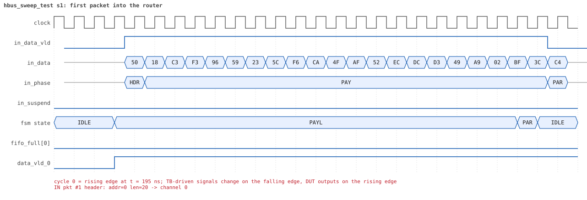
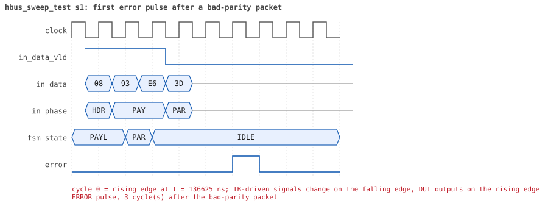

# hbus_sweep_test  seed 1

**Result:** PASSED (0 UVM_ERROR, 0 UVM_WARNING, 0 UVM_FATAL) · bench `yapp_project_tb` · sim time 314us · log `hbus_sweep_test_s1.log`

Waves: `hbus_sweep_test_s1.fst` (GTKWave, Surfer or the VS Code wave viewer); signal trace: `signals.csv`.
[Open the waves in Surfer](https://app.surfer-project.org/?load_url=https%3A%2F%2Fraw.githubusercontent.com%2Ftamirgabgab%2FQcom-Mentoring%2Fmain%2Fyapp_project%2Fregression%2Fyapp_project_tb%2Fhbus_sweep_test_s1%2Fhbus_sweep_test_s1.fst&startup_commands=run_command_file_from_url%20https%3A%2F%2Fraw.githubusercontent.com%2Ftamirgabgab%2FQcom-Mentoring%2Fmain%2Fyapp_project%2Ftb%2Fyapp_router.sucl) (web app, the signals already in groups: `yapp_project/tb/yapp_router.sucl`).

## Summary

- YAPP driver sent **0** packet(s) (0 with bad parity); the input monitor saw 1021.
- Router: **1** forwarded, **1020** dropped (1020 oversized).
- Packets out: ch0 **1**, ch1 **0**, ch2 **0**.
- Scoreboard: 1 matched, 0 mismatched, 0 unexpected.
- Back-pressure: in_suspend asserted **0** time(s).
- Error pulses: 1020.
- HBUS: 1459 write(s), 3628 read(s).

## Stages

| time (ns) | stage |
|---|---|
| 0 | 1. one 20-byte packet to address 0, so yapp_pkt_mem holds known bytes |
| 440 | 2. every address 0x1000..0x100f, registers and holes: write 0x00, 0xff, 0x55, 0xaa, read the window back |
| 32480 | 3. ctrl_reg and en_reg: walking one and walking zero |
| 34120 | 4. yapp_pkt_mem (read-only): write every byte, the reads still return the packet |
| 68040 | 5. the unmapped range 0x1050..0x10ff: the edges and 6 addresses in between, write and read 0 |
| 72280 | 6. yapp_mem: every byte written and read back with 0x00, 0xff, 0x55, 0xaa and a random value |
| 136280 | 7. the counters at 0, in between and at 255: maxpktsize = 1, 2-byte packets with bad parity |
| 136480 | 7.1 en_reg = 0x17: 255 packets to address 0, counters read after 100 and after 255 |
| 181870 | 7.2 en_reg = 0x21: 255 packets to address 1, counters read after 100 and after 255 |
| 225370 | 7.3 en_reg = 0x41: 255 packets to address 2, counters read after 100 and after 255 |
| 269320 | 7.4 en_reg = 0x81: 255 packets to address 3, counters read after 100 and after 255 |
| 313270 | 8. ctrl_reg and en_reg back to their reset values, every register read |
| 313730 | sweep done: 1021 packets, 3628 HBUS reads |
| 314225 | 9. the four HBUS coverage collectors are at 100 % and every read matched the model |
| 314225 | done: 3585 HBUS reads checked against the model, 0 mismatches, 43 memory bytes never written |

## Pictures

**reset and the first cycles**

**first packet into the router**

**first packet out on channel 0**

**first error pulse after a bad-parity packet**

**first HBUS write**

**first HBUS read**

## Timeline

11348 events (the same list is in `timeline.csv`).

| time (ns) | who | event |
|---|---|---|
| 0 | yapp monitor | YAPP monitor running |
| 0 | **test** | STAGE: 1. one 20-byte packet to address 0, so yapp_pkt_mem holds known bytes |
| 0 | clk/rst driver | Starting clock (period 10) and holding reset for 5 cycles |
| 0 | **DUT** | RESET asserted |
| 50 | **DUT** | RESET released: router_en=1 maxpktsize=63 |
| 225 | **DUT** | IN  pkt #1 header: addr=0 len=20 -> channel 0 |
| 265 | **DUT** | OUT ch0 pkt #1 start: addr=0 len=20 (receiver waited 3 cycle(s)) |
| 435 | **DUT** | IN  pkt #1 complete: addr=0 len=20 parity=ok forwarded, 22 bytes in 22 cycles (held 0) |
| 435 | yapp monitor | RX pkt #1 on the input: addr=0 len=20 parity=good gap=17 |
| 435 | reference | Packet forwarded: addr=0 len=20 -> channel 0 |
| 440 | **test** | STAGE: 2. every address 0x1000..0x100f, registers and holes: write 0x00, 0xff, 0x55, 0xaa, read the window back |
| 465 | **DUT** | CONFIG router_en=1 maxpktsize=0 |
| 465 | hbus monitor | Collected WRITE addr=0x1000 data=0x00 |
| 465 | reference | maxpktsize is now 0 |
| 470 | ch0 driver | ch0: packet consumed (response delay 3) |
| 495 | hbus monitor | Collected READ  addr=0x1000 data=0x00 |
| 525 | hbus monitor | Collected READ  addr=0x1001 data=0x01 |
| 555 | hbus monitor | Collected READ  addr=0x1002 data=0x00 |
| 565 | **DUT** | OUT ch0 pkt #1 done: 22 bytes in 31 cycles |
| 565 | ch0 monitor | ch0 RX pkt #1: addr=0 len=20 parity=good |
| 565 | scoreboard | ch0 pkt matched: addr=0 len=20 (1 matched so far) |
| 585 | hbus monitor | Collected READ  addr=0x1003 data=0x00 |
| 615 | hbus monitor | Collected READ  addr=0x1004 data=0x00 |
| 645 | hbus monitor | Collected READ  addr=0x1005 data=0x00 |
| 675 | hbus monitor | Collected READ  addr=0x1006 data=0x00 |
| 705 | hbus monitor | Collected READ  addr=0x1007 data=0x00 |
| 735 | hbus monitor | Collected READ  addr=0x1008 data=0x00 |
| 765 | hbus monitor | Collected READ  addr=0x1009 data=0x00 |
| 795 | hbus monitor | Collected READ  addr=0x100a data=0x00 |
| 825 | hbus monitor | Collected READ  addr=0x100b data=0x00 |
| 855 | hbus monitor | Collected READ  addr=0x100c data=0x00 |
| 885 | hbus monitor | Collected READ  addr=0x100d data=0x14 |
| 915 | hbus monitor | Collected READ  addr=0x100e data=0x00 |
| 945 | hbus monitor | Collected READ  addr=0x100f data=0x00 |
| 965 | **DUT** | CONFIG router_en=1 maxpktsize=63 |
| 965 | hbus monitor | Collected WRITE addr=0x1000 data=0xff |
| 965 | reference | maxpktsize is now 63 |
| 995 | hbus monitor | Collected READ  addr=0x1000 data=0xff |
| 1025 | hbus monitor | Collected READ  addr=0x1001 data=0x01 |
| 1055 | hbus monitor | Collected READ  addr=0x1002 data=0x00 |
| 1060 | ch0 driver | ch0: packet consumed (response delay 8) |
| 1085 | hbus monitor | Collected READ  addr=0x1003 data=0x00 |
| 1115 | hbus monitor | Collected READ  addr=0x1004 data=0x00 |
| 1145 | hbus monitor | Collected READ  addr=0x1005 data=0x00 |
| 1175 | hbus monitor | Collected READ  addr=0x1006 data=0x00 |
| 1205 | hbus monitor | Collected READ  addr=0x1007 data=0x00 |
| 1235 | hbus monitor | Collected READ  addr=0x1008 data=0x00 |
| 1265 | hbus monitor | Collected READ  addr=0x1009 data=0x00 |
| 1295 | hbus monitor | Collected READ  addr=0x100a data=0x00 |
| 1325 | hbus monitor | Collected READ  addr=0x100b data=0x00 |
| 1355 | hbus monitor | Collected READ  addr=0x100c data=0x00 |
| 1385 | hbus monitor | Collected READ  addr=0x100d data=0x14 |
| 1415 | hbus monitor | Collected READ  addr=0x100e data=0x00 |
| 1445 | hbus monitor | Collected READ  addr=0x100f data=0x00 |
| 1465 | **DUT** | CONFIG router_en=1 maxpktsize=21 |
| 1465 | hbus monitor | Collected WRITE addr=0x1000 data=0x55 |
| 1465 | reference | maxpktsize is now 21 |
| 1495 | hbus monitor | Collected READ  addr=0x1000 data=0x55 |
| 1525 | hbus monitor | Collected READ  addr=0x1001 data=0x01 |
| 1555 | hbus monitor | Collected READ  addr=0x1002 data=0x00 |
| 1585 | hbus monitor | Collected READ  addr=0x1003 data=0x00 |
| 1615 | hbus monitor | Collected READ  addr=0x1004 data=0x00 |
| 1645 | hbus monitor | Collected READ  addr=0x1005 data=0x00 |
| 1675 | hbus monitor | Collected READ  addr=0x1006 data=0x00 |
| 1705 | hbus monitor | Collected READ  addr=0x1007 data=0x00 |
| 1735 | hbus monitor | Collected READ  addr=0x1008 data=0x00 |
| 1765 | hbus monitor | Collected READ  addr=0x1009 data=0x00 |
| 1795 | hbus monitor | Collected READ  addr=0x100a data=0x00 |
| 1825 | hbus monitor | Collected READ  addr=0x100b data=0x00 |
| 1855 | hbus monitor | Collected READ  addr=0x100c data=0x00 |
| 1885 | hbus monitor | Collected READ  addr=0x100d data=0x14 |
| 1915 | hbus monitor | Collected READ  addr=0x100e data=0x00 |
| 1945 | hbus monitor | Collected READ  addr=0x100f data=0x00 |
| 1965 | **DUT** | CONFIG router_en=1 maxpktsize=42 |
| 1965 | hbus monitor | Collected WRITE addr=0x1000 data=0xaa |
| 1965 | reference | maxpktsize is now 42 |
| 1995 | hbus monitor | Collected READ  addr=0x1000 data=0xaa |
| 2025 | hbus monitor | Collected READ  addr=0x1001 data=0x01 |
| 2055 | hbus monitor | Collected READ  addr=0x1002 data=0x00 |
| 2085 | hbus monitor | Collected READ  addr=0x1003 data=0x00 |
| 2115 | hbus monitor | Collected READ  addr=0x1004 data=0x00 |
| 2145 | hbus monitor | Collected READ  addr=0x1005 data=0x00 |
| 2175 | hbus monitor | Collected READ  addr=0x1006 data=0x00 |
| 2205 | hbus monitor | Collected READ  addr=0x1007 data=0x00 |
| 2235 | hbus monitor | Collected READ  addr=0x1008 data=0x00 |
| 2265 | hbus monitor | Collected READ  addr=0x1009 data=0x00 |
| 2295 | hbus monitor | Collected READ  addr=0x100a data=0x00 |
| 2325 | hbus monitor | Collected READ  addr=0x100b data=0x00 |
| 2355 | hbus monitor | Collected READ  addr=0x100c data=0x00 |
| 2385 | hbus monitor | Collected READ  addr=0x100d data=0x14 |
| 2415 | hbus monitor | Collected READ  addr=0x100e data=0x00 |
| 2445 | hbus monitor | Collected READ  addr=0x100f data=0x00 |
| 2465 | **DUT** | CONFIG router_en=0 maxpktsize=42 |
| 2465 | hbus monitor | Collected WRITE addr=0x1001 data=0x00 |
| 2465 | reference | router_en is now 0 (en_reg 0x00) |
| 2495 | hbus monitor | Collected READ  addr=0x1000 data=0xaa |
| 2525 | hbus monitor | Collected READ  addr=0x1001 data=0x00 |
| 2555 | hbus monitor | Collected READ  addr=0x1002 data=0x00 |
| 2585 | hbus monitor | Collected READ  addr=0x1003 data=0x00 |
| 2615 | hbus monitor | Collected READ  addr=0x1004 data=0x00 |
| 2645 | hbus monitor | Collected READ  addr=0x1005 data=0x00 |
| 2675 | hbus monitor | Collected READ  addr=0x1006 data=0x00 |
| 2705 | hbus monitor | Collected READ  addr=0x1007 data=0x00 |
| 2735 | hbus monitor | Collected READ  addr=0x1008 data=0x00 |
| 2765 | hbus monitor | Collected READ  addr=0x1009 data=0x00 |
| 2795 | hbus monitor | Collected READ  addr=0x100a data=0x00 |
| 2825 | hbus monitor | Collected READ  addr=0x100b data=0x00 |
| 2855 | hbus monitor | Collected READ  addr=0x100c data=0x00 |
| 2885 | hbus monitor | Collected READ  addr=0x100d data=0x14 |
| 2915 | hbus monitor | Collected READ  addr=0x100e data=0x00 |
| 2945 | hbus monitor | Collected READ  addr=0x100f data=0x00 |
| 2965 | **DUT** | CONFIG router_en=1 maxpktsize=42 |
| 2965 | hbus monitor | Collected WRITE addr=0x1001 data=0xff |
| 2965 | reference | router_en is now 1 (en_reg 0xff) |
| 2995 | hbus monitor | Collected READ  addr=0x1000 data=0xaa |
| 3025 | hbus monitor | Collected READ  addr=0x1001 data=0xff |
| 3055 | hbus monitor | Collected READ  addr=0x1002 data=0x00 |
| 3085 | hbus monitor | Collected READ  addr=0x1003 data=0x00 |
| 3115 | hbus monitor | Collected READ  addr=0x1004 data=0x00 |
| 3145 | hbus monitor | Collected READ  addr=0x1005 data=0x00 |
| 3175 | hbus monitor | Collected READ  addr=0x1006 data=0x00 |
| 3205 | hbus monitor | Collected READ  addr=0x1007 data=0x00 |
| 3235 | hbus monitor | Collected READ  addr=0x1008 data=0x00 |
| 3265 | hbus monitor | Collected READ  addr=0x1009 data=0x00 |
| 3295 | hbus monitor | Collected READ  addr=0x100a data=0x00 |
| 3325 | hbus monitor | Collected READ  addr=0x100b data=0x00 |
| 3355 | hbus monitor | Collected READ  addr=0x100c data=0x00 |
| 3385 | hbus monitor | Collected READ  addr=0x100d data=0x14 |
| 3415 | hbus monitor | Collected READ  addr=0x100e data=0x00 |
| 3445 | hbus monitor | Collected READ  addr=0x100f data=0x00 |
| 3465 | hbus monitor | Collected WRITE addr=0x1001 data=0x55 |
| 3465 | reference | router_en is now 1 (en_reg 0x55) |
| 3495 | hbus monitor | Collected READ  addr=0x1000 data=0xaa |
| 3525 | hbus monitor | Collected READ  addr=0x1001 data=0x55 |
| 3555 | hbus monitor | Collected READ  addr=0x1002 data=0x00 |
| 3585 | hbus monitor | Collected READ  addr=0x1003 data=0x00 |
| 3615 | hbus monitor | Collected READ  addr=0x1004 data=0x00 |
| 3645 | hbus monitor | Collected READ  addr=0x1005 data=0x00 |
| 3675 | hbus monitor | Collected READ  addr=0x1006 data=0x00 |
| 3705 | hbus monitor | Collected READ  addr=0x1007 data=0x00 |
| 3735 | hbus monitor | Collected READ  addr=0x1008 data=0x00 |
| 3765 | hbus monitor | Collected READ  addr=0x1009 data=0x00 |
| 3795 | hbus monitor | Collected READ  addr=0x100a data=0x00 |
| 3825 | hbus monitor | Collected READ  addr=0x100b data=0x00 |
| 3855 | hbus monitor | Collected READ  addr=0x100c data=0x00 |
| 3885 | hbus monitor | Collected READ  addr=0x100d data=0x14 |
| 3915 | hbus monitor | Collected READ  addr=0x100e data=0x00 |
| 3945 | hbus monitor | Collected READ  addr=0x100f data=0x00 |
| 3965 | **DUT** | CONFIG router_en=0 maxpktsize=42 |
| 3965 | hbus monitor | Collected WRITE addr=0x1001 data=0xaa |
| 3965 | reference | router_en is now 0 (en_reg 0xaa) |
| 3995 | hbus monitor | Collected READ  addr=0x1000 data=0xaa |
| 4025 | hbus monitor | Collected READ  addr=0x1001 data=0xaa |
| 4055 | hbus monitor | Collected READ  addr=0x1002 data=0x00 |
| 4085 | hbus monitor | Collected READ  addr=0x1003 data=0x00 |
| 4115 | hbus monitor | Collected READ  addr=0x1004 data=0x00 |
| 4145 | hbus monitor | Collected READ  addr=0x1005 data=0x00 |
| 4175 | hbus monitor | Collected READ  addr=0x1006 data=0x00 |
| 4205 | hbus monitor | Collected READ  addr=0x1007 data=0x00 |
| 4235 | hbus monitor | Collected READ  addr=0x1008 data=0x00 |
| 4265 | hbus monitor | Collected READ  addr=0x1009 data=0x00 |
| 4295 | hbus monitor | Collected READ  addr=0x100a data=0x00 |
| 4325 | hbus monitor | Collected READ  addr=0x100b data=0x00 |
| 4355 | hbus monitor | Collected READ  addr=0x100c data=0x00 |
| 4385 | hbus monitor | Collected READ  addr=0x100d data=0x14 |
| 4415 | hbus monitor | Collected READ  addr=0x100e data=0x00 |
| 4445 | hbus monitor | Collected READ  addr=0x100f data=0x00 |
| 4465 | hbus monitor | Collected WRITE addr=0x1002 data=0x00 |
| 4495 | hbus monitor | Collected READ  addr=0x1000 data=0xaa |
| 4525 | hbus monitor | Collected READ  addr=0x1001 data=0xaa |
| 4555 | hbus monitor | Collected READ  addr=0x1002 data=0x00 |
| 4585 | hbus monitor | Collected READ  addr=0x1003 data=0x00 |
| 4615 | hbus monitor | Collected READ  addr=0x1004 data=0x00 |
| 4645 | hbus monitor | Collected READ  addr=0x1005 data=0x00 |
| 4675 | hbus monitor | Collected READ  addr=0x1006 data=0x00 |
| 4705 | hbus monitor | Collected READ  addr=0x1007 data=0x00 |
| 4735 | hbus monitor | Collected READ  addr=0x1008 data=0x00 |
| 4765 | hbus monitor | Collected READ  addr=0x1009 data=0x00 |
| 4795 | hbus monitor | Collected READ  addr=0x100a data=0x00 |
| 4825 | hbus monitor | Collected READ  addr=0x100b data=0x00 |
| 4855 | hbus monitor | Collected READ  addr=0x100c data=0x00 |
| 4885 | hbus monitor | Collected READ  addr=0x100d data=0x14 |
| 4915 | hbus monitor | Collected READ  addr=0x100e data=0x00 |
| 4945 | hbus monitor | Collected READ  addr=0x100f data=0x00 |
| 4965 | hbus monitor | Collected WRITE addr=0x1002 data=0xff |
| 4995 | hbus monitor | Collected READ  addr=0x1000 data=0xaa |
| 5025 | hbus monitor | Collected READ  addr=0x1001 data=0xaa |
| 5055 | hbus monitor | Collected READ  addr=0x1002 data=0x00 |
| 5085 | hbus monitor | Collected READ  addr=0x1003 data=0x00 |
| 5115 | hbus monitor | Collected READ  addr=0x1004 data=0x00 |
| 5145 | hbus monitor | Collected READ  addr=0x1005 data=0x00 |
| 5175 | hbus monitor | Collected READ  addr=0x1006 data=0x00 |
| 5205 | hbus monitor | Collected READ  addr=0x1007 data=0x00 |
| 5235 | hbus monitor | Collected READ  addr=0x1008 data=0x00 |
| 5265 | hbus monitor | Collected READ  addr=0x1009 data=0x00 |
| 5295 | hbus monitor | Collected READ  addr=0x100a data=0x00 |
| 5325 | hbus monitor | Collected READ  addr=0x100b data=0x00 |
| 5355 | hbus monitor | Collected READ  addr=0x100c data=0x00 |
| 5385 | hbus monitor | Collected READ  addr=0x100d data=0x14 |
| 5415 | hbus monitor | Collected READ  addr=0x100e data=0x00 |
| 5445 | hbus monitor | Collected READ  addr=0x100f data=0x00 |
| 5465 | hbus monitor | Collected WRITE addr=0x1002 data=0x55 |
| 5495 | hbus monitor | Collected READ  addr=0x1000 data=0xaa |
| 5525 | hbus monitor | Collected READ  addr=0x1001 data=0xaa |
| 5555 | hbus monitor | Collected READ  addr=0x1002 data=0x00 |
| 5585 | hbus monitor | Collected READ  addr=0x1003 data=0x00 |
| 5615 | hbus monitor | Collected READ  addr=0x1004 data=0x00 |
| 5645 | hbus monitor | Collected READ  addr=0x1005 data=0x00 |
| 5675 | hbus monitor | Collected READ  addr=0x1006 data=0x00 |
| 5705 | hbus monitor | Collected READ  addr=0x1007 data=0x00 |
| 5735 | hbus monitor | Collected READ  addr=0x1008 data=0x00 |
| 5765 | hbus monitor | Collected READ  addr=0x1009 data=0x00 |
| 5795 | hbus monitor | Collected READ  addr=0x100a data=0x00 |
| 5825 | hbus monitor | Collected READ  addr=0x100b data=0x00 |
| 5855 | hbus monitor | Collected READ  addr=0x100c data=0x00 |
| 5885 | hbus monitor | Collected READ  addr=0x100d data=0x14 |
| 5915 | hbus monitor | Collected READ  addr=0x100e data=0x00 |
| 5945 | hbus monitor | Collected READ  addr=0x100f data=0x00 |
| 5965 | hbus monitor | Collected WRITE addr=0x1002 data=0xaa |
| 5995 | hbus monitor | Collected READ  addr=0x1000 data=0xaa |
| 6025 | hbus monitor | Collected READ  addr=0x1001 data=0xaa |
| 6055 | hbus monitor | Collected READ  addr=0x1002 data=0x00 |
| 6085 | hbus monitor | Collected READ  addr=0x1003 data=0x00 |
| 6115 | hbus monitor | Collected READ  addr=0x1004 data=0x00 |
| 6145 | hbus monitor | Collected READ  addr=0x1005 data=0x00 |
| 6175 | hbus monitor | Collected READ  addr=0x1006 data=0x00 |
| 6205 | hbus monitor | Collected READ  addr=0x1007 data=0x00 |
| 6235 | hbus monitor | Collected READ  addr=0x1008 data=0x00 |
| 6265 | hbus monitor | Collected READ  addr=0x1009 data=0x00 |
| 6295 | hbus monitor | Collected READ  addr=0x100a data=0x00 |
| 6325 | hbus monitor | Collected READ  addr=0x100b data=0x00 |
| 6355 | hbus monitor | Collected READ  addr=0x100c data=0x00 |
| 6385 | hbus monitor | Collected READ  addr=0x100d data=0x14 |
| 6415 | hbus monitor | Collected READ  addr=0x100e data=0x00 |
| 6445 | hbus monitor | Collected READ  addr=0x100f data=0x00 |
| 6465 | hbus monitor | Collected WRITE addr=0x1003 data=0x00 |
| 6495 | hbus monitor | Collected READ  addr=0x1000 data=0xaa |
| 6525 | hbus monitor | Collected READ  addr=0x1001 data=0xaa |
| 6555 | hbus monitor | Collected READ  addr=0x1002 data=0x00 |
| 6585 | hbus monitor | Collected READ  addr=0x1003 data=0x00 |
| 6615 | hbus monitor | Collected READ  addr=0x1004 data=0x00 |
| 6645 | hbus monitor | Collected READ  addr=0x1005 data=0x00 |
| 6675 | hbus monitor | Collected READ  addr=0x1006 data=0x00 |
| 6705 | hbus monitor | Collected READ  addr=0x1007 data=0x00 |
| 6735 | hbus monitor | Collected READ  addr=0x1008 data=0x00 |
| 6765 | hbus monitor | Collected READ  addr=0x1009 data=0x00 |
| 6795 | hbus monitor | Collected READ  addr=0x100a data=0x00 |
| 6825 | hbus monitor | Collected READ  addr=0x100b data=0x00 |
| 6855 | hbus monitor | Collected READ  addr=0x100c data=0x00 |
| 6885 | hbus monitor | Collected READ  addr=0x100d data=0x14 |
| 6915 | hbus monitor | Collected READ  addr=0x100e data=0x00 |
| 6945 | hbus monitor | Collected READ  addr=0x100f data=0x00 |
| 6965 | hbus monitor | Collected WRITE addr=0x1003 data=0xff |
| 6995 | hbus monitor | Collected READ  addr=0x1000 data=0xaa |
| 7025 | hbus monitor | Collected READ  addr=0x1001 data=0xaa |
| 7055 | hbus monitor | Collected READ  addr=0x1002 data=0x00 |
| 7085 | hbus monitor | Collected READ  addr=0x1003 data=0x00 |
| 7115 | hbus monitor | Collected READ  addr=0x1004 data=0x00 |
| 7145 | hbus monitor | Collected READ  addr=0x1005 data=0x00 |
| 7175 | hbus monitor | Collected READ  addr=0x1006 data=0x00 |
| 7205 | hbus monitor | Collected READ  addr=0x1007 data=0x00 |
| 7235 | hbus monitor | Collected READ  addr=0x1008 data=0x00 |
| 7265 | hbus monitor | Collected READ  addr=0x1009 data=0x00 |
| 7295 | hbus monitor | Collected READ  addr=0x100a data=0x00 |
| 7325 | hbus monitor | Collected READ  addr=0x100b data=0x00 |
| 7355 | hbus monitor | Collected READ  addr=0x100c data=0x00 |
| 7385 | hbus monitor | Collected READ  addr=0x100d data=0x14 |
| 7415 | hbus monitor | Collected READ  addr=0x100e data=0x00 |
| 7445 | hbus monitor | Collected READ  addr=0x100f data=0x00 |
| 7465 | hbus monitor | Collected WRITE addr=0x1003 data=0x55 |
| 7495 | hbus monitor | Collected READ  addr=0x1000 data=0xaa |
| 7525 | hbus monitor | Collected READ  addr=0x1001 data=0xaa |
| 7555 | hbus monitor | Collected READ  addr=0x1002 data=0x00 |
| 7585 | hbus monitor | Collected READ  addr=0x1003 data=0x00 |
| 7615 | hbus monitor | Collected READ  addr=0x1004 data=0x00 |
| 7645 | hbus monitor | Collected READ  addr=0x1005 data=0x00 |
| 7675 | hbus monitor | Collected READ  addr=0x1006 data=0x00 |
| 7705 | hbus monitor | Collected READ  addr=0x1007 data=0x00 |
| 7735 | hbus monitor | Collected READ  addr=0x1008 data=0x00 |
| 7765 | hbus monitor | Collected READ  addr=0x1009 data=0x00 |
| 7795 | hbus monitor | Collected READ  addr=0x100a data=0x00 |
| 7825 | hbus monitor | Collected READ  addr=0x100b data=0x00 |
| 7855 | hbus monitor | Collected READ  addr=0x100c data=0x00 |
| 7885 | hbus monitor | Collected READ  addr=0x100d data=0x14 |
| 7915 | hbus monitor | Collected READ  addr=0x100e data=0x00 |
| 7945 | hbus monitor | Collected READ  addr=0x100f data=0x00 |
| 7965 | hbus monitor | Collected WRITE addr=0x1003 data=0xaa |
| 7995 | hbus monitor | Collected READ  addr=0x1000 data=0xaa |
| 8025 | hbus monitor | Collected READ  addr=0x1001 data=0xaa |
| 8055 | hbus monitor | Collected READ  addr=0x1002 data=0x00 |
| 8085 | hbus monitor | Collected READ  addr=0x1003 data=0x00 |
| 8115 | hbus monitor | Collected READ  addr=0x1004 data=0x00 |
| 8145 | hbus monitor | Collected READ  addr=0x1005 data=0x00 |
| 8175 | hbus monitor | Collected READ  addr=0x1006 data=0x00 |
| 8205 | hbus monitor | Collected READ  addr=0x1007 data=0x00 |
| 8235 | hbus monitor | Collected READ  addr=0x1008 data=0x00 |
| 8265 | hbus monitor | Collected READ  addr=0x1009 data=0x00 |
| 8295 | hbus monitor | Collected READ  addr=0x100a data=0x00 |
| 8325 | hbus monitor | Collected READ  addr=0x100b data=0x00 |
| 8355 | hbus monitor | Collected READ  addr=0x100c data=0x00 |
| 8385 | hbus monitor | Collected READ  addr=0x100d data=0x14 |
| 8415 | hbus monitor | Collected READ  addr=0x100e data=0x00 |
| 8445 | hbus monitor | Collected READ  addr=0x100f data=0x00 |
| 8465 | hbus monitor | Collected WRITE addr=0x1004 data=0x00 |
| 8495 | hbus monitor | Collected READ  addr=0x1000 data=0xaa |
| 8525 | hbus monitor | Collected READ  addr=0x1001 data=0xaa |
| 8555 | hbus monitor | Collected READ  addr=0x1002 data=0x00 |
| 8585 | hbus monitor | Collected READ  addr=0x1003 data=0x00 |
| 8615 | hbus monitor | Collected READ  addr=0x1004 data=0x00 |
| 8645 | hbus monitor | Collected READ  addr=0x1005 data=0x00 |
| 8675 | hbus monitor | Collected READ  addr=0x1006 data=0x00 |
| 8705 | hbus monitor | Collected READ  addr=0x1007 data=0x00 |
| 8735 | hbus monitor | Collected READ  addr=0x1008 data=0x00 |
| 8765 | hbus monitor | Collected READ  addr=0x1009 data=0x00 |
| 8795 | hbus monitor | Collected READ  addr=0x100a data=0x00 |
| 8825 | hbus monitor | Collected READ  addr=0x100b data=0x00 |
| 8855 | hbus monitor | Collected READ  addr=0x100c data=0x00 |
| 8885 | hbus monitor | Collected READ  addr=0x100d data=0x14 |
| 8915 | hbus monitor | Collected READ  addr=0x100e data=0x00 |
| 8945 | hbus monitor | Collected READ  addr=0x100f data=0x00 |
| 8965 | hbus monitor | Collected WRITE addr=0x1004 data=0xff |
| 8995 | hbus monitor | Collected READ  addr=0x1000 data=0xaa |
| 9025 | hbus monitor | Collected READ  addr=0x1001 data=0xaa |
| 9055 | hbus monitor | Collected READ  addr=0x1002 data=0x00 |
| 9085 | hbus monitor | Collected READ  addr=0x1003 data=0x00 |
| 9115 | hbus monitor | Collected READ  addr=0x1004 data=0x00 |
| 9145 | hbus monitor | Collected READ  addr=0x1005 data=0x00 |
| 9175 | hbus monitor | Collected READ  addr=0x1006 data=0x00 |
| 9205 | hbus monitor | Collected READ  addr=0x1007 data=0x00 |
| 9235 | hbus monitor | Collected READ  addr=0x1008 data=0x00 |
| 9265 | hbus monitor | Collected READ  addr=0x1009 data=0x00 |
| 9295 | hbus monitor | Collected READ  addr=0x100a data=0x00 |
| 9325 | hbus monitor | Collected READ  addr=0x100b data=0x00 |
| 9355 | hbus monitor | Collected READ  addr=0x100c data=0x00 |
| 9385 | hbus monitor | Collected READ  addr=0x100d data=0x14 |
| 9415 | hbus monitor | Collected READ  addr=0x100e data=0x00 |
| 9445 | hbus monitor | Collected READ  addr=0x100f data=0x00 |
| 9465 | hbus monitor | Collected WRITE addr=0x1004 data=0x55 |
| 9495 | hbus monitor | Collected READ  addr=0x1000 data=0xaa |
| 9525 | hbus monitor | Collected READ  addr=0x1001 data=0xaa |
| 9555 | hbus monitor | Collected READ  addr=0x1002 data=0x00 |
| 9585 | hbus monitor | Collected READ  addr=0x1003 data=0x00 |
| 9615 | hbus monitor | Collected READ  addr=0x1004 data=0x00 |
| 9645 | hbus monitor | Collected READ  addr=0x1005 data=0x00 |
| 9675 | hbus monitor | Collected READ  addr=0x1006 data=0x00 |
| 9705 | hbus monitor | Collected READ  addr=0x1007 data=0x00 |
| 9735 | hbus monitor | Collected READ  addr=0x1008 data=0x00 |
| 9765 | hbus monitor | Collected READ  addr=0x1009 data=0x00 |
| 9795 | hbus monitor | Collected READ  addr=0x100a data=0x00 |
| 9825 | hbus monitor | Collected READ  addr=0x100b data=0x00 |
| 9855 | hbus monitor | Collected READ  addr=0x100c data=0x00 |
| 9885 | hbus monitor | Collected READ  addr=0x100d data=0x14 |
| 9915 | hbus monitor | Collected READ  addr=0x100e data=0x00 |
| 9945 | hbus monitor | Collected READ  addr=0x100f data=0x00 |
| 9965 | hbus monitor | Collected WRITE addr=0x1004 data=0xaa |
| 9995 | hbus monitor | Collected READ  addr=0x1000 data=0xaa |
| 10025 | hbus monitor | Collected READ  addr=0x1001 data=0xaa |
| 10055 | hbus monitor | Collected READ  addr=0x1002 data=0x00 |
| 10085 | hbus monitor | Collected READ  addr=0x1003 data=0x00 |
| 10115 | hbus monitor | Collected READ  addr=0x1004 data=0x00 |
| 10145 | hbus monitor | Collected READ  addr=0x1005 data=0x00 |
| 10175 | hbus monitor | Collected READ  addr=0x1006 data=0x00 |
| 10205 | hbus monitor | Collected READ  addr=0x1007 data=0x00 |
| 10235 | hbus monitor | Collected READ  addr=0x1008 data=0x00 |
| 10265 | hbus monitor | Collected READ  addr=0x1009 data=0x00 |
| 10295 | hbus monitor | Collected READ  addr=0x100a data=0x00 |
| 10325 | hbus monitor | Collected READ  addr=0x100b data=0x00 |
| 10355 | hbus monitor | Collected READ  addr=0x100c data=0x00 |
| 10385 | hbus monitor | Collected READ  addr=0x100d data=0x14 |
| 10415 | hbus monitor | Collected READ  addr=0x100e data=0x00 |
| 10445 | hbus monitor | Collected READ  addr=0x100f data=0x00 |
| 10465 | hbus monitor | Collected WRITE addr=0x1005 data=0x00 |
| 10495 | hbus monitor | Collected READ  addr=0x1000 data=0xaa |
| 10525 | hbus monitor | Collected READ  addr=0x1001 data=0xaa |
| 10555 | hbus monitor | Collected READ  addr=0x1002 data=0x00 |
| 10585 | hbus monitor | Collected READ  addr=0x1003 data=0x00 |
| 10615 | hbus monitor | Collected READ  addr=0x1004 data=0x00 |
| 10645 | hbus monitor | Collected READ  addr=0x1005 data=0x00 |
| 10675 | hbus monitor | Collected READ  addr=0x1006 data=0x00 |
| 10705 | hbus monitor | Collected READ  addr=0x1007 data=0x00 |
| 10735 | hbus monitor | Collected READ  addr=0x1008 data=0x00 |
| 10765 | hbus monitor | Collected READ  addr=0x1009 data=0x00 |
| 10795 | hbus monitor | Collected READ  addr=0x100a data=0x00 |
| 10825 | hbus monitor | Collected READ  addr=0x100b data=0x00 |
| 10855 | hbus monitor | Collected READ  addr=0x100c data=0x00 |
| 10885 | hbus monitor | Collected READ  addr=0x100d data=0x14 |
| 10915 | hbus monitor | Collected READ  addr=0x100e data=0x00 |
| 10945 | hbus monitor | Collected READ  addr=0x100f data=0x00 |
| 10965 | hbus monitor | Collected WRITE addr=0x1005 data=0xff |
| 10995 | hbus monitor | Collected READ  addr=0x1000 data=0xaa |
| 11025 | hbus monitor | Collected READ  addr=0x1001 data=0xaa |
| 11055 | hbus monitor | Collected READ  addr=0x1002 data=0x00 |
| 11085 | hbus monitor | Collected READ  addr=0x1003 data=0x00 |
| 11115 | hbus monitor | Collected READ  addr=0x1004 data=0x00 |
| 11145 | hbus monitor | Collected READ  addr=0x1005 data=0x00 |
| 11175 | hbus monitor | Collected READ  addr=0x1006 data=0x00 |
| 11205 | hbus monitor | Collected READ  addr=0x1007 data=0x00 |
| 11235 | hbus monitor | Collected READ  addr=0x1008 data=0x00 |
| 11265 | hbus monitor | Collected READ  addr=0x1009 data=0x00 |
| 11295 | hbus monitor | Collected READ  addr=0x100a data=0x00 |
| 11325 | hbus monitor | Collected READ  addr=0x100b data=0x00 |
| 11355 | hbus monitor | Collected READ  addr=0x100c data=0x00 |
| 11385 | hbus monitor | Collected READ  addr=0x100d data=0x14 |
| 11415 | hbus monitor | Collected READ  addr=0x100e data=0x00 |
| 11445 | hbus monitor | Collected READ  addr=0x100f data=0x00 |
| 11465 | hbus monitor | Collected WRITE addr=0x1005 data=0x55 |
| 11495 | hbus monitor | Collected READ  addr=0x1000 data=0xaa |
| 11525 | hbus monitor | Collected READ  addr=0x1001 data=0xaa |
| 11555 | hbus monitor | Collected READ  addr=0x1002 data=0x00 |
| 11585 | hbus monitor | Collected READ  addr=0x1003 data=0x00 |
| 11615 | hbus monitor | Collected READ  addr=0x1004 data=0x00 |
| 11645 | hbus monitor | Collected READ  addr=0x1005 data=0x00 |
| 11675 | hbus monitor | Collected READ  addr=0x1006 data=0x00 |
| 11705 | hbus monitor | Collected READ  addr=0x1007 data=0x00 |
| 11735 | hbus monitor | Collected READ  addr=0x1008 data=0x00 |
| 11765 | hbus monitor | Collected READ  addr=0x1009 data=0x00 |
| 11795 | hbus monitor | Collected READ  addr=0x100a data=0x00 |
| 11825 | hbus monitor | Collected READ  addr=0x100b data=0x00 |
| 11855 | hbus monitor | Collected READ  addr=0x100c data=0x00 |
| 11885 | hbus monitor | Collected READ  addr=0x100d data=0x14 |
| 11915 | hbus monitor | Collected READ  addr=0x100e data=0x00 |
| 11945 | hbus monitor | Collected READ  addr=0x100f data=0x00 |
| 11965 | hbus monitor | Collected WRITE addr=0x1005 data=0xaa |
| 11995 | hbus monitor | Collected READ  addr=0x1000 data=0xaa |
| 12025 | hbus monitor | Collected READ  addr=0x1001 data=0xaa |
| 12055 | hbus monitor | Collected READ  addr=0x1002 data=0x00 |
| 12085 | hbus monitor | Collected READ  addr=0x1003 data=0x00 |
| 12115 | hbus monitor | Collected READ  addr=0x1004 data=0x00 |
| 12145 | hbus monitor | Collected READ  addr=0x1005 data=0x00 |
| 12175 | hbus monitor | Collected READ  addr=0x1006 data=0x00 |
| 12205 | hbus monitor | Collected READ  addr=0x1007 data=0x00 |
| 12235 | hbus monitor | Collected READ  addr=0x1008 data=0x00 |
| 12265 | hbus monitor | Collected READ  addr=0x1009 data=0x00 |
| 12295 | hbus monitor | Collected READ  addr=0x100a data=0x00 |
| 12325 | hbus monitor | Collected READ  addr=0x100b data=0x00 |
| 12355 | hbus monitor | Collected READ  addr=0x100c data=0x00 |
| 12385 | hbus monitor | Collected READ  addr=0x100d data=0x14 |
| 12415 | hbus monitor | Collected READ  addr=0x100e data=0x00 |
| 12445 | hbus monitor | Collected READ  addr=0x100f data=0x00 |
| 12465 | hbus monitor | Collected WRITE addr=0x1006 data=0x00 |
| 12495 | hbus monitor | Collected READ  addr=0x1000 data=0xaa |
| 12525 | hbus monitor | Collected READ  addr=0x1001 data=0xaa |
| 12555 | hbus monitor | Collected READ  addr=0x1002 data=0x00 |
| 12585 | hbus monitor | Collected READ  addr=0x1003 data=0x00 |
| 12615 | hbus monitor | Collected READ  addr=0x1004 data=0x00 |
| 12645 | hbus monitor | Collected READ  addr=0x1005 data=0x00 |
| 12675 | hbus monitor | Collected READ  addr=0x1006 data=0x00 |
| 12705 | hbus monitor | Collected READ  addr=0x1007 data=0x00 |
| 12735 | hbus monitor | Collected READ  addr=0x1008 data=0x00 |
| 12765 | hbus monitor | Collected READ  addr=0x1009 data=0x00 |
| 12795 | hbus monitor | Collected READ  addr=0x100a data=0x00 |
| 12825 | hbus monitor | Collected READ  addr=0x100b data=0x00 |
| 12855 | hbus monitor | Collected READ  addr=0x100c data=0x00 |
| 12885 | hbus monitor | Collected READ  addr=0x100d data=0x14 |
| 12915 | hbus monitor | Collected READ  addr=0x100e data=0x00 |
| 12945 | hbus monitor | Collected READ  addr=0x100f data=0x00 |
| 12965 | hbus monitor | Collected WRITE addr=0x1006 data=0xff |
| 12995 | hbus monitor | Collected READ  addr=0x1000 data=0xaa |
| 13025 | hbus monitor | Collected READ  addr=0x1001 data=0xaa |
| 13055 | hbus monitor | Collected READ  addr=0x1002 data=0x00 |
| 13085 | hbus monitor | Collected READ  addr=0x1003 data=0x00 |
| 13115 | hbus monitor | Collected READ  addr=0x1004 data=0x00 |
| 13145 | hbus monitor | Collected READ  addr=0x1005 data=0x00 |
| 13175 | hbus monitor | Collected READ  addr=0x1006 data=0x00 |
| 13205 | hbus monitor | Collected READ  addr=0x1007 data=0x00 |
| 13235 | hbus monitor | Collected READ  addr=0x1008 data=0x00 |
| 13265 | hbus monitor | Collected READ  addr=0x1009 data=0x00 |
| 13295 | hbus monitor | Collected READ  addr=0x100a data=0x00 |
| 13325 | hbus monitor | Collected READ  addr=0x100b data=0x00 |
| 13355 | hbus monitor | Collected READ  addr=0x100c data=0x00 |
| 13385 | hbus monitor | Collected READ  addr=0x100d data=0x14 |
| 13415 | hbus monitor | Collected READ  addr=0x100e data=0x00 |
| 13445 | hbus monitor | Collected READ  addr=0x100f data=0x00 |
| 13465 | hbus monitor | Collected WRITE addr=0x1006 data=0x55 |
| 13495 | hbus monitor | Collected READ  addr=0x1000 data=0xaa |
| 13525 | hbus monitor | Collected READ  addr=0x1001 data=0xaa |
| 13555 | hbus monitor | Collected READ  addr=0x1002 data=0x00 |
| 13585 | hbus monitor | Collected READ  addr=0x1003 data=0x00 |
| 13615 | hbus monitor | Collected READ  addr=0x1004 data=0x00 |
| 13645 | hbus monitor | Collected READ  addr=0x1005 data=0x00 |
| 13675 | hbus monitor | Collected READ  addr=0x1006 data=0x00 |
| 13705 | hbus monitor | Collected READ  addr=0x1007 data=0x00 |
| 13735 | hbus monitor | Collected READ  addr=0x1008 data=0x00 |
| 13765 | hbus monitor | Collected READ  addr=0x1009 data=0x00 |
| 13795 | hbus monitor | Collected READ  addr=0x100a data=0x00 |
| 13825 | hbus monitor | Collected READ  addr=0x100b data=0x00 |
| 13855 | hbus monitor | Collected READ  addr=0x100c data=0x00 |
| 13885 | hbus monitor | Collected READ  addr=0x100d data=0x14 |
| 13915 | hbus monitor | Collected READ  addr=0x100e data=0x00 |
| 13945 | hbus monitor | Collected READ  addr=0x100f data=0x00 |
| 13965 | hbus monitor | Collected WRITE addr=0x1006 data=0xaa |
| 13995 | hbus monitor | Collected READ  addr=0x1000 data=0xaa |
| 14025 | hbus monitor | Collected READ  addr=0x1001 data=0xaa |
| 14055 | hbus monitor | Collected READ  addr=0x1002 data=0x00 |
| 14085 | hbus monitor | Collected READ  addr=0x1003 data=0x00 |
| 14115 | hbus monitor | Collected READ  addr=0x1004 data=0x00 |
| 14145 | hbus monitor | Collected READ  addr=0x1005 data=0x00 |
| 14175 | hbus monitor | Collected READ  addr=0x1006 data=0x00 |
| 14205 | hbus monitor | Collected READ  addr=0x1007 data=0x00 |
| 14235 | hbus monitor | Collected READ  addr=0x1008 data=0x00 |
| 14265 | hbus monitor | Collected READ  addr=0x1009 data=0x00 |
| 14295 | hbus monitor | Collected READ  addr=0x100a data=0x00 |
| 14325 | hbus monitor | Collected READ  addr=0x100b data=0x00 |
| 14355 | hbus monitor | Collected READ  addr=0x100c data=0x00 |
| 14385 | hbus monitor | Collected READ  addr=0x100d data=0x14 |
| 14415 | hbus monitor | Collected READ  addr=0x100e data=0x00 |
| 14445 | hbus monitor | Collected READ  addr=0x100f data=0x00 |
| 14465 | hbus monitor | Collected WRITE addr=0x1007 data=0x00 |
| 14495 | hbus monitor | Collected READ  addr=0x1000 data=0xaa |
| 14525 | hbus monitor | Collected READ  addr=0x1001 data=0xaa |
| 14555 | hbus monitor | Collected READ  addr=0x1002 data=0x00 |
| 14585 | hbus monitor | Collected READ  addr=0x1003 data=0x00 |
| 14615 | hbus monitor | Collected READ  addr=0x1004 data=0x00 |
| 14645 | hbus monitor | Collected READ  addr=0x1005 data=0x00 |
| 14675 | hbus monitor | Collected READ  addr=0x1006 data=0x00 |
| 14705 | hbus monitor | Collected READ  addr=0x1007 data=0x00 |
| 14735 | hbus monitor | Collected READ  addr=0x1008 data=0x00 |
| 14765 | hbus monitor | Collected READ  addr=0x1009 data=0x00 |
| 14795 | hbus monitor | Collected READ  addr=0x100a data=0x00 |
| 14825 | hbus monitor | Collected READ  addr=0x100b data=0x00 |
| 14855 | hbus monitor | Collected READ  addr=0x100c data=0x00 |
| 14885 | hbus monitor | Collected READ  addr=0x100d data=0x14 |
| 14915 | hbus monitor | Collected READ  addr=0x100e data=0x00 |
| 14945 | hbus monitor | Collected READ  addr=0x100f data=0x00 |
| 14965 | hbus monitor | Collected WRITE addr=0x1007 data=0xff |
| 14995 | hbus monitor | Collected READ  addr=0x1000 data=0xaa |
| 15025 | hbus monitor | Collected READ  addr=0x1001 data=0xaa |
| 15055 | hbus monitor | Collected READ  addr=0x1002 data=0x00 |
| 15085 | hbus monitor | Collected READ  addr=0x1003 data=0x00 |
| 15115 | hbus monitor | Collected READ  addr=0x1004 data=0x00 |
| 15145 | hbus monitor | Collected READ  addr=0x1005 data=0x00 |
| 15175 | hbus monitor | Collected READ  addr=0x1006 data=0x00 |
| 15205 | hbus monitor | Collected READ  addr=0x1007 data=0x00 |
| 15235 | hbus monitor | Collected READ  addr=0x1008 data=0x00 |
| 15265 | hbus monitor | Collected READ  addr=0x1009 data=0x00 |
| 15295 | hbus monitor | Collected READ  addr=0x100a data=0x00 |
| 15325 | hbus monitor | Collected READ  addr=0x100b data=0x00 |
| 15355 | hbus monitor | Collected READ  addr=0x100c data=0x00 |
| 15385 | hbus monitor | Collected READ  addr=0x100d data=0x14 |
| 15415 | hbus monitor | Collected READ  addr=0x100e data=0x00 |
| 15445 | hbus monitor | Collected READ  addr=0x100f data=0x00 |
| 15465 | hbus monitor | Collected WRITE addr=0x1007 data=0x55 |
| 15495 | hbus monitor | Collected READ  addr=0x1000 data=0xaa |
| 15525 | hbus monitor | Collected READ  addr=0x1001 data=0xaa |
| 15555 | hbus monitor | Collected READ  addr=0x1002 data=0x00 |
| 15585 | hbus monitor | Collected READ  addr=0x1003 data=0x00 |
| 15615 | hbus monitor | Collected READ  addr=0x1004 data=0x00 |
| 15645 | hbus monitor | Collected READ  addr=0x1005 data=0x00 |
| 15675 | hbus monitor | Collected READ  addr=0x1006 data=0x00 |
| 15705 | hbus monitor | Collected READ  addr=0x1007 data=0x00 |
| 15735 | hbus monitor | Collected READ  addr=0x1008 data=0x00 |
| 15765 | hbus monitor | Collected READ  addr=0x1009 data=0x00 |
| 15795 | hbus monitor | Collected READ  addr=0x100a data=0x00 |
| 15825 | hbus monitor | Collected READ  addr=0x100b data=0x00 |
| 15855 | hbus monitor | Collected READ  addr=0x100c data=0x00 |
| 15885 | hbus monitor | Collected READ  addr=0x100d data=0x14 |
| 15915 | hbus monitor | Collected READ  addr=0x100e data=0x00 |
| 15945 | hbus monitor | Collected READ  addr=0x100f data=0x00 |
| 15965 | hbus monitor | Collected WRITE addr=0x1007 data=0xaa |
| 15995 | hbus monitor | Collected READ  addr=0x1000 data=0xaa |
| 16025 | hbus monitor | Collected READ  addr=0x1001 data=0xaa |
| 16055 | hbus monitor | Collected READ  addr=0x1002 data=0x00 |
| 16085 | hbus monitor | Collected READ  addr=0x1003 data=0x00 |
| 16115 | hbus monitor | Collected READ  addr=0x1004 data=0x00 |
| 16145 | hbus monitor | Collected READ  addr=0x1005 data=0x00 |
| 16175 | hbus monitor | Collected READ  addr=0x1006 data=0x00 |
| 16205 | hbus monitor | Collected READ  addr=0x1007 data=0x00 |
| 16235 | hbus monitor | Collected READ  addr=0x1008 data=0x00 |
| 16265 | hbus monitor | Collected READ  addr=0x1009 data=0x00 |
| 16295 | hbus monitor | Collected READ  addr=0x100a data=0x00 |
| 16325 | hbus monitor | Collected READ  addr=0x100b data=0x00 |
| 16355 | hbus monitor | Collected READ  addr=0x100c data=0x00 |
| 16385 | hbus monitor | Collected READ  addr=0x100d data=0x14 |
| 16415 | hbus monitor | Collected READ  addr=0x100e data=0x00 |
| 16445 | hbus monitor | Collected READ  addr=0x100f data=0x00 |
| 16465 | hbus monitor | Collected WRITE addr=0x1008 data=0x00 |
| 16495 | hbus monitor | Collected READ  addr=0x1000 data=0xaa |
| 16525 | hbus monitor | Collected READ  addr=0x1001 data=0xaa |
| 16555 | hbus monitor | Collected READ  addr=0x1002 data=0x00 |
| 16585 | hbus monitor | Collected READ  addr=0x1003 data=0x00 |
| 16615 | hbus monitor | Collected READ  addr=0x1004 data=0x00 |
| 16645 | hbus monitor | Collected READ  addr=0x1005 data=0x00 |
| 16675 | hbus monitor | Collected READ  addr=0x1006 data=0x00 |
| 16705 | hbus monitor | Collected READ  addr=0x1007 data=0x00 |
| 16735 | hbus monitor | Collected READ  addr=0x1008 data=0x00 |
| 16765 | hbus monitor | Collected READ  addr=0x1009 data=0x00 |
| 16795 | hbus monitor | Collected READ  addr=0x100a data=0x00 |
| 16825 | hbus monitor | Collected READ  addr=0x100b data=0x00 |
| 16855 | hbus monitor | Collected READ  addr=0x100c data=0x00 |
| 16885 | hbus monitor | Collected READ  addr=0x100d data=0x14 |
| 16915 | hbus monitor | Collected READ  addr=0x100e data=0x00 |
| 16945 | hbus monitor | Collected READ  addr=0x100f data=0x00 |
| 16965 | hbus monitor | Collected WRITE addr=0x1008 data=0xff |
| 16995 | hbus monitor | Collected READ  addr=0x1000 data=0xaa |
| 17025 | hbus monitor | Collected READ  addr=0x1001 data=0xaa |
| 17055 | hbus monitor | Collected READ  addr=0x1002 data=0x00 |
| 17085 | hbus monitor | Collected READ  addr=0x1003 data=0x00 |
| 17115 | hbus monitor | Collected READ  addr=0x1004 data=0x00 |
| 17145 | hbus monitor | Collected READ  addr=0x1005 data=0x00 |
| 17175 | hbus monitor | Collected READ  addr=0x1006 data=0x00 |
| 17205 | hbus monitor | Collected READ  addr=0x1007 data=0x00 |
| 17235 | hbus monitor | Collected READ  addr=0x1008 data=0x00 |
| 17265 | hbus monitor | Collected READ  addr=0x1009 data=0x00 |
| 17295 | hbus monitor | Collected READ  addr=0x100a data=0x00 |
| 17325 | hbus monitor | Collected READ  addr=0x100b data=0x00 |
| 17355 | hbus monitor | Collected READ  addr=0x100c data=0x00 |
| 17385 | hbus monitor | Collected READ  addr=0x100d data=0x14 |
| 17415 | hbus monitor | Collected READ  addr=0x100e data=0x00 |
| 17445 | hbus monitor | Collected READ  addr=0x100f data=0x00 |
| 17465 | hbus monitor | Collected WRITE addr=0x1008 data=0x55 |
| 17495 | hbus monitor | Collected READ  addr=0x1000 data=0xaa |
| 17525 | hbus monitor | Collected READ  addr=0x1001 data=0xaa |
| 17555 | hbus monitor | Collected READ  addr=0x1002 data=0x00 |
| 17585 | hbus monitor | Collected READ  addr=0x1003 data=0x00 |
| 17615 | hbus monitor | Collected READ  addr=0x1004 data=0x00 |
| 17645 | hbus monitor | Collected READ  addr=0x1005 data=0x00 |
| 17675 | hbus monitor | Collected READ  addr=0x1006 data=0x00 |
| 17705 | hbus monitor | Collected READ  addr=0x1007 data=0x00 |
| 17735 | hbus monitor | Collected READ  addr=0x1008 data=0x00 |
| 17765 | hbus monitor | Collected READ  addr=0x1009 data=0x00 |
| 17795 | hbus monitor | Collected READ  addr=0x100a data=0x00 |
| 17825 | hbus monitor | Collected READ  addr=0x100b data=0x00 |
| 17855 | hbus monitor | Collected READ  addr=0x100c data=0x00 |
| 17885 | hbus monitor | Collected READ  addr=0x100d data=0x14 |
| 17915 | hbus monitor | Collected READ  addr=0x100e data=0x00 |
| 17945 | hbus monitor | Collected READ  addr=0x100f data=0x00 |
| 17965 | hbus monitor | Collected WRITE addr=0x1008 data=0xaa |
| 17995 | hbus monitor | Collected READ  addr=0x1000 data=0xaa |
| 18025 | hbus monitor | Collected READ  addr=0x1001 data=0xaa |
| 18055 | hbus monitor | Collected READ  addr=0x1002 data=0x00 |
| 18085 | hbus monitor | Collected READ  addr=0x1003 data=0x00 |
| 18115 | hbus monitor | Collected READ  addr=0x1004 data=0x00 |
| 18145 | hbus monitor | Collected READ  addr=0x1005 data=0x00 |
| 18175 | hbus monitor | Collected READ  addr=0x1006 data=0x00 |
| 18205 | hbus monitor | Collected READ  addr=0x1007 data=0x00 |
| 18235 | hbus monitor | Collected READ  addr=0x1008 data=0x00 |
| 18265 | hbus monitor | Collected READ  addr=0x1009 data=0x00 |
| 18295 | hbus monitor | Collected READ  addr=0x100a data=0x00 |
| 18325 | hbus monitor | Collected READ  addr=0x100b data=0x00 |
| 18355 | hbus monitor | Collected READ  addr=0x100c data=0x00 |
| 18385 | hbus monitor | Collected READ  addr=0x100d data=0x14 |
| 18415 | hbus monitor | Collected READ  addr=0x100e data=0x00 |
| 18445 | hbus monitor | Collected READ  addr=0x100f data=0x00 |
| 18465 | hbus monitor | Collected WRITE addr=0x1009 data=0x00 |
| 18495 | hbus monitor | Collected READ  addr=0x1000 data=0xaa |
| 18525 | hbus monitor | Collected READ  addr=0x1001 data=0xaa |
| 18555 | hbus monitor | Collected READ  addr=0x1002 data=0x00 |
| 18585 | hbus monitor | Collected READ  addr=0x1003 data=0x00 |
| 18615 | hbus monitor | Collected READ  addr=0x1004 data=0x00 |
| 18645 | hbus monitor | Collected READ  addr=0x1005 data=0x00 |
| 18675 | hbus monitor | Collected READ  addr=0x1006 data=0x00 |
| 18705 | hbus monitor | Collected READ  addr=0x1007 data=0x00 |
| 18735 | hbus monitor | Collected READ  addr=0x1008 data=0x00 |
| 18765 | hbus monitor | Collected READ  addr=0x1009 data=0x00 |
| 18795 | hbus monitor | Collected READ  addr=0x100a data=0x00 |
| 18825 | hbus monitor | Collected READ  addr=0x100b data=0x00 |
| 18855 | hbus monitor | Collected READ  addr=0x100c data=0x00 |
| 18885 | hbus monitor | Collected READ  addr=0x100d data=0x14 |
| 18915 | hbus monitor | Collected READ  addr=0x100e data=0x00 |
| 18945 | hbus monitor | Collected READ  addr=0x100f data=0x00 |
| 18965 | hbus monitor | Collected WRITE addr=0x1009 data=0xff |
| 18995 | hbus monitor | Collected READ  addr=0x1000 data=0xaa |
| 19025 | hbus monitor | Collected READ  addr=0x1001 data=0xaa |
| 19055 | hbus monitor | Collected READ  addr=0x1002 data=0x00 |
| 19085 | hbus monitor | Collected READ  addr=0x1003 data=0x00 |
| 19115 | hbus monitor | Collected READ  addr=0x1004 data=0x00 |
| 19145 | hbus monitor | Collected READ  addr=0x1005 data=0x00 |
| 19175 | hbus monitor | Collected READ  addr=0x1006 data=0x00 |
| 19205 | hbus monitor | Collected READ  addr=0x1007 data=0x00 |
| 19235 | hbus monitor | Collected READ  addr=0x1008 data=0x00 |
| 19265 | hbus monitor | Collected READ  addr=0x1009 data=0x00 |
| 19295 | hbus monitor | Collected READ  addr=0x100a data=0x00 |
| 19325 | hbus monitor | Collected READ  addr=0x100b data=0x00 |
| 19355 | hbus monitor | Collected READ  addr=0x100c data=0x00 |
| 19385 | hbus monitor | Collected READ  addr=0x100d data=0x14 |
| 19415 | hbus monitor | Collected READ  addr=0x100e data=0x00 |
| 19445 | hbus monitor | Collected READ  addr=0x100f data=0x00 |
| 19465 | hbus monitor | Collected WRITE addr=0x1009 data=0x55 |
| 19495 | hbus monitor | Collected READ  addr=0x1000 data=0xaa |
| 19525 | hbus monitor | Collected READ  addr=0x1001 data=0xaa |
| 19555 | hbus monitor | Collected READ  addr=0x1002 data=0x00 |
| 19585 | hbus monitor | Collected READ  addr=0x1003 data=0x00 |
| 19615 | hbus monitor | Collected READ  addr=0x1004 data=0x00 |
| 19645 | hbus monitor | Collected READ  addr=0x1005 data=0x00 |
| 19675 | hbus monitor | Collected READ  addr=0x1006 data=0x00 |
| 19705 | hbus monitor | Collected READ  addr=0x1007 data=0x00 |
| 19735 | hbus monitor | Collected READ  addr=0x1008 data=0x00 |
| 19765 | hbus monitor | Collected READ  addr=0x1009 data=0x00 |
| 19795 | hbus monitor | Collected READ  addr=0x100a data=0x00 |
| 19825 | hbus monitor | Collected READ  addr=0x100b data=0x00 |
| 19855 | hbus monitor | Collected READ  addr=0x100c data=0x00 |
| 19885 | hbus monitor | Collected READ  addr=0x100d data=0x14 |
| 19915 | hbus monitor | Collected READ  addr=0x100e data=0x00 |
| 19945 | hbus monitor | Collected READ  addr=0x100f data=0x00 |
| 19965 | hbus monitor | Collected WRITE addr=0x1009 data=0xaa |
| 19995 | hbus monitor | Collected READ  addr=0x1000 data=0xaa |
| 20025 | hbus monitor | Collected READ  addr=0x1001 data=0xaa |
| 20055 | hbus monitor | Collected READ  addr=0x1002 data=0x00 |
| 20085 | hbus monitor | Collected READ  addr=0x1003 data=0x00 |
| 20115 | hbus monitor | Collected READ  addr=0x1004 data=0x00 |
| 20145 | hbus monitor | Collected READ  addr=0x1005 data=0x00 |
| 20175 | hbus monitor | Collected READ  addr=0x1006 data=0x00 |
| 20205 | hbus monitor | Collected READ  addr=0x1007 data=0x00 |
| 20235 | hbus monitor | Collected READ  addr=0x1008 data=0x00 |
| 20265 | hbus monitor | Collected READ  addr=0x1009 data=0x00 |
| 20295 | hbus monitor | Collected READ  addr=0x100a data=0x00 |
| 20325 | hbus monitor | Collected READ  addr=0x100b data=0x00 |
| 20355 | hbus monitor | Collected READ  addr=0x100c data=0x00 |
| 20385 | hbus monitor | Collected READ  addr=0x100d data=0x14 |
| 20415 | hbus monitor | Collected READ  addr=0x100e data=0x00 |
| 20445 | hbus monitor | Collected READ  addr=0x100f data=0x00 |
| 20465 | hbus monitor | Collected WRITE addr=0x100a data=0x00 |
| 20495 | hbus monitor | Collected READ  addr=0x1000 data=0xaa |
| 20525 | hbus monitor | Collected READ  addr=0x1001 data=0xaa |
| 20555 | hbus monitor | Collected READ  addr=0x1002 data=0x00 |
| 20585 | hbus monitor | Collected READ  addr=0x1003 data=0x00 |
| 20615 | hbus monitor | Collected READ  addr=0x1004 data=0x00 |
| 20645 | hbus monitor | Collected READ  addr=0x1005 data=0x00 |
| 20675 | hbus monitor | Collected READ  addr=0x1006 data=0x00 |
| 20705 | hbus monitor | Collected READ  addr=0x1007 data=0x00 |
| 20735 | hbus monitor | Collected READ  addr=0x1008 data=0x00 |
| 20765 | hbus monitor | Collected READ  addr=0x1009 data=0x00 |
| 20795 | hbus monitor | Collected READ  addr=0x100a data=0x00 |
| 20825 | hbus monitor | Collected READ  addr=0x100b data=0x00 |
| 20855 | hbus monitor | Collected READ  addr=0x100c data=0x00 |
| 20885 | hbus monitor | Collected READ  addr=0x100d data=0x14 |
| 20915 | hbus monitor | Collected READ  addr=0x100e data=0x00 |
| 20945 | hbus monitor | Collected READ  addr=0x100f data=0x00 |
| 20965 | hbus monitor | Collected WRITE addr=0x100a data=0xff |
| 20995 | hbus monitor | Collected READ  addr=0x1000 data=0xaa |
| 21025 | hbus monitor | Collected READ  addr=0x1001 data=0xaa |
| 21055 | hbus monitor | Collected READ  addr=0x1002 data=0x00 |
| 21085 | hbus monitor | Collected READ  addr=0x1003 data=0x00 |
| 21115 | hbus monitor | Collected READ  addr=0x1004 data=0x00 |
| 21145 | hbus monitor | Collected READ  addr=0x1005 data=0x00 |
| 21175 | hbus monitor | Collected READ  addr=0x1006 data=0x00 |
| 21205 | hbus monitor | Collected READ  addr=0x1007 data=0x00 |
| 21235 | hbus monitor | Collected READ  addr=0x1008 data=0x00 |
| 21265 | hbus monitor | Collected READ  addr=0x1009 data=0x00 |
| 21295 | hbus monitor | Collected READ  addr=0x100a data=0x00 |
| 21325 | hbus monitor | Collected READ  addr=0x100b data=0x00 |
| 21355 | hbus monitor | Collected READ  addr=0x100c data=0x00 |
| 21385 | hbus monitor | Collected READ  addr=0x100d data=0x14 |
| 21415 | hbus monitor | Collected READ  addr=0x100e data=0x00 |
| 21445 | hbus monitor | Collected READ  addr=0x100f data=0x00 |
| 21465 | hbus monitor | Collected WRITE addr=0x100a data=0x55 |
| 21495 | hbus monitor | Collected READ  addr=0x1000 data=0xaa |
| 21525 | hbus monitor | Collected READ  addr=0x1001 data=0xaa |
| 21555 | hbus monitor | Collected READ  addr=0x1002 data=0x00 |
| 21585 | hbus monitor | Collected READ  addr=0x1003 data=0x00 |
| 21615 | hbus monitor | Collected READ  addr=0x1004 data=0x00 |
| 21645 | hbus monitor | Collected READ  addr=0x1005 data=0x00 |
| 21675 | hbus monitor | Collected READ  addr=0x1006 data=0x00 |
| 21705 | hbus monitor | Collected READ  addr=0x1007 data=0x00 |
| 21735 | hbus monitor | Collected READ  addr=0x1008 data=0x00 |
| 21765 | hbus monitor | Collected READ  addr=0x1009 data=0x00 |
| 21795 | hbus monitor | Collected READ  addr=0x100a data=0x00 |
| 21825 | hbus monitor | Collected READ  addr=0x100b data=0x00 |
| 21855 | hbus monitor | Collected READ  addr=0x100c data=0x00 |
| 21885 | hbus monitor | Collected READ  addr=0x100d data=0x14 |
| 21915 | hbus monitor | Collected READ  addr=0x100e data=0x00 |
| 21945 | hbus monitor | Collected READ  addr=0x100f data=0x00 |
| 21965 | hbus monitor | Collected WRITE addr=0x100a data=0xaa |
| 21995 | hbus monitor | Collected READ  addr=0x1000 data=0xaa |
| 22025 | hbus monitor | Collected READ  addr=0x1001 data=0xaa |
| 22055 | hbus monitor | Collected READ  addr=0x1002 data=0x00 |
| 22085 | hbus monitor | Collected READ  addr=0x1003 data=0x00 |
| 22115 | hbus monitor | Collected READ  addr=0x1004 data=0x00 |
| 22145 | hbus monitor | Collected READ  addr=0x1005 data=0x00 |
| 22175 | hbus monitor | Collected READ  addr=0x1006 data=0x00 |
| 22205 | hbus monitor | Collected READ  addr=0x1007 data=0x00 |
| 22235 | hbus monitor | Collected READ  addr=0x1008 data=0x00 |
| 22265 | hbus monitor | Collected READ  addr=0x1009 data=0x00 |
| 22295 | hbus monitor | Collected READ  addr=0x100a data=0x00 |
| 22325 | hbus monitor | Collected READ  addr=0x100b data=0x00 |
| 22355 | hbus monitor | Collected READ  addr=0x100c data=0x00 |
| 22385 | hbus monitor | Collected READ  addr=0x100d data=0x14 |
| 22415 | hbus monitor | Collected READ  addr=0x100e data=0x00 |
| 22445 | hbus monitor | Collected READ  addr=0x100f data=0x00 |
| 22465 | hbus monitor | Collected WRITE addr=0x100b data=0x00 |
| 22495 | hbus monitor | Collected READ  addr=0x1000 data=0xaa |
| 22525 | hbus monitor | Collected READ  addr=0x1001 data=0xaa |
| 22555 | hbus monitor | Collected READ  addr=0x1002 data=0x00 |
| 22585 | hbus monitor | Collected READ  addr=0x1003 data=0x00 |
| 22615 | hbus monitor | Collected READ  addr=0x1004 data=0x00 |
| 22645 | hbus monitor | Collected READ  addr=0x1005 data=0x00 |
| 22675 | hbus monitor | Collected READ  addr=0x1006 data=0x00 |
| 22705 | hbus monitor | Collected READ  addr=0x1007 data=0x00 |
| 22735 | hbus monitor | Collected READ  addr=0x1008 data=0x00 |
| 22765 | hbus monitor | Collected READ  addr=0x1009 data=0x00 |
| 22795 | hbus monitor | Collected READ  addr=0x100a data=0x00 |
| 22825 | hbus monitor | Collected READ  addr=0x100b data=0x00 |
| 22855 | hbus monitor | Collected READ  addr=0x100c data=0x00 |
| 22885 | hbus monitor | Collected READ  addr=0x100d data=0x14 |
| 22915 | hbus monitor | Collected READ  addr=0x100e data=0x00 |
| 22945 | hbus monitor | Collected READ  addr=0x100f data=0x00 |
| 22965 | hbus monitor | Collected WRITE addr=0x100b data=0xff |
| 22995 | hbus monitor | Collected READ  addr=0x1000 data=0xaa |
| 23025 | hbus monitor | Collected READ  addr=0x1001 data=0xaa |
| 23055 | hbus monitor | Collected READ  addr=0x1002 data=0x00 |
| 23085 | hbus monitor | Collected READ  addr=0x1003 data=0x00 |
| 23115 | hbus monitor | Collected READ  addr=0x1004 data=0x00 |
| 23145 | hbus monitor | Collected READ  addr=0x1005 data=0x00 |
| 23175 | hbus monitor | Collected READ  addr=0x1006 data=0x00 |
| 23205 | hbus monitor | Collected READ  addr=0x1007 data=0x00 |
| 23235 | hbus monitor | Collected READ  addr=0x1008 data=0x00 |
| 23265 | hbus monitor | Collected READ  addr=0x1009 data=0x00 |
| 23295 | hbus monitor | Collected READ  addr=0x100a data=0x00 |
| 23325 | hbus monitor | Collected READ  addr=0x100b data=0x00 |
| 23355 | hbus monitor | Collected READ  addr=0x100c data=0x00 |
| 23385 | hbus monitor | Collected READ  addr=0x100d data=0x14 |
| 23415 | hbus monitor | Collected READ  addr=0x100e data=0x00 |
| 23445 | hbus monitor | Collected READ  addr=0x100f data=0x00 |
| 23465 | hbus monitor | Collected WRITE addr=0x100b data=0x55 |
| 23495 | hbus monitor | Collected READ  addr=0x1000 data=0xaa |
| 23525 | hbus monitor | Collected READ  addr=0x1001 data=0xaa |
| 23555 | hbus monitor | Collected READ  addr=0x1002 data=0x00 |
| 23585 | hbus monitor | Collected READ  addr=0x1003 data=0x00 |
| 23615 | hbus monitor | Collected READ  addr=0x1004 data=0x00 |
| 23645 | hbus monitor | Collected READ  addr=0x1005 data=0x00 |
| 23675 | hbus monitor | Collected READ  addr=0x1006 data=0x00 |
| 23705 | hbus monitor | Collected READ  addr=0x1007 data=0x00 |
| 23735 | hbus monitor | Collected READ  addr=0x1008 data=0x00 |
| 23765 | hbus monitor | Collected READ  addr=0x1009 data=0x00 |
| 23795 | hbus monitor | Collected READ  addr=0x100a data=0x00 |
| 23825 | hbus monitor | Collected READ  addr=0x100b data=0x00 |
| 23855 | hbus monitor | Collected READ  addr=0x100c data=0x00 |
| 23885 | hbus monitor | Collected READ  addr=0x100d data=0x14 |
| 23915 | hbus monitor | Collected READ  addr=0x100e data=0x00 |
| 23945 | hbus monitor | Collected READ  addr=0x100f data=0x00 |
| 23965 | hbus monitor | Collected WRITE addr=0x100b data=0xaa |
| 23995 | hbus monitor | Collected READ  addr=0x1000 data=0xaa |
| 24025 | hbus monitor | Collected READ  addr=0x1001 data=0xaa |
| 24055 | hbus monitor | Collected READ  addr=0x1002 data=0x00 |
| 24085 | hbus monitor | Collected READ  addr=0x1003 data=0x00 |
| 24115 | hbus monitor | Collected READ  addr=0x1004 data=0x00 |
| 24145 | hbus monitor | Collected READ  addr=0x1005 data=0x00 |
| 24175 | hbus monitor | Collected READ  addr=0x1006 data=0x00 |
| 24205 | hbus monitor | Collected READ  addr=0x1007 data=0x00 |
| 24235 | hbus monitor | Collected READ  addr=0x1008 data=0x00 |
| 24265 | hbus monitor | Collected READ  addr=0x1009 data=0x00 |
| 24295 | hbus monitor | Collected READ  addr=0x100a data=0x00 |
| 24325 | hbus monitor | Collected READ  addr=0x100b data=0x00 |
| 24355 | hbus monitor | Collected READ  addr=0x100c data=0x00 |
| 24385 | hbus monitor | Collected READ  addr=0x100d data=0x14 |
| 24415 | hbus monitor | Collected READ  addr=0x100e data=0x00 |
| 24445 | hbus monitor | Collected READ  addr=0x100f data=0x00 |
| 24465 | hbus monitor | Collected WRITE addr=0x100c data=0x00 |
| 24495 | hbus monitor | Collected READ  addr=0x1000 data=0xaa |
| 24525 | hbus monitor | Collected READ  addr=0x1001 data=0xaa |
| 24555 | hbus monitor | Collected READ  addr=0x1002 data=0x00 |
| 24585 | hbus monitor | Collected READ  addr=0x1003 data=0x00 |
| 24615 | hbus monitor | Collected READ  addr=0x1004 data=0x00 |
| 24645 | hbus monitor | Collected READ  addr=0x1005 data=0x00 |
| 24675 | hbus monitor | Collected READ  addr=0x1006 data=0x00 |
| 24705 | hbus monitor | Collected READ  addr=0x1007 data=0x00 |
| 24735 | hbus monitor | Collected READ  addr=0x1008 data=0x00 |
| 24765 | hbus monitor | Collected READ  addr=0x1009 data=0x00 |
| 24795 | hbus monitor | Collected READ  addr=0x100a data=0x00 |
| 24825 | hbus monitor | Collected READ  addr=0x100b data=0x00 |
| 24855 | hbus monitor | Collected READ  addr=0x100c data=0x00 |
| 24885 | hbus monitor | Collected READ  addr=0x100d data=0x14 |
| 24915 | hbus monitor | Collected READ  addr=0x100e data=0x00 |
| 24945 | hbus monitor | Collected READ  addr=0x100f data=0x00 |
| 24965 | hbus monitor | Collected WRITE addr=0x100c data=0xff |
| 24995 | hbus monitor | Collected READ  addr=0x1000 data=0xaa |
| 25025 | hbus monitor | Collected READ  addr=0x1001 data=0xaa |
| 25055 | hbus monitor | Collected READ  addr=0x1002 data=0x00 |
| 25085 | hbus monitor | Collected READ  addr=0x1003 data=0x00 |
| 25115 | hbus monitor | Collected READ  addr=0x1004 data=0x00 |
| 25145 | hbus monitor | Collected READ  addr=0x1005 data=0x00 |
| 25175 | hbus monitor | Collected READ  addr=0x1006 data=0x00 |
| 25205 | hbus monitor | Collected READ  addr=0x1007 data=0x00 |
| 25235 | hbus monitor | Collected READ  addr=0x1008 data=0x00 |
| 25265 | hbus monitor | Collected READ  addr=0x1009 data=0x00 |
| 25295 | hbus monitor | Collected READ  addr=0x100a data=0x00 |
| 25325 | hbus monitor | Collected READ  addr=0x100b data=0x00 |
| 25355 | hbus monitor | Collected READ  addr=0x100c data=0x00 |
| 25385 | hbus monitor | Collected READ  addr=0x100d data=0x14 |
| 25415 | hbus monitor | Collected READ  addr=0x100e data=0x00 |
| 25445 | hbus monitor | Collected READ  addr=0x100f data=0x00 |
| 25465 | hbus monitor | Collected WRITE addr=0x100c data=0x55 |
| 25495 | hbus monitor | Collected READ  addr=0x1000 data=0xaa |
| 25525 | hbus monitor | Collected READ  addr=0x1001 data=0xaa |
| 25555 | hbus monitor | Collected READ  addr=0x1002 data=0x00 |
| 25585 | hbus monitor | Collected READ  addr=0x1003 data=0x00 |
| 25615 | hbus monitor | Collected READ  addr=0x1004 data=0x00 |
| 25645 | hbus monitor | Collected READ  addr=0x1005 data=0x00 |
| 25675 | hbus monitor | Collected READ  addr=0x1006 data=0x00 |
| 25705 | hbus monitor | Collected READ  addr=0x1007 data=0x00 |
| 25735 | hbus monitor | Collected READ  addr=0x1008 data=0x00 |
| 25765 | hbus monitor | Collected READ  addr=0x1009 data=0x00 |
| 25795 | hbus monitor | Collected READ  addr=0x100a data=0x00 |
| 25825 | hbus monitor | Collected READ  addr=0x100b data=0x00 |
| 25855 | hbus monitor | Collected READ  addr=0x100c data=0x00 |
| 25885 | hbus monitor | Collected READ  addr=0x100d data=0x14 |
| 25915 | hbus monitor | Collected READ  addr=0x100e data=0x00 |
| 25945 | hbus monitor | Collected READ  addr=0x100f data=0x00 |
| 25965 | hbus monitor | Collected WRITE addr=0x100c data=0xaa |
| 25995 | hbus monitor | Collected READ  addr=0x1000 data=0xaa |
| 26025 | hbus monitor | Collected READ  addr=0x1001 data=0xaa |
| 26055 | hbus monitor | Collected READ  addr=0x1002 data=0x00 |
| 26085 | hbus monitor | Collected READ  addr=0x1003 data=0x00 |
| 26115 | hbus monitor | Collected READ  addr=0x1004 data=0x00 |
| 26145 | hbus monitor | Collected READ  addr=0x1005 data=0x00 |
| 26175 | hbus monitor | Collected READ  addr=0x1006 data=0x00 |
| 26205 | hbus monitor | Collected READ  addr=0x1007 data=0x00 |
| 26235 | hbus monitor | Collected READ  addr=0x1008 data=0x00 |
| 26265 | hbus monitor | Collected READ  addr=0x1009 data=0x00 |
| 26295 | hbus monitor | Collected READ  addr=0x100a data=0x00 |
| 26325 | hbus monitor | Collected READ  addr=0x100b data=0x00 |
| 26355 | hbus monitor | Collected READ  addr=0x100c data=0x00 |
| 26385 | hbus monitor | Collected READ  addr=0x100d data=0x14 |
| 26415 | hbus monitor | Collected READ  addr=0x100e data=0x00 |
| 26445 | hbus monitor | Collected READ  addr=0x100f data=0x00 |
| 26465 | hbus monitor | Collected WRITE addr=0x100d data=0x00 |
| 26495 | hbus monitor | Collected READ  addr=0x1000 data=0xaa |
| 26525 | hbus monitor | Collected READ  addr=0x1001 data=0xaa |
| 26555 | hbus monitor | Collected READ  addr=0x1002 data=0x00 |
| 26585 | hbus monitor | Collected READ  addr=0x1003 data=0x00 |
| 26615 | hbus monitor | Collected READ  addr=0x1004 data=0x00 |
| 26645 | hbus monitor | Collected READ  addr=0x1005 data=0x00 |
| 26675 | hbus monitor | Collected READ  addr=0x1006 data=0x00 |
| 26705 | hbus monitor | Collected READ  addr=0x1007 data=0x00 |
| 26735 | hbus monitor | Collected READ  addr=0x1008 data=0x00 |
| 26765 | hbus monitor | Collected READ  addr=0x1009 data=0x00 |
| 26795 | hbus monitor | Collected READ  addr=0x100a data=0x00 |
| 26825 | hbus monitor | Collected READ  addr=0x100b data=0x00 |
| 26855 | hbus monitor | Collected READ  addr=0x100c data=0x00 |
| 26885 | hbus monitor | Collected READ  addr=0x100d data=0x14 |
| 26915 | hbus monitor | Collected READ  addr=0x100e data=0x00 |
| 26945 | hbus monitor | Collected READ  addr=0x100f data=0x00 |
| 26965 | hbus monitor | Collected WRITE addr=0x100d data=0xff |
| 26995 | hbus monitor | Collected READ  addr=0x1000 data=0xaa |
| 27025 | hbus monitor | Collected READ  addr=0x1001 data=0xaa |
| 27055 | hbus monitor | Collected READ  addr=0x1002 data=0x00 |
| 27085 | hbus monitor | Collected READ  addr=0x1003 data=0x00 |
| 27115 | hbus monitor | Collected READ  addr=0x1004 data=0x00 |
| 27145 | hbus monitor | Collected READ  addr=0x1005 data=0x00 |
| 27175 | hbus monitor | Collected READ  addr=0x1006 data=0x00 |
| 27205 | hbus monitor | Collected READ  addr=0x1007 data=0x00 |
| 27235 | hbus monitor | Collected READ  addr=0x1008 data=0x00 |
| 27265 | hbus monitor | Collected READ  addr=0x1009 data=0x00 |
| 27295 | hbus monitor | Collected READ  addr=0x100a data=0x00 |
| 27325 | hbus monitor | Collected READ  addr=0x100b data=0x00 |
| 27355 | hbus monitor | Collected READ  addr=0x100c data=0x00 |
| 27385 | hbus monitor | Collected READ  addr=0x100d data=0x14 |
| 27415 | hbus monitor | Collected READ  addr=0x100e data=0x00 |
| 27445 | hbus monitor | Collected READ  addr=0x100f data=0x00 |
| 27465 | hbus monitor | Collected WRITE addr=0x100d data=0x55 |
| 27495 | hbus monitor | Collected READ  addr=0x1000 data=0xaa |
| 27525 | hbus monitor | Collected READ  addr=0x1001 data=0xaa |
| 27555 | hbus monitor | Collected READ  addr=0x1002 data=0x00 |
| 27585 | hbus monitor | Collected READ  addr=0x1003 data=0x00 |
| 27615 | hbus monitor | Collected READ  addr=0x1004 data=0x00 |
| 27645 | hbus monitor | Collected READ  addr=0x1005 data=0x00 |
| 27675 | hbus monitor | Collected READ  addr=0x1006 data=0x00 |
| 27705 | hbus monitor | Collected READ  addr=0x1007 data=0x00 |
| 27735 | hbus monitor | Collected READ  addr=0x1008 data=0x00 |
| 27765 | hbus monitor | Collected READ  addr=0x1009 data=0x00 |
| 27795 | hbus monitor | Collected READ  addr=0x100a data=0x00 |
| 27825 | hbus monitor | Collected READ  addr=0x100b data=0x00 |
| 27855 | hbus monitor | Collected READ  addr=0x100c data=0x00 |
| 27885 | hbus monitor | Collected READ  addr=0x100d data=0x14 |
| 27915 | hbus monitor | Collected READ  addr=0x100e data=0x00 |
| 27945 | hbus monitor | Collected READ  addr=0x100f data=0x00 |
| 27965 | hbus monitor | Collected WRITE addr=0x100d data=0xaa |
| 27995 | hbus monitor | Collected READ  addr=0x1000 data=0xaa |
| 28025 | hbus monitor | Collected READ  addr=0x1001 data=0xaa |
| 28055 | hbus monitor | Collected READ  addr=0x1002 data=0x00 |
| 28085 | hbus monitor | Collected READ  addr=0x1003 data=0x00 |
| 28115 | hbus monitor | Collected READ  addr=0x1004 data=0x00 |
| 28145 | hbus monitor | Collected READ  addr=0x1005 data=0x00 |
| 28175 | hbus monitor | Collected READ  addr=0x1006 data=0x00 |
| 28205 | hbus monitor | Collected READ  addr=0x1007 data=0x00 |
| 28235 | hbus monitor | Collected READ  addr=0x1008 data=0x00 |
| 28265 | hbus monitor | Collected READ  addr=0x1009 data=0x00 |
| 28295 | hbus monitor | Collected READ  addr=0x100a data=0x00 |
| 28325 | hbus monitor | Collected READ  addr=0x100b data=0x00 |
| 28355 | hbus monitor | Collected READ  addr=0x100c data=0x00 |
| 28385 | hbus monitor | Collected READ  addr=0x100d data=0x14 |
| 28415 | hbus monitor | Collected READ  addr=0x100e data=0x00 |
| 28445 | hbus monitor | Collected READ  addr=0x100f data=0x00 |
| 28465 | hbus monitor | Collected WRITE addr=0x100e data=0x00 |
| 28495 | hbus monitor | Collected READ  addr=0x1000 data=0xaa |
| 28525 | hbus monitor | Collected READ  addr=0x1001 data=0xaa |
| 28555 | hbus monitor | Collected READ  addr=0x1002 data=0x00 |
| 28585 | hbus monitor | Collected READ  addr=0x1003 data=0x00 |
| 28615 | hbus monitor | Collected READ  addr=0x1004 data=0x00 |
| 28645 | hbus monitor | Collected READ  addr=0x1005 data=0x00 |
| 28675 | hbus monitor | Collected READ  addr=0x1006 data=0x00 |
| 28705 | hbus monitor | Collected READ  addr=0x1007 data=0x00 |
| 28735 | hbus monitor | Collected READ  addr=0x1008 data=0x00 |
| 28765 | hbus monitor | Collected READ  addr=0x1009 data=0x00 |
| 28795 | hbus monitor | Collected READ  addr=0x100a data=0x00 |
| 28825 | hbus monitor | Collected READ  addr=0x100b data=0x00 |
| 28855 | hbus monitor | Collected READ  addr=0x100c data=0x00 |
| 28885 | hbus monitor | Collected READ  addr=0x100d data=0x14 |
| 28915 | hbus monitor | Collected READ  addr=0x100e data=0x00 |
| 28945 | hbus monitor | Collected READ  addr=0x100f data=0x00 |
| 28965 | hbus monitor | Collected WRITE addr=0x100e data=0xff |
| 28995 | hbus monitor | Collected READ  addr=0x1000 data=0xaa |
| 29025 | hbus monitor | Collected READ  addr=0x1001 data=0xaa |
| 29055 | hbus monitor | Collected READ  addr=0x1002 data=0x00 |
| 29085 | hbus monitor | Collected READ  addr=0x1003 data=0x00 |
| 29115 | hbus monitor | Collected READ  addr=0x1004 data=0x00 |
| 29145 | hbus monitor | Collected READ  addr=0x1005 data=0x00 |
| 29175 | hbus monitor | Collected READ  addr=0x1006 data=0x00 |
| 29205 | hbus monitor | Collected READ  addr=0x1007 data=0x00 |
| 29235 | hbus monitor | Collected READ  addr=0x1008 data=0x00 |
| 29265 | hbus monitor | Collected READ  addr=0x1009 data=0x00 |
| 29295 | hbus monitor | Collected READ  addr=0x100a data=0x00 |
| 29325 | hbus monitor | Collected READ  addr=0x100b data=0x00 |
| 29355 | hbus monitor | Collected READ  addr=0x100c data=0x00 |
| 29385 | hbus monitor | Collected READ  addr=0x100d data=0x14 |
| 29415 | hbus monitor | Collected READ  addr=0x100e data=0x00 |
| 29445 | hbus monitor | Collected READ  addr=0x100f data=0x00 |
| 29465 | hbus monitor | Collected WRITE addr=0x100e data=0x55 |
| 29495 | hbus monitor | Collected READ  addr=0x1000 data=0xaa |
| 29525 | hbus monitor | Collected READ  addr=0x1001 data=0xaa |
| 29555 | hbus monitor | Collected READ  addr=0x1002 data=0x00 |
| 29585 | hbus monitor | Collected READ  addr=0x1003 data=0x00 |
| 29615 | hbus monitor | Collected READ  addr=0x1004 data=0x00 |
| 29645 | hbus monitor | Collected READ  addr=0x1005 data=0x00 |
| 29675 | hbus monitor | Collected READ  addr=0x1006 data=0x00 |
| 29705 | hbus monitor | Collected READ  addr=0x1007 data=0x00 |
| 29735 | hbus monitor | Collected READ  addr=0x1008 data=0x00 |
| 29765 | hbus monitor | Collected READ  addr=0x1009 data=0x00 |
| 29795 | hbus monitor | Collected READ  addr=0x100a data=0x00 |
| 29825 | hbus monitor | Collected READ  addr=0x100b data=0x00 |
| 29855 | hbus monitor | Collected READ  addr=0x100c data=0x00 |
| 29885 | hbus monitor | Collected READ  addr=0x100d data=0x14 |
| 29915 | hbus monitor | Collected READ  addr=0x100e data=0x00 |
| 29945 | hbus monitor | Collected READ  addr=0x100f data=0x00 |
| 29965 | hbus monitor | Collected WRITE addr=0x100e data=0xaa |
| 29995 | hbus monitor | Collected READ  addr=0x1000 data=0xaa |
| 30025 | hbus monitor | Collected READ  addr=0x1001 data=0xaa |
| 30055 | hbus monitor | Collected READ  addr=0x1002 data=0x00 |
| 30085 | hbus monitor | Collected READ  addr=0x1003 data=0x00 |
| 30115 | hbus monitor | Collected READ  addr=0x1004 data=0x00 |
| 30145 | hbus monitor | Collected READ  addr=0x1005 data=0x00 |
| 30175 | hbus monitor | Collected READ  addr=0x1006 data=0x00 |
| 30205 | hbus monitor | Collected READ  addr=0x1007 data=0x00 |
| 30235 | hbus monitor | Collected READ  addr=0x1008 data=0x00 |
| 30265 | hbus monitor | Collected READ  addr=0x1009 data=0x00 |
| 30295 | hbus monitor | Collected READ  addr=0x100a data=0x00 |
| 30325 | hbus monitor | Collected READ  addr=0x100b data=0x00 |
| 30355 | hbus monitor | Collected READ  addr=0x100c data=0x00 |
| 30385 | hbus monitor | Collected READ  addr=0x100d data=0x14 |
| 30415 | hbus monitor | Collected READ  addr=0x100e data=0x00 |
| 30445 | hbus monitor | Collected READ  addr=0x100f data=0x00 |
| 30465 | hbus monitor | Collected WRITE addr=0x100f data=0x00 |
| 30495 | hbus monitor | Collected READ  addr=0x1000 data=0xaa |
| 30525 | hbus monitor | Collected READ  addr=0x1001 data=0xaa |
| 30555 | hbus monitor | Collected READ  addr=0x1002 data=0x00 |
| 30585 | hbus monitor | Collected READ  addr=0x1003 data=0x00 |
| 30615 | hbus monitor | Collected READ  addr=0x1004 data=0x00 |
| 30645 | hbus monitor | Collected READ  addr=0x1005 data=0x00 |
| 30675 | hbus monitor | Collected READ  addr=0x1006 data=0x00 |
| 30705 | hbus monitor | Collected READ  addr=0x1007 data=0x00 |
| 30735 | hbus monitor | Collected READ  addr=0x1008 data=0x00 |
| 30765 | hbus monitor | Collected READ  addr=0x1009 data=0x00 |
| 30795 | hbus monitor | Collected READ  addr=0x100a data=0x00 |
| 30825 | hbus monitor | Collected READ  addr=0x100b data=0x00 |
| 30855 | hbus monitor | Collected READ  addr=0x100c data=0x00 |
| 30885 | hbus monitor | Collected READ  addr=0x100d data=0x14 |
| 30915 | hbus monitor | Collected READ  addr=0x100e data=0x00 |
| 30945 | hbus monitor | Collected READ  addr=0x100f data=0x00 |
| 30965 | hbus monitor | Collected WRITE addr=0x100f data=0xff |
| 30995 | hbus monitor | Collected READ  addr=0x1000 data=0xaa |
| 31025 | hbus monitor | Collected READ  addr=0x1001 data=0xaa |
| 31055 | hbus monitor | Collected READ  addr=0x1002 data=0x00 |
| 31085 | hbus monitor | Collected READ  addr=0x1003 data=0x00 |
| 31115 | hbus monitor | Collected READ  addr=0x1004 data=0x00 |
| 31145 | hbus monitor | Collected READ  addr=0x1005 data=0x00 |
| 31175 | hbus monitor | Collected READ  addr=0x1006 data=0x00 |
| 31205 | hbus monitor | Collected READ  addr=0x1007 data=0x00 |
| 31235 | hbus monitor | Collected READ  addr=0x1008 data=0x00 |
| 31265 | hbus monitor | Collected READ  addr=0x1009 data=0x00 |
| 31295 | hbus monitor | Collected READ  addr=0x100a data=0x00 |
| 31325 | hbus monitor | Collected READ  addr=0x100b data=0x00 |
| 31355 | hbus monitor | Collected READ  addr=0x100c data=0x00 |
| 31385 | hbus monitor | Collected READ  addr=0x100d data=0x14 |
| 31415 | hbus monitor | Collected READ  addr=0x100e data=0x00 |
| 31445 | hbus monitor | Collected READ  addr=0x100f data=0x00 |
| 31465 | hbus monitor | Collected WRITE addr=0x100f data=0x55 |
| 31495 | hbus monitor | Collected READ  addr=0x1000 data=0xaa |
| 31525 | hbus monitor | Collected READ  addr=0x1001 data=0xaa |
| 31555 | hbus monitor | Collected READ  addr=0x1002 data=0x00 |
| 31585 | hbus monitor | Collected READ  addr=0x1003 data=0x00 |
| 31615 | hbus monitor | Collected READ  addr=0x1004 data=0x00 |
| 31645 | hbus monitor | Collected READ  addr=0x1005 data=0x00 |
| 31675 | hbus monitor | Collected READ  addr=0x1006 data=0x00 |
| 31705 | hbus monitor | Collected READ  addr=0x1007 data=0x00 |
| 31735 | hbus monitor | Collected READ  addr=0x1008 data=0x00 |
| 31765 | hbus monitor | Collected READ  addr=0x1009 data=0x00 |
| 31795 | hbus monitor | Collected READ  addr=0x100a data=0x00 |
| 31825 | hbus monitor | Collected READ  addr=0x100b data=0x00 |
| 31855 | hbus monitor | Collected READ  addr=0x100c data=0x00 |
| 31885 | hbus monitor | Collected READ  addr=0x100d data=0x14 |
| 31915 | hbus monitor | Collected READ  addr=0x100e data=0x00 |
| 31945 | hbus monitor | Collected READ  addr=0x100f data=0x00 |
| 31965 | hbus monitor | Collected WRITE addr=0x100f data=0xaa |
| 31995 | hbus monitor | Collected READ  addr=0x1000 data=0xaa |
| 32025 | hbus monitor | Collected READ  addr=0x1001 data=0xaa |
| 32055 | hbus monitor | Collected READ  addr=0x1002 data=0x00 |
| 32085 | hbus monitor | Collected READ  addr=0x1003 data=0x00 |
| 32115 | hbus monitor | Collected READ  addr=0x1004 data=0x00 |
| 32145 | hbus monitor | Collected READ  addr=0x1005 data=0x00 |
| 32175 | hbus monitor | Collected READ  addr=0x1006 data=0x00 |
| 32205 | hbus monitor | Collected READ  addr=0x1007 data=0x00 |
| 32235 | hbus monitor | Collected READ  addr=0x1008 data=0x00 |
| 32265 | hbus monitor | Collected READ  addr=0x1009 data=0x00 |
| 32295 | hbus monitor | Collected READ  addr=0x100a data=0x00 |
| 32325 | hbus monitor | Collected READ  addr=0x100b data=0x00 |
| 32355 | hbus monitor | Collected READ  addr=0x100c data=0x00 |
| 32385 | hbus monitor | Collected READ  addr=0x100d data=0x14 |
| 32415 | hbus monitor | Collected READ  addr=0x100e data=0x00 |
| 32445 | hbus monitor | Collected READ  addr=0x100f data=0x00 |
| 32465 | **DUT** | CONFIG router_en=0 maxpktsize=63 |
| 32465 | hbus monitor | Collected WRITE addr=0x1000 data=0x3f |
| 32465 | reference | maxpktsize is now 63 |
| 32480 | **test** | STAGE: 3. ctrl_reg and en_reg: walking one and walking zero |
| 32485 | **DUT** | CONFIG router_en=1 maxpktsize=63 |
| 32485 | hbus monitor | Collected WRITE addr=0x1001 data=0x01 |
| 32485 | reference | router_en is now 1 (en_reg 0x01) |
| 32505 | **DUT** | CONFIG router_en=1 maxpktsize=1 |
| 32505 | hbus monitor | Collected WRITE addr=0x1000 data=0x01 |
| 32505 | reference | maxpktsize is now 1 |
| 32535 | hbus monitor | Collected READ  addr=0x1000 data=0x01 |
| 32555 | **DUT** | CONFIG router_en=1 maxpktsize=62 |
| 32555 | hbus monitor | Collected WRITE addr=0x1000 data=0xfe |
| 32555 | reference | maxpktsize is now 62 |
| 32585 | hbus monitor | Collected READ  addr=0x1000 data=0xfe |
| 32605 | **DUT** | CONFIG router_en=1 maxpktsize=2 |
| 32605 | hbus monitor | Collected WRITE addr=0x1000 data=0x02 |
| 32605 | reference | maxpktsize is now 2 |
| 32635 | hbus monitor | Collected READ  addr=0x1000 data=0x02 |
| 32655 | **DUT** | CONFIG router_en=1 maxpktsize=61 |
| 32655 | hbus monitor | Collected WRITE addr=0x1000 data=0xfd |
| 32655 | reference | maxpktsize is now 61 |
| 32685 | hbus monitor | Collected READ  addr=0x1000 data=0xfd |
| 32705 | **DUT** | CONFIG router_en=1 maxpktsize=4 |
| 32705 | hbus monitor | Collected WRITE addr=0x1000 data=0x04 |
| 32705 | reference | maxpktsize is now 4 |
| 32735 | hbus monitor | Collected READ  addr=0x1000 data=0x04 |
| 32755 | **DUT** | CONFIG router_en=1 maxpktsize=59 |
| 32755 | hbus monitor | Collected WRITE addr=0x1000 data=0xfb |
| 32755 | reference | maxpktsize is now 59 |
| 32785 | hbus monitor | Collected READ  addr=0x1000 data=0xfb |
| 32805 | **DUT** | CONFIG router_en=1 maxpktsize=8 |
| 32805 | hbus monitor | Collected WRITE addr=0x1000 data=0x08 |
| 32805 | reference | maxpktsize is now 8 |
| 32835 | hbus monitor | Collected READ  addr=0x1000 data=0x08 |
| 32855 | **DUT** | CONFIG router_en=1 maxpktsize=55 |
| 32855 | hbus monitor | Collected WRITE addr=0x1000 data=0xf7 |
| 32855 | reference | maxpktsize is now 55 |
| 32885 | hbus monitor | Collected READ  addr=0x1000 data=0xf7 |
| 32905 | **DUT** | CONFIG router_en=1 maxpktsize=16 |
| 32905 | hbus monitor | Collected WRITE addr=0x1000 data=0x10 |
| 32905 | reference | maxpktsize is now 16 |
| 32935 | hbus monitor | Collected READ  addr=0x1000 data=0x10 |
| 32955 | **DUT** | CONFIG router_en=1 maxpktsize=47 |
| 32955 | hbus monitor | Collected WRITE addr=0x1000 data=0xef |
| 32955 | reference | maxpktsize is now 47 |
| 32985 | hbus monitor | Collected READ  addr=0x1000 data=0xef |
| 33005 | **DUT** | CONFIG router_en=1 maxpktsize=32 |
| 33005 | hbus monitor | Collected WRITE addr=0x1000 data=0x20 |
| 33005 | reference | maxpktsize is now 32 |
| 33035 | hbus monitor | Collected READ  addr=0x1000 data=0x20 |
| 33055 | **DUT** | CONFIG router_en=1 maxpktsize=31 |
| 33055 | hbus monitor | Collected WRITE addr=0x1000 data=0xdf |
| 33055 | reference | maxpktsize is now 31 |
| 33085 | hbus monitor | Collected READ  addr=0x1000 data=0xdf |
| 33105 | **DUT** | CONFIG router_en=1 maxpktsize=0 |
| 33105 | hbus monitor | Collected WRITE addr=0x1000 data=0x40 |
| 33105 | reference | maxpktsize is now 0 |
| 33135 | hbus monitor | Collected READ  addr=0x1000 data=0x40 |
| 33155 | **DUT** | CONFIG router_en=1 maxpktsize=63 |
| 33155 | hbus monitor | Collected WRITE addr=0x1000 data=0xbf |
| 33155 | reference | maxpktsize is now 63 |
| 33185 | hbus monitor | Collected READ  addr=0x1000 data=0xbf |
| 33205 | **DUT** | CONFIG router_en=1 maxpktsize=0 |
| 33205 | hbus monitor | Collected WRITE addr=0x1000 data=0x80 |
| 33205 | reference | maxpktsize is now 0 |
| 33235 | hbus monitor | Collected READ  addr=0x1000 data=0x80 |
| 33255 | **DUT** | CONFIG router_en=1 maxpktsize=63 |
| 33255 | hbus monitor | Collected WRITE addr=0x1000 data=0x7f |
| 33255 | reference | maxpktsize is now 63 |
| 33285 | hbus monitor | Collected READ  addr=0x1000 data=0x7f |
| 33305 | hbus monitor | Collected WRITE addr=0x1001 data=0x01 |
| 33305 | reference | router_en is now 1 (en_reg 0x01) |
| 33335 | hbus monitor | Collected READ  addr=0x1001 data=0x01 |
| 33355 | **DUT** | CONFIG router_en=0 maxpktsize=63 |
| 33355 | hbus monitor | Collected WRITE addr=0x1001 data=0xfe |
| 33355 | reference | router_en is now 0 (en_reg 0xfe) |
| 33385 | hbus monitor | Collected READ  addr=0x1001 data=0xfe |
| 33405 | hbus monitor | Collected WRITE addr=0x1001 data=0x02 |
| 33405 | reference | router_en is now 0 (en_reg 0x02) |
| 33435 | hbus monitor | Collected READ  addr=0x1001 data=0x02 |
| 33455 | **DUT** | CONFIG router_en=1 maxpktsize=63 |
| 33455 | hbus monitor | Collected WRITE addr=0x1001 data=0xfd |
| 33455 | reference | router_en is now 1 (en_reg 0xfd) |
| 33485 | hbus monitor | Collected READ  addr=0x1001 data=0xfd |
| 33505 | **DUT** | CONFIG router_en=0 maxpktsize=63 |
| 33505 | hbus monitor | Collected WRITE addr=0x1001 data=0x04 |
| 33505 | reference | router_en is now 0 (en_reg 0x04) |
| 33535 | hbus monitor | Collected READ  addr=0x1001 data=0x04 |
| 33555 | **DUT** | CONFIG router_en=1 maxpktsize=63 |
| 33555 | hbus monitor | Collected WRITE addr=0x1001 data=0xfb |
| 33555 | reference | router_en is now 1 (en_reg 0xfb) |
| 33585 | hbus monitor | Collected READ  addr=0x1001 data=0xfb |
| 33605 | **DUT** | CONFIG router_en=0 maxpktsize=63 |
| 33605 | hbus monitor | Collected WRITE addr=0x1001 data=0x08 |
| 33605 | reference | router_en is now 0 (en_reg 0x08) |
| 33635 | hbus monitor | Collected READ  addr=0x1001 data=0x08 |
| 33655 | **DUT** | CONFIG router_en=1 maxpktsize=63 |
| 33655 | hbus monitor | Collected WRITE addr=0x1001 data=0xf7 |
| 33655 | reference | router_en is now 1 (en_reg 0xf7) |
| 33685 | hbus monitor | Collected READ  addr=0x1001 data=0xf7 |
| 33705 | **DUT** | CONFIG router_en=0 maxpktsize=63 |
| 33705 | hbus monitor | Collected WRITE addr=0x1001 data=0x10 |
| 33705 | reference | router_en is now 0 (en_reg 0x10) |
| 33735 | hbus monitor | Collected READ  addr=0x1001 data=0x10 |
| 33755 | **DUT** | CONFIG router_en=1 maxpktsize=63 |
| 33755 | hbus monitor | Collected WRITE addr=0x1001 data=0xef |
| 33755 | reference | router_en is now 1 (en_reg 0xef) |
| 33785 | hbus monitor | Collected READ  addr=0x1001 data=0xef |
| 33805 | **DUT** | CONFIG router_en=0 maxpktsize=63 |
| 33805 | hbus monitor | Collected WRITE addr=0x1001 data=0x20 |
| 33805 | reference | router_en is now 0 (en_reg 0x20) |
| 33835 | hbus monitor | Collected READ  addr=0x1001 data=0x20 |
| 33855 | **DUT** | CONFIG router_en=1 maxpktsize=63 |
| 33855 | hbus monitor | Collected WRITE addr=0x1001 data=0xdf |
| 33855 | reference | router_en is now 1 (en_reg 0xdf) |
| 33885 | hbus monitor | Collected READ  addr=0x1001 data=0xdf |
| 33905 | **DUT** | CONFIG router_en=0 maxpktsize=63 |
| 33905 | hbus monitor | Collected WRITE addr=0x1001 data=0x40 |
| 33905 | reference | router_en is now 0 (en_reg 0x40) |
| 33935 | hbus monitor | Collected READ  addr=0x1001 data=0x40 |
| 33955 | **DUT** | CONFIG router_en=1 maxpktsize=63 |
| 33955 | hbus monitor | Collected WRITE addr=0x1001 data=0xbf |
| 33955 | reference | router_en is now 1 (en_reg 0xbf) |
| 33985 | hbus monitor | Collected READ  addr=0x1001 data=0xbf |
| 34005 | **DUT** | CONFIG router_en=0 maxpktsize=63 |
| 34005 | hbus monitor | Collected WRITE addr=0x1001 data=0x80 |
| 34005 | reference | router_en is now 0 (en_reg 0x80) |
| 34035 | hbus monitor | Collected READ  addr=0x1001 data=0x80 |
| 34055 | **DUT** | CONFIG router_en=1 maxpktsize=63 |
| 34055 | hbus monitor | Collected WRITE addr=0x1001 data=0x7f |
| 34055 | reference | router_en is now 1 (en_reg 0x7f) |
| 34085 | hbus monitor | Collected READ  addr=0x1001 data=0x7f |
| 34105 | hbus monitor | Collected WRITE addr=0x1000 data=0x3f |
| 34105 | reference | maxpktsize is now 63 |
| 34120 | **test** | STAGE: 4. yapp_pkt_mem (read-only): write every byte, the reads still return the packet |
| 34125 | hbus monitor | Collected WRITE addr=0x1001 data=0x01 |
| 34125 | reference | router_en is now 1 (en_reg 0x01) |
| 34145 | hbus monitor | Collected WRITE addr=0x1010 data=0xd3 |
| 34175 | hbus monitor | Collected READ  addr=0x1010 data=0x50 |
| 34205 | hbus monitor | Collected READ  addr=0x1000 data=0x3f |
| 34235 | hbus monitor | Collected READ  addr=0x1001 data=0x01 |
| 34265 | hbus monitor | Collected READ  addr=0x1002 data=0x00 |
| 34295 | hbus monitor | Collected READ  addr=0x1003 data=0x00 |
| 34325 | hbus monitor | Collected READ  addr=0x1004 data=0x00 |
| 34355 | hbus monitor | Collected READ  addr=0x1005 data=0x00 |
| 34385 | hbus monitor | Collected READ  addr=0x1006 data=0x00 |
| 34415 | hbus monitor | Collected READ  addr=0x1007 data=0x00 |
| 34445 | hbus monitor | Collected READ  addr=0x1008 data=0x00 |
| 34475 | hbus monitor | Collected READ  addr=0x1009 data=0x00 |
| 34505 | hbus monitor | Collected READ  addr=0x100a data=0x00 |
| 34535 | hbus monitor | Collected READ  addr=0x100b data=0x00 |
| 34565 | hbus monitor | Collected READ  addr=0x100c data=0x00 |
| 34595 | hbus monitor | Collected READ  addr=0x100d data=0x14 |
| 34625 | hbus monitor | Collected READ  addr=0x100e data=0x00 |
| 34655 | hbus monitor | Collected READ  addr=0x100f data=0x00 |
| 34675 | hbus monitor | Collected WRITE addr=0x1011 data=0x4b |
| 34705 | hbus monitor | Collected READ  addr=0x1011 data=0x18 |
| 34735 | hbus monitor | Collected READ  addr=0x1000 data=0x3f |
| 34765 | hbus monitor | Collected READ  addr=0x1001 data=0x01 |
| 34795 | hbus monitor | Collected READ  addr=0x1002 data=0x00 |
| 34825 | hbus monitor | Collected READ  addr=0x1003 data=0x00 |
| 34855 | hbus monitor | Collected READ  addr=0x1004 data=0x00 |
| 34885 | hbus monitor | Collected READ  addr=0x1005 data=0x00 |
| 34915 | hbus monitor | Collected READ  addr=0x1006 data=0x00 |
| 34945 | hbus monitor | Collected READ  addr=0x1007 data=0x00 |
| 34975 | hbus monitor | Collected READ  addr=0x1008 data=0x00 |
| 35005 | hbus monitor | Collected READ  addr=0x1009 data=0x00 |
| 35035 | hbus monitor | Collected READ  addr=0x100a data=0x00 |
| 35065 | hbus monitor | Collected READ  addr=0x100b data=0x00 |
| 35095 | hbus monitor | Collected READ  addr=0x100c data=0x00 |
| 35125 | hbus monitor | Collected READ  addr=0x100d data=0x14 |
| 35155 | hbus monitor | Collected READ  addr=0x100e data=0x00 |
| 35185 | hbus monitor | Collected READ  addr=0x100f data=0x00 |
| 35205 | hbus monitor | Collected WRITE addr=0x1012 data=0xa6 |
| 35235 | hbus monitor | Collected READ  addr=0x1012 data=0xc3 |
| 35265 | hbus monitor | Collected READ  addr=0x1000 data=0x3f |
| 35295 | hbus monitor | Collected READ  addr=0x1001 data=0x01 |
| 35325 | hbus monitor | Collected READ  addr=0x1002 data=0x00 |
| 35355 | hbus monitor | Collected READ  addr=0x1003 data=0x00 |
| 35385 | hbus monitor | Collected READ  addr=0x1004 data=0x00 |
| 35415 | hbus monitor | Collected READ  addr=0x1005 data=0x00 |
| 35445 | hbus monitor | Collected READ  addr=0x1006 data=0x00 |
| 35475 | hbus monitor | Collected READ  addr=0x1007 data=0x00 |
| 35505 | hbus monitor | Collected READ  addr=0x1008 data=0x00 |
| 35535 | hbus monitor | Collected READ  addr=0x1009 data=0x00 |
| 35565 | hbus monitor | Collected READ  addr=0x100a data=0x00 |
| 35595 | hbus monitor | Collected READ  addr=0x100b data=0x00 |
| 35625 | hbus monitor | Collected READ  addr=0x100c data=0x00 |
| 35655 | hbus monitor | Collected READ  addr=0x100d data=0x14 |
| 35685 | hbus monitor | Collected READ  addr=0x100e data=0x00 |
| 35715 | hbus monitor | Collected READ  addr=0x100f data=0x00 |
| 35735 | hbus monitor | Collected WRITE addr=0x1013 data=0xbe |
| 35765 | hbus monitor | Collected READ  addr=0x1013 data=0xf3 |
| 35795 | hbus monitor | Collected READ  addr=0x1000 data=0x3f |
| 35825 | hbus monitor | Collected READ  addr=0x1001 data=0x01 |
| 35855 | hbus monitor | Collected READ  addr=0x1002 data=0x00 |
| 35885 | hbus monitor | Collected READ  addr=0x1003 data=0x00 |
| 35915 | hbus monitor | Collected READ  addr=0x1004 data=0x00 |
| 35945 | hbus monitor | Collected READ  addr=0x1005 data=0x00 |
| 35975 | hbus monitor | Collected READ  addr=0x1006 data=0x00 |
| 36005 | hbus monitor | Collected READ  addr=0x1007 data=0x00 |
| 36035 | hbus monitor | Collected READ  addr=0x1008 data=0x00 |
| 36065 | hbus monitor | Collected READ  addr=0x1009 data=0x00 |
| 36095 | hbus monitor | Collected READ  addr=0x100a data=0x00 |
| 36125 | hbus monitor | Collected READ  addr=0x100b data=0x00 |
| 36155 | hbus monitor | Collected READ  addr=0x100c data=0x00 |
| 36185 | hbus monitor | Collected READ  addr=0x100d data=0x14 |
| 36215 | hbus monitor | Collected READ  addr=0x100e data=0x00 |
| 36245 | hbus monitor | Collected READ  addr=0x100f data=0x00 |
| 36265 | hbus monitor | Collected WRITE addr=0x1014 data=0xf8 |
| 36295 | hbus monitor | Collected READ  addr=0x1014 data=0x96 |
| 36325 | hbus monitor | Collected READ  addr=0x1000 data=0x3f |
| 36355 | hbus monitor | Collected READ  addr=0x1001 data=0x01 |
| 36385 | hbus monitor | Collected READ  addr=0x1002 data=0x00 |
| 36415 | hbus monitor | Collected READ  addr=0x1003 data=0x00 |
| 36445 | hbus monitor | Collected READ  addr=0x1004 data=0x00 |
| 36475 | hbus monitor | Collected READ  addr=0x1005 data=0x00 |
| 36505 | hbus monitor | Collected READ  addr=0x1006 data=0x00 |
| 36535 | hbus monitor | Collected READ  addr=0x1007 data=0x00 |
| 36565 | hbus monitor | Collected READ  addr=0x1008 data=0x00 |
| 36595 | hbus monitor | Collected READ  addr=0x1009 data=0x00 |
| 36625 | hbus monitor | Collected READ  addr=0x100a data=0x00 |
| 36655 | hbus monitor | Collected READ  addr=0x100b data=0x00 |
| 36685 | hbus monitor | Collected READ  addr=0x100c data=0x00 |
| 36715 | hbus monitor | Collected READ  addr=0x100d data=0x14 |
| 36745 | hbus monitor | Collected READ  addr=0x100e data=0x00 |
| 36775 | hbus monitor | Collected READ  addr=0x100f data=0x00 |
| 36795 | hbus monitor | Collected WRITE addr=0x1015 data=0x5b |
| 36825 | hbus monitor | Collected READ  addr=0x1015 data=0x59 |
| 36855 | hbus monitor | Collected READ  addr=0x1000 data=0x3f |
| 36885 | hbus monitor | Collected READ  addr=0x1001 data=0x01 |
| 36915 | hbus monitor | Collected READ  addr=0x1002 data=0x00 |
| 36945 | hbus monitor | Collected READ  addr=0x1003 data=0x00 |
| 36975 | hbus monitor | Collected READ  addr=0x1004 data=0x00 |
| 37005 | hbus monitor | Collected READ  addr=0x1005 data=0x00 |
| 37035 | hbus monitor | Collected READ  addr=0x1006 data=0x00 |
| 37065 | hbus monitor | Collected READ  addr=0x1007 data=0x00 |
| 37095 | hbus monitor | Collected READ  addr=0x1008 data=0x00 |
| 37125 | hbus monitor | Collected READ  addr=0x1009 data=0x00 |
| 37155 | hbus monitor | Collected READ  addr=0x100a data=0x00 |
| 37185 | hbus monitor | Collected READ  addr=0x100b data=0x00 |
| 37215 | hbus monitor | Collected READ  addr=0x100c data=0x00 |
| 37245 | hbus monitor | Collected READ  addr=0x100d data=0x14 |
| 37275 | hbus monitor | Collected READ  addr=0x100e data=0x00 |
| 37305 | hbus monitor | Collected READ  addr=0x100f data=0x00 |
| 37325 | hbus monitor | Collected WRITE addr=0x1016 data=0x32 |
| 37355 | hbus monitor | Collected READ  addr=0x1016 data=0x23 |
| 37385 | hbus monitor | Collected READ  addr=0x1000 data=0x3f |
| 37415 | hbus monitor | Collected READ  addr=0x1001 data=0x01 |
| 37445 | hbus monitor | Collected READ  addr=0x1002 data=0x00 |
| 37475 | hbus monitor | Collected READ  addr=0x1003 data=0x00 |
| 37505 | hbus monitor | Collected READ  addr=0x1004 data=0x00 |
| 37535 | hbus monitor | Collected READ  addr=0x1005 data=0x00 |
| 37565 | hbus monitor | Collected READ  addr=0x1006 data=0x00 |
| 37595 | hbus monitor | Collected READ  addr=0x1007 data=0x00 |
| 37625 | hbus monitor | Collected READ  addr=0x1008 data=0x00 |
| 37655 | hbus monitor | Collected READ  addr=0x1009 data=0x00 |
| 37685 | hbus monitor | Collected READ  addr=0x100a data=0x00 |
| 37715 | hbus monitor | Collected READ  addr=0x100b data=0x00 |
| 37745 | hbus monitor | Collected READ  addr=0x100c data=0x00 |
| 37775 | hbus monitor | Collected READ  addr=0x100d data=0x14 |
| 37805 | hbus monitor | Collected READ  addr=0x100e data=0x00 |
| 37835 | hbus monitor | Collected READ  addr=0x100f data=0x00 |
| 37855 | hbus monitor | Collected WRITE addr=0x1017 data=0x7a |
| 37885 | hbus monitor | Collected READ  addr=0x1017 data=0x5c |
| 37915 | hbus monitor | Collected READ  addr=0x1000 data=0x3f |
| 37945 | hbus monitor | Collected READ  addr=0x1001 data=0x01 |
| 37975 | hbus monitor | Collected READ  addr=0x1002 data=0x00 |
| 38005 | hbus monitor | Collected READ  addr=0x1003 data=0x00 |
| 38035 | hbus monitor | Collected READ  addr=0x1004 data=0x00 |
| 38065 | hbus monitor | Collected READ  addr=0x1005 data=0x00 |
| 38095 | hbus monitor | Collected READ  addr=0x1006 data=0x00 |
| 38125 | hbus monitor | Collected READ  addr=0x1007 data=0x00 |
| 38155 | hbus monitor | Collected READ  addr=0x1008 data=0x00 |
| 38185 | hbus monitor | Collected READ  addr=0x1009 data=0x00 |
| 38215 | hbus monitor | Collected READ  addr=0x100a data=0x00 |
| 38245 | hbus monitor | Collected READ  addr=0x100b data=0x00 |
| 38275 | hbus monitor | Collected READ  addr=0x100c data=0x00 |
| 38305 | hbus monitor | Collected READ  addr=0x100d data=0x14 |
| 38335 | hbus monitor | Collected READ  addr=0x100e data=0x00 |
| 38365 | hbus monitor | Collected READ  addr=0x100f data=0x00 |
| 38385 | hbus monitor | Collected WRITE addr=0x1018 data=0xc5 |
| 38415 | hbus monitor | Collected READ  addr=0x1018 data=0xf6 |
| 38445 | hbus monitor | Collected READ  addr=0x1000 data=0x3f |
| 38475 | hbus monitor | Collected READ  addr=0x1001 data=0x01 |
| 38505 | hbus monitor | Collected READ  addr=0x1002 data=0x00 |
| 38535 | hbus monitor | Collected READ  addr=0x1003 data=0x00 |
| 38565 | hbus monitor | Collected READ  addr=0x1004 data=0x00 |
| 38595 | hbus monitor | Collected READ  addr=0x1005 data=0x00 |
| 38625 | hbus monitor | Collected READ  addr=0x1006 data=0x00 |
| 38655 | hbus monitor | Collected READ  addr=0x1007 data=0x00 |
| 38685 | hbus monitor | Collected READ  addr=0x1008 data=0x00 |
| 38715 | hbus monitor | Collected READ  addr=0x1009 data=0x00 |
| 38745 | hbus monitor | Collected READ  addr=0x100a data=0x00 |
| 38775 | hbus monitor | Collected READ  addr=0x100b data=0x00 |
| 38805 | hbus monitor | Collected READ  addr=0x100c data=0x00 |
| 38835 | hbus monitor | Collected READ  addr=0x100d data=0x14 |
| 38865 | hbus monitor | Collected READ  addr=0x100e data=0x00 |
| 38895 | hbus monitor | Collected READ  addr=0x100f data=0x00 |
| 38915 | hbus monitor | Collected WRITE addr=0x1019 data=0x5c |
| 38945 | hbus monitor | Collected READ  addr=0x1019 data=0xca |
| 38975 | hbus monitor | Collected READ  addr=0x1000 data=0x3f |
| 39005 | hbus monitor | Collected READ  addr=0x1001 data=0x01 |
| 39035 | hbus monitor | Collected READ  addr=0x1002 data=0x00 |
| 39065 | hbus monitor | Collected READ  addr=0x1003 data=0x00 |
| 39095 | hbus monitor | Collected READ  addr=0x1004 data=0x00 |
| 39125 | hbus monitor | Collected READ  addr=0x1005 data=0x00 |
| 39155 | hbus monitor | Collected READ  addr=0x1006 data=0x00 |
| 39185 | hbus monitor | Collected READ  addr=0x1007 data=0x00 |
| 39215 | hbus monitor | Collected READ  addr=0x1008 data=0x00 |
| 39245 | hbus monitor | Collected READ  addr=0x1009 data=0x00 |
| 39275 | hbus monitor | Collected READ  addr=0x100a data=0x00 |
| 39305 | hbus monitor | Collected READ  addr=0x100b data=0x00 |
| 39335 | hbus monitor | Collected READ  addr=0x100c data=0x00 |
| 39365 | hbus monitor | Collected READ  addr=0x100d data=0x14 |
| 39395 | hbus monitor | Collected READ  addr=0x100e data=0x00 |
| 39425 | hbus monitor | Collected READ  addr=0x100f data=0x00 |
| 39445 | hbus monitor | Collected WRITE addr=0x101a data=0x89 |
| 39475 | hbus monitor | Collected READ  addr=0x101a data=0x4f |
| 39505 | hbus monitor | Collected READ  addr=0x1000 data=0x3f |
| 39535 | hbus monitor | Collected READ  addr=0x1001 data=0x01 |
| 39565 | hbus monitor | Collected READ  addr=0x1002 data=0x00 |
| 39595 | hbus monitor | Collected READ  addr=0x1003 data=0x00 |
| 39625 | hbus monitor | Collected READ  addr=0x1004 data=0x00 |
| 39655 | hbus monitor | Collected READ  addr=0x1005 data=0x00 |
| 39685 | hbus monitor | Collected READ  addr=0x1006 data=0x00 |
| 39715 | hbus monitor | Collected READ  addr=0x1007 data=0x00 |
| 39745 | hbus monitor | Collected READ  addr=0x1008 data=0x00 |
| 39775 | hbus monitor | Collected READ  addr=0x1009 data=0x00 |
| 39805 | hbus monitor | Collected READ  addr=0x100a data=0x00 |
| 39835 | hbus monitor | Collected READ  addr=0x100b data=0x00 |
| 39865 | hbus monitor | Collected READ  addr=0x100c data=0x00 |
| 39895 | hbus monitor | Collected READ  addr=0x100d data=0x14 |
| 39925 | hbus monitor | Collected READ  addr=0x100e data=0x00 |
| 39955 | hbus monitor | Collected READ  addr=0x100f data=0x00 |
| 39975 | hbus monitor | Collected WRITE addr=0x101b data=0xec |
| 40005 | hbus monitor | Collected READ  addr=0x101b data=0xaf |
| 40035 | hbus monitor | Collected READ  addr=0x1000 data=0x3f |
| 40065 | hbus monitor | Collected READ  addr=0x1001 data=0x01 |
| 40095 | hbus monitor | Collected READ  addr=0x1002 data=0x00 |
| 40125 | hbus monitor | Collected READ  addr=0x1003 data=0x00 |
| 40155 | hbus monitor | Collected READ  addr=0x1004 data=0x00 |
| 40185 | hbus monitor | Collected READ  addr=0x1005 data=0x00 |
| 40215 | hbus monitor | Collected READ  addr=0x1006 data=0x00 |
| 40245 | hbus monitor | Collected READ  addr=0x1007 data=0x00 |
| 40275 | hbus monitor | Collected READ  addr=0x1008 data=0x00 |
| 40305 | hbus monitor | Collected READ  addr=0x1009 data=0x00 |
| 40335 | hbus monitor | Collected READ  addr=0x100a data=0x00 |
| 40365 | hbus monitor | Collected READ  addr=0x100b data=0x00 |
| 40395 | hbus monitor | Collected READ  addr=0x100c data=0x00 |
| 40425 | hbus monitor | Collected READ  addr=0x100d data=0x14 |
| 40455 | hbus monitor | Collected READ  addr=0x100e data=0x00 |
| 40485 | hbus monitor | Collected READ  addr=0x100f data=0x00 |
| 40505 | hbus monitor | Collected WRITE addr=0x101c data=0xbf |
| 40535 | hbus monitor | Collected READ  addr=0x101c data=0x52 |
| 40565 | hbus monitor | Collected READ  addr=0x1000 data=0x3f |
| 40595 | hbus monitor | Collected READ  addr=0x1001 data=0x01 |
| 40625 | hbus monitor | Collected READ  addr=0x1002 data=0x00 |
| 40655 | hbus monitor | Collected READ  addr=0x1003 data=0x00 |
| 40685 | hbus monitor | Collected READ  addr=0x1004 data=0x00 |
| 40715 | hbus monitor | Collected READ  addr=0x1005 data=0x00 |
| 40745 | hbus monitor | Collected READ  addr=0x1006 data=0x00 |
| 40775 | hbus monitor | Collected READ  addr=0x1007 data=0x00 |
| 40805 | hbus monitor | Collected READ  addr=0x1008 data=0x00 |
| 40835 | hbus monitor | Collected READ  addr=0x1009 data=0x00 |
| 40865 | hbus monitor | Collected READ  addr=0x100a data=0x00 |
| 40895 | hbus monitor | Collected READ  addr=0x100b data=0x00 |
| 40925 | hbus monitor | Collected READ  addr=0x100c data=0x00 |
| 40955 | hbus monitor | Collected READ  addr=0x100d data=0x14 |
| 40985 | hbus monitor | Collected READ  addr=0x100e data=0x00 |
| 41015 | hbus monitor | Collected READ  addr=0x100f data=0x00 |
| 41035 | hbus monitor | Collected WRITE addr=0x101d data=0xbb |
| 41065 | hbus monitor | Collected READ  addr=0x101d data=0xec |
| 41095 | hbus monitor | Collected READ  addr=0x1000 data=0x3f |
| 41125 | hbus monitor | Collected READ  addr=0x1001 data=0x01 |
| 41155 | hbus monitor | Collected READ  addr=0x1002 data=0x00 |
| 41185 | hbus monitor | Collected READ  addr=0x1003 data=0x00 |
| 41215 | hbus monitor | Collected READ  addr=0x1004 data=0x00 |
| 41245 | hbus monitor | Collected READ  addr=0x1005 data=0x00 |
| 41275 | hbus monitor | Collected READ  addr=0x1006 data=0x00 |
| 41305 | hbus monitor | Collected READ  addr=0x1007 data=0x00 |
| 41335 | hbus monitor | Collected READ  addr=0x1008 data=0x00 |
| 41365 | hbus monitor | Collected READ  addr=0x1009 data=0x00 |
| 41395 | hbus monitor | Collected READ  addr=0x100a data=0x00 |
| 41425 | hbus monitor | Collected READ  addr=0x100b data=0x00 |
| 41455 | hbus monitor | Collected READ  addr=0x100c data=0x00 |
| 41485 | hbus monitor | Collected READ  addr=0x100d data=0x14 |
| 41515 | hbus monitor | Collected READ  addr=0x100e data=0x00 |
| 41545 | hbus monitor | Collected READ  addr=0x100f data=0x00 |
| 41565 | hbus monitor | Collected WRITE addr=0x101e data=0x79 |
| 41595 | hbus monitor | Collected READ  addr=0x101e data=0xdc |
| 41625 | hbus monitor | Collected READ  addr=0x1000 data=0x3f |
| 41655 | hbus monitor | Collected READ  addr=0x1001 data=0x01 |
| 41685 | hbus monitor | Collected READ  addr=0x1002 data=0x00 |
| 41715 | hbus monitor | Collected READ  addr=0x1003 data=0x00 |
| 41745 | hbus monitor | Collected READ  addr=0x1004 data=0x00 |
| 41775 | hbus monitor | Collected READ  addr=0x1005 data=0x00 |
| 41805 | hbus monitor | Collected READ  addr=0x1006 data=0x00 |
| 41835 | hbus monitor | Collected READ  addr=0x1007 data=0x00 |
| 41865 | hbus monitor | Collected READ  addr=0x1008 data=0x00 |
| 41895 | hbus monitor | Collected READ  addr=0x1009 data=0x00 |
| 41925 | hbus monitor | Collected READ  addr=0x100a data=0x00 |
| 41955 | hbus monitor | Collected READ  addr=0x100b data=0x00 |
| 41985 | hbus monitor | Collected READ  addr=0x100c data=0x00 |
| 42015 | hbus monitor | Collected READ  addr=0x100d data=0x14 |
| 42045 | hbus monitor | Collected READ  addr=0x100e data=0x00 |
| 42075 | hbus monitor | Collected READ  addr=0x100f data=0x00 |
| 42095 | hbus monitor | Collected WRITE addr=0x101f data=0xf4 |
| 42125 | hbus monitor | Collected READ  addr=0x101f data=0xd3 |
| 42155 | hbus monitor | Collected READ  addr=0x1000 data=0x3f |
| 42185 | hbus monitor | Collected READ  addr=0x1001 data=0x01 |
| 42215 | hbus monitor | Collected READ  addr=0x1002 data=0x00 |
| 42245 | hbus monitor | Collected READ  addr=0x1003 data=0x00 |
| 42275 | hbus monitor | Collected READ  addr=0x1004 data=0x00 |
| 42305 | hbus monitor | Collected READ  addr=0x1005 data=0x00 |
| 42335 | hbus monitor | Collected READ  addr=0x1006 data=0x00 |
| 42365 | hbus monitor | Collected READ  addr=0x1007 data=0x00 |
| 42395 | hbus monitor | Collected READ  addr=0x1008 data=0x00 |
| 42425 | hbus monitor | Collected READ  addr=0x1009 data=0x00 |
| 42455 | hbus monitor | Collected READ  addr=0x100a data=0x00 |
| 42485 | hbus monitor | Collected READ  addr=0x100b data=0x00 |
| 42515 | hbus monitor | Collected READ  addr=0x100c data=0x00 |
| 42545 | hbus monitor | Collected READ  addr=0x100d data=0x14 |
| 42575 | hbus monitor | Collected READ  addr=0x100e data=0x00 |
| 42605 | hbus monitor | Collected READ  addr=0x100f data=0x00 |
| 42625 | hbus monitor | Collected WRITE addr=0x1020 data=0x62 |
| 42655 | hbus monitor | Collected READ  addr=0x1020 data=0x49 |
| 42685 | hbus monitor | Collected READ  addr=0x1000 data=0x3f |
| 42715 | hbus monitor | Collected READ  addr=0x1001 data=0x01 |
| 42745 | hbus monitor | Collected READ  addr=0x1002 data=0x00 |
| 42775 | hbus monitor | Collected READ  addr=0x1003 data=0x00 |
| 42805 | hbus monitor | Collected READ  addr=0x1004 data=0x00 |
| 42835 | hbus monitor | Collected READ  addr=0x1005 data=0x00 |
| 42865 | hbus monitor | Collected READ  addr=0x1006 data=0x00 |
| 42895 | hbus monitor | Collected READ  addr=0x1007 data=0x00 |
| 42925 | hbus monitor | Collected READ  addr=0x1008 data=0x00 |
| 42955 | hbus monitor | Collected READ  addr=0x1009 data=0x00 |
| 42985 | hbus monitor | Collected READ  addr=0x100a data=0x00 |
| 43015 | hbus monitor | Collected READ  addr=0x100b data=0x00 |
| 43045 | hbus monitor | Collected READ  addr=0x100c data=0x00 |
| 43075 | hbus monitor | Collected READ  addr=0x100d data=0x14 |
| 43105 | hbus monitor | Collected READ  addr=0x100e data=0x00 |
| 43135 | hbus monitor | Collected READ  addr=0x100f data=0x00 |
| 43155 | hbus monitor | Collected WRITE addr=0x1021 data=0xb3 |
| 43185 | hbus monitor | Collected READ  addr=0x1021 data=0xa9 |
| 43215 | hbus monitor | Collected READ  addr=0x1000 data=0x3f |
| 43245 | hbus monitor | Collected READ  addr=0x1001 data=0x01 |
| 43275 | hbus monitor | Collected READ  addr=0x1002 data=0x00 |
| 43305 | hbus monitor | Collected READ  addr=0x1003 data=0x00 |
| 43335 | hbus monitor | Collected READ  addr=0x1004 data=0x00 |
| 43365 | hbus monitor | Collected READ  addr=0x1005 data=0x00 |
| 43395 | hbus monitor | Collected READ  addr=0x1006 data=0x00 |
| 43425 | hbus monitor | Collected READ  addr=0x1007 data=0x00 |
| 43455 | hbus monitor | Collected READ  addr=0x1008 data=0x00 |
| 43485 | hbus monitor | Collected READ  addr=0x1009 data=0x00 |
| 43515 | hbus monitor | Collected READ  addr=0x100a data=0x00 |
| 43545 | hbus monitor | Collected READ  addr=0x100b data=0x00 |
| 43575 | hbus monitor | Collected READ  addr=0x100c data=0x00 |
| 43605 | hbus monitor | Collected READ  addr=0x100d data=0x14 |
| 43635 | hbus monitor | Collected READ  addr=0x100e data=0x00 |
| 43665 | hbus monitor | Collected READ  addr=0x100f data=0x00 |
| 43685 | hbus monitor | Collected WRITE addr=0x1022 data=0x6a |
| 43715 | hbus monitor | Collected READ  addr=0x1022 data=0x02 |
| 43745 | hbus monitor | Collected READ  addr=0x1000 data=0x3f |
| 43775 | hbus monitor | Collected READ  addr=0x1001 data=0x01 |
| 43805 | hbus monitor | Collected READ  addr=0x1002 data=0x00 |
| 43835 | hbus monitor | Collected READ  addr=0x1003 data=0x00 |
| 43865 | hbus monitor | Collected READ  addr=0x1004 data=0x00 |
| 43895 | hbus monitor | Collected READ  addr=0x1005 data=0x00 |
| 43925 | hbus monitor | Collected READ  addr=0x1006 data=0x00 |
| 43955 | hbus monitor | Collected READ  addr=0x1007 data=0x00 |
| 43985 | hbus monitor | Collected READ  addr=0x1008 data=0x00 |
| 44015 | hbus monitor | Collected READ  addr=0x1009 data=0x00 |
| 44045 | hbus monitor | Collected READ  addr=0x100a data=0x00 |
| 44075 | hbus monitor | Collected READ  addr=0x100b data=0x00 |
| 44105 | hbus monitor | Collected READ  addr=0x100c data=0x00 |
| 44135 | hbus monitor | Collected READ  addr=0x100d data=0x14 |
| 44165 | hbus monitor | Collected READ  addr=0x100e data=0x00 |
| 44195 | hbus monitor | Collected READ  addr=0x100f data=0x00 |
| 44215 | hbus monitor | Collected WRITE addr=0x1023 data=0xea |
| 44245 | hbus monitor | Collected READ  addr=0x1023 data=0xbf |
| 44275 | hbus monitor | Collected READ  addr=0x1000 data=0x3f |
| 44305 | hbus monitor | Collected READ  addr=0x1001 data=0x01 |
| 44335 | hbus monitor | Collected READ  addr=0x1002 data=0x00 |
| 44365 | hbus monitor | Collected READ  addr=0x1003 data=0x00 |
| 44395 | hbus monitor | Collected READ  addr=0x1004 data=0x00 |
| 44425 | hbus monitor | Collected READ  addr=0x1005 data=0x00 |
| 44455 | hbus monitor | Collected READ  addr=0x1006 data=0x00 |
| 44485 | hbus monitor | Collected READ  addr=0x1007 data=0x00 |
| 44515 | hbus monitor | Collected READ  addr=0x1008 data=0x00 |
| 44545 | hbus monitor | Collected READ  addr=0x1009 data=0x00 |
| 44575 | hbus monitor | Collected READ  addr=0x100a data=0x00 |
| 44605 | hbus monitor | Collected READ  addr=0x100b data=0x00 |
| 44635 | hbus monitor | Collected READ  addr=0x100c data=0x00 |
| 44665 | hbus monitor | Collected READ  addr=0x100d data=0x14 |
| 44695 | hbus monitor | Collected READ  addr=0x100e data=0x00 |
| 44725 | hbus monitor | Collected READ  addr=0x100f data=0x00 |
| 44745 | hbus monitor | Collected WRITE addr=0x1024 data=0xba |
| 44775 | hbus monitor | Collected READ  addr=0x1024 data=0x3c |
| 44805 | hbus monitor | Collected READ  addr=0x1000 data=0x3f |
| 44835 | hbus monitor | Collected READ  addr=0x1001 data=0x01 |
| 44865 | hbus monitor | Collected READ  addr=0x1002 data=0x00 |
| 44895 | hbus monitor | Collected READ  addr=0x1003 data=0x00 |
| 44925 | hbus monitor | Collected READ  addr=0x1004 data=0x00 |
| 44955 | hbus monitor | Collected READ  addr=0x1005 data=0x00 |
| 44985 | hbus monitor | Collected READ  addr=0x1006 data=0x00 |
| 45015 | hbus monitor | Collected READ  addr=0x1007 data=0x00 |
| 45045 | hbus monitor | Collected READ  addr=0x1008 data=0x00 |
| 45075 | hbus monitor | Collected READ  addr=0x1009 data=0x00 |
| 45105 | hbus monitor | Collected READ  addr=0x100a data=0x00 |
| 45135 | hbus monitor | Collected READ  addr=0x100b data=0x00 |
| 45165 | hbus monitor | Collected READ  addr=0x100c data=0x00 |
| 45195 | hbus monitor | Collected READ  addr=0x100d data=0x14 |
| 45225 | hbus monitor | Collected READ  addr=0x100e data=0x00 |
| 45255 | hbus monitor | Collected READ  addr=0x100f data=0x00 |
| 45275 | hbus monitor | Collected WRITE addr=0x1025 data=0xa4 |
| 45305 | hbus monitor | Collected READ  addr=0x1025 data=0x00 |
| 45335 | hbus monitor | Collected READ  addr=0x1000 data=0x3f |
| 45365 | hbus monitor | Collected READ  addr=0x1001 data=0x01 |
| 45395 | hbus monitor | Collected READ  addr=0x1002 data=0x00 |
| 45425 | hbus monitor | Collected READ  addr=0x1003 data=0x00 |
| 45455 | hbus monitor | Collected READ  addr=0x1004 data=0x00 |
| 45485 | hbus monitor | Collected READ  addr=0x1005 data=0x00 |
| 45515 | hbus monitor | Collected READ  addr=0x1006 data=0x00 |
| 45545 | hbus monitor | Collected READ  addr=0x1007 data=0x00 |
| 45575 | hbus monitor | Collected READ  addr=0x1008 data=0x00 |
| 45605 | hbus monitor | Collected READ  addr=0x1009 data=0x00 |
| 45635 | hbus monitor | Collected READ  addr=0x100a data=0x00 |
| 45665 | hbus monitor | Collected READ  addr=0x100b data=0x00 |
| 45695 | hbus monitor | Collected READ  addr=0x100c data=0x00 |
| 45725 | hbus monitor | Collected READ  addr=0x100d data=0x14 |
| 45755 | hbus monitor | Collected READ  addr=0x100e data=0x00 |
| 45785 | hbus monitor | Collected READ  addr=0x100f data=0x00 |
| 45805 | hbus monitor | Collected WRITE addr=0x1026 data=0x33 |
| 45835 | hbus monitor | Collected READ  addr=0x1026 data=0x00 |
| 45865 | hbus monitor | Collected READ  addr=0x1000 data=0x3f |
| 45895 | hbus monitor | Collected READ  addr=0x1001 data=0x01 |
| 45925 | hbus monitor | Collected READ  addr=0x1002 data=0x00 |
| 45955 | hbus monitor | Collected READ  addr=0x1003 data=0x00 |
| 45985 | hbus monitor | Collected READ  addr=0x1004 data=0x00 |
| 46015 | hbus monitor | Collected READ  addr=0x1005 data=0x00 |
| 46045 | hbus monitor | Collected READ  addr=0x1006 data=0x00 |
| 46075 | hbus monitor | Collected READ  addr=0x1007 data=0x00 |
| 46105 | hbus monitor | Collected READ  addr=0x1008 data=0x00 |
| 46135 | hbus monitor | Collected READ  addr=0x1009 data=0x00 |
| 46165 | hbus monitor | Collected READ  addr=0x100a data=0x00 |
| 46195 | hbus monitor | Collected READ  addr=0x100b data=0x00 |
| 46225 | hbus monitor | Collected READ  addr=0x100c data=0x00 |
| 46255 | hbus monitor | Collected READ  addr=0x100d data=0x14 |
| 46285 | hbus monitor | Collected READ  addr=0x100e data=0x00 |
| 46315 | hbus monitor | Collected READ  addr=0x100f data=0x00 |
| 46335 | hbus monitor | Collected WRITE addr=0x1027 data=0xf2 |
| 46365 | hbus monitor | Collected READ  addr=0x1027 data=0x00 |
| 46395 | hbus monitor | Collected READ  addr=0x1000 data=0x3f |
| 46425 | hbus monitor | Collected READ  addr=0x1001 data=0x01 |
| 46455 | hbus monitor | Collected READ  addr=0x1002 data=0x00 |
| 46485 | hbus monitor | Collected READ  addr=0x1003 data=0x00 |
| 46515 | hbus monitor | Collected READ  addr=0x1004 data=0x00 |
| 46545 | hbus monitor | Collected READ  addr=0x1005 data=0x00 |
| 46575 | hbus monitor | Collected READ  addr=0x1006 data=0x00 |
| 46605 | hbus monitor | Collected READ  addr=0x1007 data=0x00 |
| 46635 | hbus monitor | Collected READ  addr=0x1008 data=0x00 |
| 46665 | hbus monitor | Collected READ  addr=0x1009 data=0x00 |
| 46695 | hbus monitor | Collected READ  addr=0x100a data=0x00 |
| 46725 | hbus monitor | Collected READ  addr=0x100b data=0x00 |
| 46755 | hbus monitor | Collected READ  addr=0x100c data=0x00 |
| 46785 | hbus monitor | Collected READ  addr=0x100d data=0x14 |
| 46815 | hbus monitor | Collected READ  addr=0x100e data=0x00 |
| 46845 | hbus monitor | Collected READ  addr=0x100f data=0x00 |
| 46865 | hbus monitor | Collected WRITE addr=0x1028 data=0xab |
| 46895 | hbus monitor | Collected READ  addr=0x1028 data=0x00 |
| 46925 | hbus monitor | Collected READ  addr=0x1000 data=0x3f |
| 46955 | hbus monitor | Collected READ  addr=0x1001 data=0x01 |
| 46985 | hbus monitor | Collected READ  addr=0x1002 data=0x00 |
| 47015 | hbus monitor | Collected READ  addr=0x1003 data=0x00 |
| 47045 | hbus monitor | Collected READ  addr=0x1004 data=0x00 |
| 47075 | hbus monitor | Collected READ  addr=0x1005 data=0x00 |
| 47105 | hbus monitor | Collected READ  addr=0x1006 data=0x00 |
| 47135 | hbus monitor | Collected READ  addr=0x1007 data=0x00 |
| 47165 | hbus monitor | Collected READ  addr=0x1008 data=0x00 |
| 47195 | hbus monitor | Collected READ  addr=0x1009 data=0x00 |
| 47225 | hbus monitor | Collected READ  addr=0x100a data=0x00 |
| 47255 | hbus monitor | Collected READ  addr=0x100b data=0x00 |
| 47285 | hbus monitor | Collected READ  addr=0x100c data=0x00 |
| 47315 | hbus monitor | Collected READ  addr=0x100d data=0x14 |
| 47345 | hbus monitor | Collected READ  addr=0x100e data=0x00 |
| 47375 | hbus monitor | Collected READ  addr=0x100f data=0x00 |
| 47395 | hbus monitor | Collected WRITE addr=0x1029 data=0x7c |
| 47425 | hbus monitor | Collected READ  addr=0x1029 data=0x00 |
| 47455 | hbus monitor | Collected READ  addr=0x1000 data=0x3f |
| 47485 | hbus monitor | Collected READ  addr=0x1001 data=0x01 |
| 47515 | hbus monitor | Collected READ  addr=0x1002 data=0x00 |
| 47545 | hbus monitor | Collected READ  addr=0x1003 data=0x00 |
| 47575 | hbus monitor | Collected READ  addr=0x1004 data=0x00 |
| 47605 | hbus monitor | Collected READ  addr=0x1005 data=0x00 |
| 47635 | hbus monitor | Collected READ  addr=0x1006 data=0x00 |
| 47665 | hbus monitor | Collected READ  addr=0x1007 data=0x00 |
| 47695 | hbus monitor | Collected READ  addr=0x1008 data=0x00 |
| 47725 | hbus monitor | Collected READ  addr=0x1009 data=0x00 |
| 47755 | hbus monitor | Collected READ  addr=0x100a data=0x00 |
| 47785 | hbus monitor | Collected READ  addr=0x100b data=0x00 |
| 47815 | hbus monitor | Collected READ  addr=0x100c data=0x00 |
| 47845 | hbus monitor | Collected READ  addr=0x100d data=0x14 |
| 47875 | hbus monitor | Collected READ  addr=0x100e data=0x00 |
| 47905 | hbus monitor | Collected READ  addr=0x100f data=0x00 |
| 47925 | hbus monitor | Collected WRITE addr=0x102a data=0x99 |
| 47955 | hbus monitor | Collected READ  addr=0x102a data=0x00 |
| 47985 | hbus monitor | Collected READ  addr=0x1000 data=0x3f |
| 48015 | hbus monitor | Collected READ  addr=0x1001 data=0x01 |
| 48045 | hbus monitor | Collected READ  addr=0x1002 data=0x00 |
| 48075 | hbus monitor | Collected READ  addr=0x1003 data=0x00 |
| 48105 | hbus monitor | Collected READ  addr=0x1004 data=0x00 |
| 48135 | hbus monitor | Collected READ  addr=0x1005 data=0x00 |
| 48165 | hbus monitor | Collected READ  addr=0x1006 data=0x00 |
| 48195 | hbus monitor | Collected READ  addr=0x1007 data=0x00 |
| 48225 | hbus monitor | Collected READ  addr=0x1008 data=0x00 |
| 48255 | hbus monitor | Collected READ  addr=0x1009 data=0x00 |
| 48285 | hbus monitor | Collected READ  addr=0x100a data=0x00 |
| 48315 | hbus monitor | Collected READ  addr=0x100b data=0x00 |
| 48345 | hbus monitor | Collected READ  addr=0x100c data=0x00 |
| 48375 | hbus monitor | Collected READ  addr=0x100d data=0x14 |
| 48405 | hbus monitor | Collected READ  addr=0x100e data=0x00 |
| 48435 | hbus monitor | Collected READ  addr=0x100f data=0x00 |
| 48455 | hbus monitor | Collected WRITE addr=0x102b data=0xcf |
| 48485 | hbus monitor | Collected READ  addr=0x102b data=0x00 |
| 48515 | hbus monitor | Collected READ  addr=0x1000 data=0x3f |
| 48545 | hbus monitor | Collected READ  addr=0x1001 data=0x01 |
| 48575 | hbus monitor | Collected READ  addr=0x1002 data=0x00 |
| 48605 | hbus monitor | Collected READ  addr=0x1003 data=0x00 |
| 48635 | hbus monitor | Collected READ  addr=0x1004 data=0x00 |
| 48665 | hbus monitor | Collected READ  addr=0x1005 data=0x00 |
| 48695 | hbus monitor | Collected READ  addr=0x1006 data=0x00 |
| 48725 | hbus monitor | Collected READ  addr=0x1007 data=0x00 |
| 48755 | hbus monitor | Collected READ  addr=0x1008 data=0x00 |
| 48785 | hbus monitor | Collected READ  addr=0x1009 data=0x00 |
| 48815 | hbus monitor | Collected READ  addr=0x100a data=0x00 |
| 48845 | hbus monitor | Collected READ  addr=0x100b data=0x00 |
| 48875 | hbus monitor | Collected READ  addr=0x100c data=0x00 |
| 48905 | hbus monitor | Collected READ  addr=0x100d data=0x14 |
| 48935 | hbus monitor | Collected READ  addr=0x100e data=0x00 |
| 48965 | hbus monitor | Collected READ  addr=0x100f data=0x00 |
| 48985 | hbus monitor | Collected WRITE addr=0x102c data=0x63 |
| 49015 | hbus monitor | Collected READ  addr=0x102c data=0x00 |
| 49045 | hbus monitor | Collected READ  addr=0x1000 data=0x3f |
| 49075 | hbus monitor | Collected READ  addr=0x1001 data=0x01 |
| 49105 | hbus monitor | Collected READ  addr=0x1002 data=0x00 |
| 49135 | hbus monitor | Collected READ  addr=0x1003 data=0x00 |
| 49165 | hbus monitor | Collected READ  addr=0x1004 data=0x00 |
| 49195 | hbus monitor | Collected READ  addr=0x1005 data=0x00 |
| 49225 | hbus monitor | Collected READ  addr=0x1006 data=0x00 |
| 49255 | hbus monitor | Collected READ  addr=0x1007 data=0x00 |
| 49285 | hbus monitor | Collected READ  addr=0x1008 data=0x00 |
| 49315 | hbus monitor | Collected READ  addr=0x1009 data=0x00 |
| 49345 | hbus monitor | Collected READ  addr=0x100a data=0x00 |
| 49375 | hbus monitor | Collected READ  addr=0x100b data=0x00 |
| 49405 | hbus monitor | Collected READ  addr=0x100c data=0x00 |
| 49435 | hbus monitor | Collected READ  addr=0x100d data=0x14 |
| 49465 | hbus monitor | Collected READ  addr=0x100e data=0x00 |
| 49495 | hbus monitor | Collected READ  addr=0x100f data=0x00 |
| 49515 | hbus monitor | Collected WRITE addr=0x102d data=0x0e |
| 49545 | hbus monitor | Collected READ  addr=0x102d data=0x00 |
| 49575 | hbus monitor | Collected READ  addr=0x1000 data=0x3f |
| 49605 | hbus monitor | Collected READ  addr=0x1001 data=0x01 |
| 49635 | hbus monitor | Collected READ  addr=0x1002 data=0x00 |
| 49665 | hbus monitor | Collected READ  addr=0x1003 data=0x00 |
| 49695 | hbus monitor | Collected READ  addr=0x1004 data=0x00 |
| 49725 | hbus monitor | Collected READ  addr=0x1005 data=0x00 |
| 49755 | hbus monitor | Collected READ  addr=0x1006 data=0x00 |
| 49785 | hbus monitor | Collected READ  addr=0x1007 data=0x00 |
| 49815 | hbus monitor | Collected READ  addr=0x1008 data=0x00 |
| 49845 | hbus monitor | Collected READ  addr=0x1009 data=0x00 |
| 49875 | hbus monitor | Collected READ  addr=0x100a data=0x00 |
| 49905 | hbus monitor | Collected READ  addr=0x100b data=0x00 |
| 49935 | hbus monitor | Collected READ  addr=0x100c data=0x00 |
| 49965 | hbus monitor | Collected READ  addr=0x100d data=0x14 |
| 49995 | hbus monitor | Collected READ  addr=0x100e data=0x00 |
| 50025 | hbus monitor | Collected READ  addr=0x100f data=0x00 |
| 50045 | hbus monitor | Collected WRITE addr=0x102e data=0xa4 |
| 50075 | hbus monitor | Collected READ  addr=0x102e data=0x00 |
| 50105 | hbus monitor | Collected READ  addr=0x1000 data=0x3f |
| 50135 | hbus monitor | Collected READ  addr=0x1001 data=0x01 |
| 50165 | hbus monitor | Collected READ  addr=0x1002 data=0x00 |
| 50195 | hbus monitor | Collected READ  addr=0x1003 data=0x00 |
| 50225 | hbus monitor | Collected READ  addr=0x1004 data=0x00 |
| 50255 | hbus monitor | Collected READ  addr=0x1005 data=0x00 |
| 50285 | hbus monitor | Collected READ  addr=0x1006 data=0x00 |
| 50315 | hbus monitor | Collected READ  addr=0x1007 data=0x00 |
| 50345 | hbus monitor | Collected READ  addr=0x1008 data=0x00 |
| 50375 | hbus monitor | Collected READ  addr=0x1009 data=0x00 |
| 50405 | hbus monitor | Collected READ  addr=0x100a data=0x00 |
| 50435 | hbus monitor | Collected READ  addr=0x100b data=0x00 |
| 50465 | hbus monitor | Collected READ  addr=0x100c data=0x00 |
| 50495 | hbus monitor | Collected READ  addr=0x100d data=0x14 |
| 50525 | hbus monitor | Collected READ  addr=0x100e data=0x00 |
| 50555 | hbus monitor | Collected READ  addr=0x100f data=0x00 |
| 50575 | hbus monitor | Collected WRITE addr=0x102f data=0x3a |
| 50605 | hbus monitor | Collected READ  addr=0x102f data=0x00 |
| 50635 | hbus monitor | Collected READ  addr=0x1000 data=0x3f |
| 50665 | hbus monitor | Collected READ  addr=0x1001 data=0x01 |
| 50695 | hbus monitor | Collected READ  addr=0x1002 data=0x00 |
| 50725 | hbus monitor | Collected READ  addr=0x1003 data=0x00 |
| 50755 | hbus monitor | Collected READ  addr=0x1004 data=0x00 |
| 50785 | hbus monitor | Collected READ  addr=0x1005 data=0x00 |
| 50815 | hbus monitor | Collected READ  addr=0x1006 data=0x00 |
| 50845 | hbus monitor | Collected READ  addr=0x1007 data=0x00 |
| 50875 | hbus monitor | Collected READ  addr=0x1008 data=0x00 |
| 50905 | hbus monitor | Collected READ  addr=0x1009 data=0x00 |
| 50935 | hbus monitor | Collected READ  addr=0x100a data=0x00 |
| 50965 | hbus monitor | Collected READ  addr=0x100b data=0x00 |
| 50995 | hbus monitor | Collected READ  addr=0x100c data=0x00 |
| 51025 | hbus monitor | Collected READ  addr=0x100d data=0x14 |
| 51055 | hbus monitor | Collected READ  addr=0x100e data=0x00 |
| 51085 | hbus monitor | Collected READ  addr=0x100f data=0x00 |
| 51105 | hbus monitor | Collected WRITE addr=0x1030 data=0x25 |
| 51135 | hbus monitor | Collected READ  addr=0x1030 data=0x00 |
| 51165 | hbus monitor | Collected READ  addr=0x1000 data=0x3f |
| 51195 | hbus monitor | Collected READ  addr=0x1001 data=0x01 |
| 51225 | hbus monitor | Collected READ  addr=0x1002 data=0x00 |
| 51255 | hbus monitor | Collected READ  addr=0x1003 data=0x00 |
| 51285 | hbus monitor | Collected READ  addr=0x1004 data=0x00 |
| 51315 | hbus monitor | Collected READ  addr=0x1005 data=0x00 |
| 51345 | hbus monitor | Collected READ  addr=0x1006 data=0x00 |
| 51375 | hbus monitor | Collected READ  addr=0x1007 data=0x00 |
| 51405 | hbus monitor | Collected READ  addr=0x1008 data=0x00 |
| 51435 | hbus monitor | Collected READ  addr=0x1009 data=0x00 |
| 51465 | hbus monitor | Collected READ  addr=0x100a data=0x00 |
| 51495 | hbus monitor | Collected READ  addr=0x100b data=0x00 |
| 51525 | hbus monitor | Collected READ  addr=0x100c data=0x00 |
| 51555 | hbus monitor | Collected READ  addr=0x100d data=0x14 |
| 51585 | hbus monitor | Collected READ  addr=0x100e data=0x00 |
| 51615 | hbus monitor | Collected READ  addr=0x100f data=0x00 |
| 51635 | hbus monitor | Collected WRITE addr=0x1031 data=0x6f |
| 51665 | hbus monitor | Collected READ  addr=0x1031 data=0x00 |
| 51695 | hbus monitor | Collected READ  addr=0x1000 data=0x3f |
| 51725 | hbus monitor | Collected READ  addr=0x1001 data=0x01 |
| 51755 | hbus monitor | Collected READ  addr=0x1002 data=0x00 |
| 51785 | hbus monitor | Collected READ  addr=0x1003 data=0x00 |
| 51815 | hbus monitor | Collected READ  addr=0x1004 data=0x00 |
| 51845 | hbus monitor | Collected READ  addr=0x1005 data=0x00 |
| 51875 | hbus monitor | Collected READ  addr=0x1006 data=0x00 |
| 51905 | hbus monitor | Collected READ  addr=0x1007 data=0x00 |
| 51935 | hbus monitor | Collected READ  addr=0x1008 data=0x00 |
| 51965 | hbus monitor | Collected READ  addr=0x1009 data=0x00 |
| 51995 | hbus monitor | Collected READ  addr=0x100a data=0x00 |
| 52025 | hbus monitor | Collected READ  addr=0x100b data=0x00 |
| 52055 | hbus monitor | Collected READ  addr=0x100c data=0x00 |
| 52085 | hbus monitor | Collected READ  addr=0x100d data=0x14 |
| 52115 | hbus monitor | Collected READ  addr=0x100e data=0x00 |
| 52145 | hbus monitor | Collected READ  addr=0x100f data=0x00 |
| 52165 | hbus monitor | Collected WRITE addr=0x1032 data=0x3c |
| 52195 | hbus monitor | Collected READ  addr=0x1032 data=0x00 |
| 52225 | hbus monitor | Collected READ  addr=0x1000 data=0x3f |
| 52255 | hbus monitor | Collected READ  addr=0x1001 data=0x01 |
| 52285 | hbus monitor | Collected READ  addr=0x1002 data=0x00 |
| 52315 | hbus monitor | Collected READ  addr=0x1003 data=0x00 |
| 52345 | hbus monitor | Collected READ  addr=0x1004 data=0x00 |
| 52375 | hbus monitor | Collected READ  addr=0x1005 data=0x00 |
| 52405 | hbus monitor | Collected READ  addr=0x1006 data=0x00 |
| 52435 | hbus monitor | Collected READ  addr=0x1007 data=0x00 |
| 52465 | hbus monitor | Collected READ  addr=0x1008 data=0x00 |
| 52495 | hbus monitor | Collected READ  addr=0x1009 data=0x00 |
| 52525 | hbus monitor | Collected READ  addr=0x100a data=0x00 |
| 52555 | hbus monitor | Collected READ  addr=0x100b data=0x00 |
| 52585 | hbus monitor | Collected READ  addr=0x100c data=0x00 |
| 52615 | hbus monitor | Collected READ  addr=0x100d data=0x14 |
| 52645 | hbus monitor | Collected READ  addr=0x100e data=0x00 |
| 52675 | hbus monitor | Collected READ  addr=0x100f data=0x00 |
| 52695 | hbus monitor | Collected WRITE addr=0x1033 data=0xa5 |
| 52725 | hbus monitor | Collected READ  addr=0x1033 data=0x00 |
| 52755 | hbus monitor | Collected READ  addr=0x1000 data=0x3f |
| 52785 | hbus monitor | Collected READ  addr=0x1001 data=0x01 |
| 52815 | hbus monitor | Collected READ  addr=0x1002 data=0x00 |
| 52845 | hbus monitor | Collected READ  addr=0x1003 data=0x00 |
| 52875 | hbus monitor | Collected READ  addr=0x1004 data=0x00 |
| 52905 | hbus monitor | Collected READ  addr=0x1005 data=0x00 |
| 52935 | hbus monitor | Collected READ  addr=0x1006 data=0x00 |
| 52965 | hbus monitor | Collected READ  addr=0x1007 data=0x00 |
| 52995 | hbus monitor | Collected READ  addr=0x1008 data=0x00 |
| 53025 | hbus monitor | Collected READ  addr=0x1009 data=0x00 |
| 53055 | hbus monitor | Collected READ  addr=0x100a data=0x00 |
| 53085 | hbus monitor | Collected READ  addr=0x100b data=0x00 |
| 53115 | hbus monitor | Collected READ  addr=0x100c data=0x00 |
| 53145 | hbus monitor | Collected READ  addr=0x100d data=0x14 |
| 53175 | hbus monitor | Collected READ  addr=0x100e data=0x00 |
| 53205 | hbus monitor | Collected READ  addr=0x100f data=0x00 |
| 53225 | hbus monitor | Collected WRITE addr=0x1034 data=0x1a |
| 53255 | hbus monitor | Collected READ  addr=0x1034 data=0x00 |
| 53285 | hbus monitor | Collected READ  addr=0x1000 data=0x3f |
| 53315 | hbus monitor | Collected READ  addr=0x1001 data=0x01 |
| 53345 | hbus monitor | Collected READ  addr=0x1002 data=0x00 |
| 53375 | hbus monitor | Collected READ  addr=0x1003 data=0x00 |
| 53405 | hbus monitor | Collected READ  addr=0x1004 data=0x00 |
| 53435 | hbus monitor | Collected READ  addr=0x1005 data=0x00 |
| 53465 | hbus monitor | Collected READ  addr=0x1006 data=0x00 |
| 53495 | hbus monitor | Collected READ  addr=0x1007 data=0x00 |
| 53525 | hbus monitor | Collected READ  addr=0x1008 data=0x00 |
| 53555 | hbus monitor | Collected READ  addr=0x1009 data=0x00 |
| 53585 | hbus monitor | Collected READ  addr=0x100a data=0x00 |
| 53615 | hbus monitor | Collected READ  addr=0x100b data=0x00 |
| 53645 | hbus monitor | Collected READ  addr=0x100c data=0x00 |
| 53675 | hbus monitor | Collected READ  addr=0x100d data=0x14 |
| 53705 | hbus monitor | Collected READ  addr=0x100e data=0x00 |
| 53735 | hbus monitor | Collected READ  addr=0x100f data=0x00 |
| 53755 | hbus monitor | Collected WRITE addr=0x1035 data=0x75 |
| 53785 | hbus monitor | Collected READ  addr=0x1035 data=0x00 |
| 53815 | hbus monitor | Collected READ  addr=0x1000 data=0x3f |
| 53845 | hbus monitor | Collected READ  addr=0x1001 data=0x01 |
| 53875 | hbus monitor | Collected READ  addr=0x1002 data=0x00 |
| 53905 | hbus monitor | Collected READ  addr=0x1003 data=0x00 |
| 53935 | hbus monitor | Collected READ  addr=0x1004 data=0x00 |
| 53965 | hbus monitor | Collected READ  addr=0x1005 data=0x00 |
| 53995 | hbus monitor | Collected READ  addr=0x1006 data=0x00 |
| 54025 | hbus monitor | Collected READ  addr=0x1007 data=0x00 |
| 54055 | hbus monitor | Collected READ  addr=0x1008 data=0x00 |
| 54085 | hbus monitor | Collected READ  addr=0x1009 data=0x00 |
| 54115 | hbus monitor | Collected READ  addr=0x100a data=0x00 |
| 54145 | hbus monitor | Collected READ  addr=0x100b data=0x00 |
| 54175 | hbus monitor | Collected READ  addr=0x100c data=0x00 |
| 54205 | hbus monitor | Collected READ  addr=0x100d data=0x14 |
| 54235 | hbus monitor | Collected READ  addr=0x100e data=0x00 |
| 54265 | hbus monitor | Collected READ  addr=0x100f data=0x00 |
| 54285 | hbus monitor | Collected WRITE addr=0x1036 data=0x81 |
| 54315 | hbus monitor | Collected READ  addr=0x1036 data=0x00 |
| 54345 | hbus monitor | Collected READ  addr=0x1000 data=0x3f |
| 54375 | hbus monitor | Collected READ  addr=0x1001 data=0x01 |
| 54405 | hbus monitor | Collected READ  addr=0x1002 data=0x00 |
| 54435 | hbus monitor | Collected READ  addr=0x1003 data=0x00 |
| 54465 | hbus monitor | Collected READ  addr=0x1004 data=0x00 |
| 54495 | hbus monitor | Collected READ  addr=0x1005 data=0x00 |
| 54525 | hbus monitor | Collected READ  addr=0x1006 data=0x00 |
| 54555 | hbus monitor | Collected READ  addr=0x1007 data=0x00 |
| 54585 | hbus monitor | Collected READ  addr=0x1008 data=0x00 |
| 54615 | hbus monitor | Collected READ  addr=0x1009 data=0x00 |
| 54645 | hbus monitor | Collected READ  addr=0x100a data=0x00 |
| 54675 | hbus monitor | Collected READ  addr=0x100b data=0x00 |
| 54705 | hbus monitor | Collected READ  addr=0x100c data=0x00 |
| 54735 | hbus monitor | Collected READ  addr=0x100d data=0x14 |
| 54765 | hbus monitor | Collected READ  addr=0x100e data=0x00 |
| 54795 | hbus monitor | Collected READ  addr=0x100f data=0x00 |
| 54815 | hbus monitor | Collected WRITE addr=0x1037 data=0x82 |
| 54845 | hbus monitor | Collected READ  addr=0x1037 data=0x00 |
| 54875 | hbus monitor | Collected READ  addr=0x1000 data=0x3f |
| 54905 | hbus monitor | Collected READ  addr=0x1001 data=0x01 |
| 54935 | hbus monitor | Collected READ  addr=0x1002 data=0x00 |
| 54965 | hbus monitor | Collected READ  addr=0x1003 data=0x00 |
| 54995 | hbus monitor | Collected READ  addr=0x1004 data=0x00 |
| 55025 | hbus monitor | Collected READ  addr=0x1005 data=0x00 |
| 55055 | hbus monitor | Collected READ  addr=0x1006 data=0x00 |
| 55085 | hbus monitor | Collected READ  addr=0x1007 data=0x00 |
| 55115 | hbus monitor | Collected READ  addr=0x1008 data=0x00 |
| 55145 | hbus monitor | Collected READ  addr=0x1009 data=0x00 |
| 55175 | hbus monitor | Collected READ  addr=0x100a data=0x00 |
| 55205 | hbus monitor | Collected READ  addr=0x100b data=0x00 |
| 55235 | hbus monitor | Collected READ  addr=0x100c data=0x00 |
| 55265 | hbus monitor | Collected READ  addr=0x100d data=0x14 |
| 55295 | hbus monitor | Collected READ  addr=0x100e data=0x00 |
| 55325 | hbus monitor | Collected READ  addr=0x100f data=0x00 |
| 55345 | hbus monitor | Collected WRITE addr=0x1038 data=0x40 |
| 55375 | hbus monitor | Collected READ  addr=0x1038 data=0x00 |
| 55405 | hbus monitor | Collected READ  addr=0x1000 data=0x3f |
| 55435 | hbus monitor | Collected READ  addr=0x1001 data=0x01 |
| 55465 | hbus monitor | Collected READ  addr=0x1002 data=0x00 |
| 55495 | hbus monitor | Collected READ  addr=0x1003 data=0x00 |
| 55525 | hbus monitor | Collected READ  addr=0x1004 data=0x00 |
| 55555 | hbus monitor | Collected READ  addr=0x1005 data=0x00 |
| 55585 | hbus monitor | Collected READ  addr=0x1006 data=0x00 |
| 55615 | hbus monitor | Collected READ  addr=0x1007 data=0x00 |
| 55645 | hbus monitor | Collected READ  addr=0x1008 data=0x00 |
| 55675 | hbus monitor | Collected READ  addr=0x1009 data=0x00 |
| 55705 | hbus monitor | Collected READ  addr=0x100a data=0x00 |
| 55735 | hbus monitor | Collected READ  addr=0x100b data=0x00 |
| 55765 | hbus monitor | Collected READ  addr=0x100c data=0x00 |
| 55795 | hbus monitor | Collected READ  addr=0x100d data=0x14 |
| 55825 | hbus monitor | Collected READ  addr=0x100e data=0x00 |
| 55855 | hbus monitor | Collected READ  addr=0x100f data=0x00 |
| 55875 | hbus monitor | Collected WRITE addr=0x1039 data=0xce |
| 55905 | hbus monitor | Collected READ  addr=0x1039 data=0x00 |
| 55935 | hbus monitor | Collected READ  addr=0x1000 data=0x3f |
| 55965 | hbus monitor | Collected READ  addr=0x1001 data=0x01 |
| 55995 | hbus monitor | Collected READ  addr=0x1002 data=0x00 |
| 56025 | hbus monitor | Collected READ  addr=0x1003 data=0x00 |
| 56055 | hbus monitor | Collected READ  addr=0x1004 data=0x00 |
| 56085 | hbus monitor | Collected READ  addr=0x1005 data=0x00 |
| 56115 | hbus monitor | Collected READ  addr=0x1006 data=0x00 |
| 56145 | hbus monitor | Collected READ  addr=0x1007 data=0x00 |
| 56175 | hbus monitor | Collected READ  addr=0x1008 data=0x00 |
| 56205 | hbus monitor | Collected READ  addr=0x1009 data=0x00 |
| 56235 | hbus monitor | Collected READ  addr=0x100a data=0x00 |
| 56265 | hbus monitor | Collected READ  addr=0x100b data=0x00 |
| 56295 | hbus monitor | Collected READ  addr=0x100c data=0x00 |
| 56325 | hbus monitor | Collected READ  addr=0x100d data=0x14 |
| 56355 | hbus monitor | Collected READ  addr=0x100e data=0x00 |
| 56385 | hbus monitor | Collected READ  addr=0x100f data=0x00 |
| 56405 | hbus monitor | Collected WRITE addr=0x103a data=0xdf |
| 56435 | hbus monitor | Collected READ  addr=0x103a data=0x00 |
| 56465 | hbus monitor | Collected READ  addr=0x1000 data=0x3f |
| 56495 | hbus monitor | Collected READ  addr=0x1001 data=0x01 |
| 56525 | hbus monitor | Collected READ  addr=0x1002 data=0x00 |
| 56555 | hbus monitor | Collected READ  addr=0x1003 data=0x00 |
| 56585 | hbus monitor | Collected READ  addr=0x1004 data=0x00 |
| 56615 | hbus monitor | Collected READ  addr=0x1005 data=0x00 |
| 56645 | hbus monitor | Collected READ  addr=0x1006 data=0x00 |
| 56675 | hbus monitor | Collected READ  addr=0x1007 data=0x00 |
| 56705 | hbus monitor | Collected READ  addr=0x1008 data=0x00 |
| 56735 | hbus monitor | Collected READ  addr=0x1009 data=0x00 |
| 56765 | hbus monitor | Collected READ  addr=0x100a data=0x00 |
| 56795 | hbus monitor | Collected READ  addr=0x100b data=0x00 |
| 56825 | hbus monitor | Collected READ  addr=0x100c data=0x00 |
| 56855 | hbus monitor | Collected READ  addr=0x100d data=0x14 |
| 56885 | hbus monitor | Collected READ  addr=0x100e data=0x00 |
| 56915 | hbus monitor | Collected READ  addr=0x100f data=0x00 |
| 56935 | hbus monitor | Collected WRITE addr=0x103b data=0xdb |
| 56965 | hbus monitor | Collected READ  addr=0x103b data=0x00 |
| 56995 | hbus monitor | Collected READ  addr=0x1000 data=0x3f |
| 57025 | hbus monitor | Collected READ  addr=0x1001 data=0x01 |
| 57055 | hbus monitor | Collected READ  addr=0x1002 data=0x00 |
| 57085 | hbus monitor | Collected READ  addr=0x1003 data=0x00 |
| 57115 | hbus monitor | Collected READ  addr=0x1004 data=0x00 |
| 57145 | hbus monitor | Collected READ  addr=0x1005 data=0x00 |
| 57175 | hbus monitor | Collected READ  addr=0x1006 data=0x00 |
| 57205 | hbus monitor | Collected READ  addr=0x1007 data=0x00 |
| 57235 | hbus monitor | Collected READ  addr=0x1008 data=0x00 |
| 57265 | hbus monitor | Collected READ  addr=0x1009 data=0x00 |
| 57295 | hbus monitor | Collected READ  addr=0x100a data=0x00 |
| 57325 | hbus monitor | Collected READ  addr=0x100b data=0x00 |
| 57355 | hbus monitor | Collected READ  addr=0x100c data=0x00 |
| 57385 | hbus monitor | Collected READ  addr=0x100d data=0x14 |
| 57415 | hbus monitor | Collected READ  addr=0x100e data=0x00 |
| 57445 | hbus monitor | Collected READ  addr=0x100f data=0x00 |
| 57465 | hbus monitor | Collected WRITE addr=0x103c data=0xdb |
| 57495 | hbus monitor | Collected READ  addr=0x103c data=0x00 |
| 57525 | hbus monitor | Collected READ  addr=0x1000 data=0x3f |
| 57555 | hbus monitor | Collected READ  addr=0x1001 data=0x01 |
| 57585 | hbus monitor | Collected READ  addr=0x1002 data=0x00 |
| 57615 | hbus monitor | Collected READ  addr=0x1003 data=0x00 |
| 57645 | hbus monitor | Collected READ  addr=0x1004 data=0x00 |
| 57675 | hbus monitor | Collected READ  addr=0x1005 data=0x00 |
| 57705 | hbus monitor | Collected READ  addr=0x1006 data=0x00 |
| 57735 | hbus monitor | Collected READ  addr=0x1007 data=0x00 |
| 57765 | hbus monitor | Collected READ  addr=0x1008 data=0x00 |
| 57795 | hbus monitor | Collected READ  addr=0x1009 data=0x00 |
| 57825 | hbus monitor | Collected READ  addr=0x100a data=0x00 |
| 57855 | hbus monitor | Collected READ  addr=0x100b data=0x00 |
| 57885 | hbus monitor | Collected READ  addr=0x100c data=0x00 |
| 57915 | hbus monitor | Collected READ  addr=0x100d data=0x14 |
| 57945 | hbus monitor | Collected READ  addr=0x100e data=0x00 |
| 57975 | hbus monitor | Collected READ  addr=0x100f data=0x00 |
| 57995 | hbus monitor | Collected WRITE addr=0x103d data=0xb9 |
| 58025 | hbus monitor | Collected READ  addr=0x103d data=0x00 |
| 58055 | hbus monitor | Collected READ  addr=0x1000 data=0x3f |
| 58085 | hbus monitor | Collected READ  addr=0x1001 data=0x01 |
| 58115 | hbus monitor | Collected READ  addr=0x1002 data=0x00 |
| 58145 | hbus monitor | Collected READ  addr=0x1003 data=0x00 |
| 58175 | hbus monitor | Collected READ  addr=0x1004 data=0x00 |
| 58205 | hbus monitor | Collected READ  addr=0x1005 data=0x00 |
| 58235 | hbus monitor | Collected READ  addr=0x1006 data=0x00 |
| 58265 | hbus monitor | Collected READ  addr=0x1007 data=0x00 |
| 58295 | hbus monitor | Collected READ  addr=0x1008 data=0x00 |
| 58325 | hbus monitor | Collected READ  addr=0x1009 data=0x00 |
| 58355 | hbus monitor | Collected READ  addr=0x100a data=0x00 |
| 58385 | hbus monitor | Collected READ  addr=0x100b data=0x00 |
| 58415 | hbus monitor | Collected READ  addr=0x100c data=0x00 |
| 58445 | hbus monitor | Collected READ  addr=0x100d data=0x14 |
| 58475 | hbus monitor | Collected READ  addr=0x100e data=0x00 |
| 58505 | hbus monitor | Collected READ  addr=0x100f data=0x00 |
| 58525 | hbus monitor | Collected WRITE addr=0x103e data=0x5b |
| 58555 | hbus monitor | Collected READ  addr=0x103e data=0x00 |
| 58585 | hbus monitor | Collected READ  addr=0x1000 data=0x3f |
| 58615 | hbus monitor | Collected READ  addr=0x1001 data=0x01 |
| 58645 | hbus monitor | Collected READ  addr=0x1002 data=0x00 |
| 58675 | hbus monitor | Collected READ  addr=0x1003 data=0x00 |
| 58705 | hbus monitor | Collected READ  addr=0x1004 data=0x00 |
| 58735 | hbus monitor | Collected READ  addr=0x1005 data=0x00 |
| 58765 | hbus monitor | Collected READ  addr=0x1006 data=0x00 |
| 58795 | hbus monitor | Collected READ  addr=0x1007 data=0x00 |
| 58825 | hbus monitor | Collected READ  addr=0x1008 data=0x00 |
| 58855 | hbus monitor | Collected READ  addr=0x1009 data=0x00 |
| 58885 | hbus monitor | Collected READ  addr=0x100a data=0x00 |
| 58915 | hbus monitor | Collected READ  addr=0x100b data=0x00 |
| 58945 | hbus monitor | Collected READ  addr=0x100c data=0x00 |
| 58975 | hbus monitor | Collected READ  addr=0x100d data=0x14 |
| 59005 | hbus monitor | Collected READ  addr=0x100e data=0x00 |
| 59035 | hbus monitor | Collected READ  addr=0x100f data=0x00 |
| 59055 | hbus monitor | Collected WRITE addr=0x103f data=0x69 |
| 59085 | hbus monitor | Collected READ  addr=0x103f data=0x00 |
| 59115 | hbus monitor | Collected READ  addr=0x1000 data=0x3f |
| 59145 | hbus monitor | Collected READ  addr=0x1001 data=0x01 |
| 59175 | hbus monitor | Collected READ  addr=0x1002 data=0x00 |
| 59205 | hbus monitor | Collected READ  addr=0x1003 data=0x00 |
| 59235 | hbus monitor | Collected READ  addr=0x1004 data=0x00 |
| 59265 | hbus monitor | Collected READ  addr=0x1005 data=0x00 |
| 59295 | hbus monitor | Collected READ  addr=0x1006 data=0x00 |
| 59325 | hbus monitor | Collected READ  addr=0x1007 data=0x00 |
| 59355 | hbus monitor | Collected READ  addr=0x1008 data=0x00 |
| 59385 | hbus monitor | Collected READ  addr=0x1009 data=0x00 |
| 59415 | hbus monitor | Collected READ  addr=0x100a data=0x00 |
| 59445 | hbus monitor | Collected READ  addr=0x100b data=0x00 |
| 59475 | hbus monitor | Collected READ  addr=0x100c data=0x00 |
| 59505 | hbus monitor | Collected READ  addr=0x100d data=0x14 |
| 59535 | hbus monitor | Collected READ  addr=0x100e data=0x00 |
| 59565 | hbus monitor | Collected READ  addr=0x100f data=0x00 |
| 59585 | hbus monitor | Collected WRITE addr=0x1040 data=0xb9 |
| 59615 | hbus monitor | Collected READ  addr=0x1040 data=0x00 |
| 59645 | hbus monitor | Collected READ  addr=0x1000 data=0x3f |
| 59675 | hbus monitor | Collected READ  addr=0x1001 data=0x01 |
| 59705 | hbus monitor | Collected READ  addr=0x1002 data=0x00 |
| 59735 | hbus monitor | Collected READ  addr=0x1003 data=0x00 |
| 59765 | hbus monitor | Collected READ  addr=0x1004 data=0x00 |
| 59795 | hbus monitor | Collected READ  addr=0x1005 data=0x00 |
| 59825 | hbus monitor | Collected READ  addr=0x1006 data=0x00 |
| 59855 | hbus monitor | Collected READ  addr=0x1007 data=0x00 |
| 59885 | hbus monitor | Collected READ  addr=0x1008 data=0x00 |
| 59915 | hbus monitor | Collected READ  addr=0x1009 data=0x00 |
| 59945 | hbus monitor | Collected READ  addr=0x100a data=0x00 |
| 59975 | hbus monitor | Collected READ  addr=0x100b data=0x00 |
| 60005 | hbus monitor | Collected READ  addr=0x100c data=0x00 |
| 60035 | hbus monitor | Collected READ  addr=0x100d data=0x14 |
| 60065 | hbus monitor | Collected READ  addr=0x100e data=0x00 |
| 60095 | hbus monitor | Collected READ  addr=0x100f data=0x00 |
| 60115 | hbus monitor | Collected WRITE addr=0x1041 data=0x9b |
| 60145 | hbus monitor | Collected READ  addr=0x1041 data=0x00 |
| 60175 | hbus monitor | Collected READ  addr=0x1000 data=0x3f |
| 60205 | hbus monitor | Collected READ  addr=0x1001 data=0x01 |
| 60235 | hbus monitor | Collected READ  addr=0x1002 data=0x00 |
| 60265 | hbus monitor | Collected READ  addr=0x1003 data=0x00 |
| 60295 | hbus monitor | Collected READ  addr=0x1004 data=0x00 |
| 60325 | hbus monitor | Collected READ  addr=0x1005 data=0x00 |
| 60355 | hbus monitor | Collected READ  addr=0x1006 data=0x00 |
| 60385 | hbus monitor | Collected READ  addr=0x1007 data=0x00 |
| 60415 | hbus monitor | Collected READ  addr=0x1008 data=0x00 |
| 60445 | hbus monitor | Collected READ  addr=0x1009 data=0x00 |
| 60475 | hbus monitor | Collected READ  addr=0x100a data=0x00 |
| 60505 | hbus monitor | Collected READ  addr=0x100b data=0x00 |
| 60535 | hbus monitor | Collected READ  addr=0x100c data=0x00 |
| 60565 | hbus monitor | Collected READ  addr=0x100d data=0x14 |
| 60595 | hbus monitor | Collected READ  addr=0x100e data=0x00 |
| 60625 | hbus monitor | Collected READ  addr=0x100f data=0x00 |
| 60645 | hbus monitor | Collected WRITE addr=0x1042 data=0x1f |
| 60675 | hbus monitor | Collected READ  addr=0x1042 data=0x00 |
| 60705 | hbus monitor | Collected READ  addr=0x1000 data=0x3f |
| 60735 | hbus monitor | Collected READ  addr=0x1001 data=0x01 |
| 60765 | hbus monitor | Collected READ  addr=0x1002 data=0x00 |
| 60795 | hbus monitor | Collected READ  addr=0x1003 data=0x00 |
| 60825 | hbus monitor | Collected READ  addr=0x1004 data=0x00 |
| 60855 | hbus monitor | Collected READ  addr=0x1005 data=0x00 |
| 60885 | hbus monitor | Collected READ  addr=0x1006 data=0x00 |
| 60915 | hbus monitor | Collected READ  addr=0x1007 data=0x00 |
| 60945 | hbus monitor | Collected READ  addr=0x1008 data=0x00 |
| 60975 | hbus monitor | Collected READ  addr=0x1009 data=0x00 |
| 61005 | hbus monitor | Collected READ  addr=0x100a data=0x00 |
| 61035 | hbus monitor | Collected READ  addr=0x100b data=0x00 |
| 61065 | hbus monitor | Collected READ  addr=0x100c data=0x00 |
| 61095 | hbus monitor | Collected READ  addr=0x100d data=0x14 |
| 61125 | hbus monitor | Collected READ  addr=0x100e data=0x00 |
| 61155 | hbus monitor | Collected READ  addr=0x100f data=0x00 |
| 61175 | hbus monitor | Collected WRITE addr=0x1043 data=0xba |
| 61205 | hbus monitor | Collected READ  addr=0x1043 data=0x00 |
| 61235 | hbus monitor | Collected READ  addr=0x1000 data=0x3f |
| 61265 | hbus monitor | Collected READ  addr=0x1001 data=0x01 |
| 61295 | hbus monitor | Collected READ  addr=0x1002 data=0x00 |
| 61325 | hbus monitor | Collected READ  addr=0x1003 data=0x00 |
| 61355 | hbus monitor | Collected READ  addr=0x1004 data=0x00 |
| 61385 | hbus monitor | Collected READ  addr=0x1005 data=0x00 |
| 61415 | hbus monitor | Collected READ  addr=0x1006 data=0x00 |
| 61445 | hbus monitor | Collected READ  addr=0x1007 data=0x00 |
| 61475 | hbus monitor | Collected READ  addr=0x1008 data=0x00 |
| 61505 | hbus monitor | Collected READ  addr=0x1009 data=0x00 |
| 61535 | hbus monitor | Collected READ  addr=0x100a data=0x00 |
| 61565 | hbus monitor | Collected READ  addr=0x100b data=0x00 |
| 61595 | hbus monitor | Collected READ  addr=0x100c data=0x00 |
| 61625 | hbus monitor | Collected READ  addr=0x100d data=0x14 |
| 61655 | hbus monitor | Collected READ  addr=0x100e data=0x00 |
| 61685 | hbus monitor | Collected READ  addr=0x100f data=0x00 |
| 61705 | hbus monitor | Collected WRITE addr=0x1044 data=0x04 |
| 61735 | hbus monitor | Collected READ  addr=0x1044 data=0x00 |
| 61765 | hbus monitor | Collected READ  addr=0x1000 data=0x3f |
| 61795 | hbus monitor | Collected READ  addr=0x1001 data=0x01 |
| 61825 | hbus monitor | Collected READ  addr=0x1002 data=0x00 |
| 61855 | hbus monitor | Collected READ  addr=0x1003 data=0x00 |
| 61885 | hbus monitor | Collected READ  addr=0x1004 data=0x00 |
| 61915 | hbus monitor | Collected READ  addr=0x1005 data=0x00 |
| 61945 | hbus monitor | Collected READ  addr=0x1006 data=0x00 |
| 61975 | hbus monitor | Collected READ  addr=0x1007 data=0x00 |
| 62005 | hbus monitor | Collected READ  addr=0x1008 data=0x00 |
| 62035 | hbus monitor | Collected READ  addr=0x1009 data=0x00 |
| 62065 | hbus monitor | Collected READ  addr=0x100a data=0x00 |
| 62095 | hbus monitor | Collected READ  addr=0x100b data=0x00 |
| 62125 | hbus monitor | Collected READ  addr=0x100c data=0x00 |
| 62155 | hbus monitor | Collected READ  addr=0x100d data=0x14 |
| 62185 | hbus monitor | Collected READ  addr=0x100e data=0x00 |
| 62215 | hbus monitor | Collected READ  addr=0x100f data=0x00 |
| 62235 | hbus monitor | Collected WRITE addr=0x1045 data=0x2f |
| 62265 | hbus monitor | Collected READ  addr=0x1045 data=0x00 |
| 62295 | hbus monitor | Collected READ  addr=0x1000 data=0x3f |
| 62325 | hbus monitor | Collected READ  addr=0x1001 data=0x01 |
| 62355 | hbus monitor | Collected READ  addr=0x1002 data=0x00 |
| 62385 | hbus monitor | Collected READ  addr=0x1003 data=0x00 |
| 62415 | hbus monitor | Collected READ  addr=0x1004 data=0x00 |
| 62445 | hbus monitor | Collected READ  addr=0x1005 data=0x00 |
| 62475 | hbus monitor | Collected READ  addr=0x1006 data=0x00 |
| 62505 | hbus monitor | Collected READ  addr=0x1007 data=0x00 |
| 62535 | hbus monitor | Collected READ  addr=0x1008 data=0x00 |
| 62565 | hbus monitor | Collected READ  addr=0x1009 data=0x00 |
| 62595 | hbus monitor | Collected READ  addr=0x100a data=0x00 |
| 62625 | hbus monitor | Collected READ  addr=0x100b data=0x00 |
| 62655 | hbus monitor | Collected READ  addr=0x100c data=0x00 |
| 62685 | hbus monitor | Collected READ  addr=0x100d data=0x14 |
| 62715 | hbus monitor | Collected READ  addr=0x100e data=0x00 |
| 62745 | hbus monitor | Collected READ  addr=0x100f data=0x00 |
| 62765 | hbus monitor | Collected WRITE addr=0x1046 data=0xa0 |
| 62795 | hbus monitor | Collected READ  addr=0x1046 data=0x00 |
| 62825 | hbus monitor | Collected READ  addr=0x1000 data=0x3f |
| 62855 | hbus monitor | Collected READ  addr=0x1001 data=0x01 |
| 62885 | hbus monitor | Collected READ  addr=0x1002 data=0x00 |
| 62915 | hbus monitor | Collected READ  addr=0x1003 data=0x00 |
| 62945 | hbus monitor | Collected READ  addr=0x1004 data=0x00 |
| 62975 | hbus monitor | Collected READ  addr=0x1005 data=0x00 |
| 63005 | hbus monitor | Collected READ  addr=0x1006 data=0x00 |
| 63035 | hbus monitor | Collected READ  addr=0x1007 data=0x00 |
| 63065 | hbus monitor | Collected READ  addr=0x1008 data=0x00 |
| 63095 | hbus monitor | Collected READ  addr=0x1009 data=0x00 |
| 63125 | hbus monitor | Collected READ  addr=0x100a data=0x00 |
| 63155 | hbus monitor | Collected READ  addr=0x100b data=0x00 |
| 63185 | hbus monitor | Collected READ  addr=0x100c data=0x00 |
| 63215 | hbus monitor | Collected READ  addr=0x100d data=0x14 |
| 63245 | hbus monitor | Collected READ  addr=0x100e data=0x00 |
| 63275 | hbus monitor | Collected READ  addr=0x100f data=0x00 |
| 63295 | hbus monitor | Collected WRITE addr=0x1047 data=0x55 |
| 63325 | hbus monitor | Collected READ  addr=0x1047 data=0x00 |
| 63355 | hbus monitor | Collected READ  addr=0x1000 data=0x3f |
| 63385 | hbus monitor | Collected READ  addr=0x1001 data=0x01 |
| 63415 | hbus monitor | Collected READ  addr=0x1002 data=0x00 |
| 63445 | hbus monitor | Collected READ  addr=0x1003 data=0x00 |
| 63475 | hbus monitor | Collected READ  addr=0x1004 data=0x00 |
| 63505 | hbus monitor | Collected READ  addr=0x1005 data=0x00 |
| 63535 | hbus monitor | Collected READ  addr=0x1006 data=0x00 |
| 63565 | hbus monitor | Collected READ  addr=0x1007 data=0x00 |
| 63595 | hbus monitor | Collected READ  addr=0x1008 data=0x00 |
| 63625 | hbus monitor | Collected READ  addr=0x1009 data=0x00 |
| 63655 | hbus monitor | Collected READ  addr=0x100a data=0x00 |
| 63685 | hbus monitor | Collected READ  addr=0x100b data=0x00 |
| 63715 | hbus monitor | Collected READ  addr=0x100c data=0x00 |
| 63745 | hbus monitor | Collected READ  addr=0x100d data=0x14 |
| 63775 | hbus monitor | Collected READ  addr=0x100e data=0x00 |
| 63805 | hbus monitor | Collected READ  addr=0x100f data=0x00 |
| 63825 | hbus monitor | Collected WRITE addr=0x1048 data=0x48 |
| 63855 | hbus monitor | Collected READ  addr=0x1048 data=0x00 |
| 63885 | hbus monitor | Collected READ  addr=0x1000 data=0x3f |
| 63915 | hbus monitor | Collected READ  addr=0x1001 data=0x01 |
| 63945 | hbus monitor | Collected READ  addr=0x1002 data=0x00 |
| 63975 | hbus monitor | Collected READ  addr=0x1003 data=0x00 |
| 64005 | hbus monitor | Collected READ  addr=0x1004 data=0x00 |
| 64035 | hbus monitor | Collected READ  addr=0x1005 data=0x00 |
| 64065 | hbus monitor | Collected READ  addr=0x1006 data=0x00 |
| 64095 | hbus monitor | Collected READ  addr=0x1007 data=0x00 |
| 64125 | hbus monitor | Collected READ  addr=0x1008 data=0x00 |
| 64155 | hbus monitor | Collected READ  addr=0x1009 data=0x00 |
| 64185 | hbus monitor | Collected READ  addr=0x100a data=0x00 |
| 64215 | hbus monitor | Collected READ  addr=0x100b data=0x00 |
| 64245 | hbus monitor | Collected READ  addr=0x100c data=0x00 |
| 64275 | hbus monitor | Collected READ  addr=0x100d data=0x14 |
| 64305 | hbus monitor | Collected READ  addr=0x100e data=0x00 |
| 64335 | hbus monitor | Collected READ  addr=0x100f data=0x00 |
| 64355 | hbus monitor | Collected WRITE addr=0x1049 data=0x56 |
| 64385 | hbus monitor | Collected READ  addr=0x1049 data=0x00 |
| 64415 | hbus monitor | Collected READ  addr=0x1000 data=0x3f |
| 64445 | hbus monitor | Collected READ  addr=0x1001 data=0x01 |
| 64475 | hbus monitor | Collected READ  addr=0x1002 data=0x00 |
| 64505 | hbus monitor | Collected READ  addr=0x1003 data=0x00 |
| 64535 | hbus monitor | Collected READ  addr=0x1004 data=0x00 |
| 64565 | hbus monitor | Collected READ  addr=0x1005 data=0x00 |
| 64595 | hbus monitor | Collected READ  addr=0x1006 data=0x00 |
| 64625 | hbus monitor | Collected READ  addr=0x1007 data=0x00 |
| 64655 | hbus monitor | Collected READ  addr=0x1008 data=0x00 |
| 64685 | hbus monitor | Collected READ  addr=0x1009 data=0x00 |
| 64715 | hbus monitor | Collected READ  addr=0x100a data=0x00 |
| 64745 | hbus monitor | Collected READ  addr=0x100b data=0x00 |
| 64775 | hbus monitor | Collected READ  addr=0x100c data=0x00 |
| 64805 | hbus monitor | Collected READ  addr=0x100d data=0x14 |
| 64835 | hbus monitor | Collected READ  addr=0x100e data=0x00 |
| 64865 | hbus monitor | Collected READ  addr=0x100f data=0x00 |
| 64885 | hbus monitor | Collected WRITE addr=0x104a data=0x20 |
| 64915 | hbus monitor | Collected READ  addr=0x104a data=0x00 |
| 64945 | hbus monitor | Collected READ  addr=0x1000 data=0x3f |
| 64975 | hbus monitor | Collected READ  addr=0x1001 data=0x01 |
| 65005 | hbus monitor | Collected READ  addr=0x1002 data=0x00 |
| 65035 | hbus monitor | Collected READ  addr=0x1003 data=0x00 |
| 65065 | hbus monitor | Collected READ  addr=0x1004 data=0x00 |
| 65095 | hbus monitor | Collected READ  addr=0x1005 data=0x00 |
| 65125 | hbus monitor | Collected READ  addr=0x1006 data=0x00 |
| 65155 | hbus monitor | Collected READ  addr=0x1007 data=0x00 |
| 65185 | hbus monitor | Collected READ  addr=0x1008 data=0x00 |
| 65215 | hbus monitor | Collected READ  addr=0x1009 data=0x00 |
| 65245 | hbus monitor | Collected READ  addr=0x100a data=0x00 |
| 65275 | hbus monitor | Collected READ  addr=0x100b data=0x00 |
| 65305 | hbus monitor | Collected READ  addr=0x100c data=0x00 |
| 65335 | hbus monitor | Collected READ  addr=0x100d data=0x14 |
| 65365 | hbus monitor | Collected READ  addr=0x100e data=0x00 |
| 65395 | hbus monitor | Collected READ  addr=0x100f data=0x00 |
| 65415 | hbus monitor | Collected WRITE addr=0x104b data=0x10 |
| 65445 | hbus monitor | Collected READ  addr=0x104b data=0x00 |
| 65475 | hbus monitor | Collected READ  addr=0x1000 data=0x3f |
| 65505 | hbus monitor | Collected READ  addr=0x1001 data=0x01 |
| 65535 | hbus monitor | Collected READ  addr=0x1002 data=0x00 |
| 65565 | hbus monitor | Collected READ  addr=0x1003 data=0x00 |
| 65595 | hbus monitor | Collected READ  addr=0x1004 data=0x00 |
| 65625 | hbus monitor | Collected READ  addr=0x1005 data=0x00 |
| 65655 | hbus monitor | Collected READ  addr=0x1006 data=0x00 |
| 65685 | hbus monitor | Collected READ  addr=0x1007 data=0x00 |
| 65715 | hbus monitor | Collected READ  addr=0x1008 data=0x00 |
| 65745 | hbus monitor | Collected READ  addr=0x1009 data=0x00 |
| 65775 | hbus monitor | Collected READ  addr=0x100a data=0x00 |
| 65805 | hbus monitor | Collected READ  addr=0x100b data=0x00 |
| 65835 | hbus monitor | Collected READ  addr=0x100c data=0x00 |
| 65865 | hbus monitor | Collected READ  addr=0x100d data=0x14 |
| 65895 | hbus monitor | Collected READ  addr=0x100e data=0x00 |
| 65925 | hbus monitor | Collected READ  addr=0x100f data=0x00 |
| 65945 | hbus monitor | Collected WRITE addr=0x104c data=0x77 |
| 65975 | hbus monitor | Collected READ  addr=0x104c data=0x00 |
| 66005 | hbus monitor | Collected READ  addr=0x1000 data=0x3f |
| 66035 | hbus monitor | Collected READ  addr=0x1001 data=0x01 |
| 66065 | hbus monitor | Collected READ  addr=0x1002 data=0x00 |
| 66095 | hbus monitor | Collected READ  addr=0x1003 data=0x00 |
| 66125 | hbus monitor | Collected READ  addr=0x1004 data=0x00 |
| 66155 | hbus monitor | Collected READ  addr=0x1005 data=0x00 |
| 66185 | hbus monitor | Collected READ  addr=0x1006 data=0x00 |
| 66215 | hbus monitor | Collected READ  addr=0x1007 data=0x00 |
| 66245 | hbus monitor | Collected READ  addr=0x1008 data=0x00 |
| 66275 | hbus monitor | Collected READ  addr=0x1009 data=0x00 |
| 66305 | hbus monitor | Collected READ  addr=0x100a data=0x00 |
| 66335 | hbus monitor | Collected READ  addr=0x100b data=0x00 |
| 66365 | hbus monitor | Collected READ  addr=0x100c data=0x00 |
| 66395 | hbus monitor | Collected READ  addr=0x100d data=0x14 |
| 66425 | hbus monitor | Collected READ  addr=0x100e data=0x00 |
| 66455 | hbus monitor | Collected READ  addr=0x100f data=0x00 |
| 66475 | hbus monitor | Collected WRITE addr=0x104d data=0xb0 |
| 66505 | hbus monitor | Collected READ  addr=0x104d data=0x00 |
| 66535 | hbus monitor | Collected READ  addr=0x1000 data=0x3f |
| 66565 | hbus monitor | Collected READ  addr=0x1001 data=0x01 |
| 66595 | hbus monitor | Collected READ  addr=0x1002 data=0x00 |
| 66625 | hbus monitor | Collected READ  addr=0x1003 data=0x00 |
| 66655 | hbus monitor | Collected READ  addr=0x1004 data=0x00 |
| 66685 | hbus monitor | Collected READ  addr=0x1005 data=0x00 |
| 66715 | hbus monitor | Collected READ  addr=0x1006 data=0x00 |
| 66745 | hbus monitor | Collected READ  addr=0x1007 data=0x00 |
| 66775 | hbus monitor | Collected READ  addr=0x1008 data=0x00 |
| 66805 | hbus monitor | Collected READ  addr=0x1009 data=0x00 |
| 66835 | hbus monitor | Collected READ  addr=0x100a data=0x00 |
| 66865 | hbus monitor | Collected READ  addr=0x100b data=0x00 |
| 66895 | hbus monitor | Collected READ  addr=0x100c data=0x00 |
| 66925 | hbus monitor | Collected READ  addr=0x100d data=0x14 |
| 66955 | hbus monitor | Collected READ  addr=0x100e data=0x00 |
| 66985 | hbus monitor | Collected READ  addr=0x100f data=0x00 |
| 67005 | hbus monitor | Collected WRITE addr=0x104e data=0x6f |
| 67035 | hbus monitor | Collected READ  addr=0x104e data=0x00 |
| 67065 | hbus monitor | Collected READ  addr=0x1000 data=0x3f |
| 67095 | hbus monitor | Collected READ  addr=0x1001 data=0x01 |
| 67125 | hbus monitor | Collected READ  addr=0x1002 data=0x00 |
| 67155 | hbus monitor | Collected READ  addr=0x1003 data=0x00 |
| 67185 | hbus monitor | Collected READ  addr=0x1004 data=0x00 |
| 67215 | hbus monitor | Collected READ  addr=0x1005 data=0x00 |
| 67245 | hbus monitor | Collected READ  addr=0x1006 data=0x00 |
| 67275 | hbus monitor | Collected READ  addr=0x1007 data=0x00 |
| 67305 | hbus monitor | Collected READ  addr=0x1008 data=0x00 |
| 67335 | hbus monitor | Collected READ  addr=0x1009 data=0x00 |
| 67365 | hbus monitor | Collected READ  addr=0x100a data=0x00 |
| 67395 | hbus monitor | Collected READ  addr=0x100b data=0x00 |
| 67425 | hbus monitor | Collected READ  addr=0x100c data=0x00 |
| 67455 | hbus monitor | Collected READ  addr=0x100d data=0x14 |
| 67485 | hbus monitor | Collected READ  addr=0x100e data=0x00 |
| 67515 | hbus monitor | Collected READ  addr=0x100f data=0x00 |
| 67535 | hbus monitor | Collected WRITE addr=0x104f data=0x0b |
| 67565 | hbus monitor | Collected READ  addr=0x104f data=0x00 |
| 67595 | hbus monitor | Collected READ  addr=0x1000 data=0x3f |
| 67625 | hbus monitor | Collected READ  addr=0x1001 data=0x01 |
| 67655 | hbus monitor | Collected READ  addr=0x1002 data=0x00 |
| 67685 | hbus monitor | Collected READ  addr=0x1003 data=0x00 |
| 67715 | hbus monitor | Collected READ  addr=0x1004 data=0x00 |
| 67745 | hbus monitor | Collected READ  addr=0x1005 data=0x00 |
| 67775 | hbus monitor | Collected READ  addr=0x1006 data=0x00 |
| 67805 | hbus monitor | Collected READ  addr=0x1007 data=0x00 |
| 67835 | hbus monitor | Collected READ  addr=0x1008 data=0x00 |
| 67865 | hbus monitor | Collected READ  addr=0x1009 data=0x00 |
| 67895 | hbus monitor | Collected READ  addr=0x100a data=0x00 |
| 67925 | hbus monitor | Collected READ  addr=0x100b data=0x00 |
| 67955 | hbus monitor | Collected READ  addr=0x100c data=0x00 |
| 67985 | hbus monitor | Collected READ  addr=0x100d data=0x14 |
| 68015 | hbus monitor | Collected READ  addr=0x100e data=0x00 |
| 68040 | **test** | STAGE: 5. the unmapped range 0x1050..0x10ff: the edges and 6 addresses in between, write and read 0 |
| 68045 | hbus monitor | Collected READ  addr=0x100f data=0x00 |
| 68065 | hbus monitor | Collected WRITE addr=0x1050 data=0xff |
| 68095 | hbus monitor | Collected READ  addr=0x1050 data=0x00 |
| 68125 | hbus monitor | Collected READ  addr=0x1000 data=0x3f |
| 68155 | hbus monitor | Collected READ  addr=0x1001 data=0x01 |
| 68185 | hbus monitor | Collected READ  addr=0x1002 data=0x00 |
| 68215 | hbus monitor | Collected READ  addr=0x1003 data=0x00 |
| 68245 | hbus monitor | Collected READ  addr=0x1004 data=0x00 |
| 68275 | hbus monitor | Collected READ  addr=0x1005 data=0x00 |
| 68305 | hbus monitor | Collected READ  addr=0x1006 data=0x00 |
| 68335 | hbus monitor | Collected READ  addr=0x1007 data=0x00 |
| 68365 | hbus monitor | Collected READ  addr=0x1008 data=0x00 |
| 68395 | hbus monitor | Collected READ  addr=0x1009 data=0x00 |
| 68425 | hbus monitor | Collected READ  addr=0x100a data=0x00 |
| 68455 | hbus monitor | Collected READ  addr=0x100b data=0x00 |
| 68485 | hbus monitor | Collected READ  addr=0x100c data=0x00 |
| 68515 | hbus monitor | Collected READ  addr=0x100d data=0x14 |
| 68545 | hbus monitor | Collected READ  addr=0x100e data=0x00 |
| 68575 | hbus monitor | Collected READ  addr=0x100f data=0x00 |
| 68595 | hbus monitor | Collected WRITE addr=0x10ff data=0xff |
| 68625 | hbus monitor | Collected READ  addr=0x10ff data=0x00 |
| 68655 | hbus monitor | Collected READ  addr=0x1000 data=0x3f |
| 68685 | hbus monitor | Collected READ  addr=0x1001 data=0x01 |
| 68715 | hbus monitor | Collected READ  addr=0x1002 data=0x00 |
| 68745 | hbus monitor | Collected READ  addr=0x1003 data=0x00 |
| 68775 | hbus monitor | Collected READ  addr=0x1004 data=0x00 |
| 68805 | hbus monitor | Collected READ  addr=0x1005 data=0x00 |
| 68835 | hbus monitor | Collected READ  addr=0x1006 data=0x00 |
| 68865 | hbus monitor | Collected READ  addr=0x1007 data=0x00 |
| 68895 | hbus monitor | Collected READ  addr=0x1008 data=0x00 |
| 68925 | hbus monitor | Collected READ  addr=0x1009 data=0x00 |
| 68955 | hbus monitor | Collected READ  addr=0x100a data=0x00 |
| 68985 | hbus monitor | Collected READ  addr=0x100b data=0x00 |
| 69015 | hbus monitor | Collected READ  addr=0x100c data=0x00 |
| 69045 | hbus monitor | Collected READ  addr=0x100d data=0x14 |
| 69075 | hbus monitor | Collected READ  addr=0x100e data=0x00 |
| 69105 | hbus monitor | Collected READ  addr=0x100f data=0x00 |
| 69125 | hbus monitor | Collected WRITE addr=0x10e2 data=0x20 |
| 69155 | hbus monitor | Collected READ  addr=0x10e2 data=0x00 |
| 69185 | hbus monitor | Collected READ  addr=0x1000 data=0x3f |
| 69215 | hbus monitor | Collected READ  addr=0x1001 data=0x01 |
| 69245 | hbus monitor | Collected READ  addr=0x1002 data=0x00 |
| 69275 | hbus monitor | Collected READ  addr=0x1003 data=0x00 |
| 69305 | hbus monitor | Collected READ  addr=0x1004 data=0x00 |
| 69335 | hbus monitor | Collected READ  addr=0x1005 data=0x00 |
| 69365 | hbus monitor | Collected READ  addr=0x1006 data=0x00 |
| 69395 | hbus monitor | Collected READ  addr=0x1007 data=0x00 |
| 69425 | hbus monitor | Collected READ  addr=0x1008 data=0x00 |
| 69455 | hbus monitor | Collected READ  addr=0x1009 data=0x00 |
| 69485 | hbus monitor | Collected READ  addr=0x100a data=0x00 |
| 69515 | hbus monitor | Collected READ  addr=0x100b data=0x00 |
| 69545 | hbus monitor | Collected READ  addr=0x100c data=0x00 |
| 69575 | hbus monitor | Collected READ  addr=0x100d data=0x14 |
| 69605 | hbus monitor | Collected READ  addr=0x100e data=0x00 |
| 69635 | hbus monitor | Collected READ  addr=0x100f data=0x00 |
| 69655 | hbus monitor | Collected WRITE addr=0x10aa data=0xf3 |
| 69685 | hbus monitor | Collected READ  addr=0x10aa data=0x00 |
| 69715 | hbus monitor | Collected READ  addr=0x1000 data=0x3f |
| 69745 | hbus monitor | Collected READ  addr=0x1001 data=0x01 |
| 69775 | hbus monitor | Collected READ  addr=0x1002 data=0x00 |
| 69805 | hbus monitor | Collected READ  addr=0x1003 data=0x00 |
| 69835 | hbus monitor | Collected READ  addr=0x1004 data=0x00 |
| 69865 | hbus monitor | Collected READ  addr=0x1005 data=0x00 |
| 69895 | hbus monitor | Collected READ  addr=0x1006 data=0x00 |
| 69925 | hbus monitor | Collected READ  addr=0x1007 data=0x00 |
| 69955 | hbus monitor | Collected READ  addr=0x1008 data=0x00 |
| 69985 | hbus monitor | Collected READ  addr=0x1009 data=0x00 |
| 70015 | hbus monitor | Collected READ  addr=0x100a data=0x00 |
| 70045 | hbus monitor | Collected READ  addr=0x100b data=0x00 |
| 70075 | hbus monitor | Collected READ  addr=0x100c data=0x00 |
| 70105 | hbus monitor | Collected READ  addr=0x100d data=0x14 |
| 70135 | hbus monitor | Collected READ  addr=0x100e data=0x00 |
| 70165 | hbus monitor | Collected READ  addr=0x100f data=0x00 |
| 70185 | hbus monitor | Collected WRITE addr=0x10f9 data=0x7d |
| 70215 | hbus monitor | Collected READ  addr=0x10f9 data=0x00 |
| 70245 | hbus monitor | Collected READ  addr=0x1000 data=0x3f |
| 70275 | hbus monitor | Collected READ  addr=0x1001 data=0x01 |
| 70305 | hbus monitor | Collected READ  addr=0x1002 data=0x00 |
| 70335 | hbus monitor | Collected READ  addr=0x1003 data=0x00 |
| 70365 | hbus monitor | Collected READ  addr=0x1004 data=0x00 |
| 70395 | hbus monitor | Collected READ  addr=0x1005 data=0x00 |
| 70425 | hbus monitor | Collected READ  addr=0x1006 data=0x00 |
| 70455 | hbus monitor | Collected READ  addr=0x1007 data=0x00 |
| 70485 | hbus monitor | Collected READ  addr=0x1008 data=0x00 |
| 70515 | hbus monitor | Collected READ  addr=0x1009 data=0x00 |
| 70545 | hbus monitor | Collected READ  addr=0x100a data=0x00 |
| 70575 | hbus monitor | Collected READ  addr=0x100b data=0x00 |
| 70605 | hbus monitor | Collected READ  addr=0x100c data=0x00 |
| 70635 | hbus monitor | Collected READ  addr=0x100d data=0x14 |
| 70665 | hbus monitor | Collected READ  addr=0x100e data=0x00 |
| 70695 | hbus monitor | Collected READ  addr=0x100f data=0x00 |
| 70715 | hbus monitor | Collected WRITE addr=0x108a data=0x8f |
| 70745 | hbus monitor | Collected READ  addr=0x108a data=0x00 |
| 70775 | hbus monitor | Collected READ  addr=0x1000 data=0x3f |
| 70805 | hbus monitor | Collected READ  addr=0x1001 data=0x01 |
| 70835 | hbus monitor | Collected READ  addr=0x1002 data=0x00 |
| 70865 | hbus monitor | Collected READ  addr=0x1003 data=0x00 |
| 70895 | hbus monitor | Collected READ  addr=0x1004 data=0x00 |
| 70925 | hbus monitor | Collected READ  addr=0x1005 data=0x00 |
| 70955 | hbus monitor | Collected READ  addr=0x1006 data=0x00 |
| 70985 | hbus monitor | Collected READ  addr=0x1007 data=0x00 |
| 71015 | hbus monitor | Collected READ  addr=0x1008 data=0x00 |
| 71045 | hbus monitor | Collected READ  addr=0x1009 data=0x00 |
| 71075 | hbus monitor | Collected READ  addr=0x100a data=0x00 |
| 71105 | hbus monitor | Collected READ  addr=0x100b data=0x00 |
| 71135 | hbus monitor | Collected READ  addr=0x100c data=0x00 |
| 71165 | hbus monitor | Collected READ  addr=0x100d data=0x14 |
| 71195 | hbus monitor | Collected READ  addr=0x100e data=0x00 |
| 71225 | hbus monitor | Collected READ  addr=0x100f data=0x00 |
| 71245 | hbus monitor | Collected WRITE addr=0x10f7 data=0xeb |
| 71275 | hbus monitor | Collected READ  addr=0x10f7 data=0x00 |
| 71305 | hbus monitor | Collected READ  addr=0x1000 data=0x3f |
| 71335 | hbus monitor | Collected READ  addr=0x1001 data=0x01 |
| 71365 | hbus monitor | Collected READ  addr=0x1002 data=0x00 |
| 71395 | hbus monitor | Collected READ  addr=0x1003 data=0x00 |
| 71425 | hbus monitor | Collected READ  addr=0x1004 data=0x00 |
| 71455 | hbus monitor | Collected READ  addr=0x1005 data=0x00 |
| 71485 | hbus monitor | Collected READ  addr=0x1006 data=0x00 |
| 71515 | hbus monitor | Collected READ  addr=0x1007 data=0x00 |
| 71545 | hbus monitor | Collected READ  addr=0x1008 data=0x00 |
| 71575 | hbus monitor | Collected READ  addr=0x1009 data=0x00 |
| 71605 | hbus monitor | Collected READ  addr=0x100a data=0x00 |
| 71635 | hbus monitor | Collected READ  addr=0x100b data=0x00 |
| 71665 | hbus monitor | Collected READ  addr=0x100c data=0x00 |
| 71695 | hbus monitor | Collected READ  addr=0x100d data=0x14 |
| 71725 | hbus monitor | Collected READ  addr=0x100e data=0x00 |
| 71755 | hbus monitor | Collected READ  addr=0x100f data=0x00 |
| 71775 | hbus monitor | Collected WRITE addr=0x1076 data=0x7c |
| 71805 | hbus monitor | Collected READ  addr=0x1076 data=0x00 |
| 71835 | hbus monitor | Collected READ  addr=0x1000 data=0x3f |
| 71865 | hbus monitor | Collected READ  addr=0x1001 data=0x01 |
| 71895 | hbus monitor | Collected READ  addr=0x1002 data=0x00 |
| 71925 | hbus monitor | Collected READ  addr=0x1003 data=0x00 |
| 71955 | hbus monitor | Collected READ  addr=0x1004 data=0x00 |
| 71985 | hbus monitor | Collected READ  addr=0x1005 data=0x00 |
| 72015 | hbus monitor | Collected READ  addr=0x1006 data=0x00 |
| 72045 | hbus monitor | Collected READ  addr=0x1007 data=0x00 |
| 72075 | hbus monitor | Collected READ  addr=0x1008 data=0x00 |
| 72105 | hbus monitor | Collected READ  addr=0x1009 data=0x00 |
| 72135 | hbus monitor | Collected READ  addr=0x100a data=0x00 |
| 72165 | hbus monitor | Collected READ  addr=0x100b data=0x00 |
| 72195 | hbus monitor | Collected READ  addr=0x100c data=0x00 |
| 72225 | hbus monitor | Collected READ  addr=0x100d data=0x14 |
| 72255 | hbus monitor | Collected READ  addr=0x100e data=0x00 |
| 72280 | **test** | STAGE: 6. yapp_mem: every byte written and read back with 0x00, 0xff, 0x55, 0xaa and a random value |
| 72285 | hbus monitor | Collected READ  addr=0x100f data=0x00 |
| 72305 | hbus monitor | Collected WRITE addr=0x1100 data=0x00 |
| 72335 | hbus monitor | Collected READ  addr=0x1100 data=0x00 |
| 72355 | hbus monitor | Collected WRITE addr=0x1101 data=0x00 |
| 72385 | hbus monitor | Collected READ  addr=0x1101 data=0x00 |
| 72405 | hbus monitor | Collected WRITE addr=0x1102 data=0x00 |
| 72435 | hbus monitor | Collected READ  addr=0x1102 data=0x00 |
| 72455 | hbus monitor | Collected WRITE addr=0x1103 data=0x00 |
| 72485 | hbus monitor | Collected READ  addr=0x1103 data=0x00 |
| 72505 | hbus monitor | Collected WRITE addr=0x1104 data=0x00 |
| 72535 | hbus monitor | Collected READ  addr=0x1104 data=0x00 |
| 72555 | hbus monitor | Collected WRITE addr=0x1105 data=0x00 |
| 72585 | hbus monitor | Collected READ  addr=0x1105 data=0x00 |
| 72605 | hbus monitor | Collected WRITE addr=0x1106 data=0x00 |
| 72635 | hbus monitor | Collected READ  addr=0x1106 data=0x00 |
| 72655 | hbus monitor | Collected WRITE addr=0x1107 data=0x00 |
| 72685 | hbus monitor | Collected READ  addr=0x1107 data=0x00 |
| 72705 | hbus monitor | Collected WRITE addr=0x1108 data=0x00 |
| 72735 | hbus monitor | Collected READ  addr=0x1108 data=0x00 |
| 72755 | hbus monitor | Collected WRITE addr=0x1109 data=0x00 |
| 72785 | hbus monitor | Collected READ  addr=0x1109 data=0x00 |
| 72805 | hbus monitor | Collected WRITE addr=0x110a data=0x00 |
| 72835 | hbus monitor | Collected READ  addr=0x110a data=0x00 |
| 72855 | hbus monitor | Collected WRITE addr=0x110b data=0x00 |
| 72885 | hbus monitor | Collected READ  addr=0x110b data=0x00 |
| 72905 | hbus monitor | Collected WRITE addr=0x110c data=0x00 |
| 72935 | hbus monitor | Collected READ  addr=0x110c data=0x00 |
| 72955 | hbus monitor | Collected WRITE addr=0x110d data=0x00 |
| 72985 | hbus monitor | Collected READ  addr=0x110d data=0x00 |
| 73005 | hbus monitor | Collected WRITE addr=0x110e data=0x00 |
| 73035 | hbus monitor | Collected READ  addr=0x110e data=0x00 |
| 73055 | hbus monitor | Collected WRITE addr=0x110f data=0x00 |
| 73085 | hbus monitor | Collected READ  addr=0x110f data=0x00 |
| 73105 | hbus monitor | Collected WRITE addr=0x1110 data=0x00 |
| 73135 | hbus monitor | Collected READ  addr=0x1110 data=0x00 |
| 73155 | hbus monitor | Collected WRITE addr=0x1111 data=0x00 |
| 73185 | hbus monitor | Collected READ  addr=0x1111 data=0x00 |
| 73205 | hbus monitor | Collected WRITE addr=0x1112 data=0x00 |
| 73235 | hbus monitor | Collected READ  addr=0x1112 data=0x00 |
| 73255 | hbus monitor | Collected WRITE addr=0x1113 data=0x00 |
| 73285 | hbus monitor | Collected READ  addr=0x1113 data=0x00 |
| 73305 | hbus monitor | Collected WRITE addr=0x1114 data=0x00 |
| 73335 | hbus monitor | Collected READ  addr=0x1114 data=0x00 |
| 73355 | hbus monitor | Collected WRITE addr=0x1115 data=0x00 |
| 73385 | hbus monitor | Collected READ  addr=0x1115 data=0x00 |
| 73405 | hbus monitor | Collected WRITE addr=0x1116 data=0x00 |
| 73435 | hbus monitor | Collected READ  addr=0x1116 data=0x00 |
| 73455 | hbus monitor | Collected WRITE addr=0x1117 data=0x00 |
| 73485 | hbus monitor | Collected READ  addr=0x1117 data=0x00 |
| 73505 | hbus monitor | Collected WRITE addr=0x1118 data=0x00 |
| 73535 | hbus monitor | Collected READ  addr=0x1118 data=0x00 |
| 73555 | hbus monitor | Collected WRITE addr=0x1119 data=0x00 |
| 73585 | hbus monitor | Collected READ  addr=0x1119 data=0x00 |
| 73605 | hbus monitor | Collected WRITE addr=0x111a data=0x00 |
| 73635 | hbus monitor | Collected READ  addr=0x111a data=0x00 |
| 73655 | hbus monitor | Collected WRITE addr=0x111b data=0x00 |
| 73685 | hbus monitor | Collected READ  addr=0x111b data=0x00 |
| 73705 | hbus monitor | Collected WRITE addr=0x111c data=0x00 |
| 73735 | hbus monitor | Collected READ  addr=0x111c data=0x00 |
| 73755 | hbus monitor | Collected WRITE addr=0x111d data=0x00 |
| 73785 | hbus monitor | Collected READ  addr=0x111d data=0x00 |
| 73805 | hbus monitor | Collected WRITE addr=0x111e data=0x00 |
| 73835 | hbus monitor | Collected READ  addr=0x111e data=0x00 |
| 73855 | hbus monitor | Collected WRITE addr=0x111f data=0x00 |
| 73885 | hbus monitor | Collected READ  addr=0x111f data=0x00 |
| 73905 | hbus monitor | Collected WRITE addr=0x1120 data=0x00 |
| 73935 | hbus monitor | Collected READ  addr=0x1120 data=0x00 |
| 73955 | hbus monitor | Collected WRITE addr=0x1121 data=0x00 |
| 73985 | hbus monitor | Collected READ  addr=0x1121 data=0x00 |
| 74005 | hbus monitor | Collected WRITE addr=0x1122 data=0x00 |
| 74035 | hbus monitor | Collected READ  addr=0x1122 data=0x00 |
| 74055 | hbus monitor | Collected WRITE addr=0x1123 data=0x00 |
| 74085 | hbus monitor | Collected READ  addr=0x1123 data=0x00 |
| 74105 | hbus monitor | Collected WRITE addr=0x1124 data=0x00 |
| 74135 | hbus monitor | Collected READ  addr=0x1124 data=0x00 |
| 74155 | hbus monitor | Collected WRITE addr=0x1125 data=0x00 |
| 74185 | hbus monitor | Collected READ  addr=0x1125 data=0x00 |
| 74205 | hbus monitor | Collected WRITE addr=0x1126 data=0x00 |
| 74235 | hbus monitor | Collected READ  addr=0x1126 data=0x00 |
| 74255 | hbus monitor | Collected WRITE addr=0x1127 data=0x00 |
| 74285 | hbus monitor | Collected READ  addr=0x1127 data=0x00 |
| 74305 | hbus monitor | Collected WRITE addr=0x1128 data=0x00 |
| 74335 | hbus monitor | Collected READ  addr=0x1128 data=0x00 |
| 74355 | hbus monitor | Collected WRITE addr=0x1129 data=0x00 |
| 74385 | hbus monitor | Collected READ  addr=0x1129 data=0x00 |
| 74405 | hbus monitor | Collected WRITE addr=0x112a data=0x00 |
| 74435 | hbus monitor | Collected READ  addr=0x112a data=0x00 |
| 74455 | hbus monitor | Collected WRITE addr=0x112b data=0x00 |
| 74485 | hbus monitor | Collected READ  addr=0x112b data=0x00 |
| 74505 | hbus monitor | Collected WRITE addr=0x112c data=0x00 |
| 74535 | hbus monitor | Collected READ  addr=0x112c data=0x00 |
| 74555 | hbus monitor | Collected WRITE addr=0x112d data=0x00 |
| 74585 | hbus monitor | Collected READ  addr=0x112d data=0x00 |
| 74605 | hbus monitor | Collected WRITE addr=0x112e data=0x00 |
| 74635 | hbus monitor | Collected READ  addr=0x112e data=0x00 |
| 74655 | hbus monitor | Collected WRITE addr=0x112f data=0x00 |
| 74685 | hbus monitor | Collected READ  addr=0x112f data=0x00 |
| 74705 | hbus monitor | Collected WRITE addr=0x1130 data=0x00 |
| 74735 | hbus monitor | Collected READ  addr=0x1130 data=0x00 |
| 74755 | hbus monitor | Collected WRITE addr=0x1131 data=0x00 |
| 74785 | hbus monitor | Collected READ  addr=0x1131 data=0x00 |
| 74805 | hbus monitor | Collected WRITE addr=0x1132 data=0x00 |
| 74835 | hbus monitor | Collected READ  addr=0x1132 data=0x00 |
| 74855 | hbus monitor | Collected WRITE addr=0x1133 data=0x00 |
| 74885 | hbus monitor | Collected READ  addr=0x1133 data=0x00 |
| 74905 | hbus monitor | Collected WRITE addr=0x1134 data=0x00 |
| 74935 | hbus monitor | Collected READ  addr=0x1134 data=0x00 |
| 74955 | hbus monitor | Collected WRITE addr=0x1135 data=0x00 |
| 74985 | hbus monitor | Collected READ  addr=0x1135 data=0x00 |
| 75005 | hbus monitor | Collected WRITE addr=0x1136 data=0x00 |
| 75035 | hbus monitor | Collected READ  addr=0x1136 data=0x00 |
| 75055 | hbus monitor | Collected WRITE addr=0x1137 data=0x00 |
| 75085 | hbus monitor | Collected READ  addr=0x1137 data=0x00 |
| 75105 | hbus monitor | Collected WRITE addr=0x1138 data=0x00 |
| 75135 | hbus monitor | Collected READ  addr=0x1138 data=0x00 |
| 75155 | hbus monitor | Collected WRITE addr=0x1139 data=0x00 |
| 75185 | hbus monitor | Collected READ  addr=0x1139 data=0x00 |
| 75205 | hbus monitor | Collected WRITE addr=0x113a data=0x00 |
| 75235 | hbus monitor | Collected READ  addr=0x113a data=0x00 |
| 75255 | hbus monitor | Collected WRITE addr=0x113b data=0x00 |
| 75285 | hbus monitor | Collected READ  addr=0x113b data=0x00 |
| 75305 | hbus monitor | Collected WRITE addr=0x113c data=0x00 |
| 75335 | hbus monitor | Collected READ  addr=0x113c data=0x00 |
| 75355 | hbus monitor | Collected WRITE addr=0x113d data=0x00 |
| 75385 | hbus monitor | Collected READ  addr=0x113d data=0x00 |
| 75405 | hbus monitor | Collected WRITE addr=0x113e data=0x00 |
| 75435 | hbus monitor | Collected READ  addr=0x113e data=0x00 |
| 75455 | hbus monitor | Collected WRITE addr=0x113f data=0x00 |
| 75485 | hbus monitor | Collected READ  addr=0x113f data=0x00 |
| 75505 | hbus monitor | Collected WRITE addr=0x1140 data=0x00 |
| 75535 | hbus monitor | Collected READ  addr=0x1140 data=0x00 |
| 75555 | hbus monitor | Collected WRITE addr=0x1141 data=0x00 |
| 75585 | hbus monitor | Collected READ  addr=0x1141 data=0x00 |
| 75605 | hbus monitor | Collected WRITE addr=0x1142 data=0x00 |
| 75635 | hbus monitor | Collected READ  addr=0x1142 data=0x00 |
| 75655 | hbus monitor | Collected WRITE addr=0x1143 data=0x00 |
| 75685 | hbus monitor | Collected READ  addr=0x1143 data=0x00 |
| 75705 | hbus monitor | Collected WRITE addr=0x1144 data=0x00 |
| 75735 | hbus monitor | Collected READ  addr=0x1144 data=0x00 |
| 75755 | hbus monitor | Collected WRITE addr=0x1145 data=0x00 |
| 75785 | hbus monitor | Collected READ  addr=0x1145 data=0x00 |
| 75805 | hbus monitor | Collected WRITE addr=0x1146 data=0x00 |
| 75835 | hbus monitor | Collected READ  addr=0x1146 data=0x00 |
| 75855 | hbus monitor | Collected WRITE addr=0x1147 data=0x00 |
| 75885 | hbus monitor | Collected READ  addr=0x1147 data=0x00 |
| 75905 | hbus monitor | Collected WRITE addr=0x1148 data=0x00 |
| 75935 | hbus monitor | Collected READ  addr=0x1148 data=0x00 |
| 75955 | hbus monitor | Collected WRITE addr=0x1149 data=0x00 |
| 75985 | hbus monitor | Collected READ  addr=0x1149 data=0x00 |
| 76005 | hbus monitor | Collected WRITE addr=0x114a data=0x00 |
| 76035 | hbus monitor | Collected READ  addr=0x114a data=0x00 |
| 76055 | hbus monitor | Collected WRITE addr=0x114b data=0x00 |
| 76085 | hbus monitor | Collected READ  addr=0x114b data=0x00 |
| 76105 | hbus monitor | Collected WRITE addr=0x114c data=0x00 |
| 76135 | hbus monitor | Collected READ  addr=0x114c data=0x00 |
| 76155 | hbus monitor | Collected WRITE addr=0x114d data=0x00 |
| 76185 | hbus monitor | Collected READ  addr=0x114d data=0x00 |
| 76205 | hbus monitor | Collected WRITE addr=0x114e data=0x00 |
| 76235 | hbus monitor | Collected READ  addr=0x114e data=0x00 |
| 76255 | hbus monitor | Collected WRITE addr=0x114f data=0x00 |
| 76285 | hbus monitor | Collected READ  addr=0x114f data=0x00 |
| 76305 | hbus monitor | Collected WRITE addr=0x1150 data=0x00 |
| 76335 | hbus monitor | Collected READ  addr=0x1150 data=0x00 |
| 76355 | hbus monitor | Collected WRITE addr=0x1151 data=0x00 |
| 76385 | hbus monitor | Collected READ  addr=0x1151 data=0x00 |
| 76405 | hbus monitor | Collected WRITE addr=0x1152 data=0x00 |
| 76435 | hbus monitor | Collected READ  addr=0x1152 data=0x00 |
| 76455 | hbus monitor | Collected WRITE addr=0x1153 data=0x00 |
| 76485 | hbus monitor | Collected READ  addr=0x1153 data=0x00 |
| 76505 | hbus monitor | Collected WRITE addr=0x1154 data=0x00 |
| 76535 | hbus monitor | Collected READ  addr=0x1154 data=0x00 |
| 76555 | hbus monitor | Collected WRITE addr=0x1155 data=0x00 |
| 76585 | hbus monitor | Collected READ  addr=0x1155 data=0x00 |
| 76605 | hbus monitor | Collected WRITE addr=0x1156 data=0x00 |
| 76635 | hbus monitor | Collected READ  addr=0x1156 data=0x00 |
| 76655 | hbus monitor | Collected WRITE addr=0x1157 data=0x00 |
| 76685 | hbus monitor | Collected READ  addr=0x1157 data=0x00 |
| 76705 | hbus monitor | Collected WRITE addr=0x1158 data=0x00 |
| 76735 | hbus monitor | Collected READ  addr=0x1158 data=0x00 |
| 76755 | hbus monitor | Collected WRITE addr=0x1159 data=0x00 |
| 76785 | hbus monitor | Collected READ  addr=0x1159 data=0x00 |
| 76805 | hbus monitor | Collected WRITE addr=0x115a data=0x00 |
| 76835 | hbus monitor | Collected READ  addr=0x115a data=0x00 |
| 76855 | hbus monitor | Collected WRITE addr=0x115b data=0x00 |
| 76885 | hbus monitor | Collected READ  addr=0x115b data=0x00 |
| 76905 | hbus monitor | Collected WRITE addr=0x115c data=0x00 |
| 76935 | hbus monitor | Collected READ  addr=0x115c data=0x00 |
| 76955 | hbus monitor | Collected WRITE addr=0x115d data=0x00 |
| 76985 | hbus monitor | Collected READ  addr=0x115d data=0x00 |
| 77005 | hbus monitor | Collected WRITE addr=0x115e data=0x00 |
| 77035 | hbus monitor | Collected READ  addr=0x115e data=0x00 |
| 77055 | hbus monitor | Collected WRITE addr=0x115f data=0x00 |
| 77085 | hbus monitor | Collected READ  addr=0x115f data=0x00 |
| 77105 | hbus monitor | Collected WRITE addr=0x1160 data=0x00 |
| 77135 | hbus monitor | Collected READ  addr=0x1160 data=0x00 |
| 77155 | hbus monitor | Collected WRITE addr=0x1161 data=0x00 |
| 77185 | hbus monitor | Collected READ  addr=0x1161 data=0x00 |
| 77205 | hbus monitor | Collected WRITE addr=0x1162 data=0x00 |
| 77235 | hbus monitor | Collected READ  addr=0x1162 data=0x00 |
| 77255 | hbus monitor | Collected WRITE addr=0x1163 data=0x00 |
| 77285 | hbus monitor | Collected READ  addr=0x1163 data=0x00 |
| 77305 | hbus monitor | Collected WRITE addr=0x1164 data=0x00 |
| 77335 | hbus monitor | Collected READ  addr=0x1164 data=0x00 |
| 77355 | hbus monitor | Collected WRITE addr=0x1165 data=0x00 |
| 77385 | hbus monitor | Collected READ  addr=0x1165 data=0x00 |
| 77405 | hbus monitor | Collected WRITE addr=0x1166 data=0x00 |
| 77435 | hbus monitor | Collected READ  addr=0x1166 data=0x00 |
| 77455 | hbus monitor | Collected WRITE addr=0x1167 data=0x00 |
| 77485 | hbus monitor | Collected READ  addr=0x1167 data=0x00 |
| 77505 | hbus monitor | Collected WRITE addr=0x1168 data=0x00 |
| 77535 | hbus monitor | Collected READ  addr=0x1168 data=0x00 |
| 77555 | hbus monitor | Collected WRITE addr=0x1169 data=0x00 |
| 77585 | hbus monitor | Collected READ  addr=0x1169 data=0x00 |
| 77605 | hbus monitor | Collected WRITE addr=0x116a data=0x00 |
| 77635 | hbus monitor | Collected READ  addr=0x116a data=0x00 |
| 77655 | hbus monitor | Collected WRITE addr=0x116b data=0x00 |
| 77685 | hbus monitor | Collected READ  addr=0x116b data=0x00 |
| 77705 | hbus monitor | Collected WRITE addr=0x116c data=0x00 |
| 77735 | hbus monitor | Collected READ  addr=0x116c data=0x00 |
| 77755 | hbus monitor | Collected WRITE addr=0x116d data=0x00 |
| 77785 | hbus monitor | Collected READ  addr=0x116d data=0x00 |
| 77805 | hbus monitor | Collected WRITE addr=0x116e data=0x00 |
| 77835 | hbus monitor | Collected READ  addr=0x116e data=0x00 |
| 77855 | hbus monitor | Collected WRITE addr=0x116f data=0x00 |
| 77885 | hbus monitor | Collected READ  addr=0x116f data=0x00 |
| 77905 | hbus monitor | Collected WRITE addr=0x1170 data=0x00 |
| 77935 | hbus monitor | Collected READ  addr=0x1170 data=0x00 |
| 77955 | hbus monitor | Collected WRITE addr=0x1171 data=0x00 |
| 77985 | hbus monitor | Collected READ  addr=0x1171 data=0x00 |
| 78005 | hbus monitor | Collected WRITE addr=0x1172 data=0x00 |
| 78035 | hbus monitor | Collected READ  addr=0x1172 data=0x00 |
| 78055 | hbus monitor | Collected WRITE addr=0x1173 data=0x00 |
| 78085 | hbus monitor | Collected READ  addr=0x1173 data=0x00 |
| 78105 | hbus monitor | Collected WRITE addr=0x1174 data=0x00 |
| 78135 | hbus monitor | Collected READ  addr=0x1174 data=0x00 |
| 78155 | hbus monitor | Collected WRITE addr=0x1175 data=0x00 |
| 78185 | hbus monitor | Collected READ  addr=0x1175 data=0x00 |
| 78205 | hbus monitor | Collected WRITE addr=0x1176 data=0x00 |
| 78235 | hbus monitor | Collected READ  addr=0x1176 data=0x00 |
| 78255 | hbus monitor | Collected WRITE addr=0x1177 data=0x00 |
| 78285 | hbus monitor | Collected READ  addr=0x1177 data=0x00 |
| 78305 | hbus monitor | Collected WRITE addr=0x1178 data=0x00 |
| 78335 | hbus monitor | Collected READ  addr=0x1178 data=0x00 |
| 78355 | hbus monitor | Collected WRITE addr=0x1179 data=0x00 |
| 78385 | hbus monitor | Collected READ  addr=0x1179 data=0x00 |
| 78405 | hbus monitor | Collected WRITE addr=0x117a data=0x00 |
| 78435 | hbus monitor | Collected READ  addr=0x117a data=0x00 |
| 78455 | hbus monitor | Collected WRITE addr=0x117b data=0x00 |
| 78485 | hbus monitor | Collected READ  addr=0x117b data=0x00 |
| 78505 | hbus monitor | Collected WRITE addr=0x117c data=0x00 |
| 78535 | hbus monitor | Collected READ  addr=0x117c data=0x00 |
| 78555 | hbus monitor | Collected WRITE addr=0x117d data=0x00 |
| 78585 | hbus monitor | Collected READ  addr=0x117d data=0x00 |
| 78605 | hbus monitor | Collected WRITE addr=0x117e data=0x00 |
| 78635 | hbus monitor | Collected READ  addr=0x117e data=0x00 |
| 78655 | hbus monitor | Collected WRITE addr=0x117f data=0x00 |
| 78685 | hbus monitor | Collected READ  addr=0x117f data=0x00 |
| 78705 | hbus monitor | Collected WRITE addr=0x1180 data=0x00 |
| 78735 | hbus monitor | Collected READ  addr=0x1180 data=0x00 |
| 78755 | hbus monitor | Collected WRITE addr=0x1181 data=0x00 |
| 78785 | hbus monitor | Collected READ  addr=0x1181 data=0x00 |
| 78805 | hbus monitor | Collected WRITE addr=0x1182 data=0x00 |
| 78835 | hbus monitor | Collected READ  addr=0x1182 data=0x00 |
| 78855 | hbus monitor | Collected WRITE addr=0x1183 data=0x00 |
| 78885 | hbus monitor | Collected READ  addr=0x1183 data=0x00 |
| 78905 | hbus monitor | Collected WRITE addr=0x1184 data=0x00 |
| 78935 | hbus monitor | Collected READ  addr=0x1184 data=0x00 |
| 78955 | hbus monitor | Collected WRITE addr=0x1185 data=0x00 |
| 78985 | hbus monitor | Collected READ  addr=0x1185 data=0x00 |
| 79005 | hbus monitor | Collected WRITE addr=0x1186 data=0x00 |
| 79035 | hbus monitor | Collected READ  addr=0x1186 data=0x00 |
| 79055 | hbus monitor | Collected WRITE addr=0x1187 data=0x00 |
| 79085 | hbus monitor | Collected READ  addr=0x1187 data=0x00 |
| 79105 | hbus monitor | Collected WRITE addr=0x1188 data=0x00 |
| 79135 | hbus monitor | Collected READ  addr=0x1188 data=0x00 |
| 79155 | hbus monitor | Collected WRITE addr=0x1189 data=0x00 |
| 79185 | hbus monitor | Collected READ  addr=0x1189 data=0x00 |
| 79205 | hbus monitor | Collected WRITE addr=0x118a data=0x00 |
| 79235 | hbus monitor | Collected READ  addr=0x118a data=0x00 |
| 79255 | hbus monitor | Collected WRITE addr=0x118b data=0x00 |
| 79285 | hbus monitor | Collected READ  addr=0x118b data=0x00 |
| 79305 | hbus monitor | Collected WRITE addr=0x118c data=0x00 |
| 79335 | hbus monitor | Collected READ  addr=0x118c data=0x00 |
| 79355 | hbus monitor | Collected WRITE addr=0x118d data=0x00 |
| 79385 | hbus monitor | Collected READ  addr=0x118d data=0x00 |
| 79405 | hbus monitor | Collected WRITE addr=0x118e data=0x00 |
| 79435 | hbus monitor | Collected READ  addr=0x118e data=0x00 |
| 79455 | hbus monitor | Collected WRITE addr=0x118f data=0x00 |
| 79485 | hbus monitor | Collected READ  addr=0x118f data=0x00 |
| 79505 | hbus monitor | Collected WRITE addr=0x1190 data=0x00 |
| 79535 | hbus monitor | Collected READ  addr=0x1190 data=0x00 |
| 79555 | hbus monitor | Collected WRITE addr=0x1191 data=0x00 |
| 79585 | hbus monitor | Collected READ  addr=0x1191 data=0x00 |
| 79605 | hbus monitor | Collected WRITE addr=0x1192 data=0x00 |
| 79635 | hbus monitor | Collected READ  addr=0x1192 data=0x00 |
| 79655 | hbus monitor | Collected WRITE addr=0x1193 data=0x00 |
| 79685 | hbus monitor | Collected READ  addr=0x1193 data=0x00 |
| 79705 | hbus monitor | Collected WRITE addr=0x1194 data=0x00 |
| 79735 | hbus monitor | Collected READ  addr=0x1194 data=0x00 |
| 79755 | hbus monitor | Collected WRITE addr=0x1195 data=0x00 |
| 79785 | hbus monitor | Collected READ  addr=0x1195 data=0x00 |
| 79805 | hbus monitor | Collected WRITE addr=0x1196 data=0x00 |
| 79835 | hbus monitor | Collected READ  addr=0x1196 data=0x00 |
| 79855 | hbus monitor | Collected WRITE addr=0x1197 data=0x00 |
| 79885 | hbus monitor | Collected READ  addr=0x1197 data=0x00 |
| 79905 | hbus monitor | Collected WRITE addr=0x1198 data=0x00 |
| 79935 | hbus monitor | Collected READ  addr=0x1198 data=0x00 |
| 79955 | hbus monitor | Collected WRITE addr=0x1199 data=0x00 |
| 79985 | hbus monitor | Collected READ  addr=0x1199 data=0x00 |
| 80005 | hbus monitor | Collected WRITE addr=0x119a data=0x00 |
| 80035 | hbus monitor | Collected READ  addr=0x119a data=0x00 |
| 80055 | hbus monitor | Collected WRITE addr=0x119b data=0x00 |
| 80085 | hbus monitor | Collected READ  addr=0x119b data=0x00 |
| 80105 | hbus monitor | Collected WRITE addr=0x119c data=0x00 |
| 80135 | hbus monitor | Collected READ  addr=0x119c data=0x00 |
| 80155 | hbus monitor | Collected WRITE addr=0x119d data=0x00 |
| 80185 | hbus monitor | Collected READ  addr=0x119d data=0x00 |
| 80205 | hbus monitor | Collected WRITE addr=0x119e data=0x00 |
| 80235 | hbus monitor | Collected READ  addr=0x119e data=0x00 |
| 80255 | hbus monitor | Collected WRITE addr=0x119f data=0x00 |
| 80285 | hbus monitor | Collected READ  addr=0x119f data=0x00 |
| 80305 | hbus monitor | Collected WRITE addr=0x11a0 data=0x00 |
| 80335 | hbus monitor | Collected READ  addr=0x11a0 data=0x00 |
| 80355 | hbus monitor | Collected WRITE addr=0x11a1 data=0x00 |
| 80385 | hbus monitor | Collected READ  addr=0x11a1 data=0x00 |
| 80405 | hbus monitor | Collected WRITE addr=0x11a2 data=0x00 |
| 80435 | hbus monitor | Collected READ  addr=0x11a2 data=0x00 |
| 80455 | hbus monitor | Collected WRITE addr=0x11a3 data=0x00 |
| 80485 | hbus monitor | Collected READ  addr=0x11a3 data=0x00 |
| 80505 | hbus monitor | Collected WRITE addr=0x11a4 data=0x00 |
| 80535 | hbus monitor | Collected READ  addr=0x11a4 data=0x00 |
| 80555 | hbus monitor | Collected WRITE addr=0x11a5 data=0x00 |
| 80585 | hbus monitor | Collected READ  addr=0x11a5 data=0x00 |
| 80605 | hbus monitor | Collected WRITE addr=0x11a6 data=0x00 |
| 80635 | hbus monitor | Collected READ  addr=0x11a6 data=0x00 |
| 80655 | hbus monitor | Collected WRITE addr=0x11a7 data=0x00 |
| 80685 | hbus monitor | Collected READ  addr=0x11a7 data=0x00 |
| 80705 | hbus monitor | Collected WRITE addr=0x11a8 data=0x00 |
| 80735 | hbus monitor | Collected READ  addr=0x11a8 data=0x00 |
| 80755 | hbus monitor | Collected WRITE addr=0x11a9 data=0x00 |
| 80785 | hbus monitor | Collected READ  addr=0x11a9 data=0x00 |
| 80805 | hbus monitor | Collected WRITE addr=0x11aa data=0x00 |
| 80835 | hbus monitor | Collected READ  addr=0x11aa data=0x00 |
| 80855 | hbus monitor | Collected WRITE addr=0x11ab data=0x00 |
| 80885 | hbus monitor | Collected READ  addr=0x11ab data=0x00 |
| 80905 | hbus monitor | Collected WRITE addr=0x11ac data=0x00 |
| 80935 | hbus monitor | Collected READ  addr=0x11ac data=0x00 |
| 80955 | hbus monitor | Collected WRITE addr=0x11ad data=0x00 |
| 80985 | hbus monitor | Collected READ  addr=0x11ad data=0x00 |
| 81005 | hbus monitor | Collected WRITE addr=0x11ae data=0x00 |
| 81035 | hbus monitor | Collected READ  addr=0x11ae data=0x00 |
| 81055 | hbus monitor | Collected WRITE addr=0x11af data=0x00 |
| 81085 | hbus monitor | Collected READ  addr=0x11af data=0x00 |
| 81105 | hbus monitor | Collected WRITE addr=0x11b0 data=0x00 |
| 81135 | hbus monitor | Collected READ  addr=0x11b0 data=0x00 |
| 81155 | hbus monitor | Collected WRITE addr=0x11b1 data=0x00 |
| 81185 | hbus monitor | Collected READ  addr=0x11b1 data=0x00 |
| 81205 | hbus monitor | Collected WRITE addr=0x11b2 data=0x00 |
| 81235 | hbus monitor | Collected READ  addr=0x11b2 data=0x00 |
| 81255 | hbus monitor | Collected WRITE addr=0x11b3 data=0x00 |
| 81285 | hbus monitor | Collected READ  addr=0x11b3 data=0x00 |
| 81305 | hbus monitor | Collected WRITE addr=0x11b4 data=0x00 |
| 81335 | hbus monitor | Collected READ  addr=0x11b4 data=0x00 |
| 81355 | hbus monitor | Collected WRITE addr=0x11b5 data=0x00 |
| 81385 | hbus monitor | Collected READ  addr=0x11b5 data=0x00 |
| 81405 | hbus monitor | Collected WRITE addr=0x11b6 data=0x00 |
| 81435 | hbus monitor | Collected READ  addr=0x11b6 data=0x00 |
| 81455 | hbus monitor | Collected WRITE addr=0x11b7 data=0x00 |
| 81485 | hbus monitor | Collected READ  addr=0x11b7 data=0x00 |
| 81505 | hbus monitor | Collected WRITE addr=0x11b8 data=0x00 |
| 81535 | hbus monitor | Collected READ  addr=0x11b8 data=0x00 |
| 81555 | hbus monitor | Collected WRITE addr=0x11b9 data=0x00 |
| 81585 | hbus monitor | Collected READ  addr=0x11b9 data=0x00 |
| 81605 | hbus monitor | Collected WRITE addr=0x11ba data=0x00 |
| 81635 | hbus monitor | Collected READ  addr=0x11ba data=0x00 |
| 81655 | hbus monitor | Collected WRITE addr=0x11bb data=0x00 |
| 81685 | hbus monitor | Collected READ  addr=0x11bb data=0x00 |
| 81705 | hbus monitor | Collected WRITE addr=0x11bc data=0x00 |
| 81735 | hbus monitor | Collected READ  addr=0x11bc data=0x00 |
| 81755 | hbus monitor | Collected WRITE addr=0x11bd data=0x00 |
| 81785 | hbus monitor | Collected READ  addr=0x11bd data=0x00 |
| 81805 | hbus monitor | Collected WRITE addr=0x11be data=0x00 |
| 81835 | hbus monitor | Collected READ  addr=0x11be data=0x00 |
| 81855 | hbus monitor | Collected WRITE addr=0x11bf data=0x00 |
| 81885 | hbus monitor | Collected READ  addr=0x11bf data=0x00 |
| 81905 | hbus monitor | Collected WRITE addr=0x11c0 data=0x00 |
| 81935 | hbus monitor | Collected READ  addr=0x11c0 data=0x00 |
| 81955 | hbus monitor | Collected WRITE addr=0x11c1 data=0x00 |
| 81985 | hbus monitor | Collected READ  addr=0x11c1 data=0x00 |
| 82005 | hbus monitor | Collected WRITE addr=0x11c2 data=0x00 |
| 82035 | hbus monitor | Collected READ  addr=0x11c2 data=0x00 |
| 82055 | hbus monitor | Collected WRITE addr=0x11c3 data=0x00 |
| 82085 | hbus monitor | Collected READ  addr=0x11c3 data=0x00 |
| 82105 | hbus monitor | Collected WRITE addr=0x11c4 data=0x00 |
| 82135 | hbus monitor | Collected READ  addr=0x11c4 data=0x00 |
| 82155 | hbus monitor | Collected WRITE addr=0x11c5 data=0x00 |
| 82185 | hbus monitor | Collected READ  addr=0x11c5 data=0x00 |
| 82205 | hbus monitor | Collected WRITE addr=0x11c6 data=0x00 |
| 82235 | hbus monitor | Collected READ  addr=0x11c6 data=0x00 |
| 82255 | hbus monitor | Collected WRITE addr=0x11c7 data=0x00 |
| 82285 | hbus monitor | Collected READ  addr=0x11c7 data=0x00 |
| 82305 | hbus monitor | Collected WRITE addr=0x11c8 data=0x00 |
| 82335 | hbus monitor | Collected READ  addr=0x11c8 data=0x00 |
| 82355 | hbus monitor | Collected WRITE addr=0x11c9 data=0x00 |
| 82385 | hbus monitor | Collected READ  addr=0x11c9 data=0x00 |
| 82405 | hbus monitor | Collected WRITE addr=0x11ca data=0x00 |
| 82435 | hbus monitor | Collected READ  addr=0x11ca data=0x00 |
| 82455 | hbus monitor | Collected WRITE addr=0x11cb data=0x00 |
| 82485 | hbus monitor | Collected READ  addr=0x11cb data=0x00 |
| 82505 | hbus monitor | Collected WRITE addr=0x11cc data=0x00 |
| 82535 | hbus monitor | Collected READ  addr=0x11cc data=0x00 |
| 82555 | hbus monitor | Collected WRITE addr=0x11cd data=0x00 |
| 82585 | hbus monitor | Collected READ  addr=0x11cd data=0x00 |
| 82605 | hbus monitor | Collected WRITE addr=0x11ce data=0x00 |
| 82635 | hbus monitor | Collected READ  addr=0x11ce data=0x00 |
| 82655 | hbus monitor | Collected WRITE addr=0x11cf data=0x00 |
| 82685 | hbus monitor | Collected READ  addr=0x11cf data=0x00 |
| 82705 | hbus monitor | Collected WRITE addr=0x11d0 data=0x00 |
| 82735 | hbus monitor | Collected READ  addr=0x11d0 data=0x00 |
| 82755 | hbus monitor | Collected WRITE addr=0x11d1 data=0x00 |
| 82785 | hbus monitor | Collected READ  addr=0x11d1 data=0x00 |
| 82805 | hbus monitor | Collected WRITE addr=0x11d2 data=0x00 |
| 82835 | hbus monitor | Collected READ  addr=0x11d2 data=0x00 |
| 82855 | hbus monitor | Collected WRITE addr=0x11d3 data=0x00 |
| 82885 | hbus monitor | Collected READ  addr=0x11d3 data=0x00 |
| 82905 | hbus monitor | Collected WRITE addr=0x11d4 data=0x00 |
| 82935 | hbus monitor | Collected READ  addr=0x11d4 data=0x00 |
| 82955 | hbus monitor | Collected WRITE addr=0x11d5 data=0x00 |
| 82985 | hbus monitor | Collected READ  addr=0x11d5 data=0x00 |
| 83005 | hbus monitor | Collected WRITE addr=0x11d6 data=0x00 |
| 83035 | hbus monitor | Collected READ  addr=0x11d6 data=0x00 |
| 83055 | hbus monitor | Collected WRITE addr=0x11d7 data=0x00 |
| 83085 | hbus monitor | Collected READ  addr=0x11d7 data=0x00 |
| 83105 | hbus monitor | Collected WRITE addr=0x11d8 data=0x00 |
| 83135 | hbus monitor | Collected READ  addr=0x11d8 data=0x00 |
| 83155 | hbus monitor | Collected WRITE addr=0x11d9 data=0x00 |
| 83185 | hbus monitor | Collected READ  addr=0x11d9 data=0x00 |
| 83205 | hbus monitor | Collected WRITE addr=0x11da data=0x00 |
| 83235 | hbus monitor | Collected READ  addr=0x11da data=0x00 |
| 83255 | hbus monitor | Collected WRITE addr=0x11db data=0x00 |
| 83285 | hbus monitor | Collected READ  addr=0x11db data=0x00 |
| 83305 | hbus monitor | Collected WRITE addr=0x11dc data=0x00 |
| 83335 | hbus monitor | Collected READ  addr=0x11dc data=0x00 |
| 83355 | hbus monitor | Collected WRITE addr=0x11dd data=0x00 |
| 83385 | hbus monitor | Collected READ  addr=0x11dd data=0x00 |
| 83405 | hbus monitor | Collected WRITE addr=0x11de data=0x00 |
| 83435 | hbus monitor | Collected READ  addr=0x11de data=0x00 |
| 83455 | hbus monitor | Collected WRITE addr=0x11df data=0x00 |
| 83485 | hbus monitor | Collected READ  addr=0x11df data=0x00 |
| 83505 | hbus monitor | Collected WRITE addr=0x11e0 data=0x00 |
| 83535 | hbus monitor | Collected READ  addr=0x11e0 data=0x00 |
| 83555 | hbus monitor | Collected WRITE addr=0x11e1 data=0x00 |
| 83585 | hbus monitor | Collected READ  addr=0x11e1 data=0x00 |
| 83605 | hbus monitor | Collected WRITE addr=0x11e2 data=0x00 |
| 83635 | hbus monitor | Collected READ  addr=0x11e2 data=0x00 |
| 83655 | hbus monitor | Collected WRITE addr=0x11e3 data=0x00 |
| 83685 | hbus monitor | Collected READ  addr=0x11e3 data=0x00 |
| 83705 | hbus monitor | Collected WRITE addr=0x11e4 data=0x00 |
| 83735 | hbus monitor | Collected READ  addr=0x11e4 data=0x00 |
| 83755 | hbus monitor | Collected WRITE addr=0x11e5 data=0x00 |
| 83785 | hbus monitor | Collected READ  addr=0x11e5 data=0x00 |
| 83805 | hbus monitor | Collected WRITE addr=0x11e6 data=0x00 |
| 83835 | hbus monitor | Collected READ  addr=0x11e6 data=0x00 |
| 83855 | hbus monitor | Collected WRITE addr=0x11e7 data=0x00 |
| 83885 | hbus monitor | Collected READ  addr=0x11e7 data=0x00 |
| 83905 | hbus monitor | Collected WRITE addr=0x11e8 data=0x00 |
| 83935 | hbus monitor | Collected READ  addr=0x11e8 data=0x00 |
| 83955 | hbus monitor | Collected WRITE addr=0x11e9 data=0x00 |
| 83985 | hbus monitor | Collected READ  addr=0x11e9 data=0x00 |
| 84005 | hbus monitor | Collected WRITE addr=0x11ea data=0x00 |
| 84035 | hbus monitor | Collected READ  addr=0x11ea data=0x00 |
| 84055 | hbus monitor | Collected WRITE addr=0x11eb data=0x00 |
| 84085 | hbus monitor | Collected READ  addr=0x11eb data=0x00 |
| 84105 | hbus monitor | Collected WRITE addr=0x11ec data=0x00 |
| 84135 | hbus monitor | Collected READ  addr=0x11ec data=0x00 |
| 84155 | hbus monitor | Collected WRITE addr=0x11ed data=0x00 |
| 84185 | hbus monitor | Collected READ  addr=0x11ed data=0x00 |
| 84205 | hbus monitor | Collected WRITE addr=0x11ee data=0x00 |
| 84235 | hbus monitor | Collected READ  addr=0x11ee data=0x00 |
| 84255 | hbus monitor | Collected WRITE addr=0x11ef data=0x00 |
| 84285 | hbus monitor | Collected READ  addr=0x11ef data=0x00 |
| 84305 | hbus monitor | Collected WRITE addr=0x11f0 data=0x00 |
| 84335 | hbus monitor | Collected READ  addr=0x11f0 data=0x00 |
| 84355 | hbus monitor | Collected WRITE addr=0x11f1 data=0x00 |
| 84385 | hbus monitor | Collected READ  addr=0x11f1 data=0x00 |
| 84405 | hbus monitor | Collected WRITE addr=0x11f2 data=0x00 |
| 84435 | hbus monitor | Collected READ  addr=0x11f2 data=0x00 |
| 84455 | hbus monitor | Collected WRITE addr=0x11f3 data=0x00 |
| 84485 | hbus monitor | Collected READ  addr=0x11f3 data=0x00 |
| 84505 | hbus monitor | Collected WRITE addr=0x11f4 data=0x00 |
| 84535 | hbus monitor | Collected READ  addr=0x11f4 data=0x00 |
| 84555 | hbus monitor | Collected WRITE addr=0x11f5 data=0x00 |
| 84585 | hbus monitor | Collected READ  addr=0x11f5 data=0x00 |
| 84605 | hbus monitor | Collected WRITE addr=0x11f6 data=0x00 |
| 84635 | hbus monitor | Collected READ  addr=0x11f6 data=0x00 |
| 84655 | hbus monitor | Collected WRITE addr=0x11f7 data=0x00 |
| 84685 | hbus monitor | Collected READ  addr=0x11f7 data=0x00 |
| 84705 | hbus monitor | Collected WRITE addr=0x11f8 data=0x00 |
| 84735 | hbus monitor | Collected READ  addr=0x11f8 data=0x00 |
| 84755 | hbus monitor | Collected WRITE addr=0x11f9 data=0x00 |
| 84785 | hbus monitor | Collected READ  addr=0x11f9 data=0x00 |
| 84805 | hbus monitor | Collected WRITE addr=0x11fa data=0x00 |
| 84835 | hbus monitor | Collected READ  addr=0x11fa data=0x00 |
| 84855 | hbus monitor | Collected WRITE addr=0x11fb data=0x00 |
| 84885 | hbus monitor | Collected READ  addr=0x11fb data=0x00 |
| 84905 | hbus monitor | Collected WRITE addr=0x11fc data=0x00 |
| 84935 | hbus monitor | Collected READ  addr=0x11fc data=0x00 |
| 84955 | hbus monitor | Collected WRITE addr=0x11fd data=0x00 |
| 84985 | hbus monitor | Collected READ  addr=0x11fd data=0x00 |
| 85005 | hbus monitor | Collected WRITE addr=0x11fe data=0x00 |
| 85035 | hbus monitor | Collected READ  addr=0x11fe data=0x00 |
| 85055 | hbus monitor | Collected WRITE addr=0x11ff data=0x00 |
| 85085 | hbus monitor | Collected READ  addr=0x11ff data=0x00 |
| 85105 | hbus monitor | Collected WRITE addr=0x1100 data=0xff |
| 85135 | hbus monitor | Collected READ  addr=0x1100 data=0xff |
| 85155 | hbus monitor | Collected WRITE addr=0x1101 data=0xff |
| 85185 | hbus monitor | Collected READ  addr=0x1101 data=0xff |
| 85205 | hbus monitor | Collected WRITE addr=0x1102 data=0xff |
| 85235 | hbus monitor | Collected READ  addr=0x1102 data=0xff |
| 85255 | hbus monitor | Collected WRITE addr=0x1103 data=0xff |
| 85285 | hbus monitor | Collected READ  addr=0x1103 data=0xff |
| 85305 | hbus monitor | Collected WRITE addr=0x1104 data=0xff |
| 85335 | hbus monitor | Collected READ  addr=0x1104 data=0xff |
| 85355 | hbus monitor | Collected WRITE addr=0x1105 data=0xff |
| 85385 | hbus monitor | Collected READ  addr=0x1105 data=0xff |
| 85405 | hbus monitor | Collected WRITE addr=0x1106 data=0xff |
| 85435 | hbus monitor | Collected READ  addr=0x1106 data=0xff |
| 85455 | hbus monitor | Collected WRITE addr=0x1107 data=0xff |
| 85485 | hbus monitor | Collected READ  addr=0x1107 data=0xff |
| 85505 | hbus monitor | Collected WRITE addr=0x1108 data=0xff |
| 85535 | hbus monitor | Collected READ  addr=0x1108 data=0xff |
| 85555 | hbus monitor | Collected WRITE addr=0x1109 data=0xff |
| 85585 | hbus monitor | Collected READ  addr=0x1109 data=0xff |
| 85605 | hbus monitor | Collected WRITE addr=0x110a data=0xff |
| 85635 | hbus monitor | Collected READ  addr=0x110a data=0xff |
| 85655 | hbus monitor | Collected WRITE addr=0x110b data=0xff |
| 85685 | hbus monitor | Collected READ  addr=0x110b data=0xff |
| 85705 | hbus monitor | Collected WRITE addr=0x110c data=0xff |
| 85735 | hbus monitor | Collected READ  addr=0x110c data=0xff |
| 85755 | hbus monitor | Collected WRITE addr=0x110d data=0xff |
| 85785 | hbus monitor | Collected READ  addr=0x110d data=0xff |
| 85805 | hbus monitor | Collected WRITE addr=0x110e data=0xff |
| 85835 | hbus monitor | Collected READ  addr=0x110e data=0xff |
| 85855 | hbus monitor | Collected WRITE addr=0x110f data=0xff |
| 85885 | hbus monitor | Collected READ  addr=0x110f data=0xff |
| 85905 | hbus monitor | Collected WRITE addr=0x1110 data=0xff |
| 85935 | hbus monitor | Collected READ  addr=0x1110 data=0xff |
| 85955 | hbus monitor | Collected WRITE addr=0x1111 data=0xff |
| 85985 | hbus monitor | Collected READ  addr=0x1111 data=0xff |
| 86005 | hbus monitor | Collected WRITE addr=0x1112 data=0xff |
| 86035 | hbus monitor | Collected READ  addr=0x1112 data=0xff |
| 86055 | hbus monitor | Collected WRITE addr=0x1113 data=0xff |
| 86085 | hbus monitor | Collected READ  addr=0x1113 data=0xff |
| 86105 | hbus monitor | Collected WRITE addr=0x1114 data=0xff |
| 86135 | hbus monitor | Collected READ  addr=0x1114 data=0xff |
| 86155 | hbus monitor | Collected WRITE addr=0x1115 data=0xff |
| 86185 | hbus monitor | Collected READ  addr=0x1115 data=0xff |
| 86205 | hbus monitor | Collected WRITE addr=0x1116 data=0xff |
| 86235 | hbus monitor | Collected READ  addr=0x1116 data=0xff |
| 86255 | hbus monitor | Collected WRITE addr=0x1117 data=0xff |
| 86285 | hbus monitor | Collected READ  addr=0x1117 data=0xff |
| 86305 | hbus monitor | Collected WRITE addr=0x1118 data=0xff |
| 86335 | hbus monitor | Collected READ  addr=0x1118 data=0xff |
| 86355 | hbus monitor | Collected WRITE addr=0x1119 data=0xff |
| 86385 | hbus monitor | Collected READ  addr=0x1119 data=0xff |
| 86405 | hbus monitor | Collected WRITE addr=0x111a data=0xff |
| 86435 | hbus monitor | Collected READ  addr=0x111a data=0xff |
| 86455 | hbus monitor | Collected WRITE addr=0x111b data=0xff |
| 86485 | hbus monitor | Collected READ  addr=0x111b data=0xff |
| 86505 | hbus monitor | Collected WRITE addr=0x111c data=0xff |
| 86535 | hbus monitor | Collected READ  addr=0x111c data=0xff |
| 86555 | hbus monitor | Collected WRITE addr=0x111d data=0xff |
| 86585 | hbus monitor | Collected READ  addr=0x111d data=0xff |
| 86605 | hbus monitor | Collected WRITE addr=0x111e data=0xff |
| 86635 | hbus monitor | Collected READ  addr=0x111e data=0xff |
| 86655 | hbus monitor | Collected WRITE addr=0x111f data=0xff |
| 86685 | hbus monitor | Collected READ  addr=0x111f data=0xff |
| 86705 | hbus monitor | Collected WRITE addr=0x1120 data=0xff |
| 86735 | hbus monitor | Collected READ  addr=0x1120 data=0xff |
| 86755 | hbus monitor | Collected WRITE addr=0x1121 data=0xff |
| 86785 | hbus monitor | Collected READ  addr=0x1121 data=0xff |
| 86805 | hbus monitor | Collected WRITE addr=0x1122 data=0xff |
| 86835 | hbus monitor | Collected READ  addr=0x1122 data=0xff |
| 86855 | hbus monitor | Collected WRITE addr=0x1123 data=0xff |
| 86885 | hbus monitor | Collected READ  addr=0x1123 data=0xff |
| 86905 | hbus monitor | Collected WRITE addr=0x1124 data=0xff |
| 86935 | hbus monitor | Collected READ  addr=0x1124 data=0xff |
| 86955 | hbus monitor | Collected WRITE addr=0x1125 data=0xff |
| 86985 | hbus monitor | Collected READ  addr=0x1125 data=0xff |
| 87005 | hbus monitor | Collected WRITE addr=0x1126 data=0xff |
| 87035 | hbus monitor | Collected READ  addr=0x1126 data=0xff |
| 87055 | hbus monitor | Collected WRITE addr=0x1127 data=0xff |
| 87085 | hbus monitor | Collected READ  addr=0x1127 data=0xff |
| 87105 | hbus monitor | Collected WRITE addr=0x1128 data=0xff |
| 87135 | hbus monitor | Collected READ  addr=0x1128 data=0xff |
| 87155 | hbus monitor | Collected WRITE addr=0x1129 data=0xff |
| 87185 | hbus monitor | Collected READ  addr=0x1129 data=0xff |
| 87205 | hbus monitor | Collected WRITE addr=0x112a data=0xff |
| 87235 | hbus monitor | Collected READ  addr=0x112a data=0xff |
| 87255 | hbus monitor | Collected WRITE addr=0x112b data=0xff |
| 87285 | hbus monitor | Collected READ  addr=0x112b data=0xff |
| 87305 | hbus monitor | Collected WRITE addr=0x112c data=0xff |
| 87335 | hbus monitor | Collected READ  addr=0x112c data=0xff |
| 87355 | hbus monitor | Collected WRITE addr=0x112d data=0xff |
| 87385 | hbus monitor | Collected READ  addr=0x112d data=0xff |
| 87405 | hbus monitor | Collected WRITE addr=0x112e data=0xff |
| 87435 | hbus monitor | Collected READ  addr=0x112e data=0xff |
| 87455 | hbus monitor | Collected WRITE addr=0x112f data=0xff |
| 87485 | hbus monitor | Collected READ  addr=0x112f data=0xff |
| 87505 | hbus monitor | Collected WRITE addr=0x1130 data=0xff |
| 87535 | hbus monitor | Collected READ  addr=0x1130 data=0xff |
| 87555 | hbus monitor | Collected WRITE addr=0x1131 data=0xff |
| 87585 | hbus monitor | Collected READ  addr=0x1131 data=0xff |
| 87605 | hbus monitor | Collected WRITE addr=0x1132 data=0xff |
| 87635 | hbus monitor | Collected READ  addr=0x1132 data=0xff |
| 87655 | hbus monitor | Collected WRITE addr=0x1133 data=0xff |
| 87685 | hbus monitor | Collected READ  addr=0x1133 data=0xff |
| 87705 | hbus monitor | Collected WRITE addr=0x1134 data=0xff |
| 87735 | hbus monitor | Collected READ  addr=0x1134 data=0xff |
| 87755 | hbus monitor | Collected WRITE addr=0x1135 data=0xff |
| 87785 | hbus monitor | Collected READ  addr=0x1135 data=0xff |
| 87805 | hbus monitor | Collected WRITE addr=0x1136 data=0xff |
| 87835 | hbus monitor | Collected READ  addr=0x1136 data=0xff |
| 87855 | hbus monitor | Collected WRITE addr=0x1137 data=0xff |
| 87885 | hbus monitor | Collected READ  addr=0x1137 data=0xff |
| 87905 | hbus monitor | Collected WRITE addr=0x1138 data=0xff |
| 87935 | hbus monitor | Collected READ  addr=0x1138 data=0xff |
| 87955 | hbus monitor | Collected WRITE addr=0x1139 data=0xff |
| 87985 | hbus monitor | Collected READ  addr=0x1139 data=0xff |
| 88005 | hbus monitor | Collected WRITE addr=0x113a data=0xff |
| 88035 | hbus monitor | Collected READ  addr=0x113a data=0xff |
| 88055 | hbus monitor | Collected WRITE addr=0x113b data=0xff |
| 88085 | hbus monitor | Collected READ  addr=0x113b data=0xff |
| 88105 | hbus monitor | Collected WRITE addr=0x113c data=0xff |
| 88135 | hbus monitor | Collected READ  addr=0x113c data=0xff |
| 88155 | hbus monitor | Collected WRITE addr=0x113d data=0xff |
| 88185 | hbus monitor | Collected READ  addr=0x113d data=0xff |
| 88205 | hbus monitor | Collected WRITE addr=0x113e data=0xff |
| 88235 | hbus monitor | Collected READ  addr=0x113e data=0xff |
| 88255 | hbus monitor | Collected WRITE addr=0x113f data=0xff |
| 88285 | hbus monitor | Collected READ  addr=0x113f data=0xff |
| 88305 | hbus monitor | Collected WRITE addr=0x1140 data=0xff |
| 88335 | hbus monitor | Collected READ  addr=0x1140 data=0xff |
| 88355 | hbus monitor | Collected WRITE addr=0x1141 data=0xff |
| 88385 | hbus monitor | Collected READ  addr=0x1141 data=0xff |
| 88405 | hbus monitor | Collected WRITE addr=0x1142 data=0xff |
| 88435 | hbus monitor | Collected READ  addr=0x1142 data=0xff |
| 88455 | hbus monitor | Collected WRITE addr=0x1143 data=0xff |
| 88485 | hbus monitor | Collected READ  addr=0x1143 data=0xff |
| 88505 | hbus monitor | Collected WRITE addr=0x1144 data=0xff |
| 88535 | hbus monitor | Collected READ  addr=0x1144 data=0xff |
| 88555 | hbus monitor | Collected WRITE addr=0x1145 data=0xff |
| 88585 | hbus monitor | Collected READ  addr=0x1145 data=0xff |
| 88605 | hbus monitor | Collected WRITE addr=0x1146 data=0xff |
| 88635 | hbus monitor | Collected READ  addr=0x1146 data=0xff |
| 88655 | hbus monitor | Collected WRITE addr=0x1147 data=0xff |
| 88685 | hbus monitor | Collected READ  addr=0x1147 data=0xff |
| 88705 | hbus monitor | Collected WRITE addr=0x1148 data=0xff |
| 88735 | hbus monitor | Collected READ  addr=0x1148 data=0xff |
| 88755 | hbus monitor | Collected WRITE addr=0x1149 data=0xff |
| 88785 | hbus monitor | Collected READ  addr=0x1149 data=0xff |
| 88805 | hbus monitor | Collected WRITE addr=0x114a data=0xff |
| 88835 | hbus monitor | Collected READ  addr=0x114a data=0xff |
| 88855 | hbus monitor | Collected WRITE addr=0x114b data=0xff |
| 88885 | hbus monitor | Collected READ  addr=0x114b data=0xff |
| 88905 | hbus monitor | Collected WRITE addr=0x114c data=0xff |
| 88935 | hbus monitor | Collected READ  addr=0x114c data=0xff |
| 88955 | hbus monitor | Collected WRITE addr=0x114d data=0xff |
| 88985 | hbus monitor | Collected READ  addr=0x114d data=0xff |
| 89005 | hbus monitor | Collected WRITE addr=0x114e data=0xff |
| 89035 | hbus monitor | Collected READ  addr=0x114e data=0xff |
| 89055 | hbus monitor | Collected WRITE addr=0x114f data=0xff |
| 89085 | hbus monitor | Collected READ  addr=0x114f data=0xff |
| 89105 | hbus monitor | Collected WRITE addr=0x1150 data=0xff |
| 89135 | hbus monitor | Collected READ  addr=0x1150 data=0xff |
| 89155 | hbus monitor | Collected WRITE addr=0x1151 data=0xff |
| 89185 | hbus monitor | Collected READ  addr=0x1151 data=0xff |
| 89205 | hbus monitor | Collected WRITE addr=0x1152 data=0xff |
| 89235 | hbus monitor | Collected READ  addr=0x1152 data=0xff |
| 89255 | hbus monitor | Collected WRITE addr=0x1153 data=0xff |
| 89285 | hbus monitor | Collected READ  addr=0x1153 data=0xff |
| 89305 | hbus monitor | Collected WRITE addr=0x1154 data=0xff |
| 89335 | hbus monitor | Collected READ  addr=0x1154 data=0xff |
| 89355 | hbus monitor | Collected WRITE addr=0x1155 data=0xff |
| 89385 | hbus monitor | Collected READ  addr=0x1155 data=0xff |
| 89405 | hbus monitor | Collected WRITE addr=0x1156 data=0xff |
| 89435 | hbus monitor | Collected READ  addr=0x1156 data=0xff |
| 89455 | hbus monitor | Collected WRITE addr=0x1157 data=0xff |
| 89485 | hbus monitor | Collected READ  addr=0x1157 data=0xff |
| 89505 | hbus monitor | Collected WRITE addr=0x1158 data=0xff |
| 89535 | hbus monitor | Collected READ  addr=0x1158 data=0xff |
| 89555 | hbus monitor | Collected WRITE addr=0x1159 data=0xff |
| 89585 | hbus monitor | Collected READ  addr=0x1159 data=0xff |
| 89605 | hbus monitor | Collected WRITE addr=0x115a data=0xff |
| 89635 | hbus monitor | Collected READ  addr=0x115a data=0xff |
| 89655 | hbus monitor | Collected WRITE addr=0x115b data=0xff |
| 89685 | hbus monitor | Collected READ  addr=0x115b data=0xff |
| 89705 | hbus monitor | Collected WRITE addr=0x115c data=0xff |
| 89735 | hbus monitor | Collected READ  addr=0x115c data=0xff |
| 89755 | hbus monitor | Collected WRITE addr=0x115d data=0xff |
| 89785 | hbus monitor | Collected READ  addr=0x115d data=0xff |
| 89805 | hbus monitor | Collected WRITE addr=0x115e data=0xff |
| 89835 | hbus monitor | Collected READ  addr=0x115e data=0xff |
| 89855 | hbus monitor | Collected WRITE addr=0x115f data=0xff |
| 89885 | hbus monitor | Collected READ  addr=0x115f data=0xff |
| 89905 | hbus monitor | Collected WRITE addr=0x1160 data=0xff |
| 89935 | hbus monitor | Collected READ  addr=0x1160 data=0xff |
| 89955 | hbus monitor | Collected WRITE addr=0x1161 data=0xff |
| 89985 | hbus monitor | Collected READ  addr=0x1161 data=0xff |
| 90005 | hbus monitor | Collected WRITE addr=0x1162 data=0xff |
| 90035 | hbus monitor | Collected READ  addr=0x1162 data=0xff |
| 90055 | hbus monitor | Collected WRITE addr=0x1163 data=0xff |
| 90085 | hbus monitor | Collected READ  addr=0x1163 data=0xff |
| 90105 | hbus monitor | Collected WRITE addr=0x1164 data=0xff |
| 90135 | hbus monitor | Collected READ  addr=0x1164 data=0xff |
| 90155 | hbus monitor | Collected WRITE addr=0x1165 data=0xff |
| 90185 | hbus monitor | Collected READ  addr=0x1165 data=0xff |
| 90205 | hbus monitor | Collected WRITE addr=0x1166 data=0xff |
| 90235 | hbus monitor | Collected READ  addr=0x1166 data=0xff |
| 90255 | hbus monitor | Collected WRITE addr=0x1167 data=0xff |
| 90285 | hbus monitor | Collected READ  addr=0x1167 data=0xff |
| 90305 | hbus monitor | Collected WRITE addr=0x1168 data=0xff |
| 90335 | hbus monitor | Collected READ  addr=0x1168 data=0xff |
| 90355 | hbus monitor | Collected WRITE addr=0x1169 data=0xff |
| 90385 | hbus monitor | Collected READ  addr=0x1169 data=0xff |
| 90405 | hbus monitor | Collected WRITE addr=0x116a data=0xff |
| 90435 | hbus monitor | Collected READ  addr=0x116a data=0xff |
| 90455 | hbus monitor | Collected WRITE addr=0x116b data=0xff |
| 90485 | hbus monitor | Collected READ  addr=0x116b data=0xff |
| 90505 | hbus monitor | Collected WRITE addr=0x116c data=0xff |
| 90535 | hbus monitor | Collected READ  addr=0x116c data=0xff |
| 90555 | hbus monitor | Collected WRITE addr=0x116d data=0xff |
| 90585 | hbus monitor | Collected READ  addr=0x116d data=0xff |
| 90605 | hbus monitor | Collected WRITE addr=0x116e data=0xff |
| 90635 | hbus monitor | Collected READ  addr=0x116e data=0xff |
| 90655 | hbus monitor | Collected WRITE addr=0x116f data=0xff |
| 90685 | hbus monitor | Collected READ  addr=0x116f data=0xff |
| 90705 | hbus monitor | Collected WRITE addr=0x1170 data=0xff |
| 90735 | hbus monitor | Collected READ  addr=0x1170 data=0xff |
| 90755 | hbus monitor | Collected WRITE addr=0x1171 data=0xff |
| 90785 | hbus monitor | Collected READ  addr=0x1171 data=0xff |
| 90805 | hbus monitor | Collected WRITE addr=0x1172 data=0xff |
| 90835 | hbus monitor | Collected READ  addr=0x1172 data=0xff |
| 90855 | hbus monitor | Collected WRITE addr=0x1173 data=0xff |
| 90885 | hbus monitor | Collected READ  addr=0x1173 data=0xff |
| 90905 | hbus monitor | Collected WRITE addr=0x1174 data=0xff |
| 90935 | hbus monitor | Collected READ  addr=0x1174 data=0xff |
| 90955 | hbus monitor | Collected WRITE addr=0x1175 data=0xff |
| 90985 | hbus monitor | Collected READ  addr=0x1175 data=0xff |
| 91005 | hbus monitor | Collected WRITE addr=0x1176 data=0xff |
| 91035 | hbus monitor | Collected READ  addr=0x1176 data=0xff |
| 91055 | hbus monitor | Collected WRITE addr=0x1177 data=0xff |
| 91085 | hbus monitor | Collected READ  addr=0x1177 data=0xff |
| 91105 | hbus monitor | Collected WRITE addr=0x1178 data=0xff |
| 91135 | hbus monitor | Collected READ  addr=0x1178 data=0xff |
| 91155 | hbus monitor | Collected WRITE addr=0x1179 data=0xff |
| 91185 | hbus monitor | Collected READ  addr=0x1179 data=0xff |
| 91205 | hbus monitor | Collected WRITE addr=0x117a data=0xff |
| 91235 | hbus monitor | Collected READ  addr=0x117a data=0xff |
| 91255 | hbus monitor | Collected WRITE addr=0x117b data=0xff |
| 91285 | hbus monitor | Collected READ  addr=0x117b data=0xff |
| 91305 | hbus monitor | Collected WRITE addr=0x117c data=0xff |
| 91335 | hbus monitor | Collected READ  addr=0x117c data=0xff |
| 91355 | hbus monitor | Collected WRITE addr=0x117d data=0xff |
| 91385 | hbus monitor | Collected READ  addr=0x117d data=0xff |
| 91405 | hbus monitor | Collected WRITE addr=0x117e data=0xff |
| 91435 | hbus monitor | Collected READ  addr=0x117e data=0xff |
| 91455 | hbus monitor | Collected WRITE addr=0x117f data=0xff |
| 91485 | hbus monitor | Collected READ  addr=0x117f data=0xff |
| 91505 | hbus monitor | Collected WRITE addr=0x1180 data=0xff |
| 91535 | hbus monitor | Collected READ  addr=0x1180 data=0xff |
| 91555 | hbus monitor | Collected WRITE addr=0x1181 data=0xff |
| 91585 | hbus monitor | Collected READ  addr=0x1181 data=0xff |
| 91605 | hbus monitor | Collected WRITE addr=0x1182 data=0xff |
| 91635 | hbus monitor | Collected READ  addr=0x1182 data=0xff |
| 91655 | hbus monitor | Collected WRITE addr=0x1183 data=0xff |
| 91685 | hbus monitor | Collected READ  addr=0x1183 data=0xff |
| 91705 | hbus monitor | Collected WRITE addr=0x1184 data=0xff |
| 91735 | hbus monitor | Collected READ  addr=0x1184 data=0xff |
| 91755 | hbus monitor | Collected WRITE addr=0x1185 data=0xff |
| 91785 | hbus monitor | Collected READ  addr=0x1185 data=0xff |
| 91805 | hbus monitor | Collected WRITE addr=0x1186 data=0xff |
| 91835 | hbus monitor | Collected READ  addr=0x1186 data=0xff |
| 91855 | hbus monitor | Collected WRITE addr=0x1187 data=0xff |
| 91885 | hbus monitor | Collected READ  addr=0x1187 data=0xff |
| 91905 | hbus monitor | Collected WRITE addr=0x1188 data=0xff |
| 91935 | hbus monitor | Collected READ  addr=0x1188 data=0xff |
| 91955 | hbus monitor | Collected WRITE addr=0x1189 data=0xff |
| 91985 | hbus monitor | Collected READ  addr=0x1189 data=0xff |
| 92005 | hbus monitor | Collected WRITE addr=0x118a data=0xff |
| 92035 | hbus monitor | Collected READ  addr=0x118a data=0xff |
| 92055 | hbus monitor | Collected WRITE addr=0x118b data=0xff |
| 92085 | hbus monitor | Collected READ  addr=0x118b data=0xff |
| 92105 | hbus monitor | Collected WRITE addr=0x118c data=0xff |
| 92135 | hbus monitor | Collected READ  addr=0x118c data=0xff |
| 92155 | hbus monitor | Collected WRITE addr=0x118d data=0xff |
| 92185 | hbus monitor | Collected READ  addr=0x118d data=0xff |
| 92205 | hbus monitor | Collected WRITE addr=0x118e data=0xff |
| 92235 | hbus monitor | Collected READ  addr=0x118e data=0xff |
| 92255 | hbus monitor | Collected WRITE addr=0x118f data=0xff |
| 92285 | hbus monitor | Collected READ  addr=0x118f data=0xff |
| 92305 | hbus monitor | Collected WRITE addr=0x1190 data=0xff |
| 92335 | hbus monitor | Collected READ  addr=0x1190 data=0xff |
| 92355 | hbus monitor | Collected WRITE addr=0x1191 data=0xff |
| 92385 | hbus monitor | Collected READ  addr=0x1191 data=0xff |
| 92405 | hbus monitor | Collected WRITE addr=0x1192 data=0xff |
| 92435 | hbus monitor | Collected READ  addr=0x1192 data=0xff |
| 92455 | hbus monitor | Collected WRITE addr=0x1193 data=0xff |
| 92485 | hbus monitor | Collected READ  addr=0x1193 data=0xff |
| 92505 | hbus monitor | Collected WRITE addr=0x1194 data=0xff |
| 92535 | hbus monitor | Collected READ  addr=0x1194 data=0xff |
| 92555 | hbus monitor | Collected WRITE addr=0x1195 data=0xff |
| 92585 | hbus monitor | Collected READ  addr=0x1195 data=0xff |
| 92605 | hbus monitor | Collected WRITE addr=0x1196 data=0xff |
| 92635 | hbus monitor | Collected READ  addr=0x1196 data=0xff |
| 92655 | hbus monitor | Collected WRITE addr=0x1197 data=0xff |
| 92685 | hbus monitor | Collected READ  addr=0x1197 data=0xff |
| 92705 | hbus monitor | Collected WRITE addr=0x1198 data=0xff |
| 92735 | hbus monitor | Collected READ  addr=0x1198 data=0xff |
| 92755 | hbus monitor | Collected WRITE addr=0x1199 data=0xff |
| 92785 | hbus monitor | Collected READ  addr=0x1199 data=0xff |
| 92805 | hbus monitor | Collected WRITE addr=0x119a data=0xff |
| 92835 | hbus monitor | Collected READ  addr=0x119a data=0xff |
| 92855 | hbus monitor | Collected WRITE addr=0x119b data=0xff |
| 92885 | hbus monitor | Collected READ  addr=0x119b data=0xff |
| 92905 | hbus monitor | Collected WRITE addr=0x119c data=0xff |
| 92935 | hbus monitor | Collected READ  addr=0x119c data=0xff |
| 92955 | hbus monitor | Collected WRITE addr=0x119d data=0xff |
| 92985 | hbus monitor | Collected READ  addr=0x119d data=0xff |
| 93005 | hbus monitor | Collected WRITE addr=0x119e data=0xff |
| 93035 | hbus monitor | Collected READ  addr=0x119e data=0xff |
| 93055 | hbus monitor | Collected WRITE addr=0x119f data=0xff |
| 93085 | hbus monitor | Collected READ  addr=0x119f data=0xff |
| 93105 | hbus monitor | Collected WRITE addr=0x11a0 data=0xff |
| 93135 | hbus monitor | Collected READ  addr=0x11a0 data=0xff |
| 93155 | hbus monitor | Collected WRITE addr=0x11a1 data=0xff |
| 93185 | hbus monitor | Collected READ  addr=0x11a1 data=0xff |
| 93205 | hbus monitor | Collected WRITE addr=0x11a2 data=0xff |
| 93235 | hbus monitor | Collected READ  addr=0x11a2 data=0xff |
| 93255 | hbus monitor | Collected WRITE addr=0x11a3 data=0xff |
| 93285 | hbus monitor | Collected READ  addr=0x11a3 data=0xff |
| 93305 | hbus monitor | Collected WRITE addr=0x11a4 data=0xff |
| 93335 | hbus monitor | Collected READ  addr=0x11a4 data=0xff |
| 93355 | hbus monitor | Collected WRITE addr=0x11a5 data=0xff |
| 93385 | hbus monitor | Collected READ  addr=0x11a5 data=0xff |
| 93405 | hbus monitor | Collected WRITE addr=0x11a6 data=0xff |
| 93435 | hbus monitor | Collected READ  addr=0x11a6 data=0xff |
| 93455 | hbus monitor | Collected WRITE addr=0x11a7 data=0xff |
| 93485 | hbus monitor | Collected READ  addr=0x11a7 data=0xff |
| 93505 | hbus monitor | Collected WRITE addr=0x11a8 data=0xff |
| 93535 | hbus monitor | Collected READ  addr=0x11a8 data=0xff |
| 93555 | hbus monitor | Collected WRITE addr=0x11a9 data=0xff |
| 93585 | hbus monitor | Collected READ  addr=0x11a9 data=0xff |
| 93605 | hbus monitor | Collected WRITE addr=0x11aa data=0xff |
| 93635 | hbus monitor | Collected READ  addr=0x11aa data=0xff |
| 93655 | hbus monitor | Collected WRITE addr=0x11ab data=0xff |
| 93685 | hbus monitor | Collected READ  addr=0x11ab data=0xff |
| 93705 | hbus monitor | Collected WRITE addr=0x11ac data=0xff |
| 93735 | hbus monitor | Collected READ  addr=0x11ac data=0xff |
| 93755 | hbus monitor | Collected WRITE addr=0x11ad data=0xff |
| 93785 | hbus monitor | Collected READ  addr=0x11ad data=0xff |
| 93805 | hbus monitor | Collected WRITE addr=0x11ae data=0xff |
| 93835 | hbus monitor | Collected READ  addr=0x11ae data=0xff |
| 93855 | hbus monitor | Collected WRITE addr=0x11af data=0xff |
| 93885 | hbus monitor | Collected READ  addr=0x11af data=0xff |
| 93905 | hbus monitor | Collected WRITE addr=0x11b0 data=0xff |
| 93935 | hbus monitor | Collected READ  addr=0x11b0 data=0xff |
| 93955 | hbus monitor | Collected WRITE addr=0x11b1 data=0xff |
| 93985 | hbus monitor | Collected READ  addr=0x11b1 data=0xff |
| 94005 | hbus monitor | Collected WRITE addr=0x11b2 data=0xff |
| 94035 | hbus monitor | Collected READ  addr=0x11b2 data=0xff |
| 94055 | hbus monitor | Collected WRITE addr=0x11b3 data=0xff |
| 94085 | hbus monitor | Collected READ  addr=0x11b3 data=0xff |
| 94105 | hbus monitor | Collected WRITE addr=0x11b4 data=0xff |
| 94135 | hbus monitor | Collected READ  addr=0x11b4 data=0xff |
| 94155 | hbus monitor | Collected WRITE addr=0x11b5 data=0xff |
| 94185 | hbus monitor | Collected READ  addr=0x11b5 data=0xff |
| 94205 | hbus monitor | Collected WRITE addr=0x11b6 data=0xff |
| 94235 | hbus monitor | Collected READ  addr=0x11b6 data=0xff |
| 94255 | hbus monitor | Collected WRITE addr=0x11b7 data=0xff |
| 94285 | hbus monitor | Collected READ  addr=0x11b7 data=0xff |
| 94305 | hbus monitor | Collected WRITE addr=0x11b8 data=0xff |
| 94335 | hbus monitor | Collected READ  addr=0x11b8 data=0xff |
| 94355 | hbus monitor | Collected WRITE addr=0x11b9 data=0xff |
| 94385 | hbus monitor | Collected READ  addr=0x11b9 data=0xff |
| 94405 | hbus monitor | Collected WRITE addr=0x11ba data=0xff |
| 94435 | hbus monitor | Collected READ  addr=0x11ba data=0xff |
| 94455 | hbus monitor | Collected WRITE addr=0x11bb data=0xff |
| 94485 | hbus monitor | Collected READ  addr=0x11bb data=0xff |
| 94505 | hbus monitor | Collected WRITE addr=0x11bc data=0xff |
| 94535 | hbus monitor | Collected READ  addr=0x11bc data=0xff |
| 94555 | hbus monitor | Collected WRITE addr=0x11bd data=0xff |
| 94585 | hbus monitor | Collected READ  addr=0x11bd data=0xff |
| 94605 | hbus monitor | Collected WRITE addr=0x11be data=0xff |
| 94635 | hbus monitor | Collected READ  addr=0x11be data=0xff |
| 94655 | hbus monitor | Collected WRITE addr=0x11bf data=0xff |
| 94685 | hbus monitor | Collected READ  addr=0x11bf data=0xff |
| 94705 | hbus monitor | Collected WRITE addr=0x11c0 data=0xff |
| 94735 | hbus monitor | Collected READ  addr=0x11c0 data=0xff |
| 94755 | hbus monitor | Collected WRITE addr=0x11c1 data=0xff |
| 94785 | hbus monitor | Collected READ  addr=0x11c1 data=0xff |
| 94805 | hbus monitor | Collected WRITE addr=0x11c2 data=0xff |
| 94835 | hbus monitor | Collected READ  addr=0x11c2 data=0xff |
| 94855 | hbus monitor | Collected WRITE addr=0x11c3 data=0xff |
| 94885 | hbus monitor | Collected READ  addr=0x11c3 data=0xff |
| 94905 | hbus monitor | Collected WRITE addr=0x11c4 data=0xff |
| 94935 | hbus monitor | Collected READ  addr=0x11c4 data=0xff |
| 94955 | hbus monitor | Collected WRITE addr=0x11c5 data=0xff |
| 94985 | hbus monitor | Collected READ  addr=0x11c5 data=0xff |
| 95005 | hbus monitor | Collected WRITE addr=0x11c6 data=0xff |
| 95035 | hbus monitor | Collected READ  addr=0x11c6 data=0xff |
| 95055 | hbus monitor | Collected WRITE addr=0x11c7 data=0xff |
| 95085 | hbus monitor | Collected READ  addr=0x11c7 data=0xff |
| 95105 | hbus monitor | Collected WRITE addr=0x11c8 data=0xff |
| 95135 | hbus monitor | Collected READ  addr=0x11c8 data=0xff |
| 95155 | hbus monitor | Collected WRITE addr=0x11c9 data=0xff |
| 95185 | hbus monitor | Collected READ  addr=0x11c9 data=0xff |
| 95205 | hbus monitor | Collected WRITE addr=0x11ca data=0xff |
| 95235 | hbus monitor | Collected READ  addr=0x11ca data=0xff |
| 95255 | hbus monitor | Collected WRITE addr=0x11cb data=0xff |
| 95285 | hbus monitor | Collected READ  addr=0x11cb data=0xff |
| 95305 | hbus monitor | Collected WRITE addr=0x11cc data=0xff |
| 95335 | hbus monitor | Collected READ  addr=0x11cc data=0xff |
| 95355 | hbus monitor | Collected WRITE addr=0x11cd data=0xff |
| 95385 | hbus monitor | Collected READ  addr=0x11cd data=0xff |
| 95405 | hbus monitor | Collected WRITE addr=0x11ce data=0xff |
| 95435 | hbus monitor | Collected READ  addr=0x11ce data=0xff |
| 95455 | hbus monitor | Collected WRITE addr=0x11cf data=0xff |
| 95485 | hbus monitor | Collected READ  addr=0x11cf data=0xff |
| 95505 | hbus monitor | Collected WRITE addr=0x11d0 data=0xff |
| 95535 | hbus monitor | Collected READ  addr=0x11d0 data=0xff |
| 95555 | hbus monitor | Collected WRITE addr=0x11d1 data=0xff |
| 95585 | hbus monitor | Collected READ  addr=0x11d1 data=0xff |
| 95605 | hbus monitor | Collected WRITE addr=0x11d2 data=0xff |
| 95635 | hbus monitor | Collected READ  addr=0x11d2 data=0xff |
| 95655 | hbus monitor | Collected WRITE addr=0x11d3 data=0xff |
| 95685 | hbus monitor | Collected READ  addr=0x11d3 data=0xff |
| 95705 | hbus monitor | Collected WRITE addr=0x11d4 data=0xff |
| 95735 | hbus monitor | Collected READ  addr=0x11d4 data=0xff |
| 95755 | hbus monitor | Collected WRITE addr=0x11d5 data=0xff |
| 95785 | hbus monitor | Collected READ  addr=0x11d5 data=0xff |
| 95805 | hbus monitor | Collected WRITE addr=0x11d6 data=0xff |
| 95835 | hbus monitor | Collected READ  addr=0x11d6 data=0xff |
| 95855 | hbus monitor | Collected WRITE addr=0x11d7 data=0xff |
| 95885 | hbus monitor | Collected READ  addr=0x11d7 data=0xff |
| 95905 | hbus monitor | Collected WRITE addr=0x11d8 data=0xff |
| 95935 | hbus monitor | Collected READ  addr=0x11d8 data=0xff |
| 95955 | hbus monitor | Collected WRITE addr=0x11d9 data=0xff |
| 95985 | hbus monitor | Collected READ  addr=0x11d9 data=0xff |
| 96005 | hbus monitor | Collected WRITE addr=0x11da data=0xff |
| 96035 | hbus monitor | Collected READ  addr=0x11da data=0xff |
| 96055 | hbus monitor | Collected WRITE addr=0x11db data=0xff |
| 96085 | hbus monitor | Collected READ  addr=0x11db data=0xff |
| 96105 | hbus monitor | Collected WRITE addr=0x11dc data=0xff |
| 96135 | hbus monitor | Collected READ  addr=0x11dc data=0xff |
| 96155 | hbus monitor | Collected WRITE addr=0x11dd data=0xff |
| 96185 | hbus monitor | Collected READ  addr=0x11dd data=0xff |
| 96205 | hbus monitor | Collected WRITE addr=0x11de data=0xff |
| 96235 | hbus monitor | Collected READ  addr=0x11de data=0xff |
| 96255 | hbus monitor | Collected WRITE addr=0x11df data=0xff |
| 96285 | hbus monitor | Collected READ  addr=0x11df data=0xff |
| 96305 | hbus monitor | Collected WRITE addr=0x11e0 data=0xff |
| 96335 | hbus monitor | Collected READ  addr=0x11e0 data=0xff |
| 96355 | hbus monitor | Collected WRITE addr=0x11e1 data=0xff |
| 96385 | hbus monitor | Collected READ  addr=0x11e1 data=0xff |
| 96405 | hbus monitor | Collected WRITE addr=0x11e2 data=0xff |
| 96435 | hbus monitor | Collected READ  addr=0x11e2 data=0xff |
| 96455 | hbus monitor | Collected WRITE addr=0x11e3 data=0xff |
| 96485 | hbus monitor | Collected READ  addr=0x11e3 data=0xff |
| 96505 | hbus monitor | Collected WRITE addr=0x11e4 data=0xff |
| 96535 | hbus monitor | Collected READ  addr=0x11e4 data=0xff |
| 96555 | hbus monitor | Collected WRITE addr=0x11e5 data=0xff |
| 96585 | hbus monitor | Collected READ  addr=0x11e5 data=0xff |
| 96605 | hbus monitor | Collected WRITE addr=0x11e6 data=0xff |
| 96635 | hbus monitor | Collected READ  addr=0x11e6 data=0xff |
| 96655 | hbus monitor | Collected WRITE addr=0x11e7 data=0xff |
| 96685 | hbus monitor | Collected READ  addr=0x11e7 data=0xff |
| 96705 | hbus monitor | Collected WRITE addr=0x11e8 data=0xff |
| 96735 | hbus monitor | Collected READ  addr=0x11e8 data=0xff |
| 96755 | hbus monitor | Collected WRITE addr=0x11e9 data=0xff |
| 96785 | hbus monitor | Collected READ  addr=0x11e9 data=0xff |
| 96805 | hbus monitor | Collected WRITE addr=0x11ea data=0xff |
| 96835 | hbus monitor | Collected READ  addr=0x11ea data=0xff |
| 96855 | hbus monitor | Collected WRITE addr=0x11eb data=0xff |
| 96885 | hbus monitor | Collected READ  addr=0x11eb data=0xff |
| 96905 | hbus monitor | Collected WRITE addr=0x11ec data=0xff |
| 96935 | hbus monitor | Collected READ  addr=0x11ec data=0xff |
| 96955 | hbus monitor | Collected WRITE addr=0x11ed data=0xff |
| 96985 | hbus monitor | Collected READ  addr=0x11ed data=0xff |
| 97005 | hbus monitor | Collected WRITE addr=0x11ee data=0xff |
| 97035 | hbus monitor | Collected READ  addr=0x11ee data=0xff |
| 97055 | hbus monitor | Collected WRITE addr=0x11ef data=0xff |
| 97085 | hbus monitor | Collected READ  addr=0x11ef data=0xff |
| 97105 | hbus monitor | Collected WRITE addr=0x11f0 data=0xff |
| 97135 | hbus monitor | Collected READ  addr=0x11f0 data=0xff |
| 97155 | hbus monitor | Collected WRITE addr=0x11f1 data=0xff |
| 97185 | hbus monitor | Collected READ  addr=0x11f1 data=0xff |
| 97205 | hbus monitor | Collected WRITE addr=0x11f2 data=0xff |
| 97235 | hbus monitor | Collected READ  addr=0x11f2 data=0xff |
| 97255 | hbus monitor | Collected WRITE addr=0x11f3 data=0xff |
| 97285 | hbus monitor | Collected READ  addr=0x11f3 data=0xff |
| 97305 | hbus monitor | Collected WRITE addr=0x11f4 data=0xff |
| 97335 | hbus monitor | Collected READ  addr=0x11f4 data=0xff |
| 97355 | hbus monitor | Collected WRITE addr=0x11f5 data=0xff |
| 97385 | hbus monitor | Collected READ  addr=0x11f5 data=0xff |
| 97405 | hbus monitor | Collected WRITE addr=0x11f6 data=0xff |
| 97435 | hbus monitor | Collected READ  addr=0x11f6 data=0xff |
| 97455 | hbus monitor | Collected WRITE addr=0x11f7 data=0xff |
| 97485 | hbus monitor | Collected READ  addr=0x11f7 data=0xff |
| 97505 | hbus monitor | Collected WRITE addr=0x11f8 data=0xff |
| 97535 | hbus monitor | Collected READ  addr=0x11f8 data=0xff |
| 97555 | hbus monitor | Collected WRITE addr=0x11f9 data=0xff |
| 97585 | hbus monitor | Collected READ  addr=0x11f9 data=0xff |
| 97605 | hbus monitor | Collected WRITE addr=0x11fa data=0xff |
| 97635 | hbus monitor | Collected READ  addr=0x11fa data=0xff |
| 97655 | hbus monitor | Collected WRITE addr=0x11fb data=0xff |
| 97685 | hbus monitor | Collected READ  addr=0x11fb data=0xff |
| 97705 | hbus monitor | Collected WRITE addr=0x11fc data=0xff |
| 97735 | hbus monitor | Collected READ  addr=0x11fc data=0xff |
| 97755 | hbus monitor | Collected WRITE addr=0x11fd data=0xff |
| 97785 | hbus monitor | Collected READ  addr=0x11fd data=0xff |
| 97805 | hbus monitor | Collected WRITE addr=0x11fe data=0xff |
| 97835 | hbus monitor | Collected READ  addr=0x11fe data=0xff |
| 97855 | hbus monitor | Collected WRITE addr=0x11ff data=0xff |
| 97885 | hbus monitor | Collected READ  addr=0x11ff data=0xff |
| 97905 | hbus monitor | Collected WRITE addr=0x1100 data=0x55 |
| 97935 | hbus monitor | Collected READ  addr=0x1100 data=0x55 |
| 97955 | hbus monitor | Collected WRITE addr=0x1101 data=0x55 |
| 97985 | hbus monitor | Collected READ  addr=0x1101 data=0x55 |
| 98005 | hbus monitor | Collected WRITE addr=0x1102 data=0x55 |
| 98035 | hbus monitor | Collected READ  addr=0x1102 data=0x55 |
| 98055 | hbus monitor | Collected WRITE addr=0x1103 data=0x55 |
| 98085 | hbus monitor | Collected READ  addr=0x1103 data=0x55 |
| 98105 | hbus monitor | Collected WRITE addr=0x1104 data=0x55 |
| 98135 | hbus monitor | Collected READ  addr=0x1104 data=0x55 |
| 98155 | hbus monitor | Collected WRITE addr=0x1105 data=0x55 |
| 98185 | hbus monitor | Collected READ  addr=0x1105 data=0x55 |
| 98205 | hbus monitor | Collected WRITE addr=0x1106 data=0x55 |
| 98235 | hbus monitor | Collected READ  addr=0x1106 data=0x55 |
| 98255 | hbus monitor | Collected WRITE addr=0x1107 data=0x55 |
| 98285 | hbus monitor | Collected READ  addr=0x1107 data=0x55 |
| 98305 | hbus monitor | Collected WRITE addr=0x1108 data=0x55 |
| 98335 | hbus monitor | Collected READ  addr=0x1108 data=0x55 |
| 98355 | hbus monitor | Collected WRITE addr=0x1109 data=0x55 |
| 98385 | hbus monitor | Collected READ  addr=0x1109 data=0x55 |
| 98405 | hbus monitor | Collected WRITE addr=0x110a data=0x55 |
| 98435 | hbus monitor | Collected READ  addr=0x110a data=0x55 |
| 98455 | hbus monitor | Collected WRITE addr=0x110b data=0x55 |
| 98485 | hbus monitor | Collected READ  addr=0x110b data=0x55 |
| 98505 | hbus monitor | Collected WRITE addr=0x110c data=0x55 |
| 98535 | hbus monitor | Collected READ  addr=0x110c data=0x55 |
| 98555 | hbus monitor | Collected WRITE addr=0x110d data=0x55 |
| 98585 | hbus monitor | Collected READ  addr=0x110d data=0x55 |
| 98605 | hbus monitor | Collected WRITE addr=0x110e data=0x55 |
| 98635 | hbus monitor | Collected READ  addr=0x110e data=0x55 |
| 98655 | hbus monitor | Collected WRITE addr=0x110f data=0x55 |
| 98685 | hbus monitor | Collected READ  addr=0x110f data=0x55 |
| 98705 | hbus monitor | Collected WRITE addr=0x1110 data=0x55 |
| 98735 | hbus monitor | Collected READ  addr=0x1110 data=0x55 |
| 98755 | hbus monitor | Collected WRITE addr=0x1111 data=0x55 |
| 98785 | hbus monitor | Collected READ  addr=0x1111 data=0x55 |
| 98805 | hbus monitor | Collected WRITE addr=0x1112 data=0x55 |
| 98835 | hbus monitor | Collected READ  addr=0x1112 data=0x55 |
| 98855 | hbus monitor | Collected WRITE addr=0x1113 data=0x55 |
| 98885 | hbus monitor | Collected READ  addr=0x1113 data=0x55 |
| 98905 | hbus monitor | Collected WRITE addr=0x1114 data=0x55 |
| 98935 | hbus monitor | Collected READ  addr=0x1114 data=0x55 |
| 98955 | hbus monitor | Collected WRITE addr=0x1115 data=0x55 |
| 98985 | hbus monitor | Collected READ  addr=0x1115 data=0x55 |
| 99005 | hbus monitor | Collected WRITE addr=0x1116 data=0x55 |
| 99035 | hbus monitor | Collected READ  addr=0x1116 data=0x55 |
| 99055 | hbus monitor | Collected WRITE addr=0x1117 data=0x55 |
| 99085 | hbus monitor | Collected READ  addr=0x1117 data=0x55 |
| 99105 | hbus monitor | Collected WRITE addr=0x1118 data=0x55 |
| 99135 | hbus monitor | Collected READ  addr=0x1118 data=0x55 |
| 99155 | hbus monitor | Collected WRITE addr=0x1119 data=0x55 |
| 99185 | hbus monitor | Collected READ  addr=0x1119 data=0x55 |
| 99205 | hbus monitor | Collected WRITE addr=0x111a data=0x55 |
| 99235 | hbus monitor | Collected READ  addr=0x111a data=0x55 |
| 99255 | hbus monitor | Collected WRITE addr=0x111b data=0x55 |
| 99285 | hbus monitor | Collected READ  addr=0x111b data=0x55 |
| 99305 | hbus monitor | Collected WRITE addr=0x111c data=0x55 |
| 99335 | hbus monitor | Collected READ  addr=0x111c data=0x55 |
| 99355 | hbus monitor | Collected WRITE addr=0x111d data=0x55 |
| 99385 | hbus monitor | Collected READ  addr=0x111d data=0x55 |
| 99405 | hbus monitor | Collected WRITE addr=0x111e data=0x55 |
| 99435 | hbus monitor | Collected READ  addr=0x111e data=0x55 |
| 99455 | hbus monitor | Collected WRITE addr=0x111f data=0x55 |
| 99485 | hbus monitor | Collected READ  addr=0x111f data=0x55 |
| 99505 | hbus monitor | Collected WRITE addr=0x1120 data=0x55 |
| 99535 | hbus monitor | Collected READ  addr=0x1120 data=0x55 |
| 99555 | hbus monitor | Collected WRITE addr=0x1121 data=0x55 |
| 99585 | hbus monitor | Collected READ  addr=0x1121 data=0x55 |
| 99605 | hbus monitor | Collected WRITE addr=0x1122 data=0x55 |
| 99635 | hbus monitor | Collected READ  addr=0x1122 data=0x55 |
| 99655 | hbus monitor | Collected WRITE addr=0x1123 data=0x55 |
| 99685 | hbus monitor | Collected READ  addr=0x1123 data=0x55 |
| 99705 | hbus monitor | Collected WRITE addr=0x1124 data=0x55 |
| 99735 | hbus monitor | Collected READ  addr=0x1124 data=0x55 |
| 99755 | hbus monitor | Collected WRITE addr=0x1125 data=0x55 |
| 99785 | hbus monitor | Collected READ  addr=0x1125 data=0x55 |
| 99805 | hbus monitor | Collected WRITE addr=0x1126 data=0x55 |
| 99835 | hbus monitor | Collected READ  addr=0x1126 data=0x55 |
| 99855 | hbus monitor | Collected WRITE addr=0x1127 data=0x55 |
| 99885 | hbus monitor | Collected READ  addr=0x1127 data=0x55 |
| 99905 | hbus monitor | Collected WRITE addr=0x1128 data=0x55 |
| 99935 | hbus monitor | Collected READ  addr=0x1128 data=0x55 |
| 99955 | hbus monitor | Collected WRITE addr=0x1129 data=0x55 |
| 99985 | hbus monitor | Collected READ  addr=0x1129 data=0x55 |
| 100005 | hbus monitor | Collected WRITE addr=0x112a data=0x55 |
| 100035 | hbus monitor | Collected READ  addr=0x112a data=0x55 |
| 100055 | hbus monitor | Collected WRITE addr=0x112b data=0x55 |
| 100085 | hbus monitor | Collected READ  addr=0x112b data=0x55 |
| 100105 | hbus monitor | Collected WRITE addr=0x112c data=0x55 |
| 100135 | hbus monitor | Collected READ  addr=0x112c data=0x55 |
| 100155 | hbus monitor | Collected WRITE addr=0x112d data=0x55 |
| 100185 | hbus monitor | Collected READ  addr=0x112d data=0x55 |
| 100205 | hbus monitor | Collected WRITE addr=0x112e data=0x55 |
| 100235 | hbus monitor | Collected READ  addr=0x112e data=0x55 |
| 100255 | hbus monitor | Collected WRITE addr=0x112f data=0x55 |
| 100285 | hbus monitor | Collected READ  addr=0x112f data=0x55 |
| 100305 | hbus monitor | Collected WRITE addr=0x1130 data=0x55 |
| 100335 | hbus monitor | Collected READ  addr=0x1130 data=0x55 |
| 100355 | hbus monitor | Collected WRITE addr=0x1131 data=0x55 |
| 100385 | hbus monitor | Collected READ  addr=0x1131 data=0x55 |
| 100405 | hbus monitor | Collected WRITE addr=0x1132 data=0x55 |
| 100435 | hbus monitor | Collected READ  addr=0x1132 data=0x55 |
| 100455 | hbus monitor | Collected WRITE addr=0x1133 data=0x55 |
| 100485 | hbus monitor | Collected READ  addr=0x1133 data=0x55 |
| 100505 | hbus monitor | Collected WRITE addr=0x1134 data=0x55 |
| 100535 | hbus monitor | Collected READ  addr=0x1134 data=0x55 |
| 100555 | hbus monitor | Collected WRITE addr=0x1135 data=0x55 |
| 100585 | hbus monitor | Collected READ  addr=0x1135 data=0x55 |
| 100605 | hbus monitor | Collected WRITE addr=0x1136 data=0x55 |
| 100635 | hbus monitor | Collected READ  addr=0x1136 data=0x55 |
| 100655 | hbus monitor | Collected WRITE addr=0x1137 data=0x55 |
| 100685 | hbus monitor | Collected READ  addr=0x1137 data=0x55 |
| 100705 | hbus monitor | Collected WRITE addr=0x1138 data=0x55 |
| 100735 | hbus monitor | Collected READ  addr=0x1138 data=0x55 |
| 100755 | hbus monitor | Collected WRITE addr=0x1139 data=0x55 |
| 100785 | hbus monitor | Collected READ  addr=0x1139 data=0x55 |
| 100805 | hbus monitor | Collected WRITE addr=0x113a data=0x55 |
| 100835 | hbus monitor | Collected READ  addr=0x113a data=0x55 |
| 100855 | hbus monitor | Collected WRITE addr=0x113b data=0x55 |
| 100885 | hbus monitor | Collected READ  addr=0x113b data=0x55 |
| 100905 | hbus monitor | Collected WRITE addr=0x113c data=0x55 |
| 100935 | hbus monitor | Collected READ  addr=0x113c data=0x55 |
| 100955 | hbus monitor | Collected WRITE addr=0x113d data=0x55 |
| 100985 | hbus monitor | Collected READ  addr=0x113d data=0x55 |
| 101005 | hbus monitor | Collected WRITE addr=0x113e data=0x55 |
| 101035 | hbus monitor | Collected READ  addr=0x113e data=0x55 |
| 101055 | hbus monitor | Collected WRITE addr=0x113f data=0x55 |
| 101085 | hbus monitor | Collected READ  addr=0x113f data=0x55 |
| 101105 | hbus monitor | Collected WRITE addr=0x1140 data=0x55 |
| 101135 | hbus monitor | Collected READ  addr=0x1140 data=0x55 |
| 101155 | hbus monitor | Collected WRITE addr=0x1141 data=0x55 |
| 101185 | hbus monitor | Collected READ  addr=0x1141 data=0x55 |
| 101205 | hbus monitor | Collected WRITE addr=0x1142 data=0x55 |
| 101235 | hbus monitor | Collected READ  addr=0x1142 data=0x55 |
| 101255 | hbus monitor | Collected WRITE addr=0x1143 data=0x55 |
| 101285 | hbus monitor | Collected READ  addr=0x1143 data=0x55 |
| 101305 | hbus monitor | Collected WRITE addr=0x1144 data=0x55 |
| 101335 | hbus monitor | Collected READ  addr=0x1144 data=0x55 |
| 101355 | hbus monitor | Collected WRITE addr=0x1145 data=0x55 |
| 101385 | hbus monitor | Collected READ  addr=0x1145 data=0x55 |
| 101405 | hbus monitor | Collected WRITE addr=0x1146 data=0x55 |
| 101435 | hbus monitor | Collected READ  addr=0x1146 data=0x55 |
| 101455 | hbus monitor | Collected WRITE addr=0x1147 data=0x55 |
| 101485 | hbus monitor | Collected READ  addr=0x1147 data=0x55 |
| 101505 | hbus monitor | Collected WRITE addr=0x1148 data=0x55 |
| 101535 | hbus monitor | Collected READ  addr=0x1148 data=0x55 |
| 101555 | hbus monitor | Collected WRITE addr=0x1149 data=0x55 |
| 101585 | hbus monitor | Collected READ  addr=0x1149 data=0x55 |
| 101605 | hbus monitor | Collected WRITE addr=0x114a data=0x55 |
| 101635 | hbus monitor | Collected READ  addr=0x114a data=0x55 |
| 101655 | hbus monitor | Collected WRITE addr=0x114b data=0x55 |
| 101685 | hbus monitor | Collected READ  addr=0x114b data=0x55 |
| 101705 | hbus monitor | Collected WRITE addr=0x114c data=0x55 |
| 101735 | hbus monitor | Collected READ  addr=0x114c data=0x55 |
| 101755 | hbus monitor | Collected WRITE addr=0x114d data=0x55 |
| 101785 | hbus monitor | Collected READ  addr=0x114d data=0x55 |
| 101805 | hbus monitor | Collected WRITE addr=0x114e data=0x55 |
| 101835 | hbus monitor | Collected READ  addr=0x114e data=0x55 |
| 101855 | hbus monitor | Collected WRITE addr=0x114f data=0x55 |
| 101885 | hbus monitor | Collected READ  addr=0x114f data=0x55 |
| 101905 | hbus monitor | Collected WRITE addr=0x1150 data=0x55 |
| 101935 | hbus monitor | Collected READ  addr=0x1150 data=0x55 |
| 101955 | hbus monitor | Collected WRITE addr=0x1151 data=0x55 |
| 101985 | hbus monitor | Collected READ  addr=0x1151 data=0x55 |
| 102005 | hbus monitor | Collected WRITE addr=0x1152 data=0x55 |
| 102035 | hbus monitor | Collected READ  addr=0x1152 data=0x55 |
| 102055 | hbus monitor | Collected WRITE addr=0x1153 data=0x55 |
| 102085 | hbus monitor | Collected READ  addr=0x1153 data=0x55 |
| 102105 | hbus monitor | Collected WRITE addr=0x1154 data=0x55 |
| 102135 | hbus monitor | Collected READ  addr=0x1154 data=0x55 |
| 102155 | hbus monitor | Collected WRITE addr=0x1155 data=0x55 |
| 102185 | hbus monitor | Collected READ  addr=0x1155 data=0x55 |
| 102205 | hbus monitor | Collected WRITE addr=0x1156 data=0x55 |
| 102235 | hbus monitor | Collected READ  addr=0x1156 data=0x55 |
| 102255 | hbus monitor | Collected WRITE addr=0x1157 data=0x55 |
| 102285 | hbus monitor | Collected READ  addr=0x1157 data=0x55 |
| 102305 | hbus monitor | Collected WRITE addr=0x1158 data=0x55 |
| 102335 | hbus monitor | Collected READ  addr=0x1158 data=0x55 |
| 102355 | hbus monitor | Collected WRITE addr=0x1159 data=0x55 |
| 102385 | hbus monitor | Collected READ  addr=0x1159 data=0x55 |
| 102405 | hbus monitor | Collected WRITE addr=0x115a data=0x55 |
| 102435 | hbus monitor | Collected READ  addr=0x115a data=0x55 |
| 102455 | hbus monitor | Collected WRITE addr=0x115b data=0x55 |
| 102485 | hbus monitor | Collected READ  addr=0x115b data=0x55 |
| 102505 | hbus monitor | Collected WRITE addr=0x115c data=0x55 |
| 102535 | hbus monitor | Collected READ  addr=0x115c data=0x55 |
| 102555 | hbus monitor | Collected WRITE addr=0x115d data=0x55 |
| 102585 | hbus monitor | Collected READ  addr=0x115d data=0x55 |
| 102605 | hbus monitor | Collected WRITE addr=0x115e data=0x55 |
| 102635 | hbus monitor | Collected READ  addr=0x115e data=0x55 |
| 102655 | hbus monitor | Collected WRITE addr=0x115f data=0x55 |
| 102685 | hbus monitor | Collected READ  addr=0x115f data=0x55 |
| 102705 | hbus monitor | Collected WRITE addr=0x1160 data=0x55 |
| 102735 | hbus monitor | Collected READ  addr=0x1160 data=0x55 |
| 102755 | hbus monitor | Collected WRITE addr=0x1161 data=0x55 |
| 102785 | hbus monitor | Collected READ  addr=0x1161 data=0x55 |
| 102805 | hbus monitor | Collected WRITE addr=0x1162 data=0x55 |
| 102835 | hbus monitor | Collected READ  addr=0x1162 data=0x55 |
| 102855 | hbus monitor | Collected WRITE addr=0x1163 data=0x55 |
| 102885 | hbus monitor | Collected READ  addr=0x1163 data=0x55 |
| 102905 | hbus monitor | Collected WRITE addr=0x1164 data=0x55 |
| 102935 | hbus monitor | Collected READ  addr=0x1164 data=0x55 |
| 102955 | hbus monitor | Collected WRITE addr=0x1165 data=0x55 |
| 102985 | hbus monitor | Collected READ  addr=0x1165 data=0x55 |
| 103005 | hbus monitor | Collected WRITE addr=0x1166 data=0x55 |
| 103035 | hbus monitor | Collected READ  addr=0x1166 data=0x55 |
| 103055 | hbus monitor | Collected WRITE addr=0x1167 data=0x55 |
| 103085 | hbus monitor | Collected READ  addr=0x1167 data=0x55 |
| 103105 | hbus monitor | Collected WRITE addr=0x1168 data=0x55 |
| 103135 | hbus monitor | Collected READ  addr=0x1168 data=0x55 |
| 103155 | hbus monitor | Collected WRITE addr=0x1169 data=0x55 |
| 103185 | hbus monitor | Collected READ  addr=0x1169 data=0x55 |
| 103205 | hbus monitor | Collected WRITE addr=0x116a data=0x55 |
| 103235 | hbus monitor | Collected READ  addr=0x116a data=0x55 |
| 103255 | hbus monitor | Collected WRITE addr=0x116b data=0x55 |
| 103285 | hbus monitor | Collected READ  addr=0x116b data=0x55 |
| 103305 | hbus monitor | Collected WRITE addr=0x116c data=0x55 |
| 103335 | hbus monitor | Collected READ  addr=0x116c data=0x55 |
| 103355 | hbus monitor | Collected WRITE addr=0x116d data=0x55 |
| 103385 | hbus monitor | Collected READ  addr=0x116d data=0x55 |
| 103405 | hbus monitor | Collected WRITE addr=0x116e data=0x55 |
| 103435 | hbus monitor | Collected READ  addr=0x116e data=0x55 |
| 103455 | hbus monitor | Collected WRITE addr=0x116f data=0x55 |
| 103485 | hbus monitor | Collected READ  addr=0x116f data=0x55 |
| 103505 | hbus monitor | Collected WRITE addr=0x1170 data=0x55 |
| 103535 | hbus monitor | Collected READ  addr=0x1170 data=0x55 |
| 103555 | hbus monitor | Collected WRITE addr=0x1171 data=0x55 |
| 103585 | hbus monitor | Collected READ  addr=0x1171 data=0x55 |
| 103605 | hbus monitor | Collected WRITE addr=0x1172 data=0x55 |
| 103635 | hbus monitor | Collected READ  addr=0x1172 data=0x55 |
| 103655 | hbus monitor | Collected WRITE addr=0x1173 data=0x55 |
| 103685 | hbus monitor | Collected READ  addr=0x1173 data=0x55 |
| 103705 | hbus monitor | Collected WRITE addr=0x1174 data=0x55 |
| 103735 | hbus monitor | Collected READ  addr=0x1174 data=0x55 |
| 103755 | hbus monitor | Collected WRITE addr=0x1175 data=0x55 |
| 103785 | hbus monitor | Collected READ  addr=0x1175 data=0x55 |
| 103805 | hbus monitor | Collected WRITE addr=0x1176 data=0x55 |
| 103835 | hbus monitor | Collected READ  addr=0x1176 data=0x55 |
| 103855 | hbus monitor | Collected WRITE addr=0x1177 data=0x55 |
| 103885 | hbus monitor | Collected READ  addr=0x1177 data=0x55 |
| 103905 | hbus monitor | Collected WRITE addr=0x1178 data=0x55 |
| 103935 | hbus monitor | Collected READ  addr=0x1178 data=0x55 |
| 103955 | hbus monitor | Collected WRITE addr=0x1179 data=0x55 |
| 103985 | hbus monitor | Collected READ  addr=0x1179 data=0x55 |
| 104005 | hbus monitor | Collected WRITE addr=0x117a data=0x55 |
| 104035 | hbus monitor | Collected READ  addr=0x117a data=0x55 |
| 104055 | hbus monitor | Collected WRITE addr=0x117b data=0x55 |
| 104085 | hbus monitor | Collected READ  addr=0x117b data=0x55 |
| 104105 | hbus monitor | Collected WRITE addr=0x117c data=0x55 |
| 104135 | hbus monitor | Collected READ  addr=0x117c data=0x55 |
| 104155 | hbus monitor | Collected WRITE addr=0x117d data=0x55 |
| 104185 | hbus monitor | Collected READ  addr=0x117d data=0x55 |
| 104205 | hbus monitor | Collected WRITE addr=0x117e data=0x55 |
| 104235 | hbus monitor | Collected READ  addr=0x117e data=0x55 |
| 104255 | hbus monitor | Collected WRITE addr=0x117f data=0x55 |
| 104285 | hbus monitor | Collected READ  addr=0x117f data=0x55 |
| 104305 | hbus monitor | Collected WRITE addr=0x1180 data=0x55 |
| 104335 | hbus monitor | Collected READ  addr=0x1180 data=0x55 |
| 104355 | hbus monitor | Collected WRITE addr=0x1181 data=0x55 |
| 104385 | hbus monitor | Collected READ  addr=0x1181 data=0x55 |
| 104405 | hbus monitor | Collected WRITE addr=0x1182 data=0x55 |
| 104435 | hbus monitor | Collected READ  addr=0x1182 data=0x55 |
| 104455 | hbus monitor | Collected WRITE addr=0x1183 data=0x55 |
| 104485 | hbus monitor | Collected READ  addr=0x1183 data=0x55 |
| 104505 | hbus monitor | Collected WRITE addr=0x1184 data=0x55 |
| 104535 | hbus monitor | Collected READ  addr=0x1184 data=0x55 |
| 104555 | hbus monitor | Collected WRITE addr=0x1185 data=0x55 |
| 104585 | hbus monitor | Collected READ  addr=0x1185 data=0x55 |
| 104605 | hbus monitor | Collected WRITE addr=0x1186 data=0x55 |
| 104635 | hbus monitor | Collected READ  addr=0x1186 data=0x55 |
| 104655 | hbus monitor | Collected WRITE addr=0x1187 data=0x55 |
| 104685 | hbus monitor | Collected READ  addr=0x1187 data=0x55 |
| 104705 | hbus monitor | Collected WRITE addr=0x1188 data=0x55 |
| 104735 | hbus monitor | Collected READ  addr=0x1188 data=0x55 |
| 104755 | hbus monitor | Collected WRITE addr=0x1189 data=0x55 |
| 104785 | hbus monitor | Collected READ  addr=0x1189 data=0x55 |
| 104805 | hbus monitor | Collected WRITE addr=0x118a data=0x55 |
| 104835 | hbus monitor | Collected READ  addr=0x118a data=0x55 |
| 104855 | hbus monitor | Collected WRITE addr=0x118b data=0x55 |
| 104885 | hbus monitor | Collected READ  addr=0x118b data=0x55 |
| 104905 | hbus monitor | Collected WRITE addr=0x118c data=0x55 |
| 104935 | hbus monitor | Collected READ  addr=0x118c data=0x55 |
| 104955 | hbus monitor | Collected WRITE addr=0x118d data=0x55 |
| 104985 | hbus monitor | Collected READ  addr=0x118d data=0x55 |
| 105005 | hbus monitor | Collected WRITE addr=0x118e data=0x55 |
| 105035 | hbus monitor | Collected READ  addr=0x118e data=0x55 |
| 105055 | hbus monitor | Collected WRITE addr=0x118f data=0x55 |
| 105085 | hbus monitor | Collected READ  addr=0x118f data=0x55 |
| 105105 | hbus monitor | Collected WRITE addr=0x1190 data=0x55 |
| 105135 | hbus monitor | Collected READ  addr=0x1190 data=0x55 |
| 105155 | hbus monitor | Collected WRITE addr=0x1191 data=0x55 |
| 105185 | hbus monitor | Collected READ  addr=0x1191 data=0x55 |
| 105205 | hbus monitor | Collected WRITE addr=0x1192 data=0x55 |
| 105235 | hbus monitor | Collected READ  addr=0x1192 data=0x55 |
| 105255 | hbus monitor | Collected WRITE addr=0x1193 data=0x55 |
| 105285 | hbus monitor | Collected READ  addr=0x1193 data=0x55 |
| 105305 | hbus monitor | Collected WRITE addr=0x1194 data=0x55 |
| 105335 | hbus monitor | Collected READ  addr=0x1194 data=0x55 |
| 105355 | hbus monitor | Collected WRITE addr=0x1195 data=0x55 |
| 105385 | hbus monitor | Collected READ  addr=0x1195 data=0x55 |
| 105405 | hbus monitor | Collected WRITE addr=0x1196 data=0x55 |
| 105435 | hbus monitor | Collected READ  addr=0x1196 data=0x55 |
| 105455 | hbus monitor | Collected WRITE addr=0x1197 data=0x55 |
| 105485 | hbus monitor | Collected READ  addr=0x1197 data=0x55 |
| 105505 | hbus monitor | Collected WRITE addr=0x1198 data=0x55 |
| 105535 | hbus monitor | Collected READ  addr=0x1198 data=0x55 |
| 105555 | hbus monitor | Collected WRITE addr=0x1199 data=0x55 |
| 105585 | hbus monitor | Collected READ  addr=0x1199 data=0x55 |
| 105605 | hbus monitor | Collected WRITE addr=0x119a data=0x55 |
| 105635 | hbus monitor | Collected READ  addr=0x119a data=0x55 |
| 105655 | hbus monitor | Collected WRITE addr=0x119b data=0x55 |
| 105685 | hbus monitor | Collected READ  addr=0x119b data=0x55 |
| 105705 | hbus monitor | Collected WRITE addr=0x119c data=0x55 |
| 105735 | hbus monitor | Collected READ  addr=0x119c data=0x55 |
| 105755 | hbus monitor | Collected WRITE addr=0x119d data=0x55 |
| 105785 | hbus monitor | Collected READ  addr=0x119d data=0x55 |
| 105805 | hbus monitor | Collected WRITE addr=0x119e data=0x55 |
| 105835 | hbus monitor | Collected READ  addr=0x119e data=0x55 |
| 105855 | hbus monitor | Collected WRITE addr=0x119f data=0x55 |
| 105885 | hbus monitor | Collected READ  addr=0x119f data=0x55 |
| 105905 | hbus monitor | Collected WRITE addr=0x11a0 data=0x55 |
| 105935 | hbus monitor | Collected READ  addr=0x11a0 data=0x55 |
| 105955 | hbus monitor | Collected WRITE addr=0x11a1 data=0x55 |
| 105985 | hbus monitor | Collected READ  addr=0x11a1 data=0x55 |
| 106005 | hbus monitor | Collected WRITE addr=0x11a2 data=0x55 |
| 106035 | hbus monitor | Collected READ  addr=0x11a2 data=0x55 |
| 106055 | hbus monitor | Collected WRITE addr=0x11a3 data=0x55 |
| 106085 | hbus monitor | Collected READ  addr=0x11a3 data=0x55 |
| 106105 | hbus monitor | Collected WRITE addr=0x11a4 data=0x55 |
| 106135 | hbus monitor | Collected READ  addr=0x11a4 data=0x55 |
| 106155 | hbus monitor | Collected WRITE addr=0x11a5 data=0x55 |
| 106185 | hbus monitor | Collected READ  addr=0x11a5 data=0x55 |
| 106205 | hbus monitor | Collected WRITE addr=0x11a6 data=0x55 |
| 106235 | hbus monitor | Collected READ  addr=0x11a6 data=0x55 |
| 106255 | hbus monitor | Collected WRITE addr=0x11a7 data=0x55 |
| 106285 | hbus monitor | Collected READ  addr=0x11a7 data=0x55 |
| 106305 | hbus monitor | Collected WRITE addr=0x11a8 data=0x55 |
| 106335 | hbus monitor | Collected READ  addr=0x11a8 data=0x55 |
| 106355 | hbus monitor | Collected WRITE addr=0x11a9 data=0x55 |
| 106385 | hbus monitor | Collected READ  addr=0x11a9 data=0x55 |
| 106405 | hbus monitor | Collected WRITE addr=0x11aa data=0x55 |
| 106435 | hbus monitor | Collected READ  addr=0x11aa data=0x55 |
| 106455 | hbus monitor | Collected WRITE addr=0x11ab data=0x55 |
| 106485 | hbus monitor | Collected READ  addr=0x11ab data=0x55 |
| 106505 | hbus monitor | Collected WRITE addr=0x11ac data=0x55 |
| 106535 | hbus monitor | Collected READ  addr=0x11ac data=0x55 |
| 106555 | hbus monitor | Collected WRITE addr=0x11ad data=0x55 |
| 106585 | hbus monitor | Collected READ  addr=0x11ad data=0x55 |
| 106605 | hbus monitor | Collected WRITE addr=0x11ae data=0x55 |
| 106635 | hbus monitor | Collected READ  addr=0x11ae data=0x55 |
| 106655 | hbus monitor | Collected WRITE addr=0x11af data=0x55 |
| 106685 | hbus monitor | Collected READ  addr=0x11af data=0x55 |
| 106705 | hbus monitor | Collected WRITE addr=0x11b0 data=0x55 |
| 106735 | hbus monitor | Collected READ  addr=0x11b0 data=0x55 |
| 106755 | hbus monitor | Collected WRITE addr=0x11b1 data=0x55 |
| 106785 | hbus monitor | Collected READ  addr=0x11b1 data=0x55 |
| 106805 | hbus monitor | Collected WRITE addr=0x11b2 data=0x55 |
| 106835 | hbus monitor | Collected READ  addr=0x11b2 data=0x55 |
| 106855 | hbus monitor | Collected WRITE addr=0x11b3 data=0x55 |
| 106885 | hbus monitor | Collected READ  addr=0x11b3 data=0x55 |
| 106905 | hbus monitor | Collected WRITE addr=0x11b4 data=0x55 |
| 106935 | hbus monitor | Collected READ  addr=0x11b4 data=0x55 |
| 106955 | hbus monitor | Collected WRITE addr=0x11b5 data=0x55 |
| 106985 | hbus monitor | Collected READ  addr=0x11b5 data=0x55 |
| 107005 | hbus monitor | Collected WRITE addr=0x11b6 data=0x55 |
| 107035 | hbus monitor | Collected READ  addr=0x11b6 data=0x55 |
| 107055 | hbus monitor | Collected WRITE addr=0x11b7 data=0x55 |
| 107085 | hbus monitor | Collected READ  addr=0x11b7 data=0x55 |
| 107105 | hbus monitor | Collected WRITE addr=0x11b8 data=0x55 |
| 107135 | hbus monitor | Collected READ  addr=0x11b8 data=0x55 |
| 107155 | hbus monitor | Collected WRITE addr=0x11b9 data=0x55 |
| 107185 | hbus monitor | Collected READ  addr=0x11b9 data=0x55 |
| 107205 | hbus monitor | Collected WRITE addr=0x11ba data=0x55 |
| 107235 | hbus monitor | Collected READ  addr=0x11ba data=0x55 |
| 107255 | hbus monitor | Collected WRITE addr=0x11bb data=0x55 |
| 107285 | hbus monitor | Collected READ  addr=0x11bb data=0x55 |
| 107305 | hbus monitor | Collected WRITE addr=0x11bc data=0x55 |
| 107335 | hbus monitor | Collected READ  addr=0x11bc data=0x55 |
| 107355 | hbus monitor | Collected WRITE addr=0x11bd data=0x55 |
| 107385 | hbus monitor | Collected READ  addr=0x11bd data=0x55 |
| 107405 | hbus monitor | Collected WRITE addr=0x11be data=0x55 |
| 107435 | hbus monitor | Collected READ  addr=0x11be data=0x55 |
| 107455 | hbus monitor | Collected WRITE addr=0x11bf data=0x55 |
| 107485 | hbus monitor | Collected READ  addr=0x11bf data=0x55 |
| 107505 | hbus monitor | Collected WRITE addr=0x11c0 data=0x55 |
| 107535 | hbus monitor | Collected READ  addr=0x11c0 data=0x55 |
| 107555 | hbus monitor | Collected WRITE addr=0x11c1 data=0x55 |
| 107585 | hbus monitor | Collected READ  addr=0x11c1 data=0x55 |
| 107605 | hbus monitor | Collected WRITE addr=0x11c2 data=0x55 |
| 107635 | hbus monitor | Collected READ  addr=0x11c2 data=0x55 |
| 107655 | hbus monitor | Collected WRITE addr=0x11c3 data=0x55 |
| 107685 | hbus monitor | Collected READ  addr=0x11c3 data=0x55 |
| 107705 | hbus monitor | Collected WRITE addr=0x11c4 data=0x55 |
| 107735 | hbus monitor | Collected READ  addr=0x11c4 data=0x55 |
| 107755 | hbus monitor | Collected WRITE addr=0x11c5 data=0x55 |
| 107785 | hbus monitor | Collected READ  addr=0x11c5 data=0x55 |
| 107805 | hbus monitor | Collected WRITE addr=0x11c6 data=0x55 |
| 107835 | hbus monitor | Collected READ  addr=0x11c6 data=0x55 |
| 107855 | hbus monitor | Collected WRITE addr=0x11c7 data=0x55 |
| 107885 | hbus monitor | Collected READ  addr=0x11c7 data=0x55 |
| 107905 | hbus monitor | Collected WRITE addr=0x11c8 data=0x55 |
| 107935 | hbus monitor | Collected READ  addr=0x11c8 data=0x55 |
| 107955 | hbus monitor | Collected WRITE addr=0x11c9 data=0x55 |
| 107985 | hbus monitor | Collected READ  addr=0x11c9 data=0x55 |
| 108005 | hbus monitor | Collected WRITE addr=0x11ca data=0x55 |
| 108035 | hbus monitor | Collected READ  addr=0x11ca data=0x55 |
| 108055 | hbus monitor | Collected WRITE addr=0x11cb data=0x55 |
| 108085 | hbus monitor | Collected READ  addr=0x11cb data=0x55 |
| 108105 | hbus monitor | Collected WRITE addr=0x11cc data=0x55 |
| 108135 | hbus monitor | Collected READ  addr=0x11cc data=0x55 |
| 108155 | hbus monitor | Collected WRITE addr=0x11cd data=0x55 |
| 108185 | hbus monitor | Collected READ  addr=0x11cd data=0x55 |
| 108205 | hbus monitor | Collected WRITE addr=0x11ce data=0x55 |
| 108235 | hbus monitor | Collected READ  addr=0x11ce data=0x55 |
| 108255 | hbus monitor | Collected WRITE addr=0x11cf data=0x55 |
| 108285 | hbus monitor | Collected READ  addr=0x11cf data=0x55 |
| 108305 | hbus monitor | Collected WRITE addr=0x11d0 data=0x55 |
| 108335 | hbus monitor | Collected READ  addr=0x11d0 data=0x55 |
| 108355 | hbus monitor | Collected WRITE addr=0x11d1 data=0x55 |
| 108385 | hbus monitor | Collected READ  addr=0x11d1 data=0x55 |
| 108405 | hbus monitor | Collected WRITE addr=0x11d2 data=0x55 |
| 108435 | hbus monitor | Collected READ  addr=0x11d2 data=0x55 |
| 108455 | hbus monitor | Collected WRITE addr=0x11d3 data=0x55 |
| 108485 | hbus monitor | Collected READ  addr=0x11d3 data=0x55 |
| 108505 | hbus monitor | Collected WRITE addr=0x11d4 data=0x55 |
| 108535 | hbus monitor | Collected READ  addr=0x11d4 data=0x55 |
| 108555 | hbus monitor | Collected WRITE addr=0x11d5 data=0x55 |
| 108585 | hbus monitor | Collected READ  addr=0x11d5 data=0x55 |
| 108605 | hbus monitor | Collected WRITE addr=0x11d6 data=0x55 |
| 108635 | hbus monitor | Collected READ  addr=0x11d6 data=0x55 |
| 108655 | hbus monitor | Collected WRITE addr=0x11d7 data=0x55 |
| 108685 | hbus monitor | Collected READ  addr=0x11d7 data=0x55 |
| 108705 | hbus monitor | Collected WRITE addr=0x11d8 data=0x55 |
| 108735 | hbus monitor | Collected READ  addr=0x11d8 data=0x55 |
| 108755 | hbus monitor | Collected WRITE addr=0x11d9 data=0x55 |
| 108785 | hbus monitor | Collected READ  addr=0x11d9 data=0x55 |
| 108805 | hbus monitor | Collected WRITE addr=0x11da data=0x55 |
| 108835 | hbus monitor | Collected READ  addr=0x11da data=0x55 |
| 108855 | hbus monitor | Collected WRITE addr=0x11db data=0x55 |
| 108885 | hbus monitor | Collected READ  addr=0x11db data=0x55 |
| 108905 | hbus monitor | Collected WRITE addr=0x11dc data=0x55 |
| 108935 | hbus monitor | Collected READ  addr=0x11dc data=0x55 |
| 108955 | hbus monitor | Collected WRITE addr=0x11dd data=0x55 |
| 108985 | hbus monitor | Collected READ  addr=0x11dd data=0x55 |
| 109005 | hbus monitor | Collected WRITE addr=0x11de data=0x55 |
| 109035 | hbus monitor | Collected READ  addr=0x11de data=0x55 |
| 109055 | hbus monitor | Collected WRITE addr=0x11df data=0x55 |
| 109085 | hbus monitor | Collected READ  addr=0x11df data=0x55 |
| 109105 | hbus monitor | Collected WRITE addr=0x11e0 data=0x55 |
| 109135 | hbus monitor | Collected READ  addr=0x11e0 data=0x55 |
| 109155 | hbus monitor | Collected WRITE addr=0x11e1 data=0x55 |
| 109185 | hbus monitor | Collected READ  addr=0x11e1 data=0x55 |
| 109205 | hbus monitor | Collected WRITE addr=0x11e2 data=0x55 |
| 109235 | hbus monitor | Collected READ  addr=0x11e2 data=0x55 |
| 109255 | hbus monitor | Collected WRITE addr=0x11e3 data=0x55 |
| 109285 | hbus monitor | Collected READ  addr=0x11e3 data=0x55 |
| 109305 | hbus monitor | Collected WRITE addr=0x11e4 data=0x55 |
| 109335 | hbus monitor | Collected READ  addr=0x11e4 data=0x55 |
| 109355 | hbus monitor | Collected WRITE addr=0x11e5 data=0x55 |
| 109385 | hbus monitor | Collected READ  addr=0x11e5 data=0x55 |
| 109405 | hbus monitor | Collected WRITE addr=0x11e6 data=0x55 |
| 109435 | hbus monitor | Collected READ  addr=0x11e6 data=0x55 |
| 109455 | hbus monitor | Collected WRITE addr=0x11e7 data=0x55 |
| 109485 | hbus monitor | Collected READ  addr=0x11e7 data=0x55 |
| 109505 | hbus monitor | Collected WRITE addr=0x11e8 data=0x55 |
| 109535 | hbus monitor | Collected READ  addr=0x11e8 data=0x55 |
| 109555 | hbus monitor | Collected WRITE addr=0x11e9 data=0x55 |
| 109585 | hbus monitor | Collected READ  addr=0x11e9 data=0x55 |
| 109605 | hbus monitor | Collected WRITE addr=0x11ea data=0x55 |
| 109635 | hbus monitor | Collected READ  addr=0x11ea data=0x55 |
| 109655 | hbus monitor | Collected WRITE addr=0x11eb data=0x55 |
| 109685 | hbus monitor | Collected READ  addr=0x11eb data=0x55 |
| 109705 | hbus monitor | Collected WRITE addr=0x11ec data=0x55 |
| 109735 | hbus monitor | Collected READ  addr=0x11ec data=0x55 |
| 109755 | hbus monitor | Collected WRITE addr=0x11ed data=0x55 |
| 109785 | hbus monitor | Collected READ  addr=0x11ed data=0x55 |
| 109805 | hbus monitor | Collected WRITE addr=0x11ee data=0x55 |
| 109835 | hbus monitor | Collected READ  addr=0x11ee data=0x55 |
| 109855 | hbus monitor | Collected WRITE addr=0x11ef data=0x55 |
| 109885 | hbus monitor | Collected READ  addr=0x11ef data=0x55 |
| 109905 | hbus monitor | Collected WRITE addr=0x11f0 data=0x55 |
| 109935 | hbus monitor | Collected READ  addr=0x11f0 data=0x55 |
| 109955 | hbus monitor | Collected WRITE addr=0x11f1 data=0x55 |
| 109985 | hbus monitor | Collected READ  addr=0x11f1 data=0x55 |
| 110005 | hbus monitor | Collected WRITE addr=0x11f2 data=0x55 |
| 110035 | hbus monitor | Collected READ  addr=0x11f2 data=0x55 |
| 110055 | hbus monitor | Collected WRITE addr=0x11f3 data=0x55 |
| 110085 | hbus monitor | Collected READ  addr=0x11f3 data=0x55 |
| 110105 | hbus monitor | Collected WRITE addr=0x11f4 data=0x55 |
| 110135 | hbus monitor | Collected READ  addr=0x11f4 data=0x55 |
| 110155 | hbus monitor | Collected WRITE addr=0x11f5 data=0x55 |
| 110185 | hbus monitor | Collected READ  addr=0x11f5 data=0x55 |
| 110205 | hbus monitor | Collected WRITE addr=0x11f6 data=0x55 |
| 110235 | hbus monitor | Collected READ  addr=0x11f6 data=0x55 |
| 110255 | hbus monitor | Collected WRITE addr=0x11f7 data=0x55 |
| 110285 | hbus monitor | Collected READ  addr=0x11f7 data=0x55 |
| 110305 | hbus monitor | Collected WRITE addr=0x11f8 data=0x55 |
| 110335 | hbus monitor | Collected READ  addr=0x11f8 data=0x55 |
| 110355 | hbus monitor | Collected WRITE addr=0x11f9 data=0x55 |
| 110385 | hbus monitor | Collected READ  addr=0x11f9 data=0x55 |
| 110405 | hbus monitor | Collected WRITE addr=0x11fa data=0x55 |
| 110435 | hbus monitor | Collected READ  addr=0x11fa data=0x55 |
| 110455 | hbus monitor | Collected WRITE addr=0x11fb data=0x55 |
| 110485 | hbus monitor | Collected READ  addr=0x11fb data=0x55 |
| 110505 | hbus monitor | Collected WRITE addr=0x11fc data=0x55 |
| 110535 | hbus monitor | Collected READ  addr=0x11fc data=0x55 |
| 110555 | hbus monitor | Collected WRITE addr=0x11fd data=0x55 |
| 110585 | hbus monitor | Collected READ  addr=0x11fd data=0x55 |
| 110605 | hbus monitor | Collected WRITE addr=0x11fe data=0x55 |
| 110635 | hbus monitor | Collected READ  addr=0x11fe data=0x55 |
| 110655 | hbus monitor | Collected WRITE addr=0x11ff data=0x55 |
| 110685 | hbus monitor | Collected READ  addr=0x11ff data=0x55 |
| 110705 | hbus monitor | Collected WRITE addr=0x1100 data=0xaa |
| 110735 | hbus monitor | Collected READ  addr=0x1100 data=0xaa |
| 110755 | hbus monitor | Collected WRITE addr=0x1101 data=0xaa |
| 110785 | hbus monitor | Collected READ  addr=0x1101 data=0xaa |
| 110805 | hbus monitor | Collected WRITE addr=0x1102 data=0xaa |
| 110835 | hbus monitor | Collected READ  addr=0x1102 data=0xaa |
| 110855 | hbus monitor | Collected WRITE addr=0x1103 data=0xaa |
| 110885 | hbus monitor | Collected READ  addr=0x1103 data=0xaa |
| 110905 | hbus monitor | Collected WRITE addr=0x1104 data=0xaa |
| 110935 | hbus monitor | Collected READ  addr=0x1104 data=0xaa |
| 110955 | hbus monitor | Collected WRITE addr=0x1105 data=0xaa |
| 110985 | hbus monitor | Collected READ  addr=0x1105 data=0xaa |
| 111005 | hbus monitor | Collected WRITE addr=0x1106 data=0xaa |
| 111035 | hbus monitor | Collected READ  addr=0x1106 data=0xaa |
| 111055 | hbus monitor | Collected WRITE addr=0x1107 data=0xaa |
| 111085 | hbus monitor | Collected READ  addr=0x1107 data=0xaa |
| 111105 | hbus monitor | Collected WRITE addr=0x1108 data=0xaa |
| 111135 | hbus monitor | Collected READ  addr=0x1108 data=0xaa |
| 111155 | hbus monitor | Collected WRITE addr=0x1109 data=0xaa |
| 111185 | hbus monitor | Collected READ  addr=0x1109 data=0xaa |
| 111205 | hbus monitor | Collected WRITE addr=0x110a data=0xaa |
| 111235 | hbus monitor | Collected READ  addr=0x110a data=0xaa |
| 111255 | hbus monitor | Collected WRITE addr=0x110b data=0xaa |
| 111285 | hbus monitor | Collected READ  addr=0x110b data=0xaa |
| 111305 | hbus monitor | Collected WRITE addr=0x110c data=0xaa |
| 111335 | hbus monitor | Collected READ  addr=0x110c data=0xaa |
| 111355 | hbus monitor | Collected WRITE addr=0x110d data=0xaa |
| 111385 | hbus monitor | Collected READ  addr=0x110d data=0xaa |
| 111405 | hbus monitor | Collected WRITE addr=0x110e data=0xaa |
| 111435 | hbus monitor | Collected READ  addr=0x110e data=0xaa |
| 111455 | hbus monitor | Collected WRITE addr=0x110f data=0xaa |
| 111485 | hbus monitor | Collected READ  addr=0x110f data=0xaa |
| 111505 | hbus monitor | Collected WRITE addr=0x1110 data=0xaa |
| 111535 | hbus monitor | Collected READ  addr=0x1110 data=0xaa |
| 111555 | hbus monitor | Collected WRITE addr=0x1111 data=0xaa |
| 111585 | hbus monitor | Collected READ  addr=0x1111 data=0xaa |
| 111605 | hbus monitor | Collected WRITE addr=0x1112 data=0xaa |
| 111635 | hbus monitor | Collected READ  addr=0x1112 data=0xaa |
| 111655 | hbus monitor | Collected WRITE addr=0x1113 data=0xaa |
| 111685 | hbus monitor | Collected READ  addr=0x1113 data=0xaa |
| 111705 | hbus monitor | Collected WRITE addr=0x1114 data=0xaa |
| 111735 | hbus monitor | Collected READ  addr=0x1114 data=0xaa |
| 111755 | hbus monitor | Collected WRITE addr=0x1115 data=0xaa |
| 111785 | hbus monitor | Collected READ  addr=0x1115 data=0xaa |
| 111805 | hbus monitor | Collected WRITE addr=0x1116 data=0xaa |
| 111835 | hbus monitor | Collected READ  addr=0x1116 data=0xaa |
| 111855 | hbus monitor | Collected WRITE addr=0x1117 data=0xaa |
| 111885 | hbus monitor | Collected READ  addr=0x1117 data=0xaa |
| 111905 | hbus monitor | Collected WRITE addr=0x1118 data=0xaa |
| 111935 | hbus monitor | Collected READ  addr=0x1118 data=0xaa |
| 111955 | hbus monitor | Collected WRITE addr=0x1119 data=0xaa |
| 111985 | hbus monitor | Collected READ  addr=0x1119 data=0xaa |
| 112005 | hbus monitor | Collected WRITE addr=0x111a data=0xaa |
| 112035 | hbus monitor | Collected READ  addr=0x111a data=0xaa |
| 112055 | hbus monitor | Collected WRITE addr=0x111b data=0xaa |
| 112085 | hbus monitor | Collected READ  addr=0x111b data=0xaa |
| 112105 | hbus monitor | Collected WRITE addr=0x111c data=0xaa |
| 112135 | hbus monitor | Collected READ  addr=0x111c data=0xaa |
| 112155 | hbus monitor | Collected WRITE addr=0x111d data=0xaa |
| 112185 | hbus monitor | Collected READ  addr=0x111d data=0xaa |
| 112205 | hbus monitor | Collected WRITE addr=0x111e data=0xaa |
| 112235 | hbus monitor | Collected READ  addr=0x111e data=0xaa |
| 112255 | hbus monitor | Collected WRITE addr=0x111f data=0xaa |
| 112285 | hbus monitor | Collected READ  addr=0x111f data=0xaa |
| 112305 | hbus monitor | Collected WRITE addr=0x1120 data=0xaa |
| 112335 | hbus monitor | Collected READ  addr=0x1120 data=0xaa |
| 112355 | hbus monitor | Collected WRITE addr=0x1121 data=0xaa |
| 112385 | hbus monitor | Collected READ  addr=0x1121 data=0xaa |
| 112405 | hbus monitor | Collected WRITE addr=0x1122 data=0xaa |
| 112435 | hbus monitor | Collected READ  addr=0x1122 data=0xaa |
| 112455 | hbus monitor | Collected WRITE addr=0x1123 data=0xaa |
| 112485 | hbus monitor | Collected READ  addr=0x1123 data=0xaa |
| 112505 | hbus monitor | Collected WRITE addr=0x1124 data=0xaa |
| 112535 | hbus monitor | Collected READ  addr=0x1124 data=0xaa |
| 112555 | hbus monitor | Collected WRITE addr=0x1125 data=0xaa |
| 112585 | hbus monitor | Collected READ  addr=0x1125 data=0xaa |
| 112605 | hbus monitor | Collected WRITE addr=0x1126 data=0xaa |
| 112635 | hbus monitor | Collected READ  addr=0x1126 data=0xaa |
| 112655 | hbus monitor | Collected WRITE addr=0x1127 data=0xaa |
| 112685 | hbus monitor | Collected READ  addr=0x1127 data=0xaa |
| 112705 | hbus monitor | Collected WRITE addr=0x1128 data=0xaa |
| 112735 | hbus monitor | Collected READ  addr=0x1128 data=0xaa |
| 112755 | hbus monitor | Collected WRITE addr=0x1129 data=0xaa |
| 112785 | hbus monitor | Collected READ  addr=0x1129 data=0xaa |
| 112805 | hbus monitor | Collected WRITE addr=0x112a data=0xaa |
| 112835 | hbus monitor | Collected READ  addr=0x112a data=0xaa |
| 112855 | hbus monitor | Collected WRITE addr=0x112b data=0xaa |
| 112885 | hbus monitor | Collected READ  addr=0x112b data=0xaa |
| 112905 | hbus monitor | Collected WRITE addr=0x112c data=0xaa |
| 112935 | hbus monitor | Collected READ  addr=0x112c data=0xaa |
| 112955 | hbus monitor | Collected WRITE addr=0x112d data=0xaa |
| 112985 | hbus monitor | Collected READ  addr=0x112d data=0xaa |
| 113005 | hbus monitor | Collected WRITE addr=0x112e data=0xaa |
| 113035 | hbus monitor | Collected READ  addr=0x112e data=0xaa |
| 113055 | hbus monitor | Collected WRITE addr=0x112f data=0xaa |
| 113085 | hbus monitor | Collected READ  addr=0x112f data=0xaa |
| 113105 | hbus monitor | Collected WRITE addr=0x1130 data=0xaa |
| 113135 | hbus monitor | Collected READ  addr=0x1130 data=0xaa |
| 113155 | hbus monitor | Collected WRITE addr=0x1131 data=0xaa |
| 113185 | hbus monitor | Collected READ  addr=0x1131 data=0xaa |
| 113205 | hbus monitor | Collected WRITE addr=0x1132 data=0xaa |
| 113235 | hbus monitor | Collected READ  addr=0x1132 data=0xaa |
| 113255 | hbus monitor | Collected WRITE addr=0x1133 data=0xaa |
| 113285 | hbus monitor | Collected READ  addr=0x1133 data=0xaa |
| 113305 | hbus monitor | Collected WRITE addr=0x1134 data=0xaa |
| 113335 | hbus monitor | Collected READ  addr=0x1134 data=0xaa |
| 113355 | hbus monitor | Collected WRITE addr=0x1135 data=0xaa |
| 113385 | hbus monitor | Collected READ  addr=0x1135 data=0xaa |
| 113405 | hbus monitor | Collected WRITE addr=0x1136 data=0xaa |
| 113435 | hbus monitor | Collected READ  addr=0x1136 data=0xaa |
| 113455 | hbus monitor | Collected WRITE addr=0x1137 data=0xaa |
| 113485 | hbus monitor | Collected READ  addr=0x1137 data=0xaa |
| 113505 | hbus monitor | Collected WRITE addr=0x1138 data=0xaa |
| 113535 | hbus monitor | Collected READ  addr=0x1138 data=0xaa |
| 113555 | hbus monitor | Collected WRITE addr=0x1139 data=0xaa |
| 113585 | hbus monitor | Collected READ  addr=0x1139 data=0xaa |
| 113605 | hbus monitor | Collected WRITE addr=0x113a data=0xaa |
| 113635 | hbus monitor | Collected READ  addr=0x113a data=0xaa |
| 113655 | hbus monitor | Collected WRITE addr=0x113b data=0xaa |
| 113685 | hbus monitor | Collected READ  addr=0x113b data=0xaa |
| 113705 | hbus monitor | Collected WRITE addr=0x113c data=0xaa |
| 113735 | hbus monitor | Collected READ  addr=0x113c data=0xaa |
| 113755 | hbus monitor | Collected WRITE addr=0x113d data=0xaa |
| 113785 | hbus monitor | Collected READ  addr=0x113d data=0xaa |
| 113805 | hbus monitor | Collected WRITE addr=0x113e data=0xaa |
| 113835 | hbus monitor | Collected READ  addr=0x113e data=0xaa |
| 113855 | hbus monitor | Collected WRITE addr=0x113f data=0xaa |
| 113885 | hbus monitor | Collected READ  addr=0x113f data=0xaa |
| 113905 | hbus monitor | Collected WRITE addr=0x1140 data=0xaa |
| 113935 | hbus monitor | Collected READ  addr=0x1140 data=0xaa |
| 113955 | hbus monitor | Collected WRITE addr=0x1141 data=0xaa |
| 113985 | hbus monitor | Collected READ  addr=0x1141 data=0xaa |
| 114005 | hbus monitor | Collected WRITE addr=0x1142 data=0xaa |
| 114035 | hbus monitor | Collected READ  addr=0x1142 data=0xaa |
| 114055 | hbus monitor | Collected WRITE addr=0x1143 data=0xaa |
| 114085 | hbus monitor | Collected READ  addr=0x1143 data=0xaa |
| 114105 | hbus monitor | Collected WRITE addr=0x1144 data=0xaa |
| 114135 | hbus monitor | Collected READ  addr=0x1144 data=0xaa |
| 114155 | hbus monitor | Collected WRITE addr=0x1145 data=0xaa |
| 114185 | hbus monitor | Collected READ  addr=0x1145 data=0xaa |
| 114205 | hbus monitor | Collected WRITE addr=0x1146 data=0xaa |
| 114235 | hbus monitor | Collected READ  addr=0x1146 data=0xaa |
| 114255 | hbus monitor | Collected WRITE addr=0x1147 data=0xaa |
| 114285 | hbus monitor | Collected READ  addr=0x1147 data=0xaa |
| 114305 | hbus monitor | Collected WRITE addr=0x1148 data=0xaa |
| 114335 | hbus monitor | Collected READ  addr=0x1148 data=0xaa |
| 114355 | hbus monitor | Collected WRITE addr=0x1149 data=0xaa |
| 114385 | hbus monitor | Collected READ  addr=0x1149 data=0xaa |
| 114405 | hbus monitor | Collected WRITE addr=0x114a data=0xaa |
| 114435 | hbus monitor | Collected READ  addr=0x114a data=0xaa |
| 114455 | hbus monitor | Collected WRITE addr=0x114b data=0xaa |
| 114485 | hbus monitor | Collected READ  addr=0x114b data=0xaa |
| 114505 | hbus monitor | Collected WRITE addr=0x114c data=0xaa |
| 114535 | hbus monitor | Collected READ  addr=0x114c data=0xaa |
| 114555 | hbus monitor | Collected WRITE addr=0x114d data=0xaa |
| 114585 | hbus monitor | Collected READ  addr=0x114d data=0xaa |
| 114605 | hbus monitor | Collected WRITE addr=0x114e data=0xaa |
| 114635 | hbus monitor | Collected READ  addr=0x114e data=0xaa |
| 114655 | hbus monitor | Collected WRITE addr=0x114f data=0xaa |
| 114685 | hbus monitor | Collected READ  addr=0x114f data=0xaa |
| 114705 | hbus monitor | Collected WRITE addr=0x1150 data=0xaa |
| 114735 | hbus monitor | Collected READ  addr=0x1150 data=0xaa |
| 114755 | hbus monitor | Collected WRITE addr=0x1151 data=0xaa |
| 114785 | hbus monitor | Collected READ  addr=0x1151 data=0xaa |
| 114805 | hbus monitor | Collected WRITE addr=0x1152 data=0xaa |
| 114835 | hbus monitor | Collected READ  addr=0x1152 data=0xaa |
| 114855 | hbus monitor | Collected WRITE addr=0x1153 data=0xaa |
| 114885 | hbus monitor | Collected READ  addr=0x1153 data=0xaa |
| 114905 | hbus monitor | Collected WRITE addr=0x1154 data=0xaa |
| 114935 | hbus monitor | Collected READ  addr=0x1154 data=0xaa |
| 114955 | hbus monitor | Collected WRITE addr=0x1155 data=0xaa |
| 114985 | hbus monitor | Collected READ  addr=0x1155 data=0xaa |
| 115005 | hbus monitor | Collected WRITE addr=0x1156 data=0xaa |
| 115035 | hbus monitor | Collected READ  addr=0x1156 data=0xaa |
| 115055 | hbus monitor | Collected WRITE addr=0x1157 data=0xaa |
| 115085 | hbus monitor | Collected READ  addr=0x1157 data=0xaa |
| 115105 | hbus monitor | Collected WRITE addr=0x1158 data=0xaa |
| 115135 | hbus monitor | Collected READ  addr=0x1158 data=0xaa |
| 115155 | hbus monitor | Collected WRITE addr=0x1159 data=0xaa |
| 115185 | hbus monitor | Collected READ  addr=0x1159 data=0xaa |
| 115205 | hbus monitor | Collected WRITE addr=0x115a data=0xaa |
| 115235 | hbus monitor | Collected READ  addr=0x115a data=0xaa |
| 115255 | hbus monitor | Collected WRITE addr=0x115b data=0xaa |
| 115285 | hbus monitor | Collected READ  addr=0x115b data=0xaa |
| 115305 | hbus monitor | Collected WRITE addr=0x115c data=0xaa |
| 115335 | hbus monitor | Collected READ  addr=0x115c data=0xaa |
| 115355 | hbus monitor | Collected WRITE addr=0x115d data=0xaa |
| 115385 | hbus monitor | Collected READ  addr=0x115d data=0xaa |
| 115405 | hbus monitor | Collected WRITE addr=0x115e data=0xaa |
| 115435 | hbus monitor | Collected READ  addr=0x115e data=0xaa |
| 115455 | hbus monitor | Collected WRITE addr=0x115f data=0xaa |
| 115485 | hbus monitor | Collected READ  addr=0x115f data=0xaa |
| 115505 | hbus monitor | Collected WRITE addr=0x1160 data=0xaa |
| 115535 | hbus monitor | Collected READ  addr=0x1160 data=0xaa |
| 115555 | hbus monitor | Collected WRITE addr=0x1161 data=0xaa |
| 115585 | hbus monitor | Collected READ  addr=0x1161 data=0xaa |
| 115605 | hbus monitor | Collected WRITE addr=0x1162 data=0xaa |
| 115635 | hbus monitor | Collected READ  addr=0x1162 data=0xaa |
| 115655 | hbus monitor | Collected WRITE addr=0x1163 data=0xaa |
| 115685 | hbus monitor | Collected READ  addr=0x1163 data=0xaa |
| 115705 | hbus monitor | Collected WRITE addr=0x1164 data=0xaa |
| 115735 | hbus monitor | Collected READ  addr=0x1164 data=0xaa |
| 115755 | hbus monitor | Collected WRITE addr=0x1165 data=0xaa |
| 115785 | hbus monitor | Collected READ  addr=0x1165 data=0xaa |
| 115805 | hbus monitor | Collected WRITE addr=0x1166 data=0xaa |
| 115835 | hbus monitor | Collected READ  addr=0x1166 data=0xaa |
| 115855 | hbus monitor | Collected WRITE addr=0x1167 data=0xaa |
| 115885 | hbus monitor | Collected READ  addr=0x1167 data=0xaa |
| 115905 | hbus monitor | Collected WRITE addr=0x1168 data=0xaa |
| 115935 | hbus monitor | Collected READ  addr=0x1168 data=0xaa |
| 115955 | hbus monitor | Collected WRITE addr=0x1169 data=0xaa |
| 115985 | hbus monitor | Collected READ  addr=0x1169 data=0xaa |
| 116005 | hbus monitor | Collected WRITE addr=0x116a data=0xaa |
| 116035 | hbus monitor | Collected READ  addr=0x116a data=0xaa |
| 116055 | hbus monitor | Collected WRITE addr=0x116b data=0xaa |
| 116085 | hbus monitor | Collected READ  addr=0x116b data=0xaa |
| 116105 | hbus monitor | Collected WRITE addr=0x116c data=0xaa |
| 116135 | hbus monitor | Collected READ  addr=0x116c data=0xaa |
| 116155 | hbus monitor | Collected WRITE addr=0x116d data=0xaa |
| 116185 | hbus monitor | Collected READ  addr=0x116d data=0xaa |
| 116205 | hbus monitor | Collected WRITE addr=0x116e data=0xaa |
| 116235 | hbus monitor | Collected READ  addr=0x116e data=0xaa |
| 116255 | hbus monitor | Collected WRITE addr=0x116f data=0xaa |
| 116285 | hbus monitor | Collected READ  addr=0x116f data=0xaa |
| 116305 | hbus monitor | Collected WRITE addr=0x1170 data=0xaa |
| 116335 | hbus monitor | Collected READ  addr=0x1170 data=0xaa |
| 116355 | hbus monitor | Collected WRITE addr=0x1171 data=0xaa |
| 116385 | hbus monitor | Collected READ  addr=0x1171 data=0xaa |
| 116405 | hbus monitor | Collected WRITE addr=0x1172 data=0xaa |
| 116435 | hbus monitor | Collected READ  addr=0x1172 data=0xaa |
| 116455 | hbus monitor | Collected WRITE addr=0x1173 data=0xaa |
| 116485 | hbus monitor | Collected READ  addr=0x1173 data=0xaa |
| 116505 | hbus monitor | Collected WRITE addr=0x1174 data=0xaa |
| 116535 | hbus monitor | Collected READ  addr=0x1174 data=0xaa |
| 116555 | hbus monitor | Collected WRITE addr=0x1175 data=0xaa |
| 116585 | hbus monitor | Collected READ  addr=0x1175 data=0xaa |
| 116605 | hbus monitor | Collected WRITE addr=0x1176 data=0xaa |
| 116635 | hbus monitor | Collected READ  addr=0x1176 data=0xaa |
| 116655 | hbus monitor | Collected WRITE addr=0x1177 data=0xaa |
| 116685 | hbus monitor | Collected READ  addr=0x1177 data=0xaa |
| 116705 | hbus monitor | Collected WRITE addr=0x1178 data=0xaa |
| 116735 | hbus monitor | Collected READ  addr=0x1178 data=0xaa |
| 116755 | hbus monitor | Collected WRITE addr=0x1179 data=0xaa |
| 116785 | hbus monitor | Collected READ  addr=0x1179 data=0xaa |
| 116805 | hbus monitor | Collected WRITE addr=0x117a data=0xaa |
| 116835 | hbus monitor | Collected READ  addr=0x117a data=0xaa |
| 116855 | hbus monitor | Collected WRITE addr=0x117b data=0xaa |
| 116885 | hbus monitor | Collected READ  addr=0x117b data=0xaa |
| 116905 | hbus monitor | Collected WRITE addr=0x117c data=0xaa |
| 116935 | hbus monitor | Collected READ  addr=0x117c data=0xaa |
| 116955 | hbus monitor | Collected WRITE addr=0x117d data=0xaa |
| 116985 | hbus monitor | Collected READ  addr=0x117d data=0xaa |
| 117005 | hbus monitor | Collected WRITE addr=0x117e data=0xaa |
| 117035 | hbus monitor | Collected READ  addr=0x117e data=0xaa |
| 117055 | hbus monitor | Collected WRITE addr=0x117f data=0xaa |
| 117085 | hbus monitor | Collected READ  addr=0x117f data=0xaa |
| 117105 | hbus monitor | Collected WRITE addr=0x1180 data=0xaa |
| 117135 | hbus monitor | Collected READ  addr=0x1180 data=0xaa |
| 117155 | hbus monitor | Collected WRITE addr=0x1181 data=0xaa |
| 117185 | hbus monitor | Collected READ  addr=0x1181 data=0xaa |
| 117205 | hbus monitor | Collected WRITE addr=0x1182 data=0xaa |
| 117235 | hbus monitor | Collected READ  addr=0x1182 data=0xaa |
| 117255 | hbus monitor | Collected WRITE addr=0x1183 data=0xaa |
| 117285 | hbus monitor | Collected READ  addr=0x1183 data=0xaa |
| 117305 | hbus monitor | Collected WRITE addr=0x1184 data=0xaa |
| 117335 | hbus monitor | Collected READ  addr=0x1184 data=0xaa |
| 117355 | hbus monitor | Collected WRITE addr=0x1185 data=0xaa |
| 117385 | hbus monitor | Collected READ  addr=0x1185 data=0xaa |
| 117405 | hbus monitor | Collected WRITE addr=0x1186 data=0xaa |
| 117435 | hbus monitor | Collected READ  addr=0x1186 data=0xaa |
| 117455 | hbus monitor | Collected WRITE addr=0x1187 data=0xaa |
| 117485 | hbus monitor | Collected READ  addr=0x1187 data=0xaa |
| 117505 | hbus monitor | Collected WRITE addr=0x1188 data=0xaa |
| 117535 | hbus monitor | Collected READ  addr=0x1188 data=0xaa |
| 117555 | hbus monitor | Collected WRITE addr=0x1189 data=0xaa |
| 117585 | hbus monitor | Collected READ  addr=0x1189 data=0xaa |
| 117605 | hbus monitor | Collected WRITE addr=0x118a data=0xaa |
| 117635 | hbus monitor | Collected READ  addr=0x118a data=0xaa |
| 117655 | hbus monitor | Collected WRITE addr=0x118b data=0xaa |
| 117685 | hbus monitor | Collected READ  addr=0x118b data=0xaa |
| 117705 | hbus monitor | Collected WRITE addr=0x118c data=0xaa |
| 117735 | hbus monitor | Collected READ  addr=0x118c data=0xaa |
| 117755 | hbus monitor | Collected WRITE addr=0x118d data=0xaa |
| 117785 | hbus monitor | Collected READ  addr=0x118d data=0xaa |
| 117805 | hbus monitor | Collected WRITE addr=0x118e data=0xaa |
| 117835 | hbus monitor | Collected READ  addr=0x118e data=0xaa |
| 117855 | hbus monitor | Collected WRITE addr=0x118f data=0xaa |
| 117885 | hbus monitor | Collected READ  addr=0x118f data=0xaa |
| 117905 | hbus monitor | Collected WRITE addr=0x1190 data=0xaa |
| 117935 | hbus monitor | Collected READ  addr=0x1190 data=0xaa |
| 117955 | hbus monitor | Collected WRITE addr=0x1191 data=0xaa |
| 117985 | hbus monitor | Collected READ  addr=0x1191 data=0xaa |
| 118005 | hbus monitor | Collected WRITE addr=0x1192 data=0xaa |
| 118035 | hbus monitor | Collected READ  addr=0x1192 data=0xaa |
| 118055 | hbus monitor | Collected WRITE addr=0x1193 data=0xaa |
| 118085 | hbus monitor | Collected READ  addr=0x1193 data=0xaa |
| 118105 | hbus monitor | Collected WRITE addr=0x1194 data=0xaa |
| 118135 | hbus monitor | Collected READ  addr=0x1194 data=0xaa |
| 118155 | hbus monitor | Collected WRITE addr=0x1195 data=0xaa |
| 118185 | hbus monitor | Collected READ  addr=0x1195 data=0xaa |
| 118205 | hbus monitor | Collected WRITE addr=0x1196 data=0xaa |
| 118235 | hbus monitor | Collected READ  addr=0x1196 data=0xaa |
| 118255 | hbus monitor | Collected WRITE addr=0x1197 data=0xaa |
| 118285 | hbus monitor | Collected READ  addr=0x1197 data=0xaa |
| 118305 | hbus monitor | Collected WRITE addr=0x1198 data=0xaa |
| 118335 | hbus monitor | Collected READ  addr=0x1198 data=0xaa |
| 118355 | hbus monitor | Collected WRITE addr=0x1199 data=0xaa |
| 118385 | hbus monitor | Collected READ  addr=0x1199 data=0xaa |
| 118405 | hbus monitor | Collected WRITE addr=0x119a data=0xaa |
| 118435 | hbus monitor | Collected READ  addr=0x119a data=0xaa |
| 118455 | hbus monitor | Collected WRITE addr=0x119b data=0xaa |
| 118485 | hbus monitor | Collected READ  addr=0x119b data=0xaa |
| 118505 | hbus monitor | Collected WRITE addr=0x119c data=0xaa |
| 118535 | hbus monitor | Collected READ  addr=0x119c data=0xaa |
| 118555 | hbus monitor | Collected WRITE addr=0x119d data=0xaa |
| 118585 | hbus monitor | Collected READ  addr=0x119d data=0xaa |
| 118605 | hbus monitor | Collected WRITE addr=0x119e data=0xaa |
| 118635 | hbus monitor | Collected READ  addr=0x119e data=0xaa |
| 118655 | hbus monitor | Collected WRITE addr=0x119f data=0xaa |
| 118685 | hbus monitor | Collected READ  addr=0x119f data=0xaa |
| 118705 | hbus monitor | Collected WRITE addr=0x11a0 data=0xaa |
| 118735 | hbus monitor | Collected READ  addr=0x11a0 data=0xaa |
| 118755 | hbus monitor | Collected WRITE addr=0x11a1 data=0xaa |
| 118785 | hbus monitor | Collected READ  addr=0x11a1 data=0xaa |
| 118805 | hbus monitor | Collected WRITE addr=0x11a2 data=0xaa |
| 118835 | hbus monitor | Collected READ  addr=0x11a2 data=0xaa |
| 118855 | hbus monitor | Collected WRITE addr=0x11a3 data=0xaa |
| 118885 | hbus monitor | Collected READ  addr=0x11a3 data=0xaa |
| 118905 | hbus monitor | Collected WRITE addr=0x11a4 data=0xaa |
| 118935 | hbus monitor | Collected READ  addr=0x11a4 data=0xaa |
| 118955 | hbus monitor | Collected WRITE addr=0x11a5 data=0xaa |
| 118985 | hbus monitor | Collected READ  addr=0x11a5 data=0xaa |
| 119005 | hbus monitor | Collected WRITE addr=0x11a6 data=0xaa |
| 119035 | hbus monitor | Collected READ  addr=0x11a6 data=0xaa |
| 119055 | hbus monitor | Collected WRITE addr=0x11a7 data=0xaa |
| 119085 | hbus monitor | Collected READ  addr=0x11a7 data=0xaa |
| 119105 | hbus monitor | Collected WRITE addr=0x11a8 data=0xaa |
| 119135 | hbus monitor | Collected READ  addr=0x11a8 data=0xaa |
| 119155 | hbus monitor | Collected WRITE addr=0x11a9 data=0xaa |
| 119185 | hbus monitor | Collected READ  addr=0x11a9 data=0xaa |
| 119205 | hbus monitor | Collected WRITE addr=0x11aa data=0xaa |
| 119235 | hbus monitor | Collected READ  addr=0x11aa data=0xaa |
| 119255 | hbus monitor | Collected WRITE addr=0x11ab data=0xaa |
| 119285 | hbus monitor | Collected READ  addr=0x11ab data=0xaa |
| 119305 | hbus monitor | Collected WRITE addr=0x11ac data=0xaa |
| 119335 | hbus monitor | Collected READ  addr=0x11ac data=0xaa |
| 119355 | hbus monitor | Collected WRITE addr=0x11ad data=0xaa |
| 119385 | hbus monitor | Collected READ  addr=0x11ad data=0xaa |
| 119405 | hbus monitor | Collected WRITE addr=0x11ae data=0xaa |
| 119435 | hbus monitor | Collected READ  addr=0x11ae data=0xaa |
| 119455 | hbus monitor | Collected WRITE addr=0x11af data=0xaa |
| 119485 | hbus monitor | Collected READ  addr=0x11af data=0xaa |
| 119505 | hbus monitor | Collected WRITE addr=0x11b0 data=0xaa |
| 119535 | hbus monitor | Collected READ  addr=0x11b0 data=0xaa |
| 119555 | hbus monitor | Collected WRITE addr=0x11b1 data=0xaa |
| 119585 | hbus monitor | Collected READ  addr=0x11b1 data=0xaa |
| 119605 | hbus monitor | Collected WRITE addr=0x11b2 data=0xaa |
| 119635 | hbus monitor | Collected READ  addr=0x11b2 data=0xaa |
| 119655 | hbus monitor | Collected WRITE addr=0x11b3 data=0xaa |
| 119685 | hbus monitor | Collected READ  addr=0x11b3 data=0xaa |
| 119705 | hbus monitor | Collected WRITE addr=0x11b4 data=0xaa |
| 119735 | hbus monitor | Collected READ  addr=0x11b4 data=0xaa |
| 119755 | hbus monitor | Collected WRITE addr=0x11b5 data=0xaa |
| 119785 | hbus monitor | Collected READ  addr=0x11b5 data=0xaa |
| 119805 | hbus monitor | Collected WRITE addr=0x11b6 data=0xaa |
| 119835 | hbus monitor | Collected READ  addr=0x11b6 data=0xaa |
| 119855 | hbus monitor | Collected WRITE addr=0x11b7 data=0xaa |
| 119885 | hbus monitor | Collected READ  addr=0x11b7 data=0xaa |
| 119905 | hbus monitor | Collected WRITE addr=0x11b8 data=0xaa |
| 119935 | hbus monitor | Collected READ  addr=0x11b8 data=0xaa |
| 119955 | hbus monitor | Collected WRITE addr=0x11b9 data=0xaa |
| 119985 | hbus monitor | Collected READ  addr=0x11b9 data=0xaa |
| 120005 | hbus monitor | Collected WRITE addr=0x11ba data=0xaa |
| 120035 | hbus monitor | Collected READ  addr=0x11ba data=0xaa |
| 120055 | hbus monitor | Collected WRITE addr=0x11bb data=0xaa |
| 120085 | hbus monitor | Collected READ  addr=0x11bb data=0xaa |
| 120105 | hbus monitor | Collected WRITE addr=0x11bc data=0xaa |
| 120135 | hbus monitor | Collected READ  addr=0x11bc data=0xaa |
| 120155 | hbus monitor | Collected WRITE addr=0x11bd data=0xaa |
| 120185 | hbus monitor | Collected READ  addr=0x11bd data=0xaa |
| 120205 | hbus monitor | Collected WRITE addr=0x11be data=0xaa |
| 120235 | hbus monitor | Collected READ  addr=0x11be data=0xaa |
| 120255 | hbus monitor | Collected WRITE addr=0x11bf data=0xaa |
| 120285 | hbus monitor | Collected READ  addr=0x11bf data=0xaa |
| 120305 | hbus monitor | Collected WRITE addr=0x11c0 data=0xaa |
| 120335 | hbus monitor | Collected READ  addr=0x11c0 data=0xaa |
| 120355 | hbus monitor | Collected WRITE addr=0x11c1 data=0xaa |
| 120385 | hbus monitor | Collected READ  addr=0x11c1 data=0xaa |
| 120405 | hbus monitor | Collected WRITE addr=0x11c2 data=0xaa |
| 120435 | hbus monitor | Collected READ  addr=0x11c2 data=0xaa |
| 120455 | hbus monitor | Collected WRITE addr=0x11c3 data=0xaa |
| 120485 | hbus monitor | Collected READ  addr=0x11c3 data=0xaa |
| 120505 | hbus monitor | Collected WRITE addr=0x11c4 data=0xaa |
| 120535 | hbus monitor | Collected READ  addr=0x11c4 data=0xaa |
| 120555 | hbus monitor | Collected WRITE addr=0x11c5 data=0xaa |
| 120585 | hbus monitor | Collected READ  addr=0x11c5 data=0xaa |
| 120605 | hbus monitor | Collected WRITE addr=0x11c6 data=0xaa |
| 120635 | hbus monitor | Collected READ  addr=0x11c6 data=0xaa |
| 120655 | hbus monitor | Collected WRITE addr=0x11c7 data=0xaa |
| 120685 | hbus monitor | Collected READ  addr=0x11c7 data=0xaa |
| 120705 | hbus monitor | Collected WRITE addr=0x11c8 data=0xaa |
| 120735 | hbus monitor | Collected READ  addr=0x11c8 data=0xaa |
| 120755 | hbus monitor | Collected WRITE addr=0x11c9 data=0xaa |
| 120785 | hbus monitor | Collected READ  addr=0x11c9 data=0xaa |
| 120805 | hbus monitor | Collected WRITE addr=0x11ca data=0xaa |
| 120835 | hbus monitor | Collected READ  addr=0x11ca data=0xaa |
| 120855 | hbus monitor | Collected WRITE addr=0x11cb data=0xaa |
| 120885 | hbus monitor | Collected READ  addr=0x11cb data=0xaa |
| 120905 | hbus monitor | Collected WRITE addr=0x11cc data=0xaa |
| 120935 | hbus monitor | Collected READ  addr=0x11cc data=0xaa |
| 120955 | hbus monitor | Collected WRITE addr=0x11cd data=0xaa |
| 120985 | hbus monitor | Collected READ  addr=0x11cd data=0xaa |
| 121005 | hbus monitor | Collected WRITE addr=0x11ce data=0xaa |
| 121035 | hbus monitor | Collected READ  addr=0x11ce data=0xaa |
| 121055 | hbus monitor | Collected WRITE addr=0x11cf data=0xaa |
| 121085 | hbus monitor | Collected READ  addr=0x11cf data=0xaa |
| 121105 | hbus monitor | Collected WRITE addr=0x11d0 data=0xaa |
| 121135 | hbus monitor | Collected READ  addr=0x11d0 data=0xaa |
| 121155 | hbus monitor | Collected WRITE addr=0x11d1 data=0xaa |
| 121185 | hbus monitor | Collected READ  addr=0x11d1 data=0xaa |
| 121205 | hbus monitor | Collected WRITE addr=0x11d2 data=0xaa |
| 121235 | hbus monitor | Collected READ  addr=0x11d2 data=0xaa |
| 121255 | hbus monitor | Collected WRITE addr=0x11d3 data=0xaa |
| 121285 | hbus monitor | Collected READ  addr=0x11d3 data=0xaa |
| 121305 | hbus monitor | Collected WRITE addr=0x11d4 data=0xaa |
| 121335 | hbus monitor | Collected READ  addr=0x11d4 data=0xaa |
| 121355 | hbus monitor | Collected WRITE addr=0x11d5 data=0xaa |
| 121385 | hbus monitor | Collected READ  addr=0x11d5 data=0xaa |
| 121405 | hbus monitor | Collected WRITE addr=0x11d6 data=0xaa |
| 121435 | hbus monitor | Collected READ  addr=0x11d6 data=0xaa |
| 121455 | hbus monitor | Collected WRITE addr=0x11d7 data=0xaa |
| 121485 | hbus monitor | Collected READ  addr=0x11d7 data=0xaa |
| 121505 | hbus monitor | Collected WRITE addr=0x11d8 data=0xaa |
| 121535 | hbus monitor | Collected READ  addr=0x11d8 data=0xaa |
| 121555 | hbus monitor | Collected WRITE addr=0x11d9 data=0xaa |
| 121585 | hbus monitor | Collected READ  addr=0x11d9 data=0xaa |
| 121605 | hbus monitor | Collected WRITE addr=0x11da data=0xaa |
| 121635 | hbus monitor | Collected READ  addr=0x11da data=0xaa |
| 121655 | hbus monitor | Collected WRITE addr=0x11db data=0xaa |
| 121685 | hbus monitor | Collected READ  addr=0x11db data=0xaa |
| 121705 | hbus monitor | Collected WRITE addr=0x11dc data=0xaa |
| 121735 | hbus monitor | Collected READ  addr=0x11dc data=0xaa |
| 121755 | hbus monitor | Collected WRITE addr=0x11dd data=0xaa |
| 121785 | hbus monitor | Collected READ  addr=0x11dd data=0xaa |
| 121805 | hbus monitor | Collected WRITE addr=0x11de data=0xaa |
| 121835 | hbus monitor | Collected READ  addr=0x11de data=0xaa |
| 121855 | hbus monitor | Collected WRITE addr=0x11df data=0xaa |
| 121885 | hbus monitor | Collected READ  addr=0x11df data=0xaa |
| 121905 | hbus monitor | Collected WRITE addr=0x11e0 data=0xaa |
| 121935 | hbus monitor | Collected READ  addr=0x11e0 data=0xaa |
| 121955 | hbus monitor | Collected WRITE addr=0x11e1 data=0xaa |
| 121985 | hbus monitor | Collected READ  addr=0x11e1 data=0xaa |
| 122005 | hbus monitor | Collected WRITE addr=0x11e2 data=0xaa |
| 122035 | hbus monitor | Collected READ  addr=0x11e2 data=0xaa |
| 122055 | hbus monitor | Collected WRITE addr=0x11e3 data=0xaa |
| 122085 | hbus monitor | Collected READ  addr=0x11e3 data=0xaa |
| 122105 | hbus monitor | Collected WRITE addr=0x11e4 data=0xaa |
| 122135 | hbus monitor | Collected READ  addr=0x11e4 data=0xaa |
| 122155 | hbus monitor | Collected WRITE addr=0x11e5 data=0xaa |
| 122185 | hbus monitor | Collected READ  addr=0x11e5 data=0xaa |
| 122205 | hbus monitor | Collected WRITE addr=0x11e6 data=0xaa |
| 122235 | hbus monitor | Collected READ  addr=0x11e6 data=0xaa |
| 122255 | hbus monitor | Collected WRITE addr=0x11e7 data=0xaa |
| 122285 | hbus monitor | Collected READ  addr=0x11e7 data=0xaa |
| 122305 | hbus monitor | Collected WRITE addr=0x11e8 data=0xaa |
| 122335 | hbus monitor | Collected READ  addr=0x11e8 data=0xaa |
| 122355 | hbus monitor | Collected WRITE addr=0x11e9 data=0xaa |
| 122385 | hbus monitor | Collected READ  addr=0x11e9 data=0xaa |
| 122405 | hbus monitor | Collected WRITE addr=0x11ea data=0xaa |
| 122435 | hbus monitor | Collected READ  addr=0x11ea data=0xaa |
| 122455 | hbus monitor | Collected WRITE addr=0x11eb data=0xaa |
| 122485 | hbus monitor | Collected READ  addr=0x11eb data=0xaa |
| 122505 | hbus monitor | Collected WRITE addr=0x11ec data=0xaa |
| 122535 | hbus monitor | Collected READ  addr=0x11ec data=0xaa |
| 122555 | hbus monitor | Collected WRITE addr=0x11ed data=0xaa |
| 122585 | hbus monitor | Collected READ  addr=0x11ed data=0xaa |
| 122605 | hbus monitor | Collected WRITE addr=0x11ee data=0xaa |
| 122635 | hbus monitor | Collected READ  addr=0x11ee data=0xaa |
| 122655 | hbus monitor | Collected WRITE addr=0x11ef data=0xaa |
| 122685 | hbus monitor | Collected READ  addr=0x11ef data=0xaa |
| 122705 | hbus monitor | Collected WRITE addr=0x11f0 data=0xaa |
| 122735 | hbus monitor | Collected READ  addr=0x11f0 data=0xaa |
| 122755 | hbus monitor | Collected WRITE addr=0x11f1 data=0xaa |
| 122785 | hbus monitor | Collected READ  addr=0x11f1 data=0xaa |
| 122805 | hbus monitor | Collected WRITE addr=0x11f2 data=0xaa |
| 122835 | hbus monitor | Collected READ  addr=0x11f2 data=0xaa |
| 122855 | hbus monitor | Collected WRITE addr=0x11f3 data=0xaa |
| 122885 | hbus monitor | Collected READ  addr=0x11f3 data=0xaa |
| 122905 | hbus monitor | Collected WRITE addr=0x11f4 data=0xaa |
| 122935 | hbus monitor | Collected READ  addr=0x11f4 data=0xaa |
| 122955 | hbus monitor | Collected WRITE addr=0x11f5 data=0xaa |
| 122985 | hbus monitor | Collected READ  addr=0x11f5 data=0xaa |
| 123005 | hbus monitor | Collected WRITE addr=0x11f6 data=0xaa |
| 123035 | hbus monitor | Collected READ  addr=0x11f6 data=0xaa |
| 123055 | hbus monitor | Collected WRITE addr=0x11f7 data=0xaa |
| 123085 | hbus monitor | Collected READ  addr=0x11f7 data=0xaa |
| 123105 | hbus monitor | Collected WRITE addr=0x11f8 data=0xaa |
| 123135 | hbus monitor | Collected READ  addr=0x11f8 data=0xaa |
| 123155 | hbus monitor | Collected WRITE addr=0x11f9 data=0xaa |
| 123185 | hbus monitor | Collected READ  addr=0x11f9 data=0xaa |
| 123205 | hbus monitor | Collected WRITE addr=0x11fa data=0xaa |
| 123235 | hbus monitor | Collected READ  addr=0x11fa data=0xaa |
| 123255 | hbus monitor | Collected WRITE addr=0x11fb data=0xaa |
| 123285 | hbus monitor | Collected READ  addr=0x11fb data=0xaa |
| 123305 | hbus monitor | Collected WRITE addr=0x11fc data=0xaa |
| 123335 | hbus monitor | Collected READ  addr=0x11fc data=0xaa |
| 123355 | hbus monitor | Collected WRITE addr=0x11fd data=0xaa |
| 123385 | hbus monitor | Collected READ  addr=0x11fd data=0xaa |
| 123405 | hbus monitor | Collected WRITE addr=0x11fe data=0xaa |
| 123435 | hbus monitor | Collected READ  addr=0x11fe data=0xaa |
| 123455 | hbus monitor | Collected WRITE addr=0x11ff data=0xaa |
| 123485 | hbus monitor | Collected READ  addr=0x11ff data=0xaa |
| 123505 | hbus monitor | Collected WRITE addr=0x1100 data=0xd8 |
| 123535 | hbus monitor | Collected READ  addr=0x1100 data=0xd8 |
| 123555 | hbus monitor | Collected WRITE addr=0x1101 data=0xed |
| 123585 | hbus monitor | Collected READ  addr=0x1101 data=0xed |
| 123605 | hbus monitor | Collected WRITE addr=0x1102 data=0x10 |
| 123635 | hbus monitor | Collected READ  addr=0x1102 data=0x10 |
| 123655 | hbus monitor | Collected WRITE addr=0x1103 data=0xfa |
| 123685 | hbus monitor | Collected READ  addr=0x1103 data=0xfa |
| 123705 | hbus monitor | Collected WRITE addr=0x1104 data=0xbe |
| 123735 | hbus monitor | Collected READ  addr=0x1104 data=0xbe |
| 123755 | hbus monitor | Collected WRITE addr=0x1105 data=0xe2 |
| 123785 | hbus monitor | Collected READ  addr=0x1105 data=0xe2 |
| 123805 | hbus monitor | Collected WRITE addr=0x1106 data=0x94 |
| 123835 | hbus monitor | Collected READ  addr=0x1106 data=0x94 |
| 123855 | hbus monitor | Collected WRITE addr=0x1107 data=0xa8 |
| 123885 | hbus monitor | Collected READ  addr=0x1107 data=0xa8 |
| 123905 | hbus monitor | Collected WRITE addr=0x1108 data=0x27 |
| 123935 | hbus monitor | Collected READ  addr=0x1108 data=0x27 |
| 123955 | hbus monitor | Collected WRITE addr=0x1109 data=0x57 |
| 123985 | hbus monitor | Collected READ  addr=0x1109 data=0x57 |
| 124005 | hbus monitor | Collected WRITE addr=0x110a data=0x6f |
| 124035 | hbus monitor | Collected READ  addr=0x110a data=0x6f |
| 124055 | hbus monitor | Collected WRITE addr=0x110b data=0x42 |
| 124085 | hbus monitor | Collected READ  addr=0x110b data=0x42 |
| 124105 | hbus monitor | Collected WRITE addr=0x110c data=0x6f |
| 124135 | hbus monitor | Collected READ  addr=0x110c data=0x6f |
| 124155 | hbus monitor | Collected WRITE addr=0x110d data=0xaa |
| 124185 | hbus monitor | Collected READ  addr=0x110d data=0xaa |
| 124205 | hbus monitor | Collected WRITE addr=0x110e data=0x58 |
| 124235 | hbus monitor | Collected READ  addr=0x110e data=0x58 |
| 124255 | hbus monitor | Collected WRITE addr=0x110f data=0xaf |
| 124285 | hbus monitor | Collected READ  addr=0x110f data=0xaf |
| 124305 | hbus monitor | Collected WRITE addr=0x1110 data=0xb5 |
| 124335 | hbus monitor | Collected READ  addr=0x1110 data=0xb5 |
| 124355 | hbus monitor | Collected WRITE addr=0x1111 data=0x43 |
| 124385 | hbus monitor | Collected READ  addr=0x1111 data=0x43 |
| 124405 | hbus monitor | Collected WRITE addr=0x1112 data=0x1b |
| 124435 | hbus monitor | Collected READ  addr=0x1112 data=0x1b |
| 124455 | hbus monitor | Collected WRITE addr=0x1113 data=0x38 |
| 124485 | hbus monitor | Collected READ  addr=0x1113 data=0x38 |
| 124505 | hbus monitor | Collected WRITE addr=0x1114 data=0x5d |
| 124535 | hbus monitor | Collected READ  addr=0x1114 data=0x5d |
| 124555 | hbus monitor | Collected WRITE addr=0x1115 data=0xd2 |
| 124585 | hbus monitor | Collected READ  addr=0x1115 data=0xd2 |
| 124605 | hbus monitor | Collected WRITE addr=0x1116 data=0x3b |
| 124635 | hbus monitor | Collected READ  addr=0x1116 data=0x3b |
| 124655 | hbus monitor | Collected WRITE addr=0x1117 data=0x4c |
| 124685 | hbus monitor | Collected READ  addr=0x1117 data=0x4c |
| 124705 | hbus monitor | Collected WRITE addr=0x1118 data=0xd1 |
| 124735 | hbus monitor | Collected READ  addr=0x1118 data=0xd1 |
| 124755 | hbus monitor | Collected WRITE addr=0x1119 data=0xf3 |
| 124785 | hbus monitor | Collected READ  addr=0x1119 data=0xf3 |
| 124805 | hbus monitor | Collected WRITE addr=0x111a data=0xae |
| 124835 | hbus monitor | Collected READ  addr=0x111a data=0xae |
| 124855 | hbus monitor | Collected WRITE addr=0x111b data=0x88 |
| 124885 | hbus monitor | Collected READ  addr=0x111b data=0x88 |
| 124905 | hbus monitor | Collected WRITE addr=0x111c data=0xb4 |
| 124935 | hbus monitor | Collected READ  addr=0x111c data=0xb4 |
| 124955 | hbus monitor | Collected WRITE addr=0x111d data=0x9a |
| 124985 | hbus monitor | Collected READ  addr=0x111d data=0x9a |
| 125005 | hbus monitor | Collected WRITE addr=0x111e data=0x12 |
| 125035 | hbus monitor | Collected READ  addr=0x111e data=0x12 |
| 125055 | hbus monitor | Collected WRITE addr=0x111f data=0xdb |
| 125085 | hbus monitor | Collected READ  addr=0x111f data=0xdb |
| 125105 | hbus monitor | Collected WRITE addr=0x1120 data=0x8d |
| 125135 | hbus monitor | Collected READ  addr=0x1120 data=0x8d |
| 125155 | hbus monitor | Collected WRITE addr=0x1121 data=0x12 |
| 125185 | hbus monitor | Collected READ  addr=0x1121 data=0x12 |
| 125205 | hbus monitor | Collected WRITE addr=0x1122 data=0x89 |
| 125235 | hbus monitor | Collected READ  addr=0x1122 data=0x89 |
| 125255 | hbus monitor | Collected WRITE addr=0x1123 data=0x6b |
| 125285 | hbus monitor | Collected READ  addr=0x1123 data=0x6b |
| 125305 | hbus monitor | Collected WRITE addr=0x1124 data=0x32 |
| 125335 | hbus monitor | Collected READ  addr=0x1124 data=0x32 |
| 125355 | hbus monitor | Collected WRITE addr=0x1125 data=0x6a |
| 125385 | hbus monitor | Collected READ  addr=0x1125 data=0x6a |
| 125405 | hbus monitor | Collected WRITE addr=0x1126 data=0xcd |
| 125435 | hbus monitor | Collected READ  addr=0x1126 data=0xcd |
| 125455 | hbus monitor | Collected WRITE addr=0x1127 data=0x8d |
| 125485 | hbus monitor | Collected READ  addr=0x1127 data=0x8d |
| 125505 | hbus monitor | Collected WRITE addr=0x1128 data=0xa3 |
| 125535 | hbus monitor | Collected READ  addr=0x1128 data=0xa3 |
| 125555 | hbus monitor | Collected WRITE addr=0x1129 data=0xd0 |
| 125585 | hbus monitor | Collected READ  addr=0x1129 data=0xd0 |
| 125605 | hbus monitor | Collected WRITE addr=0x112a data=0x2f |
| 125635 | hbus monitor | Collected READ  addr=0x112a data=0x2f |
| 125655 | hbus monitor | Collected WRITE addr=0x112b data=0x1c |
| 125685 | hbus monitor | Collected READ  addr=0x112b data=0x1c |
| 125705 | hbus monitor | Collected WRITE addr=0x112c data=0xa0 |
| 125735 | hbus monitor | Collected READ  addr=0x112c data=0xa0 |
| 125755 | hbus monitor | Collected WRITE addr=0x112d data=0xf6 |
| 125785 | hbus monitor | Collected READ  addr=0x112d data=0xf6 |
| 125805 | hbus monitor | Collected WRITE addr=0x112e data=0x57 |
| 125835 | hbus monitor | Collected READ  addr=0x112e data=0x57 |
| 125855 | hbus monitor | Collected WRITE addr=0x112f data=0x56 |
| 125885 | hbus monitor | Collected READ  addr=0x112f data=0x56 |
| 125905 | hbus monitor | Collected WRITE addr=0x1130 data=0xb7 |
| 125935 | hbus monitor | Collected READ  addr=0x1130 data=0xb7 |
| 125955 | hbus monitor | Collected WRITE addr=0x1131 data=0xea |
| 125985 | hbus monitor | Collected READ  addr=0x1131 data=0xea |
| 126005 | hbus monitor | Collected WRITE addr=0x1132 data=0x33 |
| 126035 | hbus monitor | Collected READ  addr=0x1132 data=0x33 |
| 126055 | hbus monitor | Collected WRITE addr=0x1133 data=0xea |
| 126085 | hbus monitor | Collected READ  addr=0x1133 data=0xea |
| 126105 | hbus monitor | Collected WRITE addr=0x1134 data=0x38 |
| 126135 | hbus monitor | Collected READ  addr=0x1134 data=0x38 |
| 126155 | hbus monitor | Collected WRITE addr=0x1135 data=0x1f |
| 126185 | hbus monitor | Collected READ  addr=0x1135 data=0x1f |
| 126205 | hbus monitor | Collected WRITE addr=0x1136 data=0xbc |
| 126235 | hbus monitor | Collected READ  addr=0x1136 data=0xbc |
| 126255 | hbus monitor | Collected WRITE addr=0x1137 data=0xea |
| 126285 | hbus monitor | Collected READ  addr=0x1137 data=0xea |
| 126305 | hbus monitor | Collected WRITE addr=0x1138 data=0x7c |
| 126335 | hbus monitor | Collected READ  addr=0x1138 data=0x7c |
| 126355 | hbus monitor | Collected WRITE addr=0x1139 data=0x4d |
| 126385 | hbus monitor | Collected READ  addr=0x1139 data=0x4d |
| 126405 | hbus monitor | Collected WRITE addr=0x113a data=0x5a |
| 126435 | hbus monitor | Collected READ  addr=0x113a data=0x5a |
| 126455 | hbus monitor | Collected WRITE addr=0x113b data=0x12 |
| 126485 | hbus monitor | Collected READ  addr=0x113b data=0x12 |
| 126505 | hbus monitor | Collected WRITE addr=0x113c data=0xa7 |
| 126535 | hbus monitor | Collected READ  addr=0x113c data=0xa7 |
| 126555 | hbus monitor | Collected WRITE addr=0x113d data=0x71 |
| 126585 | hbus monitor | Collected READ  addr=0x113d data=0x71 |
| 126605 | hbus monitor | Collected WRITE addr=0x113e data=0xef |
| 126635 | hbus monitor | Collected READ  addr=0x113e data=0xef |
| 126655 | hbus monitor | Collected WRITE addr=0x113f data=0x7b |
| 126685 | hbus monitor | Collected READ  addr=0x113f data=0x7b |
| 126705 | hbus monitor | Collected WRITE addr=0x1140 data=0x20 |
| 126735 | hbus monitor | Collected READ  addr=0x1140 data=0x20 |
| 126755 | hbus monitor | Collected WRITE addr=0x1141 data=0x97 |
| 126785 | hbus monitor | Collected READ  addr=0x1141 data=0x97 |
| 126805 | hbus monitor | Collected WRITE addr=0x1142 data=0x21 |
| 126835 | hbus monitor | Collected READ  addr=0x1142 data=0x21 |
| 126855 | hbus monitor | Collected WRITE addr=0x1143 data=0xc2 |
| 126885 | hbus monitor | Collected READ  addr=0x1143 data=0xc2 |
| 126905 | hbus monitor | Collected WRITE addr=0x1144 data=0x59 |
| 126935 | hbus monitor | Collected READ  addr=0x1144 data=0x59 |
| 126955 | hbus monitor | Collected WRITE addr=0x1145 data=0x38 |
| 126985 | hbus monitor | Collected READ  addr=0x1145 data=0x38 |
| 127005 | hbus monitor | Collected WRITE addr=0x1146 data=0x5f |
| 127035 | hbus monitor | Collected READ  addr=0x1146 data=0x5f |
| 127055 | hbus monitor | Collected WRITE addr=0x1147 data=0xfc |
| 127085 | hbus monitor | Collected READ  addr=0x1147 data=0xfc |
| 127105 | hbus monitor | Collected WRITE addr=0x1148 data=0x30 |
| 127135 | hbus monitor | Collected READ  addr=0x1148 data=0x30 |
| 127155 | hbus monitor | Collected WRITE addr=0x1149 data=0x6a |
| 127185 | hbus monitor | Collected READ  addr=0x1149 data=0x6a |
| 127205 | hbus monitor | Collected WRITE addr=0x114a data=0xee |
| 127235 | hbus monitor | Collected READ  addr=0x114a data=0xee |
| 127255 | hbus monitor | Collected WRITE addr=0x114b data=0x85 |
| 127285 | hbus monitor | Collected READ  addr=0x114b data=0x85 |
| 127305 | hbus monitor | Collected WRITE addr=0x114c data=0xf5 |
| 127335 | hbus monitor | Collected READ  addr=0x114c data=0xf5 |
| 127355 | hbus monitor | Collected WRITE addr=0x114d data=0x28 |
| 127385 | hbus monitor | Collected READ  addr=0x114d data=0x28 |
| 127405 | hbus monitor | Collected WRITE addr=0x114e data=0xc2 |
| 127435 | hbus monitor | Collected READ  addr=0x114e data=0xc2 |
| 127455 | hbus monitor | Collected WRITE addr=0x114f data=0xc6 |
| 127485 | hbus monitor | Collected READ  addr=0x114f data=0xc6 |
| 127505 | hbus monitor | Collected WRITE addr=0x1150 data=0x7b |
| 127535 | hbus monitor | Collected READ  addr=0x1150 data=0x7b |
| 127555 | hbus monitor | Collected WRITE addr=0x1151 data=0xe0 |
| 127585 | hbus monitor | Collected READ  addr=0x1151 data=0xe0 |
| 127605 | hbus monitor | Collected WRITE addr=0x1152 data=0xe1 |
| 127635 | hbus monitor | Collected READ  addr=0x1152 data=0xe1 |
| 127655 | hbus monitor | Collected WRITE addr=0x1153 data=0x2d |
| 127685 | hbus monitor | Collected READ  addr=0x1153 data=0x2d |
| 127705 | hbus monitor | Collected WRITE addr=0x1154 data=0xfe |
| 127735 | hbus monitor | Collected READ  addr=0x1154 data=0xfe |
| 127755 | hbus monitor | Collected WRITE addr=0x1155 data=0x08 |
| 127785 | hbus monitor | Collected READ  addr=0x1155 data=0x08 |
| 127805 | hbus monitor | Collected WRITE addr=0x1156 data=0x6c |
| 127835 | hbus monitor | Collected READ  addr=0x1156 data=0x6c |
| 127855 | hbus monitor | Collected WRITE addr=0x1157 data=0xcd |
| 127885 | hbus monitor | Collected READ  addr=0x1157 data=0xcd |
| 127905 | hbus monitor | Collected WRITE addr=0x1158 data=0x76 |
| 127935 | hbus monitor | Collected READ  addr=0x1158 data=0x76 |
| 127955 | hbus monitor | Collected WRITE addr=0x1159 data=0xd3 |
| 127985 | hbus monitor | Collected READ  addr=0x1159 data=0xd3 |
| 128005 | hbus monitor | Collected WRITE addr=0x115a data=0xd3 |
| 128035 | hbus monitor | Collected READ  addr=0x115a data=0xd3 |
| 128055 | hbus monitor | Collected WRITE addr=0x115b data=0xcf |
| 128085 | hbus monitor | Collected READ  addr=0x115b data=0xcf |
| 128105 | hbus monitor | Collected WRITE addr=0x115c data=0x8c |
| 128135 | hbus monitor | Collected READ  addr=0x115c data=0x8c |
| 128155 | hbus monitor | Collected WRITE addr=0x115d data=0x45 |
| 128185 | hbus monitor | Collected READ  addr=0x115d data=0x45 |
| 128205 | hbus monitor | Collected WRITE addr=0x115e data=0x64 |
| 128235 | hbus monitor | Collected READ  addr=0x115e data=0x64 |
| 128255 | hbus monitor | Collected WRITE addr=0x115f data=0x20 |
| 128285 | hbus monitor | Collected READ  addr=0x115f data=0x20 |
| 128305 | hbus monitor | Collected WRITE addr=0x1160 data=0x06 |
| 128335 | hbus monitor | Collected READ  addr=0x1160 data=0x06 |
| 128355 | hbus monitor | Collected WRITE addr=0x1161 data=0xe8 |
| 128385 | hbus monitor | Collected READ  addr=0x1161 data=0xe8 |
| 128405 | hbus monitor | Collected WRITE addr=0x1162 data=0x75 |
| 128435 | hbus monitor | Collected READ  addr=0x1162 data=0x75 |
| 128455 | hbus monitor | Collected WRITE addr=0x1163 data=0x99 |
| 128485 | hbus monitor | Collected READ  addr=0x1163 data=0x99 |
| 128505 | hbus monitor | Collected WRITE addr=0x1164 data=0x26 |
| 128535 | hbus monitor | Collected READ  addr=0x1164 data=0x26 |
| 128555 | hbus monitor | Collected WRITE addr=0x1165 data=0x89 |
| 128585 | hbus monitor | Collected READ  addr=0x1165 data=0x89 |
| 128605 | hbus monitor | Collected WRITE addr=0x1166 data=0xfb |
| 128635 | hbus monitor | Collected READ  addr=0x1166 data=0xfb |
| 128655 | hbus monitor | Collected WRITE addr=0x1167 data=0xfc |
| 128685 | hbus monitor | Collected READ  addr=0x1167 data=0xfc |
| 128705 | hbus monitor | Collected WRITE addr=0x1168 data=0x3d |
| 128735 | hbus monitor | Collected READ  addr=0x1168 data=0x3d |
| 128755 | hbus monitor | Collected WRITE addr=0x1169 data=0x4c |
| 128785 | hbus monitor | Collected READ  addr=0x1169 data=0x4c |
| 128805 | hbus monitor | Collected WRITE addr=0x116a data=0xac |
| 128835 | hbus monitor | Collected READ  addr=0x116a data=0xac |
| 128855 | hbus monitor | Collected WRITE addr=0x116b data=0x49 |
| 128885 | hbus monitor | Collected READ  addr=0x116b data=0x49 |
| 128905 | hbus monitor | Collected WRITE addr=0x116c data=0x79 |
| 128935 | hbus monitor | Collected READ  addr=0x116c data=0x79 |
| 128955 | hbus monitor | Collected WRITE addr=0x116d data=0x66 |
| 128985 | hbus monitor | Collected READ  addr=0x116d data=0x66 |
| 129005 | hbus monitor | Collected WRITE addr=0x116e data=0xeb |
| 129035 | hbus monitor | Collected READ  addr=0x116e data=0xeb |
| 129055 | hbus monitor | Collected WRITE addr=0x116f data=0xcf |
| 129085 | hbus monitor | Collected READ  addr=0x116f data=0xcf |
| 129105 | hbus monitor | Collected WRITE addr=0x1170 data=0x5d |
| 129135 | hbus monitor | Collected READ  addr=0x1170 data=0x5d |
| 129155 | hbus monitor | Collected WRITE addr=0x1171 data=0x16 |
| 129185 | hbus monitor | Collected READ  addr=0x1171 data=0x16 |
| 129205 | hbus monitor | Collected WRITE addr=0x1172 data=0xc1 |
| 129235 | hbus monitor | Collected READ  addr=0x1172 data=0xc1 |
| 129255 | hbus monitor | Collected WRITE addr=0x1173 data=0xa4 |
| 129285 | hbus monitor | Collected READ  addr=0x1173 data=0xa4 |
| 129305 | hbus monitor | Collected WRITE addr=0x1174 data=0xb6 |
| 129335 | hbus monitor | Collected READ  addr=0x1174 data=0xb6 |
| 129355 | hbus monitor | Collected WRITE addr=0x1175 data=0xc7 |
| 129385 | hbus monitor | Collected READ  addr=0x1175 data=0xc7 |
| 129405 | hbus monitor | Collected WRITE addr=0x1176 data=0xb0 |
| 129435 | hbus monitor | Collected READ  addr=0x1176 data=0xb0 |
| 129455 | hbus monitor | Collected WRITE addr=0x1177 data=0xaa |
| 129485 | hbus monitor | Collected READ  addr=0x1177 data=0xaa |
| 129505 | hbus monitor | Collected WRITE addr=0x1178 data=0x39 |
| 129535 | hbus monitor | Collected READ  addr=0x1178 data=0x39 |
| 129555 | hbus monitor | Collected WRITE addr=0x1179 data=0xcf |
| 129585 | hbus monitor | Collected READ  addr=0x1179 data=0xcf |
| 129605 | hbus monitor | Collected WRITE addr=0x117a data=0xca |
| 129635 | hbus monitor | Collected READ  addr=0x117a data=0xca |
| 129655 | hbus monitor | Collected WRITE addr=0x117b data=0x2a |
| 129685 | hbus monitor | Collected READ  addr=0x117b data=0x2a |
| 129705 | hbus monitor | Collected WRITE addr=0x117c data=0xcc |
| 129735 | hbus monitor | Collected READ  addr=0x117c data=0xcc |
| 129755 | hbus monitor | Collected WRITE addr=0x117d data=0xec |
| 129785 | hbus monitor | Collected READ  addr=0x117d data=0xec |
| 129805 | hbus monitor | Collected WRITE addr=0x117e data=0xce |
| 129835 | hbus monitor | Collected READ  addr=0x117e data=0xce |
| 129855 | hbus monitor | Collected WRITE addr=0x117f data=0xcb |
| 129885 | hbus monitor | Collected READ  addr=0x117f data=0xcb |
| 129905 | hbus monitor | Collected WRITE addr=0x1180 data=0x5f |
| 129935 | hbus monitor | Collected READ  addr=0x1180 data=0x5f |
| 129955 | hbus monitor | Collected WRITE addr=0x1181 data=0x59 |
| 129985 | hbus monitor | Collected READ  addr=0x1181 data=0x59 |
| 130005 | hbus monitor | Collected WRITE addr=0x1182 data=0x42 |
| 130035 | hbus monitor | Collected READ  addr=0x1182 data=0x42 |
| 130055 | hbus monitor | Collected WRITE addr=0x1183 data=0xe9 |
| 130085 | hbus monitor | Collected READ  addr=0x1183 data=0xe9 |
| 130105 | hbus monitor | Collected WRITE addr=0x1184 data=0x7a |
| 130135 | hbus monitor | Collected READ  addr=0x1184 data=0x7a |
| 130155 | hbus monitor | Collected WRITE addr=0x1185 data=0xcd |
| 130185 | hbus monitor | Collected READ  addr=0x1185 data=0xcd |
| 130205 | hbus monitor | Collected WRITE addr=0x1186 data=0x7b |
| 130235 | hbus monitor | Collected READ  addr=0x1186 data=0x7b |
| 130255 | hbus monitor | Collected WRITE addr=0x1187 data=0x9f |
| 130285 | hbus monitor | Collected READ  addr=0x1187 data=0x9f |
| 130305 | hbus monitor | Collected WRITE addr=0x1188 data=0x3a |
| 130335 | hbus monitor | Collected READ  addr=0x1188 data=0x3a |
| 130355 | hbus monitor | Collected WRITE addr=0x1189 data=0xe1 |
| 130385 | hbus monitor | Collected READ  addr=0x1189 data=0xe1 |
| 130405 | hbus monitor | Collected WRITE addr=0x118a data=0x1f |
| 130435 | hbus monitor | Collected READ  addr=0x118a data=0x1f |
| 130455 | hbus monitor | Collected WRITE addr=0x118b data=0x28 |
| 130485 | hbus monitor | Collected READ  addr=0x118b data=0x28 |
| 130505 | hbus monitor | Collected WRITE addr=0x118c data=0x69 |
| 130535 | hbus monitor | Collected READ  addr=0x118c data=0x69 |
| 130555 | hbus monitor | Collected WRITE addr=0x118d data=0x3c |
| 130585 | hbus monitor | Collected READ  addr=0x118d data=0x3c |
| 130605 | hbus monitor | Collected WRITE addr=0x118e data=0x9d |
| 130635 | hbus monitor | Collected READ  addr=0x118e data=0x9d |
| 130655 | hbus monitor | Collected WRITE addr=0x118f data=0xf6 |
| 130685 | hbus monitor | Collected READ  addr=0x118f data=0xf6 |
| 130705 | hbus monitor | Collected WRITE addr=0x1190 data=0xfc |
| 130735 | hbus monitor | Collected READ  addr=0x1190 data=0xfc |
| 130755 | hbus monitor | Collected WRITE addr=0x1191 data=0x50 |
| 130785 | hbus monitor | Collected READ  addr=0x1191 data=0x50 |
| 130805 | hbus monitor | Collected WRITE addr=0x1192 data=0xf0 |
| 130835 | hbus monitor | Collected READ  addr=0x1192 data=0xf0 |
| 130855 | hbus monitor | Collected WRITE addr=0x1193 data=0x56 |
| 130885 | hbus monitor | Collected READ  addr=0x1193 data=0x56 |
| 130905 | hbus monitor | Collected WRITE addr=0x1194 data=0x8c |
| 130935 | hbus monitor | Collected READ  addr=0x1194 data=0x8c |
| 130955 | hbus monitor | Collected WRITE addr=0x1195 data=0xca |
| 130985 | hbus monitor | Collected READ  addr=0x1195 data=0xca |
| 131005 | hbus monitor | Collected WRITE addr=0x1196 data=0xe3 |
| 131035 | hbus monitor | Collected READ  addr=0x1196 data=0xe3 |
| 131055 | hbus monitor | Collected WRITE addr=0x1197 data=0x4e |
| 131085 | hbus monitor | Collected READ  addr=0x1197 data=0x4e |
| 131105 | hbus monitor | Collected WRITE addr=0x1198 data=0xb1 |
| 131135 | hbus monitor | Collected READ  addr=0x1198 data=0xb1 |
| 131155 | hbus monitor | Collected WRITE addr=0x1199 data=0xf0 |
| 131185 | hbus monitor | Collected READ  addr=0x1199 data=0xf0 |
| 131205 | hbus monitor | Collected WRITE addr=0x119a data=0xa9 |
| 131235 | hbus monitor | Collected READ  addr=0x119a data=0xa9 |
| 131255 | hbus monitor | Collected WRITE addr=0x119b data=0x4f |
| 131285 | hbus monitor | Collected READ  addr=0x119b data=0x4f |
| 131305 | hbus monitor | Collected WRITE addr=0x119c data=0xdd |
| 131335 | hbus monitor | Collected READ  addr=0x119c data=0xdd |
| 131355 | hbus monitor | Collected WRITE addr=0x119d data=0x25 |
| 131385 | hbus monitor | Collected READ  addr=0x119d data=0x25 |
| 131405 | hbus monitor | Collected WRITE addr=0x119e data=0xc1 |
| 131435 | hbus monitor | Collected READ  addr=0x119e data=0xc1 |
| 131455 | hbus monitor | Collected WRITE addr=0x119f data=0x1d |
| 131485 | hbus monitor | Collected READ  addr=0x119f data=0x1d |
| 131505 | hbus monitor | Collected WRITE addr=0x11a0 data=0x85 |
| 131535 | hbus monitor | Collected READ  addr=0x11a0 data=0x85 |
| 131555 | hbus monitor | Collected WRITE addr=0x11a1 data=0xe1 |
| 131585 | hbus monitor | Collected READ  addr=0x11a1 data=0xe1 |
| 131605 | hbus monitor | Collected WRITE addr=0x11a2 data=0xcc |
| 131635 | hbus monitor | Collected READ  addr=0x11a2 data=0xcc |
| 131655 | hbus monitor | Collected WRITE addr=0x11a3 data=0xd7 |
| 131685 | hbus monitor | Collected READ  addr=0x11a3 data=0xd7 |
| 131705 | hbus monitor | Collected WRITE addr=0x11a4 data=0xc7 |
| 131735 | hbus monitor | Collected READ  addr=0x11a4 data=0xc7 |
| 131755 | hbus monitor | Collected WRITE addr=0x11a5 data=0xd2 |
| 131785 | hbus monitor | Collected READ  addr=0x11a5 data=0xd2 |
| 131805 | hbus monitor | Collected WRITE addr=0x11a6 data=0x27 |
| 131835 | hbus monitor | Collected READ  addr=0x11a6 data=0x27 |
| 131855 | hbus monitor | Collected WRITE addr=0x11a7 data=0x26 |
| 131885 | hbus monitor | Collected READ  addr=0x11a7 data=0x26 |
| 131905 | hbus monitor | Collected WRITE addr=0x11a8 data=0x61 |
| 131935 | hbus monitor | Collected READ  addr=0x11a8 data=0x61 |
| 131955 | hbus monitor | Collected WRITE addr=0x11a9 data=0x7a |
| 131985 | hbus monitor | Collected READ  addr=0x11a9 data=0x7a |
| 132005 | hbus monitor | Collected WRITE addr=0x11aa data=0xdc |
| 132035 | hbus monitor | Collected READ  addr=0x11aa data=0xdc |
| 132055 | hbus monitor | Collected WRITE addr=0x11ab data=0xa0 |
| 132085 | hbus monitor | Collected READ  addr=0x11ab data=0xa0 |
| 132105 | hbus monitor | Collected WRITE addr=0x11ac data=0xdf |
| 132135 | hbus monitor | Collected READ  addr=0x11ac data=0xdf |
| 132155 | hbus monitor | Collected WRITE addr=0x11ad data=0x85 |
| 132185 | hbus monitor | Collected READ  addr=0x11ad data=0x85 |
| 132205 | hbus monitor | Collected WRITE addr=0x11ae data=0x1b |
| 132235 | hbus monitor | Collected READ  addr=0x11ae data=0x1b |
| 132255 | hbus monitor | Collected WRITE addr=0x11af data=0xb4 |
| 132285 | hbus monitor | Collected READ  addr=0x11af data=0xb4 |
| 132305 | hbus monitor | Collected WRITE addr=0x11b0 data=0xf3 |
| 132335 | hbus monitor | Collected READ  addr=0x11b0 data=0xf3 |
| 132355 | hbus monitor | Collected WRITE addr=0x11b1 data=0x04 |
| 132385 | hbus monitor | Collected READ  addr=0x11b1 data=0x04 |
| 132405 | hbus monitor | Collected WRITE addr=0x11b2 data=0x16 |
| 132435 | hbus monitor | Collected READ  addr=0x11b2 data=0x16 |
| 132455 | hbus monitor | Collected WRITE addr=0x11b3 data=0xa9 |
| 132485 | hbus monitor | Collected READ  addr=0x11b3 data=0xa9 |
| 132505 | hbus monitor | Collected WRITE addr=0x11b4 data=0x44 |
| 132535 | hbus monitor | Collected READ  addr=0x11b4 data=0x44 |
| 132555 | hbus monitor | Collected WRITE addr=0x11b5 data=0x73 |
| 132585 | hbus monitor | Collected READ  addr=0x11b5 data=0x73 |
| 132605 | hbus monitor | Collected WRITE addr=0x11b6 data=0x30 |
| 132635 | hbus monitor | Collected READ  addr=0x11b6 data=0x30 |
| 132655 | hbus monitor | Collected WRITE addr=0x11b7 data=0xd8 |
| 132685 | hbus monitor | Collected READ  addr=0x11b7 data=0xd8 |
| 132705 | hbus monitor | Collected WRITE addr=0x11b8 data=0x63 |
| 132735 | hbus monitor | Collected READ  addr=0x11b8 data=0x63 |
| 132755 | hbus monitor | Collected WRITE addr=0x11b9 data=0x08 |
| 132785 | hbus monitor | Collected READ  addr=0x11b9 data=0x08 |
| 132805 | hbus monitor | Collected WRITE addr=0x11ba data=0xa7 |
| 132835 | hbus monitor | Collected READ  addr=0x11ba data=0xa7 |
| 132855 | hbus monitor | Collected WRITE addr=0x11bb data=0x6c |
| 132885 | hbus monitor | Collected READ  addr=0x11bb data=0x6c |
| 132905 | hbus monitor | Collected WRITE addr=0x11bc data=0xa4 |
| 132935 | hbus monitor | Collected READ  addr=0x11bc data=0xa4 |
| 132955 | hbus monitor | Collected WRITE addr=0x11bd data=0x6c |
| 132985 | hbus monitor | Collected READ  addr=0x11bd data=0x6c |
| 133005 | hbus monitor | Collected WRITE addr=0x11be data=0x98 |
| 133035 | hbus monitor | Collected READ  addr=0x11be data=0x98 |
| 133055 | hbus monitor | Collected WRITE addr=0x11bf data=0x06 |
| 133085 | hbus monitor | Collected READ  addr=0x11bf data=0x06 |
| 133105 | hbus monitor | Collected WRITE addr=0x11c0 data=0xa2 |
| 133135 | hbus monitor | Collected READ  addr=0x11c0 data=0xa2 |
| 133155 | hbus monitor | Collected WRITE addr=0x11c1 data=0x88 |
| 133185 | hbus monitor | Collected READ  addr=0x11c1 data=0x88 |
| 133205 | hbus monitor | Collected WRITE addr=0x11c2 data=0x63 |
| 133235 | hbus monitor | Collected READ  addr=0x11c2 data=0x63 |
| 133255 | hbus monitor | Collected WRITE addr=0x11c3 data=0x9c |
| 133285 | hbus monitor | Collected READ  addr=0x11c3 data=0x9c |
| 133305 | hbus monitor | Collected WRITE addr=0x11c4 data=0x70 |
| 133335 | hbus monitor | Collected READ  addr=0x11c4 data=0x70 |
| 133355 | hbus monitor | Collected WRITE addr=0x11c5 data=0x91 |
| 133385 | hbus monitor | Collected READ  addr=0x11c5 data=0x91 |
| 133405 | hbus monitor | Collected WRITE addr=0x11c6 data=0x2a |
| 133435 | hbus monitor | Collected READ  addr=0x11c6 data=0x2a |
| 133455 | hbus monitor | Collected WRITE addr=0x11c7 data=0x70 |
| 133485 | hbus monitor | Collected READ  addr=0x11c7 data=0x70 |
| 133505 | hbus monitor | Collected WRITE addr=0x11c8 data=0x42 |
| 133535 | hbus monitor | Collected READ  addr=0x11c8 data=0x42 |
| 133555 | hbus monitor | Collected WRITE addr=0x11c9 data=0x3c |
| 133585 | hbus monitor | Collected READ  addr=0x11c9 data=0x3c |
| 133605 | hbus monitor | Collected WRITE addr=0x11ca data=0x3b |
| 133635 | hbus monitor | Collected READ  addr=0x11ca data=0x3b |
| 133655 | hbus monitor | Collected WRITE addr=0x11cb data=0x86 |
| 133685 | hbus monitor | Collected READ  addr=0x11cb data=0x86 |
| 133705 | hbus monitor | Collected WRITE addr=0x11cc data=0xf3 |
| 133735 | hbus monitor | Collected READ  addr=0x11cc data=0xf3 |
| 133755 | hbus monitor | Collected WRITE addr=0x11cd data=0x33 |
| 133785 | hbus monitor | Collected READ  addr=0x11cd data=0x33 |
| 133805 | hbus monitor | Collected WRITE addr=0x11ce data=0x7d |
| 133835 | hbus monitor | Collected READ  addr=0x11ce data=0x7d |
| 133855 | hbus monitor | Collected WRITE addr=0x11cf data=0xe2 |
| 133885 | hbus monitor | Collected READ  addr=0x11cf data=0xe2 |
| 133905 | hbus monitor | Collected WRITE addr=0x11d0 data=0xce |
| 133935 | hbus monitor | Collected READ  addr=0x11d0 data=0xce |
| 133955 | hbus monitor | Collected WRITE addr=0x11d1 data=0x46 |
| 133985 | hbus monitor | Collected READ  addr=0x11d1 data=0x46 |
| 134005 | hbus monitor | Collected WRITE addr=0x11d2 data=0xe3 |
| 134035 | hbus monitor | Collected READ  addr=0x11d2 data=0xe3 |
| 134055 | hbus monitor | Collected WRITE addr=0x11d3 data=0x2d |
| 134085 | hbus monitor | Collected READ  addr=0x11d3 data=0x2d |
| 134105 | hbus monitor | Collected WRITE addr=0x11d4 data=0x0f |
| 134135 | hbus monitor | Collected READ  addr=0x11d4 data=0x0f |
| 134155 | hbus monitor | Collected WRITE addr=0x11d5 data=0x03 |
| 134185 | hbus monitor | Collected READ  addr=0x11d5 data=0x03 |
| 134205 | hbus monitor | Collected WRITE addr=0x11d6 data=0xff |
| 134235 | hbus monitor | Collected READ  addr=0x11d6 data=0xff |
| 134255 | hbus monitor | Collected WRITE addr=0x11d7 data=0xbd |
| 134285 | hbus monitor | Collected READ  addr=0x11d7 data=0xbd |
| 134305 | hbus monitor | Collected WRITE addr=0x11d8 data=0x0b |
| 134335 | hbus monitor | Collected READ  addr=0x11d8 data=0x0b |
| 134355 | hbus monitor | Collected WRITE addr=0x11d9 data=0xb6 |
| 134385 | hbus monitor | Collected READ  addr=0x11d9 data=0xb6 |
| 134405 | hbus monitor | Collected WRITE addr=0x11da data=0xe1 |
| 134435 | hbus monitor | Collected READ  addr=0x11da data=0xe1 |
| 134455 | hbus monitor | Collected WRITE addr=0x11db data=0x29 |
| 134485 | hbus monitor | Collected READ  addr=0x11db data=0x29 |
| 134505 | hbus monitor | Collected WRITE addr=0x11dc data=0xe4 |
| 134535 | hbus monitor | Collected READ  addr=0x11dc data=0xe4 |
| 134555 | hbus monitor | Collected WRITE addr=0x11dd data=0x75 |
| 134585 | hbus monitor | Collected READ  addr=0x11dd data=0x75 |
| 134605 | hbus monitor | Collected WRITE addr=0x11de data=0xa5 |
| 134635 | hbus monitor | Collected READ  addr=0x11de data=0xa5 |
| 134655 | hbus monitor | Collected WRITE addr=0x11df data=0x1d |
| 134685 | hbus monitor | Collected READ  addr=0x11df data=0x1d |
| 134705 | hbus monitor | Collected WRITE addr=0x11e0 data=0x63 |
| 134735 | hbus monitor | Collected READ  addr=0x11e0 data=0x63 |
| 134755 | hbus monitor | Collected WRITE addr=0x11e1 data=0xc9 |
| 134785 | hbus monitor | Collected READ  addr=0x11e1 data=0xc9 |
| 134805 | hbus monitor | Collected WRITE addr=0x11e2 data=0x6c |
| 134835 | hbus monitor | Collected READ  addr=0x11e2 data=0x6c |
| 134855 | hbus monitor | Collected WRITE addr=0x11e3 data=0x3e |
| 134885 | hbus monitor | Collected READ  addr=0x11e3 data=0x3e |
| 134905 | hbus monitor | Collected WRITE addr=0x11e4 data=0x0e |
| 134935 | hbus monitor | Collected READ  addr=0x11e4 data=0x0e |
| 134955 | hbus monitor | Collected WRITE addr=0x11e5 data=0x2a |
| 134985 | hbus monitor | Collected READ  addr=0x11e5 data=0x2a |
| 135005 | hbus monitor | Collected WRITE addr=0x11e6 data=0x60 |
| 135035 | hbus monitor | Collected READ  addr=0x11e6 data=0x60 |
| 135055 | hbus monitor | Collected WRITE addr=0x11e7 data=0x6b |
| 135085 | hbus monitor | Collected READ  addr=0x11e7 data=0x6b |
| 135105 | hbus monitor | Collected WRITE addr=0x11e8 data=0x31 |
| 135135 | hbus monitor | Collected READ  addr=0x11e8 data=0x31 |
| 135155 | hbus monitor | Collected WRITE addr=0x11e9 data=0x9e |
| 135185 | hbus monitor | Collected READ  addr=0x11e9 data=0x9e |
| 135205 | hbus monitor | Collected WRITE addr=0x11ea data=0x20 |
| 135235 | hbus monitor | Collected READ  addr=0x11ea data=0x20 |
| 135255 | hbus monitor | Collected WRITE addr=0x11eb data=0x20 |
| 135285 | hbus monitor | Collected READ  addr=0x11eb data=0x20 |
| 135305 | hbus monitor | Collected WRITE addr=0x11ec data=0x9c |
| 135335 | hbus monitor | Collected READ  addr=0x11ec data=0x9c |
| 135355 | hbus monitor | Collected WRITE addr=0x11ed data=0x39 |
| 135385 | hbus monitor | Collected READ  addr=0x11ed data=0x39 |
| 135405 | hbus monitor | Collected WRITE addr=0x11ee data=0x69 |
| 135435 | hbus monitor | Collected READ  addr=0x11ee data=0x69 |
| 135455 | hbus monitor | Collected WRITE addr=0x11ef data=0xac |
| 135485 | hbus monitor | Collected READ  addr=0x11ef data=0xac |
| 135505 | hbus monitor | Collected WRITE addr=0x11f0 data=0xe8 |
| 135535 | hbus monitor | Collected READ  addr=0x11f0 data=0xe8 |
| 135555 | hbus monitor | Collected WRITE addr=0x11f1 data=0x28 |
| 135585 | hbus monitor | Collected READ  addr=0x11f1 data=0x28 |
| 135605 | hbus monitor | Collected WRITE addr=0x11f2 data=0x01 |
| 135635 | hbus monitor | Collected READ  addr=0x11f2 data=0x01 |
| 135655 | hbus monitor | Collected WRITE addr=0x11f3 data=0x4f |
| 135685 | hbus monitor | Collected READ  addr=0x11f3 data=0x4f |
| 135705 | hbus monitor | Collected WRITE addr=0x11f4 data=0x22 |
| 135735 | hbus monitor | Collected READ  addr=0x11f4 data=0x22 |
| 135755 | hbus monitor | Collected WRITE addr=0x11f5 data=0x60 |
| 135785 | hbus monitor | Collected READ  addr=0x11f5 data=0x60 |
| 135805 | hbus monitor | Collected WRITE addr=0x11f6 data=0xa4 |
| 135835 | hbus monitor | Collected READ  addr=0x11f6 data=0xa4 |
| 135855 | hbus monitor | Collected WRITE addr=0x11f7 data=0x3c |
| 135885 | hbus monitor | Collected READ  addr=0x11f7 data=0x3c |
| 135905 | hbus monitor | Collected WRITE addr=0x11f8 data=0x3a |
| 135935 | hbus monitor | Collected READ  addr=0x11f8 data=0x3a |
| 135955 | hbus monitor | Collected WRITE addr=0x11f9 data=0xcd |
| 135985 | hbus monitor | Collected READ  addr=0x11f9 data=0xcd |
| 136005 | hbus monitor | Collected WRITE addr=0x11fa data=0x3d |
| 136035 | hbus monitor | Collected READ  addr=0x11fa data=0x3d |
| 136055 | hbus monitor | Collected WRITE addr=0x11fb data=0x8b |
| 136085 | hbus monitor | Collected READ  addr=0x11fb data=0x8b |
| 136105 | hbus monitor | Collected WRITE addr=0x11fc data=0xb7 |
| 136135 | hbus monitor | Collected READ  addr=0x11fc data=0xb7 |
| 136155 | hbus monitor | Collected WRITE addr=0x11fd data=0xee |
| 136185 | hbus monitor | Collected READ  addr=0x11fd data=0xee |
| 136205 | hbus monitor | Collected WRITE addr=0x11fe data=0x41 |
| 136235 | hbus monitor | Collected READ  addr=0x11fe data=0x41 |
| 136255 | hbus monitor | Collected WRITE addr=0x11ff data=0x63 |
| 136280 | **test** | STAGE: 7. the counters at 0, in between and at 255: maxpktsize = 1, 2-byte packets with bad parity |
| 136285 | hbus monitor | Collected READ  addr=0x11ff data=0x63 |
| 136305 | **DUT** | CONFIG router_en=1 maxpktsize=1 |
| 136305 | hbus monitor | Collected WRITE addr=0x1000 data=0x01 |
| 136305 | reference | maxpktsize is now 1 |
| 136335 | hbus monitor | Collected READ  addr=0x1004 data=0x00 |
| 136365 | hbus monitor | Collected READ  addr=0x1005 data=0x00 |
| 136395 | hbus monitor | Collected READ  addr=0x1006 data=0x00 |
| 136425 | hbus monitor | Collected READ  addr=0x1009 data=0x00 |
| 136455 | hbus monitor | Collected READ  addr=0x100a data=0x00 |
| 136480 | **test** | STAGE: 7.1 en_reg = 0x17: 255 packets to address 0, counters read after 100 and after 255 |
| 136485 | hbus monitor | Collected READ  addr=0x100b data=0x00 |
| 136505 | hbus monitor | Collected WRITE addr=0x1001 data=0x17 |
| 136505 | reference | router_en is now 1 (en_reg 0x17) |
| 136625 | **DUT** | IN  pkt #2 header: addr=0 len=2 -> DROP (oversized: len 2 > maxpktsize 1) |
| 136655 | **DUT** | IN  pkt #2 complete: addr=0 len=2 parity=BAD dropped, 4 bytes in 4 cycles (held 0) |
| 136655 | yapp monitor | RX pkt #2 on the input: addr=0 len=2 parity=bad gap=13618 |
| 136655 | reference | Packet dropped: length 2 > maxpktsize 1 (addr=0) |
| 136655 | **DUT** | ROUTER DROPS PACKET addr=0 length=2 (length > maxpktsize) |
| 136690 | **DUT** | ERROR pulse, 3 cycle(s) after the bad-parity packet |
| 136855 | **DUT** | IN  pkt #3 header: addr=0 len=2 -> DROP (oversized: len 2 > maxpktsize 1) |
| 136885 | **DUT** | IN  pkt #3 complete: addr=0 len=2 parity=BAD dropped, 4 bytes in 4 cycles (held 0) |
| 136885 | yapp monitor | RX pkt #3 on the input: addr=0 len=2 parity=bad gap=19 |
| 136885 | reference | Packet dropped: length 2 > maxpktsize 1 (addr=0) |
| 136885 | **DUT** | ROUTER DROPS PACKET addr=0 length=2 (length > maxpktsize) |
| 136930 | **DUT** | ERROR pulse, 4 cycle(s) after the bad-parity packet |
| 136955 | **DUT** | IN  pkt #4 header: addr=0 len=2 -> DROP (oversized: len 2 > maxpktsize 1) |
| 136985 | **DUT** | IN  pkt #4 complete: addr=0 len=2 parity=BAD dropped, 4 bytes in 4 cycles (held 0) |
| 136985 | yapp monitor | RX pkt #4 on the input: addr=0 len=2 parity=bad gap=6 |
| 136985 | reference | Packet dropped: length 2 > maxpktsize 1 (addr=0) |
| 136985 | **DUT** | ROUTER DROPS PACKET addr=0 length=2 (length > maxpktsize) |
| 137030 | **DUT** | ERROR pulse, 4 cycle(s) after the bad-parity packet |
| 137065 | **DUT** | IN  pkt #5 header: addr=0 len=2 -> DROP (oversized: len 2 > maxpktsize 1) |
| 137095 | **DUT** | IN  pkt #5 complete: addr=0 len=2 parity=BAD dropped, 4 bytes in 4 cycles (held 0) |
| 137095 | yapp monitor | RX pkt #5 on the input: addr=0 len=2 parity=bad gap=7 |
| 137095 | reference | Packet dropped: length 2 > maxpktsize 1 (addr=0) |
| 137095 | **DUT** | ROUTER DROPS PACKET addr=0 length=2 (length > maxpktsize) |
| 137190 | **DUT** | ERROR pulse, 9 cycle(s) after the bad-parity packet |
| 137305 | **DUT** | IN  pkt #6 header: addr=0 len=2 -> DROP (oversized: len 2 > maxpktsize 1) |
| 137335 | **DUT** | IN  pkt #6 complete: addr=0 len=2 parity=BAD dropped, 4 bytes in 4 cycles (held 0) |
| 137335 | yapp monitor | RX pkt #6 on the input: addr=0 len=2 parity=bad gap=20 |
| 137335 | reference | Packet dropped: length 2 > maxpktsize 1 (addr=0) |
| 137335 | **DUT** | ROUTER DROPS PACKET addr=0 length=2 (length > maxpktsize) |
| 137350 | **DUT** | ERROR pulse, 1 cycle(s) after the bad-parity packet |
| 137455 | **DUT** | IN  pkt #7 header: addr=0 len=2 -> DROP (oversized: len 2 > maxpktsize 1) |
| 137485 | **DUT** | IN  pkt #7 complete: addr=0 len=2 parity=BAD dropped, 4 bytes in 4 cycles (held 0) |
| 137485 | yapp monitor | RX pkt #7 on the input: addr=0 len=2 parity=bad gap=11 |
| 137485 | reference | Packet dropped: length 2 > maxpktsize 1 (addr=0) |
| 137485 | **DUT** | ROUTER DROPS PACKET addr=0 length=2 (length > maxpktsize) |
| 137550 | **DUT** | ERROR pulse, 6 cycle(s) after the bad-parity packet |
| 137695 | **DUT** | IN  pkt #8 header: addr=0 len=2 -> DROP (oversized: len 2 > maxpktsize 1) |
| 137725 | **DUT** | IN  pkt #8 complete: addr=0 len=2 parity=BAD dropped, 4 bytes in 4 cycles (held 0) |
| 137725 | yapp monitor | RX pkt #8 on the input: addr=0 len=2 parity=bad gap=20 |
| 137725 | reference | Packet dropped: length 2 > maxpktsize 1 (addr=0) |
| 137725 | **DUT** | ROUTER DROPS PACKET addr=0 length=2 (length > maxpktsize) |
| 137810 | **DUT** | ERROR pulse, 8 cycle(s) after the bad-parity packet |
| 137905 | **DUT** | IN  pkt #9 header: addr=0 len=2 -> DROP (oversized: len 2 > maxpktsize 1) |
| 137935 | **DUT** | IN  pkt #9 complete: addr=0 len=2 parity=BAD dropped, 4 bytes in 4 cycles (held 0) |
| 137935 | yapp monitor | RX pkt #9 on the input: addr=0 len=2 parity=bad gap=17 |
| 137935 | reference | Packet dropped: length 2 > maxpktsize 1 (addr=0) |
| 137935 | **DUT** | ROUTER DROPS PACKET addr=0 length=2 (length > maxpktsize) |
| 137955 | **DUT** | IN  pkt #10 header: addr=0 len=2 -> DROP (oversized: len 2 > maxpktsize 1) |
| 137970 | **DUT** | ERROR pulse, 3 cycle(s) after the bad-parity packet |
| 137985 | **DUT** | IN  pkt #10 complete: addr=0 len=2 parity=BAD dropped, 4 bytes in 4 cycles (held 0) |
| 137985 | yapp monitor | RX pkt #10 on the input: addr=0 len=2 parity=bad gap=1 |
| 137985 | reference | Packet dropped: length 2 > maxpktsize 1 (addr=0) |
| 137985 | **DUT** | ROUTER DROPS PACKET addr=0 length=2 (length > maxpktsize) |
| 138010 | **DUT** | ERROR pulse, 2 cycle(s) after the bad-parity packet |
| 138085 | **DUT** | IN  pkt #11 header: addr=0 len=2 -> DROP (oversized: len 2 > maxpktsize 1) |
| 138115 | **DUT** | IN  pkt #11 complete: addr=0 len=2 parity=BAD dropped, 4 bytes in 4 cycles (held 0) |
| 138115 | yapp monitor | RX pkt #11 on the input: addr=0 len=2 parity=bad gap=9 |
| 138115 | reference | Packet dropped: length 2 > maxpktsize 1 (addr=0) |
| 138115 | **DUT** | ROUTER DROPS PACKET addr=0 length=2 (length > maxpktsize) |
| 138170 | **DUT** | ERROR pulse, 5 cycle(s) after the bad-parity packet |
| 138205 | **DUT** | IN  pkt #12 header: addr=0 len=2 -> DROP (oversized: len 2 > maxpktsize 1) |
| 138235 | **DUT** | IN  pkt #12 complete: addr=0 len=2 parity=BAD dropped, 4 bytes in 4 cycles (held 0) |
| 138235 | yapp monitor | RX pkt #12 on the input: addr=0 len=2 parity=bad gap=8 |
| 138235 | reference | Packet dropped: length 2 > maxpktsize 1 (addr=0) |
| 138235 | **DUT** | ROUTER DROPS PACKET addr=0 length=2 (length > maxpktsize) |
| 138250 | **DUT** | ERROR pulse, 1 cycle(s) after the bad-parity packet |
| 138265 | **DUT** | IN  pkt #13 header: addr=0 len=2 -> DROP (oversized: len 2 > maxpktsize 1) |
| 138295 | **DUT** | IN  pkt #13 complete: addr=0 len=2 parity=BAD dropped, 4 bytes in 4 cycles (held 0) |
| 138295 | yapp monitor | RX pkt #13 on the input: addr=0 len=2 parity=bad gap=2 |
| 138295 | reference | Packet dropped: length 2 > maxpktsize 1 (addr=0) |
| 138295 | **DUT** | ROUTER DROPS PACKET addr=0 length=2 (length > maxpktsize) |
| 138310 | **DUT** | ERROR pulse, 1 cycle(s) after the bad-parity packet |
| 138495 | **DUT** | IN  pkt #14 header: addr=0 len=2 -> DROP (oversized: len 2 > maxpktsize 1) |
| 138525 | **DUT** | IN  pkt #14 complete: addr=0 len=2 parity=BAD dropped, 4 bytes in 4 cycles (held 0) |
| 138525 | yapp monitor | RX pkt #14 on the input: addr=0 len=2 parity=bad gap=19 |
| 138525 | reference | Packet dropped: length 2 > maxpktsize 1 (addr=0) |
| 138525 | **DUT** | ROUTER DROPS PACKET addr=0 length=2 (length > maxpktsize) |
| 138610 | **DUT** | ERROR pulse, 8 cycle(s) after the bad-parity packet |
| 138735 | **DUT** | IN  pkt #15 header: addr=0 len=2 -> DROP (oversized: len 2 > maxpktsize 1) |
| 138765 | **DUT** | IN  pkt #15 complete: addr=0 len=2 parity=BAD dropped, 4 bytes in 4 cycles (held 0) |
| 138765 | yapp monitor | RX pkt #15 on the input: addr=0 len=2 parity=bad gap=20 |
| 138765 | reference | Packet dropped: length 2 > maxpktsize 1 (addr=0) |
| 138765 | **DUT** | ROUTER DROPS PACKET addr=0 length=2 (length > maxpktsize) |
| 138830 | **DUT** | ERROR pulse, 6 cycle(s) after the bad-parity packet |
| 138955 | **DUT** | IN  pkt #16 header: addr=0 len=2 -> DROP (oversized: len 2 > maxpktsize 1) |
| 138985 | **DUT** | IN  pkt #16 complete: addr=0 len=2 parity=BAD dropped, 4 bytes in 4 cycles (held 0) |
| 138985 | yapp monitor | RX pkt #16 on the input: addr=0 len=2 parity=bad gap=18 |
| 138985 | reference | Packet dropped: length 2 > maxpktsize 1 (addr=0) |
| 138985 | **DUT** | ROUTER DROPS PACKET addr=0 length=2 (length > maxpktsize) |
| 139050 | **DUT** | ERROR pulse, 6 cycle(s) after the bad-parity packet |
| 139155 | **DUT** | IN  pkt #17 header: addr=0 len=2 -> DROP (oversized: len 2 > maxpktsize 1) |
| 139185 | **DUT** | IN  pkt #17 complete: addr=0 len=2 parity=BAD dropped, 4 bytes in 4 cycles (held 0) |
| 139185 | yapp monitor | RX pkt #17 on the input: addr=0 len=2 parity=bad gap=16 |
| 139185 | reference | Packet dropped: length 2 > maxpktsize 1 (addr=0) |
| 139185 | **DUT** | ROUTER DROPS PACKET addr=0 length=2 (length > maxpktsize) |
| 139290 | **DUT** | ERROR pulse, 10 cycle(s) after the bad-parity packet |
| 139325 | **DUT** | IN  pkt #18 header: addr=0 len=2 -> DROP (oversized: len 2 > maxpktsize 1) |
| 139355 | **DUT** | IN  pkt #18 complete: addr=0 len=2 parity=BAD dropped, 4 bytes in 4 cycles (held 0) |
| 139355 | yapp monitor | RX pkt #18 on the input: addr=0 len=2 parity=bad gap=13 |
| 139355 | reference | Packet dropped: length 2 > maxpktsize 1 (addr=0) |
| 139355 | **DUT** | ROUTER DROPS PACKET addr=0 length=2 (length > maxpktsize) |
| 139370 | **DUT** | ERROR pulse, 1 cycle(s) after the bad-parity packet |
| 139565 | **DUT** | IN  pkt #19 header: addr=0 len=2 -> DROP (oversized: len 2 > maxpktsize 1) |
| 139595 | **DUT** | IN  pkt #19 complete: addr=0 len=2 parity=BAD dropped, 4 bytes in 4 cycles (held 0) |
| 139595 | yapp monitor | RX pkt #19 on the input: addr=0 len=2 parity=bad gap=20 |
| 139595 | reference | Packet dropped: length 2 > maxpktsize 1 (addr=0) |
| 139595 | **DUT** | ROUTER DROPS PACKET addr=0 length=2 (length > maxpktsize) |
| 139630 | **DUT** | ERROR pulse, 3 cycle(s) after the bad-parity packet |
| 139635 | **DUT** | IN  pkt #20 header: addr=0 len=2 -> DROP (oversized: len 2 > maxpktsize 1) |
| 139665 | **DUT** | IN  pkt #20 complete: addr=0 len=2 parity=BAD dropped, 4 bytes in 4 cycles (held 0) |
| 139665 | yapp monitor | RX pkt #20 on the input: addr=0 len=2 parity=bad gap=3 |
| 139665 | reference | Packet dropped: length 2 > maxpktsize 1 (addr=0) |
| 139665 | **DUT** | ROUTER DROPS PACKET addr=0 length=2 (length > maxpktsize) |
| 139770 | **DUT** | ERROR pulse, 10 cycle(s) after the bad-parity packet |
| 139855 | **DUT** | IN  pkt #21 header: addr=0 len=2 -> DROP (oversized: len 2 > maxpktsize 1) |
| 139885 | **DUT** | IN  pkt #21 complete: addr=0 len=2 parity=BAD dropped, 4 bytes in 4 cycles (held 0) |
| 139885 | yapp monitor | RX pkt #21 on the input: addr=0 len=2 parity=bad gap=18 |
| 139885 | reference | Packet dropped: length 2 > maxpktsize 1 (addr=0) |
| 139885 | **DUT** | ROUTER DROPS PACKET addr=0 length=2 (length > maxpktsize) |
| 139950 | **DUT** | ERROR pulse, 6 cycle(s) after the bad-parity packet |
| 139995 | **DUT** | IN  pkt #22 header: addr=0 len=2 -> DROP (oversized: len 2 > maxpktsize 1) |
| 140025 | **DUT** | IN  pkt #22 complete: addr=0 len=2 parity=BAD dropped, 4 bytes in 4 cycles (held 0) |
| 140025 | yapp monitor | RX pkt #22 on the input: addr=0 len=2 parity=bad gap=10 |
| 140025 | reference | Packet dropped: length 2 > maxpktsize 1 (addr=0) |
| 140025 | **DUT** | ROUTER DROPS PACKET addr=0 length=2 (length > maxpktsize) |
| 140070 | **DUT** | ERROR pulse, 4 cycle(s) after the bad-parity packet |
| 140185 | **DUT** | IN  pkt #23 header: addr=0 len=2 -> DROP (oversized: len 2 > maxpktsize 1) |
| 140215 | **DUT** | IN  pkt #23 complete: addr=0 len=2 parity=BAD dropped, 4 bytes in 4 cycles (held 0) |
| 140215 | yapp monitor | RX pkt #23 on the input: addr=0 len=2 parity=bad gap=15 |
| 140215 | reference | Packet dropped: length 2 > maxpktsize 1 (addr=0) |
| 140215 | **DUT** | ROUTER DROPS PACKET addr=0 length=2 (length > maxpktsize) |
| 140230 | **DUT** | ERROR pulse, 1 cycle(s) after the bad-parity packet |
| 140255 | **DUT** | IN  pkt #24 header: addr=0 len=2 -> DROP (oversized: len 2 > maxpktsize 1) |
| 140285 | **DUT** | IN  pkt #24 complete: addr=0 len=2 parity=BAD dropped, 4 bytes in 4 cycles (held 0) |
| 140285 | yapp monitor | RX pkt #24 on the input: addr=0 len=2 parity=bad gap=3 |
| 140285 | reference | Packet dropped: length 2 > maxpktsize 1 (addr=0) |
| 140285 | **DUT** | ROUTER DROPS PACKET addr=0 length=2 (length > maxpktsize) |
| 140370 | **DUT** | ERROR pulse, 8 cycle(s) after the bad-parity packet |
| 140455 | **DUT** | IN  pkt #25 header: addr=0 len=2 -> DROP (oversized: len 2 > maxpktsize 1) |
| 140485 | **DUT** | IN  pkt #25 complete: addr=0 len=2 parity=BAD dropped, 4 bytes in 4 cycles (held 0) |
| 140485 | yapp monitor | RX pkt #25 on the input: addr=0 len=2 parity=bad gap=16 |
| 140485 | reference | Packet dropped: length 2 > maxpktsize 1 (addr=0) |
| 140485 | **DUT** | ROUTER DROPS PACKET addr=0 length=2 (length > maxpktsize) |
| 140510 | **DUT** | ERROR pulse, 2 cycle(s) after the bad-parity packet |
| 140665 | **DUT** | IN  pkt #26 header: addr=0 len=2 -> DROP (oversized: len 2 > maxpktsize 1) |
| 140695 | **DUT** | IN  pkt #26 complete: addr=0 len=2 parity=BAD dropped, 4 bytes in 4 cycles (held 0) |
| 140695 | yapp monitor | RX pkt #26 on the input: addr=0 len=2 parity=bad gap=17 |
| 140695 | reference | Packet dropped: length 2 > maxpktsize 1 (addr=0) |
| 140695 | **DUT** | ROUTER DROPS PACKET addr=0 length=2 (length > maxpktsize) |
| 140710 | **DUT** | ERROR pulse, 1 cycle(s) after the bad-parity packet |
| 140825 | **DUT** | IN  pkt #27 header: addr=0 len=2 -> DROP (oversized: len 2 > maxpktsize 1) |
| 140855 | **DUT** | IN  pkt #27 complete: addr=0 len=2 parity=BAD dropped, 4 bytes in 4 cycles (held 0) |
| 140855 | yapp monitor | RX pkt #27 on the input: addr=0 len=2 parity=bad gap=12 |
| 140855 | reference | Packet dropped: length 2 > maxpktsize 1 (addr=0) |
| 140855 | **DUT** | ROUTER DROPS PACKET addr=0 length=2 (length > maxpktsize) |
| 140870 | **DUT** | ERROR pulse, 1 cycle(s) after the bad-parity packet |
| 140955 | **DUT** | IN  pkt #28 header: addr=0 len=2 -> DROP (oversized: len 2 > maxpktsize 1) |
| 140985 | **DUT** | IN  pkt #28 complete: addr=0 len=2 parity=BAD dropped, 4 bytes in 4 cycles (held 0) |
| 140985 | yapp monitor | RX pkt #28 on the input: addr=0 len=2 parity=bad gap=9 |
| 140985 | reference | Packet dropped: length 2 > maxpktsize 1 (addr=0) |
| 140985 | **DUT** | ROUTER DROPS PACKET addr=0 length=2 (length > maxpktsize) |
| 141005 | **DUT** | IN  pkt #29 header: addr=0 len=2 -> DROP (oversized: len 2 > maxpktsize 1) |
| 141030 | **DUT** | ERROR pulse, 4 cycle(s) after the bad-parity packet |
| 141035 | **DUT** | IN  pkt #29 complete: addr=0 len=2 parity=BAD dropped, 4 bytes in 4 cycles (held 0) |
| 141035 | yapp monitor | RX pkt #29 on the input: addr=0 len=2 parity=bad gap=1 |
| 141035 | reference | Packet dropped: length 2 > maxpktsize 1 (addr=0) |
| 141035 | **DUT** | ROUTER DROPS PACKET addr=0 length=2 (length > maxpktsize) |
| 141070 | **DUT** | ERROR pulse, 3 cycle(s) after the bad-parity packet |
| 141175 | **DUT** | IN  pkt #30 header: addr=0 len=2 -> DROP (oversized: len 2 > maxpktsize 1) |
| 141205 | **DUT** | IN  pkt #30 complete: addr=0 len=2 parity=BAD dropped, 4 bytes in 4 cycles (held 0) |
| 141205 | yapp monitor | RX pkt #30 on the input: addr=0 len=2 parity=bad gap=13 |
| 141205 | reference | Packet dropped: length 2 > maxpktsize 1 (addr=0) |
| 141205 | **DUT** | ROUTER DROPS PACKET addr=0 length=2 (length > maxpktsize) |
| 141250 | **DUT** | ERROR pulse, 4 cycle(s) after the bad-parity packet |
| 141415 | **DUT** | IN  pkt #31 header: addr=0 len=2 -> DROP (oversized: len 2 > maxpktsize 1) |
| 141445 | **DUT** | IN  pkt #31 complete: addr=0 len=2 parity=BAD dropped, 4 bytes in 4 cycles (held 0) |
| 141445 | yapp monitor | RX pkt #31 on the input: addr=0 len=2 parity=bad gap=20 |
| 141445 | reference | Packet dropped: length 2 > maxpktsize 1 (addr=0) |
| 141445 | **DUT** | ROUTER DROPS PACKET addr=0 length=2 (length > maxpktsize) |
| 141470 | **DUT** | ERROR pulse, 2 cycle(s) after the bad-parity packet |
| 141555 | **DUT** | IN  pkt #32 header: addr=0 len=2 -> DROP (oversized: len 2 > maxpktsize 1) |
| 141585 | **DUT** | IN  pkt #32 complete: addr=0 len=2 parity=BAD dropped, 4 bytes in 4 cycles (held 0) |
| 141585 | yapp monitor | RX pkt #32 on the input: addr=0 len=2 parity=bad gap=10 |
| 141585 | reference | Packet dropped: length 2 > maxpktsize 1 (addr=0) |
| 141585 | **DUT** | ROUTER DROPS PACKET addr=0 length=2 (length > maxpktsize) |
| 141690 | **DUT** | ERROR pulse, 10 cycle(s) after the bad-parity packet |
| 141795 | **DUT** | IN  pkt #33 header: addr=0 len=2 -> DROP (oversized: len 2 > maxpktsize 1) |
| 141825 | **DUT** | IN  pkt #33 complete: addr=0 len=2 parity=BAD dropped, 4 bytes in 4 cycles (held 0) |
| 141825 | yapp monitor | RX pkt #33 on the input: addr=0 len=2 parity=bad gap=20 |
| 141825 | reference | Packet dropped: length 2 > maxpktsize 1 (addr=0) |
| 141825 | **DUT** | ROUTER DROPS PACKET addr=0 length=2 (length > maxpktsize) |
| 141850 | **DUT** | ERROR pulse, 2 cycle(s) after the bad-parity packet |
| 142015 | **DUT** | IN  pkt #34 header: addr=0 len=2 -> DROP (oversized: len 2 > maxpktsize 1) |
| 142045 | **DUT** | IN  pkt #34 complete: addr=0 len=2 parity=BAD dropped, 4 bytes in 4 cycles (held 0) |
| 142045 | yapp monitor | RX pkt #34 on the input: addr=0 len=2 parity=bad gap=18 |
| 142045 | reference | Packet dropped: length 2 > maxpktsize 1 (addr=0) |
| 142045 | **DUT** | ROUTER DROPS PACKET addr=0 length=2 (length > maxpktsize) |
| 142130 | **DUT** | ERROR pulse, 8 cycle(s) after the bad-parity packet |
| 142245 | **DUT** | IN  pkt #35 header: addr=0 len=2 -> DROP (oversized: len 2 > maxpktsize 1) |
| 142275 | **DUT** | IN  pkt #35 complete: addr=0 len=2 parity=BAD dropped, 4 bytes in 4 cycles (held 0) |
| 142275 | yapp monitor | RX pkt #35 on the input: addr=0 len=2 parity=bad gap=19 |
| 142275 | reference | Packet dropped: length 2 > maxpktsize 1 (addr=0) |
| 142275 | **DUT** | ROUTER DROPS PACKET addr=0 length=2 (length > maxpktsize) |
| 142330 | **DUT** | ERROR pulse, 5 cycle(s) after the bad-parity packet |
| 142485 | **DUT** | IN  pkt #36 header: addr=0 len=2 -> DROP (oversized: len 2 > maxpktsize 1) |
| 142515 | **DUT** | IN  pkt #36 complete: addr=0 len=2 parity=BAD dropped, 4 bytes in 4 cycles (held 0) |
| 142515 | yapp monitor | RX pkt #36 on the input: addr=0 len=2 parity=bad gap=20 |
| 142515 | reference | Packet dropped: length 2 > maxpktsize 1 (addr=0) |
| 142515 | **DUT** | ROUTER DROPS PACKET addr=0 length=2 (length > maxpktsize) |
| 142590 | **DUT** | ERROR pulse, 7 cycle(s) after the bad-parity packet |
| 142725 | **DUT** | IN  pkt #37 header: addr=0 len=2 -> DROP (oversized: len 2 > maxpktsize 1) |
| 142755 | **DUT** | IN  pkt #37 complete: addr=0 len=2 parity=BAD dropped, 4 bytes in 4 cycles (held 0) |
| 142755 | yapp monitor | RX pkt #37 on the input: addr=0 len=2 parity=bad gap=20 |
| 142755 | reference | Packet dropped: length 2 > maxpktsize 1 (addr=0) |
| 142755 | **DUT** | ROUTER DROPS PACKET addr=0 length=2 (length > maxpktsize) |
| 142810 | **DUT** | ERROR pulse, 5 cycle(s) after the bad-parity packet |
| 142965 | **DUT** | IN  pkt #38 header: addr=0 len=2 -> DROP (oversized: len 2 > maxpktsize 1) |
| 142995 | **DUT** | IN  pkt #38 complete: addr=0 len=2 parity=BAD dropped, 4 bytes in 4 cycles (held 0) |
| 142995 | yapp monitor | RX pkt #38 on the input: addr=0 len=2 parity=bad gap=20 |
| 142995 | reference | Packet dropped: length 2 > maxpktsize 1 (addr=0) |
| 142995 | **DUT** | ROUTER DROPS PACKET addr=0 length=2 (length > maxpktsize) |
| 143070 | **DUT** | ERROR pulse, 7 cycle(s) after the bad-parity packet |
| 143205 | **DUT** | IN  pkt #39 header: addr=0 len=2 -> DROP (oversized: len 2 > maxpktsize 1) |
| 143235 | **DUT** | IN  pkt #39 complete: addr=0 len=2 parity=BAD dropped, 4 bytes in 4 cycles (held 0) |
| 143235 | yapp monitor | RX pkt #39 on the input: addr=0 len=2 parity=bad gap=20 |
| 143235 | reference | Packet dropped: length 2 > maxpktsize 1 (addr=0) |
| 143235 | **DUT** | ROUTER DROPS PACKET addr=0 length=2 (length > maxpktsize) |
| 143255 | **DUT** | IN  pkt #40 header: addr=0 len=2 -> DROP (oversized: len 2 > maxpktsize 1) |
| 143285 | **DUT** | IN  pkt #40 complete: addr=0 len=2 parity=BAD dropped, 4 bytes in 4 cycles (held 0) |
| 143285 | yapp monitor | RX pkt #40 on the input: addr=0 len=2 parity=bad gap=1 |
| 143285 | reference | Packet dropped: length 2 > maxpktsize 1 (addr=0) |
| 143285 | **DUT** | ROUTER DROPS PACKET addr=0 length=2 (length > maxpktsize) |
| 143290 | **DUT** | ERROR pulse, 5 cycle(s) after the bad-parity packet (1 more owed) |
| 143330 | **DUT** | ERROR pulse, 4 cycle(s) after the bad-parity packet |
| 143435 | **DUT** | IN  pkt #41 header: addr=0 len=2 -> DROP (oversized: len 2 > maxpktsize 1) |
| 143465 | **DUT** | IN  pkt #41 complete: addr=0 len=2 parity=BAD dropped, 4 bytes in 4 cycles (held 0) |
| 143465 | yapp monitor | RX pkt #41 on the input: addr=0 len=2 parity=bad gap=14 |
| 143465 | reference | Packet dropped: length 2 > maxpktsize 1 (addr=0) |
| 143465 | **DUT** | ROUTER DROPS PACKET addr=0 length=2 (length > maxpktsize) |
| 143530 | **DUT** | ERROR pulse, 6 cycle(s) after the bad-parity packet |
| 143665 | **DUT** | IN  pkt #42 header: addr=0 len=2 -> DROP (oversized: len 2 > maxpktsize 1) |
| 143695 | **DUT** | IN  pkt #42 complete: addr=0 len=2 parity=BAD dropped, 4 bytes in 4 cycles (held 0) |
| 143695 | yapp monitor | RX pkt #42 on the input: addr=0 len=2 parity=bad gap=19 |
| 143695 | reference | Packet dropped: length 2 > maxpktsize 1 (addr=0) |
| 143695 | **DUT** | ROUTER DROPS PACKET addr=0 length=2 (length > maxpktsize) |
| 143730 | **DUT** | ERROR pulse, 3 cycle(s) after the bad-parity packet |
| 143905 | **DUT** | IN  pkt #43 header: addr=0 len=2 -> DROP (oversized: len 2 > maxpktsize 1) |
| 143935 | **DUT** | IN  pkt #43 complete: addr=0 len=2 parity=BAD dropped, 4 bytes in 4 cycles (held 0) |
| 143935 | yapp monitor | RX pkt #43 on the input: addr=0 len=2 parity=bad gap=20 |
| 143935 | reference | Packet dropped: length 2 > maxpktsize 1 (addr=0) |
| 143935 | **DUT** | ROUTER DROPS PACKET addr=0 length=2 (length > maxpktsize) |
| 143990 | **DUT** | ERROR pulse, 5 cycle(s) after the bad-parity packet |
| 144135 | **DUT** | IN  pkt #44 header: addr=0 len=2 -> DROP (oversized: len 2 > maxpktsize 1) |
| 144165 | **DUT** | IN  pkt #44 complete: addr=0 len=2 parity=BAD dropped, 4 bytes in 4 cycles (held 0) |
| 144165 | yapp monitor | RX pkt #44 on the input: addr=0 len=2 parity=bad gap=19 |
| 144165 | reference | Packet dropped: length 2 > maxpktsize 1 (addr=0) |
| 144165 | **DUT** | ROUTER DROPS PACKET addr=0 length=2 (length > maxpktsize) |
| 144190 | **DUT** | ERROR pulse, 2 cycle(s) after the bad-parity packet |
| 144365 | **DUT** | IN  pkt #45 header: addr=0 len=2 -> DROP (oversized: len 2 > maxpktsize 1) |
| 144395 | **DUT** | IN  pkt #45 complete: addr=0 len=2 parity=BAD dropped, 4 bytes in 4 cycles (held 0) |
| 144395 | yapp monitor | RX pkt #45 on the input: addr=0 len=2 parity=bad gap=19 |
| 144395 | reference | Packet dropped: length 2 > maxpktsize 1 (addr=0) |
| 144395 | **DUT** | ROUTER DROPS PACKET addr=0 length=2 (length > maxpktsize) |
| 144430 | **DUT** | ERROR pulse, 3 cycle(s) after the bad-parity packet |
| 144565 | **DUT** | IN  pkt #46 header: addr=0 len=2 -> DROP (oversized: len 2 > maxpktsize 1) |
| 144595 | **DUT** | IN  pkt #46 complete: addr=0 len=2 parity=BAD dropped, 4 bytes in 4 cycles (held 0) |
| 144595 | yapp monitor | RX pkt #46 on the input: addr=0 len=2 parity=bad gap=16 |
| 144595 | reference | Packet dropped: length 2 > maxpktsize 1 (addr=0) |
| 144595 | **DUT** | ROUTER DROPS PACKET addr=0 length=2 (length > maxpktsize) |
| 144670 | **DUT** | ERROR pulse, 7 cycle(s) after the bad-parity packet |
| 144805 | **DUT** | IN  pkt #47 header: addr=0 len=2 -> DROP (oversized: len 2 > maxpktsize 1) |
| 144835 | **DUT** | IN  pkt #47 complete: addr=0 len=2 parity=BAD dropped, 4 bytes in 4 cycles (held 0) |
| 144835 | yapp monitor | RX pkt #47 on the input: addr=0 len=2 parity=bad gap=20 |
| 144835 | reference | Packet dropped: length 2 > maxpktsize 1 (addr=0) |
| 144835 | **DUT** | ROUTER DROPS PACKET addr=0 length=2 (length > maxpktsize) |
| 144875 | **DUT** | IN  pkt #48 header: addr=0 len=2 -> DROP (oversized: len 2 > maxpktsize 1) |
| 144890 | **DUT** | ERROR pulse, 5 cycle(s) after the bad-parity packet |
| 144905 | **DUT** | IN  pkt #48 complete: addr=0 len=2 parity=BAD dropped, 4 bytes in 4 cycles (held 0) |
| 144905 | yapp monitor | RX pkt #48 on the input: addr=0 len=2 parity=bad gap=3 |
| 144905 | reference | Packet dropped: length 2 > maxpktsize 1 (addr=0) |
| 144905 | **DUT** | ROUTER DROPS PACKET addr=0 length=2 (length > maxpktsize) |
| 144970 | **DUT** | ERROR pulse, 6 cycle(s) after the bad-parity packet |
| 145115 | **DUT** | IN  pkt #49 header: addr=0 len=2 -> DROP (oversized: len 2 > maxpktsize 1) |
| 145145 | **DUT** | IN  pkt #49 complete: addr=0 len=2 parity=BAD dropped, 4 bytes in 4 cycles (held 0) |
| 145145 | yapp monitor | RX pkt #49 on the input: addr=0 len=2 parity=bad gap=20 |
| 145145 | reference | Packet dropped: length 2 > maxpktsize 1 (addr=0) |
| 145145 | **DUT** | ROUTER DROPS PACKET addr=0 length=2 (length > maxpktsize) |
| 145190 | **DUT** | ERROR pulse, 4 cycle(s) after the bad-parity packet |
| 145325 | **DUT** | IN  pkt #50 header: addr=0 len=2 -> DROP (oversized: len 2 > maxpktsize 1) |
| 145355 | **DUT** | IN  pkt #50 complete: addr=0 len=2 parity=BAD dropped, 4 bytes in 4 cycles (held 0) |
| 145355 | yapp monitor | RX pkt #50 on the input: addr=0 len=2 parity=bad gap=17 |
| 145355 | reference | Packet dropped: length 2 > maxpktsize 1 (addr=0) |
| 145355 | **DUT** | ROUTER DROPS PACKET addr=0 length=2 (length > maxpktsize) |
| 145390 | **DUT** | ERROR pulse, 3 cycle(s) after the bad-parity packet |
| 145515 | **DUT** | IN  pkt #51 header: addr=0 len=2 -> DROP (oversized: len 2 > maxpktsize 1) |
| 145545 | **DUT** | IN  pkt #51 complete: addr=0 len=2 parity=BAD dropped, 4 bytes in 4 cycles (held 0) |
| 145545 | yapp monitor | RX pkt #51 on the input: addr=0 len=2 parity=bad gap=15 |
| 145545 | reference | Packet dropped: length 2 > maxpktsize 1 (addr=0) |
| 145545 | **DUT** | ROUTER DROPS PACKET addr=0 length=2 (length > maxpktsize) |
| 145610 | **DUT** | ERROR pulse, 6 cycle(s) after the bad-parity packet |
| 145755 | **DUT** | IN  pkt #52 header: addr=0 len=2 -> DROP (oversized: len 2 > maxpktsize 1) |
| 145785 | **DUT** | IN  pkt #52 complete: addr=0 len=2 parity=BAD dropped, 4 bytes in 4 cycles (held 0) |
| 145785 | yapp monitor | RX pkt #52 on the input: addr=0 len=2 parity=bad gap=20 |
| 145785 | reference | Packet dropped: length 2 > maxpktsize 1 (addr=0) |
| 145785 | **DUT** | ROUTER DROPS PACKET addr=0 length=2 (length > maxpktsize) |
| 145830 | **DUT** | ERROR pulse, 4 cycle(s) after the bad-parity packet |
| 145955 | **DUT** | IN  pkt #53 header: addr=0 len=2 -> DROP (oversized: len 2 > maxpktsize 1) |
| 145985 | **DUT** | IN  pkt #53 complete: addr=0 len=2 parity=BAD dropped, 4 bytes in 4 cycles (held 0) |
| 145985 | yapp monitor | RX pkt #53 on the input: addr=0 len=2 parity=bad gap=16 |
| 145985 | reference | Packet dropped: length 2 > maxpktsize 1 (addr=0) |
| 145985 | **DUT** | ROUTER DROPS PACKET addr=0 length=2 (length > maxpktsize) |
| 146010 | **DUT** | ERROR pulse, 2 cycle(s) after the bad-parity packet |
| 146195 | **DUT** | IN  pkt #54 header: addr=0 len=2 -> DROP (oversized: len 2 > maxpktsize 1) |
| 146225 | **DUT** | IN  pkt #54 complete: addr=0 len=2 parity=BAD dropped, 4 bytes in 4 cycles (held 0) |
| 146225 | yapp monitor | RX pkt #54 on the input: addr=0 len=2 parity=bad gap=20 |
| 146225 | reference | Packet dropped: length 2 > maxpktsize 1 (addr=0) |
| 146225 | **DUT** | ROUTER DROPS PACKET addr=0 length=2 (length > maxpktsize) |
| 146330 | **DUT** | ERROR pulse, 10 cycle(s) after the bad-parity packet |
| 146435 | **DUT** | IN  pkt #55 header: addr=0 len=2 -> DROP (oversized: len 2 > maxpktsize 1) |
| 146465 | **DUT** | IN  pkt #55 complete: addr=0 len=2 parity=BAD dropped, 4 bytes in 4 cycles (held 0) |
| 146465 | yapp monitor | RX pkt #55 on the input: addr=0 len=2 parity=bad gap=20 |
| 146465 | reference | Packet dropped: length 2 > maxpktsize 1 (addr=0) |
| 146465 | **DUT** | ROUTER DROPS PACKET addr=0 length=2 (length > maxpktsize) |
| 146490 | **DUT** | ERROR pulse, 2 cycle(s) after the bad-parity packet |
| 146675 | **DUT** | IN  pkt #56 header: addr=0 len=2 -> DROP (oversized: len 2 > maxpktsize 1) |
| 146705 | **DUT** | IN  pkt #56 complete: addr=0 len=2 parity=BAD dropped, 4 bytes in 4 cycles (held 0) |
| 146705 | yapp monitor | RX pkt #56 on the input: addr=0 len=2 parity=bad gap=20 |
| 146705 | reference | Packet dropped: length 2 > maxpktsize 1 (addr=0) |
| 146705 | **DUT** | ROUTER DROPS PACKET addr=0 length=2 (length > maxpktsize) |
| 146795 | **DUT** | IN  pkt #57 header: addr=0 len=2 -> DROP (oversized: len 2 > maxpktsize 1) |
| 146810 | **DUT** | ERROR pulse, 10 cycle(s) after the bad-parity packet |
| 146825 | **DUT** | IN  pkt #57 complete: addr=0 len=2 parity=BAD dropped, 4 bytes in 4 cycles (held 0) |
| 146825 | yapp monitor | RX pkt #57 on the input: addr=0 len=2 parity=bad gap=8 |
| 146825 | reference | Packet dropped: length 2 > maxpktsize 1 (addr=0) |
| 146825 | **DUT** | ROUTER DROPS PACKET addr=0 length=2 (length > maxpktsize) |
| 146890 | **DUT** | ERROR pulse, 6 cycle(s) after the bad-parity packet |
| 147025 | **DUT** | IN  pkt #58 header: addr=0 len=2 -> DROP (oversized: len 2 > maxpktsize 1) |
| 147055 | **DUT** | IN  pkt #58 complete: addr=0 len=2 parity=BAD dropped, 4 bytes in 4 cycles (held 0) |
| 147055 | yapp monitor | RX pkt #58 on the input: addr=0 len=2 parity=bad gap=19 |
| 147055 | reference | Packet dropped: length 2 > maxpktsize 1 (addr=0) |
| 147055 | **DUT** | ROUTER DROPS PACKET addr=0 length=2 (length > maxpktsize) |
| 147090 | **DUT** | ERROR pulse, 3 cycle(s) after the bad-parity packet |
| 147175 | **DUT** | IN  pkt #59 header: addr=0 len=2 -> DROP (oversized: len 2 > maxpktsize 1) |
| 147205 | **DUT** | IN  pkt #59 complete: addr=0 len=2 parity=BAD dropped, 4 bytes in 4 cycles (held 0) |
| 147205 | yapp monitor | RX pkt #59 on the input: addr=0 len=2 parity=bad gap=11 |
| 147205 | reference | Packet dropped: length 2 > maxpktsize 1 (addr=0) |
| 147205 | **DUT** | ROUTER DROPS PACKET addr=0 length=2 (length > maxpktsize) |
| 147230 | **DUT** | ERROR pulse, 2 cycle(s) after the bad-parity packet |
| 147395 | **DUT** | IN  pkt #60 header: addr=0 len=2 -> DROP (oversized: len 2 > maxpktsize 1) |
| 147425 | **DUT** | IN  pkt #60 complete: addr=0 len=2 parity=BAD dropped, 4 bytes in 4 cycles (held 0) |
| 147425 | yapp monitor | RX pkt #60 on the input: addr=0 len=2 parity=bad gap=18 |
| 147425 | reference | Packet dropped: length 2 > maxpktsize 1 (addr=0) |
| 147425 | **DUT** | ROUTER DROPS PACKET addr=0 length=2 (length > maxpktsize) |
| 147450 | **DUT** | ERROR pulse, 2 cycle(s) after the bad-parity packet |
| 147625 | **DUT** | IN  pkt #61 header: addr=0 len=2 -> DROP (oversized: len 2 > maxpktsize 1) |
| 147655 | **DUT** | IN  pkt #61 complete: addr=0 len=2 parity=BAD dropped, 4 bytes in 4 cycles (held 0) |
| 147655 | yapp monitor | RX pkt #61 on the input: addr=0 len=2 parity=bad gap=19 |
| 147655 | reference | Packet dropped: length 2 > maxpktsize 1 (addr=0) |
| 147655 | **DUT** | ROUTER DROPS PACKET addr=0 length=2 (length > maxpktsize) |
| 147750 | **DUT** | ERROR pulse, 9 cycle(s) after the bad-parity packet |
| 147825 | **DUT** | IN  pkt #62 header: addr=0 len=2 -> DROP (oversized: len 2 > maxpktsize 1) |
| 147855 | **DUT** | IN  pkt #62 complete: addr=0 len=2 parity=BAD dropped, 4 bytes in 4 cycles (held 0) |
| 147855 | yapp monitor | RX pkt #62 on the input: addr=0 len=2 parity=bad gap=16 |
| 147855 | reference | Packet dropped: length 2 > maxpktsize 1 (addr=0) |
| 147855 | **DUT** | ROUTER DROPS PACKET addr=0 length=2 (length > maxpktsize) |
| 147890 | **DUT** | ERROR pulse, 3 cycle(s) after the bad-parity packet |
| 147975 | **DUT** | IN  pkt #63 header: addr=0 len=2 -> DROP (oversized: len 2 > maxpktsize 1) |
| 148005 | **DUT** | IN  pkt #63 complete: addr=0 len=2 parity=BAD dropped, 4 bytes in 4 cycles (held 0) |
| 148005 | yapp monitor | RX pkt #63 on the input: addr=0 len=2 parity=bad gap=11 |
| 148005 | reference | Packet dropped: length 2 > maxpktsize 1 (addr=0) |
| 148005 | **DUT** | ROUTER DROPS PACKET addr=0 length=2 (length > maxpktsize) |
| 148030 | **DUT** | ERROR pulse, 2 cycle(s) after the bad-parity packet |
| 148215 | **DUT** | IN  pkt #64 header: addr=0 len=2 -> DROP (oversized: len 2 > maxpktsize 1) |
| 148245 | **DUT** | IN  pkt #64 complete: addr=0 len=2 parity=BAD dropped, 4 bytes in 4 cycles (held 0) |
| 148245 | yapp monitor | RX pkt #64 on the input: addr=0 len=2 parity=bad gap=20 |
| 148245 | reference | Packet dropped: length 2 > maxpktsize 1 (addr=0) |
| 148245 | **DUT** | ROUTER DROPS PACKET addr=0 length=2 (length > maxpktsize) |
| 148290 | **DUT** | ERROR pulse, 4 cycle(s) after the bad-parity packet |
| 148425 | **DUT** | IN  pkt #65 header: addr=0 len=2 -> DROP (oversized: len 2 > maxpktsize 1) |
| 148455 | **DUT** | IN  pkt #65 complete: addr=0 len=2 parity=BAD dropped, 4 bytes in 4 cycles (held 0) |
| 148455 | yapp monitor | RX pkt #65 on the input: addr=0 len=2 parity=bad gap=17 |
| 148455 | reference | Packet dropped: length 2 > maxpktsize 1 (addr=0) |
| 148455 | **DUT** | ROUTER DROPS PACKET addr=0 length=2 (length > maxpktsize) |
| 148550 | **DUT** | ERROR pulse, 9 cycle(s) after the bad-parity packet |
| 148655 | **DUT** | IN  pkt #66 header: addr=0 len=2 -> DROP (oversized: len 2 > maxpktsize 1) |
| 148685 | **DUT** | IN  pkt #66 complete: addr=0 len=2 parity=BAD dropped, 4 bytes in 4 cycles (held 0) |
| 148685 | yapp monitor | RX pkt #66 on the input: addr=0 len=2 parity=bad gap=19 |
| 148685 | reference | Packet dropped: length 2 > maxpktsize 1 (addr=0) |
| 148685 | **DUT** | ROUTER DROPS PACKET addr=0 length=2 (length > maxpktsize) |
| 148750 | **DUT** | ERROR pulse, 6 cycle(s) after the bad-parity packet |
| 148755 | **DUT** | IN  pkt #67 header: addr=0 len=2 -> DROP (oversized: len 2 > maxpktsize 1) |
| 148785 | **DUT** | IN  pkt #67 complete: addr=0 len=2 parity=BAD dropped, 4 bytes in 4 cycles (held 0) |
| 148785 | yapp monitor | RX pkt #67 on the input: addr=0 len=2 parity=bad gap=6 |
| 148785 | reference | Packet dropped: length 2 > maxpktsize 1 (addr=0) |
| 148785 | **DUT** | ROUTER DROPS PACKET addr=0 length=2 (length > maxpktsize) |
| 148835 | **DUT** | IN  pkt #68 header: addr=0 len=2 -> DROP (oversized: len 2 > maxpktsize 1) |
| 148865 | **DUT** | IN  pkt #68 complete: addr=0 len=2 parity=BAD dropped, 4 bytes in 4 cycles (held 0) |
| 148865 | yapp monitor | RX pkt #68 on the input: addr=0 len=2 parity=bad gap=4 |
| 148865 | reference | Packet dropped: length 2 > maxpktsize 1 (addr=0) |
| 148865 | **DUT** | ROUTER DROPS PACKET addr=0 length=2 (length > maxpktsize) |
| 148890 | **DUT** | ERROR pulse, 10 cycle(s) after the bad-parity packet (1 more owed) |
| 148900 | **DUT** | ERROR pulse, 3 cycle(s) after the bad-parity packet |
| 149075 | **DUT** | IN  pkt #69 header: addr=0 len=2 -> DROP (oversized: len 2 > maxpktsize 1) |
| 149105 | **DUT** | IN  pkt #69 complete: addr=0 len=2 parity=BAD dropped, 4 bytes in 4 cycles (held 0) |
| 149105 | yapp monitor | RX pkt #69 on the input: addr=0 len=2 parity=bad gap=20 |
| 149105 | reference | Packet dropped: length 2 > maxpktsize 1 (addr=0) |
| 149105 | **DUT** | ROUTER DROPS PACKET addr=0 length=2 (length > maxpktsize) |
| 149210 | **DUT** | ERROR pulse, 10 cycle(s) after the bad-parity packet |
| 149295 | **DUT** | IN  pkt #70 header: addr=0 len=2 -> DROP (oversized: len 2 > maxpktsize 1) |
| 149325 | **DUT** | IN  pkt #70 complete: addr=0 len=2 parity=BAD dropped, 4 bytes in 4 cycles (held 0) |
| 149325 | yapp monitor | RX pkt #70 on the input: addr=0 len=2 parity=bad gap=18 |
| 149325 | reference | Packet dropped: length 2 > maxpktsize 1 (addr=0) |
| 149325 | **DUT** | ROUTER DROPS PACKET addr=0 length=2 (length > maxpktsize) |
| 149390 | **DUT** | ERROR pulse, 6 cycle(s) after the bad-parity packet |
| 149535 | **DUT** | IN  pkt #71 header: addr=0 len=2 -> DROP (oversized: len 2 > maxpktsize 1) |
| 149565 | **DUT** | IN  pkt #71 complete: addr=0 len=2 parity=BAD dropped, 4 bytes in 4 cycles (held 0) |
| 149565 | yapp monitor | RX pkt #71 on the input: addr=0 len=2 parity=bad gap=20 |
| 149565 | reference | Packet dropped: length 2 > maxpktsize 1 (addr=0) |
| 149565 | **DUT** | ROUTER DROPS PACKET addr=0 length=2 (length > maxpktsize) |
| 149595 | **DUT** | IN  pkt #72 header: addr=0 len=2 -> DROP (oversized: len 2 > maxpktsize 1) |
| 149625 | **DUT** | IN  pkt #72 complete: addr=0 len=2 parity=BAD dropped, 4 bytes in 4 cycles (held 0) |
| 149625 | yapp monitor | RX pkt #72 on the input: addr=0 len=2 parity=bad gap=2 |
| 149625 | reference | Packet dropped: length 2 > maxpktsize 1 (addr=0) |
| 149625 | **DUT** | ROUTER DROPS PACKET addr=0 length=2 (length > maxpktsize) |
| 149650 | **DUT** | ERROR pulse, 8 cycle(s) after the bad-parity packet (1 more owed) |
| 149670 | **DUT** | ERROR pulse, 4 cycle(s) after the bad-parity packet |
| 149805 | **DUT** | IN  pkt #73 header: addr=0 len=2 -> DROP (oversized: len 2 > maxpktsize 1) |
| 149835 | **DUT** | IN  pkt #73 complete: addr=0 len=2 parity=BAD dropped, 4 bytes in 4 cycles (held 0) |
| 149835 | yapp monitor | RX pkt #73 on the input: addr=0 len=2 parity=bad gap=17 |
| 149835 | reference | Packet dropped: length 2 > maxpktsize 1 (addr=0) |
| 149835 | **DUT** | ROUTER DROPS PACKET addr=0 length=2 (length > maxpktsize) |
| 149870 | **DUT** | ERROR pulse, 3 cycle(s) after the bad-parity packet |
| 149945 | **DUT** | IN  pkt #74 header: addr=0 len=2 -> DROP (oversized: len 2 > maxpktsize 1) |
| 149975 | **DUT** | IN  pkt #74 complete: addr=0 len=2 parity=BAD dropped, 4 bytes in 4 cycles (held 0) |
| 149975 | yapp monitor | RX pkt #74 on the input: addr=0 len=2 parity=bad gap=10 |
| 149975 | reference | Packet dropped: length 2 > maxpktsize 1 (addr=0) |
| 149975 | **DUT** | ROUTER DROPS PACKET addr=0 length=2 (length > maxpktsize) |
| 149990 | **DUT** | ERROR pulse, 1 cycle(s) after the bad-parity packet |
| 150135 | **DUT** | IN  pkt #75 header: addr=0 len=2 -> DROP (oversized: len 2 > maxpktsize 1) |
| 150165 | **DUT** | IN  pkt #75 complete: addr=0 len=2 parity=BAD dropped, 4 bytes in 4 cycles (held 0) |
| 150165 | yapp monitor | RX pkt #75 on the input: addr=0 len=2 parity=bad gap=15 |
| 150165 | reference | Packet dropped: length 2 > maxpktsize 1 (addr=0) |
| 150165 | **DUT** | ROUTER DROPS PACKET addr=0 length=2 (length > maxpktsize) |
| 150210 | **DUT** | ERROR pulse, 4 cycle(s) after the bad-parity packet |
| 150235 | **DUT** | IN  pkt #76 header: addr=0 len=2 -> DROP (oversized: len 2 > maxpktsize 1) |
| 150265 | **DUT** | IN  pkt #76 complete: addr=0 len=2 parity=BAD dropped, 4 bytes in 4 cycles (held 0) |
| 150265 | yapp monitor | RX pkt #76 on the input: addr=0 len=2 parity=bad gap=6 |
| 150265 | reference | Packet dropped: length 2 > maxpktsize 1 (addr=0) |
| 150265 | **DUT** | ROUTER DROPS PACKET addr=0 length=2 (length > maxpktsize) |
| 150310 | **DUT** | ERROR pulse, 4 cycle(s) after the bad-parity packet |
| 150475 | **DUT** | IN  pkt #77 header: addr=0 len=2 -> DROP (oversized: len 2 > maxpktsize 1) |
| 150505 | **DUT** | IN  pkt #77 complete: addr=0 len=2 parity=BAD dropped, 4 bytes in 4 cycles (held 0) |
| 150505 | yapp monitor | RX pkt #77 on the input: addr=0 len=2 parity=bad gap=20 |
| 150505 | reference | Packet dropped: length 2 > maxpktsize 1 (addr=0) |
| 150505 | **DUT** | ROUTER DROPS PACKET addr=0 length=2 (length > maxpktsize) |
| 150570 | **DUT** | ERROR pulse, 6 cycle(s) after the bad-parity packet |
| 150715 | **DUT** | IN  pkt #78 header: addr=0 len=2 -> DROP (oversized: len 2 > maxpktsize 1) |
| 150745 | **DUT** | IN  pkt #78 complete: addr=0 len=2 parity=BAD dropped, 4 bytes in 4 cycles (held 0) |
| 150745 | yapp monitor | RX pkt #78 on the input: addr=0 len=2 parity=bad gap=20 |
| 150745 | reference | Packet dropped: length 2 > maxpktsize 1 (addr=0) |
| 150745 | **DUT** | ROUTER DROPS PACKET addr=0 length=2 (length > maxpktsize) |
| 150765 | **DUT** | IN  pkt #79 header: addr=0 len=2 -> DROP (oversized: len 2 > maxpktsize 1) |
| 150790 | **DUT** | ERROR pulse, 4 cycle(s) after the bad-parity packet |
| 150795 | **DUT** | IN  pkt #79 complete: addr=0 len=2 parity=BAD dropped, 4 bytes in 4 cycles (held 0) |
| 150795 | yapp monitor | RX pkt #79 on the input: addr=0 len=2 parity=bad gap=1 |
| 150795 | reference | Packet dropped: length 2 > maxpktsize 1 (addr=0) |
| 150795 | **DUT** | ROUTER DROPS PACKET addr=0 length=2 (length > maxpktsize) |
| 150830 | **DUT** | ERROR pulse, 3 cycle(s) after the bad-parity packet |
| 150985 | **DUT** | IN  pkt #80 header: addr=0 len=2 -> DROP (oversized: len 2 > maxpktsize 1) |
| 151015 | **DUT** | IN  pkt #80 complete: addr=0 len=2 parity=BAD dropped, 4 bytes in 4 cycles (held 0) |
| 151015 | yapp monitor | RX pkt #80 on the input: addr=0 len=2 parity=bad gap=18 |
| 151015 | reference | Packet dropped: length 2 > maxpktsize 1 (addr=0) |
| 151015 | **DUT** | ROUTER DROPS PACKET addr=0 length=2 (length > maxpktsize) |
| 151035 | **DUT** | IN  pkt #81 header: addr=0 len=2 -> DROP (oversized: len 2 > maxpktsize 1) |
| 151065 | **DUT** | IN  pkt #81 complete: addr=0 len=2 parity=BAD dropped, 4 bytes in 4 cycles (held 0) |
| 151065 | yapp monitor | RX pkt #81 on the input: addr=0 len=2 parity=bad gap=1 |
| 151065 | reference | Packet dropped: length 2 > maxpktsize 1 (addr=0) |
| 151065 | **DUT** | ROUTER DROPS PACKET addr=0 length=2 (length > maxpktsize) |
| 151110 | **DUT** | ERROR pulse, 9 cycle(s) after the bad-parity packet (1 more owed) |
| 151120 | **DUT** | ERROR pulse, 5 cycle(s) after the bad-parity packet |
| 151165 | **DUT** | IN  pkt #82 header: addr=0 len=2 -> DROP (oversized: len 2 > maxpktsize 1) |
| 151195 | **DUT** | IN  pkt #82 complete: addr=0 len=2 parity=BAD dropped, 4 bytes in 4 cycles (held 0) |
| 151195 | yapp monitor | RX pkt #82 on the input: addr=0 len=2 parity=bad gap=9 |
| 151195 | reference | Packet dropped: length 2 > maxpktsize 1 (addr=0) |
| 151195 | **DUT** | ROUTER DROPS PACKET addr=0 length=2 (length > maxpktsize) |
| 151210 | **DUT** | ERROR pulse, 1 cycle(s) after the bad-parity packet |
| 151315 | **DUT** | IN  pkt #83 header: addr=0 len=2 -> DROP (oversized: len 2 > maxpktsize 1) |
| 151345 | **DUT** | IN  pkt #83 complete: addr=0 len=2 parity=BAD dropped, 4 bytes in 4 cycles (held 0) |
| 151345 | yapp monitor | RX pkt #83 on the input: addr=0 len=2 parity=bad gap=11 |
| 151345 | reference | Packet dropped: length 2 > maxpktsize 1 (addr=0) |
| 151345 | **DUT** | ROUTER DROPS PACKET addr=0 length=2 (length > maxpktsize) |
| 151445 | **DUT** | IN  pkt #84 header: addr=0 len=2 -> DROP (oversized: len 2 > maxpktsize 1) |
| 151450 | **DUT** | ERROR pulse, 10 cycle(s) after the bad-parity packet |
| 151475 | **DUT** | IN  pkt #84 complete: addr=0 len=2 parity=BAD dropped, 4 bytes in 4 cycles (held 0) |
| 151475 | yapp monitor | RX pkt #84 on the input: addr=0 len=2 parity=bad gap=9 |
| 151475 | reference | Packet dropped: length 2 > maxpktsize 1 (addr=0) |
| 151475 | **DUT** | ROUTER DROPS PACKET addr=0 length=2 (length > maxpktsize) |
| 151550 | **DUT** | ERROR pulse, 7 cycle(s) after the bad-parity packet |
| 151555 | **DUT** | IN  pkt #85 header: addr=0 len=2 -> DROP (oversized: len 2 > maxpktsize 1) |
| 151585 | **DUT** | IN  pkt #85 complete: addr=0 len=2 parity=BAD dropped, 4 bytes in 4 cycles (held 0) |
| 151585 | yapp monitor | RX pkt #85 on the input: addr=0 len=2 parity=bad gap=7 |
| 151585 | reference | Packet dropped: length 2 > maxpktsize 1 (addr=0) |
| 151585 | **DUT** | ROUTER DROPS PACKET addr=0 length=2 (length > maxpktsize) |
| 151605 | **DUT** | IN  pkt #86 header: addr=0 len=2 -> DROP (oversized: len 2 > maxpktsize 1) |
| 151610 | **DUT** | ERROR pulse, 2 cycle(s) after the bad-parity packet |
| 151635 | **DUT** | IN  pkt #86 complete: addr=0 len=2 parity=BAD dropped, 4 bytes in 4 cycles (held 0) |
| 151635 | yapp monitor | RX pkt #86 on the input: addr=0 len=2 parity=bad gap=1 |
| 151635 | reference | Packet dropped: length 2 > maxpktsize 1 (addr=0) |
| 151635 | **DUT** | ROUTER DROPS PACKET addr=0 length=2 (length > maxpktsize) |
| 151710 | **DUT** | ERROR pulse, 7 cycle(s) after the bad-parity packet |
| 151845 | **DUT** | IN  pkt #87 header: addr=0 len=2 -> DROP (oversized: len 2 > maxpktsize 1) |
| 151875 | **DUT** | IN  pkt #87 complete: addr=0 len=2 parity=BAD dropped, 4 bytes in 4 cycles (held 0) |
| 151875 | yapp monitor | RX pkt #87 on the input: addr=0 len=2 parity=bad gap=20 |
| 151875 | reference | Packet dropped: length 2 > maxpktsize 1 (addr=0) |
| 151875 | **DUT** | ROUTER DROPS PACKET addr=0 length=2 (length > maxpktsize) |
| 151930 | **DUT** | ERROR pulse, 5 cycle(s) after the bad-parity packet |
| 152065 | **DUT** | IN  pkt #88 header: addr=0 len=2 -> DROP (oversized: len 2 > maxpktsize 1) |
| 152095 | **DUT** | IN  pkt #88 complete: addr=0 len=2 parity=BAD dropped, 4 bytes in 4 cycles (held 0) |
| 152095 | yapp monitor | RX pkt #88 on the input: addr=0 len=2 parity=bad gap=18 |
| 152095 | reference | Packet dropped: length 2 > maxpktsize 1 (addr=0) |
| 152095 | **DUT** | ROUTER DROPS PACKET addr=0 length=2 (length > maxpktsize) |
| 152150 | **DUT** | ERROR pulse, 5 cycle(s) after the bad-parity packet |
| 152275 | **DUT** | IN  pkt #89 header: addr=0 len=2 -> DROP (oversized: len 2 > maxpktsize 1) |
| 152305 | **DUT** | IN  pkt #89 complete: addr=0 len=2 parity=BAD dropped, 4 bytes in 4 cycles (held 0) |
| 152305 | yapp monitor | RX pkt #89 on the input: addr=0 len=2 parity=bad gap=17 |
| 152305 | reference | Packet dropped: length 2 > maxpktsize 1 (addr=0) |
| 152305 | **DUT** | ROUTER DROPS PACKET addr=0 length=2 (length > maxpktsize) |
| 152410 | **DUT** | ERROR pulse, 10 cycle(s) after the bad-parity packet |
| 152415 | **DUT** | IN  pkt #90 header: addr=0 len=2 -> DROP (oversized: len 2 > maxpktsize 1) |
| 152445 | **DUT** | IN  pkt #90 complete: addr=0 len=2 parity=BAD dropped, 4 bytes in 4 cycles (held 0) |
| 152445 | yapp monitor | RX pkt #90 on the input: addr=0 len=2 parity=bad gap=10 |
| 152445 | reference | Packet dropped: length 2 > maxpktsize 1 (addr=0) |
| 152445 | **DUT** | ROUTER DROPS PACKET addr=0 length=2 (length > maxpktsize) |
| 152530 | **DUT** | ERROR pulse, 8 cycle(s) after the bad-parity packet |
| 152645 | **DUT** | IN  pkt #91 header: addr=0 len=2 -> DROP (oversized: len 2 > maxpktsize 1) |
| 152675 | **DUT** | IN  pkt #91 complete: addr=0 len=2 parity=BAD dropped, 4 bytes in 4 cycles (held 0) |
| 152675 | yapp monitor | RX pkt #91 on the input: addr=0 len=2 parity=bad gap=19 |
| 152675 | reference | Packet dropped: length 2 > maxpktsize 1 (addr=0) |
| 152675 | **DUT** | ROUTER DROPS PACKET addr=0 length=2 (length > maxpktsize) |
| 152730 | **DUT** | ERROR pulse, 5 cycle(s) after the bad-parity packet |
| 152885 | **DUT** | IN  pkt #92 header: addr=0 len=2 -> DROP (oversized: len 2 > maxpktsize 1) |
| 152915 | **DUT** | IN  pkt #92 complete: addr=0 len=2 parity=BAD dropped, 4 bytes in 4 cycles (held 0) |
| 152915 | yapp monitor | RX pkt #92 on the input: addr=0 len=2 parity=bad gap=20 |
| 152915 | reference | Packet dropped: length 2 > maxpktsize 1 (addr=0) |
| 152915 | **DUT** | ROUTER DROPS PACKET addr=0 length=2 (length > maxpktsize) |
| 152990 | **DUT** | ERROR pulse, 7 cycle(s) after the bad-parity packet |
| 153125 | **DUT** | IN  pkt #93 header: addr=0 len=2 -> DROP (oversized: len 2 > maxpktsize 1) |
| 153155 | **DUT** | IN  pkt #93 complete: addr=0 len=2 parity=BAD dropped, 4 bytes in 4 cycles (held 0) |
| 153155 | yapp monitor | RX pkt #93 on the input: addr=0 len=2 parity=bad gap=20 |
| 153155 | reference | Packet dropped: length 2 > maxpktsize 1 (addr=0) |
| 153155 | **DUT** | ROUTER DROPS PACKET addr=0 length=2 (length > maxpktsize) |
| 153185 | **DUT** | IN  pkt #94 header: addr=0 len=2 -> DROP (oversized: len 2 > maxpktsize 1) |
| 153210 | **DUT** | ERROR pulse, 5 cycle(s) after the bad-parity packet |
| 153215 | **DUT** | IN  pkt #94 complete: addr=0 len=2 parity=BAD dropped, 4 bytes in 4 cycles (held 0) |
| 153215 | yapp monitor | RX pkt #94 on the input: addr=0 len=2 parity=bad gap=2 |
| 153215 | reference | Packet dropped: length 2 > maxpktsize 1 (addr=0) |
| 153215 | **DUT** | ROUTER DROPS PACKET addr=0 length=2 (length > maxpktsize) |
| 153270 | **DUT** | ERROR pulse, 5 cycle(s) after the bad-parity packet |
| 153305 | **DUT** | IN  pkt #95 header: addr=0 len=2 -> DROP (oversized: len 2 > maxpktsize 1) |
| 153335 | **DUT** | IN  pkt #95 complete: addr=0 len=2 parity=BAD dropped, 4 bytes in 4 cycles (held 0) |
| 153335 | yapp monitor | RX pkt #95 on the input: addr=0 len=2 parity=bad gap=8 |
| 153335 | reference | Packet dropped: length 2 > maxpktsize 1 (addr=0) |
| 153335 | **DUT** | ROUTER DROPS PACKET addr=0 length=2 (length > maxpktsize) |
| 153350 | **DUT** | ERROR pulse, 1 cycle(s) after the bad-parity packet |
| 153395 | **DUT** | IN  pkt #96 header: addr=0 len=2 -> DROP (oversized: len 2 > maxpktsize 1) |
| 153425 | **DUT** | IN  pkt #96 complete: addr=0 len=2 parity=BAD dropped, 4 bytes in 4 cycles (held 0) |
| 153425 | yapp monitor | RX pkt #96 on the input: addr=0 len=2 parity=bad gap=5 |
| 153425 | reference | Packet dropped: length 2 > maxpktsize 1 (addr=0) |
| 153425 | **DUT** | ROUTER DROPS PACKET addr=0 length=2 (length > maxpktsize) |
| 153530 | **DUT** | ERROR pulse, 10 cycle(s) after the bad-parity packet |
| 153595 | **DUT** | IN  pkt #97 header: addr=0 len=2 -> DROP (oversized: len 2 > maxpktsize 1) |
| 153625 | **DUT** | IN  pkt #97 complete: addr=0 len=2 parity=BAD dropped, 4 bytes in 4 cycles (held 0) |
| 153625 | yapp monitor | RX pkt #97 on the input: addr=0 len=2 parity=bad gap=16 |
| 153625 | reference | Packet dropped: length 2 > maxpktsize 1 (addr=0) |
| 153625 | **DUT** | ROUTER DROPS PACKET addr=0 length=2 (length > maxpktsize) |
| 153645 | **DUT** | IN  pkt #98 header: addr=0 len=2 -> DROP (oversized: len 2 > maxpktsize 1) |
| 153670 | **DUT** | ERROR pulse, 4 cycle(s) after the bad-parity packet |
| 153675 | **DUT** | IN  pkt #98 complete: addr=0 len=2 parity=BAD dropped, 4 bytes in 4 cycles (held 0) |
| 153675 | yapp monitor | RX pkt #98 on the input: addr=0 len=2 parity=bad gap=1 |
| 153675 | reference | Packet dropped: length 2 > maxpktsize 1 (addr=0) |
| 153675 | **DUT** | ROUTER DROPS PACKET addr=0 length=2 (length > maxpktsize) |
| 153710 | **DUT** | ERROR pulse, 3 cycle(s) after the bad-parity packet |
| 153885 | **DUT** | IN  pkt #99 header: addr=0 len=2 -> DROP (oversized: len 2 > maxpktsize 1) |
| 153915 | **DUT** | IN  pkt #99 complete: addr=0 len=2 parity=BAD dropped, 4 bytes in 4 cycles (held 0) |
| 153915 | yapp monitor | RX pkt #99 on the input: addr=0 len=2 parity=bad gap=20 |
| 153915 | reference | Packet dropped: length 2 > maxpktsize 1 (addr=0) |
| 153915 | **DUT** | ROUTER DROPS PACKET addr=0 length=2 (length > maxpktsize) |
| 153930 | **DUT** | ERROR pulse, 1 cycle(s) after the bad-parity packet |
| 153945 | **DUT** | IN  pkt #100 header: addr=0 len=2 -> DROP (oversized: len 2 > maxpktsize 1) |
| 153975 | **DUT** | IN  pkt #100 complete: addr=0 len=2 parity=BAD dropped, 4 bytes in 4 cycles (held 0) |
| 153975 | yapp monitor | RX pkt #100 on the input: addr=0 len=2 parity=bad gap=2 |
| 153975 | reference | Packet dropped: length 2 > maxpktsize 1 (addr=0) |
| 153975 | **DUT** | ROUTER DROPS PACKET addr=0 length=2 (length > maxpktsize) |
| 153990 | **DUT** | ERROR pulse, 1 cycle(s) after the bad-parity packet |
| 154015 | **DUT** | IN  pkt #101 header: addr=0 len=2 -> DROP (oversized: len 2 > maxpktsize 1) |
| 154045 | **DUT** | IN  pkt #101 complete: addr=0 len=2 parity=BAD dropped, 4 bytes in 4 cycles (held 0) |
| 154045 | yapp monitor | RX pkt #101 on the input: addr=0 len=2 parity=bad gap=3 |
| 154045 | reference | Packet dropped: length 2 > maxpktsize 1 (addr=0) |
| 154045 | **DUT** | ROUTER DROPS PACKET addr=0 length=2 (length > maxpktsize) |
| 154085 | hbus monitor | Collected READ  addr=0x1004 data=0x64 |
| 154115 | hbus monitor | Collected READ  addr=0x1005 data=0x64 |
| 154130 | **DUT** | ERROR pulse, 8 cycle(s) after the bad-parity packet |
| 154145 | hbus monitor | Collected READ  addr=0x1006 data=0x00 |
| 154175 | hbus monitor | Collected READ  addr=0x1009 data=0x64 |
| 154205 | hbus monitor | Collected READ  addr=0x100a data=0x00 |
| 154235 | hbus monitor | Collected READ  addr=0x100b data=0x00 |
| 154375 | **DUT** | IN  pkt #102 header: addr=0 len=2 -> DROP (oversized: len 2 > maxpktsize 1) |
| 154405 | **DUT** | IN  pkt #102 complete: addr=0 len=2 parity=BAD dropped, 4 bytes in 4 cycles (held 0) |
| 154405 | yapp monitor | RX pkt #102 on the input: addr=0 len=2 parity=bad gap=32 |
| 154405 | reference | Packet dropped: length 2 > maxpktsize 1 (addr=0) |
| 154405 | **DUT** | ROUTER DROPS PACKET addr=0 length=2 (length > maxpktsize) |
| 154430 | **DUT** | ERROR pulse, 2 cycle(s) after the bad-parity packet |
| 154595 | **DUT** | IN  pkt #103 header: addr=0 len=2 -> DROP (oversized: len 2 > maxpktsize 1) |
| 154625 | **DUT** | IN  pkt #103 complete: addr=0 len=2 parity=BAD dropped, 4 bytes in 4 cycles (held 0) |
| 154625 | yapp monitor | RX pkt #103 on the input: addr=0 len=2 parity=bad gap=18 |
| 154625 | reference | Packet dropped: length 2 > maxpktsize 1 (addr=0) |
| 154625 | **DUT** | ROUTER DROPS PACKET addr=0 length=2 (length > maxpktsize) |
| 154650 | **DUT** | ERROR pulse, 2 cycle(s) after the bad-parity packet |
| 154835 | **DUT** | IN  pkt #104 header: addr=0 len=2 -> DROP (oversized: len 2 > maxpktsize 1) |
| 154865 | **DUT** | IN  pkt #104 complete: addr=0 len=2 parity=BAD dropped, 4 bytes in 4 cycles (held 0) |
| 154865 | yapp monitor | RX pkt #104 on the input: addr=0 len=2 parity=bad gap=20 |
| 154865 | reference | Packet dropped: length 2 > maxpktsize 1 (addr=0) |
| 154865 | **DUT** | ROUTER DROPS PACKET addr=0 length=2 (length > maxpktsize) |
| 154970 | **DUT** | ERROR pulse, 10 cycle(s) after the bad-parity packet |
| 155015 | **DUT** | IN  pkt #105 header: addr=0 len=2 -> DROP (oversized: len 2 > maxpktsize 1) |
| 155045 | **DUT** | IN  pkt #105 complete: addr=0 len=2 parity=BAD dropped, 4 bytes in 4 cycles (held 0) |
| 155045 | yapp monitor | RX pkt #105 on the input: addr=0 len=2 parity=bad gap=14 |
| 155045 | reference | Packet dropped: length 2 > maxpktsize 1 (addr=0) |
| 155045 | **DUT** | ROUTER DROPS PACKET addr=0 length=2 (length > maxpktsize) |
| 155070 | **DUT** | ERROR pulse, 2 cycle(s) after the bad-parity packet |
| 155095 | **DUT** | IN  pkt #106 header: addr=0 len=2 -> DROP (oversized: len 2 > maxpktsize 1) |
| 155125 | **DUT** | IN  pkt #106 complete: addr=0 len=2 parity=BAD dropped, 4 bytes in 4 cycles (held 0) |
| 155125 | yapp monitor | RX pkt #106 on the input: addr=0 len=2 parity=bad gap=4 |
| 155125 | reference | Packet dropped: length 2 > maxpktsize 1 (addr=0) |
| 155125 | **DUT** | ROUTER DROPS PACKET addr=0 length=2 (length > maxpktsize) |
| 155170 | **DUT** | ERROR pulse, 4 cycle(s) after the bad-parity packet |
| 155335 | **DUT** | IN  pkt #107 header: addr=0 len=2 -> DROP (oversized: len 2 > maxpktsize 1) |
| 155365 | **DUT** | IN  pkt #107 complete: addr=0 len=2 parity=BAD dropped, 4 bytes in 4 cycles (held 0) |
| 155365 | yapp monitor | RX pkt #107 on the input: addr=0 len=2 parity=bad gap=20 |
| 155365 | reference | Packet dropped: length 2 > maxpktsize 1 (addr=0) |
| 155365 | **DUT** | ROUTER DROPS PACKET addr=0 length=2 (length > maxpktsize) |
| 155385 | **DUT** | IN  pkt #108 header: addr=0 len=2 -> DROP (oversized: len 2 > maxpktsize 1) |
| 155390 | **DUT** | ERROR pulse, 2 cycle(s) after the bad-parity packet |
| 155415 | **DUT** | IN  pkt #108 complete: addr=0 len=2 parity=BAD dropped, 4 bytes in 4 cycles (held 0) |
| 155415 | yapp monitor | RX pkt #108 on the input: addr=0 len=2 parity=bad gap=1 |
| 155415 | reference | Packet dropped: length 2 > maxpktsize 1 (addr=0) |
| 155415 | **DUT** | ROUTER DROPS PACKET addr=0 length=2 (length > maxpktsize) |
| 155430 | **DUT** | ERROR pulse, 1 cycle(s) after the bad-parity packet |
| 155435 | **DUT** | IN  pkt #109 header: addr=0 len=2 -> DROP (oversized: len 2 > maxpktsize 1) |
| 155465 | **DUT** | IN  pkt #109 complete: addr=0 len=2 parity=BAD dropped, 4 bytes in 4 cycles (held 0) |
| 155465 | yapp monitor | RX pkt #109 on the input: addr=0 len=2 parity=bad gap=1 |
| 155465 | reference | Packet dropped: length 2 > maxpktsize 1 (addr=0) |
| 155465 | **DUT** | ROUTER DROPS PACKET addr=0 length=2 (length > maxpktsize) |
| 155530 | **DUT** | ERROR pulse, 6 cycle(s) after the bad-parity packet |
| 155545 | **DUT** | IN  pkt #110 header: addr=0 len=2 -> DROP (oversized: len 2 > maxpktsize 1) |
| 155575 | **DUT** | IN  pkt #110 complete: addr=0 len=2 parity=BAD dropped, 4 bytes in 4 cycles (held 0) |
| 155575 | yapp monitor | RX pkt #110 on the input: addr=0 len=2 parity=bad gap=7 |
| 155575 | reference | Packet dropped: length 2 > maxpktsize 1 (addr=0) |
| 155575 | **DUT** | ROUTER DROPS PACKET addr=0 length=2 (length > maxpktsize) |
| 155590 | **DUT** | ERROR pulse, 1 cycle(s) after the bad-parity packet |
| 155785 | **DUT** | IN  pkt #111 header: addr=0 len=2 -> DROP (oversized: len 2 > maxpktsize 1) |
| 155815 | **DUT** | IN  pkt #111 complete: addr=0 len=2 parity=BAD dropped, 4 bytes in 4 cycles (held 0) |
| 155815 | yapp monitor | RX pkt #111 on the input: addr=0 len=2 parity=bad gap=20 |
| 155815 | reference | Packet dropped: length 2 > maxpktsize 1 (addr=0) |
| 155815 | **DUT** | ROUTER DROPS PACKET addr=0 length=2 (length > maxpktsize) |
| 155910 | **DUT** | ERROR pulse, 9 cycle(s) after the bad-parity packet |
| 156025 | **DUT** | IN  pkt #112 header: addr=0 len=2 -> DROP (oversized: len 2 > maxpktsize 1) |
| 156055 | **DUT** | IN  pkt #112 complete: addr=0 len=2 parity=BAD dropped, 4 bytes in 4 cycles (held 0) |
| 156055 | yapp monitor | RX pkt #112 on the input: addr=0 len=2 parity=bad gap=20 |
| 156055 | reference | Packet dropped: length 2 > maxpktsize 1 (addr=0) |
| 156055 | **DUT** | ROUTER DROPS PACKET addr=0 length=2 (length > maxpktsize) |
| 156070 | **DUT** | ERROR pulse, 1 cycle(s) after the bad-parity packet |
| 156115 | **DUT** | IN  pkt #113 header: addr=0 len=2 -> DROP (oversized: len 2 > maxpktsize 1) |
| 156145 | **DUT** | IN  pkt #113 complete: addr=0 len=2 parity=BAD dropped, 4 bytes in 4 cycles (held 0) |
| 156145 | yapp monitor | RX pkt #113 on the input: addr=0 len=2 parity=bad gap=5 |
| 156145 | reference | Packet dropped: length 2 > maxpktsize 1 (addr=0) |
| 156145 | **DUT** | ROUTER DROPS PACKET addr=0 length=2 (length > maxpktsize) |
| 156250 | **DUT** | ERROR pulse, 10 cycle(s) after the bad-parity packet |
| 156355 | **DUT** | IN  pkt #114 header: addr=0 len=2 -> DROP (oversized: len 2 > maxpktsize 1) |
| 156385 | **DUT** | IN  pkt #114 complete: addr=0 len=2 parity=BAD dropped, 4 bytes in 4 cycles (held 0) |
| 156385 | yapp monitor | RX pkt #114 on the input: addr=0 len=2 parity=bad gap=20 |
| 156385 | reference | Packet dropped: length 2 > maxpktsize 1 (addr=0) |
| 156385 | **DUT** | ROUTER DROPS PACKET addr=0 length=2 (length > maxpktsize) |
| 156410 | **DUT** | ERROR pulse, 2 cycle(s) after the bad-parity packet |
| 156555 | **DUT** | IN  pkt #115 header: addr=0 len=2 -> DROP (oversized: len 2 > maxpktsize 1) |
| 156585 | **DUT** | IN  pkt #115 complete: addr=0 len=2 parity=BAD dropped, 4 bytes in 4 cycles (held 0) |
| 156585 | yapp monitor | RX pkt #115 on the input: addr=0 len=2 parity=bad gap=16 |
| 156585 | reference | Packet dropped: length 2 > maxpktsize 1 (addr=0) |
| 156585 | **DUT** | ROUTER DROPS PACKET addr=0 length=2 (length > maxpktsize) |
| 156650 | **DUT** | ERROR pulse, 6 cycle(s) after the bad-parity packet |
| 156765 | **DUT** | IN  pkt #116 header: addr=0 len=2 -> DROP (oversized: len 2 > maxpktsize 1) |
| 156795 | **DUT** | IN  pkt #116 complete: addr=0 len=2 parity=BAD dropped, 4 bytes in 4 cycles (held 0) |
| 156795 | yapp monitor | RX pkt #116 on the input: addr=0 len=2 parity=bad gap=17 |
| 156795 | reference | Packet dropped: length 2 > maxpktsize 1 (addr=0) |
| 156795 | **DUT** | ROUTER DROPS PACKET addr=0 length=2 (length > maxpktsize) |
| 156810 | **DUT** | ERROR pulse, 1 cycle(s) after the bad-parity packet |
| 156975 | **DUT** | IN  pkt #117 header: addr=0 len=2 -> DROP (oversized: len 2 > maxpktsize 1) |
| 157005 | **DUT** | IN  pkt #117 complete: addr=0 len=2 parity=BAD dropped, 4 bytes in 4 cycles (held 0) |
| 157005 | yapp monitor | RX pkt #117 on the input: addr=0 len=2 parity=bad gap=17 |
| 157005 | reference | Packet dropped: length 2 > maxpktsize 1 (addr=0) |
| 157005 | **DUT** | ROUTER DROPS PACKET addr=0 length=2 (length > maxpktsize) |
| 157070 | **DUT** | ERROR pulse, 6 cycle(s) after the bad-parity packet |
| 157095 | **DUT** | IN  pkt #118 header: addr=0 len=2 -> DROP (oversized: len 2 > maxpktsize 1) |
| 157125 | **DUT** | IN  pkt #118 complete: addr=0 len=2 parity=BAD dropped, 4 bytes in 4 cycles (held 0) |
| 157125 | yapp monitor | RX pkt #118 on the input: addr=0 len=2 parity=bad gap=8 |
| 157125 | reference | Packet dropped: length 2 > maxpktsize 1 (addr=0) |
| 157125 | **DUT** | ROUTER DROPS PACKET addr=0 length=2 (length > maxpktsize) |
| 157145 | **DUT** | IN  pkt #119 header: addr=0 len=2 -> DROP (oversized: len 2 > maxpktsize 1) |
| 157150 | **DUT** | ERROR pulse, 2 cycle(s) after the bad-parity packet |
| 157175 | **DUT** | IN  pkt #119 complete: addr=0 len=2 parity=BAD dropped, 4 bytes in 4 cycles (held 0) |
| 157175 | yapp monitor | RX pkt #119 on the input: addr=0 len=2 parity=bad gap=1 |
| 157175 | reference | Packet dropped: length 2 > maxpktsize 1 (addr=0) |
| 157175 | **DUT** | ROUTER DROPS PACKET addr=0 length=2 (length > maxpktsize) |
| 157190 | **DUT** | ERROR pulse, 1 cycle(s) after the bad-parity packet |
| 157385 | **DUT** | IN  pkt #120 header: addr=0 len=2 -> DROP (oversized: len 2 > maxpktsize 1) |
| 157415 | **DUT** | IN  pkt #120 complete: addr=0 len=2 parity=BAD dropped, 4 bytes in 4 cycles (held 0) |
| 157415 | yapp monitor | RX pkt #120 on the input: addr=0 len=2 parity=bad gap=20 |
| 157415 | reference | Packet dropped: length 2 > maxpktsize 1 (addr=0) |
| 157415 | **DUT** | ROUTER DROPS PACKET addr=0 length=2 (length > maxpktsize) |
| 157485 | **DUT** | IN  pkt #121 header: addr=0 len=2 -> DROP (oversized: len 2 > maxpktsize 1) |
| 157510 | **DUT** | ERROR pulse, 9 cycle(s) after the bad-parity packet |
| 157515 | **DUT** | IN  pkt #121 complete: addr=0 len=2 parity=BAD dropped, 4 bytes in 4 cycles (held 0) |
| 157515 | yapp monitor | RX pkt #121 on the input: addr=0 len=2 parity=bad gap=6 |
| 157515 | reference | Packet dropped: length 2 > maxpktsize 1 (addr=0) |
| 157515 | **DUT** | ROUTER DROPS PACKET addr=0 length=2 (length > maxpktsize) |
| 157550 | **DUT** | ERROR pulse, 3 cycle(s) after the bad-parity packet |
| 157675 | **DUT** | IN  pkt #122 header: addr=0 len=2 -> DROP (oversized: len 2 > maxpktsize 1) |
| 157705 | **DUT** | IN  pkt #122 complete: addr=0 len=2 parity=BAD dropped, 4 bytes in 4 cycles (held 0) |
| 157705 | yapp monitor | RX pkt #122 on the input: addr=0 len=2 parity=bad gap=15 |
| 157705 | reference | Packet dropped: length 2 > maxpktsize 1 (addr=0) |
| 157705 | **DUT** | ROUTER DROPS PACKET addr=0 length=2 (length > maxpktsize) |
| 157770 | **DUT** | ERROR pulse, 6 cycle(s) after the bad-parity packet |
| 157875 | **DUT** | IN  pkt #123 header: addr=0 len=2 -> DROP (oversized: len 2 > maxpktsize 1) |
| 157905 | **DUT** | IN  pkt #123 complete: addr=0 len=2 parity=BAD dropped, 4 bytes in 4 cycles (held 0) |
| 157905 | yapp monitor | RX pkt #123 on the input: addr=0 len=2 parity=bad gap=16 |
| 157905 | reference | Packet dropped: length 2 > maxpktsize 1 (addr=0) |
| 157905 | **DUT** | ROUTER DROPS PACKET addr=0 length=2 (length > maxpktsize) |
| 158010 | **DUT** | ERROR pulse, 10 cycle(s) after the bad-parity packet |
| 158105 | **DUT** | IN  pkt #124 header: addr=0 len=2 -> DROP (oversized: len 2 > maxpktsize 1) |
| 158135 | **DUT** | IN  pkt #124 complete: addr=0 len=2 parity=BAD dropped, 4 bytes in 4 cycles (held 0) |
| 158135 | yapp monitor | RX pkt #124 on the input: addr=0 len=2 parity=bad gap=19 |
| 158135 | reference | Packet dropped: length 2 > maxpktsize 1 (addr=0) |
| 158135 | **DUT** | ROUTER DROPS PACKET addr=0 length=2 (length > maxpktsize) |
| 158150 | **DUT** | ERROR pulse, 1 cycle(s) after the bad-parity packet |
| 158235 | **DUT** | IN  pkt #125 header: addr=0 len=2 -> DROP (oversized: len 2 > maxpktsize 1) |
| 158265 | **DUT** | IN  pkt #125 complete: addr=0 len=2 parity=BAD dropped, 4 bytes in 4 cycles (held 0) |
| 158265 | yapp monitor | RX pkt #125 on the input: addr=0 len=2 parity=bad gap=9 |
| 158265 | reference | Packet dropped: length 2 > maxpktsize 1 (addr=0) |
| 158265 | **DUT** | ROUTER DROPS PACKET addr=0 length=2 (length > maxpktsize) |
| 158310 | **DUT** | ERROR pulse, 4 cycle(s) after the bad-parity packet |
| 158475 | **DUT** | IN  pkt #126 header: addr=0 len=2 -> DROP (oversized: len 2 > maxpktsize 1) |
| 158505 | **DUT** | IN  pkt #126 complete: addr=0 len=2 parity=BAD dropped, 4 bytes in 4 cycles (held 0) |
| 158505 | yapp monitor | RX pkt #126 on the input: addr=0 len=2 parity=bad gap=20 |
| 158505 | reference | Packet dropped: length 2 > maxpktsize 1 (addr=0) |
| 158505 | **DUT** | ROUTER DROPS PACKET addr=0 length=2 (length > maxpktsize) |
| 158570 | **DUT** | ERROR pulse, 6 cycle(s) after the bad-parity packet |
| 158715 | **DUT** | IN  pkt #127 header: addr=0 len=2 -> DROP (oversized: len 2 > maxpktsize 1) |
| 158745 | **DUT** | IN  pkt #127 complete: addr=0 len=2 parity=BAD dropped, 4 bytes in 4 cycles (held 0) |
| 158745 | yapp monitor | RX pkt #127 on the input: addr=0 len=2 parity=bad gap=20 |
| 158745 | reference | Packet dropped: length 2 > maxpktsize 1 (addr=0) |
| 158745 | **DUT** | ROUTER DROPS PACKET addr=0 length=2 (length > maxpktsize) |
| 158790 | **DUT** | ERROR pulse, 4 cycle(s) after the bad-parity packet |
| 158885 | **DUT** | IN  pkt #128 header: addr=0 len=2 -> DROP (oversized: len 2 > maxpktsize 1) |
| 158915 | **DUT** | IN  pkt #128 complete: addr=0 len=2 parity=BAD dropped, 4 bytes in 4 cycles (held 0) |
| 158915 | yapp monitor | RX pkt #128 on the input: addr=0 len=2 parity=bad gap=13 |
| 158915 | reference | Packet dropped: length 2 > maxpktsize 1 (addr=0) |
| 158915 | **DUT** | ROUTER DROPS PACKET addr=0 length=2 (length > maxpktsize) |
| 158970 | **DUT** | ERROR pulse, 5 cycle(s) after the bad-parity packet |
| 159125 | **DUT** | IN  pkt #129 header: addr=0 len=2 -> DROP (oversized: len 2 > maxpktsize 1) |
| 159155 | **DUT** | IN  pkt #129 complete: addr=0 len=2 parity=BAD dropped, 4 bytes in 4 cycles (held 0) |
| 159155 | yapp monitor | RX pkt #129 on the input: addr=0 len=2 parity=bad gap=20 |
| 159155 | reference | Packet dropped: length 2 > maxpktsize 1 (addr=0) |
| 159155 | **DUT** | ROUTER DROPS PACKET addr=0 length=2 (length > maxpktsize) |
| 159175 | **DUT** | IN  pkt #130 header: addr=0 len=2 -> DROP (oversized: len 2 > maxpktsize 1) |
| 159205 | **DUT** | IN  pkt #130 complete: addr=0 len=2 parity=BAD dropped, 4 bytes in 4 cycles (held 0) |
| 159205 | yapp monitor | RX pkt #130 on the input: addr=0 len=2 parity=bad gap=1 |
| 159205 | reference | Packet dropped: length 2 > maxpktsize 1 (addr=0) |
| 159205 | **DUT** | ROUTER DROPS PACKET addr=0 length=2 (length > maxpktsize) |
| 159230 | **DUT** | ERROR pulse, 7 cycle(s) after the bad-parity packet (1 more owed) |
| 159240 | **DUT** | ERROR pulse, 3 cycle(s) after the bad-parity packet |
| 159385 | **DUT** | IN  pkt #131 header: addr=0 len=2 -> DROP (oversized: len 2 > maxpktsize 1) |
| 159415 | **DUT** | IN  pkt #131 complete: addr=0 len=2 parity=BAD dropped, 4 bytes in 4 cycles (held 0) |
| 159415 | yapp monitor | RX pkt #131 on the input: addr=0 len=2 parity=bad gap=17 |
| 159415 | reference | Packet dropped: length 2 > maxpktsize 1 (addr=0) |
| 159415 | **DUT** | ROUTER DROPS PACKET addr=0 length=2 (length > maxpktsize) |
| 159430 | **DUT** | ERROR pulse, 1 cycle(s) after the bad-parity packet |
| 159465 | **DUT** | IN  pkt #132 header: addr=0 len=2 -> DROP (oversized: len 2 > maxpktsize 1) |
| 159495 | **DUT** | IN  pkt #132 complete: addr=0 len=2 parity=BAD dropped, 4 bytes in 4 cycles (held 0) |
| 159495 | yapp monitor | RX pkt #132 on the input: addr=0 len=2 parity=bad gap=4 |
| 159495 | reference | Packet dropped: length 2 > maxpktsize 1 (addr=0) |
| 159495 | **DUT** | ROUTER DROPS PACKET addr=0 length=2 (length > maxpktsize) |
| 159590 | **DUT** | ERROR pulse, 9 cycle(s) after the bad-parity packet |
| 159705 | **DUT** | IN  pkt #133 header: addr=0 len=2 -> DROP (oversized: len 2 > maxpktsize 1) |
| 159735 | **DUT** | IN  pkt #133 complete: addr=0 len=2 parity=BAD dropped, 4 bytes in 4 cycles (held 0) |
| 159735 | yapp monitor | RX pkt #133 on the input: addr=0 len=2 parity=bad gap=20 |
| 159735 | reference | Packet dropped: length 2 > maxpktsize 1 (addr=0) |
| 159735 | **DUT** | ROUTER DROPS PACKET addr=0 length=2 (length > maxpktsize) |
| 159750 | **DUT** | ERROR pulse, 1 cycle(s) after the bad-parity packet |
| 159755 | **DUT** | IN  pkt #134 header: addr=0 len=2 -> DROP (oversized: len 2 > maxpktsize 1) |
| 159785 | **DUT** | IN  pkt #134 complete: addr=0 len=2 parity=BAD dropped, 4 bytes in 4 cycles (held 0) |
| 159785 | yapp monitor | RX pkt #134 on the input: addr=0 len=2 parity=bad gap=1 |
| 159785 | reference | Packet dropped: length 2 > maxpktsize 1 (addr=0) |
| 159785 | **DUT** | ROUTER DROPS PACKET addr=0 length=2 (length > maxpktsize) |
| 159845 | **DUT** | IN  pkt #135 header: addr=0 len=2 -> DROP (oversized: len 2 > maxpktsize 1) |
| 159850 | **DUT** | ERROR pulse, 6 cycle(s) after the bad-parity packet |
| 159875 | **DUT** | IN  pkt #135 complete: addr=0 len=2 parity=BAD dropped, 4 bytes in 4 cycles (held 0) |
| 159875 | yapp monitor | RX pkt #135 on the input: addr=0 len=2 parity=bad gap=5 |
| 159875 | reference | Packet dropped: length 2 > maxpktsize 1 (addr=0) |
| 159875 | **DUT** | ROUTER DROPS PACKET addr=0 length=2 (length > maxpktsize) |
| 159930 | **DUT** | ERROR pulse, 5 cycle(s) after the bad-parity packet |
| 160045 | **DUT** | IN  pkt #136 header: addr=0 len=2 -> DROP (oversized: len 2 > maxpktsize 1) |
| 160075 | **DUT** | IN  pkt #136 complete: addr=0 len=2 parity=BAD dropped, 4 bytes in 4 cycles (held 0) |
| 160075 | yapp monitor | RX pkt #136 on the input: addr=0 len=2 parity=bad gap=16 |
| 160075 | reference | Packet dropped: length 2 > maxpktsize 1 (addr=0) |
| 160075 | **DUT** | ROUTER DROPS PACKET addr=0 length=2 (length > maxpktsize) |
| 160110 | **DUT** | ERROR pulse, 3 cycle(s) after the bad-parity packet |
| 160265 | **DUT** | IN  pkt #137 header: addr=0 len=2 -> DROP (oversized: len 2 > maxpktsize 1) |
| 160295 | **DUT** | IN  pkt #137 complete: addr=0 len=2 parity=BAD dropped, 4 bytes in 4 cycles (held 0) |
| 160295 | yapp monitor | RX pkt #137 on the input: addr=0 len=2 parity=bad gap=18 |
| 160295 | reference | Packet dropped: length 2 > maxpktsize 1 (addr=0) |
| 160295 | **DUT** | ROUTER DROPS PACKET addr=0 length=2 (length > maxpktsize) |
| 160375 | **DUT** | IN  pkt #138 header: addr=0 len=2 -> DROP (oversized: len 2 > maxpktsize 1) |
| 160390 | **DUT** | ERROR pulse, 9 cycle(s) after the bad-parity packet |
| 160405 | **DUT** | IN  pkt #138 complete: addr=0 len=2 parity=BAD dropped, 4 bytes in 4 cycles (held 0) |
| 160405 | yapp monitor | RX pkt #138 on the input: addr=0 len=2 parity=bad gap=7 |
| 160405 | reference | Packet dropped: length 2 > maxpktsize 1 (addr=0) |
| 160405 | **DUT** | ROUTER DROPS PACKET addr=0 length=2 (length > maxpktsize) |
| 160450 | **DUT** | ERROR pulse, 4 cycle(s) after the bad-parity packet |
| 160605 | **DUT** | IN  pkt #139 header: addr=0 len=2 -> DROP (oversized: len 2 > maxpktsize 1) |
| 160635 | **DUT** | IN  pkt #139 complete: addr=0 len=2 parity=BAD dropped, 4 bytes in 4 cycles (held 0) |
| 160635 | yapp monitor | RX pkt #139 on the input: addr=0 len=2 parity=bad gap=19 |
| 160635 | reference | Packet dropped: length 2 > maxpktsize 1 (addr=0) |
| 160635 | **DUT** | ROUTER DROPS PACKET addr=0 length=2 (length > maxpktsize) |
| 160650 | **DUT** | ERROR pulse, 1 cycle(s) after the bad-parity packet |
| 160705 | **DUT** | IN  pkt #140 header: addr=0 len=2 -> DROP (oversized: len 2 > maxpktsize 1) |
| 160735 | **DUT** | IN  pkt #140 complete: addr=0 len=2 parity=BAD dropped, 4 bytes in 4 cycles (held 0) |
| 160735 | yapp monitor | RX pkt #140 on the input: addr=0 len=2 parity=bad gap=6 |
| 160735 | reference | Packet dropped: length 2 > maxpktsize 1 (addr=0) |
| 160735 | **DUT** | ROUTER DROPS PACKET addr=0 length=2 (length > maxpktsize) |
| 160790 | **DUT** | ERROR pulse, 5 cycle(s) after the bad-parity packet |
| 160945 | **DUT** | IN  pkt #141 header: addr=0 len=2 -> DROP (oversized: len 2 > maxpktsize 1) |
| 160975 | **DUT** | IN  pkt #141 complete: addr=0 len=2 parity=BAD dropped, 4 bytes in 4 cycles (held 0) |
| 160975 | yapp monitor | RX pkt #141 on the input: addr=0 len=2 parity=bad gap=20 |
| 160975 | reference | Packet dropped: length 2 > maxpktsize 1 (addr=0) |
| 160975 | **DUT** | ROUTER DROPS PACKET addr=0 length=2 (length > maxpktsize) |
| 161010 | **DUT** | ERROR pulse, 3 cycle(s) after the bad-parity packet |
| 161115 | **DUT** | IN  pkt #142 header: addr=0 len=2 -> DROP (oversized: len 2 > maxpktsize 1) |
| 161145 | **DUT** | IN  pkt #142 complete: addr=0 len=2 parity=BAD dropped, 4 bytes in 4 cycles (held 0) |
| 161145 | yapp monitor | RX pkt #142 on the input: addr=0 len=2 parity=bad gap=13 |
| 161145 | reference | Packet dropped: length 2 > maxpktsize 1 (addr=0) |
| 161145 | **DUT** | ROUTER DROPS PACKET addr=0 length=2 (length > maxpktsize) |
| 161190 | **DUT** | ERROR pulse, 4 cycle(s) after the bad-parity packet |
| 161255 | **DUT** | IN  pkt #143 header: addr=0 len=2 -> DROP (oversized: len 2 > maxpktsize 1) |
| 161285 | **DUT** | IN  pkt #143 complete: addr=0 len=2 parity=BAD dropped, 4 bytes in 4 cycles (held 0) |
| 161285 | yapp monitor | RX pkt #143 on the input: addr=0 len=2 parity=bad gap=10 |
| 161285 | reference | Packet dropped: length 2 > maxpktsize 1 (addr=0) |
| 161285 | **DUT** | ROUTER DROPS PACKET addr=0 length=2 (length > maxpktsize) |
| 161310 | **DUT** | ERROR pulse, 2 cycle(s) after the bad-parity packet |
| 161395 | **DUT** | IN  pkt #144 header: addr=0 len=2 -> DROP (oversized: len 2 > maxpktsize 1) |
| 161425 | **DUT** | IN  pkt #144 complete: addr=0 len=2 parity=BAD dropped, 4 bytes in 4 cycles (held 0) |
| 161425 | yapp monitor | RX pkt #144 on the input: addr=0 len=2 parity=bad gap=10 |
| 161425 | reference | Packet dropped: length 2 > maxpktsize 1 (addr=0) |
| 161425 | **DUT** | ROUTER DROPS PACKET addr=0 length=2 (length > maxpktsize) |
| 161530 | **DUT** | ERROR pulse, 10 cycle(s) after the bad-parity packet |
| 161605 | **DUT** | IN  pkt #145 header: addr=0 len=2 -> DROP (oversized: len 2 > maxpktsize 1) |
| 161635 | **DUT** | IN  pkt #145 complete: addr=0 len=2 parity=BAD dropped, 4 bytes in 4 cycles (held 0) |
| 161635 | yapp monitor | RX pkt #145 on the input: addr=0 len=2 parity=bad gap=17 |
| 161635 | reference | Packet dropped: length 2 > maxpktsize 1 (addr=0) |
| 161635 | **DUT** | ROUTER DROPS PACKET addr=0 length=2 (length > maxpktsize) |
| 161690 | **DUT** | ERROR pulse, 5 cycle(s) after the bad-parity packet |
| 161755 | **DUT** | IN  pkt #146 header: addr=0 len=2 -> DROP (oversized: len 2 > maxpktsize 1) |
| 161785 | **DUT** | IN  pkt #146 complete: addr=0 len=2 parity=BAD dropped, 4 bytes in 4 cycles (held 0) |
| 161785 | yapp monitor | RX pkt #146 on the input: addr=0 len=2 parity=bad gap=11 |
| 161785 | reference | Packet dropped: length 2 > maxpktsize 1 (addr=0) |
| 161785 | **DUT** | ROUTER DROPS PACKET addr=0 length=2 (length > maxpktsize) |
| 161830 | **DUT** | ERROR pulse, 4 cycle(s) after the bad-parity packet |
| 161995 | **DUT** | IN  pkt #147 header: addr=0 len=2 -> DROP (oversized: len 2 > maxpktsize 1) |
| 162025 | **DUT** | IN  pkt #147 complete: addr=0 len=2 parity=BAD dropped, 4 bytes in 4 cycles (held 0) |
| 162025 | yapp monitor | RX pkt #147 on the input: addr=0 len=2 parity=bad gap=20 |
| 162025 | reference | Packet dropped: length 2 > maxpktsize 1 (addr=0) |
| 162025 | **DUT** | ROUTER DROPS PACKET addr=0 length=2 (length > maxpktsize) |
| 162090 | **DUT** | ERROR pulse, 6 cycle(s) after the bad-parity packet |
| 162135 | **DUT** | IN  pkt #148 header: addr=0 len=2 -> DROP (oversized: len 2 > maxpktsize 1) |
| 162165 | **DUT** | IN  pkt #148 complete: addr=0 len=2 parity=BAD dropped, 4 bytes in 4 cycles (held 0) |
| 162165 | yapp monitor | RX pkt #148 on the input: addr=0 len=2 parity=bad gap=10 |
| 162165 | reference | Packet dropped: length 2 > maxpktsize 1 (addr=0) |
| 162165 | **DUT** | ROUTER DROPS PACKET addr=0 length=2 (length > maxpktsize) |
| 162210 | **DUT** | ERROR pulse, 4 cycle(s) after the bad-parity packet |
| 162345 | **DUT** | IN  pkt #149 header: addr=0 len=2 -> DROP (oversized: len 2 > maxpktsize 1) |
| 162375 | **DUT** | IN  pkt #149 complete: addr=0 len=2 parity=BAD dropped, 4 bytes in 4 cycles (held 0) |
| 162375 | yapp monitor | RX pkt #149 on the input: addr=0 len=2 parity=bad gap=17 |
| 162375 | reference | Packet dropped: length 2 > maxpktsize 1 (addr=0) |
| 162375 | **DUT** | ROUTER DROPS PACKET addr=0 length=2 (length > maxpktsize) |
| 162445 | **DUT** | IN  pkt #150 header: addr=0 len=2 -> DROP (oversized: len 2 > maxpktsize 1) |
| 162470 | **DUT** | ERROR pulse, 9 cycle(s) after the bad-parity packet |
| 162475 | **DUT** | IN  pkt #150 complete: addr=0 len=2 parity=BAD dropped, 4 bytes in 4 cycles (held 0) |
| 162475 | yapp monitor | RX pkt #150 on the input: addr=0 len=2 parity=bad gap=6 |
| 162475 | reference | Packet dropped: length 2 > maxpktsize 1 (addr=0) |
| 162475 | **DUT** | ROUTER DROPS PACKET addr=0 length=2 (length > maxpktsize) |
| 162510 | **DUT** | ERROR pulse, 3 cycle(s) after the bad-parity packet |
| 162525 | **DUT** | IN  pkt #151 header: addr=0 len=2 -> DROP (oversized: len 2 > maxpktsize 1) |
| 162555 | **DUT** | IN  pkt #151 complete: addr=0 len=2 parity=BAD dropped, 4 bytes in 4 cycles (held 0) |
| 162555 | yapp monitor | RX pkt #151 on the input: addr=0 len=2 parity=bad gap=4 |
| 162555 | reference | Packet dropped: length 2 > maxpktsize 1 (addr=0) |
| 162555 | **DUT** | ROUTER DROPS PACKET addr=0 length=2 (length > maxpktsize) |
| 162570 | **DUT** | ERROR pulse, 1 cycle(s) after the bad-parity packet |
| 162755 | **DUT** | IN  pkt #152 header: addr=0 len=2 -> DROP (oversized: len 2 > maxpktsize 1) |
| 162785 | **DUT** | IN  pkt #152 complete: addr=0 len=2 parity=BAD dropped, 4 bytes in 4 cycles (held 0) |
| 162785 | yapp monitor | RX pkt #152 on the input: addr=0 len=2 parity=bad gap=19 |
| 162785 | reference | Packet dropped: length 2 > maxpktsize 1 (addr=0) |
| 162785 | **DUT** | ROUTER DROPS PACKET addr=0 length=2 (length > maxpktsize) |
| 162810 | **DUT** | ERROR pulse, 2 cycle(s) after the bad-parity packet |
| 162995 | **DUT** | IN  pkt #153 header: addr=0 len=2 -> DROP (oversized: len 2 > maxpktsize 1) |
| 163025 | **DUT** | IN  pkt #153 complete: addr=0 len=2 parity=BAD dropped, 4 bytes in 4 cycles (held 0) |
| 163025 | yapp monitor | RX pkt #153 on the input: addr=0 len=2 parity=bad gap=20 |
| 163025 | reference | Packet dropped: length 2 > maxpktsize 1 (addr=0) |
| 163025 | **DUT** | ROUTER DROPS PACKET addr=0 length=2 (length > maxpktsize) |
| 163130 | **DUT** | ERROR pulse, 10 cycle(s) after the bad-parity packet |
| 163235 | **DUT** | IN  pkt #154 header: addr=0 len=2 -> DROP (oversized: len 2 > maxpktsize 1) |
| 163265 | **DUT** | IN  pkt #154 complete: addr=0 len=2 parity=BAD dropped, 4 bytes in 4 cycles (held 0) |
| 163265 | yapp monitor | RX pkt #154 on the input: addr=0 len=2 parity=bad gap=20 |
| 163265 | reference | Packet dropped: length 2 > maxpktsize 1 (addr=0) |
| 163265 | **DUT** | ROUTER DROPS PACKET addr=0 length=2 (length > maxpktsize) |
| 163290 | **DUT** | ERROR pulse, 2 cycle(s) after the bad-parity packet |
| 163475 | **DUT** | IN  pkt #155 header: addr=0 len=2 -> DROP (oversized: len 2 > maxpktsize 1) |
| 163505 | **DUT** | IN  pkt #155 complete: addr=0 len=2 parity=BAD dropped, 4 bytes in 4 cycles (held 0) |
| 163505 | yapp monitor | RX pkt #155 on the input: addr=0 len=2 parity=bad gap=20 |
| 163505 | reference | Packet dropped: length 2 > maxpktsize 1 (addr=0) |
| 163505 | **DUT** | ROUTER DROPS PACKET addr=0 length=2 (length > maxpktsize) |
| 163610 | **DUT** | ERROR pulse, 10 cycle(s) after the bad-parity packet |
| 163715 | **DUT** | IN  pkt #156 header: addr=0 len=2 -> DROP (oversized: len 2 > maxpktsize 1) |
| 163745 | **DUT** | IN  pkt #156 complete: addr=0 len=2 parity=BAD dropped, 4 bytes in 4 cycles (held 0) |
| 163745 | yapp monitor | RX pkt #156 on the input: addr=0 len=2 parity=bad gap=20 |
| 163745 | reference | Packet dropped: length 2 > maxpktsize 1 (addr=0) |
| 163745 | **DUT** | ROUTER DROPS PACKET addr=0 length=2 (length > maxpktsize) |
| 163770 | **DUT** | ERROR pulse, 2 cycle(s) after the bad-parity packet |
| 163955 | **DUT** | IN  pkt #157 header: addr=0 len=2 -> DROP (oversized: len 2 > maxpktsize 1) |
| 163985 | **DUT** | IN  pkt #157 complete: addr=0 len=2 parity=BAD dropped, 4 bytes in 4 cycles (held 0) |
| 163985 | yapp monitor | RX pkt #157 on the input: addr=0 len=2 parity=bad gap=20 |
| 163985 | reference | Packet dropped: length 2 > maxpktsize 1 (addr=0) |
| 163985 | **DUT** | ROUTER DROPS PACKET addr=0 length=2 (length > maxpktsize) |
| 164090 | **DUT** | ERROR pulse, 10 cycle(s) after the bad-parity packet |
| 164175 | **DUT** | IN  pkt #158 header: addr=0 len=2 -> DROP (oversized: len 2 > maxpktsize 1) |
| 164205 | **DUT** | IN  pkt #158 complete: addr=0 len=2 parity=BAD dropped, 4 bytes in 4 cycles (held 0) |
| 164205 | yapp monitor | RX pkt #158 on the input: addr=0 len=2 parity=bad gap=18 |
| 164205 | reference | Packet dropped: length 2 > maxpktsize 1 (addr=0) |
| 164205 | **DUT** | ROUTER DROPS PACKET addr=0 length=2 (length > maxpktsize) |
| 164270 | **DUT** | ERROR pulse, 6 cycle(s) after the bad-parity packet |
| 164305 | **DUT** | IN  pkt #159 header: addr=0 len=2 -> DROP (oversized: len 2 > maxpktsize 1) |
| 164335 | **DUT** | IN  pkt #159 complete: addr=0 len=2 parity=BAD dropped, 4 bytes in 4 cycles (held 0) |
| 164335 | yapp monitor | RX pkt #159 on the input: addr=0 len=2 parity=bad gap=9 |
| 164335 | reference | Packet dropped: length 2 > maxpktsize 1 (addr=0) |
| 164335 | **DUT** | ROUTER DROPS PACKET addr=0 length=2 (length > maxpktsize) |
| 164370 | **DUT** | ERROR pulse, 3 cycle(s) after the bad-parity packet |
| 164465 | **DUT** | IN  pkt #160 header: addr=0 len=2 -> DROP (oversized: len 2 > maxpktsize 1) |
| 164495 | **DUT** | IN  pkt #160 complete: addr=0 len=2 parity=BAD dropped, 4 bytes in 4 cycles (held 0) |
| 164495 | yapp monitor | RX pkt #160 on the input: addr=0 len=2 parity=bad gap=12 |
| 164495 | reference | Packet dropped: length 2 > maxpktsize 1 (addr=0) |
| 164495 | **DUT** | ROUTER DROPS PACKET addr=0 length=2 (length > maxpktsize) |
| 164530 | **DUT** | ERROR pulse, 3 cycle(s) after the bad-parity packet |
| 164535 | **DUT** | IN  pkt #161 header: addr=0 len=2 -> DROP (oversized: len 2 > maxpktsize 1) |
| 164565 | **DUT** | IN  pkt #161 complete: addr=0 len=2 parity=BAD dropped, 4 bytes in 4 cycles (held 0) |
| 164565 | yapp monitor | RX pkt #161 on the input: addr=0 len=2 parity=bad gap=3 |
| 164565 | reference | Packet dropped: length 2 > maxpktsize 1 (addr=0) |
| 164565 | **DUT** | ROUTER DROPS PACKET addr=0 length=2 (length > maxpktsize) |
| 164605 | **DUT** | IN  pkt #162 header: addr=0 len=2 -> DROP (oversized: len 2 > maxpktsize 1) |
| 164610 | **DUT** | ERROR pulse, 4 cycle(s) after the bad-parity packet |
| 164635 | **DUT** | IN  pkt #162 complete: addr=0 len=2 parity=BAD dropped, 4 bytes in 4 cycles (held 0) |
| 164635 | yapp monitor | RX pkt #162 on the input: addr=0 len=2 parity=bad gap=3 |
| 164635 | reference | Packet dropped: length 2 > maxpktsize 1 (addr=0) |
| 164635 | **DUT** | ROUTER DROPS PACKET addr=0 length=2 (length > maxpktsize) |
| 164650 | **DUT** | ERROR pulse, 1 cycle(s) after the bad-parity packet |
| 164825 | **DUT** | IN  pkt #163 header: addr=0 len=2 -> DROP (oversized: len 2 > maxpktsize 1) |
| 164855 | **DUT** | IN  pkt #163 complete: addr=0 len=2 parity=BAD dropped, 4 bytes in 4 cycles (held 0) |
| 164855 | yapp monitor | RX pkt #163 on the input: addr=0 len=2 parity=bad gap=18 |
| 164855 | reference | Packet dropped: length 2 > maxpktsize 1 (addr=0) |
| 164855 | **DUT** | ROUTER DROPS PACKET addr=0 length=2 (length > maxpktsize) |
| 164870 | **DUT** | ERROR pulse, 1 cycle(s) after the bad-parity packet |
| 165065 | **DUT** | IN  pkt #164 header: addr=0 len=2 -> DROP (oversized: len 2 > maxpktsize 1) |
| 165095 | **DUT** | IN  pkt #164 complete: addr=0 len=2 parity=BAD dropped, 4 bytes in 4 cycles (held 0) |
| 165095 | yapp monitor | RX pkt #164 on the input: addr=0 len=2 parity=bad gap=20 |
| 165095 | reference | Packet dropped: length 2 > maxpktsize 1 (addr=0) |
| 165095 | **DUT** | ROUTER DROPS PACKET addr=0 length=2 (length > maxpktsize) |
| 165190 | **DUT** | ERROR pulse, 9 cycle(s) after the bad-parity packet |
| 165305 | **DUT** | IN  pkt #165 header: addr=0 len=2 -> DROP (oversized: len 2 > maxpktsize 1) |
| 165335 | **DUT** | IN  pkt #165 complete: addr=0 len=2 parity=BAD dropped, 4 bytes in 4 cycles (held 0) |
| 165335 | yapp monitor | RX pkt #165 on the input: addr=0 len=2 parity=bad gap=20 |
| 165335 | reference | Packet dropped: length 2 > maxpktsize 1 (addr=0) |
| 165335 | **DUT** | ROUTER DROPS PACKET addr=0 length=2 (length > maxpktsize) |
| 165350 | **DUT** | ERROR pulse, 1 cycle(s) after the bad-parity packet |
| 165415 | **DUT** | IN  pkt #166 header: addr=0 len=2 -> DROP (oversized: len 2 > maxpktsize 1) |
| 165445 | **DUT** | IN  pkt #166 complete: addr=0 len=2 parity=BAD dropped, 4 bytes in 4 cycles (held 0) |
| 165445 | yapp monitor | RX pkt #166 on the input: addr=0 len=2 parity=bad gap=7 |
| 165445 | reference | Packet dropped: length 2 > maxpktsize 1 (addr=0) |
| 165445 | **DUT** | ROUTER DROPS PACKET addr=0 length=2 (length > maxpktsize) |
| 165470 | **DUT** | ERROR pulse, 2 cycle(s) after the bad-parity packet |
| 165625 | **DUT** | IN  pkt #167 header: addr=0 len=2 -> DROP (oversized: len 2 > maxpktsize 1) |
| 165655 | **DUT** | IN  pkt #167 complete: addr=0 len=2 parity=BAD dropped, 4 bytes in 4 cycles (held 0) |
| 165655 | yapp monitor | RX pkt #167 on the input: addr=0 len=2 parity=bad gap=17 |
| 165655 | reference | Packet dropped: length 2 > maxpktsize 1 (addr=0) |
| 165655 | **DUT** | ROUTER DROPS PACKET addr=0 length=2 (length > maxpktsize) |
| 165670 | **DUT** | ERROR pulse, 1 cycle(s) after the bad-parity packet |
| 165865 | **DUT** | IN  pkt #168 header: addr=0 len=2 -> DROP (oversized: len 2 > maxpktsize 1) |
| 165895 | **DUT** | IN  pkt #168 complete: addr=0 len=2 parity=BAD dropped, 4 bytes in 4 cycles (held 0) |
| 165895 | yapp monitor | RX pkt #168 on the input: addr=0 len=2 parity=bad gap=20 |
| 165895 | reference | Packet dropped: length 2 > maxpktsize 1 (addr=0) |
| 165895 | **DUT** | ROUTER DROPS PACKET addr=0 length=2 (length > maxpktsize) |
| 165990 | **DUT** | ERROR pulse, 9 cycle(s) after the bad-parity packet |
| 166075 | **DUT** | IN  pkt #169 header: addr=0 len=2 -> DROP (oversized: len 2 > maxpktsize 1) |
| 166105 | **DUT** | IN  pkt #169 complete: addr=0 len=2 parity=BAD dropped, 4 bytes in 4 cycles (held 0) |
| 166105 | yapp monitor | RX pkt #169 on the input: addr=0 len=2 parity=bad gap=17 |
| 166105 | reference | Packet dropped: length 2 > maxpktsize 1 (addr=0) |
| 166105 | **DUT** | ROUTER DROPS PACKET addr=0 length=2 (length > maxpktsize) |
| 166150 | **DUT** | ERROR pulse, 4 cycle(s) after the bad-parity packet |
| 166305 | **DUT** | IN  pkt #170 header: addr=0 len=2 -> DROP (oversized: len 2 > maxpktsize 1) |
| 166335 | **DUT** | IN  pkt #170 complete: addr=0 len=2 parity=BAD dropped, 4 bytes in 4 cycles (held 0) |
| 166335 | yapp monitor | RX pkt #170 on the input: addr=0 len=2 parity=bad gap=19 |
| 166335 | reference | Packet dropped: length 2 > maxpktsize 1 (addr=0) |
| 166335 | **DUT** | ROUTER DROPS PACKET addr=0 length=2 (length > maxpktsize) |
| 166365 | **DUT** | IN  pkt #171 header: addr=0 len=2 -> DROP (oversized: len 2 > maxpktsize 1) |
| 166390 | **DUT** | ERROR pulse, 5 cycle(s) after the bad-parity packet |
| 166395 | **DUT** | IN  pkt #171 complete: addr=0 len=2 parity=BAD dropped, 4 bytes in 4 cycles (held 0) |
| 166395 | yapp monitor | RX pkt #171 on the input: addr=0 len=2 parity=bad gap=2 |
| 166395 | reference | Packet dropped: length 2 > maxpktsize 1 (addr=0) |
| 166395 | **DUT** | ROUTER DROPS PACKET addr=0 length=2 (length > maxpktsize) |
| 166410 | **DUT** | ERROR pulse, 1 cycle(s) after the bad-parity packet |
| 166445 | **DUT** | IN  pkt #172 header: addr=0 len=2 -> DROP (oversized: len 2 > maxpktsize 1) |
| 166475 | **DUT** | IN  pkt #172 complete: addr=0 len=2 parity=BAD dropped, 4 bytes in 4 cycles (held 0) |
| 166475 | yapp monitor | RX pkt #172 on the input: addr=0 len=2 parity=bad gap=4 |
| 166475 | reference | Packet dropped: length 2 > maxpktsize 1 (addr=0) |
| 166475 | **DUT** | ROUTER DROPS PACKET addr=0 length=2 (length > maxpktsize) |
| 166510 | **DUT** | ERROR pulse, 3 cycle(s) after the bad-parity packet |
| 166525 | **DUT** | IN  pkt #173 header: addr=0 len=2 -> DROP (oversized: len 2 > maxpktsize 1) |
| 166555 | **DUT** | IN  pkt #173 complete: addr=0 len=2 parity=BAD dropped, 4 bytes in 4 cycles (held 0) |
| 166555 | yapp monitor | RX pkt #173 on the input: addr=0 len=2 parity=bad gap=4 |
| 166555 | reference | Packet dropped: length 2 > maxpktsize 1 (addr=0) |
| 166555 | **DUT** | ROUTER DROPS PACKET addr=0 length=2 (length > maxpktsize) |
| 166570 | **DUT** | ERROR pulse, 1 cycle(s) after the bad-parity packet |
| 166725 | **DUT** | IN  pkt #174 header: addr=0 len=2 -> DROP (oversized: len 2 > maxpktsize 1) |
| 166755 | **DUT** | IN  pkt #174 complete: addr=0 len=2 parity=BAD dropped, 4 bytes in 4 cycles (held 0) |
| 166755 | yapp monitor | RX pkt #174 on the input: addr=0 len=2 parity=bad gap=16 |
| 166755 | reference | Packet dropped: length 2 > maxpktsize 1 (addr=0) |
| 166755 | **DUT** | ROUTER DROPS PACKET addr=0 length=2 (length > maxpktsize) |
| 166810 | **DUT** | ERROR pulse, 5 cycle(s) after the bad-parity packet |
| 166925 | **DUT** | IN  pkt #175 header: addr=0 len=2 -> DROP (oversized: len 2 > maxpktsize 1) |
| 166955 | **DUT** | IN  pkt #175 complete: addr=0 len=2 parity=BAD dropped, 4 bytes in 4 cycles (held 0) |
| 166955 | yapp monitor | RX pkt #175 on the input: addr=0 len=2 parity=bad gap=16 |
| 166955 | reference | Packet dropped: length 2 > maxpktsize 1 (addr=0) |
| 166955 | **DUT** | ROUTER DROPS PACKET addr=0 length=2 (length > maxpktsize) |
| 166990 | **DUT** | ERROR pulse, 3 cycle(s) after the bad-parity packet |
| 167005 | **DUT** | IN  pkt #176 header: addr=0 len=2 -> DROP (oversized: len 2 > maxpktsize 1) |
| 167035 | **DUT** | IN  pkt #176 complete: addr=0 len=2 parity=BAD dropped, 4 bytes in 4 cycles (held 0) |
| 167035 | yapp monitor | RX pkt #176 on the input: addr=0 len=2 parity=bad gap=4 |
| 167035 | reference | Packet dropped: length 2 > maxpktsize 1 (addr=0) |
| 167035 | **DUT** | ROUTER DROPS PACKET addr=0 length=2 (length > maxpktsize) |
| 167050 | **DUT** | ERROR pulse, 1 cycle(s) after the bad-parity packet |
| 167055 | **DUT** | IN  pkt #177 header: addr=0 len=2 -> DROP (oversized: len 2 > maxpktsize 1) |
| 167085 | **DUT** | IN  pkt #177 complete: addr=0 len=2 parity=BAD dropped, 4 bytes in 4 cycles (held 0) |
| 167085 | yapp monitor | RX pkt #177 on the input: addr=0 len=2 parity=bad gap=1 |
| 167085 | reference | Packet dropped: length 2 > maxpktsize 1 (addr=0) |
| 167085 | **DUT** | ROUTER DROPS PACKET addr=0 length=2 (length > maxpktsize) |
| 167150 | **DUT** | ERROR pulse, 6 cycle(s) after the bad-parity packet |
| 167275 | **DUT** | IN  pkt #178 header: addr=0 len=2 -> DROP (oversized: len 2 > maxpktsize 1) |
| 167305 | **DUT** | IN  pkt #178 complete: addr=0 len=2 parity=BAD dropped, 4 bytes in 4 cycles (held 0) |
| 167305 | yapp monitor | RX pkt #178 on the input: addr=0 len=2 parity=bad gap=18 |
| 167305 | reference | Packet dropped: length 2 > maxpktsize 1 (addr=0) |
| 167305 | **DUT** | ROUTER DROPS PACKET addr=0 length=2 (length > maxpktsize) |
| 167335 | **DUT** | IN  pkt #179 header: addr=0 len=2 -> DROP (oversized: len 2 > maxpktsize 1) |
| 167365 | **DUT** | IN  pkt #179 complete: addr=0 len=2 parity=BAD dropped, 4 bytes in 4 cycles (held 0) |
| 167365 | yapp monitor | RX pkt #179 on the input: addr=0 len=2 parity=bad gap=2 |
| 167365 | reference | Packet dropped: length 2 > maxpktsize 1 (addr=0) |
| 167365 | **DUT** | ROUTER DROPS PACKET addr=0 length=2 (length > maxpktsize) |
| 167370 | **DUT** | ERROR pulse, 6 cycle(s) after the bad-parity packet (1 more owed) |
| 167390 | **DUT** | ERROR pulse, 2 cycle(s) after the bad-parity packet |
| 167535 | **DUT** | IN  pkt #180 header: addr=0 len=2 -> DROP (oversized: len 2 > maxpktsize 1) |
| 167565 | **DUT** | IN  pkt #180 complete: addr=0 len=2 parity=BAD dropped, 4 bytes in 4 cycles (held 0) |
| 167565 | yapp monitor | RX pkt #180 on the input: addr=0 len=2 parity=bad gap=16 |
| 167565 | reference | Packet dropped: length 2 > maxpktsize 1 (addr=0) |
| 167565 | **DUT** | ROUTER DROPS PACKET addr=0 length=2 (length > maxpktsize) |
| 167630 | **DUT** | ERROR pulse, 6 cycle(s) after the bad-parity packet |
| 167735 | **DUT** | IN  pkt #181 header: addr=0 len=2 -> DROP (oversized: len 2 > maxpktsize 1) |
| 167765 | **DUT** | IN  pkt #181 complete: addr=0 len=2 parity=BAD dropped, 4 bytes in 4 cycles (held 0) |
| 167765 | yapp monitor | RX pkt #181 on the input: addr=0 len=2 parity=bad gap=16 |
| 167765 | reference | Packet dropped: length 2 > maxpktsize 1 (addr=0) |
| 167765 | **DUT** | ROUTER DROPS PACKET addr=0 length=2 (length > maxpktsize) |
| 167810 | **DUT** | ERROR pulse, 4 cycle(s) after the bad-parity packet |
| 167975 | **DUT** | IN  pkt #182 header: addr=0 len=2 -> DROP (oversized: len 2 > maxpktsize 1) |
| 168005 | **DUT** | IN  pkt #182 complete: addr=0 len=2 parity=BAD dropped, 4 bytes in 4 cycles (held 0) |
| 168005 | yapp monitor | RX pkt #182 on the input: addr=0 len=2 parity=bad gap=20 |
| 168005 | reference | Packet dropped: length 2 > maxpktsize 1 (addr=0) |
| 168005 | **DUT** | ROUTER DROPS PACKET addr=0 length=2 (length > maxpktsize) |
| 168030 | **DUT** | ERROR pulse, 2 cycle(s) after the bad-parity packet |
| 168055 | **DUT** | IN  pkt #183 header: addr=0 len=2 -> DROP (oversized: len 2 > maxpktsize 1) |
| 168085 | **DUT** | IN  pkt #183 complete: addr=0 len=2 parity=BAD dropped, 4 bytes in 4 cycles (held 0) |
| 168085 | yapp monitor | RX pkt #183 on the input: addr=0 len=2 parity=bad gap=4 |
| 168085 | reference | Packet dropped: length 2 > maxpktsize 1 (addr=0) |
| 168085 | **DUT** | ROUTER DROPS PACKET addr=0 length=2 (length > maxpktsize) |
| 168130 | **DUT** | ERROR pulse, 4 cycle(s) after the bad-parity packet |
| 168195 | **DUT** | IN  pkt #184 header: addr=0 len=2 -> DROP (oversized: len 2 > maxpktsize 1) |
| 168225 | **DUT** | IN  pkt #184 complete: addr=0 len=2 parity=BAD dropped, 4 bytes in 4 cycles (held 0) |
| 168225 | yapp monitor | RX pkt #184 on the input: addr=0 len=2 parity=bad gap=10 |
| 168225 | reference | Packet dropped: length 2 > maxpktsize 1 (addr=0) |
| 168225 | **DUT** | ROUTER DROPS PACKET addr=0 length=2 (length > maxpktsize) |
| 168250 | **DUT** | ERROR pulse, 2 cycle(s) after the bad-parity packet |
| 168305 | **DUT** | IN  pkt #185 header: addr=0 len=2 -> DROP (oversized: len 2 > maxpktsize 1) |
| 168335 | **DUT** | IN  pkt #185 complete: addr=0 len=2 parity=BAD dropped, 4 bytes in 4 cycles (held 0) |
| 168335 | yapp monitor | RX pkt #185 on the input: addr=0 len=2 parity=bad gap=7 |
| 168335 | reference | Packet dropped: length 2 > maxpktsize 1 (addr=0) |
| 168335 | **DUT** | ROUTER DROPS PACKET addr=0 length=2 (length > maxpktsize) |
| 168370 | **DUT** | ERROR pulse, 3 cycle(s) after the bad-parity packet |
| 168545 | **DUT** | IN  pkt #186 header: addr=0 len=2 -> DROP (oversized: len 2 > maxpktsize 1) |
| 168575 | **DUT** | IN  pkt #186 complete: addr=0 len=2 parity=BAD dropped, 4 bytes in 4 cycles (held 0) |
| 168575 | yapp monitor | RX pkt #186 on the input: addr=0 len=2 parity=bad gap=20 |
| 168575 | reference | Packet dropped: length 2 > maxpktsize 1 (addr=0) |
| 168575 | **DUT** | ROUTER DROPS PACKET addr=0 length=2 (length > maxpktsize) |
| 168630 | **DUT** | ERROR pulse, 5 cycle(s) after the bad-parity packet |
| 168745 | **DUT** | IN  pkt #187 header: addr=0 len=2 -> DROP (oversized: len 2 > maxpktsize 1) |
| 168775 | **DUT** | IN  pkt #187 complete: addr=0 len=2 parity=BAD dropped, 4 bytes in 4 cycles (held 0) |
| 168775 | yapp monitor | RX pkt #187 on the input: addr=0 len=2 parity=bad gap=16 |
| 168775 | reference | Packet dropped: length 2 > maxpktsize 1 (addr=0) |
| 168775 | **DUT** | ROUTER DROPS PACKET addr=0 length=2 (length > maxpktsize) |
| 168870 | **DUT** | ERROR pulse, 9 cycle(s) after the bad-parity packet |
| 168885 | **DUT** | IN  pkt #188 header: addr=0 len=2 -> DROP (oversized: len 2 > maxpktsize 1) |
| 168915 | **DUT** | IN  pkt #188 complete: addr=0 len=2 parity=BAD dropped, 4 bytes in 4 cycles (held 0) |
| 168915 | yapp monitor | RX pkt #188 on the input: addr=0 len=2 parity=bad gap=10 |
| 168915 | reference | Packet dropped: length 2 > maxpktsize 1 (addr=0) |
| 168915 | **DUT** | ROUTER DROPS PACKET addr=0 length=2 (length > maxpktsize) |
| 168990 | **DUT** | ERROR pulse, 7 cycle(s) after the bad-parity packet |
| 169045 | **DUT** | IN  pkt #189 header: addr=0 len=2 -> DROP (oversized: len 2 > maxpktsize 1) |
| 169075 | **DUT** | IN  pkt #189 complete: addr=0 len=2 parity=BAD dropped, 4 bytes in 4 cycles (held 0) |
| 169075 | yapp monitor | RX pkt #189 on the input: addr=0 len=2 parity=bad gap=12 |
| 169075 | reference | Packet dropped: length 2 > maxpktsize 1 (addr=0) |
| 169075 | **DUT** | ROUTER DROPS PACKET addr=0 length=2 (length > maxpktsize) |
| 169150 | **DUT** | ERROR pulse, 7 cycle(s) after the bad-parity packet |
| 169285 | **DUT** | IN  pkt #190 header: addr=0 len=2 -> DROP (oversized: len 2 > maxpktsize 1) |
| 169315 | **DUT** | IN  pkt #190 complete: addr=0 len=2 parity=BAD dropped, 4 bytes in 4 cycles (held 0) |
| 169315 | yapp monitor | RX pkt #190 on the input: addr=0 len=2 parity=bad gap=20 |
| 169315 | reference | Packet dropped: length 2 > maxpktsize 1 (addr=0) |
| 169315 | **DUT** | ROUTER DROPS PACKET addr=0 length=2 (length > maxpktsize) |
| 169370 | **DUT** | ERROR pulse, 5 cycle(s) after the bad-parity packet |
| 169515 | **DUT** | IN  pkt #191 header: addr=0 len=2 -> DROP (oversized: len 2 > maxpktsize 1) |
| 169545 | **DUT** | IN  pkt #191 complete: addr=0 len=2 parity=BAD dropped, 4 bytes in 4 cycles (held 0) |
| 169545 | yapp monitor | RX pkt #191 on the input: addr=0 len=2 parity=bad gap=19 |
| 169545 | reference | Packet dropped: length 2 > maxpktsize 1 (addr=0) |
| 169545 | **DUT** | ROUTER DROPS PACKET addr=0 length=2 (length > maxpktsize) |
| 169610 | **DUT** | ERROR pulse, 6 cycle(s) after the bad-parity packet |
| 169755 | **DUT** | IN  pkt #192 header: addr=0 len=2 -> DROP (oversized: len 2 > maxpktsize 1) |
| 169785 | **DUT** | IN  pkt #192 complete: addr=0 len=2 parity=BAD dropped, 4 bytes in 4 cycles (held 0) |
| 169785 | yapp monitor | RX pkt #192 on the input: addr=0 len=2 parity=bad gap=20 |
| 169785 | reference | Packet dropped: length 2 > maxpktsize 1 (addr=0) |
| 169785 | **DUT** | ROUTER DROPS PACKET addr=0 length=2 (length > maxpktsize) |
| 169805 | **DUT** | IN  pkt #193 header: addr=0 len=2 -> DROP (oversized: len 2 > maxpktsize 1) |
| 169830 | **DUT** | ERROR pulse, 4 cycle(s) after the bad-parity packet |
| 169835 | **DUT** | IN  pkt #193 complete: addr=0 len=2 parity=BAD dropped, 4 bytes in 4 cycles (held 0) |
| 169835 | yapp monitor | RX pkt #193 on the input: addr=0 len=2 parity=bad gap=1 |
| 169835 | reference | Packet dropped: length 2 > maxpktsize 1 (addr=0) |
| 169835 | **DUT** | ROUTER DROPS PACKET addr=0 length=2 (length > maxpktsize) |
| 169870 | **DUT** | ERROR pulse, 3 cycle(s) after the bad-parity packet |
| 169905 | **DUT** | IN  pkt #194 header: addr=0 len=2 -> DROP (oversized: len 2 > maxpktsize 1) |
| 169935 | **DUT** | IN  pkt #194 complete: addr=0 len=2 parity=BAD dropped, 4 bytes in 4 cycles (held 0) |
| 169935 | yapp monitor | RX pkt #194 on the input: addr=0 len=2 parity=bad gap=6 |
| 169935 | reference | Packet dropped: length 2 > maxpktsize 1 (addr=0) |
| 169935 | **DUT** | ROUTER DROPS PACKET addr=0 length=2 (length > maxpktsize) |
| 169970 | **DUT** | ERROR pulse, 3 cycle(s) after the bad-parity packet |
| 170125 | **DUT** | IN  pkt #195 header: addr=0 len=2 -> DROP (oversized: len 2 > maxpktsize 1) |
| 170155 | **DUT** | IN  pkt #195 complete: addr=0 len=2 parity=BAD dropped, 4 bytes in 4 cycles (held 0) |
| 170155 | yapp monitor | RX pkt #195 on the input: addr=0 len=2 parity=bad gap=18 |
| 170155 | reference | Packet dropped: length 2 > maxpktsize 1 (addr=0) |
| 170155 | **DUT** | ROUTER DROPS PACKET addr=0 length=2 (length > maxpktsize) |
| 170190 | **DUT** | ERROR pulse, 3 cycle(s) after the bad-parity packet |
| 170335 | **DUT** | IN  pkt #196 header: addr=0 len=2 -> DROP (oversized: len 2 > maxpktsize 1) |
| 170365 | **DUT** | IN  pkt #196 complete: addr=0 len=2 parity=BAD dropped, 4 bytes in 4 cycles (held 0) |
| 170365 | yapp monitor | RX pkt #196 on the input: addr=0 len=2 parity=bad gap=17 |
| 170365 | reference | Packet dropped: length 2 > maxpktsize 1 (addr=0) |
| 170365 | **DUT** | ROUTER DROPS PACKET addr=0 length=2 (length > maxpktsize) |
| 170450 | **DUT** | ERROR pulse, 8 cycle(s) after the bad-parity packet |
| 170505 | **DUT** | IN  pkt #197 header: addr=0 len=2 -> DROP (oversized: len 2 > maxpktsize 1) |
| 170535 | **DUT** | IN  pkt #197 complete: addr=0 len=2 parity=BAD dropped, 4 bytes in 4 cycles (held 0) |
| 170535 | yapp monitor | RX pkt #197 on the input: addr=0 len=2 parity=bad gap=13 |
| 170535 | reference | Packet dropped: length 2 > maxpktsize 1 (addr=0) |
| 170535 | **DUT** | ROUTER DROPS PACKET addr=0 length=2 (length > maxpktsize) |
| 170630 | **DUT** | ERROR pulse, 9 cycle(s) after the bad-parity packet |
| 170635 | **DUT** | IN  pkt #198 header: addr=0 len=2 -> DROP (oversized: len 2 > maxpktsize 1) |
| 170665 | **DUT** | IN  pkt #198 complete: addr=0 len=2 parity=BAD dropped, 4 bytes in 4 cycles (held 0) |
| 170665 | yapp monitor | RX pkt #198 on the input: addr=0 len=2 parity=bad gap=9 |
| 170665 | reference | Packet dropped: length 2 > maxpktsize 1 (addr=0) |
| 170665 | **DUT** | ROUTER DROPS PACKET addr=0 length=2 (length > maxpktsize) |
| 170730 | **DUT** | ERROR pulse, 6 cycle(s) after the bad-parity packet |
| 170875 | **DUT** | IN  pkt #199 header: addr=0 len=2 -> DROP (oversized: len 2 > maxpktsize 1) |
| 170905 | **DUT** | IN  pkt #199 complete: addr=0 len=2 parity=BAD dropped, 4 bytes in 4 cycles (held 0) |
| 170905 | yapp monitor | RX pkt #199 on the input: addr=0 len=2 parity=bad gap=20 |
| 170905 | reference | Packet dropped: length 2 > maxpktsize 1 (addr=0) |
| 170905 | **DUT** | ROUTER DROPS PACKET addr=0 length=2 (length > maxpktsize) |
| 170950 | **DUT** | ERROR pulse, 4 cycle(s) after the bad-parity packet |
| 171075 | **DUT** | IN  pkt #200 header: addr=0 len=2 -> DROP (oversized: len 2 > maxpktsize 1) |
| 171105 | **DUT** | IN  pkt #200 complete: addr=0 len=2 parity=BAD dropped, 4 bytes in 4 cycles (held 0) |
| 171105 | yapp monitor | RX pkt #200 on the input: addr=0 len=2 parity=bad gap=16 |
| 171105 | reference | Packet dropped: length 2 > maxpktsize 1 (addr=0) |
| 171105 | **DUT** | ROUTER DROPS PACKET addr=0 length=2 (length > maxpktsize) |
| 171130 | **DUT** | ERROR pulse, 2 cycle(s) after the bad-parity packet |
| 171245 | **DUT** | IN  pkt #201 header: addr=0 len=2 -> DROP (oversized: len 2 > maxpktsize 1) |
| 171275 | **DUT** | IN  pkt #201 complete: addr=0 len=2 parity=BAD dropped, 4 bytes in 4 cycles (held 0) |
| 171275 | yapp monitor | RX pkt #201 on the input: addr=0 len=2 parity=bad gap=13 |
| 171275 | reference | Packet dropped: length 2 > maxpktsize 1 (addr=0) |
| 171275 | **DUT** | ROUTER DROPS PACKET addr=0 length=2 (length > maxpktsize) |
| 171310 | **DUT** | ERROR pulse, 3 cycle(s) after the bad-parity packet |
| 171445 | **DUT** | IN  pkt #202 header: addr=0 len=2 -> DROP (oversized: len 2 > maxpktsize 1) |
| 171475 | **DUT** | IN  pkt #202 complete: addr=0 len=2 parity=BAD dropped, 4 bytes in 4 cycles (held 0) |
| 171475 | yapp monitor | RX pkt #202 on the input: addr=0 len=2 parity=bad gap=16 |
| 171475 | reference | Packet dropped: length 2 > maxpktsize 1 (addr=0) |
| 171475 | **DUT** | ROUTER DROPS PACKET addr=0 length=2 (length > maxpktsize) |
| 171550 | **DUT** | ERROR pulse, 7 cycle(s) after the bad-parity packet |
| 171685 | **DUT** | IN  pkt #203 header: addr=0 len=2 -> DROP (oversized: len 2 > maxpktsize 1) |
| 171715 | **DUT** | IN  pkt #203 complete: addr=0 len=2 parity=BAD dropped, 4 bytes in 4 cycles (held 0) |
| 171715 | yapp monitor | RX pkt #203 on the input: addr=0 len=2 parity=bad gap=20 |
| 171715 | reference | Packet dropped: length 2 > maxpktsize 1 (addr=0) |
| 171715 | **DUT** | ROUTER DROPS PACKET addr=0 length=2 (length > maxpktsize) |
| 171770 | **DUT** | ERROR pulse, 5 cycle(s) after the bad-parity packet |
| 171885 | **DUT** | IN  pkt #204 header: addr=0 len=2 -> DROP (oversized: len 2 > maxpktsize 1) |
| 171915 | **DUT** | IN  pkt #204 complete: addr=0 len=2 parity=BAD dropped, 4 bytes in 4 cycles (held 0) |
| 171915 | yapp monitor | RX pkt #204 on the input: addr=0 len=2 parity=bad gap=16 |
| 171915 | reference | Packet dropped: length 2 > maxpktsize 1 (addr=0) |
| 171915 | **DUT** | ROUTER DROPS PACKET addr=0 length=2 (length > maxpktsize) |
| 171950 | **DUT** | ERROR pulse, 3 cycle(s) after the bad-parity packet |
| 172125 | **DUT** | IN  pkt #205 header: addr=0 len=2 -> DROP (oversized: len 2 > maxpktsize 1) |
| 172155 | **DUT** | IN  pkt #205 complete: addr=0 len=2 parity=BAD dropped, 4 bytes in 4 cycles (held 0) |
| 172155 | yapp monitor | RX pkt #205 on the input: addr=0 len=2 parity=bad gap=20 |
| 172155 | reference | Packet dropped: length 2 > maxpktsize 1 (addr=0) |
| 172155 | **DUT** | ROUTER DROPS PACKET addr=0 length=2 (length > maxpktsize) |
| 172170 | **DUT** | ERROR pulse, 1 cycle(s) after the bad-parity packet |
| 172225 | **DUT** | IN  pkt #206 header: addr=0 len=2 -> DROP (oversized: len 2 > maxpktsize 1) |
| 172255 | **DUT** | IN  pkt #206 complete: addr=0 len=2 parity=BAD dropped, 4 bytes in 4 cycles (held 0) |
| 172255 | yapp monitor | RX pkt #206 on the input: addr=0 len=2 parity=bad gap=6 |
| 172255 | reference | Packet dropped: length 2 > maxpktsize 1 (addr=0) |
| 172255 | **DUT** | ROUTER DROPS PACKET addr=0 length=2 (length > maxpktsize) |
| 172310 | **DUT** | ERROR pulse, 5 cycle(s) after the bad-parity packet |
| 172365 | **DUT** | IN  pkt #207 header: addr=0 len=2 -> DROP (oversized: len 2 > maxpktsize 1) |
| 172395 | **DUT** | IN  pkt #207 complete: addr=0 len=2 parity=BAD dropped, 4 bytes in 4 cycles (held 0) |
| 172395 | yapp monitor | RX pkt #207 on the input: addr=0 len=2 parity=bad gap=10 |
| 172395 | reference | Packet dropped: length 2 > maxpktsize 1 (addr=0) |
| 172395 | **DUT** | ROUTER DROPS PACKET addr=0 length=2 (length > maxpktsize) |
| 172430 | **DUT** | ERROR pulse, 3 cycle(s) after the bad-parity packet |
| 172465 | **DUT** | IN  pkt #208 header: addr=0 len=2 -> DROP (oversized: len 2 > maxpktsize 1) |
| 172495 | **DUT** | IN  pkt #208 complete: addr=0 len=2 parity=BAD dropped, 4 bytes in 4 cycles (held 0) |
| 172495 | yapp monitor | RX pkt #208 on the input: addr=0 len=2 parity=bad gap=6 |
| 172495 | reference | Packet dropped: length 2 > maxpktsize 1 (addr=0) |
| 172495 | **DUT** | ROUTER DROPS PACKET addr=0 length=2 (length > maxpktsize) |
| 172530 | **DUT** | ERROR pulse, 3 cycle(s) after the bad-parity packet |
| 172705 | **DUT** | IN  pkt #209 header: addr=0 len=2 -> DROP (oversized: len 2 > maxpktsize 1) |
| 172735 | **DUT** | IN  pkt #209 complete: addr=0 len=2 parity=BAD dropped, 4 bytes in 4 cycles (held 0) |
| 172735 | yapp monitor | RX pkt #209 on the input: addr=0 len=2 parity=bad gap=20 |
| 172735 | reference | Packet dropped: length 2 > maxpktsize 1 (addr=0) |
| 172735 | **DUT** | ROUTER DROPS PACKET addr=0 length=2 (length > maxpktsize) |
| 172790 | **DUT** | ERROR pulse, 5 cycle(s) after the bad-parity packet |
| 172865 | **DUT** | IN  pkt #210 header: addr=0 len=2 -> DROP (oversized: len 2 > maxpktsize 1) |
| 172895 | **DUT** | IN  pkt #210 complete: addr=0 len=2 parity=BAD dropped, 4 bytes in 4 cycles (held 0) |
| 172895 | yapp monitor | RX pkt #210 on the input: addr=0 len=2 parity=bad gap=12 |
| 172895 | reference | Packet dropped: length 2 > maxpktsize 1 (addr=0) |
| 172895 | **DUT** | ROUTER DROPS PACKET addr=0 length=2 (length > maxpktsize) |
| 172950 | **DUT** | ERROR pulse, 5 cycle(s) after the bad-parity packet |
| 173055 | **DUT** | IN  pkt #211 header: addr=0 len=2 -> DROP (oversized: len 2 > maxpktsize 1) |
| 173085 | **DUT** | IN  pkt #211 complete: addr=0 len=2 parity=BAD dropped, 4 bytes in 4 cycles (held 0) |
| 173085 | yapp monitor | RX pkt #211 on the input: addr=0 len=2 parity=bad gap=15 |
| 173085 | reference | Packet dropped: length 2 > maxpktsize 1 (addr=0) |
| 173085 | **DUT** | ROUTER DROPS PACKET addr=0 length=2 (length > maxpktsize) |
| 173170 | **DUT** | ERROR pulse, 8 cycle(s) after the bad-parity packet |
| 173255 | **DUT** | IN  pkt #212 header: addr=0 len=2 -> DROP (oversized: len 2 > maxpktsize 1) |
| 173285 | **DUT** | IN  pkt #212 complete: addr=0 len=2 parity=BAD dropped, 4 bytes in 4 cycles (held 0) |
| 173285 | yapp monitor | RX pkt #212 on the input: addr=0 len=2 parity=bad gap=16 |
| 173285 | reference | Packet dropped: length 2 > maxpktsize 1 (addr=0) |
| 173285 | **DUT** | ROUTER DROPS PACKET addr=0 length=2 (length > maxpktsize) |
| 173310 | **DUT** | ERROR pulse, 2 cycle(s) after the bad-parity packet |
| 173455 | **DUT** | IN  pkt #213 header: addr=0 len=2 -> DROP (oversized: len 2 > maxpktsize 1) |
| 173485 | **DUT** | IN  pkt #213 complete: addr=0 len=2 parity=BAD dropped, 4 bytes in 4 cycles (held 0) |
| 173485 | yapp monitor | RX pkt #213 on the input: addr=0 len=2 parity=bad gap=16 |
| 173485 | reference | Packet dropped: length 2 > maxpktsize 1 (addr=0) |
| 173485 | **DUT** | ROUTER DROPS PACKET addr=0 length=2 (length > maxpktsize) |
| 173550 | **DUT** | ERROR pulse, 6 cycle(s) after the bad-parity packet |
| 173665 | **DUT** | IN  pkt #214 header: addr=0 len=2 -> DROP (oversized: len 2 > maxpktsize 1) |
| 173695 | **DUT** | IN  pkt #214 complete: addr=0 len=2 parity=BAD dropped, 4 bytes in 4 cycles (held 0) |
| 173695 | yapp monitor | RX pkt #214 on the input: addr=0 len=2 parity=bad gap=17 |
| 173695 | reference | Packet dropped: length 2 > maxpktsize 1 (addr=0) |
| 173695 | **DUT** | ROUTER DROPS PACKET addr=0 length=2 (length > maxpktsize) |
| 173750 | **DUT** | ERROR pulse, 5 cycle(s) after the bad-parity packet |
| 173905 | **DUT** | IN  pkt #215 header: addr=0 len=2 -> DROP (oversized: len 2 > maxpktsize 1) |
| 173935 | **DUT** | IN  pkt #215 complete: addr=0 len=2 parity=BAD dropped, 4 bytes in 4 cycles (held 0) |
| 173935 | yapp monitor | RX pkt #215 on the input: addr=0 len=2 parity=bad gap=20 |
| 173935 | reference | Packet dropped: length 2 > maxpktsize 1 (addr=0) |
| 173935 | **DUT** | ROUTER DROPS PACKET addr=0 length=2 (length > maxpktsize) |
| 173970 | **DUT** | ERROR pulse, 3 cycle(s) after the bad-parity packet |
| 174105 | **DUT** | IN  pkt #216 header: addr=0 len=2 -> DROP (oversized: len 2 > maxpktsize 1) |
| 174135 | **DUT** | IN  pkt #216 complete: addr=0 len=2 parity=BAD dropped, 4 bytes in 4 cycles (held 0) |
| 174135 | yapp monitor | RX pkt #216 on the input: addr=0 len=2 parity=bad gap=16 |
| 174135 | reference | Packet dropped: length 2 > maxpktsize 1 (addr=0) |
| 174135 | **DUT** | ROUTER DROPS PACKET addr=0 length=2 (length > maxpktsize) |
| 174150 | **DUT** | ERROR pulse, 1 cycle(s) after the bad-parity packet |
| 174265 | **DUT** | IN  pkt #217 header: addr=0 len=2 -> DROP (oversized: len 2 > maxpktsize 1) |
| 174295 | **DUT** | IN  pkt #217 complete: addr=0 len=2 parity=BAD dropped, 4 bytes in 4 cycles (held 0) |
| 174295 | yapp monitor | RX pkt #217 on the input: addr=0 len=2 parity=bad gap=12 |
| 174295 | reference | Packet dropped: length 2 > maxpktsize 1 (addr=0) |
| 174295 | **DUT** | ROUTER DROPS PACKET addr=0 length=2 (length > maxpktsize) |
| 174310 | **DUT** | ERROR pulse, 1 cycle(s) after the bad-parity packet |
| 174505 | **DUT** | IN  pkt #218 header: addr=0 len=2 -> DROP (oversized: len 2 > maxpktsize 1) |
| 174535 | **DUT** | IN  pkt #218 complete: addr=0 len=2 parity=BAD dropped, 4 bytes in 4 cycles (held 0) |
| 174535 | yapp monitor | RX pkt #218 on the input: addr=0 len=2 parity=bad gap=20 |
| 174535 | reference | Packet dropped: length 2 > maxpktsize 1 (addr=0) |
| 174535 | **DUT** | ROUTER DROPS PACKET addr=0 length=2 (length > maxpktsize) |
| 174630 | **DUT** | ERROR pulse, 9 cycle(s) after the bad-parity packet |
| 174665 | **DUT** | IN  pkt #219 header: addr=0 len=2 -> DROP (oversized: len 2 > maxpktsize 1) |
| 174695 | **DUT** | IN  pkt #219 complete: addr=0 len=2 parity=BAD dropped, 4 bytes in 4 cycles (held 0) |
| 174695 | yapp monitor | RX pkt #219 on the input: addr=0 len=2 parity=bad gap=12 |
| 174695 | reference | Packet dropped: length 2 > maxpktsize 1 (addr=0) |
| 174695 | **DUT** | ROUTER DROPS PACKET addr=0 length=2 (length > maxpktsize) |
| 174790 | **DUT** | ERROR pulse, 9 cycle(s) after the bad-parity packet |
| 174815 | **DUT** | IN  pkt #220 header: addr=0 len=2 -> DROP (oversized: len 2 > maxpktsize 1) |
| 174845 | **DUT** | IN  pkt #220 complete: addr=0 len=2 parity=BAD dropped, 4 bytes in 4 cycles (held 0) |
| 174845 | yapp monitor | RX pkt #220 on the input: addr=0 len=2 parity=bad gap=11 |
| 174845 | reference | Packet dropped: length 2 > maxpktsize 1 (addr=0) |
| 174845 | **DUT** | ROUTER DROPS PACKET addr=0 length=2 (length > maxpktsize) |
| 174930 | **DUT** | ERROR pulse, 8 cycle(s) after the bad-parity packet |
| 175015 | **DUT** | IN  pkt #221 header: addr=0 len=2 -> DROP (oversized: len 2 > maxpktsize 1) |
| 175045 | **DUT** | IN  pkt #221 complete: addr=0 len=2 parity=BAD dropped, 4 bytes in 4 cycles (held 0) |
| 175045 | yapp monitor | RX pkt #221 on the input: addr=0 len=2 parity=bad gap=16 |
| 175045 | reference | Packet dropped: length 2 > maxpktsize 1 (addr=0) |
| 175045 | **DUT** | ROUTER DROPS PACKET addr=0 length=2 (length > maxpktsize) |
| 175070 | **DUT** | ERROR pulse, 2 cycle(s) after the bad-parity packet |
| 175215 | **DUT** | IN  pkt #222 header: addr=0 len=2 -> DROP (oversized: len 2 > maxpktsize 1) |
| 175245 | **DUT** | IN  pkt #222 complete: addr=0 len=2 parity=BAD dropped, 4 bytes in 4 cycles (held 0) |
| 175245 | yapp monitor | RX pkt #222 on the input: addr=0 len=2 parity=bad gap=16 |
| 175245 | reference | Packet dropped: length 2 > maxpktsize 1 (addr=0) |
| 175245 | **DUT** | ROUTER DROPS PACKET addr=0 length=2 (length > maxpktsize) |
| 175310 | **DUT** | ERROR pulse, 6 cycle(s) after the bad-parity packet |
| 175455 | **DUT** | IN  pkt #223 header: addr=0 len=2 -> DROP (oversized: len 2 > maxpktsize 1) |
| 175485 | **DUT** | IN  pkt #223 complete: addr=0 len=2 parity=BAD dropped, 4 bytes in 4 cycles (held 0) |
| 175485 | yapp monitor | RX pkt #223 on the input: addr=0 len=2 parity=bad gap=20 |
| 175485 | reference | Packet dropped: length 2 > maxpktsize 1 (addr=0) |
| 175485 | **DUT** | ROUTER DROPS PACKET addr=0 length=2 (length > maxpktsize) |
| 175505 | **DUT** | IN  pkt #224 header: addr=0 len=2 -> DROP (oversized: len 2 > maxpktsize 1) |
| 175535 | **DUT** | IN  pkt #224 complete: addr=0 len=2 parity=BAD dropped, 4 bytes in 4 cycles (held 0) |
| 175535 | yapp monitor | RX pkt #224 on the input: addr=0 len=2 parity=bad gap=1 |
| 175535 | reference | Packet dropped: length 2 > maxpktsize 1 (addr=0) |
| 175535 | **DUT** | ROUTER DROPS PACKET addr=0 length=2 (length > maxpktsize) |
| 175570 | **DUT** | ERROR pulse, 8 cycle(s) after the bad-parity packet (1 more owed) |
| 175580 | **DUT** | ERROR pulse, 4 cycle(s) after the bad-parity packet |
| 175745 | **DUT** | IN  pkt #225 header: addr=0 len=2 -> DROP (oversized: len 2 > maxpktsize 1) |
| 175775 | **DUT** | IN  pkt #225 complete: addr=0 len=2 parity=BAD dropped, 4 bytes in 4 cycles (held 0) |
| 175775 | yapp monitor | RX pkt #225 on the input: addr=0 len=2 parity=bad gap=20 |
| 175775 | reference | Packet dropped: length 2 > maxpktsize 1 (addr=0) |
| 175775 | **DUT** | ROUTER DROPS PACKET addr=0 length=2 (length > maxpktsize) |
| 175830 | **DUT** | ERROR pulse, 5 cycle(s) after the bad-parity packet |
| 175975 | **DUT** | IN  pkt #226 header: addr=0 len=2 -> DROP (oversized: len 2 > maxpktsize 1) |
| 176005 | **DUT** | IN  pkt #226 complete: addr=0 len=2 parity=BAD dropped, 4 bytes in 4 cycles (held 0) |
| 176005 | yapp monitor | RX pkt #226 on the input: addr=0 len=2 parity=bad gap=19 |
| 176005 | reference | Packet dropped: length 2 > maxpktsize 1 (addr=0) |
| 176005 | **DUT** | ROUTER DROPS PACKET addr=0 length=2 (length > maxpktsize) |
| 176030 | **DUT** | ERROR pulse, 2 cycle(s) after the bad-parity packet |
| 176145 | **DUT** | IN  pkt #227 header: addr=0 len=2 -> DROP (oversized: len 2 > maxpktsize 1) |
| 176175 | **DUT** | IN  pkt #227 complete: addr=0 len=2 parity=BAD dropped, 4 bytes in 4 cycles (held 0) |
| 176175 | yapp monitor | RX pkt #227 on the input: addr=0 len=2 parity=bad gap=13 |
| 176175 | reference | Packet dropped: length 2 > maxpktsize 1 (addr=0) |
| 176175 | **DUT** | ROUTER DROPS PACKET addr=0 length=2 (length > maxpktsize) |
| 176210 | **DUT** | ERROR pulse, 3 cycle(s) after the bad-parity packet |
| 176375 | **DUT** | IN  pkt #228 header: addr=0 len=2 -> DROP (oversized: len 2 > maxpktsize 1) |
| 176405 | **DUT** | IN  pkt #228 complete: addr=0 len=2 parity=BAD dropped, 4 bytes in 4 cycles (held 0) |
| 176405 | yapp monitor | RX pkt #228 on the input: addr=0 len=2 parity=bad gap=19 |
| 176405 | reference | Packet dropped: length 2 > maxpktsize 1 (addr=0) |
| 176405 | **DUT** | ROUTER DROPS PACKET addr=0 length=2 (length > maxpktsize) |
| 176450 | **DUT** | ERROR pulse, 4 cycle(s) after the bad-parity packet |
| 176485 | **DUT** | IN  pkt #229 header: addr=0 len=2 -> DROP (oversized: len 2 > maxpktsize 1) |
| 176515 | **DUT** | IN  pkt #229 complete: addr=0 len=2 parity=BAD dropped, 4 bytes in 4 cycles (held 0) |
| 176515 | yapp monitor | RX pkt #229 on the input: addr=0 len=2 parity=bad gap=7 |
| 176515 | reference | Packet dropped: length 2 > maxpktsize 1 (addr=0) |
| 176515 | **DUT** | ROUTER DROPS PACKET addr=0 length=2 (length > maxpktsize) |
| 176570 | **DUT** | ERROR pulse, 5 cycle(s) after the bad-parity packet |
| 176705 | **DUT** | IN  pkt #230 header: addr=0 len=2 -> DROP (oversized: len 2 > maxpktsize 1) |
| 176735 | **DUT** | IN  pkt #230 complete: addr=0 len=2 parity=BAD dropped, 4 bytes in 4 cycles (held 0) |
| 176735 | yapp monitor | RX pkt #230 on the input: addr=0 len=2 parity=bad gap=18 |
| 176735 | reference | Packet dropped: length 2 > maxpktsize 1 (addr=0) |
| 176735 | **DUT** | ROUTER DROPS PACKET addr=0 length=2 (length > maxpktsize) |
| 176765 | **DUT** | IN  pkt #231 header: addr=0 len=2 -> DROP (oversized: len 2 > maxpktsize 1) |
| 176790 | **DUT** | ERROR pulse, 5 cycle(s) after the bad-parity packet |
| 176795 | **DUT** | IN  pkt #231 complete: addr=0 len=2 parity=BAD dropped, 4 bytes in 4 cycles (held 0) |
| 176795 | yapp monitor | RX pkt #231 on the input: addr=0 len=2 parity=bad gap=2 |
| 176795 | reference | Packet dropped: length 2 > maxpktsize 1 (addr=0) |
| 176795 | **DUT** | ROUTER DROPS PACKET addr=0 length=2 (length > maxpktsize) |
| 176810 | **DUT** | ERROR pulse, 1 cycle(s) after the bad-parity packet |
| 177005 | **DUT** | IN  pkt #232 header: addr=0 len=2 -> DROP (oversized: len 2 > maxpktsize 1) |
| 177035 | **DUT** | IN  pkt #232 complete: addr=0 len=2 parity=BAD dropped, 4 bytes in 4 cycles (held 0) |
| 177035 | yapp monitor | RX pkt #232 on the input: addr=0 len=2 parity=bad gap=20 |
| 177035 | reference | Packet dropped: length 2 > maxpktsize 1 (addr=0) |
| 177035 | **DUT** | ROUTER DROPS PACKET addr=0 length=2 (length > maxpktsize) |
| 177070 | **DUT** | ERROR pulse, 3 cycle(s) after the bad-parity packet |
| 177225 | **DUT** | IN  pkt #233 header: addr=0 len=2 -> DROP (oversized: len 2 > maxpktsize 1) |
| 177255 | **DUT** | IN  pkt #233 complete: addr=0 len=2 parity=BAD dropped, 4 bytes in 4 cycles (held 0) |
| 177255 | yapp monitor | RX pkt #233 on the input: addr=0 len=2 parity=bad gap=18 |
| 177255 | reference | Packet dropped: length 2 > maxpktsize 1 (addr=0) |
| 177255 | **DUT** | ROUTER DROPS PACKET addr=0 length=2 (length > maxpktsize) |
| 177350 | **DUT** | ERROR pulse, 9 cycle(s) after the bad-parity packet |
| 177425 | **DUT** | IN  pkt #234 header: addr=0 len=2 -> DROP (oversized: len 2 > maxpktsize 1) |
| 177455 | **DUT** | IN  pkt #234 complete: addr=0 len=2 parity=BAD dropped, 4 bytes in 4 cycles (held 0) |
| 177455 | yapp monitor | RX pkt #234 on the input: addr=0 len=2 parity=bad gap=16 |
| 177455 | reference | Packet dropped: length 2 > maxpktsize 1 (addr=0) |
| 177455 | **DUT** | ROUTER DROPS PACKET addr=0 length=2 (length > maxpktsize) |
| 177490 | **DUT** | ERROR pulse, 3 cycle(s) after the bad-parity packet |
| 177665 | **DUT** | IN  pkt #235 header: addr=0 len=2 -> DROP (oversized: len 2 > maxpktsize 1) |
| 177695 | **DUT** | IN  pkt #235 complete: addr=0 len=2 parity=BAD dropped, 4 bytes in 4 cycles (held 0) |
| 177695 | yapp monitor | RX pkt #235 on the input: addr=0 len=2 parity=bad gap=20 |
| 177695 | reference | Packet dropped: length 2 > maxpktsize 1 (addr=0) |
| 177695 | **DUT** | ROUTER DROPS PACKET addr=0 length=2 (length > maxpktsize) |
| 177750 | **DUT** | ERROR pulse, 5 cycle(s) after the bad-parity packet |
| 177835 | **DUT** | IN  pkt #236 header: addr=0 len=2 -> DROP (oversized: len 2 > maxpktsize 1) |
| 177865 | **DUT** | IN  pkt #236 complete: addr=0 len=2 parity=BAD dropped, 4 bytes in 4 cycles (held 0) |
| 177865 | yapp monitor | RX pkt #236 on the input: addr=0 len=2 parity=bad gap=13 |
| 177865 | reference | Packet dropped: length 2 > maxpktsize 1 (addr=0) |
| 177865 | **DUT** | ROUTER DROPS PACKET addr=0 length=2 (length > maxpktsize) |
| 177930 | **DUT** | ERROR pulse, 6 cycle(s) after the bad-parity packet |
| 178075 | **DUT** | IN  pkt #237 header: addr=0 len=2 -> DROP (oversized: len 2 > maxpktsize 1) |
| 178105 | **DUT** | IN  pkt #237 complete: addr=0 len=2 parity=BAD dropped, 4 bytes in 4 cycles (held 0) |
| 178105 | yapp monitor | RX pkt #237 on the input: addr=0 len=2 parity=bad gap=20 |
| 178105 | reference | Packet dropped: length 2 > maxpktsize 1 (addr=0) |
| 178105 | **DUT** | ROUTER DROPS PACKET addr=0 length=2 (length > maxpktsize) |
| 178150 | **DUT** | ERROR pulse, 4 cycle(s) after the bad-parity packet |
| 178215 | **DUT** | IN  pkt #238 header: addr=0 len=2 -> DROP (oversized: len 2 > maxpktsize 1) |
| 178245 | **DUT** | IN  pkt #238 complete: addr=0 len=2 parity=BAD dropped, 4 bytes in 4 cycles (held 0) |
| 178245 | yapp monitor | RX pkt #238 on the input: addr=0 len=2 parity=bad gap=10 |
| 178245 | reference | Packet dropped: length 2 > maxpktsize 1 (addr=0) |
| 178245 | **DUT** | ROUTER DROPS PACKET addr=0 length=2 (length > maxpktsize) |
| 178270 | **DUT** | ERROR pulse, 2 cycle(s) after the bad-parity packet |
| 178455 | **DUT** | IN  pkt #239 header: addr=0 len=2 -> DROP (oversized: len 2 > maxpktsize 1) |
| 178485 | **DUT** | IN  pkt #239 complete: addr=0 len=2 parity=BAD dropped, 4 bytes in 4 cycles (held 0) |
| 178485 | yapp monitor | RX pkt #239 on the input: addr=0 len=2 parity=bad gap=20 |
| 178485 | reference | Packet dropped: length 2 > maxpktsize 1 (addr=0) |
| 178485 | **DUT** | ROUTER DROPS PACKET addr=0 length=2 (length > maxpktsize) |
| 178530 | **DUT** | ERROR pulse, 4 cycle(s) after the bad-parity packet |
| 178695 | **DUT** | IN  pkt #240 header: addr=0 len=2 -> DROP (oversized: len 2 > maxpktsize 1) |
| 178725 | **DUT** | IN  pkt #240 complete: addr=0 len=2 parity=BAD dropped, 4 bytes in 4 cycles (held 0) |
| 178725 | yapp monitor | RX pkt #240 on the input: addr=0 len=2 parity=bad gap=20 |
| 178725 | reference | Packet dropped: length 2 > maxpktsize 1 (addr=0) |
| 178725 | **DUT** | ROUTER DROPS PACKET addr=0 length=2 (length > maxpktsize) |
| 178750 | **DUT** | ERROR pulse, 2 cycle(s) after the bad-parity packet |
| 178865 | **DUT** | IN  pkt #241 header: addr=0 len=2 -> DROP (oversized: len 2 > maxpktsize 1) |
| 178895 | **DUT** | IN  pkt #241 complete: addr=0 len=2 parity=BAD dropped, 4 bytes in 4 cycles (held 0) |
| 178895 | yapp monitor | RX pkt #241 on the input: addr=0 len=2 parity=bad gap=13 |
| 178895 | reference | Packet dropped: length 2 > maxpktsize 1 (addr=0) |
| 178895 | **DUT** | ROUTER DROPS PACKET addr=0 length=2 (length > maxpktsize) |
| 178930 | **DUT** | ERROR pulse, 3 cycle(s) after the bad-parity packet |
| 179105 | **DUT** | IN  pkt #242 header: addr=0 len=2 -> DROP (oversized: len 2 > maxpktsize 1) |
| 179135 | **DUT** | IN  pkt #242 complete: addr=0 len=2 parity=BAD dropped, 4 bytes in 4 cycles (held 0) |
| 179135 | yapp monitor | RX pkt #242 on the input: addr=0 len=2 parity=bad gap=20 |
| 179135 | reference | Packet dropped: length 2 > maxpktsize 1 (addr=0) |
| 179135 | **DUT** | ROUTER DROPS PACKET addr=0 length=2 (length > maxpktsize) |
| 179190 | **DUT** | ERROR pulse, 5 cycle(s) after the bad-parity packet |
| 179345 | **DUT** | IN  pkt #243 header: addr=0 len=2 -> DROP (oversized: len 2 > maxpktsize 1) |
| 179375 | **DUT** | IN  pkt #243 complete: addr=0 len=2 parity=BAD dropped, 4 bytes in 4 cycles (held 0) |
| 179375 | yapp monitor | RX pkt #243 on the input: addr=0 len=2 parity=bad gap=20 |
| 179375 | reference | Packet dropped: length 2 > maxpktsize 1 (addr=0) |
| 179375 | **DUT** | ROUTER DROPS PACKET addr=0 length=2 (length > maxpktsize) |
| 179410 | **DUT** | ERROR pulse, 3 cycle(s) after the bad-parity packet |
| 179435 | **DUT** | IN  pkt #244 header: addr=0 len=2 -> DROP (oversized: len 2 > maxpktsize 1) |
| 179465 | **DUT** | IN  pkt #244 complete: addr=0 len=2 parity=BAD dropped, 4 bytes in 4 cycles (held 0) |
| 179465 | yapp monitor | RX pkt #244 on the input: addr=0 len=2 parity=bad gap=5 |
| 179465 | reference | Packet dropped: length 2 > maxpktsize 1 (addr=0) |
| 179465 | **DUT** | ROUTER DROPS PACKET addr=0 length=2 (length > maxpktsize) |
| 179530 | **DUT** | ERROR pulse, 6 cycle(s) after the bad-parity packet |
| 179595 | **DUT** | IN  pkt #245 header: addr=0 len=2 -> DROP (oversized: len 2 > maxpktsize 1) |
| 179625 | **DUT** | IN  pkt #245 complete: addr=0 len=2 parity=BAD dropped, 4 bytes in 4 cycles (held 0) |
| 179625 | yapp monitor | RX pkt #245 on the input: addr=0 len=2 parity=bad gap=12 |
| 179625 | reference | Packet dropped: length 2 > maxpktsize 1 (addr=0) |
| 179625 | **DUT** | ROUTER DROPS PACKET addr=0 length=2 (length > maxpktsize) |
| 179655 | **DUT** | IN  pkt #246 header: addr=0 len=2 -> DROP (oversized: len 2 > maxpktsize 1) |
| 179685 | **DUT** | IN  pkt #246 complete: addr=0 len=2 parity=BAD dropped, 4 bytes in 4 cycles (held 0) |
| 179685 | yapp monitor | RX pkt #246 on the input: addr=0 len=2 parity=bad gap=2 |
| 179685 | reference | Packet dropped: length 2 > maxpktsize 1 (addr=0) |
| 179685 | **DUT** | ROUTER DROPS PACKET addr=0 length=2 (length > maxpktsize) |
| 179690 | **DUT** | ERROR pulse, 6 cycle(s) after the bad-parity packet (1 more owed) |
| 179710 | **DUT** | ERROR pulse, 2 cycle(s) after the bad-parity packet |
| 179895 | **DUT** | IN  pkt #247 header: addr=0 len=2 -> DROP (oversized: len 2 > maxpktsize 1) |
| 179925 | **DUT** | IN  pkt #247 complete: addr=0 len=2 parity=BAD dropped, 4 bytes in 4 cycles (held 0) |
| 179925 | yapp monitor | RX pkt #247 on the input: addr=0 len=2 parity=bad gap=20 |
| 179925 | reference | Packet dropped: length 2 > maxpktsize 1 (addr=0) |
| 179925 | **DUT** | ROUTER DROPS PACKET addr=0 length=2 (length > maxpktsize) |
| 179970 | **DUT** | ERROR pulse, 4 cycle(s) after the bad-parity packet |
| 180035 | **DUT** | IN  pkt #248 header: addr=0 len=2 -> DROP (oversized: len 2 > maxpktsize 1) |
| 180065 | **DUT** | IN  pkt #248 complete: addr=0 len=2 parity=BAD dropped, 4 bytes in 4 cycles (held 0) |
| 180065 | yapp monitor | RX pkt #248 on the input: addr=0 len=2 parity=bad gap=10 |
| 180065 | reference | Packet dropped: length 2 > maxpktsize 1 (addr=0) |
| 180065 | **DUT** | ROUTER DROPS PACKET addr=0 length=2 (length > maxpktsize) |
| 180090 | **DUT** | ERROR pulse, 2 cycle(s) after the bad-parity packet |
| 180275 | **DUT** | IN  pkt #249 header: addr=0 len=2 -> DROP (oversized: len 2 > maxpktsize 1) |
| 180305 | **DUT** | IN  pkt #249 complete: addr=0 len=2 parity=BAD dropped, 4 bytes in 4 cycles (held 0) |
| 180305 | yapp monitor | RX pkt #249 on the input: addr=0 len=2 parity=bad gap=20 |
| 180305 | reference | Packet dropped: length 2 > maxpktsize 1 (addr=0) |
| 180305 | **DUT** | ROUTER DROPS PACKET addr=0 length=2 (length > maxpktsize) |
| 180410 | **DUT** | ERROR pulse, 10 cycle(s) after the bad-parity packet |
| 180495 | **DUT** | IN  pkt #250 header: addr=0 len=2 -> DROP (oversized: len 2 > maxpktsize 1) |
| 180525 | **DUT** | IN  pkt #250 complete: addr=0 len=2 parity=BAD dropped, 4 bytes in 4 cycles (held 0) |
| 180525 | yapp monitor | RX pkt #250 on the input: addr=0 len=2 parity=bad gap=18 |
| 180525 | reference | Packet dropped: length 2 > maxpktsize 1 (addr=0) |
| 180525 | **DUT** | ROUTER DROPS PACKET addr=0 length=2 (length > maxpktsize) |
| 180590 | **DUT** | ERROR pulse, 6 cycle(s) after the bad-parity packet |
| 180735 | **DUT** | IN  pkt #251 header: addr=0 len=2 -> DROP (oversized: len 2 > maxpktsize 1) |
| 180765 | **DUT** | IN  pkt #251 complete: addr=0 len=2 parity=BAD dropped, 4 bytes in 4 cycles (held 0) |
| 180765 | yapp monitor | RX pkt #251 on the input: addr=0 len=2 parity=bad gap=20 |
| 180765 | reference | Packet dropped: length 2 > maxpktsize 1 (addr=0) |
| 180765 | **DUT** | ROUTER DROPS PACKET addr=0 length=2 (length > maxpktsize) |
| 180850 | **DUT** | ERROR pulse, 8 cycle(s) after the bad-parity packet |
| 180925 | **DUT** | IN  pkt #252 header: addr=0 len=2 -> DROP (oversized: len 2 > maxpktsize 1) |
| 180955 | **DUT** | IN  pkt #252 complete: addr=0 len=2 parity=BAD dropped, 4 bytes in 4 cycles (held 0) |
| 180955 | yapp monitor | RX pkt #252 on the input: addr=0 len=2 parity=bad gap=15 |
| 180955 | reference | Packet dropped: length 2 > maxpktsize 1 (addr=0) |
| 180955 | **DUT** | ROUTER DROPS PACKET addr=0 length=2 (length > maxpktsize) |
| 180970 | **DUT** | ERROR pulse, 1 cycle(s) after the bad-parity packet |
| 181125 | **DUT** | IN  pkt #253 header: addr=0 len=2 -> DROP (oversized: len 2 > maxpktsize 1) |
| 181155 | **DUT** | IN  pkt #253 complete: addr=0 len=2 parity=BAD dropped, 4 bytes in 4 cycles (held 0) |
| 181155 | yapp monitor | RX pkt #253 on the input: addr=0 len=2 parity=bad gap=16 |
| 181155 | reference | Packet dropped: length 2 > maxpktsize 1 (addr=0) |
| 181155 | **DUT** | ROUTER DROPS PACKET addr=0 length=2 (length > maxpktsize) |
| 181210 | **DUT** | ERROR pulse, 5 cycle(s) after the bad-parity packet |
| 181365 | **DUT** | IN  pkt #254 header: addr=0 len=2 -> DROP (oversized: len 2 > maxpktsize 1) |
| 181395 | **DUT** | IN  pkt #254 complete: addr=0 len=2 parity=BAD dropped, 4 bytes in 4 cycles (held 0) |
| 181395 | yapp monitor | RX pkt #254 on the input: addr=0 len=2 parity=bad gap=20 |
| 181395 | reference | Packet dropped: length 2 > maxpktsize 1 (addr=0) |
| 181395 | **DUT** | ROUTER DROPS PACKET addr=0 length=2 (length > maxpktsize) |
| 181470 | **DUT** | ERROR pulse, 7 cycle(s) after the bad-parity packet |
| 181605 | **DUT** | IN  pkt #255 header: addr=0 len=2 -> DROP (oversized: len 2 > maxpktsize 1) |
| 181635 | **DUT** | IN  pkt #255 complete: addr=0 len=2 parity=BAD dropped, 4 bytes in 4 cycles (held 0) |
| 181635 | yapp monitor | RX pkt #255 on the input: addr=0 len=2 parity=bad gap=20 |
| 181635 | reference | Packet dropped: length 2 > maxpktsize 1 (addr=0) |
| 181635 | **DUT** | ROUTER DROPS PACKET addr=0 length=2 (length > maxpktsize) |
| 181655 | **DUT** | IN  pkt #256 header: addr=0 len=2 -> DROP (oversized: len 2 > maxpktsize 1) |
| 181685 | **DUT** | IN  pkt #256 complete: addr=0 len=2 parity=BAD dropped, 4 bytes in 4 cycles (held 0) |
| 181685 | yapp monitor | RX pkt #256 on the input: addr=0 len=2 parity=bad gap=1 |
| 181685 | reference | Packet dropped: length 2 > maxpktsize 1 (addr=0) |
| 181685 | **DUT** | ROUTER DROPS PACKET addr=0 length=2 (length > maxpktsize) |
| 181690 | **DUT** | ERROR pulse, 5 cycle(s) after the bad-parity packet (1 more owed) |
| 181725 | hbus monitor | Collected READ  addr=0x1004 data=0xff |
| 181730 | **DUT** | ERROR pulse, 4 cycle(s) after the bad-parity packet |
| 181755 | hbus monitor | Collected READ  addr=0x1005 data=0xff |
| 181785 | hbus monitor | Collected READ  addr=0x1006 data=0x00 |
| 181815 | hbus monitor | Collected READ  addr=0x1009 data=0xff |
| 181845 | hbus monitor | Collected READ  addr=0x100a data=0x00 |
| 181870 | **test** | STAGE: 7.2 en_reg = 0x21: 255 packets to address 1, counters read after 100 and after 255 |
| 181875 | hbus monitor | Collected READ  addr=0x100b data=0x00 |
| 181895 | hbus monitor | Collected WRITE addr=0x1001 data=0x21 |
| 181895 | reference | router_en is now 1 (en_reg 0x21) |
| 182095 | **DUT** | IN  pkt #257 header: addr=1 len=2 -> DROP (oversized: len 2 > maxpktsize 1) |
| 182125 | **DUT** | IN  pkt #257 complete: addr=1 len=2 parity=BAD dropped, 4 bytes in 4 cycles (held 0) |
| 182125 | yapp monitor | RX pkt #257 on the input: addr=1 len=2 parity=bad gap=40 |
| 182125 | reference | Packet dropped: length 2 > maxpktsize 1 (addr=1) |
| 182125 | **DUT** | ROUTER DROPS PACKET addr=1 length=2 (length > maxpktsize) |
| 182190 | **DUT** | ERROR pulse, 6 cycle(s) after the bad-parity packet |
| 182335 | **DUT** | IN  pkt #258 header: addr=1 len=2 -> DROP (oversized: len 2 > maxpktsize 1) |
| 182365 | **DUT** | IN  pkt #258 complete: addr=1 len=2 parity=BAD dropped, 4 bytes in 4 cycles (held 0) |
| 182365 | yapp monitor | RX pkt #258 on the input: addr=1 len=2 parity=bad gap=20 |
| 182365 | reference | Packet dropped: length 2 > maxpktsize 1 (addr=1) |
| 182365 | **DUT** | ROUTER DROPS PACKET addr=1 length=2 (length > maxpktsize) |
| 182450 | **DUT** | ERROR pulse, 8 cycle(s) after the bad-parity packet |
| 182555 | **DUT** | IN  pkt #259 header: addr=1 len=2 -> DROP (oversized: len 2 > maxpktsize 1) |
| 182585 | **DUT** | IN  pkt #259 complete: addr=1 len=2 parity=BAD dropped, 4 bytes in 4 cycles (held 0) |
| 182585 | yapp monitor | RX pkt #259 on the input: addr=1 len=2 parity=bad gap=18 |
| 182585 | reference | Packet dropped: length 2 > maxpktsize 1 (addr=1) |
| 182585 | **DUT** | ROUTER DROPS PACKET addr=1 length=2 (length > maxpktsize) |
| 182625 | **DUT** | IN  pkt #260 header: addr=1 len=2 -> DROP (oversized: len 2 > maxpktsize 1) |
| 182630 | **DUT** | ERROR pulse, 4 cycle(s) after the bad-parity packet |
| 182655 | **DUT** | IN  pkt #260 complete: addr=1 len=2 parity=BAD dropped, 4 bytes in 4 cycles (held 0) |
| 182655 | yapp monitor | RX pkt #260 on the input: addr=1 len=2 parity=bad gap=3 |
| 182655 | reference | Packet dropped: length 2 > maxpktsize 1 (addr=1) |
| 182655 | **DUT** | ROUTER DROPS PACKET addr=1 length=2 (length > maxpktsize) |
| 182710 | **DUT** | ERROR pulse, 5 cycle(s) after the bad-parity packet |
| 182865 | **DUT** | IN  pkt #261 header: addr=1 len=2 -> DROP (oversized: len 2 > maxpktsize 1) |
| 182895 | **DUT** | IN  pkt #261 complete: addr=1 len=2 parity=BAD dropped, 4 bytes in 4 cycles (held 0) |
| 182895 | yapp monitor | RX pkt #261 on the input: addr=1 len=2 parity=bad gap=20 |
| 182895 | reference | Packet dropped: length 2 > maxpktsize 1 (addr=1) |
| 182895 | **DUT** | ROUTER DROPS PACKET addr=1 length=2 (length > maxpktsize) |
| 182930 | **DUT** | ERROR pulse, 3 cycle(s) after the bad-parity packet |
| 182965 | **DUT** | IN  pkt #262 header: addr=1 len=2 -> DROP (oversized: len 2 > maxpktsize 1) |
| 182995 | **DUT** | IN  pkt #262 complete: addr=1 len=2 parity=BAD dropped, 4 bytes in 4 cycles (held 0) |
| 182995 | yapp monitor | RX pkt #262 on the input: addr=1 len=2 parity=bad gap=6 |
| 182995 | reference | Packet dropped: length 2 > maxpktsize 1 (addr=1) |
| 182995 | **DUT** | ROUTER DROPS PACKET addr=1 length=2 (length > maxpktsize) |
| 183070 | **DUT** | ERROR pulse, 7 cycle(s) after the bad-parity packet |
| 183205 | **DUT** | IN  pkt #263 header: addr=1 len=2 -> DROP (oversized: len 2 > maxpktsize 1) |
| 183235 | **DUT** | IN  pkt #263 complete: addr=1 len=2 parity=BAD dropped, 4 bytes in 4 cycles (held 0) |
| 183235 | yapp monitor | RX pkt #263 on the input: addr=1 len=2 parity=bad gap=20 |
| 183235 | reference | Packet dropped: length 2 > maxpktsize 1 (addr=1) |
| 183235 | **DUT** | ROUTER DROPS PACKET addr=1 length=2 (length > maxpktsize) |
| 183290 | **DUT** | ERROR pulse, 5 cycle(s) after the bad-parity packet |
| 183405 | **DUT** | IN  pkt #264 header: addr=1 len=2 -> DROP (oversized: len 2 > maxpktsize 1) |
| 183435 | **DUT** | IN  pkt #264 complete: addr=1 len=2 parity=BAD dropped, 4 bytes in 4 cycles (held 0) |
| 183435 | yapp monitor | RX pkt #264 on the input: addr=1 len=2 parity=bad gap=16 |
| 183435 | reference | Packet dropped: length 2 > maxpktsize 1 (addr=1) |
| 183435 | **DUT** | ROUTER DROPS PACKET addr=1 length=2 (length > maxpktsize) |
| 183470 | **DUT** | ERROR pulse, 3 cycle(s) after the bad-parity packet |
| 183645 | **DUT** | IN  pkt #265 header: addr=1 len=2 -> DROP (oversized: len 2 > maxpktsize 1) |
| 183675 | **DUT** | IN  pkt #265 complete: addr=1 len=2 parity=BAD dropped, 4 bytes in 4 cycles (held 0) |
| 183675 | yapp monitor | RX pkt #265 on the input: addr=1 len=2 parity=bad gap=20 |
| 183675 | reference | Packet dropped: length 2 > maxpktsize 1 (addr=1) |
| 183675 | **DUT** | ROUTER DROPS PACKET addr=1 length=2 (length > maxpktsize) |
| 183690 | **DUT** | ERROR pulse, 1 cycle(s) after the bad-parity packet |
| 183695 | **DUT** | IN  pkt #266 header: addr=1 len=2 -> DROP (oversized: len 2 > maxpktsize 1) |
| 183725 | **DUT** | IN  pkt #266 complete: addr=1 len=2 parity=BAD dropped, 4 bytes in 4 cycles (held 0) |
| 183725 | yapp monitor | RX pkt #266 on the input: addr=1 len=2 parity=bad gap=1 |
| 183725 | reference | Packet dropped: length 2 > maxpktsize 1 (addr=1) |
| 183725 | **DUT** | ROUTER DROPS PACKET addr=1 length=2 (length > maxpktsize) |
| 183745 | **DUT** | IN  pkt #267 header: addr=1 len=2 -> DROP (oversized: len 2 > maxpktsize 1) |
| 183775 | **DUT** | IN  pkt #267 complete: addr=1 len=2 parity=BAD dropped, 4 bytes in 4 cycles (held 0) |
| 183775 | yapp monitor | RX pkt #267 on the input: addr=1 len=2 parity=bad gap=1 |
| 183775 | reference | Packet dropped: length 2 > maxpktsize 1 (addr=1) |
| 183775 | **DUT** | ROUTER DROPS PACKET addr=1 length=2 (length > maxpktsize) |
| 183790 | **DUT** | ERROR pulse, 6 cycle(s) after the bad-parity packet (1 more owed) |
| 183830 | **DUT** | ERROR pulse, 5 cycle(s) after the bad-parity packet |
| 183985 | **DUT** | IN  pkt #268 header: addr=1 len=2 -> DROP (oversized: len 2 > maxpktsize 1) |
| 184015 | **DUT** | IN  pkt #268 complete: addr=1 len=2 parity=BAD dropped, 4 bytes in 4 cycles (held 0) |
| 184015 | yapp monitor | RX pkt #268 on the input: addr=1 len=2 parity=bad gap=20 |
| 184015 | reference | Packet dropped: length 2 > maxpktsize 1 (addr=1) |
| 184015 | **DUT** | ROUTER DROPS PACKET addr=1 length=2 (length > maxpktsize) |
| 184050 | **DUT** | ERROR pulse, 3 cycle(s) after the bad-parity packet |
| 184225 | **DUT** | IN  pkt #269 header: addr=1 len=2 -> DROP (oversized: len 2 > maxpktsize 1) |
| 184255 | **DUT** | IN  pkt #269 complete: addr=1 len=2 parity=BAD dropped, 4 bytes in 4 cycles (held 0) |
| 184255 | yapp monitor | RX pkt #269 on the input: addr=1 len=2 parity=bad gap=20 |
| 184255 | reference | Packet dropped: length 2 > maxpktsize 1 (addr=1) |
| 184255 | **DUT** | ROUTER DROPS PACKET addr=1 length=2 (length > maxpktsize) |
| 184310 | **DUT** | ERROR pulse, 5 cycle(s) after the bad-parity packet |
| 184465 | **DUT** | IN  pkt #270 header: addr=1 len=2 -> DROP (oversized: len 2 > maxpktsize 1) |
| 184495 | **DUT** | IN  pkt #270 complete: addr=1 len=2 parity=BAD dropped, 4 bytes in 4 cycles (held 0) |
| 184495 | yapp monitor | RX pkt #270 on the input: addr=1 len=2 parity=bad gap=20 |
| 184495 | reference | Packet dropped: length 2 > maxpktsize 1 (addr=1) |
| 184495 | **DUT** | ROUTER DROPS PACKET addr=1 length=2 (length > maxpktsize) |
| 184515 | **DUT** | IN  pkt #271 header: addr=1 len=2 -> DROP (oversized: len 2 > maxpktsize 1) |
| 184530 | **DUT** | ERROR pulse, 3 cycle(s) after the bad-parity packet |
| 184545 | **DUT** | IN  pkt #271 complete: addr=1 len=2 parity=BAD dropped, 4 bytes in 4 cycles (held 0) |
| 184545 | yapp monitor | RX pkt #271 on the input: addr=1 len=2 parity=bad gap=1 |
| 184545 | reference | Packet dropped: length 2 > maxpktsize 1 (addr=1) |
| 184545 | **DUT** | ROUTER DROPS PACKET addr=1 length=2 (length > maxpktsize) |
| 184570 | **DUT** | ERROR pulse, 2 cycle(s) after the bad-parity packet |
| 184745 | **DUT** | IN  pkt #272 header: addr=1 len=2 -> DROP (oversized: len 2 > maxpktsize 1) |
| 184775 | **DUT** | IN  pkt #272 complete: addr=1 len=2 parity=BAD dropped, 4 bytes in 4 cycles (held 0) |
| 184775 | yapp monitor | RX pkt #272 on the input: addr=1 len=2 parity=bad gap=19 |
| 184775 | reference | Packet dropped: length 2 > maxpktsize 1 (addr=1) |
| 184775 | **DUT** | ROUTER DROPS PACKET addr=1 length=2 (length > maxpktsize) |
| 184870 | **DUT** | ERROR pulse, 9 cycle(s) after the bad-parity packet |
| 184945 | **DUT** | IN  pkt #273 header: addr=1 len=2 -> DROP (oversized: len 2 > maxpktsize 1) |
| 184975 | **DUT** | IN  pkt #273 complete: addr=1 len=2 parity=BAD dropped, 4 bytes in 4 cycles (held 0) |
| 184975 | yapp monitor | RX pkt #273 on the input: addr=1 len=2 parity=bad gap=16 |
| 184975 | reference | Packet dropped: length 2 > maxpktsize 1 (addr=1) |
| 184975 | **DUT** | ROUTER DROPS PACKET addr=1 length=2 (length > maxpktsize) |
| 185010 | **DUT** | ERROR pulse, 3 cycle(s) after the bad-parity packet |
| 185075 | **DUT** | IN  pkt #274 header: addr=1 len=2 -> DROP (oversized: len 2 > maxpktsize 1) |
| 185105 | **DUT** | IN  pkt #274 complete: addr=1 len=2 parity=BAD dropped, 4 bytes in 4 cycles (held 0) |
| 185105 | yapp monitor | RX pkt #274 on the input: addr=1 len=2 parity=bad gap=9 |
| 185105 | reference | Packet dropped: length 2 > maxpktsize 1 (addr=1) |
| 185105 | **DUT** | ROUTER DROPS PACKET addr=1 length=2 (length > maxpktsize) |
| 185155 | **DUT** | IN  pkt #275 header: addr=1 len=2 -> DROP (oversized: len 2 > maxpktsize 1) |
| 185185 | **DUT** | IN  pkt #275 complete: addr=1 len=2 parity=BAD dropped, 4 bytes in 4 cycles (held 0) |
| 185185 | yapp monitor | RX pkt #275 on the input: addr=1 len=2 parity=bad gap=4 |
| 185185 | reference | Packet dropped: length 2 > maxpktsize 1 (addr=1) |
| 185185 | **DUT** | ROUTER DROPS PACKET addr=1 length=2 (length > maxpktsize) |
| 185205 | **DUT** | IN  pkt #276 header: addr=1 len=2 -> DROP (oversized: len 2 > maxpktsize 1) |
| 185210 | **DUT** | ERROR pulse, 10 cycle(s) after the bad-parity packet (1 more owed) |
| 185220 | **DUT** | ERROR pulse, 3 cycle(s) after the bad-parity packet |
| 185235 | **DUT** | IN  pkt #276 complete: addr=1 len=2 parity=BAD dropped, 4 bytes in 4 cycles (held 0) |
| 185235 | yapp monitor | RX pkt #276 on the input: addr=1 len=2 parity=bad gap=1 |
| 185235 | reference | Packet dropped: length 2 > maxpktsize 1 (addr=1) |
| 185235 | **DUT** | ROUTER DROPS PACKET addr=1 length=2 (length > maxpktsize) |
| 185275 | **DUT** | IN  pkt #277 header: addr=1 len=2 -> DROP (oversized: len 2 > maxpktsize 1) |
| 185305 | **DUT** | IN  pkt #277 complete: addr=1 len=2 parity=BAD dropped, 4 bytes in 4 cycles (held 0) |
| 185305 | yapp monitor | RX pkt #277 on the input: addr=1 len=2 parity=bad gap=3 |
| 185305 | reference | Packet dropped: length 2 > maxpktsize 1 (addr=1) |
| 185305 | **DUT** | ROUTER DROPS PACKET addr=1 length=2 (length > maxpktsize) |
| 185310 | **DUT** | ERROR pulse, 7 cycle(s) after the bad-parity packet (1 more owed) |
| 185350 | **DUT** | ERROR pulse, 4 cycle(s) after the bad-parity packet |
| 185475 | **DUT** | IN  pkt #278 header: addr=1 len=2 -> DROP (oversized: len 2 > maxpktsize 1) |
| 185505 | **DUT** | IN  pkt #278 complete: addr=1 len=2 parity=BAD dropped, 4 bytes in 4 cycles (held 0) |
| 185505 | yapp monitor | RX pkt #278 on the input: addr=1 len=2 parity=bad gap=16 |
| 185505 | reference | Packet dropped: length 2 > maxpktsize 1 (addr=1) |
| 185505 | **DUT** | ROUTER DROPS PACKET addr=1 length=2 (length > maxpktsize) |
| 185530 | **DUT** | ERROR pulse, 2 cycle(s) after the bad-parity packet |
| 185685 | **DUT** | IN  pkt #279 header: addr=1 len=2 -> DROP (oversized: len 2 > maxpktsize 1) |
| 185715 | **DUT** | IN  pkt #279 complete: addr=1 len=2 parity=BAD dropped, 4 bytes in 4 cycles (held 0) |
| 185715 | yapp monitor | RX pkt #279 on the input: addr=1 len=2 parity=bad gap=17 |
| 185715 | reference | Packet dropped: length 2 > maxpktsize 1 (addr=1) |
| 185715 | **DUT** | ROUTER DROPS PACKET addr=1 length=2 (length > maxpktsize) |
| 185775 | **DUT** | IN  pkt #280 header: addr=1 len=2 -> DROP (oversized: len 2 > maxpktsize 1) |
| 185790 | **DUT** | ERROR pulse, 7 cycle(s) after the bad-parity packet |
| 185805 | **DUT** | IN  pkt #280 complete: addr=1 len=2 parity=BAD dropped, 4 bytes in 4 cycles (held 0) |
| 185805 | yapp monitor | RX pkt #280 on the input: addr=1 len=2 parity=bad gap=5 |
| 185805 | reference | Packet dropped: length 2 > maxpktsize 1 (addr=1) |
| 185805 | **DUT** | ROUTER DROPS PACKET addr=1 length=2 (length > maxpktsize) |
| 185870 | **DUT** | ERROR pulse, 6 cycle(s) after the bad-parity packet |
| 185965 | **DUT** | IN  pkt #281 header: addr=1 len=2 -> DROP (oversized: len 2 > maxpktsize 1) |
| 185995 | **DUT** | IN  pkt #281 complete: addr=1 len=2 parity=BAD dropped, 4 bytes in 4 cycles (held 0) |
| 185995 | yapp monitor | RX pkt #281 on the input: addr=1 len=2 parity=bad gap=15 |
| 185995 | reference | Packet dropped: length 2 > maxpktsize 1 (addr=1) |
| 185995 | **DUT** | ROUTER DROPS PACKET addr=1 length=2 (length > maxpktsize) |
| 186030 | **DUT** | ERROR pulse, 3 cycle(s) after the bad-parity packet |
| 186095 | **DUT** | IN  pkt #282 header: addr=1 len=2 -> DROP (oversized: len 2 > maxpktsize 1) |
| 186125 | **DUT** | IN  pkt #282 complete: addr=1 len=2 parity=BAD dropped, 4 bytes in 4 cycles (held 0) |
| 186125 | yapp monitor | RX pkt #282 on the input: addr=1 len=2 parity=bad gap=9 |
| 186125 | reference | Packet dropped: length 2 > maxpktsize 1 (addr=1) |
| 186125 | **DUT** | ROUTER DROPS PACKET addr=1 length=2 (length > maxpktsize) |
| 186190 | **DUT** | ERROR pulse, 6 cycle(s) after the bad-parity packet |
| 186295 | **DUT** | IN  pkt #283 header: addr=1 len=2 -> DROP (oversized: len 2 > maxpktsize 1) |
| 186325 | **DUT** | IN  pkt #283 complete: addr=1 len=2 parity=BAD dropped, 4 bytes in 4 cycles (held 0) |
| 186325 | yapp monitor | RX pkt #283 on the input: addr=1 len=2 parity=bad gap=16 |
| 186325 | reference | Packet dropped: length 2 > maxpktsize 1 (addr=1) |
| 186325 | **DUT** | ROUTER DROPS PACKET addr=1 length=2 (length > maxpktsize) |
| 186365 | **DUT** | IN  pkt #284 header: addr=1 len=2 -> DROP (oversized: len 2 > maxpktsize 1) |
| 186370 | **DUT** | ERROR pulse, 4 cycle(s) after the bad-parity packet |
| 186395 | **DUT** | IN  pkt #284 complete: addr=1 len=2 parity=BAD dropped, 4 bytes in 4 cycles (held 0) |
| 186395 | yapp monitor | RX pkt #284 on the input: addr=1 len=2 parity=bad gap=3 |
| 186395 | reference | Packet dropped: length 2 > maxpktsize 1 (addr=1) |
| 186395 | **DUT** | ROUTER DROPS PACKET addr=1 length=2 (length > maxpktsize) |
| 186410 | **DUT** | ERROR pulse, 1 cycle(s) after the bad-parity packet |
| 186605 | **DUT** | IN  pkt #285 header: addr=1 len=2 -> DROP (oversized: len 2 > maxpktsize 1) |
| 186635 | **DUT** | IN  pkt #285 complete: addr=1 len=2 parity=BAD dropped, 4 bytes in 4 cycles (held 0) |
| 186635 | yapp monitor | RX pkt #285 on the input: addr=1 len=2 parity=bad gap=20 |
| 186635 | reference | Packet dropped: length 2 > maxpktsize 1 (addr=1) |
| 186635 | **DUT** | ROUTER DROPS PACKET addr=1 length=2 (length > maxpktsize) |
| 186665 | **DUT** | IN  pkt #286 header: addr=1 len=2 -> DROP (oversized: len 2 > maxpktsize 1) |
| 186670 | **DUT** | ERROR pulse, 3 cycle(s) after the bad-parity packet |
| 186695 | **DUT** | IN  pkt #286 complete: addr=1 len=2 parity=BAD dropped, 4 bytes in 4 cycles (held 0) |
| 186695 | yapp monitor | RX pkt #286 on the input: addr=1 len=2 parity=bad gap=2 |
| 186695 | reference | Packet dropped: length 2 > maxpktsize 1 (addr=1) |
| 186695 | **DUT** | ROUTER DROPS PACKET addr=1 length=2 (length > maxpktsize) |
| 186775 | **DUT** | IN  pkt #287 header: addr=1 len=2 -> DROP (oversized: len 2 > maxpktsize 1) |
| 186790 | **DUT** | ERROR pulse, 9 cycle(s) after the bad-parity packet |
| 186805 | **DUT** | IN  pkt #287 complete: addr=1 len=2 parity=BAD dropped, 4 bytes in 4 cycles (held 0) |
| 186805 | yapp monitor | RX pkt #287 on the input: addr=1 len=2 parity=bad gap=7 |
| 186805 | reference | Packet dropped: length 2 > maxpktsize 1 (addr=1) |
| 186805 | **DUT** | ROUTER DROPS PACKET addr=1 length=2 (length > maxpktsize) |
| 186850 | **DUT** | ERROR pulse, 4 cycle(s) after the bad-parity packet |
| 186955 | **DUT** | IN  pkt #288 header: addr=1 len=2 -> DROP (oversized: len 2 > maxpktsize 1) |
| 186985 | **DUT** | IN  pkt #288 complete: addr=1 len=2 parity=BAD dropped, 4 bytes in 4 cycles (held 0) |
| 186985 | yapp monitor | RX pkt #288 on the input: addr=1 len=2 parity=bad gap=14 |
| 186985 | reference | Packet dropped: length 2 > maxpktsize 1 (addr=1) |
| 186985 | **DUT** | ROUTER DROPS PACKET addr=1 length=2 (length > maxpktsize) |
| 187050 | **DUT** | ERROR pulse, 6 cycle(s) after the bad-parity packet |
| 187195 | **DUT** | IN  pkt #289 header: addr=1 len=2 -> DROP (oversized: len 2 > maxpktsize 1) |
| 187225 | **DUT** | IN  pkt #289 complete: addr=1 len=2 parity=BAD dropped, 4 bytes in 4 cycles (held 0) |
| 187225 | yapp monitor | RX pkt #289 on the input: addr=1 len=2 parity=bad gap=20 |
| 187225 | reference | Packet dropped: length 2 > maxpktsize 1 (addr=1) |
| 187225 | **DUT** | ROUTER DROPS PACKET addr=1 length=2 (length > maxpktsize) |
| 187270 | **DUT** | ERROR pulse, 4 cycle(s) after the bad-parity packet |
| 187385 | **DUT** | IN  pkt #290 header: addr=1 len=2 -> DROP (oversized: len 2 > maxpktsize 1) |
| 187415 | **DUT** | IN  pkt #290 complete: addr=1 len=2 parity=BAD dropped, 4 bytes in 4 cycles (held 0) |
| 187415 | yapp monitor | RX pkt #290 on the input: addr=1 len=2 parity=bad gap=15 |
| 187415 | reference | Packet dropped: length 2 > maxpktsize 1 (addr=1) |
| 187415 | **DUT** | ROUTER DROPS PACKET addr=1 length=2 (length > maxpktsize) |
| 187430 | **DUT** | ERROR pulse, 1 cycle(s) after the bad-parity packet |
| 187455 | **DUT** | IN  pkt #291 header: addr=1 len=2 -> DROP (oversized: len 2 > maxpktsize 1) |
| 187485 | **DUT** | IN  pkt #291 complete: addr=1 len=2 parity=BAD dropped, 4 bytes in 4 cycles (held 0) |
| 187485 | yapp monitor | RX pkt #291 on the input: addr=1 len=2 parity=bad gap=3 |
| 187485 | reference | Packet dropped: length 2 > maxpktsize 1 (addr=1) |
| 187485 | **DUT** | ROUTER DROPS PACKET addr=1 length=2 (length > maxpktsize) |
| 187570 | **DUT** | ERROR pulse, 8 cycle(s) after the bad-parity packet |
| 187695 | **DUT** | IN  pkt #292 header: addr=1 len=2 -> DROP (oversized: len 2 > maxpktsize 1) |
| 187725 | **DUT** | IN  pkt #292 complete: addr=1 len=2 parity=BAD dropped, 4 bytes in 4 cycles (held 0) |
| 187725 | yapp monitor | RX pkt #292 on the input: addr=1 len=2 parity=bad gap=20 |
| 187725 | reference | Packet dropped: length 2 > maxpktsize 1 (addr=1) |
| 187725 | **DUT** | ROUTER DROPS PACKET addr=1 length=2 (length > maxpktsize) |
| 187790 | **DUT** | ERROR pulse, 6 cycle(s) after the bad-parity packet |
| 187915 | **DUT** | IN  pkt #293 header: addr=1 len=2 -> DROP (oversized: len 2 > maxpktsize 1) |
| 187945 | **DUT** | IN  pkt #293 complete: addr=1 len=2 parity=BAD dropped, 4 bytes in 4 cycles (held 0) |
| 187945 | yapp monitor | RX pkt #293 on the input: addr=1 len=2 parity=bad gap=18 |
| 187945 | reference | Packet dropped: length 2 > maxpktsize 1 (addr=1) |
| 187945 | **DUT** | ROUTER DROPS PACKET addr=1 length=2 (length > maxpktsize) |
| 188010 | **DUT** | ERROR pulse, 6 cycle(s) after the bad-parity packet |
| 188155 | **DUT** | IN  pkt #294 header: addr=1 len=2 -> DROP (oversized: len 2 > maxpktsize 1) |
| 188185 | **DUT** | IN  pkt #294 complete: addr=1 len=2 parity=BAD dropped, 4 bytes in 4 cycles (held 0) |
| 188185 | yapp monitor | RX pkt #294 on the input: addr=1 len=2 parity=bad gap=20 |
| 188185 | reference | Packet dropped: length 2 > maxpktsize 1 (addr=1) |
| 188185 | **DUT** | ROUTER DROPS PACKET addr=1 length=2 (length > maxpktsize) |
| 188230 | **DUT** | ERROR pulse, 4 cycle(s) after the bad-parity packet |
| 188345 | **DUT** | IN  pkt #295 header: addr=1 len=2 -> DROP (oversized: len 2 > maxpktsize 1) |
| 188375 | **DUT** | IN  pkt #295 complete: addr=1 len=2 parity=BAD dropped, 4 bytes in 4 cycles (held 0) |
| 188375 | yapp monitor | RX pkt #295 on the input: addr=1 len=2 parity=bad gap=15 |
| 188375 | reference | Packet dropped: length 2 > maxpktsize 1 (addr=1) |
| 188375 | **DUT** | ROUTER DROPS PACKET addr=1 length=2 (length > maxpktsize) |
| 188390 | **DUT** | ERROR pulse, 1 cycle(s) after the bad-parity packet |
| 188545 | **DUT** | IN  pkt #296 header: addr=1 len=2 -> DROP (oversized: len 2 > maxpktsize 1) |
| 188575 | **DUT** | IN  pkt #296 complete: addr=1 len=2 parity=BAD dropped, 4 bytes in 4 cycles (held 0) |
| 188575 | yapp monitor | RX pkt #296 on the input: addr=1 len=2 parity=bad gap=16 |
| 188575 | reference | Packet dropped: length 2 > maxpktsize 1 (addr=1) |
| 188575 | **DUT** | ROUTER DROPS PACKET addr=1 length=2 (length > maxpktsize) |
| 188630 | **DUT** | ERROR pulse, 5 cycle(s) after the bad-parity packet |
| 188765 | **DUT** | IN  pkt #297 header: addr=1 len=2 -> DROP (oversized: len 2 > maxpktsize 1) |
| 188795 | **DUT** | IN  pkt #297 complete: addr=1 len=2 parity=BAD dropped, 4 bytes in 4 cycles (held 0) |
| 188795 | yapp monitor | RX pkt #297 on the input: addr=1 len=2 parity=bad gap=18 |
| 188795 | reference | Packet dropped: length 2 > maxpktsize 1 (addr=1) |
| 188795 | **DUT** | ROUTER DROPS PACKET addr=1 length=2 (length > maxpktsize) |
| 188810 | **DUT** | ERROR pulse, 1 cycle(s) after the bad-parity packet |
| 189005 | **DUT** | IN  pkt #298 header: addr=1 len=2 -> DROP (oversized: len 2 > maxpktsize 1) |
| 189035 | **DUT** | IN  pkt #298 complete: addr=1 len=2 parity=BAD dropped, 4 bytes in 4 cycles (held 0) |
| 189035 | yapp monitor | RX pkt #298 on the input: addr=1 len=2 parity=bad gap=20 |
| 189035 | reference | Packet dropped: length 2 > maxpktsize 1 (addr=1) |
| 189035 | **DUT** | ROUTER DROPS PACKET addr=1 length=2 (length > maxpktsize) |
| 189055 | **DUT** | IN  pkt #299 header: addr=1 len=2 -> DROP (oversized: len 2 > maxpktsize 1) |
| 189070 | **DUT** | ERROR pulse, 3 cycle(s) after the bad-parity packet |
| 189085 | **DUT** | IN  pkt #299 complete: addr=1 len=2 parity=BAD dropped, 4 bytes in 4 cycles (held 0) |
| 189085 | yapp monitor | RX pkt #299 on the input: addr=1 len=2 parity=bad gap=1 |
| 189085 | reference | Packet dropped: length 2 > maxpktsize 1 (addr=1) |
| 189085 | **DUT** | ROUTER DROPS PACKET addr=1 length=2 (length > maxpktsize) |
| 189170 | **DUT** | ERROR pulse, 8 cycle(s) after the bad-parity packet |
| 189255 | **DUT** | IN  pkt #300 header: addr=1 len=2 -> DROP (oversized: len 2 > maxpktsize 1) |
| 189285 | **DUT** | IN  pkt #300 complete: addr=1 len=2 parity=BAD dropped, 4 bytes in 4 cycles (held 0) |
| 189285 | yapp monitor | RX pkt #300 on the input: addr=1 len=2 parity=bad gap=16 |
| 189285 | reference | Packet dropped: length 2 > maxpktsize 1 (addr=1) |
| 189285 | **DUT** | ROUTER DROPS PACKET addr=1 length=2 (length > maxpktsize) |
| 189310 | **DUT** | ERROR pulse, 2 cycle(s) after the bad-parity packet |
| 189495 | **DUT** | IN  pkt #301 header: addr=1 len=2 -> DROP (oversized: len 2 > maxpktsize 1) |
| 189525 | **DUT** | IN  pkt #301 complete: addr=1 len=2 parity=BAD dropped, 4 bytes in 4 cycles (held 0) |
| 189525 | yapp monitor | RX pkt #301 on the input: addr=1 len=2 parity=bad gap=20 |
| 189525 | reference | Packet dropped: length 2 > maxpktsize 1 (addr=1) |
| 189525 | **DUT** | ROUTER DROPS PACKET addr=1 length=2 (length > maxpktsize) |
| 189570 | **DUT** | ERROR pulse, 4 cycle(s) after the bad-parity packet |
| 189735 | **DUT** | IN  pkt #302 header: addr=1 len=2 -> DROP (oversized: len 2 > maxpktsize 1) |
| 189765 | **DUT** | IN  pkt #302 complete: addr=1 len=2 parity=BAD dropped, 4 bytes in 4 cycles (held 0) |
| 189765 | yapp monitor | RX pkt #302 on the input: addr=1 len=2 parity=bad gap=20 |
| 189765 | reference | Packet dropped: length 2 > maxpktsize 1 (addr=1) |
| 189765 | **DUT** | ROUTER DROPS PACKET addr=1 length=2 (length > maxpktsize) |
| 189790 | **DUT** | ERROR pulse, 2 cycle(s) after the bad-parity packet |
| 189865 | **DUT** | IN  pkt #303 header: addr=1 len=2 -> DROP (oversized: len 2 > maxpktsize 1) |
| 189895 | **DUT** | IN  pkt #303 complete: addr=1 len=2 parity=BAD dropped, 4 bytes in 4 cycles (held 0) |
| 189895 | yapp monitor | RX pkt #303 on the input: addr=1 len=2 parity=bad gap=9 |
| 189895 | reference | Packet dropped: length 2 > maxpktsize 1 (addr=1) |
| 189895 | **DUT** | ROUTER DROPS PACKET addr=1 length=2 (length > maxpktsize) |
| 189990 | **DUT** | ERROR pulse, 9 cycle(s) after the bad-parity packet |
| 190105 | **DUT** | IN  pkt #304 header: addr=1 len=2 -> DROP (oversized: len 2 > maxpktsize 1) |
| 190135 | **DUT** | IN  pkt #304 complete: addr=1 len=2 parity=BAD dropped, 4 bytes in 4 cycles (held 0) |
| 190135 | yapp monitor | RX pkt #304 on the input: addr=1 len=2 parity=bad gap=20 |
| 190135 | reference | Packet dropped: length 2 > maxpktsize 1 (addr=1) |
| 190135 | **DUT** | ROUTER DROPS PACKET addr=1 length=2 (length > maxpktsize) |
| 190150 | **DUT** | ERROR pulse, 1 cycle(s) after the bad-parity packet |
| 190335 | **DUT** | IN  pkt #305 header: addr=1 len=2 -> DROP (oversized: len 2 > maxpktsize 1) |
| 190365 | **DUT** | IN  pkt #305 complete: addr=1 len=2 parity=BAD dropped, 4 bytes in 4 cycles (held 0) |
| 190365 | yapp monitor | RX pkt #305 on the input: addr=1 len=2 parity=bad gap=19 |
| 190365 | reference | Packet dropped: length 2 > maxpktsize 1 (addr=1) |
| 190365 | **DUT** | ROUTER DROPS PACKET addr=1 length=2 (length > maxpktsize) |
| 190450 | **DUT** | ERROR pulse, 8 cycle(s) after the bad-parity packet |
| 190535 | **DUT** | IN  pkt #306 header: addr=1 len=2 -> DROP (oversized: len 2 > maxpktsize 1) |
| 190565 | **DUT** | IN  pkt #306 complete: addr=1 len=2 parity=BAD dropped, 4 bytes in 4 cycles (held 0) |
| 190565 | yapp monitor | RX pkt #306 on the input: addr=1 len=2 parity=bad gap=16 |
| 190565 | reference | Packet dropped: length 2 > maxpktsize 1 (addr=1) |
| 190565 | **DUT** | ROUTER DROPS PACKET addr=1 length=2 (length > maxpktsize) |
| 190590 | **DUT** | ERROR pulse, 2 cycle(s) after the bad-parity packet |
| 190775 | **DUT** | IN  pkt #307 header: addr=1 len=2 -> DROP (oversized: len 2 > maxpktsize 1) |
| 190805 | **DUT** | IN  pkt #307 complete: addr=1 len=2 parity=BAD dropped, 4 bytes in 4 cycles (held 0) |
| 190805 | yapp monitor | RX pkt #307 on the input: addr=1 len=2 parity=bad gap=20 |
| 190805 | reference | Packet dropped: length 2 > maxpktsize 1 (addr=1) |
| 190805 | **DUT** | ROUTER DROPS PACKET addr=1 length=2 (length > maxpktsize) |
| 190850 | **DUT** | ERROR pulse, 4 cycle(s) after the bad-parity packet |
| 190935 | **DUT** | IN  pkt #308 header: addr=1 len=2 -> DROP (oversized: len 2 > maxpktsize 1) |
| 190965 | **DUT** | IN  pkt #308 complete: addr=1 len=2 parity=BAD dropped, 4 bytes in 4 cycles (held 0) |
| 190965 | yapp monitor | RX pkt #308 on the input: addr=1 len=2 parity=bad gap=12 |
| 190965 | reference | Packet dropped: length 2 > maxpktsize 1 (addr=1) |
| 190965 | **DUT** | ROUTER DROPS PACKET addr=1 length=2 (length > maxpktsize) |
| 191010 | **DUT** | ERROR pulse, 4 cycle(s) after the bad-parity packet |
| 191175 | **DUT** | IN  pkt #309 header: addr=1 len=2 -> DROP (oversized: len 2 > maxpktsize 1) |
| 191205 | **DUT** | IN  pkt #309 complete: addr=1 len=2 parity=BAD dropped, 4 bytes in 4 cycles (held 0) |
| 191205 | yapp monitor | RX pkt #309 on the input: addr=1 len=2 parity=bad gap=20 |
| 191205 | reference | Packet dropped: length 2 > maxpktsize 1 (addr=1) |
| 191205 | **DUT** | ROUTER DROPS PACKET addr=1 length=2 (length > maxpktsize) |
| 191225 | **DUT** | IN  pkt #310 header: addr=1 len=2 -> DROP (oversized: len 2 > maxpktsize 1) |
| 191230 | **DUT** | ERROR pulse, 2 cycle(s) after the bad-parity packet |
| 191255 | **DUT** | IN  pkt #310 complete: addr=1 len=2 parity=BAD dropped, 4 bytes in 4 cycles (held 0) |
| 191255 | yapp monitor | RX pkt #310 on the input: addr=1 len=2 parity=bad gap=1 |
| 191255 | reference | Packet dropped: length 2 > maxpktsize 1 (addr=1) |
| 191255 | **DUT** | ROUTER DROPS PACKET addr=1 length=2 (length > maxpktsize) |
| 191270 | **DUT** | ERROR pulse, 1 cycle(s) after the bad-parity packet |
| 191455 | **DUT** | IN  pkt #311 header: addr=1 len=2 -> DROP (oversized: len 2 > maxpktsize 1) |
| 191485 | **DUT** | IN  pkt #311 complete: addr=1 len=2 parity=BAD dropped, 4 bytes in 4 cycles (held 0) |
| 191485 | yapp monitor | RX pkt #311 on the input: addr=1 len=2 parity=bad gap=19 |
| 191485 | reference | Packet dropped: length 2 > maxpktsize 1 (addr=1) |
| 191485 | **DUT** | ROUTER DROPS PACKET addr=1 length=2 (length > maxpktsize) |
| 191555 | **DUT** | IN  pkt #312 header: addr=1 len=2 -> DROP (oversized: len 2 > maxpktsize 1) |
| 191570 | **DUT** | ERROR pulse, 8 cycle(s) after the bad-parity packet |
| 191585 | **DUT** | IN  pkt #312 complete: addr=1 len=2 parity=BAD dropped, 4 bytes in 4 cycles (held 0) |
| 191585 | yapp monitor | RX pkt #312 on the input: addr=1 len=2 parity=bad gap=6 |
| 191585 | reference | Packet dropped: length 2 > maxpktsize 1 (addr=1) |
| 191585 | **DUT** | ROUTER DROPS PACKET addr=1 length=2 (length > maxpktsize) |
| 191610 | **DUT** | ERROR pulse, 2 cycle(s) after the bad-parity packet |
| 191625 | **DUT** | IN  pkt #313 header: addr=1 len=2 -> DROP (oversized: len 2 > maxpktsize 1) |
| 191655 | **DUT** | IN  pkt #313 complete: addr=1 len=2 parity=BAD dropped, 4 bytes in 4 cycles (held 0) |
| 191655 | yapp monitor | RX pkt #313 on the input: addr=1 len=2 parity=bad gap=3 |
| 191655 | reference | Packet dropped: length 2 > maxpktsize 1 (addr=1) |
| 191655 | **DUT** | ROUTER DROPS PACKET addr=1 length=2 (length > maxpktsize) |
| 191675 | **DUT** | IN  pkt #314 header: addr=1 len=2 -> DROP (oversized: len 2 > maxpktsize 1) |
| 191705 | **DUT** | IN  pkt #314 complete: addr=1 len=2 parity=BAD dropped, 4 bytes in 4 cycles (held 0) |
| 191705 | yapp monitor | RX pkt #314 on the input: addr=1 len=2 parity=bad gap=1 |
| 191705 | reference | Packet dropped: length 2 > maxpktsize 1 (addr=1) |
| 191705 | **DUT** | ROUTER DROPS PACKET addr=1 length=2 (length > maxpktsize) |
| 191750 | **DUT** | ERROR pulse, 9 cycle(s) after the bad-parity packet (1 more owed) |
| 191760 | **DUT** | ERROR pulse, 5 cycle(s) after the bad-parity packet |
| 191775 | **DUT** | IN  pkt #315 header: addr=1 len=2 -> DROP (oversized: len 2 > maxpktsize 1) |
| 191805 | **DUT** | IN  pkt #315 complete: addr=1 len=2 parity=BAD dropped, 4 bytes in 4 cycles (held 0) |
| 191805 | yapp monitor | RX pkt #315 on the input: addr=1 len=2 parity=bad gap=6 |
| 191805 | reference | Packet dropped: length 2 > maxpktsize 1 (addr=1) |
| 191805 | **DUT** | ROUTER DROPS PACKET addr=1 length=2 (length > maxpktsize) |
| 191890 | **DUT** | ERROR pulse, 8 cycle(s) after the bad-parity packet |
| 192015 | **DUT** | IN  pkt #316 header: addr=1 len=2 -> DROP (oversized: len 2 > maxpktsize 1) |
| 192045 | **DUT** | IN  pkt #316 complete: addr=1 len=2 parity=BAD dropped, 4 bytes in 4 cycles (held 0) |
| 192045 | yapp monitor | RX pkt #316 on the input: addr=1 len=2 parity=bad gap=20 |
| 192045 | reference | Packet dropped: length 2 > maxpktsize 1 (addr=1) |
| 192045 | **DUT** | ROUTER DROPS PACKET addr=1 length=2 (length > maxpktsize) |
| 192110 | **DUT** | ERROR pulse, 6 cycle(s) after the bad-parity packet |
| 192165 | **DUT** | IN  pkt #317 header: addr=1 len=2 -> DROP (oversized: len 2 > maxpktsize 1) |
| 192195 | **DUT** | IN  pkt #317 complete: addr=1 len=2 parity=BAD dropped, 4 bytes in 4 cycles (held 0) |
| 192195 | yapp monitor | RX pkt #317 on the input: addr=1 len=2 parity=bad gap=11 |
| 192195 | reference | Packet dropped: length 2 > maxpktsize 1 (addr=1) |
| 192195 | **DUT** | ROUTER DROPS PACKET addr=1 length=2 (length > maxpktsize) |
| 192250 | **DUT** | ERROR pulse, 5 cycle(s) after the bad-parity packet |
| 192285 | **DUT** | IN  pkt #318 header: addr=1 len=2 -> DROP (oversized: len 2 > maxpktsize 1) |
| 192315 | **DUT** | IN  pkt #318 complete: addr=1 len=2 parity=BAD dropped, 4 bytes in 4 cycles (held 0) |
| 192315 | yapp monitor | RX pkt #318 on the input: addr=1 len=2 parity=bad gap=8 |
| 192315 | reference | Packet dropped: length 2 > maxpktsize 1 (addr=1) |
| 192315 | **DUT** | ROUTER DROPS PACKET addr=1 length=2 (length > maxpktsize) |
| 192330 | **DUT** | ERROR pulse, 1 cycle(s) after the bad-parity packet |
| 192365 | **DUT** | IN  pkt #319 header: addr=1 len=2 -> DROP (oversized: len 2 > maxpktsize 1) |
| 192395 | **DUT** | IN  pkt #319 complete: addr=1 len=2 parity=BAD dropped, 4 bytes in 4 cycles (held 0) |
| 192395 | yapp monitor | RX pkt #319 on the input: addr=1 len=2 parity=bad gap=4 |
| 192395 | reference | Packet dropped: length 2 > maxpktsize 1 (addr=1) |
| 192395 | **DUT** | ROUTER DROPS PACKET addr=1 length=2 (length > maxpktsize) |
| 192430 | **DUT** | ERROR pulse, 3 cycle(s) after the bad-parity packet |
| 192605 | **DUT** | IN  pkt #320 header: addr=1 len=2 -> DROP (oversized: len 2 > maxpktsize 1) |
| 192635 | **DUT** | IN  pkt #320 complete: addr=1 len=2 parity=BAD dropped, 4 bytes in 4 cycles (held 0) |
| 192635 | yapp monitor | RX pkt #320 on the input: addr=1 len=2 parity=bad gap=20 |
| 192635 | reference | Packet dropped: length 2 > maxpktsize 1 (addr=1) |
| 192635 | **DUT** | ROUTER DROPS PACKET addr=1 length=2 (length > maxpktsize) |
| 192650 | **DUT** | ERROR pulse, 1 cycle(s) after the bad-parity packet |
| 192785 | **DUT** | IN  pkt #321 header: addr=1 len=2 -> DROP (oversized: len 2 > maxpktsize 1) |
| 192815 | **DUT** | IN  pkt #321 complete: addr=1 len=2 parity=BAD dropped, 4 bytes in 4 cycles (held 0) |
| 192815 | yapp monitor | RX pkt #321 on the input: addr=1 len=2 parity=bad gap=14 |
| 192815 | reference | Packet dropped: length 2 > maxpktsize 1 (addr=1) |
| 192815 | **DUT** | ROUTER DROPS PACKET addr=1 length=2 (length > maxpktsize) |
| 192850 | **DUT** | ERROR pulse, 3 cycle(s) after the bad-parity packet |
| 192995 | **DUT** | IN  pkt #322 header: addr=1 len=2 -> DROP (oversized: len 2 > maxpktsize 1) |
| 193025 | **DUT** | IN  pkt #322 complete: addr=1 len=2 parity=BAD dropped, 4 bytes in 4 cycles (held 0) |
| 193025 | yapp monitor | RX pkt #322 on the input: addr=1 len=2 parity=bad gap=17 |
| 193025 | reference | Packet dropped: length 2 > maxpktsize 1 (addr=1) |
| 193025 | **DUT** | ROUTER DROPS PACKET addr=1 length=2 (length > maxpktsize) |
| 193045 | **DUT** | IN  pkt #323 header: addr=1 len=2 -> DROP (oversized: len 2 > maxpktsize 1) |
| 193050 | **DUT** | ERROR pulse, 2 cycle(s) after the bad-parity packet |
| 193075 | **DUT** | IN  pkt #323 complete: addr=1 len=2 parity=BAD dropped, 4 bytes in 4 cycles (held 0) |
| 193075 | yapp monitor | RX pkt #323 on the input: addr=1 len=2 parity=bad gap=1 |
| 193075 | reference | Packet dropped: length 2 > maxpktsize 1 (addr=1) |
| 193075 | **DUT** | ROUTER DROPS PACKET addr=1 length=2 (length > maxpktsize) |
| 193150 | **DUT** | ERROR pulse, 7 cycle(s) after the bad-parity packet |
| 193285 | **DUT** | IN  pkt #324 header: addr=1 len=2 -> DROP (oversized: len 2 > maxpktsize 1) |
| 193315 | **DUT** | IN  pkt #324 complete: addr=1 len=2 parity=BAD dropped, 4 bytes in 4 cycles (held 0) |
| 193315 | yapp monitor | RX pkt #324 on the input: addr=1 len=2 parity=bad gap=20 |
| 193315 | reference | Packet dropped: length 2 > maxpktsize 1 (addr=1) |
| 193315 | **DUT** | ROUTER DROPS PACKET addr=1 length=2 (length > maxpktsize) |
| 193370 | **DUT** | ERROR pulse, 5 cycle(s) after the bad-parity packet |
| 193495 | **DUT** | IN  pkt #325 header: addr=1 len=2 -> DROP (oversized: len 2 > maxpktsize 1) |
| 193525 | **DUT** | IN  pkt #325 complete: addr=1 len=2 parity=BAD dropped, 4 bytes in 4 cycles (held 0) |
| 193525 | yapp monitor | RX pkt #325 on the input: addr=1 len=2 parity=bad gap=17 |
| 193525 | reference | Packet dropped: length 2 > maxpktsize 1 (addr=1) |
| 193525 | **DUT** | ROUTER DROPS PACKET addr=1 length=2 (length > maxpktsize) |
| 193565 | **DUT** | IN  pkt #326 header: addr=1 len=2 -> DROP (oversized: len 2 > maxpktsize 1) |
| 193570 | **DUT** | ERROR pulse, 4 cycle(s) after the bad-parity packet |
| 193595 | **DUT** | IN  pkt #326 complete: addr=1 len=2 parity=BAD dropped, 4 bytes in 4 cycles (held 0) |
| 193595 | yapp monitor | RX pkt #326 on the input: addr=1 len=2 parity=bad gap=3 |
| 193595 | reference | Packet dropped: length 2 > maxpktsize 1 (addr=1) |
| 193595 | **DUT** | ROUTER DROPS PACKET addr=1 length=2 (length > maxpktsize) |
| 193610 | **DUT** | ERROR pulse, 1 cycle(s) after the bad-parity packet |
| 193655 | **DUT** | IN  pkt #327 header: addr=1 len=2 -> DROP (oversized: len 2 > maxpktsize 1) |
| 193685 | **DUT** | IN  pkt #327 complete: addr=1 len=2 parity=BAD dropped, 4 bytes in 4 cycles (held 0) |
| 193685 | yapp monitor | RX pkt #327 on the input: addr=1 len=2 parity=bad gap=5 |
| 193685 | reference | Packet dropped: length 2 > maxpktsize 1 (addr=1) |
| 193685 | **DUT** | ROUTER DROPS PACKET addr=1 length=2 (length > maxpktsize) |
| 193730 | **DUT** | ERROR pulse, 4 cycle(s) after the bad-parity packet |
| 193815 | **DUT** | IN  pkt #328 header: addr=1 len=2 -> DROP (oversized: len 2 > maxpktsize 1) |
| 193845 | **DUT** | IN  pkt #328 complete: addr=1 len=2 parity=BAD dropped, 4 bytes in 4 cycles (held 0) |
| 193845 | yapp monitor | RX pkt #328 on the input: addr=1 len=2 parity=bad gap=12 |
| 193845 | reference | Packet dropped: length 2 > maxpktsize 1 (addr=1) |
| 193845 | **DUT** | ROUTER DROPS PACKET addr=1 length=2 (length > maxpktsize) |
| 193890 | **DUT** | ERROR pulse, 4 cycle(s) after the bad-parity packet |
| 194035 | **DUT** | IN  pkt #329 header: addr=1 len=2 -> DROP (oversized: len 2 > maxpktsize 1) |
| 194065 | **DUT** | IN  pkt #329 complete: addr=1 len=2 parity=BAD dropped, 4 bytes in 4 cycles (held 0) |
| 194065 | yapp monitor | RX pkt #329 on the input: addr=1 len=2 parity=bad gap=18 |
| 194065 | reference | Packet dropped: length 2 > maxpktsize 1 (addr=1) |
| 194065 | **DUT** | ROUTER DROPS PACKET addr=1 length=2 (length > maxpktsize) |
| 194105 | **DUT** | IN  pkt #330 header: addr=1 len=2 -> DROP (oversized: len 2 > maxpktsize 1) |
| 194135 | **DUT** | IN  pkt #330 complete: addr=1 len=2 parity=BAD dropped, 4 bytes in 4 cycles (held 0) |
| 194135 | yapp monitor | RX pkt #330 on the input: addr=1 len=2 parity=bad gap=3 |
| 194135 | reference | Packet dropped: length 2 > maxpktsize 1 (addr=1) |
| 194135 | **DUT** | ROUTER DROPS PACKET addr=1 length=2 (length > maxpktsize) |
| 194150 | **DUT** | ERROR pulse, 8 cycle(s) after the bad-parity packet (1 more owed) |
| 194170 | **DUT** | ERROR pulse, 3 cycle(s) after the bad-parity packet |
| 194295 | **DUT** | IN  pkt #331 header: addr=1 len=2 -> DROP (oversized: len 2 > maxpktsize 1) |
| 194325 | **DUT** | IN  pkt #331 complete: addr=1 len=2 parity=BAD dropped, 4 bytes in 4 cycles (held 0) |
| 194325 | yapp monitor | RX pkt #331 on the input: addr=1 len=2 parity=bad gap=15 |
| 194325 | reference | Packet dropped: length 2 > maxpktsize 1 (addr=1) |
| 194325 | **DUT** | ROUTER DROPS PACKET addr=1 length=2 (length > maxpktsize) |
| 194370 | **DUT** | ERROR pulse, 4 cycle(s) after the bad-parity packet |
| 194505 | **DUT** | IN  pkt #332 header: addr=1 len=2 -> DROP (oversized: len 2 > maxpktsize 1) |
| 194535 | **DUT** | IN  pkt #332 complete: addr=1 len=2 parity=BAD dropped, 4 bytes in 4 cycles (held 0) |
| 194535 | yapp monitor | RX pkt #332 on the input: addr=1 len=2 parity=bad gap=17 |
| 194535 | reference | Packet dropped: length 2 > maxpktsize 1 (addr=1) |
| 194535 | **DUT** | ROUTER DROPS PACKET addr=1 length=2 (length > maxpktsize) |
| 194630 | **DUT** | ERROR pulse, 9 cycle(s) after the bad-parity packet |
| 194695 | **DUT** | IN  pkt #333 header: addr=1 len=2 -> DROP (oversized: len 2 > maxpktsize 1) |
| 194725 | **DUT** | IN  pkt #333 complete: addr=1 len=2 parity=BAD dropped, 4 bytes in 4 cycles (held 0) |
| 194725 | yapp monitor | RX pkt #333 on the input: addr=1 len=2 parity=bad gap=15 |
| 194725 | reference | Packet dropped: length 2 > maxpktsize 1 (addr=1) |
| 194725 | **DUT** | ROUTER DROPS PACKET addr=1 length=2 (length > maxpktsize) |
| 194750 | **DUT** | ERROR pulse, 2 cycle(s) after the bad-parity packet |
| 194835 | **DUT** | IN  pkt #334 header: addr=1 len=2 -> DROP (oversized: len 2 > maxpktsize 1) |
| 194865 | **DUT** | IN  pkt #334 complete: addr=1 len=2 parity=BAD dropped, 4 bytes in 4 cycles (held 0) |
| 194865 | yapp monitor | RX pkt #334 on the input: addr=1 len=2 parity=bad gap=10 |
| 194865 | reference | Packet dropped: length 2 > maxpktsize 1 (addr=1) |
| 194865 | **DUT** | ROUTER DROPS PACKET addr=1 length=2 (length > maxpktsize) |
| 194970 | **DUT** | ERROR pulse, 10 cycle(s) after the bad-parity packet |
| 195005 | **DUT** | IN  pkt #335 header: addr=1 len=2 -> DROP (oversized: len 2 > maxpktsize 1) |
| 195035 | **DUT** | IN  pkt #335 complete: addr=1 len=2 parity=BAD dropped, 4 bytes in 4 cycles (held 0) |
| 195035 | yapp monitor | RX pkt #335 on the input: addr=1 len=2 parity=bad gap=13 |
| 195035 | reference | Packet dropped: length 2 > maxpktsize 1 (addr=1) |
| 195035 | **DUT** | ROUTER DROPS PACKET addr=1 length=2 (length > maxpktsize) |
| 195050 | **DUT** | ERROR pulse, 1 cycle(s) after the bad-parity packet |
| 195155 | **DUT** | IN  pkt #336 header: addr=1 len=2 -> DROP (oversized: len 2 > maxpktsize 1) |
| 195185 | **DUT** | IN  pkt #336 complete: addr=1 len=2 parity=BAD dropped, 4 bytes in 4 cycles (held 0) |
| 195185 | yapp monitor | RX pkt #336 on the input: addr=1 len=2 parity=bad gap=11 |
| 195185 | reference | Packet dropped: length 2 > maxpktsize 1 (addr=1) |
| 195185 | **DUT** | ROUTER DROPS PACKET addr=1 length=2 (length > maxpktsize) |
| 195290 | **DUT** | ERROR pulse, 10 cycle(s) after the bad-parity packet |
| 195365 | **DUT** | IN  pkt #337 header: addr=1 len=2 -> DROP (oversized: len 2 > maxpktsize 1) |
| 195395 | **DUT** | IN  pkt #337 complete: addr=1 len=2 parity=BAD dropped, 4 bytes in 4 cycles (held 0) |
| 195395 | yapp monitor | RX pkt #337 on the input: addr=1 len=2 parity=bad gap=17 |
| 195395 | reference | Packet dropped: length 2 > maxpktsize 1 (addr=1) |
| 195395 | **DUT** | ROUTER DROPS PACKET addr=1 length=2 (length > maxpktsize) |
| 195450 | **DUT** | ERROR pulse, 5 cycle(s) after the bad-parity packet |
| 195515 | **DUT** | IN  pkt #338 header: addr=1 len=2 -> DROP (oversized: len 2 > maxpktsize 1) |
| 195545 | **DUT** | IN  pkt #338 complete: addr=1 len=2 parity=BAD dropped, 4 bytes in 4 cycles (held 0) |
| 195545 | yapp monitor | RX pkt #338 on the input: addr=1 len=2 parity=bad gap=11 |
| 195545 | reference | Packet dropped: length 2 > maxpktsize 1 (addr=1) |
| 195545 | **DUT** | ROUTER DROPS PACKET addr=1 length=2 (length > maxpktsize) |
| 195590 | **DUT** | ERROR pulse, 4 cycle(s) after the bad-parity packet |
| 195755 | **DUT** | IN  pkt #339 header: addr=1 len=2 -> DROP (oversized: len 2 > maxpktsize 1) |
| 195785 | **DUT** | IN  pkt #339 complete: addr=1 len=2 parity=BAD dropped, 4 bytes in 4 cycles (held 0) |
| 195785 | yapp monitor | RX pkt #339 on the input: addr=1 len=2 parity=bad gap=20 |
| 195785 | reference | Packet dropped: length 2 > maxpktsize 1 (addr=1) |
| 195785 | **DUT** | ROUTER DROPS PACKET addr=1 length=2 (length > maxpktsize) |
| 195850 | **DUT** | ERROR pulse, 6 cycle(s) after the bad-parity packet |
| 195955 | **DUT** | IN  pkt #340 header: addr=1 len=2 -> DROP (oversized: len 2 > maxpktsize 1) |
| 195985 | **DUT** | IN  pkt #340 complete: addr=1 len=2 parity=BAD dropped, 4 bytes in 4 cycles (held 0) |
| 195985 | yapp monitor | RX pkt #340 on the input: addr=1 len=2 parity=bad gap=16 |
| 195985 | reference | Packet dropped: length 2 > maxpktsize 1 (addr=1) |
| 195985 | **DUT** | ROUTER DROPS PACKET addr=1 length=2 (length > maxpktsize) |
| 196090 | **DUT** | ERROR pulse, 10 cycle(s) after the bad-parity packet |
| 196195 | **DUT** | IN  pkt #341 header: addr=1 len=2 -> DROP (oversized: len 2 > maxpktsize 1) |
| 196225 | **DUT** | IN  pkt #341 complete: addr=1 len=2 parity=BAD dropped, 4 bytes in 4 cycles (held 0) |
| 196225 | yapp monitor | RX pkt #341 on the input: addr=1 len=2 parity=bad gap=20 |
| 196225 | reference | Packet dropped: length 2 > maxpktsize 1 (addr=1) |
| 196225 | **DUT** | ROUTER DROPS PACKET addr=1 length=2 (length > maxpktsize) |
| 196250 | **DUT** | ERROR pulse, 2 cycle(s) after the bad-parity packet |
| 196395 | **DUT** | IN  pkt #342 header: addr=1 len=2 -> DROP (oversized: len 2 > maxpktsize 1) |
| 196425 | **DUT** | IN  pkt #342 complete: addr=1 len=2 parity=BAD dropped, 4 bytes in 4 cycles (held 0) |
| 196425 | yapp monitor | RX pkt #342 on the input: addr=1 len=2 parity=bad gap=16 |
| 196425 | reference | Packet dropped: length 2 > maxpktsize 1 (addr=1) |
| 196425 | **DUT** | ROUTER DROPS PACKET addr=1 length=2 (length > maxpktsize) |
| 196490 | **DUT** | ERROR pulse, 6 cycle(s) after the bad-parity packet |
| 196625 | **DUT** | IN  pkt #343 header: addr=1 len=2 -> DROP (oversized: len 2 > maxpktsize 1) |
| 196655 | **DUT** | IN  pkt #343 complete: addr=1 len=2 parity=BAD dropped, 4 bytes in 4 cycles (held 0) |
| 196655 | yapp monitor | RX pkt #343 on the input: addr=1 len=2 parity=bad gap=19 |
| 196655 | reference | Packet dropped: length 2 > maxpktsize 1 (addr=1) |
| 196655 | **DUT** | ROUTER DROPS PACKET addr=1 length=2 (length > maxpktsize) |
| 196690 | **DUT** | ERROR pulse, 3 cycle(s) after the bad-parity packet |
| 196855 | **DUT** | IN  pkt #344 header: addr=1 len=2 -> DROP (oversized: len 2 > maxpktsize 1) |
| 196885 | **DUT** | IN  pkt #344 complete: addr=1 len=2 parity=BAD dropped, 4 bytes in 4 cycles (held 0) |
| 196885 | yapp monitor | RX pkt #344 on the input: addr=1 len=2 parity=bad gap=19 |
| 196885 | reference | Packet dropped: length 2 > maxpktsize 1 (addr=1) |
| 196885 | **DUT** | ROUTER DROPS PACKET addr=1 length=2 (length > maxpktsize) |
| 196930 | **DUT** | ERROR pulse, 4 cycle(s) after the bad-parity packet |
| 197065 | **DUT** | IN  pkt #345 header: addr=1 len=2 -> DROP (oversized: len 2 > maxpktsize 1) |
| 197095 | **DUT** | IN  pkt #345 complete: addr=1 len=2 parity=BAD dropped, 4 bytes in 4 cycles (held 0) |
| 197095 | yapp monitor | RX pkt #345 on the input: addr=1 len=2 parity=bad gap=17 |
| 197095 | reference | Packet dropped: length 2 > maxpktsize 1 (addr=1) |
| 197095 | **DUT** | ROUTER DROPS PACKET addr=1 length=2 (length > maxpktsize) |
| 197190 | **DUT** | ERROR pulse, 9 cycle(s) after the bad-parity packet |
| 197225 | **DUT** | IN  pkt #346 header: addr=1 len=2 -> DROP (oversized: len 2 > maxpktsize 1) |
| 197255 | **DUT** | IN  pkt #346 complete: addr=1 len=2 parity=BAD dropped, 4 bytes in 4 cycles (held 0) |
| 197255 | yapp monitor | RX pkt #346 on the input: addr=1 len=2 parity=bad gap=12 |
| 197255 | reference | Packet dropped: length 2 > maxpktsize 1 (addr=1) |
| 197255 | **DUT** | ROUTER DROPS PACKET addr=1 length=2 (length > maxpktsize) |
| 197350 | **DUT** | ERROR pulse, 9 cycle(s) after the bad-parity packet |
| 197385 | **DUT** | IN  pkt #347 header: addr=1 len=2 -> DROP (oversized: len 2 > maxpktsize 1) |
| 197415 | **DUT** | IN  pkt #347 complete: addr=1 len=2 parity=BAD dropped, 4 bytes in 4 cycles (held 0) |
| 197415 | yapp monitor | RX pkt #347 on the input: addr=1 len=2 parity=bad gap=12 |
| 197415 | reference | Packet dropped: length 2 > maxpktsize 1 (addr=1) |
| 197415 | **DUT** | ROUTER DROPS PACKET addr=1 length=2 (length > maxpktsize) |
| 197510 | **DUT** | ERROR pulse, 9 cycle(s) after the bad-parity packet |
| 197625 | **DUT** | IN  pkt #348 header: addr=1 len=2 -> DROP (oversized: len 2 > maxpktsize 1) |
| 197655 | **DUT** | IN  pkt #348 complete: addr=1 len=2 parity=BAD dropped, 4 bytes in 4 cycles (held 0) |
| 197655 | yapp monitor | RX pkt #348 on the input: addr=1 len=2 parity=bad gap=20 |
| 197655 | reference | Packet dropped: length 2 > maxpktsize 1 (addr=1) |
| 197655 | **DUT** | ROUTER DROPS PACKET addr=1 length=2 (length > maxpktsize) |
| 197670 | **DUT** | ERROR pulse, 1 cycle(s) after the bad-parity packet |
| 197865 | **DUT** | IN  pkt #349 header: addr=1 len=2 -> DROP (oversized: len 2 > maxpktsize 1) |
| 197895 | **DUT** | IN  pkt #349 complete: addr=1 len=2 parity=BAD dropped, 4 bytes in 4 cycles (held 0) |
| 197895 | yapp monitor | RX pkt #349 on the input: addr=1 len=2 parity=bad gap=20 |
| 197895 | reference | Packet dropped: length 2 > maxpktsize 1 (addr=1) |
| 197895 | **DUT** | ROUTER DROPS PACKET addr=1 length=2 (length > maxpktsize) |
| 197990 | **DUT** | ERROR pulse, 9 cycle(s) after the bad-parity packet |
| 198005 | **DUT** | IN  pkt #350 header: addr=1 len=2 -> DROP (oversized: len 2 > maxpktsize 1) |
| 198035 | **DUT** | IN  pkt #350 complete: addr=1 len=2 parity=BAD dropped, 4 bytes in 4 cycles (held 0) |
| 198035 | yapp monitor | RX pkt #350 on the input: addr=1 len=2 parity=bad gap=10 |
| 198035 | reference | Packet dropped: length 2 > maxpktsize 1 (addr=1) |
| 198035 | **DUT** | ROUTER DROPS PACKET addr=1 length=2 (length > maxpktsize) |
| 198110 | **DUT** | ERROR pulse, 7 cycle(s) after the bad-parity packet |
| 198215 | **DUT** | IN  pkt #351 header: addr=1 len=2 -> DROP (oversized: len 2 > maxpktsize 1) |
| 198245 | **DUT** | IN  pkt #351 complete: addr=1 len=2 parity=BAD dropped, 4 bytes in 4 cycles (held 0) |
| 198245 | yapp monitor | RX pkt #351 on the input: addr=1 len=2 parity=bad gap=17 |
| 198245 | reference | Packet dropped: length 2 > maxpktsize 1 (addr=1) |
| 198245 | **DUT** | ROUTER DROPS PACKET addr=1 length=2 (length > maxpktsize) |
| 198270 | **DUT** | ERROR pulse, 2 cycle(s) after the bad-parity packet |
| 198455 | **DUT** | IN  pkt #352 header: addr=1 len=2 -> DROP (oversized: len 2 > maxpktsize 1) |
| 198485 | **DUT** | IN  pkt #352 complete: addr=1 len=2 parity=BAD dropped, 4 bytes in 4 cycles (held 0) |
| 198485 | yapp monitor | RX pkt #352 on the input: addr=1 len=2 parity=bad gap=20 |
| 198485 | reference | Packet dropped: length 2 > maxpktsize 1 (addr=1) |
| 198485 | **DUT** | ROUTER DROPS PACKET addr=1 length=2 (length > maxpktsize) |
| 198530 | **DUT** | ERROR pulse, 4 cycle(s) after the bad-parity packet |
| 198595 | **DUT** | IN  pkt #353 header: addr=1 len=2 -> DROP (oversized: len 2 > maxpktsize 1) |
| 198625 | **DUT** | IN  pkt #353 complete: addr=1 len=2 parity=BAD dropped, 4 bytes in 4 cycles (held 0) |
| 198625 | yapp monitor | RX pkt #353 on the input: addr=1 len=2 parity=bad gap=10 |
| 198625 | reference | Packet dropped: length 2 > maxpktsize 1 (addr=1) |
| 198625 | **DUT** | ROUTER DROPS PACKET addr=1 length=2 (length > maxpktsize) |
| 198650 | **DUT** | ERROR pulse, 2 cycle(s) after the bad-parity packet |
| 198715 | **DUT** | IN  pkt #354 header: addr=1 len=2 -> DROP (oversized: len 2 > maxpktsize 1) |
| 198745 | **DUT** | IN  pkt #354 complete: addr=1 len=2 parity=BAD dropped, 4 bytes in 4 cycles (held 0) |
| 198745 | yapp monitor | RX pkt #354 on the input: addr=1 len=2 parity=bad gap=8 |
| 198745 | reference | Packet dropped: length 2 > maxpktsize 1 (addr=1) |
| 198745 | **DUT** | ROUTER DROPS PACKET addr=1 length=2 (length > maxpktsize) |
| 198790 | **DUT** | ERROR pulse, 4 cycle(s) after the bad-parity packet |
| 198805 | **DUT** | IN  pkt #355 header: addr=1 len=2 -> DROP (oversized: len 2 > maxpktsize 1) |
| 198835 | **DUT** | IN  pkt #355 complete: addr=1 len=2 parity=BAD dropped, 4 bytes in 4 cycles (held 0) |
| 198835 | yapp monitor | RX pkt #355 on the input: addr=1 len=2 parity=bad gap=5 |
| 198835 | reference | Packet dropped: length 2 > maxpktsize 1 (addr=1) |
| 198835 | **DUT** | ROUTER DROPS PACKET addr=1 length=2 (length > maxpktsize) |
| 198910 | **DUT** | ERROR pulse, 7 cycle(s) after the bad-parity packet |
| 198995 | **DUT** | IN  pkt #356 header: addr=1 len=2 -> DROP (oversized: len 2 > maxpktsize 1) |
| 199025 | **DUT** | IN  pkt #356 complete: addr=1 len=2 parity=BAD dropped, 4 bytes in 4 cycles (held 0) |
| 199025 | yapp monitor | RX pkt #356 on the input: addr=1 len=2 parity=bad gap=15 |
| 199025 | reference | Packet dropped: length 2 > maxpktsize 1 (addr=1) |
| 199025 | **DUT** | ROUTER DROPS PACKET addr=1 length=2 (length > maxpktsize) |
| 199065 | hbus monitor | Collected READ  addr=0x1004 data=0xff |
| 199095 | hbus monitor | Collected READ  addr=0x1005 data=0xff |
| 199125 | hbus monitor | Collected READ  addr=0x1006 data=0x00 |
| 199130 | **DUT** | ERROR pulse, 10 cycle(s) after the bad-parity packet |
| 199155 | hbus monitor | Collected READ  addr=0x1009 data=0xff |
| 199185 | hbus monitor | Collected READ  addr=0x100a data=0x64 |
| 199215 | hbus monitor | Collected READ  addr=0x100b data=0x00 |
| 199325 | **DUT** | IN  pkt #357 header: addr=1 len=2 -> DROP (oversized: len 2 > maxpktsize 1) |
| 199355 | **DUT** | IN  pkt #357 complete: addr=1 len=2 parity=BAD dropped, 4 bytes in 4 cycles (held 0) |
| 199355 | yapp monitor | RX pkt #357 on the input: addr=1 len=2 parity=bad gap=29 |
| 199355 | reference | Packet dropped: length 2 > maxpktsize 1 (addr=1) |
| 199355 | **DUT** | ROUTER DROPS PACKET addr=1 length=2 (length > maxpktsize) |
| 199370 | **DUT** | ERROR pulse, 1 cycle(s) after the bad-parity packet |
| 199555 | **DUT** | IN  pkt #358 header: addr=1 len=2 -> DROP (oversized: len 2 > maxpktsize 1) |
| 199585 | **DUT** | IN  pkt #358 complete: addr=1 len=2 parity=BAD dropped, 4 bytes in 4 cycles (held 0) |
| 199585 | yapp monitor | RX pkt #358 on the input: addr=1 len=2 parity=bad gap=19 |
| 199585 | reference | Packet dropped: length 2 > maxpktsize 1 (addr=1) |
| 199585 | **DUT** | ROUTER DROPS PACKET addr=1 length=2 (length > maxpktsize) |
| 199610 | **DUT** | ERROR pulse, 2 cycle(s) after the bad-parity packet |
| 199795 | **DUT** | IN  pkt #359 header: addr=1 len=2 -> DROP (oversized: len 2 > maxpktsize 1) |
| 199825 | **DUT** | IN  pkt #359 complete: addr=1 len=2 parity=BAD dropped, 4 bytes in 4 cycles (held 0) |
| 199825 | yapp monitor | RX pkt #359 on the input: addr=1 len=2 parity=bad gap=20 |
| 199825 | reference | Packet dropped: length 2 > maxpktsize 1 (addr=1) |
| 199825 | **DUT** | ROUTER DROPS PACKET addr=1 length=2 (length > maxpktsize) |
| 199930 | **DUT** | ERROR pulse, 10 cycle(s) after the bad-parity packet |
| 200035 | **DUT** | IN  pkt #360 header: addr=1 len=2 -> DROP (oversized: len 2 > maxpktsize 1) |
| 200065 | **DUT** | IN  pkt #360 complete: addr=1 len=2 parity=BAD dropped, 4 bytes in 4 cycles (held 0) |
| 200065 | yapp monitor | RX pkt #360 on the input: addr=1 len=2 parity=bad gap=20 |
| 200065 | reference | Packet dropped: length 2 > maxpktsize 1 (addr=1) |
| 200065 | **DUT** | ROUTER DROPS PACKET addr=1 length=2 (length > maxpktsize) |
| 200090 | **DUT** | ERROR pulse, 2 cycle(s) after the bad-parity packet |
| 200105 | **DUT** | IN  pkt #361 header: addr=1 len=2 -> DROP (oversized: len 2 > maxpktsize 1) |
| 200135 | **DUT** | IN  pkt #361 complete: addr=1 len=2 parity=BAD dropped, 4 bytes in 4 cycles (held 0) |
| 200135 | yapp monitor | RX pkt #361 on the input: addr=1 len=2 parity=bad gap=3 |
| 200135 | reference | Packet dropped: length 2 > maxpktsize 1 (addr=1) |
| 200135 | **DUT** | ROUTER DROPS PACKET addr=1 length=2 (length > maxpktsize) |
| 200230 | **DUT** | ERROR pulse, 9 cycle(s) after the bad-parity packet |
| 200305 | **DUT** | IN  pkt #362 header: addr=1 len=2 -> DROP (oversized: len 2 > maxpktsize 1) |
| 200335 | **DUT** | IN  pkt #362 complete: addr=1 len=2 parity=BAD dropped, 4 bytes in 4 cycles (held 0) |
| 200335 | yapp monitor | RX pkt #362 on the input: addr=1 len=2 parity=bad gap=16 |
| 200335 | reference | Packet dropped: length 2 > maxpktsize 1 (addr=1) |
| 200335 | **DUT** | ROUTER DROPS PACKET addr=1 length=2 (length > maxpktsize) |
| 200370 | **DUT** | ERROR pulse, 3 cycle(s) after the bad-parity packet |
| 200475 | **DUT** | IN  pkt #363 header: addr=1 len=2 -> DROP (oversized: len 2 > maxpktsize 1) |
| 200505 | **DUT** | IN  pkt #363 complete: addr=1 len=2 parity=BAD dropped, 4 bytes in 4 cycles (held 0) |
| 200505 | yapp monitor | RX pkt #363 on the input: addr=1 len=2 parity=bad gap=13 |
| 200505 | reference | Packet dropped: length 2 > maxpktsize 1 (addr=1) |
| 200505 | **DUT** | ROUTER DROPS PACKET addr=1 length=2 (length > maxpktsize) |
| 200550 | **DUT** | ERROR pulse, 4 cycle(s) after the bad-parity packet |
| 200665 | **DUT** | IN  pkt #364 header: addr=1 len=2 -> DROP (oversized: len 2 > maxpktsize 1) |
| 200695 | **DUT** | IN  pkt #364 complete: addr=1 len=2 parity=BAD dropped, 4 bytes in 4 cycles (held 0) |
| 200695 | yapp monitor | RX pkt #364 on the input: addr=1 len=2 parity=bad gap=15 |
| 200695 | reference | Packet dropped: length 2 > maxpktsize 1 (addr=1) |
| 200695 | **DUT** | ROUTER DROPS PACKET addr=1 length=2 (length > maxpktsize) |
| 200710 | **DUT** | ERROR pulse, 1 cycle(s) after the bad-parity packet |
| 200885 | **DUT** | IN  pkt #365 header: addr=1 len=2 -> DROP (oversized: len 2 > maxpktsize 1) |
| 200915 | **DUT** | IN  pkt #365 complete: addr=1 len=2 parity=BAD dropped, 4 bytes in 4 cycles (held 0) |
| 200915 | yapp monitor | RX pkt #365 on the input: addr=1 len=2 parity=bad gap=18 |
| 200915 | reference | Packet dropped: length 2 > maxpktsize 1 (addr=1) |
| 200915 | **DUT** | ROUTER DROPS PACKET addr=1 length=2 (length > maxpktsize) |
| 200955 | **DUT** | IN  pkt #366 header: addr=1 len=2 -> DROP (oversized: len 2 > maxpktsize 1) |
| 200985 | **DUT** | IN  pkt #366 complete: addr=1 len=2 parity=BAD dropped, 4 bytes in 4 cycles (held 0) |
| 200985 | yapp monitor | RX pkt #366 on the input: addr=1 len=2 parity=bad gap=3 |
| 200985 | reference | Packet dropped: length 2 > maxpktsize 1 (addr=1) |
| 200985 | **DUT** | ROUTER DROPS PACKET addr=1 length=2 (length > maxpktsize) |
| 200990 | **DUT** | ERROR pulse, 7 cycle(s) after the bad-parity packet (1 more owed) |
| 201030 | **DUT** | ERROR pulse, 4 cycle(s) after the bad-parity packet |
| 201165 | **DUT** | IN  pkt #367 header: addr=1 len=2 -> DROP (oversized: len 2 > maxpktsize 1) |
| 201195 | **DUT** | IN  pkt #367 complete: addr=1 len=2 parity=BAD dropped, 4 bytes in 4 cycles (held 0) |
| 201195 | yapp monitor | RX pkt #367 on the input: addr=1 len=2 parity=bad gap=17 |
| 201195 | reference | Packet dropped: length 2 > maxpktsize 1 (addr=1) |
| 201195 | **DUT** | ROUTER DROPS PACKET addr=1 length=2 (length > maxpktsize) |
| 201230 | **DUT** | ERROR pulse, 3 cycle(s) after the bad-parity packet |
| 201235 | **DUT** | IN  pkt #368 header: addr=1 len=2 -> DROP (oversized: len 2 > maxpktsize 1) |
| 201265 | **DUT** | IN  pkt #368 complete: addr=1 len=2 parity=BAD dropped, 4 bytes in 4 cycles (held 0) |
| 201265 | yapp monitor | RX pkt #368 on the input: addr=1 len=2 parity=bad gap=3 |
| 201265 | reference | Packet dropped: length 2 > maxpktsize 1 (addr=1) |
| 201265 | **DUT** | ROUTER DROPS PACKET addr=1 length=2 (length > maxpktsize) |
| 201365 | **DUT** | IN  pkt #369 header: addr=1 len=2 -> DROP (oversized: len 2 > maxpktsize 1) |
| 201370 | **DUT** | ERROR pulse, 10 cycle(s) after the bad-parity packet |
| 201395 | **DUT** | IN  pkt #369 complete: addr=1 len=2 parity=BAD dropped, 4 bytes in 4 cycles (held 0) |
| 201395 | yapp monitor | RX pkt #369 on the input: addr=1 len=2 parity=bad gap=9 |
| 201395 | reference | Packet dropped: length 2 > maxpktsize 1 (addr=1) |
| 201395 | **DUT** | ROUTER DROPS PACKET addr=1 length=2 (length > maxpktsize) |
| 201470 | **DUT** | ERROR pulse, 7 cycle(s) after the bad-parity packet |
| 201595 | **DUT** | IN  pkt #370 header: addr=1 len=2 -> DROP (oversized: len 2 > maxpktsize 1) |
| 201625 | **DUT** | IN  pkt #370 complete: addr=1 len=2 parity=BAD dropped, 4 bytes in 4 cycles (held 0) |
| 201625 | yapp monitor | RX pkt #370 on the input: addr=1 len=2 parity=bad gap=19 |
| 201625 | reference | Packet dropped: length 2 > maxpktsize 1 (addr=1) |
| 201625 | **DUT** | ROUTER DROPS PACKET addr=1 length=2 (length > maxpktsize) |
| 201670 | **DUT** | ERROR pulse, 4 cycle(s) after the bad-parity packet |
| 201775 | **DUT** | IN  pkt #371 header: addr=1 len=2 -> DROP (oversized: len 2 > maxpktsize 1) |
| 201805 | **DUT** | IN  pkt #371 complete: addr=1 len=2 parity=BAD dropped, 4 bytes in 4 cycles (held 0) |
| 201805 | yapp monitor | RX pkt #371 on the input: addr=1 len=2 parity=bad gap=14 |
| 201805 | reference | Packet dropped: length 2 > maxpktsize 1 (addr=1) |
| 201805 | **DUT** | ROUTER DROPS PACKET addr=1 length=2 (length > maxpktsize) |
| 201870 | **DUT** | ERROR pulse, 6 cycle(s) after the bad-parity packet |
| 202015 | **DUT** | IN  pkt #372 header: addr=1 len=2 -> DROP (oversized: len 2 > maxpktsize 1) |
| 202045 | **DUT** | IN  pkt #372 complete: addr=1 len=2 parity=BAD dropped, 4 bytes in 4 cycles (held 0) |
| 202045 | yapp monitor | RX pkt #372 on the input: addr=1 len=2 parity=bad gap=20 |
| 202045 | reference | Packet dropped: length 2 > maxpktsize 1 (addr=1) |
| 202045 | **DUT** | ROUTER DROPS PACKET addr=1 length=2 (length > maxpktsize) |
| 202130 | **DUT** | ERROR pulse, 8 cycle(s) after the bad-parity packet |
| 202235 | **DUT** | IN  pkt #373 header: addr=1 len=2 -> DROP (oversized: len 2 > maxpktsize 1) |
| 202265 | **DUT** | IN  pkt #373 complete: addr=1 len=2 parity=BAD dropped, 4 bytes in 4 cycles (held 0) |
| 202265 | yapp monitor | RX pkt #373 on the input: addr=1 len=2 parity=bad gap=18 |
| 202265 | reference | Packet dropped: length 2 > maxpktsize 1 (addr=1) |
| 202265 | **DUT** | ROUTER DROPS PACKET addr=1 length=2 (length > maxpktsize) |
| 202310 | **DUT** | ERROR pulse, 4 cycle(s) after the bad-parity packet |
| 202475 | **DUT** | IN  pkt #374 header: addr=1 len=2 -> DROP (oversized: len 2 > maxpktsize 1) |
| 202505 | **DUT** | IN  pkt #374 complete: addr=1 len=2 parity=BAD dropped, 4 bytes in 4 cycles (held 0) |
| 202505 | yapp monitor | RX pkt #374 on the input: addr=1 len=2 parity=bad gap=20 |
| 202505 | reference | Packet dropped: length 2 > maxpktsize 1 (addr=1) |
| 202505 | **DUT** | ROUTER DROPS PACKET addr=1 length=2 (length > maxpktsize) |
| 202570 | **DUT** | ERROR pulse, 6 cycle(s) after the bad-parity packet |
| 202655 | **DUT** | IN  pkt #375 header: addr=1 len=2 -> DROP (oversized: len 2 > maxpktsize 1) |
| 202685 | **DUT** | IN  pkt #375 complete: addr=1 len=2 parity=BAD dropped, 4 bytes in 4 cycles (held 0) |
| 202685 | yapp monitor | RX pkt #375 on the input: addr=1 len=2 parity=bad gap=14 |
| 202685 | reference | Packet dropped: length 2 > maxpktsize 1 (addr=1) |
| 202685 | **DUT** | ROUTER DROPS PACKET addr=1 length=2 (length > maxpktsize) |
| 202705 | **DUT** | IN  pkt #376 header: addr=1 len=2 -> DROP (oversized: len 2 > maxpktsize 1) |
| 202735 | **DUT** | IN  pkt #376 complete: addr=1 len=2 parity=BAD dropped, 4 bytes in 4 cycles (held 0) |
| 202735 | yapp monitor | RX pkt #376 on the input: addr=1 len=2 parity=bad gap=1 |
| 202735 | reference | Packet dropped: length 2 > maxpktsize 1 (addr=1) |
| 202735 | **DUT** | ROUTER DROPS PACKET addr=1 length=2 (length > maxpktsize) |
| 202770 | **DUT** | ERROR pulse, 8 cycle(s) after the bad-parity packet (1 more owed) |
| 202780 | **DUT** | ERROR pulse, 4 cycle(s) after the bad-parity packet |
| 202915 | **DUT** | IN  pkt #377 header: addr=1 len=2 -> DROP (oversized: len 2 > maxpktsize 1) |
| 202945 | **DUT** | IN  pkt #377 complete: addr=1 len=2 parity=BAD dropped, 4 bytes in 4 cycles (held 0) |
| 202945 | yapp monitor | RX pkt #377 on the input: addr=1 len=2 parity=bad gap=17 |
| 202945 | reference | Packet dropped: length 2 > maxpktsize 1 (addr=1) |
| 202945 | **DUT** | ROUTER DROPS PACKET addr=1 length=2 (length > maxpktsize) |
| 202970 | **DUT** | ERROR pulse, 2 cycle(s) after the bad-parity packet |
| 202985 | **DUT** | IN  pkt #378 header: addr=1 len=2 -> DROP (oversized: len 2 > maxpktsize 1) |
| 203015 | **DUT** | IN  pkt #378 complete: addr=1 len=2 parity=BAD dropped, 4 bytes in 4 cycles (held 0) |
| 203015 | yapp monitor | RX pkt #378 on the input: addr=1 len=2 parity=bad gap=3 |
| 203015 | reference | Packet dropped: length 2 > maxpktsize 1 (addr=1) |
| 203015 | **DUT** | ROUTER DROPS PACKET addr=1 length=2 (length > maxpktsize) |
| 203110 | **DUT** | ERROR pulse, 9 cycle(s) after the bad-parity packet |
| 203145 | **DUT** | IN  pkt #379 header: addr=1 len=2 -> DROP (oversized: len 2 > maxpktsize 1) |
| 203175 | **DUT** | IN  pkt #379 complete: addr=1 len=2 parity=BAD dropped, 4 bytes in 4 cycles (held 0) |
| 203175 | yapp monitor | RX pkt #379 on the input: addr=1 len=2 parity=bad gap=12 |
| 203175 | reference | Packet dropped: length 2 > maxpktsize 1 (addr=1) |
| 203175 | **DUT** | ROUTER DROPS PACKET addr=1 length=2 (length > maxpktsize) |
| 203270 | **DUT** | ERROR pulse, 9 cycle(s) after the bad-parity packet |
| 203385 | **DUT** | IN  pkt #380 header: addr=1 len=2 -> DROP (oversized: len 2 > maxpktsize 1) |
| 203415 | **DUT** | IN  pkt #380 complete: addr=1 len=2 parity=BAD dropped, 4 bytes in 4 cycles (held 0) |
| 203415 | yapp monitor | RX pkt #380 on the input: addr=1 len=2 parity=bad gap=20 |
| 203415 | reference | Packet dropped: length 2 > maxpktsize 1 (addr=1) |
| 203415 | **DUT** | ROUTER DROPS PACKET addr=1 length=2 (length > maxpktsize) |
| 203430 | **DUT** | ERROR pulse, 1 cycle(s) after the bad-parity packet |
| 203475 | **DUT** | IN  pkt #381 header: addr=1 len=2 -> DROP (oversized: len 2 > maxpktsize 1) |
| 203505 | **DUT** | IN  pkt #381 complete: addr=1 len=2 parity=BAD dropped, 4 bytes in 4 cycles (held 0) |
| 203505 | yapp monitor | RX pkt #381 on the input: addr=1 len=2 parity=bad gap=5 |
| 203505 | reference | Packet dropped: length 2 > maxpktsize 1 (addr=1) |
| 203505 | **DUT** | ROUTER DROPS PACKET addr=1 length=2 (length > maxpktsize) |
| 203610 | **DUT** | ERROR pulse, 10 cycle(s) after the bad-parity packet |
| 203685 | **DUT** | IN  pkt #382 header: addr=1 len=2 -> DROP (oversized: len 2 > maxpktsize 1) |
| 203715 | **DUT** | IN  pkt #382 complete: addr=1 len=2 parity=BAD dropped, 4 bytes in 4 cycles (held 0) |
| 203715 | yapp monitor | RX pkt #382 on the input: addr=1 len=2 parity=bad gap=17 |
| 203715 | reference | Packet dropped: length 2 > maxpktsize 1 (addr=1) |
| 203715 | **DUT** | ROUTER DROPS PACKET addr=1 length=2 (length > maxpktsize) |
| 203770 | **DUT** | ERROR pulse, 5 cycle(s) after the bad-parity packet |
| 203905 | **DUT** | IN  pkt #383 header: addr=1 len=2 -> DROP (oversized: len 2 > maxpktsize 1) |
| 203935 | **DUT** | IN  pkt #383 complete: addr=1 len=2 parity=BAD dropped, 4 bytes in 4 cycles (held 0) |
| 203935 | yapp monitor | RX pkt #383 on the input: addr=1 len=2 parity=bad gap=18 |
| 203935 | reference | Packet dropped: length 2 > maxpktsize 1 (addr=1) |
| 203935 | **DUT** | ROUTER DROPS PACKET addr=1 length=2 (length > maxpktsize) |
| 203990 | **DUT** | ERROR pulse, 5 cycle(s) after the bad-parity packet |
| 204145 | **DUT** | IN  pkt #384 header: addr=1 len=2 -> DROP (oversized: len 2 > maxpktsize 1) |
| 204175 | **DUT** | IN  pkt #384 complete: addr=1 len=2 parity=BAD dropped, 4 bytes in 4 cycles (held 0) |
| 204175 | yapp monitor | RX pkt #384 on the input: addr=1 len=2 parity=bad gap=20 |
| 204175 | reference | Packet dropped: length 2 > maxpktsize 1 (addr=1) |
| 204175 | **DUT** | ROUTER DROPS PACKET addr=1 length=2 (length > maxpktsize) |
| 204210 | **DUT** | ERROR pulse, 3 cycle(s) after the bad-parity packet |
| 204385 | **DUT** | IN  pkt #385 header: addr=1 len=2 -> DROP (oversized: len 2 > maxpktsize 1) |
| 204415 | **DUT** | IN  pkt #385 complete: addr=1 len=2 parity=BAD dropped, 4 bytes in 4 cycles (held 0) |
| 204415 | yapp monitor | RX pkt #385 on the input: addr=1 len=2 parity=bad gap=20 |
| 204415 | reference | Packet dropped: length 2 > maxpktsize 1 (addr=1) |
| 204415 | **DUT** | ROUTER DROPS PACKET addr=1 length=2 (length > maxpktsize) |
| 204470 | **DUT** | ERROR pulse, 5 cycle(s) after the bad-parity packet |
| 204625 | **DUT** | IN  pkt #386 header: addr=1 len=2 -> DROP (oversized: len 2 > maxpktsize 1) |
| 204655 | **DUT** | IN  pkt #386 complete: addr=1 len=2 parity=BAD dropped, 4 bytes in 4 cycles (held 0) |
| 204655 | yapp monitor | RX pkt #386 on the input: addr=1 len=2 parity=bad gap=20 |
| 204655 | reference | Packet dropped: length 2 > maxpktsize 1 (addr=1) |
| 204655 | **DUT** | ROUTER DROPS PACKET addr=1 length=2 (length > maxpktsize) |
| 204690 | **DUT** | ERROR pulse, 3 cycle(s) after the bad-parity packet |
| 204725 | **DUT** | IN  pkt #387 header: addr=1 len=2 -> DROP (oversized: len 2 > maxpktsize 1) |
| 204755 | **DUT** | IN  pkt #387 complete: addr=1 len=2 parity=BAD dropped, 4 bytes in 4 cycles (held 0) |
| 204755 | yapp monitor | RX pkt #387 on the input: addr=1 len=2 parity=bad gap=6 |
| 204755 | reference | Packet dropped: length 2 > maxpktsize 1 (addr=1) |
| 204755 | **DUT** | ROUTER DROPS PACKET addr=1 length=2 (length > maxpktsize) |
| 204805 | **DUT** | IN  pkt #388 header: addr=1 len=2 -> DROP (oversized: len 2 > maxpktsize 1) |
| 204830 | **DUT** | ERROR pulse, 7 cycle(s) after the bad-parity packet |
| 204835 | **DUT** | IN  pkt #388 complete: addr=1 len=2 parity=BAD dropped, 4 bytes in 4 cycles (held 0) |
| 204835 | yapp monitor | RX pkt #388 on the input: addr=1 len=2 parity=bad gap=4 |
| 204835 | reference | Packet dropped: length 2 > maxpktsize 1 (addr=1) |
| 204835 | **DUT** | ROUTER DROPS PACKET addr=1 length=2 (length > maxpktsize) |
| 204890 | **DUT** | ERROR pulse, 5 cycle(s) after the bad-parity packet |
| 204895 | **DUT** | IN  pkt #389 header: addr=1 len=2 -> DROP (oversized: len 2 > maxpktsize 1) |
| 204925 | **DUT** | IN  pkt #389 complete: addr=1 len=2 parity=BAD dropped, 4 bytes in 4 cycles (held 0) |
| 204925 | yapp monitor | RX pkt #389 on the input: addr=1 len=2 parity=bad gap=5 |
| 204925 | reference | Packet dropped: length 2 > maxpktsize 1 (addr=1) |
| 204925 | **DUT** | ROUTER DROPS PACKET addr=1 length=2 (length > maxpktsize) |
| 205010 | **DUT** | ERROR pulse, 8 cycle(s) after the bad-parity packet |
| 205035 | **DUT** | IN  pkt #390 header: addr=1 len=2 -> DROP (oversized: len 2 > maxpktsize 1) |
| 205065 | **DUT** | IN  pkt #390 complete: addr=1 len=2 parity=BAD dropped, 4 bytes in 4 cycles (held 0) |
| 205065 | yapp monitor | RX pkt #390 on the input: addr=1 len=2 parity=bad gap=10 |
| 205065 | reference | Packet dropped: length 2 > maxpktsize 1 (addr=1) |
| 205065 | **DUT** | ROUTER DROPS PACKET addr=1 length=2 (length > maxpktsize) |
| 205130 | **DUT** | ERROR pulse, 6 cycle(s) after the bad-parity packet |
| 205195 | **DUT** | IN  pkt #391 header: addr=1 len=2 -> DROP (oversized: len 2 > maxpktsize 1) |
| 205225 | **DUT** | IN  pkt #391 complete: addr=1 len=2 parity=BAD dropped, 4 bytes in 4 cycles (held 0) |
| 205225 | yapp monitor | RX pkt #391 on the input: addr=1 len=2 parity=bad gap=12 |
| 205225 | reference | Packet dropped: length 2 > maxpktsize 1 (addr=1) |
| 205225 | **DUT** | ROUTER DROPS PACKET addr=1 length=2 (length > maxpktsize) |
| 205290 | **DUT** | ERROR pulse, 6 cycle(s) after the bad-parity packet |
| 205425 | **DUT** | IN  pkt #392 header: addr=1 len=2 -> DROP (oversized: len 2 > maxpktsize 1) |
| 205455 | **DUT** | IN  pkt #392 complete: addr=1 len=2 parity=BAD dropped, 4 bytes in 4 cycles (held 0) |
| 205455 | yapp monitor | RX pkt #392 on the input: addr=1 len=2 parity=bad gap=19 |
| 205455 | reference | Packet dropped: length 2 > maxpktsize 1 (addr=1) |
| 205455 | **DUT** | ROUTER DROPS PACKET addr=1 length=2 (length > maxpktsize) |
| 205490 | **DUT** | ERROR pulse, 3 cycle(s) after the bad-parity packet |
| 205665 | **DUT** | IN  pkt #393 header: addr=1 len=2 -> DROP (oversized: len 2 > maxpktsize 1) |
| 205695 | **DUT** | IN  pkt #393 complete: addr=1 len=2 parity=BAD dropped, 4 bytes in 4 cycles (held 0) |
| 205695 | yapp monitor | RX pkt #393 on the input: addr=1 len=2 parity=bad gap=20 |
| 205695 | reference | Packet dropped: length 2 > maxpktsize 1 (addr=1) |
| 205695 | **DUT** | ROUTER DROPS PACKET addr=1 length=2 (length > maxpktsize) |
| 205750 | **DUT** | ERROR pulse, 5 cycle(s) after the bad-parity packet |
| 205845 | **DUT** | IN  pkt #394 header: addr=1 len=2 -> DROP (oversized: len 2 > maxpktsize 1) |
| 205875 | **DUT** | IN  pkt #394 complete: addr=1 len=2 parity=BAD dropped, 4 bytes in 4 cycles (held 0) |
| 205875 | yapp monitor | RX pkt #394 on the input: addr=1 len=2 parity=bad gap=14 |
| 205875 | reference | Packet dropped: length 2 > maxpktsize 1 (addr=1) |
| 205875 | **DUT** | ROUTER DROPS PACKET addr=1 length=2 (length > maxpktsize) |
| 205950 | **DUT** | ERROR pulse, 7 cycle(s) after the bad-parity packet |
| 206005 | **DUT** | IN  pkt #395 header: addr=1 len=2 -> DROP (oversized: len 2 > maxpktsize 1) |
| 206035 | **DUT** | IN  pkt #395 complete: addr=1 len=2 parity=BAD dropped, 4 bytes in 4 cycles (held 0) |
| 206035 | yapp monitor | RX pkt #395 on the input: addr=1 len=2 parity=bad gap=12 |
| 206035 | reference | Packet dropped: length 2 > maxpktsize 1 (addr=1) |
| 206035 | **DUT** | ROUTER DROPS PACKET addr=1 length=2 (length > maxpktsize) |
| 206110 | **DUT** | ERROR pulse, 7 cycle(s) after the bad-parity packet |
| 206215 | **DUT** | IN  pkt #396 header: addr=1 len=2 -> DROP (oversized: len 2 > maxpktsize 1) |
| 206245 | **DUT** | IN  pkt #396 complete: addr=1 len=2 parity=BAD dropped, 4 bytes in 4 cycles (held 0) |
| 206245 | yapp monitor | RX pkt #396 on the input: addr=1 len=2 parity=bad gap=17 |
| 206245 | reference | Packet dropped: length 2 > maxpktsize 1 (addr=1) |
| 206245 | **DUT** | ROUTER DROPS PACKET addr=1 length=2 (length > maxpktsize) |
| 206270 | **DUT** | ERROR pulse, 2 cycle(s) after the bad-parity packet |
| 206365 | **DUT** | IN  pkt #397 header: addr=1 len=2 -> DROP (oversized: len 2 > maxpktsize 1) |
| 206395 | **DUT** | IN  pkt #397 complete: addr=1 len=2 parity=BAD dropped, 4 bytes in 4 cycles (held 0) |
| 206395 | yapp monitor | RX pkt #397 on the input: addr=1 len=2 parity=bad gap=11 |
| 206395 | reference | Packet dropped: length 2 > maxpktsize 1 (addr=1) |
| 206395 | **DUT** | ROUTER DROPS PACKET addr=1 length=2 (length > maxpktsize) |
| 206410 | **DUT** | ERROR pulse, 1 cycle(s) after the bad-parity packet |
| 206465 | **DUT** | IN  pkt #398 header: addr=1 len=2 -> DROP (oversized: len 2 > maxpktsize 1) |
| 206495 | **DUT** | IN  pkt #398 complete: addr=1 len=2 parity=BAD dropped, 4 bytes in 4 cycles (held 0) |
| 206495 | yapp monitor | RX pkt #398 on the input: addr=1 len=2 parity=bad gap=6 |
| 206495 | reference | Packet dropped: length 2 > maxpktsize 1 (addr=1) |
| 206495 | **DUT** | ROUTER DROPS PACKET addr=1 length=2 (length > maxpktsize) |
| 206550 | **DUT** | ERROR pulse, 5 cycle(s) after the bad-parity packet |
| 206675 | **DUT** | IN  pkt #399 header: addr=1 len=2 -> DROP (oversized: len 2 > maxpktsize 1) |
| 206705 | **DUT** | IN  pkt #399 complete: addr=1 len=2 parity=BAD dropped, 4 bytes in 4 cycles (held 0) |
| 206705 | yapp monitor | RX pkt #399 on the input: addr=1 len=2 parity=bad gap=17 |
| 206705 | reference | Packet dropped: length 2 > maxpktsize 1 (addr=1) |
| 206705 | **DUT** | ROUTER DROPS PACKET addr=1 length=2 (length > maxpktsize) |
| 206810 | **DUT** | ERROR pulse, 10 cycle(s) after the bad-parity packet |
| 206815 | **DUT** | IN  pkt #400 header: addr=1 len=2 -> DROP (oversized: len 2 > maxpktsize 1) |
| 206845 | **DUT** | IN  pkt #400 complete: addr=1 len=2 parity=BAD dropped, 4 bytes in 4 cycles (held 0) |
| 206845 | yapp monitor | RX pkt #400 on the input: addr=1 len=2 parity=bad gap=10 |
| 206845 | reference | Packet dropped: length 2 > maxpktsize 1 (addr=1) |
| 206845 | **DUT** | ROUTER DROPS PACKET addr=1 length=2 (length > maxpktsize) |
| 206865 | **DUT** | IN  pkt #401 header: addr=1 len=2 -> DROP (oversized: len 2 > maxpktsize 1) |
| 206895 | **DUT** | IN  pkt #401 complete: addr=1 len=2 parity=BAD dropped, 4 bytes in 4 cycles (held 0) |
| 206895 | yapp monitor | RX pkt #401 on the input: addr=1 len=2 parity=bad gap=1 |
| 206895 | reference | Packet dropped: length 2 > maxpktsize 1 (addr=1) |
| 206895 | **DUT** | ROUTER DROPS PACKET addr=1 length=2 (length > maxpktsize) |
| 206925 | **DUT** | IN  pkt #402 header: addr=1 len=2 -> DROP (oversized: len 2 > maxpktsize 1) |
| 206930 | **DUT** | ERROR pulse, 8 cycle(s) after the bad-parity packet (1 more owed) |
| 206940 | **DUT** | ERROR pulse, 4 cycle(s) after the bad-parity packet |
| 206955 | **DUT** | IN  pkt #402 complete: addr=1 len=2 parity=BAD dropped, 4 bytes in 4 cycles (held 0) |
| 206955 | yapp monitor | RX pkt #402 on the input: addr=1 len=2 parity=bad gap=2 |
| 206955 | reference | Packet dropped: length 2 > maxpktsize 1 (addr=1) |
| 206955 | **DUT** | ROUTER DROPS PACKET addr=1 length=2 (length > maxpktsize) |
| 206990 | **DUT** | ERROR pulse, 3 cycle(s) after the bad-parity packet |
| 207075 | **DUT** | IN  pkt #403 header: addr=1 len=2 -> DROP (oversized: len 2 > maxpktsize 1) |
| 207105 | **DUT** | IN  pkt #403 complete: addr=1 len=2 parity=BAD dropped, 4 bytes in 4 cycles (held 0) |
| 207105 | yapp monitor | RX pkt #403 on the input: addr=1 len=2 parity=bad gap=11 |
| 207105 | reference | Packet dropped: length 2 > maxpktsize 1 (addr=1) |
| 207105 | **DUT** | ROUTER DROPS PACKET addr=1 length=2 (length > maxpktsize) |
| 207130 | **DUT** | ERROR pulse, 2 cycle(s) after the bad-parity packet |
| 207255 | **DUT** | IN  pkt #404 header: addr=1 len=2 -> DROP (oversized: len 2 > maxpktsize 1) |
| 207285 | **DUT** | IN  pkt #404 complete: addr=1 len=2 parity=BAD dropped, 4 bytes in 4 cycles (held 0) |
| 207285 | yapp monitor | RX pkt #404 on the input: addr=1 len=2 parity=bad gap=14 |
| 207285 | reference | Packet dropped: length 2 > maxpktsize 1 (addr=1) |
| 207285 | **DUT** | ROUTER DROPS PACKET addr=1 length=2 (length > maxpktsize) |
| 207330 | **DUT** | ERROR pulse, 4 cycle(s) after the bad-parity packet |
| 207445 | **DUT** | IN  pkt #405 header: addr=1 len=2 -> DROP (oversized: len 2 > maxpktsize 1) |
| 207475 | **DUT** | IN  pkt #405 complete: addr=1 len=2 parity=BAD dropped, 4 bytes in 4 cycles (held 0) |
| 207475 | yapp monitor | RX pkt #405 on the input: addr=1 len=2 parity=bad gap=15 |
| 207475 | reference | Packet dropped: length 2 > maxpktsize 1 (addr=1) |
| 207475 | **DUT** | ROUTER DROPS PACKET addr=1 length=2 (length > maxpktsize) |
| 207550 | **DUT** | ERROR pulse, 7 cycle(s) after the bad-parity packet |
| 207665 | **DUT** | IN  pkt #406 header: addr=1 len=2 -> DROP (oversized: len 2 > maxpktsize 1) |
| 207695 | **DUT** | IN  pkt #406 complete: addr=1 len=2 parity=BAD dropped, 4 bytes in 4 cycles (held 0) |
| 207695 | yapp monitor | RX pkt #406 on the input: addr=1 len=2 parity=bad gap=18 |
| 207695 | reference | Packet dropped: length 2 > maxpktsize 1 (addr=1) |
| 207695 | **DUT** | ROUTER DROPS PACKET addr=1 length=2 (length > maxpktsize) |
| 207730 | **DUT** | ERROR pulse, 3 cycle(s) after the bad-parity packet |
| 207745 | **DUT** | IN  pkt #407 header: addr=1 len=2 -> DROP (oversized: len 2 > maxpktsize 1) |
| 207775 | **DUT** | IN  pkt #407 complete: addr=1 len=2 parity=BAD dropped, 4 bytes in 4 cycles (held 0) |
| 207775 | yapp monitor | RX pkt #407 on the input: addr=1 len=2 parity=bad gap=4 |
| 207775 | reference | Packet dropped: length 2 > maxpktsize 1 (addr=1) |
| 207775 | **DUT** | ROUTER DROPS PACKET addr=1 length=2 (length > maxpktsize) |
| 207795 | **DUT** | IN  pkt #408 header: addr=1 len=2 -> DROP (oversized: len 2 > maxpktsize 1) |
| 207825 | **DUT** | IN  pkt #408 complete: addr=1 len=2 parity=BAD dropped, 4 bytes in 4 cycles (held 0) |
| 207825 | yapp monitor | RX pkt #408 on the input: addr=1 len=2 parity=bad gap=1 |
| 207825 | reference | Packet dropped: length 2 > maxpktsize 1 (addr=1) |
| 207825 | **DUT** | ROUTER DROPS PACKET addr=1 length=2 (length > maxpktsize) |
| 207830 | **DUT** | ERROR pulse, 5 cycle(s) after the bad-parity packet (1 more owed) |
| 207930 | **DUT** | ERROR pulse, 10 cycle(s) after the bad-parity packet |
| 208005 | **DUT** | IN  pkt #409 header: addr=1 len=2 -> DROP (oversized: len 2 > maxpktsize 1) |
| 208035 | **DUT** | IN  pkt #409 complete: addr=1 len=2 parity=BAD dropped, 4 bytes in 4 cycles (held 0) |
| 208035 | yapp monitor | RX pkt #409 on the input: addr=1 len=2 parity=bad gap=17 |
| 208035 | reference | Packet dropped: length 2 > maxpktsize 1 (addr=1) |
| 208035 | **DUT** | ROUTER DROPS PACKET addr=1 length=2 (length > maxpktsize) |
| 208090 | **DUT** | ERROR pulse, 5 cycle(s) after the bad-parity packet |
| 208245 | **DUT** | IN  pkt #410 header: addr=1 len=2 -> DROP (oversized: len 2 > maxpktsize 1) |
| 208275 | **DUT** | IN  pkt #410 complete: addr=1 len=2 parity=BAD dropped, 4 bytes in 4 cycles (held 0) |
| 208275 | yapp monitor | RX pkt #410 on the input: addr=1 len=2 parity=bad gap=20 |
| 208275 | reference | Packet dropped: length 2 > maxpktsize 1 (addr=1) |
| 208275 | **DUT** | ROUTER DROPS PACKET addr=1 length=2 (length > maxpktsize) |
| 208350 | **DUT** | ERROR pulse, 7 cycle(s) after the bad-parity packet |
| 208415 | **DUT** | IN  pkt #411 header: addr=1 len=2 -> DROP (oversized: len 2 > maxpktsize 1) |
| 208445 | **DUT** | IN  pkt #411 complete: addr=1 len=2 parity=BAD dropped, 4 bytes in 4 cycles (held 0) |
| 208445 | yapp monitor | RX pkt #411 on the input: addr=1 len=2 parity=bad gap=13 |
| 208445 | reference | Packet dropped: length 2 > maxpktsize 1 (addr=1) |
| 208445 | **DUT** | ROUTER DROPS PACKET addr=1 length=2 (length > maxpktsize) |
| 208515 | **DUT** | IN  pkt #412 header: addr=1 len=2 -> DROP (oversized: len 2 > maxpktsize 1) |
| 208530 | **DUT** | ERROR pulse, 8 cycle(s) after the bad-parity packet |
| 208545 | **DUT** | IN  pkt #412 complete: addr=1 len=2 parity=BAD dropped, 4 bytes in 4 cycles (held 0) |
| 208545 | yapp monitor | RX pkt #412 on the input: addr=1 len=2 parity=bad gap=6 |
| 208545 | reference | Packet dropped: length 2 > maxpktsize 1 (addr=1) |
| 208545 | **DUT** | ROUTER DROPS PACKET addr=1 length=2 (length > maxpktsize) |
| 208570 | **DUT** | ERROR pulse, 2 cycle(s) after the bad-parity packet |
| 208755 | **DUT** | IN  pkt #413 header: addr=1 len=2 -> DROP (oversized: len 2 > maxpktsize 1) |
| 208785 | **DUT** | IN  pkt #413 complete: addr=1 len=2 parity=BAD dropped, 4 bytes in 4 cycles (held 0) |
| 208785 | yapp monitor | RX pkt #413 on the input: addr=1 len=2 parity=bad gap=20 |
| 208785 | reference | Packet dropped: length 2 > maxpktsize 1 (addr=1) |
| 208785 | **DUT** | ROUTER DROPS PACKET addr=1 length=2 (length > maxpktsize) |
| 208890 | **DUT** | ERROR pulse, 10 cycle(s) after the bad-parity packet |
| 208995 | **DUT** | IN  pkt #414 header: addr=1 len=2 -> DROP (oversized: len 2 > maxpktsize 1) |
| 209025 | **DUT** | IN  pkt #414 complete: addr=1 len=2 parity=BAD dropped, 4 bytes in 4 cycles (held 0) |
| 209025 | yapp monitor | RX pkt #414 on the input: addr=1 len=2 parity=bad gap=20 |
| 209025 | reference | Packet dropped: length 2 > maxpktsize 1 (addr=1) |
| 209025 | **DUT** | ROUTER DROPS PACKET addr=1 length=2 (length > maxpktsize) |
| 209045 | **DUT** | IN  pkt #415 header: addr=1 len=2 -> DROP (oversized: len 2 > maxpktsize 1) |
| 209050 | **DUT** | ERROR pulse, 2 cycle(s) after the bad-parity packet |
| 209075 | **DUT** | IN  pkt #415 complete: addr=1 len=2 parity=BAD dropped, 4 bytes in 4 cycles (held 0) |
| 209075 | yapp monitor | RX pkt #415 on the input: addr=1 len=2 parity=bad gap=1 |
| 209075 | reference | Packet dropped: length 2 > maxpktsize 1 (addr=1) |
| 209075 | **DUT** | ROUTER DROPS PACKET addr=1 length=2 (length > maxpktsize) |
| 209150 | **DUT** | ERROR pulse, 7 cycle(s) after the bad-parity packet |
| 209265 | **DUT** | IN  pkt #416 header: addr=1 len=2 -> DROP (oversized: len 2 > maxpktsize 1) |
| 209295 | **DUT** | IN  pkt #416 complete: addr=1 len=2 parity=BAD dropped, 4 bytes in 4 cycles (held 0) |
| 209295 | yapp monitor | RX pkt #416 on the input: addr=1 len=2 parity=bad gap=18 |
| 209295 | reference | Packet dropped: length 2 > maxpktsize 1 (addr=1) |
| 209295 | **DUT** | ROUTER DROPS PACKET addr=1 length=2 (length > maxpktsize) |
| 209330 | **DUT** | ERROR pulse, 3 cycle(s) after the bad-parity packet |
| 209455 | **DUT** | IN  pkt #417 header: addr=1 len=2 -> DROP (oversized: len 2 > maxpktsize 1) |
| 209485 | **DUT** | IN  pkt #417 complete: addr=1 len=2 parity=BAD dropped, 4 bytes in 4 cycles (held 0) |
| 209485 | yapp monitor | RX pkt #417 on the input: addr=1 len=2 parity=bad gap=15 |
| 209485 | reference | Packet dropped: length 2 > maxpktsize 1 (addr=1) |
| 209485 | **DUT** | ROUTER DROPS PACKET addr=1 length=2 (length > maxpktsize) |
| 209550 | **DUT** | ERROR pulse, 6 cycle(s) after the bad-parity packet |
| 209655 | **DUT** | IN  pkt #418 header: addr=1 len=2 -> DROP (oversized: len 2 > maxpktsize 1) |
| 209685 | **DUT** | IN  pkt #418 complete: addr=1 len=2 parity=BAD dropped, 4 bytes in 4 cycles (held 0) |
| 209685 | yapp monitor | RX pkt #418 on the input: addr=1 len=2 parity=bad gap=16 |
| 209685 | reference | Packet dropped: length 2 > maxpktsize 1 (addr=1) |
| 209685 | **DUT** | ROUTER DROPS PACKET addr=1 length=2 (length > maxpktsize) |
| 209730 | **DUT** | ERROR pulse, 4 cycle(s) after the bad-parity packet |
| 209835 | **DUT** | IN  pkt #419 header: addr=1 len=2 -> DROP (oversized: len 2 > maxpktsize 1) |
| 209865 | **DUT** | IN  pkt #419 complete: addr=1 len=2 parity=BAD dropped, 4 bytes in 4 cycles (held 0) |
| 209865 | yapp monitor | RX pkt #419 on the input: addr=1 len=2 parity=bad gap=14 |
| 209865 | reference | Packet dropped: length 2 > maxpktsize 1 (addr=1) |
| 209865 | **DUT** | ROUTER DROPS PACKET addr=1 length=2 (length > maxpktsize) |
| 209930 | **DUT** | ERROR pulse, 6 cycle(s) after the bad-parity packet |
| 209995 | **DUT** | IN  pkt #420 header: addr=1 len=2 -> DROP (oversized: len 2 > maxpktsize 1) |
| 210025 | **DUT** | IN  pkt #420 complete: addr=1 len=2 parity=BAD dropped, 4 bytes in 4 cycles (held 0) |
| 210025 | yapp monitor | RX pkt #420 on the input: addr=1 len=2 parity=bad gap=12 |
| 210025 | reference | Packet dropped: length 2 > maxpktsize 1 (addr=1) |
| 210025 | **DUT** | ROUTER DROPS PACKET addr=1 length=2 (length > maxpktsize) |
| 210090 | **DUT** | ERROR pulse, 6 cycle(s) after the bad-parity packet |
| 210235 | **DUT** | IN  pkt #421 header: addr=1 len=2 -> DROP (oversized: len 2 > maxpktsize 1) |
| 210265 | **DUT** | IN  pkt #421 complete: addr=1 len=2 parity=BAD dropped, 4 bytes in 4 cycles (held 0) |
| 210265 | yapp monitor | RX pkt #421 on the input: addr=1 len=2 parity=bad gap=20 |
| 210265 | reference | Packet dropped: length 2 > maxpktsize 1 (addr=1) |
| 210265 | **DUT** | ROUTER DROPS PACKET addr=1 length=2 (length > maxpktsize) |
| 210310 | **DUT** | ERROR pulse, 4 cycle(s) after the bad-parity packet |
| 210375 | **DUT** | IN  pkt #422 header: addr=1 len=2 -> DROP (oversized: len 2 > maxpktsize 1) |
| 210405 | **DUT** | IN  pkt #422 complete: addr=1 len=2 parity=BAD dropped, 4 bytes in 4 cycles (held 0) |
| 210405 | yapp monitor | RX pkt #422 on the input: addr=1 len=2 parity=bad gap=10 |
| 210405 | reference | Packet dropped: length 2 > maxpktsize 1 (addr=1) |
| 210405 | **DUT** | ROUTER DROPS PACKET addr=1 length=2 (length > maxpktsize) |
| 210430 | **DUT** | ERROR pulse, 2 cycle(s) after the bad-parity packet |
| 210615 | **DUT** | IN  pkt #423 header: addr=1 len=2 -> DROP (oversized: len 2 > maxpktsize 1) |
| 210645 | **DUT** | IN  pkt #423 complete: addr=1 len=2 parity=BAD dropped, 4 bytes in 4 cycles (held 0) |
| 210645 | yapp monitor | RX pkt #423 on the input: addr=1 len=2 parity=bad gap=20 |
| 210645 | reference | Packet dropped: length 2 > maxpktsize 1 (addr=1) |
| 210645 | **DUT** | ROUTER DROPS PACKET addr=1 length=2 (length > maxpktsize) |
| 210690 | **DUT** | ERROR pulse, 4 cycle(s) after the bad-parity packet |
| 210825 | **DUT** | IN  pkt #424 header: addr=1 len=2 -> DROP (oversized: len 2 > maxpktsize 1) |
| 210855 | **DUT** | IN  pkt #424 complete: addr=1 len=2 parity=BAD dropped, 4 bytes in 4 cycles (held 0) |
| 210855 | yapp monitor | RX pkt #424 on the input: addr=1 len=2 parity=bad gap=17 |
| 210855 | reference | Packet dropped: length 2 > maxpktsize 1 (addr=1) |
| 210855 | **DUT** | ROUTER DROPS PACKET addr=1 length=2 (length > maxpktsize) |
| 210950 | **DUT** | ERROR pulse, 9 cycle(s) after the bad-parity packet |
| 211045 | **DUT** | IN  pkt #425 header: addr=1 len=2 -> DROP (oversized: len 2 > maxpktsize 1) |
| 211075 | **DUT** | IN  pkt #425 complete: addr=1 len=2 parity=BAD dropped, 4 bytes in 4 cycles (held 0) |
| 211075 | yapp monitor | RX pkt #425 on the input: addr=1 len=2 parity=bad gap=18 |
| 211075 | reference | Packet dropped: length 2 > maxpktsize 1 (addr=1) |
| 211075 | **DUT** | ROUTER DROPS PACKET addr=1 length=2 (length > maxpktsize) |
| 211130 | **DUT** | ERROR pulse, 5 cycle(s) after the bad-parity packet |
| 211225 | **DUT** | IN  pkt #426 header: addr=1 len=2 -> DROP (oversized: len 2 > maxpktsize 1) |
| 211255 | **DUT** | IN  pkt #426 complete: addr=1 len=2 parity=BAD dropped, 4 bytes in 4 cycles (held 0) |
| 211255 | yapp monitor | RX pkt #426 on the input: addr=1 len=2 parity=bad gap=14 |
| 211255 | reference | Packet dropped: length 2 > maxpktsize 1 (addr=1) |
| 211255 | **DUT** | ROUTER DROPS PACKET addr=1 length=2 (length > maxpktsize) |
| 211270 | **DUT** | ERROR pulse, 1 cycle(s) after the bad-parity packet |
| 211295 | **DUT** | IN  pkt #427 header: addr=1 len=2 -> DROP (oversized: len 2 > maxpktsize 1) |
| 211325 | **DUT** | IN  pkt #427 complete: addr=1 len=2 parity=BAD dropped, 4 bytes in 4 cycles (held 0) |
| 211325 | yapp monitor | RX pkt #427 on the input: addr=1 len=2 parity=bad gap=3 |
| 211325 | reference | Packet dropped: length 2 > maxpktsize 1 (addr=1) |
| 211325 | **DUT** | ROUTER DROPS PACKET addr=1 length=2 (length > maxpktsize) |
| 211410 | **DUT** | ERROR pulse, 8 cycle(s) after the bad-parity packet |
| 211455 | **DUT** | IN  pkt #428 header: addr=1 len=2 -> DROP (oversized: len 2 > maxpktsize 1) |
| 211485 | **DUT** | IN  pkt #428 complete: addr=1 len=2 parity=BAD dropped, 4 bytes in 4 cycles (held 0) |
| 211485 | yapp monitor | RX pkt #428 on the input: addr=1 len=2 parity=bad gap=12 |
| 211485 | reference | Packet dropped: length 2 > maxpktsize 1 (addr=1) |
| 211485 | **DUT** | ROUTER DROPS PACKET addr=1 length=2 (length > maxpktsize) |
| 211570 | **DUT** | ERROR pulse, 8 cycle(s) after the bad-parity packet |
| 211695 | **DUT** | IN  pkt #429 header: addr=1 len=2 -> DROP (oversized: len 2 > maxpktsize 1) |
| 211725 | **DUT** | IN  pkt #429 complete: addr=1 len=2 parity=BAD dropped, 4 bytes in 4 cycles (held 0) |
| 211725 | yapp monitor | RX pkt #429 on the input: addr=1 len=2 parity=bad gap=20 |
| 211725 | reference | Packet dropped: length 2 > maxpktsize 1 (addr=1) |
| 211725 | **DUT** | ROUTER DROPS PACKET addr=1 length=2 (length > maxpktsize) |
| 211785 | **DUT** | IN  pkt #430 header: addr=1 len=2 -> DROP (oversized: len 2 > maxpktsize 1) |
| 211790 | **DUT** | ERROR pulse, 6 cycle(s) after the bad-parity packet |
| 211815 | **DUT** | IN  pkt #430 complete: addr=1 len=2 parity=BAD dropped, 4 bytes in 4 cycles (held 0) |
| 211815 | yapp monitor | RX pkt #430 on the input: addr=1 len=2 parity=bad gap=5 |
| 211815 | reference | Packet dropped: length 2 > maxpktsize 1 (addr=1) |
| 211815 | **DUT** | ROUTER DROPS PACKET addr=1 length=2 (length > maxpktsize) |
| 211910 | **DUT** | ERROR pulse, 9 cycle(s) after the bad-parity packet |
| 211995 | **DUT** | IN  pkt #431 header: addr=1 len=2 -> DROP (oversized: len 2 > maxpktsize 1) |
| 212025 | **DUT** | IN  pkt #431 complete: addr=1 len=2 parity=BAD dropped, 4 bytes in 4 cycles (held 0) |
| 212025 | yapp monitor | RX pkt #431 on the input: addr=1 len=2 parity=bad gap=17 |
| 212025 | reference | Packet dropped: length 2 > maxpktsize 1 (addr=1) |
| 212025 | **DUT** | ROUTER DROPS PACKET addr=1 length=2 (length > maxpktsize) |
| 212070 | **DUT** | ERROR pulse, 4 cycle(s) after the bad-parity packet |
| 212165 | **DUT** | IN  pkt #432 header: addr=1 len=2 -> DROP (oversized: len 2 > maxpktsize 1) |
| 212195 | **DUT** | IN  pkt #432 complete: addr=1 len=2 parity=BAD dropped, 4 bytes in 4 cycles (held 0) |
| 212195 | yapp monitor | RX pkt #432 on the input: addr=1 len=2 parity=bad gap=13 |
| 212195 | reference | Packet dropped: length 2 > maxpktsize 1 (addr=1) |
| 212195 | **DUT** | ROUTER DROPS PACKET addr=1 length=2 (length > maxpktsize) |
| 212250 | **DUT** | ERROR pulse, 5 cycle(s) after the bad-parity packet |
| 212405 | **DUT** | IN  pkt #433 header: addr=1 len=2 -> DROP (oversized: len 2 > maxpktsize 1) |
| 212435 | **DUT** | IN  pkt #433 complete: addr=1 len=2 parity=BAD dropped, 4 bytes in 4 cycles (held 0) |
| 212435 | yapp monitor | RX pkt #433 on the input: addr=1 len=2 parity=bad gap=20 |
| 212435 | reference | Packet dropped: length 2 > maxpktsize 1 (addr=1) |
| 212435 | **DUT** | ROUTER DROPS PACKET addr=1 length=2 (length > maxpktsize) |
| 212510 | **DUT** | ERROR pulse, 7 cycle(s) after the bad-parity packet |
| 212545 | **DUT** | IN  pkt #434 header: addr=1 len=2 -> DROP (oversized: len 2 > maxpktsize 1) |
| 212575 | **DUT** | IN  pkt #434 complete: addr=1 len=2 parity=BAD dropped, 4 bytes in 4 cycles (held 0) |
| 212575 | yapp monitor | RX pkt #434 on the input: addr=1 len=2 parity=bad gap=10 |
| 212575 | reference | Packet dropped: length 2 > maxpktsize 1 (addr=1) |
| 212575 | **DUT** | ROUTER DROPS PACKET addr=1 length=2 (length > maxpktsize) |
| 212595 | **DUT** | IN  pkt #435 header: addr=1 len=2 -> DROP (oversized: len 2 > maxpktsize 1) |
| 212625 | **DUT** | IN  pkt #435 complete: addr=1 len=2 parity=BAD dropped, 4 bytes in 4 cycles (held 0) |
| 212625 | yapp monitor | RX pkt #435 on the input: addr=1 len=2 parity=bad gap=1 |
| 212625 | reference | Packet dropped: length 2 > maxpktsize 1 (addr=1) |
| 212625 | **DUT** | ROUTER DROPS PACKET addr=1 length=2 (length > maxpktsize) |
| 212630 | **DUT** | ERROR pulse, 5 cycle(s) after the bad-parity packet (1 more owed) |
| 212730 | **DUT** | ERROR pulse, 10 cycle(s) after the bad-parity packet |
| 212835 | **DUT** | IN  pkt #436 header: addr=1 len=2 -> DROP (oversized: len 2 > maxpktsize 1) |
| 212865 | **DUT** | IN  pkt #436 complete: addr=1 len=2 parity=BAD dropped, 4 bytes in 4 cycles (held 0) |
| 212865 | yapp monitor | RX pkt #436 on the input: addr=1 len=2 parity=bad gap=20 |
| 212865 | reference | Packet dropped: length 2 > maxpktsize 1 (addr=1) |
| 212865 | **DUT** | ROUTER DROPS PACKET addr=1 length=2 (length > maxpktsize) |
| 212890 | **DUT** | ERROR pulse, 2 cycle(s) after the bad-parity packet |
| 212955 | **DUT** | IN  pkt #437 header: addr=1 len=2 -> DROP (oversized: len 2 > maxpktsize 1) |
| 212985 | **DUT** | IN  pkt #437 complete: addr=1 len=2 parity=BAD dropped, 4 bytes in 4 cycles (held 0) |
| 212985 | yapp monitor | RX pkt #437 on the input: addr=1 len=2 parity=bad gap=8 |
| 212985 | reference | Packet dropped: length 2 > maxpktsize 1 (addr=1) |
| 212985 | **DUT** | ROUTER DROPS PACKET addr=1 length=2 (length > maxpktsize) |
| 213030 | **DUT** | ERROR pulse, 4 cycle(s) after the bad-parity packet |
| 213165 | **DUT** | IN  pkt #438 header: addr=1 len=2 -> DROP (oversized: len 2 > maxpktsize 1) |
| 213195 | **DUT** | IN  pkt #438 complete: addr=1 len=2 parity=BAD dropped, 4 bytes in 4 cycles (held 0) |
| 213195 | yapp monitor | RX pkt #438 on the input: addr=1 len=2 parity=bad gap=17 |
| 213195 | reference | Packet dropped: length 2 > maxpktsize 1 (addr=1) |
| 213195 | **DUT** | ROUTER DROPS PACKET addr=1 length=2 (length > maxpktsize) |
| 213230 | **DUT** | ERROR pulse, 3 cycle(s) after the bad-parity packet |
| 213385 | **DUT** | IN  pkt #439 header: addr=1 len=2 -> DROP (oversized: len 2 > maxpktsize 1) |
| 213415 | **DUT** | IN  pkt #439 complete: addr=1 len=2 parity=BAD dropped, 4 bytes in 4 cycles (held 0) |
| 213415 | yapp monitor | RX pkt #439 on the input: addr=1 len=2 parity=bad gap=18 |
| 213415 | reference | Packet dropped: length 2 > maxpktsize 1 (addr=1) |
| 213415 | **DUT** | ROUTER DROPS PACKET addr=1 length=2 (length > maxpktsize) |
| 213485 | **DUT** | IN  pkt #440 header: addr=1 len=2 -> DROP (oversized: len 2 > maxpktsize 1) |
| 213510 | **DUT** | ERROR pulse, 9 cycle(s) after the bad-parity packet |
| 213515 | **DUT** | IN  pkt #440 complete: addr=1 len=2 parity=BAD dropped, 4 bytes in 4 cycles (held 0) |
| 213515 | yapp monitor | RX pkt #440 on the input: addr=1 len=2 parity=bad gap=6 |
| 213515 | reference | Packet dropped: length 2 > maxpktsize 1 (addr=1) |
| 213515 | **DUT** | ROUTER DROPS PACKET addr=1 length=2 (length > maxpktsize) |
| 213550 | **DUT** | ERROR pulse, 3 cycle(s) after the bad-parity packet |
| 213655 | **DUT** | IN  pkt #441 header: addr=1 len=2 -> DROP (oversized: len 2 > maxpktsize 1) |
| 213685 | **DUT** | IN  pkt #441 complete: addr=1 len=2 parity=BAD dropped, 4 bytes in 4 cycles (held 0) |
| 213685 | yapp monitor | RX pkt #441 on the input: addr=1 len=2 parity=bad gap=13 |
| 213685 | reference | Packet dropped: length 2 > maxpktsize 1 (addr=1) |
| 213685 | **DUT** | ROUTER DROPS PACKET addr=1 length=2 (length > maxpktsize) |
| 213730 | **DUT** | ERROR pulse, 4 cycle(s) after the bad-parity packet |
| 213885 | **DUT** | IN  pkt #442 header: addr=1 len=2 -> DROP (oversized: len 2 > maxpktsize 1) |
| 213915 | **DUT** | IN  pkt #442 complete: addr=1 len=2 parity=BAD dropped, 4 bytes in 4 cycles (held 0) |
| 213915 | yapp monitor | RX pkt #442 on the input: addr=1 len=2 parity=bad gap=19 |
| 213915 | reference | Packet dropped: length 2 > maxpktsize 1 (addr=1) |
| 213915 | **DUT** | ROUTER DROPS PACKET addr=1 length=2 (length > maxpktsize) |
| 213930 | **DUT** | ERROR pulse, 1 cycle(s) after the bad-parity packet |
| 213985 | **DUT** | IN  pkt #443 header: addr=1 len=2 -> DROP (oversized: len 2 > maxpktsize 1) |
| 214015 | **DUT** | IN  pkt #443 complete: addr=1 len=2 parity=BAD dropped, 4 bytes in 4 cycles (held 0) |
| 214015 | yapp monitor | RX pkt #443 on the input: addr=1 len=2 parity=bad gap=6 |
| 214015 | reference | Packet dropped: length 2 > maxpktsize 1 (addr=1) |
| 214015 | **DUT** | ROUTER DROPS PACKET addr=1 length=2 (length > maxpktsize) |
| 214070 | **DUT** | ERROR pulse, 5 cycle(s) after the bad-parity packet |
| 214135 | **DUT** | IN  pkt #444 header: addr=1 len=2 -> DROP (oversized: len 2 > maxpktsize 1) |
| 214165 | **DUT** | IN  pkt #444 complete: addr=1 len=2 parity=BAD dropped, 4 bytes in 4 cycles (held 0) |
| 214165 | yapp monitor | RX pkt #444 on the input: addr=1 len=2 parity=bad gap=11 |
| 214165 | reference | Packet dropped: length 2 > maxpktsize 1 (addr=1) |
| 214165 | **DUT** | ROUTER DROPS PACKET addr=1 length=2 (length > maxpktsize) |
| 214210 | **DUT** | ERROR pulse, 4 cycle(s) after the bad-parity packet |
| 214325 | **DUT** | IN  pkt #445 header: addr=1 len=2 -> DROP (oversized: len 2 > maxpktsize 1) |
| 214355 | **DUT** | IN  pkt #445 complete: addr=1 len=2 parity=BAD dropped, 4 bytes in 4 cycles (held 0) |
| 214355 | yapp monitor | RX pkt #445 on the input: addr=1 len=2 parity=bad gap=15 |
| 214355 | reference | Packet dropped: length 2 > maxpktsize 1 (addr=1) |
| 214355 | **DUT** | ROUTER DROPS PACKET addr=1 length=2 (length > maxpktsize) |
| 214430 | **DUT** | ERROR pulse, 7 cycle(s) after the bad-parity packet |
| 214565 | **DUT** | IN  pkt #446 header: addr=1 len=2 -> DROP (oversized: len 2 > maxpktsize 1) |
| 214595 | **DUT** | IN  pkt #446 complete: addr=1 len=2 parity=BAD dropped, 4 bytes in 4 cycles (held 0) |
| 214595 | yapp monitor | RX pkt #446 on the input: addr=1 len=2 parity=bad gap=20 |
| 214595 | reference | Packet dropped: length 2 > maxpktsize 1 (addr=1) |
| 214595 | **DUT** | ROUTER DROPS PACKET addr=1 length=2 (length > maxpktsize) |
| 214650 | **DUT** | ERROR pulse, 5 cycle(s) after the bad-parity packet |
| 214805 | **DUT** | IN  pkt #447 header: addr=1 len=2 -> DROP (oversized: len 2 > maxpktsize 1) |
| 214835 | **DUT** | IN  pkt #447 complete: addr=1 len=2 parity=BAD dropped, 4 bytes in 4 cycles (held 0) |
| 214835 | yapp monitor | RX pkt #447 on the input: addr=1 len=2 parity=bad gap=20 |
| 214835 | reference | Packet dropped: length 2 > maxpktsize 1 (addr=1) |
| 214835 | **DUT** | ROUTER DROPS PACKET addr=1 length=2 (length > maxpktsize) |
| 214885 | **DUT** | IN  pkt #448 header: addr=1 len=2 -> DROP (oversized: len 2 > maxpktsize 1) |
| 214910 | **DUT** | ERROR pulse, 7 cycle(s) after the bad-parity packet |
| 214915 | **DUT** | IN  pkt #448 complete: addr=1 len=2 parity=BAD dropped, 4 bytes in 4 cycles (held 0) |
| 214915 | yapp monitor | RX pkt #448 on the input: addr=1 len=2 parity=bad gap=4 |
| 214915 | reference | Packet dropped: length 2 > maxpktsize 1 (addr=1) |
| 214915 | **DUT** | ROUTER DROPS PACKET addr=1 length=2 (length > maxpktsize) |
| 214970 | **DUT** | ERROR pulse, 5 cycle(s) after the bad-parity packet |
| 215035 | **DUT** | IN  pkt #449 header: addr=1 len=2 -> DROP (oversized: len 2 > maxpktsize 1) |
| 215065 | **DUT** | IN  pkt #449 complete: addr=1 len=2 parity=BAD dropped, 4 bytes in 4 cycles (held 0) |
| 215065 | yapp monitor | RX pkt #449 on the input: addr=1 len=2 parity=bad gap=11 |
| 215065 | reference | Packet dropped: length 2 > maxpktsize 1 (addr=1) |
| 215065 | **DUT** | ROUTER DROPS PACKET addr=1 length=2 (length > maxpktsize) |
| 215110 | **DUT** | ERROR pulse, 4 cycle(s) after the bad-parity packet |
| 215275 | **DUT** | IN  pkt #450 header: addr=1 len=2 -> DROP (oversized: len 2 > maxpktsize 1) |
| 215305 | **DUT** | IN  pkt #450 complete: addr=1 len=2 parity=BAD dropped, 4 bytes in 4 cycles (held 0) |
| 215305 | yapp monitor | RX pkt #450 on the input: addr=1 len=2 parity=bad gap=20 |
| 215305 | reference | Packet dropped: length 2 > maxpktsize 1 (addr=1) |
| 215305 | **DUT** | ROUTER DROPS PACKET addr=1 length=2 (length > maxpktsize) |
| 215370 | **DUT** | ERROR pulse, 6 cycle(s) after the bad-parity packet |
| 215465 | **DUT** | IN  pkt #451 header: addr=1 len=2 -> DROP (oversized: len 2 > maxpktsize 1) |
| 215495 | **DUT** | IN  pkt #451 complete: addr=1 len=2 parity=BAD dropped, 4 bytes in 4 cycles (held 0) |
| 215495 | yapp monitor | RX pkt #451 on the input: addr=1 len=2 parity=bad gap=15 |
| 215495 | reference | Packet dropped: length 2 > maxpktsize 1 (addr=1) |
| 215495 | **DUT** | ROUTER DROPS PACKET addr=1 length=2 (length > maxpktsize) |
| 215590 | **DUT** | ERROR pulse, 9 cycle(s) after the bad-parity packet |
| 215675 | **DUT** | IN  pkt #452 header: addr=1 len=2 -> DROP (oversized: len 2 > maxpktsize 1) |
| 215705 | **DUT** | IN  pkt #452 complete: addr=1 len=2 parity=BAD dropped, 4 bytes in 4 cycles (held 0) |
| 215705 | yapp monitor | RX pkt #452 on the input: addr=1 len=2 parity=bad gap=17 |
| 215705 | reference | Packet dropped: length 2 > maxpktsize 1 (addr=1) |
| 215705 | **DUT** | ROUTER DROPS PACKET addr=1 length=2 (length > maxpktsize) |
| 215750 | **DUT** | ERROR pulse, 4 cycle(s) after the bad-parity packet |
| 215795 | **DUT** | IN  pkt #453 header: addr=1 len=2 -> DROP (oversized: len 2 > maxpktsize 1) |
| 215825 | **DUT** | IN  pkt #453 complete: addr=1 len=2 parity=BAD dropped, 4 bytes in 4 cycles (held 0) |
| 215825 | yapp monitor | RX pkt #453 on the input: addr=1 len=2 parity=bad gap=8 |
| 215825 | reference | Packet dropped: length 2 > maxpktsize 1 (addr=1) |
| 215825 | **DUT** | ROUTER DROPS PACKET addr=1 length=2 (length > maxpktsize) |
| 215930 | **DUT** | ERROR pulse, 10 cycle(s) after the bad-parity packet |
| 216035 | **DUT** | IN  pkt #454 header: addr=1 len=2 -> DROP (oversized: len 2 > maxpktsize 1) |
| 216065 | **DUT** | IN  pkt #454 complete: addr=1 len=2 parity=BAD dropped, 4 bytes in 4 cycles (held 0) |
| 216065 | yapp monitor | RX pkt #454 on the input: addr=1 len=2 parity=bad gap=20 |
| 216065 | reference | Packet dropped: length 2 > maxpktsize 1 (addr=1) |
| 216065 | **DUT** | ROUTER DROPS PACKET addr=1 length=2 (length > maxpktsize) |
| 216090 | **DUT** | ERROR pulse, 2 cycle(s) after the bad-parity packet |
| 216205 | **DUT** | IN  pkt #455 header: addr=1 len=2 -> DROP (oversized: len 2 > maxpktsize 1) |
| 216235 | **DUT** | IN  pkt #455 complete: addr=1 len=2 parity=BAD dropped, 4 bytes in 4 cycles (held 0) |
| 216235 | yapp monitor | RX pkt #455 on the input: addr=1 len=2 parity=bad gap=13 |
| 216235 | reference | Packet dropped: length 2 > maxpktsize 1 (addr=1) |
| 216235 | **DUT** | ROUTER DROPS PACKET addr=1 length=2 (length > maxpktsize) |
| 216270 | **DUT** | ERROR pulse, 3 cycle(s) after the bad-parity packet |
| 216445 | **DUT** | IN  pkt #456 header: addr=1 len=2 -> DROP (oversized: len 2 > maxpktsize 1) |
| 216475 | **DUT** | IN  pkt #456 complete: addr=1 len=2 parity=BAD dropped, 4 bytes in 4 cycles (held 0) |
| 216475 | yapp monitor | RX pkt #456 on the input: addr=1 len=2 parity=bad gap=20 |
| 216475 | reference | Packet dropped: length 2 > maxpktsize 1 (addr=1) |
| 216475 | **DUT** | ROUTER DROPS PACKET addr=1 length=2 (length > maxpktsize) |
| 216490 | **DUT** | ERROR pulse, 1 cycle(s) after the bad-parity packet |
| 216575 | **DUT** | IN  pkt #457 header: addr=1 len=2 -> DROP (oversized: len 2 > maxpktsize 1) |
| 216605 | **DUT** | IN  pkt #457 complete: addr=1 len=2 parity=BAD dropped, 4 bytes in 4 cycles (held 0) |
| 216605 | yapp monitor | RX pkt #457 on the input: addr=1 len=2 parity=bad gap=9 |
| 216605 | reference | Packet dropped: length 2 > maxpktsize 1 (addr=1) |
| 216605 | **DUT** | ROUTER DROPS PACKET addr=1 length=2 (length > maxpktsize) |
| 216690 | **DUT** | ERROR pulse, 8 cycle(s) after the bad-parity packet |
| 216765 | **DUT** | IN  pkt #458 header: addr=1 len=2 -> DROP (oversized: len 2 > maxpktsize 1) |
| 216795 | **DUT** | IN  pkt #458 complete: addr=1 len=2 parity=BAD dropped, 4 bytes in 4 cycles (held 0) |
| 216795 | yapp monitor | RX pkt #458 on the input: addr=1 len=2 parity=bad gap=15 |
| 216795 | reference | Packet dropped: length 2 > maxpktsize 1 (addr=1) |
| 216795 | **DUT** | ROUTER DROPS PACKET addr=1 length=2 (length > maxpktsize) |
| 216810 | **DUT** | ERROR pulse, 1 cycle(s) after the bad-parity packet |
| 216995 | **DUT** | IN  pkt #459 header: addr=1 len=2 -> DROP (oversized: len 2 > maxpktsize 1) |
| 217025 | **DUT** | IN  pkt #459 complete: addr=1 len=2 parity=BAD dropped, 4 bytes in 4 cycles (held 0) |
| 217025 | yapp monitor | RX pkt #459 on the input: addr=1 len=2 parity=bad gap=19 |
| 217025 | reference | Packet dropped: length 2 > maxpktsize 1 (addr=1) |
| 217025 | **DUT** | ROUTER DROPS PACKET addr=1 length=2 (length > maxpktsize) |
| 217050 | **DUT** | ERROR pulse, 2 cycle(s) after the bad-parity packet |
| 217195 | **DUT** | IN  pkt #460 header: addr=1 len=2 -> DROP (oversized: len 2 > maxpktsize 1) |
| 217225 | **DUT** | IN  pkt #460 complete: addr=1 len=2 parity=BAD dropped, 4 bytes in 4 cycles (held 0) |
| 217225 | yapp monitor | RX pkt #460 on the input: addr=1 len=2 parity=bad gap=16 |
| 217225 | reference | Packet dropped: length 2 > maxpktsize 1 (addr=1) |
| 217225 | **DUT** | ROUTER DROPS PACKET addr=1 length=2 (length > maxpktsize) |
| 217290 | **DUT** | ERROR pulse, 6 cycle(s) after the bad-parity packet |
| 217335 | **DUT** | IN  pkt #461 header: addr=1 len=2 -> DROP (oversized: len 2 > maxpktsize 1) |
| 217365 | **DUT** | IN  pkt #461 complete: addr=1 len=2 parity=BAD dropped, 4 bytes in 4 cycles (held 0) |
| 217365 | yapp monitor | RX pkt #461 on the input: addr=1 len=2 parity=bad gap=10 |
| 217365 | reference | Packet dropped: length 2 > maxpktsize 1 (addr=1) |
| 217365 | **DUT** | ROUTER DROPS PACKET addr=1 length=2 (length > maxpktsize) |
| 217410 | **DUT** | ERROR pulse, 4 cycle(s) after the bad-parity packet |
| 217565 | **DUT** | IN  pkt #462 header: addr=1 len=2 -> DROP (oversized: len 2 > maxpktsize 1) |
| 217595 | **DUT** | IN  pkt #462 complete: addr=1 len=2 parity=BAD dropped, 4 bytes in 4 cycles (held 0) |
| 217595 | yapp monitor | RX pkt #462 on the input: addr=1 len=2 parity=bad gap=19 |
| 217595 | reference | Packet dropped: length 2 > maxpktsize 1 (addr=1) |
| 217595 | **DUT** | ROUTER DROPS PACKET addr=1 length=2 (length > maxpktsize) |
| 217610 | **DUT** | ERROR pulse, 1 cycle(s) after the bad-parity packet |
| 217745 | **DUT** | IN  pkt #463 header: addr=1 len=2 -> DROP (oversized: len 2 > maxpktsize 1) |
| 217775 | **DUT** | IN  pkt #463 complete: addr=1 len=2 parity=BAD dropped, 4 bytes in 4 cycles (held 0) |
| 217775 | yapp monitor | RX pkt #463 on the input: addr=1 len=2 parity=bad gap=14 |
| 217775 | reference | Packet dropped: length 2 > maxpktsize 1 (addr=1) |
| 217775 | **DUT** | ROUTER DROPS PACKET addr=1 length=2 (length > maxpktsize) |
| 217810 | **DUT** | ERROR pulse, 3 cycle(s) after the bad-parity packet |
| 217845 | **DUT** | IN  pkt #464 header: addr=1 len=2 -> DROP (oversized: len 2 > maxpktsize 1) |
| 217875 | **DUT** | IN  pkt #464 complete: addr=1 len=2 parity=BAD dropped, 4 bytes in 4 cycles (held 0) |
| 217875 | yapp monitor | RX pkt #464 on the input: addr=1 len=2 parity=bad gap=6 |
| 217875 | reference | Packet dropped: length 2 > maxpktsize 1 (addr=1) |
| 217875 | **DUT** | ROUTER DROPS PACKET addr=1 length=2 (length > maxpktsize) |
| 217950 | **DUT** | ERROR pulse, 7 cycle(s) after the bad-parity packet |
| 218055 | **DUT** | IN  pkt #465 header: addr=1 len=2 -> DROP (oversized: len 2 > maxpktsize 1) |
| 218085 | **DUT** | IN  pkt #465 complete: addr=1 len=2 parity=BAD dropped, 4 bytes in 4 cycles (held 0) |
| 218085 | yapp monitor | RX pkt #465 on the input: addr=1 len=2 parity=bad gap=17 |
| 218085 | reference | Packet dropped: length 2 > maxpktsize 1 (addr=1) |
| 218085 | **DUT** | ROUTER DROPS PACKET addr=1 length=2 (length > maxpktsize) |
| 218110 | **DUT** | ERROR pulse, 2 cycle(s) after the bad-parity packet |
| 218295 | **DUT** | IN  pkt #466 header: addr=1 len=2 -> DROP (oversized: len 2 > maxpktsize 1) |
| 218325 | **DUT** | IN  pkt #466 complete: addr=1 len=2 parity=BAD dropped, 4 bytes in 4 cycles (held 0) |
| 218325 | yapp monitor | RX pkt #466 on the input: addr=1 len=2 parity=bad gap=20 |
| 218325 | reference | Packet dropped: length 2 > maxpktsize 1 (addr=1) |
| 218325 | **DUT** | ROUTER DROPS PACKET addr=1 length=2 (length > maxpktsize) |
| 218370 | **DUT** | ERROR pulse, 4 cycle(s) after the bad-parity packet |
| 218505 | **DUT** | IN  pkt #467 header: addr=1 len=2 -> DROP (oversized: len 2 > maxpktsize 1) |
| 218535 | **DUT** | IN  pkt #467 complete: addr=1 len=2 parity=BAD dropped, 4 bytes in 4 cycles (held 0) |
| 218535 | yapp monitor | RX pkt #467 on the input: addr=1 len=2 parity=bad gap=17 |
| 218535 | reference | Packet dropped: length 2 > maxpktsize 1 (addr=1) |
| 218535 | **DUT** | ROUTER DROPS PACKET addr=1 length=2 (length > maxpktsize) |
| 218595 | **DUT** | IN  pkt #468 header: addr=1 len=2 -> DROP (oversized: len 2 > maxpktsize 1) |
| 218625 | **DUT** | IN  pkt #468 complete: addr=1 len=2 parity=BAD dropped, 4 bytes in 4 cycles (held 0) |
| 218625 | yapp monitor | RX pkt #468 on the input: addr=1 len=2 parity=bad gap=5 |
| 218625 | reference | Packet dropped: length 2 > maxpktsize 1 (addr=1) |
| 218625 | **DUT** | ROUTER DROPS PACKET addr=1 length=2 (length > maxpktsize) |
| 218630 | **DUT** | ERROR pulse, 9 cycle(s) after the bad-parity packet (1 more owed) |
| 218650 | **DUT** | ERROR pulse, 2 cycle(s) after the bad-parity packet |
| 218835 | **DUT** | IN  pkt #469 header: addr=1 len=2 -> DROP (oversized: len 2 > maxpktsize 1) |
| 218865 | **DUT** | IN  pkt #469 complete: addr=1 len=2 parity=BAD dropped, 4 bytes in 4 cycles (held 0) |
| 218865 | yapp monitor | RX pkt #469 on the input: addr=1 len=2 parity=bad gap=20 |
| 218865 | reference | Packet dropped: length 2 > maxpktsize 1 (addr=1) |
| 218865 | **DUT** | ROUTER DROPS PACKET addr=1 length=2 (length > maxpktsize) |
| 218945 | **DUT** | IN  pkt #470 header: addr=1 len=2 -> DROP (oversized: len 2 > maxpktsize 1) |
| 218970 | **DUT** | ERROR pulse, 10 cycle(s) after the bad-parity packet |
| 218975 | **DUT** | IN  pkt #470 complete: addr=1 len=2 parity=BAD dropped, 4 bytes in 4 cycles (held 0) |
| 218975 | yapp monitor | RX pkt #470 on the input: addr=1 len=2 parity=bad gap=7 |
| 218975 | reference | Packet dropped: length 2 > maxpktsize 1 (addr=1) |
| 218975 | **DUT** | ROUTER DROPS PACKET addr=1 length=2 (length > maxpktsize) |
| 219030 | **DUT** | ERROR pulse, 5 cycle(s) after the bad-parity packet |
| 219135 | **DUT** | IN  pkt #471 header: addr=1 len=2 -> DROP (oversized: len 2 > maxpktsize 1) |
| 219165 | **DUT** | IN  pkt #471 complete: addr=1 len=2 parity=BAD dropped, 4 bytes in 4 cycles (held 0) |
| 219165 | yapp monitor | RX pkt #471 on the input: addr=1 len=2 parity=bad gap=15 |
| 219165 | reference | Packet dropped: length 2 > maxpktsize 1 (addr=1) |
| 219165 | **DUT** | ROUTER DROPS PACKET addr=1 length=2 (length > maxpktsize) |
| 219250 | **DUT** | ERROR pulse, 8 cycle(s) after the bad-parity packet |
| 219265 | **DUT** | IN  pkt #472 header: addr=1 len=2 -> DROP (oversized: len 2 > maxpktsize 1) |
| 219295 | **DUT** | IN  pkt #472 complete: addr=1 len=2 parity=BAD dropped, 4 bytes in 4 cycles (held 0) |
| 219295 | yapp monitor | RX pkt #472 on the input: addr=1 len=2 parity=bad gap=9 |
| 219295 | reference | Packet dropped: length 2 > maxpktsize 1 (addr=1) |
| 219295 | **DUT** | ROUTER DROPS PACKET addr=1 length=2 (length > maxpktsize) |
| 219350 | **DUT** | ERROR pulse, 5 cycle(s) after the bad-parity packet |
| 219475 | **DUT** | IN  pkt #473 header: addr=1 len=2 -> DROP (oversized: len 2 > maxpktsize 1) |
| 219505 | **DUT** | IN  pkt #473 complete: addr=1 len=2 parity=BAD dropped, 4 bytes in 4 cycles (held 0) |
| 219505 | yapp monitor | RX pkt #473 on the input: addr=1 len=2 parity=bad gap=17 |
| 219505 | reference | Packet dropped: length 2 > maxpktsize 1 (addr=1) |
| 219505 | **DUT** | ROUTER DROPS PACKET addr=1 length=2 (length > maxpktsize) |
| 219525 | **DUT** | IN  pkt #474 header: addr=1 len=2 -> DROP (oversized: len 2 > maxpktsize 1) |
| 219555 | **DUT** | IN  pkt #474 complete: addr=1 len=2 parity=BAD dropped, 4 bytes in 4 cycles (held 0) |
| 219555 | yapp monitor | RX pkt #474 on the input: addr=1 len=2 parity=bad gap=1 |
| 219555 | reference | Packet dropped: length 2 > maxpktsize 1 (addr=1) |
| 219555 | **DUT** | ROUTER DROPS PACKET addr=1 length=2 (length > maxpktsize) |
| 219610 | **DUT** | ERROR pulse, 10 cycle(s) after the bad-parity packet (1 more owed) |
| 219620 | **DUT** | ERROR pulse, 6 cycle(s) after the bad-parity packet |
| 219675 | **DUT** | IN  pkt #475 header: addr=1 len=2 -> DROP (oversized: len 2 > maxpktsize 1) |
| 219705 | **DUT** | IN  pkt #475 complete: addr=1 len=2 parity=BAD dropped, 4 bytes in 4 cycles (held 0) |
| 219705 | yapp monitor | RX pkt #475 on the input: addr=1 len=2 parity=bad gap=11 |
| 219705 | reference | Packet dropped: length 2 > maxpktsize 1 (addr=1) |
| 219705 | **DUT** | ROUTER DROPS PACKET addr=1 length=2 (length > maxpktsize) |
| 219725 | **DUT** | IN  pkt #476 header: addr=1 len=2 -> DROP (oversized: len 2 > maxpktsize 1) |
| 219750 | **DUT** | ERROR pulse, 4 cycle(s) after the bad-parity packet |
| 219755 | **DUT** | IN  pkt #476 complete: addr=1 len=2 parity=BAD dropped, 4 bytes in 4 cycles (held 0) |
| 219755 | yapp monitor | RX pkt #476 on the input: addr=1 len=2 parity=bad gap=1 |
| 219755 | reference | Packet dropped: length 2 > maxpktsize 1 (addr=1) |
| 219755 | **DUT** | ROUTER DROPS PACKET addr=1 length=2 (length > maxpktsize) |
| 219775 | **DUT** | IN  pkt #477 header: addr=1 len=2 -> DROP (oversized: len 2 > maxpktsize 1) |
| 219790 | **DUT** | ERROR pulse, 3 cycle(s) after the bad-parity packet |
| 219805 | **DUT** | IN  pkt #477 complete: addr=1 len=2 parity=BAD dropped, 4 bytes in 4 cycles (held 0) |
| 219805 | yapp monitor | RX pkt #477 on the input: addr=1 len=2 parity=bad gap=1 |
| 219805 | reference | Packet dropped: length 2 > maxpktsize 1 (addr=1) |
| 219805 | **DUT** | ROUTER DROPS PACKET addr=1 length=2 (length > maxpktsize) |
| 219835 | **DUT** | IN  pkt #478 header: addr=1 len=2 -> DROP (oversized: len 2 > maxpktsize 1) |
| 219865 | **DUT** | IN  pkt #478 complete: addr=1 len=2 parity=BAD dropped, 4 bytes in 4 cycles (held 0) |
| 219865 | yapp monitor | RX pkt #478 on the input: addr=1 len=2 parity=bad gap=2 |
| 219865 | reference | Packet dropped: length 2 > maxpktsize 1 (addr=1) |
| 219865 | **DUT** | ROUTER DROPS PACKET addr=1 length=2 (length > maxpktsize) |
| 219890 | **DUT** | ERROR pulse, 8 cycle(s) after the bad-parity packet (1 more owed) |
| 219910 | **DUT** | ERROR pulse, 4 cycle(s) after the bad-parity packet |
| 219995 | **DUT** | IN  pkt #479 header: addr=1 len=2 -> DROP (oversized: len 2 > maxpktsize 1) |
| 220025 | **DUT** | IN  pkt #479 complete: addr=1 len=2 parity=BAD dropped, 4 bytes in 4 cycles (held 0) |
| 220025 | yapp monitor | RX pkt #479 on the input: addr=1 len=2 parity=bad gap=12 |
| 220025 | reference | Packet dropped: length 2 > maxpktsize 1 (addr=1) |
| 220025 | **DUT** | ROUTER DROPS PACKET addr=1 length=2 (length > maxpktsize) |
| 220070 | **DUT** | ERROR pulse, 4 cycle(s) after the bad-parity packet |
| 220235 | **DUT** | IN  pkt #480 header: addr=1 len=2 -> DROP (oversized: len 2 > maxpktsize 1) |
| 220265 | **DUT** | IN  pkt #480 complete: addr=1 len=2 parity=BAD dropped, 4 bytes in 4 cycles (held 0) |
| 220265 | yapp monitor | RX pkt #480 on the input: addr=1 len=2 parity=bad gap=20 |
| 220265 | reference | Packet dropped: length 2 > maxpktsize 1 (addr=1) |
| 220265 | **DUT** | ROUTER DROPS PACKET addr=1 length=2 (length > maxpktsize) |
| 220330 | **DUT** | ERROR pulse, 6 cycle(s) after the bad-parity packet |
| 220335 | **DUT** | IN  pkt #481 header: addr=1 len=2 -> DROP (oversized: len 2 > maxpktsize 1) |
| 220365 | **DUT** | IN  pkt #481 complete: addr=1 len=2 parity=BAD dropped, 4 bytes in 4 cycles (held 0) |
| 220365 | yapp monitor | RX pkt #481 on the input: addr=1 len=2 parity=bad gap=6 |
| 220365 | reference | Packet dropped: length 2 > maxpktsize 1 (addr=1) |
| 220365 | **DUT** | ROUTER DROPS PACKET addr=1 length=2 (length > maxpktsize) |
| 220430 | **DUT** | ERROR pulse, 6 cycle(s) after the bad-parity packet |
| 220445 | **DUT** | IN  pkt #482 header: addr=1 len=2 -> DROP (oversized: len 2 > maxpktsize 1) |
| 220475 | **DUT** | IN  pkt #482 complete: addr=1 len=2 parity=BAD dropped, 4 bytes in 4 cycles (held 0) |
| 220475 | yapp monitor | RX pkt #482 on the input: addr=1 len=2 parity=bad gap=7 |
| 220475 | reference | Packet dropped: length 2 > maxpktsize 1 (addr=1) |
| 220475 | **DUT** | ROUTER DROPS PACKET addr=1 length=2 (length > maxpktsize) |
| 220490 | **DUT** | ERROR pulse, 1 cycle(s) after the bad-parity packet |
| 220685 | **DUT** | IN  pkt #483 header: addr=1 len=2 -> DROP (oversized: len 2 > maxpktsize 1) |
| 220715 | **DUT** | IN  pkt #483 complete: addr=1 len=2 parity=BAD dropped, 4 bytes in 4 cycles (held 0) |
| 220715 | yapp monitor | RX pkt #483 on the input: addr=1 len=2 parity=bad gap=20 |
| 220715 | reference | Packet dropped: length 2 > maxpktsize 1 (addr=1) |
| 220715 | **DUT** | ROUTER DROPS PACKET addr=1 length=2 (length > maxpktsize) |
| 220735 | **DUT** | IN  pkt #484 header: addr=1 len=2 -> DROP (oversized: len 2 > maxpktsize 1) |
| 220750 | **DUT** | ERROR pulse, 3 cycle(s) after the bad-parity packet |
| 220765 | **DUT** | IN  pkt #484 complete: addr=1 len=2 parity=BAD dropped, 4 bytes in 4 cycles (held 0) |
| 220765 | yapp monitor | RX pkt #484 on the input: addr=1 len=2 parity=bad gap=1 |
| 220765 | reference | Packet dropped: length 2 > maxpktsize 1 (addr=1) |
| 220765 | **DUT** | ROUTER DROPS PACKET addr=1 length=2 (length > maxpktsize) |
| 220850 | **DUT** | ERROR pulse, 8 cycle(s) after the bad-parity packet |
| 220865 | **DUT** | IN  pkt #485 header: addr=1 len=2 -> DROP (oversized: len 2 > maxpktsize 1) |
| 220895 | **DUT** | IN  pkt #485 complete: addr=1 len=2 parity=BAD dropped, 4 bytes in 4 cycles (held 0) |
| 220895 | yapp monitor | RX pkt #485 on the input: addr=1 len=2 parity=bad gap=9 |
| 220895 | reference | Packet dropped: length 2 > maxpktsize 1 (addr=1) |
| 220895 | **DUT** | ROUTER DROPS PACKET addr=1 length=2 (length > maxpktsize) |
| 220950 | **DUT** | ERROR pulse, 5 cycle(s) after the bad-parity packet |
| 221085 | **DUT** | IN  pkt #486 header: addr=1 len=2 -> DROP (oversized: len 2 > maxpktsize 1) |
| 221115 | **DUT** | IN  pkt #486 complete: addr=1 len=2 parity=BAD dropped, 4 bytes in 4 cycles (held 0) |
| 221115 | yapp monitor | RX pkt #486 on the input: addr=1 len=2 parity=bad gap=18 |
| 221115 | reference | Packet dropped: length 2 > maxpktsize 1 (addr=1) |
| 221115 | **DUT** | ROUTER DROPS PACKET addr=1 length=2 (length > maxpktsize) |
| 221130 | **DUT** | ERROR pulse, 1 cycle(s) after the bad-parity packet |
| 221315 | **DUT** | IN  pkt #487 header: addr=1 len=2 -> DROP (oversized: len 2 > maxpktsize 1) |
| 221345 | **DUT** | IN  pkt #487 complete: addr=1 len=2 parity=BAD dropped, 4 bytes in 4 cycles (held 0) |
| 221345 | yapp monitor | RX pkt #487 on the input: addr=1 len=2 parity=bad gap=19 |
| 221345 | reference | Packet dropped: length 2 > maxpktsize 1 (addr=1) |
| 221345 | **DUT** | ROUTER DROPS PACKET addr=1 length=2 (length > maxpktsize) |
| 221370 | **DUT** | ERROR pulse, 2 cycle(s) after the bad-parity packet |
| 221515 | **DUT** | IN  pkt #488 header: addr=1 len=2 -> DROP (oversized: len 2 > maxpktsize 1) |
| 221545 | **DUT** | IN  pkt #488 complete: addr=1 len=2 parity=BAD dropped, 4 bytes in 4 cycles (held 0) |
| 221545 | yapp monitor | RX pkt #488 on the input: addr=1 len=2 parity=bad gap=16 |
| 221545 | reference | Packet dropped: length 2 > maxpktsize 1 (addr=1) |
| 221545 | **DUT** | ROUTER DROPS PACKET addr=1 length=2 (length > maxpktsize) |
| 221610 | **DUT** | ERROR pulse, 6 cycle(s) after the bad-parity packet |
| 221735 | **DUT** | IN  pkt #489 header: addr=1 len=2 -> DROP (oversized: len 2 > maxpktsize 1) |
| 221765 | **DUT** | IN  pkt #489 complete: addr=1 len=2 parity=BAD dropped, 4 bytes in 4 cycles (held 0) |
| 221765 | yapp monitor | RX pkt #489 on the input: addr=1 len=2 parity=bad gap=18 |
| 221765 | reference | Packet dropped: length 2 > maxpktsize 1 (addr=1) |
| 221765 | **DUT** | ROUTER DROPS PACKET addr=1 length=2 (length > maxpktsize) |
| 221790 | **DUT** | ERROR pulse, 2 cycle(s) after the bad-parity packet |
| 221895 | **DUT** | IN  pkt #490 header: addr=1 len=2 -> DROP (oversized: len 2 > maxpktsize 1) |
| 221925 | **DUT** | IN  pkt #490 complete: addr=1 len=2 parity=BAD dropped, 4 bytes in 4 cycles (held 0) |
| 221925 | yapp monitor | RX pkt #490 on the input: addr=1 len=2 parity=bad gap=12 |
| 221925 | reference | Packet dropped: length 2 > maxpktsize 1 (addr=1) |
| 221925 | **DUT** | ROUTER DROPS PACKET addr=1 length=2 (length > maxpktsize) |
| 221950 | **DUT** | ERROR pulse, 2 cycle(s) after the bad-parity packet |
| 221995 | **DUT** | IN  pkt #491 header: addr=1 len=2 -> DROP (oversized: len 2 > maxpktsize 1) |
| 222025 | **DUT** | IN  pkt #491 complete: addr=1 len=2 parity=BAD dropped, 4 bytes in 4 cycles (held 0) |
| 222025 | yapp monitor | RX pkt #491 on the input: addr=1 len=2 parity=bad gap=6 |
| 222025 | reference | Packet dropped: length 2 > maxpktsize 1 (addr=1) |
| 222025 | **DUT** | ROUTER DROPS PACKET addr=1 length=2 (length > maxpktsize) |
| 222065 | **DUT** | IN  pkt #492 header: addr=1 len=2 -> DROP (oversized: len 2 > maxpktsize 1) |
| 222090 | **DUT** | ERROR pulse, 6 cycle(s) after the bad-parity packet |
| 222095 | **DUT** | IN  pkt #492 complete: addr=1 len=2 parity=BAD dropped, 4 bytes in 4 cycles (held 0) |
| 222095 | yapp monitor | RX pkt #492 on the input: addr=1 len=2 parity=bad gap=3 |
| 222095 | reference | Packet dropped: length 2 > maxpktsize 1 (addr=1) |
| 222095 | **DUT** | ROUTER DROPS PACKET addr=1 length=2 (length > maxpktsize) |
| 222115 | **DUT** | IN  pkt #493 header: addr=1 len=2 -> DROP (oversized: len 2 > maxpktsize 1) |
| 222130 | **DUT** | ERROR pulse, 3 cycle(s) after the bad-parity packet |
| 222145 | **DUT** | IN  pkt #493 complete: addr=1 len=2 parity=BAD dropped, 4 bytes in 4 cycles (held 0) |
| 222145 | yapp monitor | RX pkt #493 on the input: addr=1 len=2 parity=bad gap=1 |
| 222145 | reference | Packet dropped: length 2 > maxpktsize 1 (addr=1) |
| 222145 | **DUT** | ROUTER DROPS PACKET addr=1 length=2 (length > maxpktsize) |
| 222165 | **DUT** | IN  pkt #494 header: addr=1 len=2 -> DROP (oversized: len 2 > maxpktsize 1) |
| 222170 | **DUT** | ERROR pulse, 2 cycle(s) after the bad-parity packet |
| 222195 | **DUT** | IN  pkt #494 complete: addr=1 len=2 parity=BAD dropped, 4 bytes in 4 cycles (held 0) |
| 222195 | yapp monitor | RX pkt #494 on the input: addr=1 len=2 parity=bad gap=1 |
| 222195 | reference | Packet dropped: length 2 > maxpktsize 1 (addr=1) |
| 222195 | **DUT** | ROUTER DROPS PACKET addr=1 length=2 (length > maxpktsize) |
| 222270 | **DUT** | ERROR pulse, 7 cycle(s) after the bad-parity packet |
| 222275 | **DUT** | IN  pkt #495 header: addr=1 len=2 -> DROP (oversized: len 2 > maxpktsize 1) |
| 222305 | **DUT** | IN  pkt #495 complete: addr=1 len=2 parity=BAD dropped, 4 bytes in 4 cycles (held 0) |
| 222305 | yapp monitor | RX pkt #495 on the input: addr=1 len=2 parity=bad gap=7 |
| 222305 | reference | Packet dropped: length 2 > maxpktsize 1 (addr=1) |
| 222305 | **DUT** | ROUTER DROPS PACKET addr=1 length=2 (length > maxpktsize) |
| 222330 | **DUT** | ERROR pulse, 2 cycle(s) after the bad-parity packet |
| 222515 | **DUT** | IN  pkt #496 header: addr=1 len=2 -> DROP (oversized: len 2 > maxpktsize 1) |
| 222545 | **DUT** | IN  pkt #496 complete: addr=1 len=2 parity=BAD dropped, 4 bytes in 4 cycles (held 0) |
| 222545 | yapp monitor | RX pkt #496 on the input: addr=1 len=2 parity=bad gap=20 |
| 222545 | reference | Packet dropped: length 2 > maxpktsize 1 (addr=1) |
| 222545 | **DUT** | ROUTER DROPS PACKET addr=1 length=2 (length > maxpktsize) |
| 222650 | **DUT** | ERROR pulse, 10 cycle(s) after the bad-parity packet |
| 222725 | **DUT** | IN  pkt #497 header: addr=1 len=2 -> DROP (oversized: len 2 > maxpktsize 1) |
| 222755 | **DUT** | IN  pkt #497 complete: addr=1 len=2 parity=BAD dropped, 4 bytes in 4 cycles (held 0) |
| 222755 | yapp monitor | RX pkt #497 on the input: addr=1 len=2 parity=bad gap=17 |
| 222755 | reference | Packet dropped: length 2 > maxpktsize 1 (addr=1) |
| 222755 | **DUT** | ROUTER DROPS PACKET addr=1 length=2 (length > maxpktsize) |
| 222810 | **DUT** | ERROR pulse, 5 cycle(s) after the bad-parity packet |
| 222915 | **DUT** | IN  pkt #498 header: addr=1 len=2 -> DROP (oversized: len 2 > maxpktsize 1) |
| 222945 | **DUT** | IN  pkt #498 complete: addr=1 len=2 parity=BAD dropped, 4 bytes in 4 cycles (held 0) |
| 222945 | yapp monitor | RX pkt #498 on the input: addr=1 len=2 parity=bad gap=15 |
| 222945 | reference | Packet dropped: length 2 > maxpktsize 1 (addr=1) |
| 222945 | **DUT** | ROUTER DROPS PACKET addr=1 length=2 (length > maxpktsize) |
| 222970 | **DUT** | ERROR pulse, 2 cycle(s) after the bad-parity packet |
| 223075 | **DUT** | IN  pkt #499 header: addr=1 len=2 -> DROP (oversized: len 2 > maxpktsize 1) |
| 223105 | **DUT** | IN  pkt #499 complete: addr=1 len=2 parity=BAD dropped, 4 bytes in 4 cycles (held 0) |
| 223105 | yapp monitor | RX pkt #499 on the input: addr=1 len=2 parity=bad gap=12 |
| 223105 | reference | Packet dropped: length 2 > maxpktsize 1 (addr=1) |
| 223105 | **DUT** | ROUTER DROPS PACKET addr=1 length=2 (length > maxpktsize) |
| 223130 | **DUT** | ERROR pulse, 2 cycle(s) after the bad-parity packet |
| 223225 | **DUT** | IN  pkt #500 header: addr=1 len=2 -> DROP (oversized: len 2 > maxpktsize 1) |
| 223255 | **DUT** | IN  pkt #500 complete: addr=1 len=2 parity=BAD dropped, 4 bytes in 4 cycles (held 0) |
| 223255 | yapp monitor | RX pkt #500 on the input: addr=1 len=2 parity=bad gap=11 |
| 223255 | reference | Packet dropped: length 2 > maxpktsize 1 (addr=1) |
| 223255 | **DUT** | ROUTER DROPS PACKET addr=1 length=2 (length > maxpktsize) |
| 223270 | **DUT** | ERROR pulse, 1 cycle(s) after the bad-parity packet |
| 223445 | **DUT** | IN  pkt #501 header: addr=1 len=2 -> DROP (oversized: len 2 > maxpktsize 1) |
| 223475 | **DUT** | IN  pkt #501 complete: addr=1 len=2 parity=BAD dropped, 4 bytes in 4 cycles (held 0) |
| 223475 | yapp monitor | RX pkt #501 on the input: addr=1 len=2 parity=bad gap=18 |
| 223475 | reference | Packet dropped: length 2 > maxpktsize 1 (addr=1) |
| 223475 | **DUT** | ROUTER DROPS PACKET addr=1 length=2 (length > maxpktsize) |
| 223545 | **DUT** | IN  pkt #502 header: addr=1 len=2 -> DROP (oversized: len 2 > maxpktsize 1) |
| 223550 | **DUT** | ERROR pulse, 7 cycle(s) after the bad-parity packet |
| 223575 | **DUT** | IN  pkt #502 complete: addr=1 len=2 parity=BAD dropped, 4 bytes in 4 cycles (held 0) |
| 223575 | yapp monitor | RX pkt #502 on the input: addr=1 len=2 parity=bad gap=6 |
| 223575 | reference | Packet dropped: length 2 > maxpktsize 1 (addr=1) |
| 223575 | **DUT** | ROUTER DROPS PACKET addr=1 length=2 (length > maxpktsize) |
| 223590 | **DUT** | ERROR pulse, 1 cycle(s) after the bad-parity packet |
| 223785 | **DUT** | IN  pkt #503 header: addr=1 len=2 -> DROP (oversized: len 2 > maxpktsize 1) |
| 223815 | **DUT** | IN  pkt #503 complete: addr=1 len=2 parity=BAD dropped, 4 bytes in 4 cycles (held 0) |
| 223815 | yapp monitor | RX pkt #503 on the input: addr=1 len=2 parity=bad gap=20 |
| 223815 | reference | Packet dropped: length 2 > maxpktsize 1 (addr=1) |
| 223815 | **DUT** | ROUTER DROPS PACKET addr=1 length=2 (length > maxpktsize) |
| 223910 | **DUT** | ERROR pulse, 9 cycle(s) after the bad-parity packet |
| 223995 | **DUT** | IN  pkt #504 header: addr=1 len=2 -> DROP (oversized: len 2 > maxpktsize 1) |
| 224025 | **DUT** | IN  pkt #504 complete: addr=1 len=2 parity=BAD dropped, 4 bytes in 4 cycles (held 0) |
| 224025 | yapp monitor | RX pkt #504 on the input: addr=1 len=2 parity=bad gap=17 |
| 224025 | reference | Packet dropped: length 2 > maxpktsize 1 (addr=1) |
| 224025 | **DUT** | ROUTER DROPS PACKET addr=1 length=2 (length > maxpktsize) |
| 224070 | **DUT** | ERROR pulse, 4 cycle(s) after the bad-parity packet |
| 224235 | **DUT** | IN  pkt #505 header: addr=1 len=2 -> DROP (oversized: len 2 > maxpktsize 1) |
| 224265 | **DUT** | IN  pkt #505 complete: addr=1 len=2 parity=BAD dropped, 4 bytes in 4 cycles (held 0) |
| 224265 | yapp monitor | RX pkt #505 on the input: addr=1 len=2 parity=bad gap=20 |
| 224265 | reference | Packet dropped: length 2 > maxpktsize 1 (addr=1) |
| 224265 | **DUT** | ROUTER DROPS PACKET addr=1 length=2 (length > maxpktsize) |
| 224295 | **DUT** | IN  pkt #506 header: addr=1 len=2 -> DROP (oversized: len 2 > maxpktsize 1) |
| 224325 | **DUT** | IN  pkt #506 complete: addr=1 len=2 parity=BAD dropped, 4 bytes in 4 cycles (held 0) |
| 224325 | yapp monitor | RX pkt #506 on the input: addr=1 len=2 parity=bad gap=2 |
| 224325 | reference | Packet dropped: length 2 > maxpktsize 1 (addr=1) |
| 224325 | **DUT** | ROUTER DROPS PACKET addr=1 length=2 (length > maxpktsize) |
| 224330 | **DUT** | ERROR pulse, 6 cycle(s) after the bad-parity packet (1 more owed) |
| 224350 | **DUT** | ERROR pulse, 2 cycle(s) after the bad-parity packet |
| 224515 | **DUT** | IN  pkt #507 header: addr=1 len=2 -> DROP (oversized: len 2 > maxpktsize 1) |
| 224545 | **DUT** | IN  pkt #507 complete: addr=1 len=2 parity=BAD dropped, 4 bytes in 4 cycles (held 0) |
| 224545 | yapp monitor | RX pkt #507 on the input: addr=1 len=2 parity=bad gap=18 |
| 224545 | reference | Packet dropped: length 2 > maxpktsize 1 (addr=1) |
| 224545 | **DUT** | ROUTER DROPS PACKET addr=1 length=2 (length > maxpktsize) |
| 224570 | **DUT** | ERROR pulse, 2 cycle(s) after the bad-parity packet |
| 224755 | **DUT** | IN  pkt #508 header: addr=1 len=2 -> DROP (oversized: len 2 > maxpktsize 1) |
| 224785 | **DUT** | IN  pkt #508 complete: addr=1 len=2 parity=BAD dropped, 4 bytes in 4 cycles (held 0) |
| 224785 | yapp monitor | RX pkt #508 on the input: addr=1 len=2 parity=bad gap=20 |
| 224785 | reference | Packet dropped: length 2 > maxpktsize 1 (addr=1) |
| 224785 | **DUT** | ROUTER DROPS PACKET addr=1 length=2 (length > maxpktsize) |
| 224815 | **DUT** | IN  pkt #509 header: addr=1 len=2 -> DROP (oversized: len 2 > maxpktsize 1) |
| 224845 | **DUT** | IN  pkt #509 complete: addr=1 len=2 parity=BAD dropped, 4 bytes in 4 cycles (held 0) |
| 224845 | yapp monitor | RX pkt #509 on the input: addr=1 len=2 parity=bad gap=2 |
| 224845 | reference | Packet dropped: length 2 > maxpktsize 1 (addr=1) |
| 224845 | **DUT** | ROUTER DROPS PACKET addr=1 length=2 (length > maxpktsize) |
| 224890 | **DUT** | ERROR pulse, 10 cycle(s) after the bad-parity packet (1 more owed) |
| 224910 | **DUT** | ERROR pulse, 6 cycle(s) after the bad-parity packet |
| 225055 | **DUT** | IN  pkt #510 header: addr=1 len=2 -> DROP (oversized: len 2 > maxpktsize 1) |
| 225085 | **DUT** | IN  pkt #510 complete: addr=1 len=2 parity=BAD dropped, 4 bytes in 4 cycles (held 0) |
| 225085 | yapp monitor | RX pkt #510 on the input: addr=1 len=2 parity=bad gap=20 |
| 225085 | reference | Packet dropped: length 2 > maxpktsize 1 (addr=1) |
| 225085 | **DUT** | ROUTER DROPS PACKET addr=1 length=2 (length > maxpktsize) |
| 225155 | **DUT** | IN  pkt #511 header: addr=1 len=2 -> DROP (oversized: len 2 > maxpktsize 1) |
| 225170 | **DUT** | ERROR pulse, 8 cycle(s) after the bad-parity packet |
| 225185 | **DUT** | IN  pkt #511 complete: addr=1 len=2 parity=BAD dropped, 4 bytes in 4 cycles (held 0) |
| 225185 | yapp monitor | RX pkt #511 on the input: addr=1 len=2 parity=bad gap=6 |
| 225185 | reference | Packet dropped: length 2 > maxpktsize 1 (addr=1) |
| 225185 | **DUT** | ROUTER DROPS PACKET addr=1 length=2 (length > maxpktsize) |
| 225210 | **DUT** | ERROR pulse, 2 cycle(s) after the bad-parity packet |
| 225225 | hbus monitor | Collected READ  addr=0x1004 data=0xff |
| 225255 | hbus monitor | Collected READ  addr=0x1005 data=0xff |
| 225285 | hbus monitor | Collected READ  addr=0x1006 data=0x00 |
| 225315 | hbus monitor | Collected READ  addr=0x1009 data=0xff |
| 225345 | hbus monitor | Collected READ  addr=0x100a data=0xff |
| 225370 | **test** | STAGE: 7.3 en_reg = 0x41: 255 packets to address 2, counters read after 100 and after 255 |
| 225375 | hbus monitor | Collected READ  addr=0x100b data=0x00 |
| 225395 | hbus monitor | Collected WRITE addr=0x1001 data=0x41 |
| 225395 | reference | router_en is now 1 (en_reg 0x41) |
| 225425 | **DUT** | IN  pkt #512 header: addr=2 len=2 -> DROP (oversized: len 2 > maxpktsize 1) |
| 225455 | **DUT** | IN  pkt #512 complete: addr=2 len=2 parity=BAD dropped, 4 bytes in 4 cycles (held 0) |
| 225455 | yapp monitor | RX pkt #512 on the input: addr=2 len=2 parity=bad gap=23 |
| 225455 | reference | Packet dropped: length 2 > maxpktsize 1 (addr=2) |
| 225455 | **DUT** | ROUTER DROPS PACKET addr=2 length=2 (length > maxpktsize) |
| 225475 | **DUT** | IN  pkt #513 header: addr=2 len=2 -> DROP (oversized: len 2 > maxpktsize 1) |
| 225490 | **DUT** | ERROR pulse, 3 cycle(s) after the bad-parity packet |
| 225505 | **DUT** | IN  pkt #513 complete: addr=2 len=2 parity=BAD dropped, 4 bytes in 4 cycles (held 0) |
| 225505 | yapp monitor | RX pkt #513 on the input: addr=2 len=2 parity=bad gap=1 |
| 225505 | reference | Packet dropped: length 2 > maxpktsize 1 (addr=2) |
| 225505 | **DUT** | ROUTER DROPS PACKET addr=2 length=2 (length > maxpktsize) |
| 225530 | **DUT** | ERROR pulse, 2 cycle(s) after the bad-parity packet |
| 225715 | **DUT** | IN  pkt #514 header: addr=2 len=2 -> DROP (oversized: len 2 > maxpktsize 1) |
| 225745 | **DUT** | IN  pkt #514 complete: addr=2 len=2 parity=BAD dropped, 4 bytes in 4 cycles (held 0) |
| 225745 | yapp monitor | RX pkt #514 on the input: addr=2 len=2 parity=bad gap=20 |
| 225745 | reference | Packet dropped: length 2 > maxpktsize 1 (addr=2) |
| 225745 | **DUT** | ROUTER DROPS PACKET addr=2 length=2 (length > maxpktsize) |
| 225850 | **DUT** | ERROR pulse, 10 cycle(s) after the bad-parity packet |
| 225935 | **DUT** | IN  pkt #515 header: addr=2 len=2 -> DROP (oversized: len 2 > maxpktsize 1) |
| 225965 | **DUT** | IN  pkt #515 complete: addr=2 len=2 parity=BAD dropped, 4 bytes in 4 cycles (held 0) |
| 225965 | yapp monitor | RX pkt #515 on the input: addr=2 len=2 parity=bad gap=18 |
| 225965 | reference | Packet dropped: length 2 > maxpktsize 1 (addr=2) |
| 225965 | **DUT** | ROUTER DROPS PACKET addr=2 length=2 (length > maxpktsize) |
| 226030 | **DUT** | ERROR pulse, 6 cycle(s) after the bad-parity packet |
| 226155 | **DUT** | IN  pkt #516 header: addr=2 len=2 -> DROP (oversized: len 2 > maxpktsize 1) |
| 226185 | **DUT** | IN  pkt #516 complete: addr=2 len=2 parity=BAD dropped, 4 bytes in 4 cycles (held 0) |
| 226185 | yapp monitor | RX pkt #516 on the input: addr=2 len=2 parity=bad gap=18 |
| 226185 | reference | Packet dropped: length 2 > maxpktsize 1 (addr=2) |
| 226185 | **DUT** | ROUTER DROPS PACKET addr=2 length=2 (length > maxpktsize) |
| 226250 | **DUT** | ERROR pulse, 6 cycle(s) after the bad-parity packet |
| 226355 | **DUT** | IN  pkt #517 header: addr=2 len=2 -> DROP (oversized: len 2 > maxpktsize 1) |
| 226385 | **DUT** | IN  pkt #517 complete: addr=2 len=2 parity=BAD dropped, 4 bytes in 4 cycles (held 0) |
| 226385 | yapp monitor | RX pkt #517 on the input: addr=2 len=2 parity=bad gap=16 |
| 226385 | reference | Packet dropped: length 2 > maxpktsize 1 (addr=2) |
| 226385 | **DUT** | ROUTER DROPS PACKET addr=2 length=2 (length > maxpktsize) |
| 226490 | **DUT** | ERROR pulse, 10 cycle(s) after the bad-parity packet |
| 226505 | **DUT** | IN  pkt #518 header: addr=2 len=2 -> DROP (oversized: len 2 > maxpktsize 1) |
| 226535 | **DUT** | IN  pkt #518 complete: addr=2 len=2 parity=BAD dropped, 4 bytes in 4 cycles (held 0) |
| 226535 | yapp monitor | RX pkt #518 on the input: addr=2 len=2 parity=bad gap=11 |
| 226535 | reference | Packet dropped: length 2 > maxpktsize 1 (addr=2) |
| 226535 | **DUT** | ROUTER DROPS PACKET addr=2 length=2 (length > maxpktsize) |
| 226630 | **DUT** | ERROR pulse, 9 cycle(s) after the bad-parity packet |
| 226705 | **DUT** | IN  pkt #519 header: addr=2 len=2 -> DROP (oversized: len 2 > maxpktsize 1) |
| 226735 | **DUT** | IN  pkt #519 complete: addr=2 len=2 parity=BAD dropped, 4 bytes in 4 cycles (held 0) |
| 226735 | yapp monitor | RX pkt #519 on the input: addr=2 len=2 parity=bad gap=16 |
| 226735 | reference | Packet dropped: length 2 > maxpktsize 1 (addr=2) |
| 226735 | **DUT** | ROUTER DROPS PACKET addr=2 length=2 (length > maxpktsize) |
| 226770 | **DUT** | ERROR pulse, 3 cycle(s) after the bad-parity packet |
| 226795 | **DUT** | IN  pkt #520 header: addr=2 len=2 -> DROP (oversized: len 2 > maxpktsize 1) |
| 226825 | **DUT** | IN  pkt #520 complete: addr=2 len=2 parity=BAD dropped, 4 bytes in 4 cycles (held 0) |
| 226825 | yapp monitor | RX pkt #520 on the input: addr=2 len=2 parity=bad gap=5 |
| 226825 | reference | Packet dropped: length 2 > maxpktsize 1 (addr=2) |
| 226825 | **DUT** | ROUTER DROPS PACKET addr=2 length=2 (length > maxpktsize) |
| 226890 | **DUT** | ERROR pulse, 6 cycle(s) after the bad-parity packet |
| 226965 | **DUT** | IN  pkt #521 header: addr=2 len=2 -> DROP (oversized: len 2 > maxpktsize 1) |
| 226995 | **DUT** | IN  pkt #521 complete: addr=2 len=2 parity=BAD dropped, 4 bytes in 4 cycles (held 0) |
| 226995 | yapp monitor | RX pkt #521 on the input: addr=2 len=2 parity=bad gap=13 |
| 226995 | reference | Packet dropped: length 2 > maxpktsize 1 (addr=2) |
| 226995 | **DUT** | ROUTER DROPS PACKET addr=2 length=2 (length > maxpktsize) |
| 227070 | **DUT** | ERROR pulse, 7 cycle(s) after the bad-parity packet |
| 227205 | **DUT** | IN  pkt #522 header: addr=2 len=2 -> DROP (oversized: len 2 > maxpktsize 1) |
| 227235 | **DUT** | IN  pkt #522 complete: addr=2 len=2 parity=BAD dropped, 4 bytes in 4 cycles (held 0) |
| 227235 | yapp monitor | RX pkt #522 on the input: addr=2 len=2 parity=bad gap=20 |
| 227235 | reference | Packet dropped: length 2 > maxpktsize 1 (addr=2) |
| 227235 | **DUT** | ROUTER DROPS PACKET addr=2 length=2 (length > maxpktsize) |
| 227290 | **DUT** | ERROR pulse, 5 cycle(s) after the bad-parity packet |
| 227445 | **DUT** | IN  pkt #523 header: addr=2 len=2 -> DROP (oversized: len 2 > maxpktsize 1) |
| 227475 | **DUT** | IN  pkt #523 complete: addr=2 len=2 parity=BAD dropped, 4 bytes in 4 cycles (held 0) |
| 227475 | yapp monitor | RX pkt #523 on the input: addr=2 len=2 parity=bad gap=20 |
| 227475 | reference | Packet dropped: length 2 > maxpktsize 1 (addr=2) |
| 227475 | **DUT** | ROUTER DROPS PACKET addr=2 length=2 (length > maxpktsize) |
| 227550 | **DUT** | ERROR pulse, 7 cycle(s) after the bad-parity packet |
| 227685 | **DUT** | IN  pkt #524 header: addr=2 len=2 -> DROP (oversized: len 2 > maxpktsize 1) |
| 227715 | **DUT** | IN  pkt #524 complete: addr=2 len=2 parity=BAD dropped, 4 bytes in 4 cycles (held 0) |
| 227715 | yapp monitor | RX pkt #524 on the input: addr=2 len=2 parity=bad gap=20 |
| 227715 | reference | Packet dropped: length 2 > maxpktsize 1 (addr=2) |
| 227715 | **DUT** | ROUTER DROPS PACKET addr=2 length=2 (length > maxpktsize) |
| 227770 | **DUT** | ERROR pulse, 5 cycle(s) after the bad-parity packet |
| 227905 | **DUT** | IN  pkt #525 header: addr=2 len=2 -> DROP (oversized: len 2 > maxpktsize 1) |
| 227935 | **DUT** | IN  pkt #525 complete: addr=2 len=2 parity=BAD dropped, 4 bytes in 4 cycles (held 0) |
| 227935 | yapp monitor | RX pkt #525 on the input: addr=2 len=2 parity=bad gap=18 |
| 227935 | reference | Packet dropped: length 2 > maxpktsize 1 (addr=2) |
| 227935 | **DUT** | ROUTER DROPS PACKET addr=2 length=2 (length > maxpktsize) |
| 227990 | **DUT** | ERROR pulse, 5 cycle(s) after the bad-parity packet |
| 228005 | **DUT** | IN  pkt #526 header: addr=2 len=2 -> DROP (oversized: len 2 > maxpktsize 1) |
| 228035 | **DUT** | IN  pkt #526 complete: addr=2 len=2 parity=BAD dropped, 4 bytes in 4 cycles (held 0) |
| 228035 | yapp monitor | RX pkt #526 on the input: addr=2 len=2 parity=bad gap=6 |
| 228035 | reference | Packet dropped: length 2 > maxpktsize 1 (addr=2) |
| 228035 | **DUT** | ROUTER DROPS PACKET addr=2 length=2 (length > maxpktsize) |
| 228090 | **DUT** | ERROR pulse, 5 cycle(s) after the bad-parity packet |
| 228245 | **DUT** | IN  pkt #527 header: addr=2 len=2 -> DROP (oversized: len 2 > maxpktsize 1) |
| 228275 | **DUT** | IN  pkt #527 complete: addr=2 len=2 parity=BAD dropped, 4 bytes in 4 cycles (held 0) |
| 228275 | yapp monitor | RX pkt #527 on the input: addr=2 len=2 parity=bad gap=20 |
| 228275 | reference | Packet dropped: length 2 > maxpktsize 1 (addr=2) |
| 228275 | **DUT** | ROUTER DROPS PACKET addr=2 length=2 (length > maxpktsize) |
| 228315 | **DUT** | IN  pkt #528 header: addr=2 len=2 -> DROP (oversized: len 2 > maxpktsize 1) |
| 228345 | **DUT** | IN  pkt #528 complete: addr=2 len=2 parity=BAD dropped, 4 bytes in 4 cycles (held 0) |
| 228345 | yapp monitor | RX pkt #528 on the input: addr=2 len=2 parity=bad gap=3 |
| 228345 | reference | Packet dropped: length 2 > maxpktsize 1 (addr=2) |
| 228345 | **DUT** | ROUTER DROPS PACKET addr=2 length=2 (length > maxpktsize) |
| 228350 | **DUT** | ERROR pulse, 7 cycle(s) after the bad-parity packet (1 more owed) |
| 228390 | **DUT** | ERROR pulse, 4 cycle(s) after the bad-parity packet |
| 228535 | **DUT** | IN  pkt #529 header: addr=2 len=2 -> DROP (oversized: len 2 > maxpktsize 1) |
| 228565 | **DUT** | IN  pkt #529 complete: addr=2 len=2 parity=BAD dropped, 4 bytes in 4 cycles (held 0) |
| 228565 | yapp monitor | RX pkt #529 on the input: addr=2 len=2 parity=bad gap=18 |
| 228565 | reference | Packet dropped: length 2 > maxpktsize 1 (addr=2) |
| 228565 | **DUT** | ROUTER DROPS PACKET addr=2 length=2 (length > maxpktsize) |
| 228610 | **DUT** | ERROR pulse, 4 cycle(s) after the bad-parity packet |
| 228755 | **DUT** | IN  pkt #530 header: addr=2 len=2 -> DROP (oversized: len 2 > maxpktsize 1) |
| 228785 | **DUT** | IN  pkt #530 complete: addr=2 len=2 parity=BAD dropped, 4 bytes in 4 cycles (held 0) |
| 228785 | yapp monitor | RX pkt #530 on the input: addr=2 len=2 parity=bad gap=18 |
| 228785 | reference | Packet dropped: length 2 > maxpktsize 1 (addr=2) |
| 228785 | **DUT** | ROUTER DROPS PACKET addr=2 length=2 (length > maxpktsize) |
| 228805 | **DUT** | IN  pkt #531 header: addr=2 len=2 -> DROP (oversized: len 2 > maxpktsize 1) |
| 228835 | **DUT** | IN  pkt #531 complete: addr=2 len=2 parity=BAD dropped, 4 bytes in 4 cycles (held 0) |
| 228835 | yapp monitor | RX pkt #531 on the input: addr=2 len=2 parity=bad gap=1 |
| 228835 | reference | Packet dropped: length 2 > maxpktsize 1 (addr=2) |
| 228835 | **DUT** | ROUTER DROPS PACKET addr=2 length=2 (length > maxpktsize) |
| 228890 | **DUT** | ERROR pulse, 10 cycle(s) after the bad-parity packet (1 more owed) |
| 228900 | **DUT** | ERROR pulse, 6 cycle(s) after the bad-parity packet |
| 228955 | **DUT** | IN  pkt #532 header: addr=2 len=2 -> DROP (oversized: len 2 > maxpktsize 1) |
| 228985 | **DUT** | IN  pkt #532 complete: addr=2 len=2 parity=BAD dropped, 4 bytes in 4 cycles (held 0) |
| 228985 | yapp monitor | RX pkt #532 on the input: addr=2 len=2 parity=bad gap=11 |
| 228985 | reference | Packet dropped: length 2 > maxpktsize 1 (addr=2) |
| 228985 | **DUT** | ROUTER DROPS PACKET addr=2 length=2 (length > maxpktsize) |
| 229030 | **DUT** | ERROR pulse, 4 cycle(s) after the bad-parity packet |
| 229195 | **DUT** | IN  pkt #533 header: addr=2 len=2 -> DROP (oversized: len 2 > maxpktsize 1) |
| 229225 | **DUT** | IN  pkt #533 complete: addr=2 len=2 parity=BAD dropped, 4 bytes in 4 cycles (held 0) |
| 229225 | yapp monitor | RX pkt #533 on the input: addr=2 len=2 parity=bad gap=20 |
| 229225 | reference | Packet dropped: length 2 > maxpktsize 1 (addr=2) |
| 229225 | **DUT** | ROUTER DROPS PACKET addr=2 length=2 (length > maxpktsize) |
| 229290 | **DUT** | ERROR pulse, 6 cycle(s) after the bad-parity packet |
| 229425 | **DUT** | IN  pkt #534 header: addr=2 len=2 -> DROP (oversized: len 2 > maxpktsize 1) |
| 229455 | **DUT** | IN  pkt #534 complete: addr=2 len=2 parity=BAD dropped, 4 bytes in 4 cycles (held 0) |
| 229455 | yapp monitor | RX pkt #534 on the input: addr=2 len=2 parity=bad gap=19 |
| 229455 | reference | Packet dropped: length 2 > maxpktsize 1 (addr=2) |
| 229455 | **DUT** | ROUTER DROPS PACKET addr=2 length=2 (length > maxpktsize) |
| 229490 | **DUT** | ERROR pulse, 3 cycle(s) after the bad-parity packet |
| 229665 | **DUT** | IN  pkt #535 header: addr=2 len=2 -> DROP (oversized: len 2 > maxpktsize 1) |
| 229695 | **DUT** | IN  pkt #535 complete: addr=2 len=2 parity=BAD dropped, 4 bytes in 4 cycles (held 0) |
| 229695 | yapp monitor | RX pkt #535 on the input: addr=2 len=2 parity=bad gap=20 |
| 229695 | reference | Packet dropped: length 2 > maxpktsize 1 (addr=2) |
| 229695 | **DUT** | ROUTER DROPS PACKET addr=2 length=2 (length > maxpktsize) |
| 229715 | **DUT** | IN  pkt #536 header: addr=2 len=2 -> DROP (oversized: len 2 > maxpktsize 1) |
| 229745 | **DUT** | IN  pkt #536 complete: addr=2 len=2 parity=BAD dropped, 4 bytes in 4 cycles (held 0) |
| 229745 | yapp monitor | RX pkt #536 on the input: addr=2 len=2 parity=bad gap=1 |
| 229745 | reference | Packet dropped: length 2 > maxpktsize 1 (addr=2) |
| 229745 | **DUT** | ROUTER DROPS PACKET addr=2 length=2 (length > maxpktsize) |
| 229750 | **DUT** | ERROR pulse, 5 cycle(s) after the bad-parity packet (1 more owed) |
| 229795 | **DUT** | IN  pkt #537 header: addr=2 len=2 -> DROP (oversized: len 2 > maxpktsize 1) |
| 229825 | **DUT** | IN  pkt #537 complete: addr=2 len=2 parity=BAD dropped, 4 bytes in 4 cycles (held 0) |
| 229825 | yapp monitor | RX pkt #537 on the input: addr=2 len=2 parity=bad gap=4 |
| 229825 | reference | Packet dropped: length 2 > maxpktsize 1 (addr=2) |
| 229825 | **DUT** | ROUTER DROPS PACKET addr=2 length=2 (length > maxpktsize) |
| 229850 | **DUT** | ERROR pulse, 10 cycle(s) after the bad-parity packet (1 more owed) |
| 229855 | **DUT** | IN  pkt #538 header: addr=2 len=2 -> DROP (oversized: len 2 > maxpktsize 1) |
| 229860 | **DUT** | ERROR pulse, 3 cycle(s) after the bad-parity packet |
| 229885 | **DUT** | IN  pkt #538 complete: addr=2 len=2 parity=BAD dropped, 4 bytes in 4 cycles (held 0) |
| 229885 | yapp monitor | RX pkt #538 on the input: addr=2 len=2 parity=bad gap=2 |
| 229885 | reference | Packet dropped: length 2 > maxpktsize 1 (addr=2) |
| 229885 | **DUT** | ROUTER DROPS PACKET addr=2 length=2 (length > maxpktsize) |
| 229970 | **DUT** | ERROR pulse, 8 cycle(s) after the bad-parity packet |
| 229995 | **DUT** | IN  pkt #539 header: addr=2 len=2 -> DROP (oversized: len 2 > maxpktsize 1) |
| 230025 | **DUT** | IN  pkt #539 complete: addr=2 len=2 parity=BAD dropped, 4 bytes in 4 cycles (held 0) |
| 230025 | yapp monitor | RX pkt #539 on the input: addr=2 len=2 parity=bad gap=10 |
| 230025 | reference | Packet dropped: length 2 > maxpktsize 1 (addr=2) |
| 230025 | **DUT** | ROUTER DROPS PACKET addr=2 length=2 (length > maxpktsize) |
| 230090 | **DUT** | ERROR pulse, 6 cycle(s) after the bad-parity packet |
| 230195 | **DUT** | IN  pkt #540 header: addr=2 len=2 -> DROP (oversized: len 2 > maxpktsize 1) |
| 230225 | **DUT** | IN  pkt #540 complete: addr=2 len=2 parity=BAD dropped, 4 bytes in 4 cycles (held 0) |
| 230225 | yapp monitor | RX pkt #540 on the input: addr=2 len=2 parity=bad gap=16 |
| 230225 | reference | Packet dropped: length 2 > maxpktsize 1 (addr=2) |
| 230225 | **DUT** | ROUTER DROPS PACKET addr=2 length=2 (length > maxpktsize) |
| 230330 | **DUT** | ERROR pulse, 10 cycle(s) after the bad-parity packet |
| 230435 | **DUT** | IN  pkt #541 header: addr=2 len=2 -> DROP (oversized: len 2 > maxpktsize 1) |
| 230465 | **DUT** | IN  pkt #541 complete: addr=2 len=2 parity=BAD dropped, 4 bytes in 4 cycles (held 0) |
| 230465 | yapp monitor | RX pkt #541 on the input: addr=2 len=2 parity=bad gap=20 |
| 230465 | reference | Packet dropped: length 2 > maxpktsize 1 (addr=2) |
| 230465 | **DUT** | ROUTER DROPS PACKET addr=2 length=2 (length > maxpktsize) |
| 230490 | **DUT** | ERROR pulse, 2 cycle(s) after the bad-parity packet |
| 230585 | **DUT** | IN  pkt #542 header: addr=2 len=2 -> DROP (oversized: len 2 > maxpktsize 1) |
| 230615 | **DUT** | IN  pkt #542 complete: addr=2 len=2 parity=BAD dropped, 4 bytes in 4 cycles (held 0) |
| 230615 | yapp monitor | RX pkt #542 on the input: addr=2 len=2 parity=bad gap=11 |
| 230615 | reference | Packet dropped: length 2 > maxpktsize 1 (addr=2) |
| 230615 | **DUT** | ROUTER DROPS PACKET addr=2 length=2 (length > maxpktsize) |
| 230630 | **DUT** | ERROR pulse, 1 cycle(s) after the bad-parity packet |
| 230815 | **DUT** | IN  pkt #543 header: addr=2 len=2 -> DROP (oversized: len 2 > maxpktsize 1) |
| 230845 | **DUT** | IN  pkt #543 complete: addr=2 len=2 parity=BAD dropped, 4 bytes in 4 cycles (held 0) |
| 230845 | yapp monitor | RX pkt #543 on the input: addr=2 len=2 parity=bad gap=19 |
| 230845 | reference | Packet dropped: length 2 > maxpktsize 1 (addr=2) |
| 230845 | **DUT** | ROUTER DROPS PACKET addr=2 length=2 (length > maxpktsize) |
| 230905 | **DUT** | IN  pkt #544 header: addr=2 len=2 -> DROP (oversized: len 2 > maxpktsize 1) |
| 230930 | **DUT** | ERROR pulse, 8 cycle(s) after the bad-parity packet |
| 230935 | **DUT** | IN  pkt #544 complete: addr=2 len=2 parity=BAD dropped, 4 bytes in 4 cycles (held 0) |
| 230935 | yapp monitor | RX pkt #544 on the input: addr=2 len=2 parity=bad gap=5 |
| 230935 | reference | Packet dropped: length 2 > maxpktsize 1 (addr=2) |
| 230935 | **DUT** | ROUTER DROPS PACKET addr=2 length=2 (length > maxpktsize) |
| 230950 | **DUT** | ERROR pulse, 1 cycle(s) after the bad-parity packet |
| 230955 | **DUT** | IN  pkt #545 header: addr=2 len=2 -> DROP (oversized: len 2 > maxpktsize 1) |
| 230985 | **DUT** | IN  pkt #545 complete: addr=2 len=2 parity=BAD dropped, 4 bytes in 4 cycles (held 0) |
| 230985 | yapp monitor | RX pkt #545 on the input: addr=2 len=2 parity=bad gap=1 |
| 230985 | reference | Packet dropped: length 2 > maxpktsize 1 (addr=2) |
| 230985 | **DUT** | ROUTER DROPS PACKET addr=2 length=2 (length > maxpktsize) |
| 231050 | **DUT** | ERROR pulse, 6 cycle(s) after the bad-parity packet |
| 231055 | **DUT** | IN  pkt #546 header: addr=2 len=2 -> DROP (oversized: len 2 > maxpktsize 1) |
| 231085 | **DUT** | IN  pkt #546 complete: addr=2 len=2 parity=BAD dropped, 4 bytes in 4 cycles (held 0) |
| 231085 | yapp monitor | RX pkt #546 on the input: addr=2 len=2 parity=bad gap=6 |
| 231085 | reference | Packet dropped: length 2 > maxpktsize 1 (addr=2) |
| 231085 | **DUT** | ROUTER DROPS PACKET addr=2 length=2 (length > maxpktsize) |
| 231150 | **DUT** | ERROR pulse, 6 cycle(s) after the bad-parity packet |
| 231195 | **DUT** | IN  pkt #547 header: addr=2 len=2 -> DROP (oversized: len 2 > maxpktsize 1) |
| 231225 | **DUT** | IN  pkt #547 complete: addr=2 len=2 parity=BAD dropped, 4 bytes in 4 cycles (held 0) |
| 231225 | yapp monitor | RX pkt #547 on the input: addr=2 len=2 parity=bad gap=10 |
| 231225 | reference | Packet dropped: length 2 > maxpktsize 1 (addr=2) |
| 231225 | **DUT** | ROUTER DROPS PACKET addr=2 length=2 (length > maxpktsize) |
| 231270 | **DUT** | ERROR pulse, 4 cycle(s) after the bad-parity packet |
| 231435 | **DUT** | IN  pkt #548 header: addr=2 len=2 -> DROP (oversized: len 2 > maxpktsize 1) |
| 231465 | **DUT** | IN  pkt #548 complete: addr=2 len=2 parity=BAD dropped, 4 bytes in 4 cycles (held 0) |
| 231465 | yapp monitor | RX pkt #548 on the input: addr=2 len=2 parity=bad gap=20 |
| 231465 | reference | Packet dropped: length 2 > maxpktsize 1 (addr=2) |
| 231465 | **DUT** | ROUTER DROPS PACKET addr=2 length=2 (length > maxpktsize) |
| 231530 | **DUT** | ERROR pulse, 6 cycle(s) after the bad-parity packet |
| 231675 | **DUT** | IN  pkt #549 header: addr=2 len=2 -> DROP (oversized: len 2 > maxpktsize 1) |
| 231705 | **DUT** | IN  pkt #549 complete: addr=2 len=2 parity=BAD dropped, 4 bytes in 4 cycles (held 0) |
| 231705 | yapp monitor | RX pkt #549 on the input: addr=2 len=2 parity=bad gap=20 |
| 231705 | reference | Packet dropped: length 2 > maxpktsize 1 (addr=2) |
| 231705 | **DUT** | ROUTER DROPS PACKET addr=2 length=2 (length > maxpktsize) |
| 231750 | **DUT** | ERROR pulse, 4 cycle(s) after the bad-parity packet |
| 231885 | **DUT** | IN  pkt #550 header: addr=2 len=2 -> DROP (oversized: len 2 > maxpktsize 1) |
| 231915 | **DUT** | IN  pkt #550 complete: addr=2 len=2 parity=BAD dropped, 4 bytes in 4 cycles (held 0) |
| 231915 | yapp monitor | RX pkt #550 on the input: addr=2 len=2 parity=bad gap=17 |
| 231915 | reference | Packet dropped: length 2 > maxpktsize 1 (addr=2) |
| 231915 | **DUT** | ROUTER DROPS PACKET addr=2 length=2 (length > maxpktsize) |
| 231950 | **DUT** | ERROR pulse, 3 cycle(s) after the bad-parity packet |
| 232045 | **DUT** | IN  pkt #551 header: addr=2 len=2 -> DROP (oversized: len 2 > maxpktsize 1) |
| 232075 | **DUT** | IN  pkt #551 complete: addr=2 len=2 parity=BAD dropped, 4 bytes in 4 cycles (held 0) |
| 232075 | yapp monitor | RX pkt #551 on the input: addr=2 len=2 parity=bad gap=12 |
| 232075 | reference | Packet dropped: length 2 > maxpktsize 1 (addr=2) |
| 232075 | **DUT** | ROUTER DROPS PACKET addr=2 length=2 (length > maxpktsize) |
| 232110 | **DUT** | ERROR pulse, 3 cycle(s) after the bad-parity packet |
| 232285 | **DUT** | IN  pkt #552 header: addr=2 len=2 -> DROP (oversized: len 2 > maxpktsize 1) |
| 232315 | **DUT** | IN  pkt #552 complete: addr=2 len=2 parity=BAD dropped, 4 bytes in 4 cycles (held 0) |
| 232315 | yapp monitor | RX pkt #552 on the input: addr=2 len=2 parity=bad gap=20 |
| 232315 | reference | Packet dropped: length 2 > maxpktsize 1 (addr=2) |
| 232315 | **DUT** | ROUTER DROPS PACKET addr=2 length=2 (length > maxpktsize) |
| 232330 | **DUT** | ERROR pulse, 1 cycle(s) after the bad-parity packet |
| 232525 | **DUT** | IN  pkt #553 header: addr=2 len=2 -> DROP (oversized: len 2 > maxpktsize 1) |
| 232555 | **DUT** | IN  pkt #553 complete: addr=2 len=2 parity=BAD dropped, 4 bytes in 4 cycles (held 0) |
| 232555 | yapp monitor | RX pkt #553 on the input: addr=2 len=2 parity=bad gap=20 |
| 232555 | reference | Packet dropped: length 2 > maxpktsize 1 (addr=2) |
| 232555 | **DUT** | ROUTER DROPS PACKET addr=2 length=2 (length > maxpktsize) |
| 232590 | **DUT** | ERROR pulse, 3 cycle(s) after the bad-parity packet |
| 232655 | **DUT** | IN  pkt #554 header: addr=2 len=2 -> DROP (oversized: len 2 > maxpktsize 1) |
| 232685 | **DUT** | IN  pkt #554 complete: addr=2 len=2 parity=BAD dropped, 4 bytes in 4 cycles (held 0) |
| 232685 | yapp monitor | RX pkt #554 on the input: addr=2 len=2 parity=bad gap=9 |
| 232685 | reference | Packet dropped: length 2 > maxpktsize 1 (addr=2) |
| 232685 | **DUT** | ROUTER DROPS PACKET addr=2 length=2 (length > maxpktsize) |
| 232735 | **DUT** | IN  pkt #555 header: addr=2 len=2 -> DROP (oversized: len 2 > maxpktsize 1) |
| 232750 | **DUT** | ERROR pulse, 6 cycle(s) after the bad-parity packet |
| 232765 | **DUT** | IN  pkt #555 complete: addr=2 len=2 parity=BAD dropped, 4 bytes in 4 cycles (held 0) |
| 232765 | yapp monitor | RX pkt #555 on the input: addr=2 len=2 parity=bad gap=4 |
| 232765 | reference | Packet dropped: length 2 > maxpktsize 1 (addr=2) |
| 232765 | **DUT** | ROUTER DROPS PACKET addr=2 length=2 (length > maxpktsize) |
| 232850 | **DUT** | ERROR pulse, 8 cycle(s) after the bad-parity packet |
| 232975 | **DUT** | IN  pkt #556 header: addr=2 len=2 -> DROP (oversized: len 2 > maxpktsize 1) |
| 233005 | **DUT** | IN  pkt #556 complete: addr=2 len=2 parity=BAD dropped, 4 bytes in 4 cycles (held 0) |
| 233005 | yapp monitor | RX pkt #556 on the input: addr=2 len=2 parity=bad gap=20 |
| 233005 | reference | Packet dropped: length 2 > maxpktsize 1 (addr=2) |
| 233005 | **DUT** | ROUTER DROPS PACKET addr=2 length=2 (length > maxpktsize) |
| 233070 | **DUT** | ERROR pulse, 6 cycle(s) after the bad-parity packet |
| 233115 | **DUT** | IN  pkt #557 header: addr=2 len=2 -> DROP (oversized: len 2 > maxpktsize 1) |
| 233145 | **DUT** | IN  pkt #557 complete: addr=2 len=2 parity=BAD dropped, 4 bytes in 4 cycles (held 0) |
| 233145 | yapp monitor | RX pkt #557 on the input: addr=2 len=2 parity=bad gap=10 |
| 233145 | reference | Packet dropped: length 2 > maxpktsize 1 (addr=2) |
| 233145 | **DUT** | ROUTER DROPS PACKET addr=2 length=2 (length > maxpktsize) |
| 233190 | **DUT** | ERROR pulse, 4 cycle(s) after the bad-parity packet |
| 233355 | **DUT** | IN  pkt #558 header: addr=2 len=2 -> DROP (oversized: len 2 > maxpktsize 1) |
| 233385 | **DUT** | IN  pkt #558 complete: addr=2 len=2 parity=BAD dropped, 4 bytes in 4 cycles (held 0) |
| 233385 | yapp monitor | RX pkt #558 on the input: addr=2 len=2 parity=bad gap=20 |
| 233385 | reference | Packet dropped: length 2 > maxpktsize 1 (addr=2) |
| 233385 | **DUT** | ROUTER DROPS PACKET addr=2 length=2 (length > maxpktsize) |
| 233450 | **DUT** | ERROR pulse, 6 cycle(s) after the bad-parity packet |
| 233595 | **DUT** | IN  pkt #559 header: addr=2 len=2 -> DROP (oversized: len 2 > maxpktsize 1) |
| 233625 | **DUT** | IN  pkt #559 complete: addr=2 len=2 parity=BAD dropped, 4 bytes in 4 cycles (held 0) |
| 233625 | yapp monitor | RX pkt #559 on the input: addr=2 len=2 parity=bad gap=20 |
| 233625 | reference | Packet dropped: length 2 > maxpktsize 1 (addr=2) |
| 233625 | **DUT** | ROUTER DROPS PACKET addr=2 length=2 (length > maxpktsize) |
| 233670 | **DUT** | ERROR pulse, 4 cycle(s) after the bad-parity packet |
| 233835 | **DUT** | IN  pkt #560 header: addr=2 len=2 -> DROP (oversized: len 2 > maxpktsize 1) |
| 233865 | **DUT** | IN  pkt #560 complete: addr=2 len=2 parity=BAD dropped, 4 bytes in 4 cycles (held 0) |
| 233865 | yapp monitor | RX pkt #560 on the input: addr=2 len=2 parity=bad gap=20 |
| 233865 | reference | Packet dropped: length 2 > maxpktsize 1 (addr=2) |
| 233865 | **DUT** | ROUTER DROPS PACKET addr=2 length=2 (length > maxpktsize) |
| 233930 | **DUT** | ERROR pulse, 6 cycle(s) after the bad-parity packet |
| 233935 | **DUT** | IN  pkt #561 header: addr=2 len=2 -> DROP (oversized: len 2 > maxpktsize 1) |
| 233965 | **DUT** | IN  pkt #561 complete: addr=2 len=2 parity=BAD dropped, 4 bytes in 4 cycles (held 0) |
| 233965 | yapp monitor | RX pkt #561 on the input: addr=2 len=2 parity=bad gap=6 |
| 233965 | reference | Packet dropped: length 2 > maxpktsize 1 (addr=2) |
| 233965 | **DUT** | ROUTER DROPS PACKET addr=2 length=2 (length > maxpktsize) |
| 234030 | **DUT** | ERROR pulse, 6 cycle(s) after the bad-parity packet |
| 234175 | **DUT** | IN  pkt #562 header: addr=2 len=2 -> DROP (oversized: len 2 > maxpktsize 1) |
| 234205 | **DUT** | IN  pkt #562 complete: addr=2 len=2 parity=BAD dropped, 4 bytes in 4 cycles (held 0) |
| 234205 | yapp monitor | RX pkt #562 on the input: addr=2 len=2 parity=bad gap=20 |
| 234205 | reference | Packet dropped: length 2 > maxpktsize 1 (addr=2) |
| 234205 | **DUT** | ROUTER DROPS PACKET addr=2 length=2 (length > maxpktsize) |
| 234290 | **DUT** | ERROR pulse, 8 cycle(s) after the bad-parity packet |
| 234365 | **DUT** | IN  pkt #563 header: addr=2 len=2 -> DROP (oversized: len 2 > maxpktsize 1) |
| 234395 | **DUT** | IN  pkt #563 complete: addr=2 len=2 parity=BAD dropped, 4 bytes in 4 cycles (held 0) |
| 234395 | yapp monitor | RX pkt #563 on the input: addr=2 len=2 parity=bad gap=15 |
| 234395 | reference | Packet dropped: length 2 > maxpktsize 1 (addr=2) |
| 234395 | **DUT** | ROUTER DROPS PACKET addr=2 length=2 (length > maxpktsize) |
| 234410 | **DUT** | ERROR pulse, 1 cycle(s) after the bad-parity packet |
| 234595 | **DUT** | IN  pkt #564 header: addr=2 len=2 -> DROP (oversized: len 2 > maxpktsize 1) |
| 234625 | **DUT** | IN  pkt #564 complete: addr=2 len=2 parity=BAD dropped, 4 bytes in 4 cycles (held 0) |
| 234625 | yapp monitor | RX pkt #564 on the input: addr=2 len=2 parity=bad gap=19 |
| 234625 | reference | Packet dropped: length 2 > maxpktsize 1 (addr=2) |
| 234625 | **DUT** | ROUTER DROPS PACKET addr=2 length=2 (length > maxpktsize) |
| 234650 | **DUT** | ERROR pulse, 2 cycle(s) after the bad-parity packet |
| 234675 | **DUT** | IN  pkt #565 header: addr=2 len=2 -> DROP (oversized: len 2 > maxpktsize 1) |
| 234705 | **DUT** | IN  pkt #565 complete: addr=2 len=2 parity=BAD dropped, 4 bytes in 4 cycles (held 0) |
| 234705 | yapp monitor | RX pkt #565 on the input: addr=2 len=2 parity=bad gap=4 |
| 234705 | reference | Packet dropped: length 2 > maxpktsize 1 (addr=2) |
| 234705 | **DUT** | ROUTER DROPS PACKET addr=2 length=2 (length > maxpktsize) |
| 234775 | **DUT** | IN  pkt #566 header: addr=2 len=2 -> DROP (oversized: len 2 > maxpktsize 1) |
| 234805 | **DUT** | IN  pkt #566 complete: addr=2 len=2 parity=BAD dropped, 4 bytes in 4 cycles (held 0) |
| 234805 | yapp monitor | RX pkt #566 on the input: addr=2 len=2 parity=bad gap=6 |
| 234805 | reference | Packet dropped: length 2 > maxpktsize 1 (addr=2) |
| 234805 | **DUT** | ROUTER DROPS PACKET addr=2 length=2 (length > maxpktsize) |
| 234810 | **DUT** | ERROR pulse, 10 cycle(s) after the bad-parity packet (1 more owed) |
| 234850 | **DUT** | ERROR pulse, 4 cycle(s) after the bad-parity packet |
| 234975 | **DUT** | IN  pkt #567 header: addr=2 len=2 -> DROP (oversized: len 2 > maxpktsize 1) |
| 235005 | **DUT** | IN  pkt #567 complete: addr=2 len=2 parity=BAD dropped, 4 bytes in 4 cycles (held 0) |
| 235005 | yapp monitor | RX pkt #567 on the input: addr=2 len=2 parity=bad gap=16 |
| 235005 | reference | Packet dropped: length 2 > maxpktsize 1 (addr=2) |
| 235005 | **DUT** | ROUTER DROPS PACKET addr=2 length=2 (length > maxpktsize) |
| 235090 | **DUT** | ERROR pulse, 8 cycle(s) after the bad-parity packet |
| 235205 | **DUT** | IN  pkt #568 header: addr=2 len=2 -> DROP (oversized: len 2 > maxpktsize 1) |
| 235235 | **DUT** | IN  pkt #568 complete: addr=2 len=2 parity=BAD dropped, 4 bytes in 4 cycles (held 0) |
| 235235 | yapp monitor | RX pkt #568 on the input: addr=2 len=2 parity=bad gap=19 |
| 235235 | reference | Packet dropped: length 2 > maxpktsize 1 (addr=2) |
| 235235 | **DUT** | ROUTER DROPS PACKET addr=2 length=2 (length > maxpktsize) |
| 235290 | **DUT** | ERROR pulse, 5 cycle(s) after the bad-parity packet |
| 235375 | **DUT** | IN  pkt #569 header: addr=2 len=2 -> DROP (oversized: len 2 > maxpktsize 1) |
| 235405 | **DUT** | IN  pkt #569 complete: addr=2 len=2 parity=BAD dropped, 4 bytes in 4 cycles (held 0) |
| 235405 | yapp monitor | RX pkt #569 on the input: addr=2 len=2 parity=bad gap=13 |
| 235405 | reference | Packet dropped: length 2 > maxpktsize 1 (addr=2) |
| 235405 | **DUT** | ROUTER DROPS PACKET addr=2 length=2 (length > maxpktsize) |
| 235470 | **DUT** | ERROR pulse, 6 cycle(s) after the bad-parity packet |
| 235505 | **DUT** | IN  pkt #570 header: addr=2 len=2 -> DROP (oversized: len 2 > maxpktsize 1) |
| 235535 | **DUT** | IN  pkt #570 complete: addr=2 len=2 parity=BAD dropped, 4 bytes in 4 cycles (held 0) |
| 235535 | yapp monitor | RX pkt #570 on the input: addr=2 len=2 parity=bad gap=9 |
| 235535 | reference | Packet dropped: length 2 > maxpktsize 1 (addr=2) |
| 235535 | **DUT** | ROUTER DROPS PACKET addr=2 length=2 (length > maxpktsize) |
| 235570 | **DUT** | ERROR pulse, 3 cycle(s) after the bad-parity packet |
| 235655 | **DUT** | IN  pkt #571 header: addr=2 len=2 -> DROP (oversized: len 2 > maxpktsize 1) |
| 235685 | **DUT** | IN  pkt #571 complete: addr=2 len=2 parity=BAD dropped, 4 bytes in 4 cycles (held 0) |
| 235685 | yapp monitor | RX pkt #571 on the input: addr=2 len=2 parity=bad gap=11 |
| 235685 | reference | Packet dropped: length 2 > maxpktsize 1 (addr=2) |
| 235685 | **DUT** | ROUTER DROPS PACKET addr=2 length=2 (length > maxpktsize) |
| 235710 | **DUT** | ERROR pulse, 2 cycle(s) after the bad-parity packet |
| 235805 | **DUT** | IN  pkt #572 header: addr=2 len=2 -> DROP (oversized: len 2 > maxpktsize 1) |
| 235835 | **DUT** | IN  pkt #572 complete: addr=2 len=2 parity=BAD dropped, 4 bytes in 4 cycles (held 0) |
| 235835 | yapp monitor | RX pkt #572 on the input: addr=2 len=2 parity=bad gap=11 |
| 235835 | reference | Packet dropped: length 2 > maxpktsize 1 (addr=2) |
| 235835 | **DUT** | ROUTER DROPS PACKET addr=2 length=2 (length > maxpktsize) |
| 235850 | **DUT** | ERROR pulse, 1 cycle(s) after the bad-parity packet |
| 235955 | **DUT** | IN  pkt #573 header: addr=2 len=2 -> DROP (oversized: len 2 > maxpktsize 1) |
| 235985 | **DUT** | IN  pkt #573 complete: addr=2 len=2 parity=BAD dropped, 4 bytes in 4 cycles (held 0) |
| 235985 | yapp monitor | RX pkt #573 on the input: addr=2 len=2 parity=bad gap=11 |
| 235985 | reference | Packet dropped: length 2 > maxpktsize 1 (addr=2) |
| 235985 | **DUT** | ROUTER DROPS PACKET addr=2 length=2 (length > maxpktsize) |
| 236090 | **DUT** | ERROR pulse, 10 cycle(s) after the bad-parity packet |
| 236185 | **DUT** | IN  pkt #574 header: addr=2 len=2 -> DROP (oversized: len 2 > maxpktsize 1) |
| 236215 | **DUT** | IN  pkt #574 complete: addr=2 len=2 parity=BAD dropped, 4 bytes in 4 cycles (held 0) |
| 236215 | yapp monitor | RX pkt #574 on the input: addr=2 len=2 parity=bad gap=19 |
| 236215 | reference | Packet dropped: length 2 > maxpktsize 1 (addr=2) |
| 236215 | **DUT** | ROUTER DROPS PACKET addr=2 length=2 (length > maxpktsize) |
| 236230 | **DUT** | ERROR pulse, 1 cycle(s) after the bad-parity packet |
| 236425 | **DUT** | IN  pkt #575 header: addr=2 len=2 -> DROP (oversized: len 2 > maxpktsize 1) |
| 236455 | **DUT** | IN  pkt #575 complete: addr=2 len=2 parity=BAD dropped, 4 bytes in 4 cycles (held 0) |
| 236455 | yapp monitor | RX pkt #575 on the input: addr=2 len=2 parity=bad gap=20 |
| 236455 | reference | Packet dropped: length 2 > maxpktsize 1 (addr=2) |
| 236455 | **DUT** | ROUTER DROPS PACKET addr=2 length=2 (length > maxpktsize) |
| 236550 | **DUT** | ERROR pulse, 9 cycle(s) after the bad-parity packet |
| 236665 | **DUT** | IN  pkt #576 header: addr=2 len=2 -> DROP (oversized: len 2 > maxpktsize 1) |
| 236695 | **DUT** | IN  pkt #576 complete: addr=2 len=2 parity=BAD dropped, 4 bytes in 4 cycles (held 0) |
| 236695 | yapp monitor | RX pkt #576 on the input: addr=2 len=2 parity=bad gap=20 |
| 236695 | reference | Packet dropped: length 2 > maxpktsize 1 (addr=2) |
| 236695 | **DUT** | ROUTER DROPS PACKET addr=2 length=2 (length > maxpktsize) |
| 236710 | **DUT** | ERROR pulse, 1 cycle(s) after the bad-parity packet |
| 236905 | **DUT** | IN  pkt #577 header: addr=2 len=2 -> DROP (oversized: len 2 > maxpktsize 1) |
| 236935 | **DUT** | IN  pkt #577 complete: addr=2 len=2 parity=BAD dropped, 4 bytes in 4 cycles (held 0) |
| 236935 | yapp monitor | RX pkt #577 on the input: addr=2 len=2 parity=bad gap=20 |
| 236935 | reference | Packet dropped: length 2 > maxpktsize 1 (addr=2) |
| 236935 | **DUT** | ROUTER DROPS PACKET addr=2 length=2 (length > maxpktsize) |
| 237030 | **DUT** | ERROR pulse, 9 cycle(s) after the bad-parity packet |
| 237105 | **DUT** | IN  pkt #578 header: addr=2 len=2 -> DROP (oversized: len 2 > maxpktsize 1) |
| 237135 | **DUT** | IN  pkt #578 complete: addr=2 len=2 parity=BAD dropped, 4 bytes in 4 cycles (held 0) |
| 237135 | yapp monitor | RX pkt #578 on the input: addr=2 len=2 parity=bad gap=16 |
| 237135 | reference | Packet dropped: length 2 > maxpktsize 1 (addr=2) |
| 237135 | **DUT** | ROUTER DROPS PACKET addr=2 length=2 (length > maxpktsize) |
| 237170 | **DUT** | ERROR pulse, 3 cycle(s) after the bad-parity packet |
| 237305 | **DUT** | IN  pkt #579 header: addr=2 len=2 -> DROP (oversized: len 2 > maxpktsize 1) |
| 237335 | **DUT** | IN  pkt #579 complete: addr=2 len=2 parity=BAD dropped, 4 bytes in 4 cycles (held 0) |
| 237335 | yapp monitor | RX pkt #579 on the input: addr=2 len=2 parity=bad gap=16 |
| 237335 | reference | Packet dropped: length 2 > maxpktsize 1 (addr=2) |
| 237335 | **DUT** | ROUTER DROPS PACKET addr=2 length=2 (length > maxpktsize) |
| 237350 | **DUT** | ERROR pulse, 1 cycle(s) after the bad-parity packet |
| 237545 | **DUT** | IN  pkt #580 header: addr=2 len=2 -> DROP (oversized: len 2 > maxpktsize 1) |
| 237575 | **DUT** | IN  pkt #580 complete: addr=2 len=2 parity=BAD dropped, 4 bytes in 4 cycles (held 0) |
| 237575 | yapp monitor | RX pkt #580 on the input: addr=2 len=2 parity=bad gap=20 |
| 237575 | reference | Packet dropped: length 2 > maxpktsize 1 (addr=2) |
| 237575 | **DUT** | ROUTER DROPS PACKET addr=2 length=2 (length > maxpktsize) |
| 237670 | **DUT** | ERROR pulse, 9 cycle(s) after the bad-parity packet |
| 237715 | **DUT** | IN  pkt #581 header: addr=2 len=2 -> DROP (oversized: len 2 > maxpktsize 1) |
| 237745 | **DUT** | IN  pkt #581 complete: addr=2 len=2 parity=BAD dropped, 4 bytes in 4 cycles (held 0) |
| 237745 | yapp monitor | RX pkt #581 on the input: addr=2 len=2 parity=bad gap=13 |
| 237745 | reference | Packet dropped: length 2 > maxpktsize 1 (addr=2) |
| 237745 | **DUT** | ROUTER DROPS PACKET addr=2 length=2 (length > maxpktsize) |
| 237850 | **DUT** | ERROR pulse, 10 cycle(s) after the bad-parity packet |
| 237865 | **DUT** | IN  pkt #582 header: addr=2 len=2 -> DROP (oversized: len 2 > maxpktsize 1) |
| 237895 | **DUT** | IN  pkt #582 complete: addr=2 len=2 parity=BAD dropped, 4 bytes in 4 cycles (held 0) |
| 237895 | yapp monitor | RX pkt #582 on the input: addr=2 len=2 parity=bad gap=11 |
| 237895 | reference | Packet dropped: length 2 > maxpktsize 1 (addr=2) |
| 237895 | **DUT** | ROUTER DROPS PACKET addr=2 length=2 (length > maxpktsize) |
| 237955 | **DUT** | IN  pkt #583 header: addr=2 len=2 -> DROP (oversized: len 2 > maxpktsize 1) |
| 237985 | **DUT** | IN  pkt #583 complete: addr=2 len=2 parity=BAD dropped, 4 bytes in 4 cycles (held 0) |
| 237985 | yapp monitor | RX pkt #583 on the input: addr=2 len=2 parity=bad gap=5 |
| 237985 | reference | Packet dropped: length 2 > maxpktsize 1 (addr=2) |
| 237985 | **DUT** | ROUTER DROPS PACKET addr=2 length=2 (length > maxpktsize) |
| 237990 | **DUT** | ERROR pulse, 9 cycle(s) after the bad-parity packet (1 more owed) |
| 238010 | **DUT** | ERROR pulse, 2 cycle(s) after the bad-parity packet |
| 238015 | **DUT** | IN  pkt #584 header: addr=2 len=2 -> DROP (oversized: len 2 > maxpktsize 1) |
| 238045 | **DUT** | IN  pkt #584 complete: addr=2 len=2 parity=BAD dropped, 4 bytes in 4 cycles (held 0) |
| 238045 | yapp monitor | RX pkt #584 on the input: addr=2 len=2 parity=bad gap=2 |
| 238045 | reference | Packet dropped: length 2 > maxpktsize 1 (addr=2) |
| 238045 | **DUT** | ROUTER DROPS PACKET addr=2 length=2 (length > maxpktsize) |
| 238130 | **DUT** | ERROR pulse, 8 cycle(s) after the bad-parity packet |
| 238205 | **DUT** | IN  pkt #585 header: addr=2 len=2 -> DROP (oversized: len 2 > maxpktsize 1) |
| 238235 | **DUT** | IN  pkt #585 complete: addr=2 len=2 parity=BAD dropped, 4 bytes in 4 cycles (held 0) |
| 238235 | yapp monitor | RX pkt #585 on the input: addr=2 len=2 parity=bad gap=15 |
| 238235 | reference | Packet dropped: length 2 > maxpktsize 1 (addr=2) |
| 238235 | **DUT** | ROUTER DROPS PACKET addr=2 length=2 (length > maxpktsize) |
| 238250 | **DUT** | ERROR pulse, 1 cycle(s) after the bad-parity packet |
| 238435 | **DUT** | IN  pkt #586 header: addr=2 len=2 -> DROP (oversized: len 2 > maxpktsize 1) |
| 238465 | **DUT** | IN  pkt #586 complete: addr=2 len=2 parity=BAD dropped, 4 bytes in 4 cycles (held 0) |
| 238465 | yapp monitor | RX pkt #586 on the input: addr=2 len=2 parity=bad gap=19 |
| 238465 | reference | Packet dropped: length 2 > maxpktsize 1 (addr=2) |
| 238465 | **DUT** | ROUTER DROPS PACKET addr=2 length=2 (length > maxpktsize) |
| 238485 | **DUT** | IN  pkt #587 header: addr=2 len=2 -> DROP (oversized: len 2 > maxpktsize 1) |
| 238490 | **DUT** | ERROR pulse, 2 cycle(s) after the bad-parity packet |
| 238515 | **DUT** | IN  pkt #587 complete: addr=2 len=2 parity=BAD dropped, 4 bytes in 4 cycles (held 0) |
| 238515 | yapp monitor | RX pkt #587 on the input: addr=2 len=2 parity=bad gap=1 |
| 238515 | reference | Packet dropped: length 2 > maxpktsize 1 (addr=2) |
| 238515 | **DUT** | ROUTER DROPS PACKET addr=2 length=2 (length > maxpktsize) |
| 238590 | **DUT** | ERROR pulse, 7 cycle(s) after the bad-parity packet |
| 238725 | **DUT** | IN  pkt #588 header: addr=2 len=2 -> DROP (oversized: len 2 > maxpktsize 1) |
| 238755 | **DUT** | IN  pkt #588 complete: addr=2 len=2 parity=BAD dropped, 4 bytes in 4 cycles (held 0) |
| 238755 | yapp monitor | RX pkt #588 on the input: addr=2 len=2 parity=bad gap=20 |
| 238755 | reference | Packet dropped: length 2 > maxpktsize 1 (addr=2) |
| 238755 | **DUT** | ROUTER DROPS PACKET addr=2 length=2 (length > maxpktsize) |
| 238810 | **DUT** | ERROR pulse, 5 cycle(s) after the bad-parity packet |
| 238915 | **DUT** | IN  pkt #589 header: addr=2 len=2 -> DROP (oversized: len 2 > maxpktsize 1) |
| 238945 | **DUT** | IN  pkt #589 complete: addr=2 len=2 parity=BAD dropped, 4 bytes in 4 cycles (held 0) |
| 238945 | yapp monitor | RX pkt #589 on the input: addr=2 len=2 parity=bad gap=15 |
| 238945 | reference | Packet dropped: length 2 > maxpktsize 1 (addr=2) |
| 238945 | **DUT** | ROUTER DROPS PACKET addr=2 length=2 (length > maxpktsize) |
| 238970 | **DUT** | ERROR pulse, 2 cycle(s) after the bad-parity packet |
| 239115 | **DUT** | IN  pkt #590 header: addr=2 len=2 -> DROP (oversized: len 2 > maxpktsize 1) |
| 239145 | **DUT** | IN  pkt #590 complete: addr=2 len=2 parity=BAD dropped, 4 bytes in 4 cycles (held 0) |
| 239145 | yapp monitor | RX pkt #590 on the input: addr=2 len=2 parity=bad gap=16 |
| 239145 | reference | Packet dropped: length 2 > maxpktsize 1 (addr=2) |
| 239145 | **DUT** | ROUTER DROPS PACKET addr=2 length=2 (length > maxpktsize) |
| 239210 | **DUT** | ERROR pulse, 6 cycle(s) after the bad-parity packet |
| 239355 | **DUT** | IN  pkt #591 header: addr=2 len=2 -> DROP (oversized: len 2 > maxpktsize 1) |
| 239385 | **DUT** | IN  pkt #591 complete: addr=2 len=2 parity=BAD dropped, 4 bytes in 4 cycles (held 0) |
| 239385 | yapp monitor | RX pkt #591 on the input: addr=2 len=2 parity=bad gap=20 |
| 239385 | reference | Packet dropped: length 2 > maxpktsize 1 (addr=2) |
| 239385 | **DUT** | ROUTER DROPS PACKET addr=2 length=2 (length > maxpktsize) |
| 239430 | **DUT** | ERROR pulse, 4 cycle(s) after the bad-parity packet |
| 239595 | **DUT** | IN  pkt #592 header: addr=2 len=2 -> DROP (oversized: len 2 > maxpktsize 1) |
| 239625 | **DUT** | IN  pkt #592 complete: addr=2 len=2 parity=BAD dropped, 4 bytes in 4 cycles (held 0) |
| 239625 | yapp monitor | RX pkt #592 on the input: addr=2 len=2 parity=bad gap=20 |
| 239625 | reference | Packet dropped: length 2 > maxpktsize 1 (addr=2) |
| 239625 | **DUT** | ROUTER DROPS PACKET addr=2 length=2 (length > maxpktsize) |
| 239690 | **DUT** | ERROR pulse, 6 cycle(s) after the bad-parity packet |
| 239785 | **DUT** | IN  pkt #593 header: addr=2 len=2 -> DROP (oversized: len 2 > maxpktsize 1) |
| 239815 | **DUT** | IN  pkt #593 complete: addr=2 len=2 parity=BAD dropped, 4 bytes in 4 cycles (held 0) |
| 239815 | yapp monitor | RX pkt #593 on the input: addr=2 len=2 parity=bad gap=15 |
| 239815 | reference | Packet dropped: length 2 > maxpktsize 1 (addr=2) |
| 239815 | **DUT** | ROUTER DROPS PACKET addr=2 length=2 (length > maxpktsize) |
| 239910 | **DUT** | ERROR pulse, 9 cycle(s) after the bad-parity packet |
| 239985 | **DUT** | IN  pkt #594 header: addr=2 len=2 -> DROP (oversized: len 2 > maxpktsize 1) |
| 240015 | **DUT** | IN  pkt #594 complete: addr=2 len=2 parity=BAD dropped, 4 bytes in 4 cycles (held 0) |
| 240015 | yapp monitor | RX pkt #594 on the input: addr=2 len=2 parity=bad gap=16 |
| 240015 | reference | Packet dropped: length 2 > maxpktsize 1 (addr=2) |
| 240015 | **DUT** | ROUTER DROPS PACKET addr=2 length=2 (length > maxpktsize) |
| 240045 | **DUT** | IN  pkt #595 header: addr=2 len=2 -> DROP (oversized: len 2 > maxpktsize 1) |
| 240050 | **DUT** | ERROR pulse, 3 cycle(s) after the bad-parity packet |
| 240075 | **DUT** | IN  pkt #595 complete: addr=2 len=2 parity=BAD dropped, 4 bytes in 4 cycles (held 0) |
| 240075 | yapp monitor | RX pkt #595 on the input: addr=2 len=2 parity=bad gap=2 |
| 240075 | reference | Packet dropped: length 2 > maxpktsize 1 (addr=2) |
| 240075 | **DUT** | ROUTER DROPS PACKET addr=2 length=2 (length > maxpktsize) |
| 240110 | **DUT** | ERROR pulse, 3 cycle(s) after the bad-parity packet |
| 240285 | **DUT** | IN  pkt #596 header: addr=2 len=2 -> DROP (oversized: len 2 > maxpktsize 1) |
| 240315 | **DUT** | IN  pkt #596 complete: addr=2 len=2 parity=BAD dropped, 4 bytes in 4 cycles (held 0) |
| 240315 | yapp monitor | RX pkt #596 on the input: addr=2 len=2 parity=bad gap=20 |
| 240315 | reference | Packet dropped: length 2 > maxpktsize 1 (addr=2) |
| 240315 | **DUT** | ROUTER DROPS PACKET addr=2 length=2 (length > maxpktsize) |
| 240330 | **DUT** | ERROR pulse, 1 cycle(s) after the bad-parity packet |
| 240485 | **DUT** | IN  pkt #597 header: addr=2 len=2 -> DROP (oversized: len 2 > maxpktsize 1) |
| 240515 | **DUT** | IN  pkt #597 complete: addr=2 len=2 parity=BAD dropped, 4 bytes in 4 cycles (held 0) |
| 240515 | yapp monitor | RX pkt #597 on the input: addr=2 len=2 parity=bad gap=16 |
| 240515 | reference | Packet dropped: length 2 > maxpktsize 1 (addr=2) |
| 240515 | **DUT** | ROUTER DROPS PACKET addr=2 length=2 (length > maxpktsize) |
| 240555 | **DUT** | IN  pkt #598 header: addr=2 len=2 -> DROP (oversized: len 2 > maxpktsize 1) |
| 240570 | **DUT** | ERROR pulse, 5 cycle(s) after the bad-parity packet |
| 240585 | **DUT** | IN  pkt #598 complete: addr=2 len=2 parity=BAD dropped, 4 bytes in 4 cycles (held 0) |
| 240585 | yapp monitor | RX pkt #598 on the input: addr=2 len=2 parity=bad gap=3 |
| 240585 | reference | Packet dropped: length 2 > maxpktsize 1 (addr=2) |
| 240585 | **DUT** | ROUTER DROPS PACKET addr=2 length=2 (length > maxpktsize) |
| 240650 | **DUT** | ERROR pulse, 6 cycle(s) after the bad-parity packet |
| 240755 | **DUT** | IN  pkt #599 header: addr=2 len=2 -> DROP (oversized: len 2 > maxpktsize 1) |
| 240785 | **DUT** | IN  pkt #599 complete: addr=2 len=2 parity=BAD dropped, 4 bytes in 4 cycles (held 0) |
| 240785 | yapp monitor | RX pkt #599 on the input: addr=2 len=2 parity=bad gap=16 |
| 240785 | reference | Packet dropped: length 2 > maxpktsize 1 (addr=2) |
| 240785 | **DUT** | ROUTER DROPS PACKET addr=2 length=2 (length > maxpktsize) |
| 240890 | **DUT** | ERROR pulse, 10 cycle(s) after the bad-parity packet |
| 240985 | **DUT** | IN  pkt #600 header: addr=2 len=2 -> DROP (oversized: len 2 > maxpktsize 1) |
| 241015 | **DUT** | IN  pkt #600 complete: addr=2 len=2 parity=BAD dropped, 4 bytes in 4 cycles (held 0) |
| 241015 | yapp monitor | RX pkt #600 on the input: addr=2 len=2 parity=bad gap=19 |
| 241015 | reference | Packet dropped: length 2 > maxpktsize 1 (addr=2) |
| 241015 | **DUT** | ROUTER DROPS PACKET addr=2 length=2 (length > maxpktsize) |
| 241030 | **DUT** | ERROR pulse, 1 cycle(s) after the bad-parity packet |
| 241185 | **DUT** | IN  pkt #601 header: addr=2 len=2 -> DROP (oversized: len 2 > maxpktsize 1) |
| 241215 | **DUT** | IN  pkt #601 complete: addr=2 len=2 parity=BAD dropped, 4 bytes in 4 cycles (held 0) |
| 241215 | yapp monitor | RX pkt #601 on the input: addr=2 len=2 parity=bad gap=16 |
| 241215 | reference | Packet dropped: length 2 > maxpktsize 1 (addr=2) |
| 241215 | **DUT** | ROUTER DROPS PACKET addr=2 length=2 (length > maxpktsize) |
| 241270 | **DUT** | ERROR pulse, 5 cycle(s) after the bad-parity packet |
| 241375 | **DUT** | IN  pkt #602 header: addr=2 len=2 -> DROP (oversized: len 2 > maxpktsize 1) |
| 241405 | **DUT** | IN  pkt #602 complete: addr=2 len=2 parity=BAD dropped, 4 bytes in 4 cycles (held 0) |
| 241405 | yapp monitor | RX pkt #602 on the input: addr=2 len=2 parity=bad gap=15 |
| 241405 | reference | Packet dropped: length 2 > maxpktsize 1 (addr=2) |
| 241405 | **DUT** | ROUTER DROPS PACKET addr=2 length=2 (length > maxpktsize) |
| 241485 | **DUT** | IN  pkt #603 header: addr=2 len=2 -> DROP (oversized: len 2 > maxpktsize 1) |
| 241490 | **DUT** | ERROR pulse, 8 cycle(s) after the bad-parity packet |
| 241515 | **DUT** | IN  pkt #603 complete: addr=2 len=2 parity=BAD dropped, 4 bytes in 4 cycles (held 0) |
| 241515 | yapp monitor | RX pkt #603 on the input: addr=2 len=2 parity=bad gap=7 |
| 241515 | reference | Packet dropped: length 2 > maxpktsize 1 (addr=2) |
| 241515 | **DUT** | ROUTER DROPS PACKET addr=2 length=2 (length > maxpktsize) |
| 241550 | **DUT** | ERROR pulse, 3 cycle(s) after the bad-parity packet |
| 241725 | **DUT** | IN  pkt #604 header: addr=2 len=2 -> DROP (oversized: len 2 > maxpktsize 1) |
| 241755 | **DUT** | IN  pkt #604 complete: addr=2 len=2 parity=BAD dropped, 4 bytes in 4 cycles (held 0) |
| 241755 | yapp monitor | RX pkt #604 on the input: addr=2 len=2 parity=bad gap=20 |
| 241755 | reference | Packet dropped: length 2 > maxpktsize 1 (addr=2) |
| 241755 | **DUT** | ROUTER DROPS PACKET addr=2 length=2 (length > maxpktsize) |
| 241770 | **DUT** | ERROR pulse, 1 cycle(s) after the bad-parity packet |
| 241925 | **DUT** | IN  pkt #605 header: addr=2 len=2 -> DROP (oversized: len 2 > maxpktsize 1) |
| 241955 | **DUT** | IN  pkt #605 complete: addr=2 len=2 parity=BAD dropped, 4 bytes in 4 cycles (held 0) |
| 241955 | yapp monitor | RX pkt #605 on the input: addr=2 len=2 parity=bad gap=16 |
| 241955 | reference | Packet dropped: length 2 > maxpktsize 1 (addr=2) |
| 241955 | **DUT** | ROUTER DROPS PACKET addr=2 length=2 (length > maxpktsize) |
| 242010 | **DUT** | ERROR pulse, 5 cycle(s) after the bad-parity packet |
| 242135 | **DUT** | IN  pkt #606 header: addr=2 len=2 -> DROP (oversized: len 2 > maxpktsize 1) |
| 242165 | **DUT** | IN  pkt #606 complete: addr=2 len=2 parity=BAD dropped, 4 bytes in 4 cycles (held 0) |
| 242165 | yapp monitor | RX pkt #606 on the input: addr=2 len=2 parity=bad gap=17 |
| 242165 | reference | Packet dropped: length 2 > maxpktsize 1 (addr=2) |
| 242165 | **DUT** | ROUTER DROPS PACKET addr=2 length=2 (length > maxpktsize) |
| 242210 | **DUT** | ERROR pulse, 4 cycle(s) after the bad-parity packet |
| 242265 | **DUT** | IN  pkt #607 header: addr=2 len=2 -> DROP (oversized: len 2 > maxpktsize 1) |
| 242295 | **DUT** | IN  pkt #607 complete: addr=2 len=2 parity=BAD dropped, 4 bytes in 4 cycles (held 0) |
| 242295 | yapp monitor | RX pkt #607 on the input: addr=2 len=2 parity=bad gap=9 |
| 242295 | reference | Packet dropped: length 2 > maxpktsize 1 (addr=2) |
| 242295 | **DUT** | ROUTER DROPS PACKET addr=2 length=2 (length > maxpktsize) |
| 242310 | **DUT** | ERROR pulse, 1 cycle(s) after the bad-parity packet |
| 242425 | **DUT** | IN  pkt #608 header: addr=2 len=2 -> DROP (oversized: len 2 > maxpktsize 1) |
| 242455 | **DUT** | IN  pkt #608 complete: addr=2 len=2 parity=BAD dropped, 4 bytes in 4 cycles (held 0) |
| 242455 | yapp monitor | RX pkt #608 on the input: addr=2 len=2 parity=bad gap=12 |
| 242455 | reference | Packet dropped: length 2 > maxpktsize 1 (addr=2) |
| 242455 | **DUT** | ROUTER DROPS PACKET addr=2 length=2 (length > maxpktsize) |
| 242470 | **DUT** | ERROR pulse, 1 cycle(s) after the bad-parity packet |
| 242575 | **DUT** | IN  pkt #609 header: addr=2 len=2 -> DROP (oversized: len 2 > maxpktsize 1) |
| 242605 | **DUT** | IN  pkt #609 complete: addr=2 len=2 parity=BAD dropped, 4 bytes in 4 cycles (held 0) |
| 242605 | yapp monitor | RX pkt #609 on the input: addr=2 len=2 parity=bad gap=11 |
| 242605 | reference | Packet dropped: length 2 > maxpktsize 1 (addr=2) |
| 242605 | **DUT** | ROUTER DROPS PACKET addr=2 length=2 (length > maxpktsize) |
| 242670 | **DUT** | ERROR pulse, 6 cycle(s) after the bad-parity packet |
| 242815 | **DUT** | IN  pkt #610 header: addr=2 len=2 -> DROP (oversized: len 2 > maxpktsize 1) |
| 242845 | **DUT** | IN  pkt #610 complete: addr=2 len=2 parity=BAD dropped, 4 bytes in 4 cycles (held 0) |
| 242845 | yapp monitor | RX pkt #610 on the input: addr=2 len=2 parity=bad gap=20 |
| 242845 | reference | Packet dropped: length 2 > maxpktsize 1 (addr=2) |
| 242845 | **DUT** | ROUTER DROPS PACKET addr=2 length=2 (length > maxpktsize) |
| 242930 | **DUT** | ERROR pulse, 8 cycle(s) after the bad-parity packet |
| 243055 | **DUT** | IN  pkt #611 header: addr=2 len=2 -> DROP (oversized: len 2 > maxpktsize 1) |
| 243085 | **DUT** | IN  pkt #611 complete: addr=2 len=2 parity=BAD dropped, 4 bytes in 4 cycles (held 0) |
| 243085 | yapp monitor | RX pkt #611 on the input: addr=2 len=2 parity=bad gap=20 |
| 243085 | reference | Packet dropped: length 2 > maxpktsize 1 (addr=2) |
| 243085 | **DUT** | ROUTER DROPS PACKET addr=2 length=2 (length > maxpktsize) |
| 243125 | hbus monitor | Collected READ  addr=0x1004 data=0xff |
| 243150 | **DUT** | ERROR pulse, 6 cycle(s) after the bad-parity packet |
| 243155 | hbus monitor | Collected READ  addr=0x1005 data=0xff |
| 243185 | hbus monitor | Collected READ  addr=0x1006 data=0x00 |
| 243215 | hbus monitor | Collected READ  addr=0x1009 data=0xff |
| 243245 | hbus monitor | Collected READ  addr=0x100a data=0xff |
| 243275 | hbus monitor | Collected READ  addr=0x100b data=0x64 |
| 243365 | **DUT** | IN  pkt #612 header: addr=2 len=2 -> DROP (oversized: len 2 > maxpktsize 1) |
| 243395 | **DUT** | IN  pkt #612 complete: addr=2 len=2 parity=BAD dropped, 4 bytes in 4 cycles (held 0) |
| 243395 | yapp monitor | RX pkt #612 on the input: addr=2 len=2 parity=bad gap=27 |
| 243395 | reference | Packet dropped: length 2 > maxpktsize 1 (addr=2) |
| 243395 | **DUT** | ROUTER DROPS PACKET addr=2 length=2 (length > maxpktsize) |
| 243450 | **DUT** | ERROR pulse, 5 cycle(s) after the bad-parity packet |
| 243525 | **DUT** | IN  pkt #613 header: addr=2 len=2 -> DROP (oversized: len 2 > maxpktsize 1) |
| 243555 | **DUT** | IN  pkt #613 complete: addr=2 len=2 parity=BAD dropped, 4 bytes in 4 cycles (held 0) |
| 243555 | yapp monitor | RX pkt #613 on the input: addr=2 len=2 parity=bad gap=12 |
| 243555 | reference | Packet dropped: length 2 > maxpktsize 1 (addr=2) |
| 243555 | **DUT** | ROUTER DROPS PACKET addr=2 length=2 (length > maxpktsize) |
| 243610 | **DUT** | ERROR pulse, 5 cycle(s) after the bad-parity packet |
| 243765 | **DUT** | IN  pkt #614 header: addr=2 len=2 -> DROP (oversized: len 2 > maxpktsize 1) |
| 243795 | **DUT** | IN  pkt #614 complete: addr=2 len=2 parity=BAD dropped, 4 bytes in 4 cycles (held 0) |
| 243795 | yapp monitor | RX pkt #614 on the input: addr=2 len=2 parity=bad gap=20 |
| 243795 | reference | Packet dropped: length 2 > maxpktsize 1 (addr=2) |
| 243795 | **DUT** | ROUTER DROPS PACKET addr=2 length=2 (length > maxpktsize) |
| 243855 | **DUT** | IN  pkt #615 header: addr=2 len=2 -> DROP (oversized: len 2 > maxpktsize 1) |
| 243870 | **DUT** | ERROR pulse, 7 cycle(s) after the bad-parity packet |
| 243885 | **DUT** | IN  pkt #615 complete: addr=2 len=2 parity=BAD dropped, 4 bytes in 4 cycles (held 0) |
| 243885 | yapp monitor | RX pkt #615 on the input: addr=2 len=2 parity=bad gap=5 |
| 243885 | reference | Packet dropped: length 2 > maxpktsize 1 (addr=2) |
| 243885 | **DUT** | ROUTER DROPS PACKET addr=2 length=2 (length > maxpktsize) |
| 243950 | **DUT** | ERROR pulse, 6 cycle(s) after the bad-parity packet |
| 243965 | **DUT** | IN  pkt #616 header: addr=2 len=2 -> DROP (oversized: len 2 > maxpktsize 1) |
| 243995 | **DUT** | IN  pkt #616 complete: addr=2 len=2 parity=BAD dropped, 4 bytes in 4 cycles (held 0) |
| 243995 | yapp monitor | RX pkt #616 on the input: addr=2 len=2 parity=bad gap=7 |
| 243995 | reference | Packet dropped: length 2 > maxpktsize 1 (addr=2) |
| 243995 | **DUT** | ROUTER DROPS PACKET addr=2 length=2 (length > maxpktsize) |
| 244010 | **DUT** | ERROR pulse, 1 cycle(s) after the bad-parity packet |
| 244055 | **DUT** | IN  pkt #617 header: addr=2 len=2 -> DROP (oversized: len 2 > maxpktsize 1) |
| 244085 | **DUT** | IN  pkt #617 complete: addr=2 len=2 parity=BAD dropped, 4 bytes in 4 cycles (held 0) |
| 244085 | yapp monitor | RX pkt #617 on the input: addr=2 len=2 parity=bad gap=5 |
| 244085 | reference | Packet dropped: length 2 > maxpktsize 1 (addr=2) |
| 244085 | **DUT** | ROUTER DROPS PACKET addr=2 length=2 (length > maxpktsize) |
| 244130 | **DUT** | ERROR pulse, 4 cycle(s) after the bad-parity packet |
| 244165 | **DUT** | IN  pkt #618 header: addr=2 len=2 -> DROP (oversized: len 2 > maxpktsize 1) |
| 244195 | **DUT** | IN  pkt #618 complete: addr=2 len=2 parity=BAD dropped, 4 bytes in 4 cycles (held 0) |
| 244195 | yapp monitor | RX pkt #618 on the input: addr=2 len=2 parity=bad gap=7 |
| 244195 | reference | Packet dropped: length 2 > maxpktsize 1 (addr=2) |
| 244195 | **DUT** | ROUTER DROPS PACKET addr=2 length=2 (length > maxpktsize) |
| 244250 | **DUT** | ERROR pulse, 5 cycle(s) after the bad-parity packet |
| 244405 | **DUT** | IN  pkt #619 header: addr=2 len=2 -> DROP (oversized: len 2 > maxpktsize 1) |
| 244435 | **DUT** | IN  pkt #619 complete: addr=2 len=2 parity=BAD dropped, 4 bytes in 4 cycles (held 0) |
| 244435 | yapp monitor | RX pkt #619 on the input: addr=2 len=2 parity=bad gap=20 |
| 244435 | reference | Packet dropped: length 2 > maxpktsize 1 (addr=2) |
| 244435 | **DUT** | ROUTER DROPS PACKET addr=2 length=2 (length > maxpktsize) |
| 244510 | **DUT** | ERROR pulse, 7 cycle(s) after the bad-parity packet |
| 244525 | **DUT** | IN  pkt #620 header: addr=2 len=2 -> DROP (oversized: len 2 > maxpktsize 1) |
| 244555 | **DUT** | IN  pkt #620 complete: addr=2 len=2 parity=BAD dropped, 4 bytes in 4 cycles (held 0) |
| 244555 | yapp monitor | RX pkt #620 on the input: addr=2 len=2 parity=bad gap=8 |
| 244555 | reference | Packet dropped: length 2 > maxpktsize 1 (addr=2) |
| 244555 | **DUT** | ROUTER DROPS PACKET addr=2 length=2 (length > maxpktsize) |
| 244590 | **DUT** | ERROR pulse, 3 cycle(s) after the bad-parity packet |
| 244745 | **DUT** | IN  pkt #621 header: addr=2 len=2 -> DROP (oversized: len 2 > maxpktsize 1) |
| 244775 | **DUT** | IN  pkt #621 complete: addr=2 len=2 parity=BAD dropped, 4 bytes in 4 cycles (held 0) |
| 244775 | yapp monitor | RX pkt #621 on the input: addr=2 len=2 parity=bad gap=18 |
| 244775 | reference | Packet dropped: length 2 > maxpktsize 1 (addr=2) |
| 244775 | **DUT** | ROUTER DROPS PACKET addr=2 length=2 (length > maxpktsize) |
| 244815 | **DUT** | IN  pkt #622 header: addr=2 len=2 -> DROP (oversized: len 2 > maxpktsize 1) |
| 244845 | **DUT** | IN  pkt #622 complete: addr=2 len=2 parity=BAD dropped, 4 bytes in 4 cycles (held 0) |
| 244845 | yapp monitor | RX pkt #622 on the input: addr=2 len=2 parity=bad gap=3 |
| 244845 | reference | Packet dropped: length 2 > maxpktsize 1 (addr=2) |
| 244845 | **DUT** | ROUTER DROPS PACKET addr=2 length=2 (length > maxpktsize) |
| 244870 | **DUT** | ERROR pulse, 9 cycle(s) after the bad-parity packet (1 more owed) |
| 244910 | **DUT** | ERROR pulse, 6 cycle(s) after the bad-parity packet |
| 244995 | **DUT** | IN  pkt #623 header: addr=2 len=2 -> DROP (oversized: len 2 > maxpktsize 1) |
| 245025 | **DUT** | IN  pkt #623 complete: addr=2 len=2 parity=BAD dropped, 4 bytes in 4 cycles (held 0) |
| 245025 | yapp monitor | RX pkt #623 on the input: addr=2 len=2 parity=bad gap=14 |
| 245025 | reference | Packet dropped: length 2 > maxpktsize 1 (addr=2) |
| 245025 | **DUT** | ROUTER DROPS PACKET addr=2 length=2 (length > maxpktsize) |
| 245050 | **DUT** | ERROR pulse, 2 cycle(s) after the bad-parity packet |
| 245115 | **DUT** | IN  pkt #624 header: addr=2 len=2 -> DROP (oversized: len 2 > maxpktsize 1) |
| 245145 | **DUT** | IN  pkt #624 complete: addr=2 len=2 parity=BAD dropped, 4 bytes in 4 cycles (held 0) |
| 245145 | yapp monitor | RX pkt #624 on the input: addr=2 len=2 parity=bad gap=8 |
| 245145 | reference | Packet dropped: length 2 > maxpktsize 1 (addr=2) |
| 245145 | **DUT** | ROUTER DROPS PACKET addr=2 length=2 (length > maxpktsize) |
| 245190 | **DUT** | ERROR pulse, 4 cycle(s) after the bad-parity packet |
| 245295 | **DUT** | IN  pkt #625 header: addr=2 len=2 -> DROP (oversized: len 2 > maxpktsize 1) |
| 245325 | **DUT** | IN  pkt #625 complete: addr=2 len=2 parity=BAD dropped, 4 bytes in 4 cycles (held 0) |
| 245325 | yapp monitor | RX pkt #625 on the input: addr=2 len=2 parity=bad gap=14 |
| 245325 | reference | Packet dropped: length 2 > maxpktsize 1 (addr=2) |
| 245325 | **DUT** | ROUTER DROPS PACKET addr=2 length=2 (length > maxpktsize) |
| 245390 | **DUT** | ERROR pulse, 6 cycle(s) after the bad-parity packet |
| 245535 | **DUT** | IN  pkt #626 header: addr=2 len=2 -> DROP (oversized: len 2 > maxpktsize 1) |
| 245565 | **DUT** | IN  pkt #626 complete: addr=2 len=2 parity=BAD dropped, 4 bytes in 4 cycles (held 0) |
| 245565 | yapp monitor | RX pkt #626 on the input: addr=2 len=2 parity=bad gap=20 |
| 245565 | reference | Packet dropped: length 2 > maxpktsize 1 (addr=2) |
| 245565 | **DUT** | ROUTER DROPS PACKET addr=2 length=2 (length > maxpktsize) |
| 245650 | **DUT** | ERROR pulse, 8 cycle(s) after the bad-parity packet |
| 245755 | **DUT** | IN  pkt #627 header: addr=2 len=2 -> DROP (oversized: len 2 > maxpktsize 1) |
| 245785 | **DUT** | IN  pkt #627 complete: addr=2 len=2 parity=BAD dropped, 4 bytes in 4 cycles (held 0) |
| 245785 | yapp monitor | RX pkt #627 on the input: addr=2 len=2 parity=bad gap=18 |
| 245785 | reference | Packet dropped: length 2 > maxpktsize 1 (addr=2) |
| 245785 | **DUT** | ROUTER DROPS PACKET addr=2 length=2 (length > maxpktsize) |
| 245825 | **DUT** | IN  pkt #628 header: addr=2 len=2 -> DROP (oversized: len 2 > maxpktsize 1) |
| 245830 | **DUT** | ERROR pulse, 4 cycle(s) after the bad-parity packet |
| 245855 | **DUT** | IN  pkt #628 complete: addr=2 len=2 parity=BAD dropped, 4 bytes in 4 cycles (held 0) |
| 245855 | yapp monitor | RX pkt #628 on the input: addr=2 len=2 parity=bad gap=3 |
| 245855 | reference | Packet dropped: length 2 > maxpktsize 1 (addr=2) |
| 245855 | **DUT** | ROUTER DROPS PACKET addr=2 length=2 (length > maxpktsize) |
| 245910 | **DUT** | ERROR pulse, 5 cycle(s) after the bad-parity packet |
| 246065 | **DUT** | IN  pkt #629 header: addr=2 len=2 -> DROP (oversized: len 2 > maxpktsize 1) |
| 246095 | **DUT** | IN  pkt #629 complete: addr=2 len=2 parity=BAD dropped, 4 bytes in 4 cycles (held 0) |
| 246095 | yapp monitor | RX pkt #629 on the input: addr=2 len=2 parity=bad gap=20 |
| 246095 | reference | Packet dropped: length 2 > maxpktsize 1 (addr=2) |
| 246095 | **DUT** | ROUTER DROPS PACKET addr=2 length=2 (length > maxpktsize) |
| 246130 | **DUT** | ERROR pulse, 3 cycle(s) after the bad-parity packet |
| 246305 | **DUT** | IN  pkt #630 header: addr=2 len=2 -> DROP (oversized: len 2 > maxpktsize 1) |
| 246335 | **DUT** | IN  pkt #630 complete: addr=2 len=2 parity=BAD dropped, 4 bytes in 4 cycles (held 0) |
| 246335 | yapp monitor | RX pkt #630 on the input: addr=2 len=2 parity=bad gap=20 |
| 246335 | reference | Packet dropped: length 2 > maxpktsize 1 (addr=2) |
| 246335 | **DUT** | ROUTER DROPS PACKET addr=2 length=2 (length > maxpktsize) |
| 246390 | **DUT** | ERROR pulse, 5 cycle(s) after the bad-parity packet |
| 246545 | **DUT** | IN  pkt #631 header: addr=2 len=2 -> DROP (oversized: len 2 > maxpktsize 1) |
| 246575 | **DUT** | IN  pkt #631 complete: addr=2 len=2 parity=BAD dropped, 4 bytes in 4 cycles (held 0) |
| 246575 | yapp monitor | RX pkt #631 on the input: addr=2 len=2 parity=bad gap=20 |
| 246575 | reference | Packet dropped: length 2 > maxpktsize 1 (addr=2) |
| 246575 | **DUT** | ROUTER DROPS PACKET addr=2 length=2 (length > maxpktsize) |
| 246610 | **DUT** | ERROR pulse, 3 cycle(s) after the bad-parity packet |
| 246655 | **DUT** | IN  pkt #632 header: addr=2 len=2 -> DROP (oversized: len 2 > maxpktsize 1) |
| 246685 | **DUT** | IN  pkt #632 complete: addr=2 len=2 parity=BAD dropped, 4 bytes in 4 cycles (held 0) |
| 246685 | yapp monitor | RX pkt #632 on the input: addr=2 len=2 parity=bad gap=7 |
| 246685 | reference | Packet dropped: length 2 > maxpktsize 1 (addr=2) |
| 246685 | **DUT** | ROUTER DROPS PACKET addr=2 length=2 (length > maxpktsize) |
| 246755 | **DUT** | IN  pkt #633 header: addr=2 len=2 -> DROP (oversized: len 2 > maxpktsize 1) |
| 246770 | **DUT** | ERROR pulse, 8 cycle(s) after the bad-parity packet |
| 246785 | **DUT** | IN  pkt #633 complete: addr=2 len=2 parity=BAD dropped, 4 bytes in 4 cycles (held 0) |
| 246785 | yapp monitor | RX pkt #633 on the input: addr=2 len=2 parity=bad gap=6 |
| 246785 | reference | Packet dropped: length 2 > maxpktsize 1 (addr=2) |
| 246785 | **DUT** | ROUTER DROPS PACKET addr=2 length=2 (length > maxpktsize) |
| 246810 | **DUT** | ERROR pulse, 2 cycle(s) after the bad-parity packet |
| 246935 | **DUT** | IN  pkt #634 header: addr=2 len=2 -> DROP (oversized: len 2 > maxpktsize 1) |
| 246965 | **DUT** | IN  pkt #634 complete: addr=2 len=2 parity=BAD dropped, 4 bytes in 4 cycles (held 0) |
| 246965 | yapp monitor | RX pkt #634 on the input: addr=2 len=2 parity=bad gap=14 |
| 246965 | reference | Packet dropped: length 2 > maxpktsize 1 (addr=2) |
| 246965 | **DUT** | ROUTER DROPS PACKET addr=2 length=2 (length > maxpktsize) |
| 247010 | **DUT** | ERROR pulse, 4 cycle(s) after the bad-parity packet |
| 247155 | **DUT** | IN  pkt #635 header: addr=2 len=2 -> DROP (oversized: len 2 > maxpktsize 1) |
| 247185 | **DUT** | IN  pkt #635 complete: addr=2 len=2 parity=BAD dropped, 4 bytes in 4 cycles (held 0) |
| 247185 | yapp monitor | RX pkt #635 on the input: addr=2 len=2 parity=bad gap=18 |
| 247185 | reference | Packet dropped: length 2 > maxpktsize 1 (addr=2) |
| 247185 | **DUT** | ROUTER DROPS PACKET addr=2 length=2 (length > maxpktsize) |
| 247255 | **DUT** | IN  pkt #636 header: addr=2 len=2 -> DROP (oversized: len 2 > maxpktsize 1) |
| 247285 | **DUT** | IN  pkt #636 complete: addr=2 len=2 parity=BAD dropped, 4 bytes in 4 cycles (held 0) |
| 247285 | yapp monitor | RX pkt #636 on the input: addr=2 len=2 parity=bad gap=6 |
| 247285 | reference | Packet dropped: length 2 > maxpktsize 1 (addr=2) |
| 247285 | **DUT** | ROUTER DROPS PACKET addr=2 length=2 (length > maxpktsize) |
| 247290 | **DUT** | ERROR pulse, 10 cycle(s) after the bad-parity packet (1 more owed) |
| 247330 | **DUT** | ERROR pulse, 4 cycle(s) after the bad-parity packet |
| 247475 | **DUT** | IN  pkt #637 header: addr=2 len=2 -> DROP (oversized: len 2 > maxpktsize 1) |
| 247505 | **DUT** | IN  pkt #637 complete: addr=2 len=2 parity=BAD dropped, 4 bytes in 4 cycles (held 0) |
| 247505 | yapp monitor | RX pkt #637 on the input: addr=2 len=2 parity=bad gap=18 |
| 247505 | reference | Packet dropped: length 2 > maxpktsize 1 (addr=2) |
| 247505 | **DUT** | ROUTER DROPS PACKET addr=2 length=2 (length > maxpktsize) |
| 247610 | **DUT** | ERROR pulse, 10 cycle(s) after the bad-parity packet |
| 247665 | **DUT** | IN  pkt #638 header: addr=2 len=2 -> DROP (oversized: len 2 > maxpktsize 1) |
| 247695 | **DUT** | IN  pkt #638 complete: addr=2 len=2 parity=BAD dropped, 4 bytes in 4 cycles (held 0) |
| 247695 | yapp monitor | RX pkt #638 on the input: addr=2 len=2 parity=bad gap=15 |
| 247695 | reference | Packet dropped: length 2 > maxpktsize 1 (addr=2) |
| 247695 | **DUT** | ROUTER DROPS PACKET addr=2 length=2 (length > maxpktsize) |
| 247730 | **DUT** | ERROR pulse, 3 cycle(s) after the bad-parity packet |
| 247905 | **DUT** | IN  pkt #639 header: addr=2 len=2 -> DROP (oversized: len 2 > maxpktsize 1) |
| 247935 | **DUT** | IN  pkt #639 complete: addr=2 len=2 parity=BAD dropped, 4 bytes in 4 cycles (held 0) |
| 247935 | yapp monitor | RX pkt #639 on the input: addr=2 len=2 parity=bad gap=20 |
| 247935 | reference | Packet dropped: length 2 > maxpktsize 1 (addr=2) |
| 247935 | **DUT** | ROUTER DROPS PACKET addr=2 length=2 (length > maxpktsize) |
| 247965 | **DUT** | IN  pkt #640 header: addr=2 len=2 -> DROP (oversized: len 2 > maxpktsize 1) |
| 247990 | **DUT** | ERROR pulse, 5 cycle(s) after the bad-parity packet |
| 247995 | **DUT** | IN  pkt #640 complete: addr=2 len=2 parity=BAD dropped, 4 bytes in 4 cycles (held 0) |
| 247995 | yapp monitor | RX pkt #640 on the input: addr=2 len=2 parity=bad gap=2 |
| 247995 | reference | Packet dropped: length 2 > maxpktsize 1 (addr=2) |
| 247995 | **DUT** | ROUTER DROPS PACKET addr=2 length=2 (length > maxpktsize) |
| 248010 | **DUT** | ERROR pulse, 1 cycle(s) after the bad-parity packet |
| 248205 | **DUT** | IN  pkt #641 header: addr=2 len=2 -> DROP (oversized: len 2 > maxpktsize 1) |
| 248235 | **DUT** | IN  pkt #641 complete: addr=2 len=2 parity=BAD dropped, 4 bytes in 4 cycles (held 0) |
| 248235 | yapp monitor | RX pkt #641 on the input: addr=2 len=2 parity=bad gap=20 |
| 248235 | reference | Packet dropped: length 2 > maxpktsize 1 (addr=2) |
| 248235 | **DUT** | ROUTER DROPS PACKET addr=2 length=2 (length > maxpktsize) |
| 248270 | **DUT** | ERROR pulse, 3 cycle(s) after the bad-parity packet |
| 248415 | **DUT** | IN  pkt #642 header: addr=2 len=2 -> DROP (oversized: len 2 > maxpktsize 1) |
| 248445 | **DUT** | IN  pkt #642 complete: addr=2 len=2 parity=BAD dropped, 4 bytes in 4 cycles (held 0) |
| 248445 | yapp monitor | RX pkt #642 on the input: addr=2 len=2 parity=bad gap=17 |
| 248445 | reference | Packet dropped: length 2 > maxpktsize 1 (addr=2) |
| 248445 | **DUT** | ROUTER DROPS PACKET addr=2 length=2 (length > maxpktsize) |
| 248515 | **DUT** | IN  pkt #643 header: addr=2 len=2 -> DROP (oversized: len 2 > maxpktsize 1) |
| 248530 | **DUT** | ERROR pulse, 8 cycle(s) after the bad-parity packet |
| 248545 | **DUT** | IN  pkt #643 complete: addr=2 len=2 parity=BAD dropped, 4 bytes in 4 cycles (held 0) |
| 248545 | yapp monitor | RX pkt #643 on the input: addr=2 len=2 parity=bad gap=6 |
| 248545 | reference | Packet dropped: length 2 > maxpktsize 1 (addr=2) |
| 248545 | **DUT** | ROUTER DROPS PACKET addr=2 length=2 (length > maxpktsize) |
| 248565 | **DUT** | IN  pkt #644 header: addr=2 len=2 -> DROP (oversized: len 2 > maxpktsize 1) |
| 248570 | **DUT** | ERROR pulse, 2 cycle(s) after the bad-parity packet |
| 248595 | **DUT** | IN  pkt #644 complete: addr=2 len=2 parity=BAD dropped, 4 bytes in 4 cycles (held 0) |
| 248595 | yapp monitor | RX pkt #644 on the input: addr=2 len=2 parity=bad gap=1 |
| 248595 | reference | Packet dropped: length 2 > maxpktsize 1 (addr=2) |
| 248595 | **DUT** | ROUTER DROPS PACKET addr=2 length=2 (length > maxpktsize) |
| 248670 | **DUT** | ERROR pulse, 7 cycle(s) after the bad-parity packet |
| 248685 | **DUT** | IN  pkt #645 header: addr=2 len=2 -> DROP (oversized: len 2 > maxpktsize 1) |
| 248715 | **DUT** | IN  pkt #645 complete: addr=2 len=2 parity=BAD dropped, 4 bytes in 4 cycles (held 0) |
| 248715 | yapp monitor | RX pkt #645 on the input: addr=2 len=2 parity=bad gap=8 |
| 248715 | reference | Packet dropped: length 2 > maxpktsize 1 (addr=2) |
| 248715 | **DUT** | ROUTER DROPS PACKET addr=2 length=2 (length > maxpktsize) |
| 248750 | **DUT** | ERROR pulse, 3 cycle(s) after the bad-parity packet |
| 248845 | **DUT** | IN  pkt #646 header: addr=2 len=2 -> DROP (oversized: len 2 > maxpktsize 1) |
| 248875 | **DUT** | IN  pkt #646 complete: addr=2 len=2 parity=BAD dropped, 4 bytes in 4 cycles (held 0) |
| 248875 | yapp monitor | RX pkt #646 on the input: addr=2 len=2 parity=bad gap=12 |
| 248875 | reference | Packet dropped: length 2 > maxpktsize 1 (addr=2) |
| 248875 | **DUT** | ROUTER DROPS PACKET addr=2 length=2 (length > maxpktsize) |
| 248910 | **DUT** | ERROR pulse, 3 cycle(s) after the bad-parity packet |
| 248955 | **DUT** | IN  pkt #647 header: addr=2 len=2 -> DROP (oversized: len 2 > maxpktsize 1) |
| 248985 | **DUT** | IN  pkt #647 complete: addr=2 len=2 parity=BAD dropped, 4 bytes in 4 cycles (held 0) |
| 248985 | yapp monitor | RX pkt #647 on the input: addr=2 len=2 parity=bad gap=7 |
| 248985 | reference | Packet dropped: length 2 > maxpktsize 1 (addr=2) |
| 248985 | **DUT** | ROUTER DROPS PACKET addr=2 length=2 (length > maxpktsize) |
| 249030 | **DUT** | ERROR pulse, 4 cycle(s) after the bad-parity packet |
| 249155 | **DUT** | IN  pkt #648 header: addr=2 len=2 -> DROP (oversized: len 2 > maxpktsize 1) |
| 249185 | **DUT** | IN  pkt #648 complete: addr=2 len=2 parity=BAD dropped, 4 bytes in 4 cycles (held 0) |
| 249185 | yapp monitor | RX pkt #648 on the input: addr=2 len=2 parity=bad gap=16 |
| 249185 | reference | Packet dropped: length 2 > maxpktsize 1 (addr=2) |
| 249185 | **DUT** | ROUTER DROPS PACKET addr=2 length=2 (length > maxpktsize) |
| 249210 | **DUT** | ERROR pulse, 2 cycle(s) after the bad-parity packet |
| 249285 | **DUT** | IN  pkt #649 header: addr=2 len=2 -> DROP (oversized: len 2 > maxpktsize 1) |
| 249315 | **DUT** | IN  pkt #649 complete: addr=2 len=2 parity=BAD dropped, 4 bytes in 4 cycles (held 0) |
| 249315 | yapp monitor | RX pkt #649 on the input: addr=2 len=2 parity=bad gap=9 |
| 249315 | reference | Packet dropped: length 2 > maxpktsize 1 (addr=2) |
| 249315 | **DUT** | ROUTER DROPS PACKET addr=2 length=2 (length > maxpktsize) |
| 249335 | **DUT** | IN  pkt #650 header: addr=2 len=2 -> DROP (oversized: len 2 > maxpktsize 1) |
| 249365 | **DUT** | IN  pkt #650 complete: addr=2 len=2 parity=BAD dropped, 4 bytes in 4 cycles (held 0) |
| 249365 | yapp monitor | RX pkt #650 on the input: addr=2 len=2 parity=bad gap=1 |
| 249365 | reference | Packet dropped: length 2 > maxpktsize 1 (addr=2) |
| 249365 | **DUT** | ROUTER DROPS PACKET addr=2 length=2 (length > maxpktsize) |
| 249370 | **DUT** | ERROR pulse, 5 cycle(s) after the bad-parity packet (1 more owed) |
| 249410 | **DUT** | ERROR pulse, 4 cycle(s) after the bad-parity packet |
| 249575 | **DUT** | IN  pkt #651 header: addr=2 len=2 -> DROP (oversized: len 2 > maxpktsize 1) |
| 249605 | **DUT** | IN  pkt #651 complete: addr=2 len=2 parity=BAD dropped, 4 bytes in 4 cycles (held 0) |
| 249605 | yapp monitor | RX pkt #651 on the input: addr=2 len=2 parity=bad gap=20 |
| 249605 | reference | Packet dropped: length 2 > maxpktsize 1 (addr=2) |
| 249605 | **DUT** | ROUTER DROPS PACKET addr=2 length=2 (length > maxpktsize) |
| 249625 | **DUT** | IN  pkt #652 header: addr=2 len=2 -> DROP (oversized: len 2 > maxpktsize 1) |
| 249630 | **DUT** | ERROR pulse, 2 cycle(s) after the bad-parity packet |
| 249655 | **DUT** | IN  pkt #652 complete: addr=2 len=2 parity=BAD dropped, 4 bytes in 4 cycles (held 0) |
| 249655 | yapp monitor | RX pkt #652 on the input: addr=2 len=2 parity=bad gap=1 |
| 249655 | reference | Packet dropped: length 2 > maxpktsize 1 (addr=2) |
| 249655 | **DUT** | ROUTER DROPS PACKET addr=2 length=2 (length > maxpktsize) |
| 249670 | **DUT** | ERROR pulse, 1 cycle(s) after the bad-parity packet |
| 249815 | **DUT** | IN  pkt #653 header: addr=2 len=2 -> DROP (oversized: len 2 > maxpktsize 1) |
| 249845 | **DUT** | IN  pkt #653 complete: addr=2 len=2 parity=BAD dropped, 4 bytes in 4 cycles (held 0) |
| 249845 | yapp monitor | RX pkt #653 on the input: addr=2 len=2 parity=bad gap=15 |
| 249845 | reference | Packet dropped: length 2 > maxpktsize 1 (addr=2) |
| 249845 | **DUT** | ROUTER DROPS PACKET addr=2 length=2 (length > maxpktsize) |
| 249890 | **DUT** | ERROR pulse, 4 cycle(s) after the bad-parity packet |
| 249945 | **DUT** | IN  pkt #654 header: addr=2 len=2 -> DROP (oversized: len 2 > maxpktsize 1) |
| 249975 | **DUT** | IN  pkt #654 complete: addr=2 len=2 parity=BAD dropped, 4 bytes in 4 cycles (held 0) |
| 249975 | yapp monitor | RX pkt #654 on the input: addr=2 len=2 parity=bad gap=9 |
| 249975 | reference | Packet dropped: length 2 > maxpktsize 1 (addr=2) |
| 249975 | **DUT** | ROUTER DROPS PACKET addr=2 length=2 (length > maxpktsize) |
| 249990 | **DUT** | ERROR pulse, 1 cycle(s) after the bad-parity packet |
| 250175 | **DUT** | IN  pkt #655 header: addr=2 len=2 -> DROP (oversized: len 2 > maxpktsize 1) |
| 250205 | **DUT** | IN  pkt #655 complete: addr=2 len=2 parity=BAD dropped, 4 bytes in 4 cycles (held 0) |
| 250205 | yapp monitor | RX pkt #655 on the input: addr=2 len=2 parity=bad gap=19 |
| 250205 | reference | Packet dropped: length 2 > maxpktsize 1 (addr=2) |
| 250205 | **DUT** | ROUTER DROPS PACKET addr=2 length=2 (length > maxpktsize) |
| 250290 | **DUT** | ERROR pulse, 8 cycle(s) after the bad-parity packet |
| 250345 | **DUT** | IN  pkt #656 header: addr=2 len=2 -> DROP (oversized: len 2 > maxpktsize 1) |
| 250375 | **DUT** | IN  pkt #656 complete: addr=2 len=2 parity=BAD dropped, 4 bytes in 4 cycles (held 0) |
| 250375 | yapp monitor | RX pkt #656 on the input: addr=2 len=2 parity=bad gap=13 |
| 250375 | reference | Packet dropped: length 2 > maxpktsize 1 (addr=2) |
| 250375 | **DUT** | ROUTER DROPS PACKET addr=2 length=2 (length > maxpktsize) |
| 250470 | **DUT** | ERROR pulse, 9 cycle(s) after the bad-parity packet |
| 250565 | **DUT** | IN  pkt #657 header: addr=2 len=2 -> DROP (oversized: len 2 > maxpktsize 1) |
| 250595 | **DUT** | IN  pkt #657 complete: addr=2 len=2 parity=BAD dropped, 4 bytes in 4 cycles (held 0) |
| 250595 | yapp monitor | RX pkt #657 on the input: addr=2 len=2 parity=bad gap=18 |
| 250595 | reference | Packet dropped: length 2 > maxpktsize 1 (addr=2) |
| 250595 | **DUT** | ROUTER DROPS PACKET addr=2 length=2 (length > maxpktsize) |
| 250650 | **DUT** | ERROR pulse, 5 cycle(s) after the bad-parity packet |
| 250805 | **DUT** | IN  pkt #658 header: addr=2 len=2 -> DROP (oversized: len 2 > maxpktsize 1) |
| 250835 | **DUT** | IN  pkt #658 complete: addr=2 len=2 parity=BAD dropped, 4 bytes in 4 cycles (held 0) |
| 250835 | yapp monitor | RX pkt #658 on the input: addr=2 len=2 parity=bad gap=20 |
| 250835 | reference | Packet dropped: length 2 > maxpktsize 1 (addr=2) |
| 250835 | **DUT** | ROUTER DROPS PACKET addr=2 length=2 (length > maxpktsize) |
| 250910 | **DUT** | ERROR pulse, 7 cycle(s) after the bad-parity packet |
| 250995 | **DUT** | IN  pkt #659 header: addr=2 len=2 -> DROP (oversized: len 2 > maxpktsize 1) |
| 251025 | **DUT** | IN  pkt #659 complete: addr=2 len=2 parity=BAD dropped, 4 bytes in 4 cycles (held 0) |
| 251025 | yapp monitor | RX pkt #659 on the input: addr=2 len=2 parity=bad gap=15 |
| 251025 | reference | Packet dropped: length 2 > maxpktsize 1 (addr=2) |
| 251025 | **DUT** | ROUTER DROPS PACKET addr=2 length=2 (length > maxpktsize) |
| 251105 | **DUT** | IN  pkt #660 header: addr=2 len=2 -> DROP (oversized: len 2 > maxpktsize 1) |
| 251130 | **DUT** | ERROR pulse, 10 cycle(s) after the bad-parity packet |
| 251135 | **DUT** | IN  pkt #660 complete: addr=2 len=2 parity=BAD dropped, 4 bytes in 4 cycles (held 0) |
| 251135 | yapp monitor | RX pkt #660 on the input: addr=2 len=2 parity=bad gap=7 |
| 251135 | reference | Packet dropped: length 2 > maxpktsize 1 (addr=2) |
| 251135 | **DUT** | ROUTER DROPS PACKET addr=2 length=2 (length > maxpktsize) |
| 251190 | **DUT** | ERROR pulse, 5 cycle(s) after the bad-parity packet |
| 251345 | **DUT** | IN  pkt #661 header: addr=2 len=2 -> DROP (oversized: len 2 > maxpktsize 1) |
| 251375 | **DUT** | IN  pkt #661 complete: addr=2 len=2 parity=BAD dropped, 4 bytes in 4 cycles (held 0) |
| 251375 | yapp monitor | RX pkt #661 on the input: addr=2 len=2 parity=bad gap=20 |
| 251375 | reference | Packet dropped: length 2 > maxpktsize 1 (addr=2) |
| 251375 | **DUT** | ROUTER DROPS PACKET addr=2 length=2 (length > maxpktsize) |
| 251410 | **DUT** | ERROR pulse, 3 cycle(s) after the bad-parity packet |
| 251555 | **DUT** | IN  pkt #662 header: addr=2 len=2 -> DROP (oversized: len 2 > maxpktsize 1) |
| 251585 | **DUT** | IN  pkt #662 complete: addr=2 len=2 parity=BAD dropped, 4 bytes in 4 cycles (held 0) |
| 251585 | yapp monitor | RX pkt #662 on the input: addr=2 len=2 parity=bad gap=17 |
| 251585 | reference | Packet dropped: length 2 > maxpktsize 1 (addr=2) |
| 251585 | **DUT** | ROUTER DROPS PACKET addr=2 length=2 (length > maxpktsize) |
| 251605 | **DUT** | IN  pkt #663 header: addr=2 len=2 -> DROP (oversized: len 2 > maxpktsize 1) |
| 251610 | **DUT** | ERROR pulse, 2 cycle(s) after the bad-parity packet |
| 251635 | **DUT** | IN  pkt #663 complete: addr=2 len=2 parity=BAD dropped, 4 bytes in 4 cycles (held 0) |
| 251635 | yapp monitor | RX pkt #663 on the input: addr=2 len=2 parity=bad gap=1 |
| 251635 | reference | Packet dropped: length 2 > maxpktsize 1 (addr=2) |
| 251635 | **DUT** | ROUTER DROPS PACKET addr=2 length=2 (length > maxpktsize) |
| 251710 | **DUT** | ERROR pulse, 7 cycle(s) after the bad-parity packet |
| 251835 | **DUT** | IN  pkt #664 header: addr=2 len=2 -> DROP (oversized: len 2 > maxpktsize 1) |
| 251865 | **DUT** | IN  pkt #664 complete: addr=2 len=2 parity=BAD dropped, 4 bytes in 4 cycles (held 0) |
| 251865 | yapp monitor | RX pkt #664 on the input: addr=2 len=2 parity=bad gap=19 |
| 251865 | reference | Packet dropped: length 2 > maxpktsize 1 (addr=2) |
| 251865 | **DUT** | ROUTER DROPS PACKET addr=2 length=2 (length > maxpktsize) |
| 251910 | **DUT** | ERROR pulse, 4 cycle(s) after the bad-parity packet |
| 251925 | **DUT** | IN  pkt #665 header: addr=2 len=2 -> DROP (oversized: len 2 > maxpktsize 1) |
| 251955 | **DUT** | IN  pkt #665 complete: addr=2 len=2 parity=BAD dropped, 4 bytes in 4 cycles (held 0) |
| 251955 | yapp monitor | RX pkt #665 on the input: addr=2 len=2 parity=bad gap=5 |
| 251955 | reference | Packet dropped: length 2 > maxpktsize 1 (addr=2) |
| 251955 | **DUT** | ROUTER DROPS PACKET addr=2 length=2 (length > maxpktsize) |
| 252030 | **DUT** | ERROR pulse, 7 cycle(s) after the bad-parity packet |
| 252105 | **DUT** | IN  pkt #666 header: addr=2 len=2 -> DROP (oversized: len 2 > maxpktsize 1) |
| 252135 | **DUT** | IN  pkt #666 complete: addr=2 len=2 parity=BAD dropped, 4 bytes in 4 cycles (held 0) |
| 252135 | yapp monitor | RX pkt #666 on the input: addr=2 len=2 parity=bad gap=14 |
| 252135 | reference | Packet dropped: length 2 > maxpktsize 1 (addr=2) |
| 252135 | **DUT** | ROUTER DROPS PACKET addr=2 length=2 (length > maxpktsize) |
| 252230 | **DUT** | ERROR pulse, 9 cycle(s) after the bad-parity packet |
| 252275 | **DUT** | IN  pkt #667 header: addr=2 len=2 -> DROP (oversized: len 2 > maxpktsize 1) |
| 252305 | **DUT** | IN  pkt #667 complete: addr=2 len=2 parity=BAD dropped, 4 bytes in 4 cycles (held 0) |
| 252305 | yapp monitor | RX pkt #667 on the input: addr=2 len=2 parity=bad gap=13 |
| 252305 | reference | Packet dropped: length 2 > maxpktsize 1 (addr=2) |
| 252305 | **DUT** | ROUTER DROPS PACKET addr=2 length=2 (length > maxpktsize) |
| 252405 | **DUT** | IN  pkt #668 header: addr=2 len=2 -> DROP (oversized: len 2 > maxpktsize 1) |
| 252410 | **DUT** | ERROR pulse, 10 cycle(s) after the bad-parity packet |
| 252435 | **DUT** | IN  pkt #668 complete: addr=2 len=2 parity=BAD dropped, 4 bytes in 4 cycles (held 0) |
| 252435 | yapp monitor | RX pkt #668 on the input: addr=2 len=2 parity=bad gap=9 |
| 252435 | reference | Packet dropped: length 2 > maxpktsize 1 (addr=2) |
| 252435 | **DUT** | ROUTER DROPS PACKET addr=2 length=2 (length > maxpktsize) |
| 252510 | **DUT** | ERROR pulse, 7 cycle(s) after the bad-parity packet |
| 252515 | **DUT** | IN  pkt #669 header: addr=2 len=2 -> DROP (oversized: len 2 > maxpktsize 1) |
| 252545 | **DUT** | IN  pkt #669 complete: addr=2 len=2 parity=BAD dropped, 4 bytes in 4 cycles (held 0) |
| 252545 | yapp monitor | RX pkt #669 on the input: addr=2 len=2 parity=bad gap=7 |
| 252545 | reference | Packet dropped: length 2 > maxpktsize 1 (addr=2) |
| 252545 | **DUT** | ROUTER DROPS PACKET addr=2 length=2 (length > maxpktsize) |
| 252570 | **DUT** | ERROR pulse, 2 cycle(s) after the bad-parity packet |
| 252685 | **DUT** | IN  pkt #670 header: addr=2 len=2 -> DROP (oversized: len 2 > maxpktsize 1) |
| 252715 | **DUT** | IN  pkt #670 complete: addr=2 len=2 parity=BAD dropped, 4 bytes in 4 cycles (held 0) |
| 252715 | yapp monitor | RX pkt #670 on the input: addr=2 len=2 parity=bad gap=13 |
| 252715 | reference | Packet dropped: length 2 > maxpktsize 1 (addr=2) |
| 252715 | **DUT** | ROUTER DROPS PACKET addr=2 length=2 (length > maxpktsize) |
| 252750 | **DUT** | ERROR pulse, 3 cycle(s) after the bad-parity packet |
| 252795 | **DUT** | IN  pkt #671 header: addr=2 len=2 -> DROP (oversized: len 2 > maxpktsize 1) |
| 252825 | **DUT** | IN  pkt #671 complete: addr=2 len=2 parity=BAD dropped, 4 bytes in 4 cycles (held 0) |
| 252825 | yapp monitor | RX pkt #671 on the input: addr=2 len=2 parity=bad gap=7 |
| 252825 | reference | Packet dropped: length 2 > maxpktsize 1 (addr=2) |
| 252825 | **DUT** | ROUTER DROPS PACKET addr=2 length=2 (length > maxpktsize) |
| 252870 | **DUT** | ERROR pulse, 4 cycle(s) after the bad-parity packet |
| 252975 | **DUT** | IN  pkt #672 header: addr=2 len=2 -> DROP (oversized: len 2 > maxpktsize 1) |
| 253005 | **DUT** | IN  pkt #672 complete: addr=2 len=2 parity=BAD dropped, 4 bytes in 4 cycles (held 0) |
| 253005 | yapp monitor | RX pkt #672 on the input: addr=2 len=2 parity=bad gap=14 |
| 253005 | reference | Packet dropped: length 2 > maxpktsize 1 (addr=2) |
| 253005 | **DUT** | ROUTER DROPS PACKET addr=2 length=2 (length > maxpktsize) |
| 253070 | **DUT** | ERROR pulse, 6 cycle(s) after the bad-parity packet |
| 253215 | **DUT** | IN  pkt #673 header: addr=2 len=2 -> DROP (oversized: len 2 > maxpktsize 1) |
| 253245 | **DUT** | IN  pkt #673 complete: addr=2 len=2 parity=BAD dropped, 4 bytes in 4 cycles (held 0) |
| 253245 | yapp monitor | RX pkt #673 on the input: addr=2 len=2 parity=bad gap=20 |
| 253245 | reference | Packet dropped: length 2 > maxpktsize 1 (addr=2) |
| 253245 | **DUT** | ROUTER DROPS PACKET addr=2 length=2 (length > maxpktsize) |
| 253330 | **DUT** | ERROR pulse, 8 cycle(s) after the bad-parity packet |
| 253445 | **DUT** | IN  pkt #674 header: addr=2 len=2 -> DROP (oversized: len 2 > maxpktsize 1) |
| 253475 | **DUT** | IN  pkt #674 complete: addr=2 len=2 parity=BAD dropped, 4 bytes in 4 cycles (held 0) |
| 253475 | yapp monitor | RX pkt #674 on the input: addr=2 len=2 parity=bad gap=19 |
| 253475 | reference | Packet dropped: length 2 > maxpktsize 1 (addr=2) |
| 253475 | **DUT** | ROUTER DROPS PACKET addr=2 length=2 (length > maxpktsize) |
| 253530 | **DUT** | ERROR pulse, 5 cycle(s) after the bad-parity packet |
| 253685 | **DUT** | IN  pkt #675 header: addr=2 len=2 -> DROP (oversized: len 2 > maxpktsize 1) |
| 253715 | **DUT** | IN  pkt #675 complete: addr=2 len=2 parity=BAD dropped, 4 bytes in 4 cycles (held 0) |
| 253715 | yapp monitor | RX pkt #675 on the input: addr=2 len=2 parity=bad gap=20 |
| 253715 | reference | Packet dropped: length 2 > maxpktsize 1 (addr=2) |
| 253715 | **DUT** | ROUTER DROPS PACKET addr=2 length=2 (length > maxpktsize) |
| 253790 | **DUT** | ERROR pulse, 7 cycle(s) after the bad-parity packet |
| 253925 | **DUT** | IN  pkt #676 header: addr=2 len=2 -> DROP (oversized: len 2 > maxpktsize 1) |
| 253955 | **DUT** | IN  pkt #676 complete: addr=2 len=2 parity=BAD dropped, 4 bytes in 4 cycles (held 0) |
| 253955 | yapp monitor | RX pkt #676 on the input: addr=2 len=2 parity=bad gap=20 |
| 253955 | reference | Packet dropped: length 2 > maxpktsize 1 (addr=2) |
| 253955 | **DUT** | ROUTER DROPS PACKET addr=2 length=2 (length > maxpktsize) |
| 254010 | **DUT** | ERROR pulse, 5 cycle(s) after the bad-parity packet |
| 254165 | **DUT** | IN  pkt #677 header: addr=2 len=2 -> DROP (oversized: len 2 > maxpktsize 1) |
| 254195 | **DUT** | IN  pkt #677 complete: addr=2 len=2 parity=BAD dropped, 4 bytes in 4 cycles (held 0) |
| 254195 | yapp monitor | RX pkt #677 on the input: addr=2 len=2 parity=bad gap=20 |
| 254195 | reference | Packet dropped: length 2 > maxpktsize 1 (addr=2) |
| 254195 | **DUT** | ROUTER DROPS PACKET addr=2 length=2 (length > maxpktsize) |
| 254270 | **DUT** | ERROR pulse, 7 cycle(s) after the bad-parity packet |
| 254305 | **DUT** | IN  pkt #678 header: addr=2 len=2 -> DROP (oversized: len 2 > maxpktsize 1) |
| 254335 | **DUT** | IN  pkt #678 complete: addr=2 len=2 parity=BAD dropped, 4 bytes in 4 cycles (held 0) |
| 254335 | yapp monitor | RX pkt #678 on the input: addr=2 len=2 parity=bad gap=10 |
| 254335 | reference | Packet dropped: length 2 > maxpktsize 1 (addr=2) |
| 254335 | **DUT** | ROUTER DROPS PACKET addr=2 length=2 (length > maxpktsize) |
| 254390 | **DUT** | ERROR pulse, 5 cycle(s) after the bad-parity packet |
| 254475 | **DUT** | IN  pkt #679 header: addr=2 len=2 -> DROP (oversized: len 2 > maxpktsize 1) |
| 254505 | **DUT** | IN  pkt #679 complete: addr=2 len=2 parity=BAD dropped, 4 bytes in 4 cycles (held 0) |
| 254505 | yapp monitor | RX pkt #679 on the input: addr=2 len=2 parity=bad gap=13 |
| 254505 | reference | Packet dropped: length 2 > maxpktsize 1 (addr=2) |
| 254505 | **DUT** | ROUTER DROPS PACKET addr=2 length=2 (length > maxpktsize) |
| 254570 | **DUT** | ERROR pulse, 6 cycle(s) after the bad-parity packet |
| 254685 | **DUT** | IN  pkt #680 header: addr=2 len=2 -> DROP (oversized: len 2 > maxpktsize 1) |
| 254715 | **DUT** | IN  pkt #680 complete: addr=2 len=2 parity=BAD dropped, 4 bytes in 4 cycles (held 0) |
| 254715 | yapp monitor | RX pkt #680 on the input: addr=2 len=2 parity=bad gap=17 |
| 254715 | reference | Packet dropped: length 2 > maxpktsize 1 (addr=2) |
| 254715 | **DUT** | ROUTER DROPS PACKET addr=2 length=2 (length > maxpktsize) |
| 254730 | **DUT** | ERROR pulse, 1 cycle(s) after the bad-parity packet |
| 254845 | **DUT** | IN  pkt #681 header: addr=2 len=2 -> DROP (oversized: len 2 > maxpktsize 1) |
| 254875 | **DUT** | IN  pkt #681 complete: addr=2 len=2 parity=BAD dropped, 4 bytes in 4 cycles (held 0) |
| 254875 | yapp monitor | RX pkt #681 on the input: addr=2 len=2 parity=bad gap=12 |
| 254875 | reference | Packet dropped: length 2 > maxpktsize 1 (addr=2) |
| 254875 | **DUT** | ROUTER DROPS PACKET addr=2 length=2 (length > maxpktsize) |
| 254890 | **DUT** | ERROR pulse, 1 cycle(s) after the bad-parity packet |
| 255085 | **DUT** | IN  pkt #682 header: addr=2 len=2 -> DROP (oversized: len 2 > maxpktsize 1) |
| 255115 | **DUT** | IN  pkt #682 complete: addr=2 len=2 parity=BAD dropped, 4 bytes in 4 cycles (held 0) |
| 255115 | yapp monitor | RX pkt #682 on the input: addr=2 len=2 parity=bad gap=20 |
| 255115 | reference | Packet dropped: length 2 > maxpktsize 1 (addr=2) |
| 255115 | **DUT** | ROUTER DROPS PACKET addr=2 length=2 (length > maxpktsize) |
| 255150 | **DUT** | ERROR pulse, 3 cycle(s) after the bad-parity packet |
| 255315 | **DUT** | IN  pkt #683 header: addr=2 len=2 -> DROP (oversized: len 2 > maxpktsize 1) |
| 255345 | **DUT** | IN  pkt #683 complete: addr=2 len=2 parity=BAD dropped, 4 bytes in 4 cycles (held 0) |
| 255345 | yapp monitor | RX pkt #683 on the input: addr=2 len=2 parity=bad gap=19 |
| 255345 | reference | Packet dropped: length 2 > maxpktsize 1 (addr=2) |
| 255345 | **DUT** | ROUTER DROPS PACKET addr=2 length=2 (length > maxpktsize) |
| 255435 | **DUT** | IN  pkt #684 header: addr=2 len=2 -> DROP (oversized: len 2 > maxpktsize 1) |
| 255450 | **DUT** | ERROR pulse, 10 cycle(s) after the bad-parity packet |
| 255465 | **DUT** | IN  pkt #684 complete: addr=2 len=2 parity=BAD dropped, 4 bytes in 4 cycles (held 0) |
| 255465 | yapp monitor | RX pkt #684 on the input: addr=2 len=2 parity=bad gap=8 |
| 255465 | reference | Packet dropped: length 2 > maxpktsize 1 (addr=2) |
| 255465 | **DUT** | ROUTER DROPS PACKET addr=2 length=2 (length > maxpktsize) |
| 255530 | **DUT** | ERROR pulse, 6 cycle(s) after the bad-parity packet |
| 255675 | **DUT** | IN  pkt #685 header: addr=2 len=2 -> DROP (oversized: len 2 > maxpktsize 1) |
| 255705 | **DUT** | IN  pkt #685 complete: addr=2 len=2 parity=BAD dropped, 4 bytes in 4 cycles (held 0) |
| 255705 | yapp monitor | RX pkt #685 on the input: addr=2 len=2 parity=bad gap=20 |
| 255705 | reference | Packet dropped: length 2 > maxpktsize 1 (addr=2) |
| 255705 | **DUT** | ROUTER DROPS PACKET addr=2 length=2 (length > maxpktsize) |
| 255750 | **DUT** | ERROR pulse, 4 cycle(s) after the bad-parity packet |
| 255915 | **DUT** | IN  pkt #686 header: addr=2 len=2 -> DROP (oversized: len 2 > maxpktsize 1) |
| 255945 | **DUT** | IN  pkt #686 complete: addr=2 len=2 parity=BAD dropped, 4 bytes in 4 cycles (held 0) |
| 255945 | yapp monitor | RX pkt #686 on the input: addr=2 len=2 parity=bad gap=20 |
| 255945 | reference | Packet dropped: length 2 > maxpktsize 1 (addr=2) |
| 255945 | **DUT** | ROUTER DROPS PACKET addr=2 length=2 (length > maxpktsize) |
| 256010 | **DUT** | ERROR pulse, 6 cycle(s) after the bad-parity packet |
| 256115 | **DUT** | IN  pkt #687 header: addr=2 len=2 -> DROP (oversized: len 2 > maxpktsize 1) |
| 256145 | **DUT** | IN  pkt #687 complete: addr=2 len=2 parity=BAD dropped, 4 bytes in 4 cycles (held 0) |
| 256145 | yapp monitor | RX pkt #687 on the input: addr=2 len=2 parity=bad gap=16 |
| 256145 | reference | Packet dropped: length 2 > maxpktsize 1 (addr=2) |
| 256145 | **DUT** | ROUTER DROPS PACKET addr=2 length=2 (length > maxpktsize) |
| 256165 | **DUT** | IN  pkt #688 header: addr=2 len=2 -> DROP (oversized: len 2 > maxpktsize 1) |
| 256195 | **DUT** | IN  pkt #688 complete: addr=2 len=2 parity=BAD dropped, 4 bytes in 4 cycles (held 0) |
| 256195 | yapp monitor | RX pkt #688 on the input: addr=2 len=2 parity=bad gap=1 |
| 256195 | reference | Packet dropped: length 2 > maxpktsize 1 (addr=2) |
| 256195 | **DUT** | ROUTER DROPS PACKET addr=2 length=2 (length > maxpktsize) |
| 256250 | **DUT** | ERROR pulse, 10 cycle(s) after the bad-parity packet (1 more owed) |
| 256260 | **DUT** | ERROR pulse, 6 cycle(s) after the bad-parity packet |
| 256285 | **DUT** | IN  pkt #689 header: addr=2 len=2 -> DROP (oversized: len 2 > maxpktsize 1) |
| 256315 | **DUT** | IN  pkt #689 complete: addr=2 len=2 parity=BAD dropped, 4 bytes in 4 cycles (held 0) |
| 256315 | yapp monitor | RX pkt #689 on the input: addr=2 len=2 parity=bad gap=8 |
| 256315 | reference | Packet dropped: length 2 > maxpktsize 1 (addr=2) |
| 256315 | **DUT** | ROUTER DROPS PACKET addr=2 length=2 (length > maxpktsize) |
| 256330 | **DUT** | ERROR pulse, 1 cycle(s) after the bad-parity packet |
| 256375 | **DUT** | IN  pkt #690 header: addr=2 len=2 -> DROP (oversized: len 2 > maxpktsize 1) |
| 256405 | **DUT** | IN  pkt #690 complete: addr=2 len=2 parity=BAD dropped, 4 bytes in 4 cycles (held 0) |
| 256405 | yapp monitor | RX pkt #690 on the input: addr=2 len=2 parity=bad gap=5 |
| 256405 | reference | Packet dropped: length 2 > maxpktsize 1 (addr=2) |
| 256405 | **DUT** | ROUTER DROPS PACKET addr=2 length=2 (length > maxpktsize) |
| 256425 | **DUT** | IN  pkt #691 header: addr=2 len=2 -> DROP (oversized: len 2 > maxpktsize 1) |
| 256450 | **DUT** | ERROR pulse, 4 cycle(s) after the bad-parity packet |
| 256455 | **DUT** | IN  pkt #691 complete: addr=2 len=2 parity=BAD dropped, 4 bytes in 4 cycles (held 0) |
| 256455 | yapp monitor | RX pkt #691 on the input: addr=2 len=2 parity=bad gap=1 |
| 256455 | reference | Packet dropped: length 2 > maxpktsize 1 (addr=2) |
| 256455 | **DUT** | ROUTER DROPS PACKET addr=2 length=2 (length > maxpktsize) |
| 256550 | **DUT** | ERROR pulse, 9 cycle(s) after the bad-parity packet |
| 256595 | **DUT** | IN  pkt #692 header: addr=2 len=2 -> DROP (oversized: len 2 > maxpktsize 1) |
| 256625 | **DUT** | IN  pkt #692 complete: addr=2 len=2 parity=BAD dropped, 4 bytes in 4 cycles (held 0) |
| 256625 | yapp monitor | RX pkt #692 on the input: addr=2 len=2 parity=bad gap=13 |
| 256625 | reference | Packet dropped: length 2 > maxpktsize 1 (addr=2) |
| 256625 | **DUT** | ROUTER DROPS PACKET addr=2 length=2 (length > maxpktsize) |
| 256730 | **DUT** | ERROR pulse, 10 cycle(s) after the bad-parity packet |
| 256775 | **DUT** | IN  pkt #693 header: addr=2 len=2 -> DROP (oversized: len 2 > maxpktsize 1) |
| 256805 | **DUT** | IN  pkt #693 complete: addr=2 len=2 parity=BAD dropped, 4 bytes in 4 cycles (held 0) |
| 256805 | yapp monitor | RX pkt #693 on the input: addr=2 len=2 parity=bad gap=14 |
| 256805 | reference | Packet dropped: length 2 > maxpktsize 1 (addr=2) |
| 256805 | **DUT** | ROUTER DROPS PACKET addr=2 length=2 (length > maxpktsize) |
| 256830 | **DUT** | ERROR pulse, 2 cycle(s) after the bad-parity packet |
| 256995 | **DUT** | IN  pkt #694 header: addr=2 len=2 -> DROP (oversized: len 2 > maxpktsize 1) |
| 257025 | **DUT** | IN  pkt #694 complete: addr=2 len=2 parity=BAD dropped, 4 bytes in 4 cycles (held 0) |
| 257025 | yapp monitor | RX pkt #694 on the input: addr=2 len=2 parity=bad gap=18 |
| 257025 | reference | Packet dropped: length 2 > maxpktsize 1 (addr=2) |
| 257025 | **DUT** | ROUTER DROPS PACKET addr=2 length=2 (length > maxpktsize) |
| 257050 | **DUT** | ERROR pulse, 2 cycle(s) after the bad-parity packet |
| 257055 | **DUT** | IN  pkt #695 header: addr=2 len=2 -> DROP (oversized: len 2 > maxpktsize 1) |
| 257085 | **DUT** | IN  pkt #695 complete: addr=2 len=2 parity=BAD dropped, 4 bytes in 4 cycles (held 0) |
| 257085 | yapp monitor | RX pkt #695 on the input: addr=2 len=2 parity=bad gap=2 |
| 257085 | reference | Packet dropped: length 2 > maxpktsize 1 (addr=2) |
| 257085 | **DUT** | ROUTER DROPS PACKET addr=2 length=2 (length > maxpktsize) |
| 257170 | **DUT** | ERROR pulse, 8 cycle(s) after the bad-parity packet |
| 257185 | **DUT** | IN  pkt #696 header: addr=2 len=2 -> DROP (oversized: len 2 > maxpktsize 1) |
| 257215 | **DUT** | IN  pkt #696 complete: addr=2 len=2 parity=BAD dropped, 4 bytes in 4 cycles (held 0) |
| 257215 | yapp monitor | RX pkt #696 on the input: addr=2 len=2 parity=bad gap=9 |
| 257215 | reference | Packet dropped: length 2 > maxpktsize 1 (addr=2) |
| 257215 | **DUT** | ROUTER DROPS PACKET addr=2 length=2 (length > maxpktsize) |
| 257235 | **DUT** | IN  pkt #697 header: addr=2 len=2 -> DROP (oversized: len 2 > maxpktsize 1) |
| 257265 | **DUT** | IN  pkt #697 complete: addr=2 len=2 parity=BAD dropped, 4 bytes in 4 cycles (held 0) |
| 257265 | yapp monitor | RX pkt #697 on the input: addr=2 len=2 parity=bad gap=1 |
| 257265 | reference | Packet dropped: length 2 > maxpktsize 1 (addr=2) |
| 257265 | **DUT** | ROUTER DROPS PACKET addr=2 length=2 (length > maxpktsize) |
| 257270 | **DUT** | ERROR pulse, 5 cycle(s) after the bad-parity packet (1 more owed) |
| 257355 | **DUT** | IN  pkt #698 header: addr=2 len=2 -> DROP (oversized: len 2 > maxpktsize 1) |
| 257370 | **DUT** | ERROR pulse, 10 cycle(s) after the bad-parity packet |
| 257385 | **DUT** | IN  pkt #698 complete: addr=2 len=2 parity=BAD dropped, 4 bytes in 4 cycles (held 0) |
| 257385 | yapp monitor | RX pkt #698 on the input: addr=2 len=2 parity=bad gap=8 |
| 257385 | reference | Packet dropped: length 2 > maxpktsize 1 (addr=2) |
| 257385 | **DUT** | ROUTER DROPS PACKET addr=2 length=2 (length > maxpktsize) |
| 257450 | **DUT** | ERROR pulse, 6 cycle(s) after the bad-parity packet |
| 257465 | **DUT** | IN  pkt #699 header: addr=2 len=2 -> DROP (oversized: len 2 > maxpktsize 1) |
| 257495 | **DUT** | IN  pkt #699 complete: addr=2 len=2 parity=BAD dropped, 4 bytes in 4 cycles (held 0) |
| 257495 | yapp monitor | RX pkt #699 on the input: addr=2 len=2 parity=bad gap=7 |
| 257495 | reference | Packet dropped: length 2 > maxpktsize 1 (addr=2) |
| 257495 | **DUT** | ROUTER DROPS PACKET addr=2 length=2 (length > maxpktsize) |
| 257510 | **DUT** | ERROR pulse, 1 cycle(s) after the bad-parity packet |
| 257705 | **DUT** | IN  pkt #700 header: addr=2 len=2 -> DROP (oversized: len 2 > maxpktsize 1) |
| 257735 | **DUT** | IN  pkt #700 complete: addr=2 len=2 parity=BAD dropped, 4 bytes in 4 cycles (held 0) |
| 257735 | yapp monitor | RX pkt #700 on the input: addr=2 len=2 parity=bad gap=20 |
| 257735 | reference | Packet dropped: length 2 > maxpktsize 1 (addr=2) |
| 257735 | **DUT** | ROUTER DROPS PACKET addr=2 length=2 (length > maxpktsize) |
| 257830 | **DUT** | ERROR pulse, 9 cycle(s) after the bad-parity packet |
| 257905 | **DUT** | IN  pkt #701 header: addr=2 len=2 -> DROP (oversized: len 2 > maxpktsize 1) |
| 257935 | **DUT** | IN  pkt #701 complete: addr=2 len=2 parity=BAD dropped, 4 bytes in 4 cycles (held 0) |
| 257935 | yapp monitor | RX pkt #701 on the input: addr=2 len=2 parity=bad gap=16 |
| 257935 | reference | Packet dropped: length 2 > maxpktsize 1 (addr=2) |
| 257935 | **DUT** | ROUTER DROPS PACKET addr=2 length=2 (length > maxpktsize) |
| 257970 | **DUT** | ERROR pulse, 3 cycle(s) after the bad-parity packet |
| 258065 | **DUT** | IN  pkt #702 header: addr=2 len=2 -> DROP (oversized: len 2 > maxpktsize 1) |
| 258095 | **DUT** | IN  pkt #702 complete: addr=2 len=2 parity=BAD dropped, 4 bytes in 4 cycles (held 0) |
| 258095 | yapp monitor | RX pkt #702 on the input: addr=2 len=2 parity=bad gap=12 |
| 258095 | reference | Packet dropped: length 2 > maxpktsize 1 (addr=2) |
| 258095 | **DUT** | ROUTER DROPS PACKET addr=2 length=2 (length > maxpktsize) |
| 258130 | **DUT** | ERROR pulse, 3 cycle(s) after the bad-parity packet |
| 258135 | **DUT** | IN  pkt #703 header: addr=2 len=2 -> DROP (oversized: len 2 > maxpktsize 1) |
| 258165 | **DUT** | IN  pkt #703 complete: addr=2 len=2 parity=BAD dropped, 4 bytes in 4 cycles (held 0) |
| 258165 | yapp monitor | RX pkt #703 on the input: addr=2 len=2 parity=bad gap=3 |
| 258165 | reference | Packet dropped: length 2 > maxpktsize 1 (addr=2) |
| 258165 | **DUT** | ROUTER DROPS PACKET addr=2 length=2 (length > maxpktsize) |
| 258205 | **DUT** | IN  pkt #704 header: addr=2 len=2 -> DROP (oversized: len 2 > maxpktsize 1) |
| 258210 | **DUT** | ERROR pulse, 4 cycle(s) after the bad-parity packet |
| 258235 | **DUT** | IN  pkt #704 complete: addr=2 len=2 parity=BAD dropped, 4 bytes in 4 cycles (held 0) |
| 258235 | yapp monitor | RX pkt #704 on the input: addr=2 len=2 parity=bad gap=3 |
| 258235 | reference | Packet dropped: length 2 > maxpktsize 1 (addr=2) |
| 258235 | **DUT** | ROUTER DROPS PACKET addr=2 length=2 (length > maxpktsize) |
| 258250 | **DUT** | ERROR pulse, 1 cycle(s) after the bad-parity packet |
| 258445 | **DUT** | IN  pkt #705 header: addr=2 len=2 -> DROP (oversized: len 2 > maxpktsize 1) |
| 258475 | **DUT** | IN  pkt #705 complete: addr=2 len=2 parity=BAD dropped, 4 bytes in 4 cycles (held 0) |
| 258475 | yapp monitor | RX pkt #705 on the input: addr=2 len=2 parity=bad gap=20 |
| 258475 | reference | Packet dropped: length 2 > maxpktsize 1 (addr=2) |
| 258475 | **DUT** | ROUTER DROPS PACKET addr=2 length=2 (length > maxpktsize) |
| 258510 | **DUT** | ERROR pulse, 3 cycle(s) after the bad-parity packet |
| 258595 | **DUT** | IN  pkt #706 header: addr=2 len=2 -> DROP (oversized: len 2 > maxpktsize 1) |
| 258625 | **DUT** | IN  pkt #706 complete: addr=2 len=2 parity=BAD dropped, 4 bytes in 4 cycles (held 0) |
| 258625 | yapp monitor | RX pkt #706 on the input: addr=2 len=2 parity=bad gap=11 |
| 258625 | reference | Packet dropped: length 2 > maxpktsize 1 (addr=2) |
| 258625 | **DUT** | ROUTER DROPS PACKET addr=2 length=2 (length > maxpktsize) |
| 258650 | **DUT** | ERROR pulse, 2 cycle(s) after the bad-parity packet |
| 258825 | **DUT** | IN  pkt #707 header: addr=2 len=2 -> DROP (oversized: len 2 > maxpktsize 1) |
| 258855 | **DUT** | IN  pkt #707 complete: addr=2 len=2 parity=BAD dropped, 4 bytes in 4 cycles (held 0) |
| 258855 | yapp monitor | RX pkt #707 on the input: addr=2 len=2 parity=bad gap=19 |
| 258855 | reference | Packet dropped: length 2 > maxpktsize 1 (addr=2) |
| 258855 | **DUT** | ROUTER DROPS PACKET addr=2 length=2 (length > maxpktsize) |
| 258875 | **DUT** | IN  pkt #708 header: addr=2 len=2 -> DROP (oversized: len 2 > maxpktsize 1) |
| 258905 | **DUT** | IN  pkt #708 complete: addr=2 len=2 parity=BAD dropped, 4 bytes in 4 cycles (held 0) |
| 258905 | yapp monitor | RX pkt #708 on the input: addr=2 len=2 parity=bad gap=1 |
| 258905 | reference | Packet dropped: length 2 > maxpktsize 1 (addr=2) |
| 258905 | **DUT** | ROUTER DROPS PACKET addr=2 length=2 (length > maxpktsize) |
| 258950 | **DUT** | ERROR pulse, 9 cycle(s) after the bad-parity packet (1 more owed) |
| 258960 | **DUT** | ERROR pulse, 5 cycle(s) after the bad-parity packet |
| 259105 | **DUT** | IN  pkt #709 header: addr=2 len=2 -> DROP (oversized: len 2 > maxpktsize 1) |
| 259135 | **DUT** | IN  pkt #709 complete: addr=2 len=2 parity=BAD dropped, 4 bytes in 4 cycles (held 0) |
| 259135 | yapp monitor | RX pkt #709 on the input: addr=2 len=2 parity=bad gap=19 |
| 259135 | reference | Packet dropped: length 2 > maxpktsize 1 (addr=2) |
| 259135 | **DUT** | ROUTER DROPS PACKET addr=2 length=2 (length > maxpktsize) |
| 259165 | **DUT** | IN  pkt #710 header: addr=2 len=2 -> DROP (oversized: len 2 > maxpktsize 1) |
| 259190 | **DUT** | ERROR pulse, 5 cycle(s) after the bad-parity packet |
| 259195 | **DUT** | IN  pkt #710 complete: addr=2 len=2 parity=BAD dropped, 4 bytes in 4 cycles (held 0) |
| 259195 | yapp monitor | RX pkt #710 on the input: addr=2 len=2 parity=bad gap=2 |
| 259195 | reference | Packet dropped: length 2 > maxpktsize 1 (addr=2) |
| 259195 | **DUT** | ROUTER DROPS PACKET addr=2 length=2 (length > maxpktsize) |
| 259210 | **DUT** | ERROR pulse, 1 cycle(s) after the bad-parity packet |
| 259295 | **DUT** | IN  pkt #711 header: addr=2 len=2 -> DROP (oversized: len 2 > maxpktsize 1) |
| 259325 | **DUT** | IN  pkt #711 complete: addr=2 len=2 parity=BAD dropped, 4 bytes in 4 cycles (held 0) |
| 259325 | yapp monitor | RX pkt #711 on the input: addr=2 len=2 parity=bad gap=9 |
| 259325 | reference | Packet dropped: length 2 > maxpktsize 1 (addr=2) |
| 259325 | **DUT** | ROUTER DROPS PACKET addr=2 length=2 (length > maxpktsize) |
| 259405 | **DUT** | IN  pkt #712 header: addr=2 len=2 -> DROP (oversized: len 2 > maxpktsize 1) |
| 259410 | **DUT** | ERROR pulse, 8 cycle(s) after the bad-parity packet |
| 259435 | **DUT** | IN  pkt #712 complete: addr=2 len=2 parity=BAD dropped, 4 bytes in 4 cycles (held 0) |
| 259435 | yapp monitor | RX pkt #712 on the input: addr=2 len=2 parity=bad gap=7 |
| 259435 | reference | Packet dropped: length 2 > maxpktsize 1 (addr=2) |
| 259435 | **DUT** | ROUTER DROPS PACKET addr=2 length=2 (length > maxpktsize) |
| 259470 | **DUT** | ERROR pulse, 3 cycle(s) after the bad-parity packet |
| 259495 | **DUT** | IN  pkt #713 header: addr=2 len=2 -> DROP (oversized: len 2 > maxpktsize 1) |
| 259525 | **DUT** | IN  pkt #713 complete: addr=2 len=2 parity=BAD dropped, 4 bytes in 4 cycles (held 0) |
| 259525 | yapp monitor | RX pkt #713 on the input: addr=2 len=2 parity=bad gap=5 |
| 259525 | reference | Packet dropped: length 2 > maxpktsize 1 (addr=2) |
| 259525 | **DUT** | ROUTER DROPS PACKET addr=2 length=2 (length > maxpktsize) |
| 259550 | **DUT** | ERROR pulse, 2 cycle(s) after the bad-parity packet |
| 259735 | **DUT** | IN  pkt #714 header: addr=2 len=2 -> DROP (oversized: len 2 > maxpktsize 1) |
| 259765 | **DUT** | IN  pkt #714 complete: addr=2 len=2 parity=BAD dropped, 4 bytes in 4 cycles (held 0) |
| 259765 | yapp monitor | RX pkt #714 on the input: addr=2 len=2 parity=bad gap=20 |
| 259765 | reference | Packet dropped: length 2 > maxpktsize 1 (addr=2) |
| 259765 | **DUT** | ROUTER DROPS PACKET addr=2 length=2 (length > maxpktsize) |
| 259810 | **DUT** | ERROR pulse, 4 cycle(s) after the bad-parity packet |
| 259875 | **DUT** | IN  pkt #715 header: addr=2 len=2 -> DROP (oversized: len 2 > maxpktsize 1) |
| 259905 | **DUT** | IN  pkt #715 complete: addr=2 len=2 parity=BAD dropped, 4 bytes in 4 cycles (held 0) |
| 259905 | yapp monitor | RX pkt #715 on the input: addr=2 len=2 parity=bad gap=10 |
| 259905 | reference | Packet dropped: length 2 > maxpktsize 1 (addr=2) |
| 259905 | **DUT** | ROUTER DROPS PACKET addr=2 length=2 (length > maxpktsize) |
| 259930 | **DUT** | ERROR pulse, 2 cycle(s) after the bad-parity packet |
| 260105 | **DUT** | IN  pkt #716 header: addr=2 len=2 -> DROP (oversized: len 2 > maxpktsize 1) |
| 260135 | **DUT** | IN  pkt #716 complete: addr=2 len=2 parity=BAD dropped, 4 bytes in 4 cycles (held 0) |
| 260135 | yapp monitor | RX pkt #716 on the input: addr=2 len=2 parity=bad gap=19 |
| 260135 | reference | Packet dropped: length 2 > maxpktsize 1 (addr=2) |
| 260135 | **DUT** | ROUTER DROPS PACKET addr=2 length=2 (length > maxpktsize) |
| 260205 | **DUT** | IN  pkt #717 header: addr=2 len=2 -> DROP (oversized: len 2 > maxpktsize 1) |
| 260230 | **DUT** | ERROR pulse, 9 cycle(s) after the bad-parity packet |
| 260235 | **DUT** | IN  pkt #717 complete: addr=2 len=2 parity=BAD dropped, 4 bytes in 4 cycles (held 0) |
| 260235 | yapp monitor | RX pkt #717 on the input: addr=2 len=2 parity=bad gap=6 |
| 260235 | reference | Packet dropped: length 2 > maxpktsize 1 (addr=2) |
| 260235 | **DUT** | ROUTER DROPS PACKET addr=2 length=2 (length > maxpktsize) |
| 260255 | **DUT** | IN  pkt #718 header: addr=2 len=2 -> DROP (oversized: len 2 > maxpktsize 1) |
| 260270 | **DUT** | ERROR pulse, 3 cycle(s) after the bad-parity packet |
| 260285 | **DUT** | IN  pkt #718 complete: addr=2 len=2 parity=BAD dropped, 4 bytes in 4 cycles (held 0) |
| 260285 | yapp monitor | RX pkt #718 on the input: addr=2 len=2 parity=bad gap=1 |
| 260285 | reference | Packet dropped: length 2 > maxpktsize 1 (addr=2) |
| 260285 | **DUT** | ROUTER DROPS PACKET addr=2 length=2 (length > maxpktsize) |
| 260370 | **DUT** | ERROR pulse, 8 cycle(s) after the bad-parity packet |
| 260495 | **DUT** | IN  pkt #719 header: addr=2 len=2 -> DROP (oversized: len 2 > maxpktsize 1) |
| 260525 | **DUT** | IN  pkt #719 complete: addr=2 len=2 parity=BAD dropped, 4 bytes in 4 cycles (held 0) |
| 260525 | yapp monitor | RX pkt #719 on the input: addr=2 len=2 parity=bad gap=20 |
| 260525 | reference | Packet dropped: length 2 > maxpktsize 1 (addr=2) |
| 260525 | **DUT** | ROUTER DROPS PACKET addr=2 length=2 (length > maxpktsize) |
| 260575 | **DUT** | IN  pkt #720 header: addr=2 len=2 -> DROP (oversized: len 2 > maxpktsize 1) |
| 260590 | **DUT** | ERROR pulse, 6 cycle(s) after the bad-parity packet |
| 260605 | **DUT** | IN  pkt #720 complete: addr=2 len=2 parity=BAD dropped, 4 bytes in 4 cycles (held 0) |
| 260605 | yapp monitor | RX pkt #720 on the input: addr=2 len=2 parity=bad gap=4 |
| 260605 | reference | Packet dropped: length 2 > maxpktsize 1 (addr=2) |
| 260605 | **DUT** | ROUTER DROPS PACKET addr=2 length=2 (length > maxpktsize) |
| 260690 | **DUT** | ERROR pulse, 8 cycle(s) after the bad-parity packet |
| 260725 | **DUT** | IN  pkt #721 header: addr=2 len=2 -> DROP (oversized: len 2 > maxpktsize 1) |
| 260755 | **DUT** | IN  pkt #721 complete: addr=2 len=2 parity=BAD dropped, 4 bytes in 4 cycles (held 0) |
| 260755 | yapp monitor | RX pkt #721 on the input: addr=2 len=2 parity=bad gap=11 |
| 260755 | reference | Packet dropped: length 2 > maxpktsize 1 (addr=2) |
| 260755 | **DUT** | ROUTER DROPS PACKET addr=2 length=2 (length > maxpktsize) |
| 260830 | **DUT** | ERROR pulse, 7 cycle(s) after the bad-parity packet |
| 260965 | **DUT** | IN  pkt #722 header: addr=2 len=2 -> DROP (oversized: len 2 > maxpktsize 1) |
| 260995 | **DUT** | IN  pkt #722 complete: addr=2 len=2 parity=BAD dropped, 4 bytes in 4 cycles (held 0) |
| 260995 | yapp monitor | RX pkt #722 on the input: addr=2 len=2 parity=bad gap=20 |
| 260995 | reference | Packet dropped: length 2 > maxpktsize 1 (addr=2) |
| 260995 | **DUT** | ROUTER DROPS PACKET addr=2 length=2 (length > maxpktsize) |
| 261050 | **DUT** | ERROR pulse, 5 cycle(s) after the bad-parity packet |
| 261135 | **DUT** | IN  pkt #723 header: addr=2 len=2 -> DROP (oversized: len 2 > maxpktsize 1) |
| 261165 | **DUT** | IN  pkt #723 complete: addr=2 len=2 parity=BAD dropped, 4 bytes in 4 cycles (held 0) |
| 261165 | yapp monitor | RX pkt #723 on the input: addr=2 len=2 parity=bad gap=13 |
| 261165 | reference | Packet dropped: length 2 > maxpktsize 1 (addr=2) |
| 261165 | **DUT** | ROUTER DROPS PACKET addr=2 length=2 (length > maxpktsize) |
| 261230 | **DUT** | ERROR pulse, 6 cycle(s) after the bad-parity packet |
| 261375 | **DUT** | IN  pkt #724 header: addr=2 len=2 -> DROP (oversized: len 2 > maxpktsize 1) |
| 261405 | **DUT** | IN  pkt #724 complete: addr=2 len=2 parity=BAD dropped, 4 bytes in 4 cycles (held 0) |
| 261405 | yapp monitor | RX pkt #724 on the input: addr=2 len=2 parity=bad gap=20 |
| 261405 | reference | Packet dropped: length 2 > maxpktsize 1 (addr=2) |
| 261405 | **DUT** | ROUTER DROPS PACKET addr=2 length=2 (length > maxpktsize) |
| 261490 | **DUT** | ERROR pulse, 8 cycle(s) after the bad-parity packet |
| 261555 | **DUT** | IN  pkt #725 header: addr=2 len=2 -> DROP (oversized: len 2 > maxpktsize 1) |
| 261585 | **DUT** | IN  pkt #725 complete: addr=2 len=2 parity=BAD dropped, 4 bytes in 4 cycles (held 0) |
| 261585 | yapp monitor | RX pkt #725 on the input: addr=2 len=2 parity=bad gap=14 |
| 261585 | reference | Packet dropped: length 2 > maxpktsize 1 (addr=2) |
| 261585 | **DUT** | ROUTER DROPS PACKET addr=2 length=2 (length > maxpktsize) |
| 261690 | **DUT** | ERROR pulse, 10 cycle(s) after the bad-parity packet |
| 261795 | **DUT** | IN  pkt #726 header: addr=2 len=2 -> DROP (oversized: len 2 > maxpktsize 1) |
| 261825 | **DUT** | IN  pkt #726 complete: addr=2 len=2 parity=BAD dropped, 4 bytes in 4 cycles (held 0) |
| 261825 | yapp monitor | RX pkt #726 on the input: addr=2 len=2 parity=bad gap=20 |
| 261825 | reference | Packet dropped: length 2 > maxpktsize 1 (addr=2) |
| 261825 | **DUT** | ROUTER DROPS PACKET addr=2 length=2 (length > maxpktsize) |
| 261850 | **DUT** | ERROR pulse, 2 cycle(s) after the bad-parity packet |
| 262035 | **DUT** | IN  pkt #727 header: addr=2 len=2 -> DROP (oversized: len 2 > maxpktsize 1) |
| 262065 | **DUT** | IN  pkt #727 complete: addr=2 len=2 parity=BAD dropped, 4 bytes in 4 cycles (held 0) |
| 262065 | yapp monitor | RX pkt #727 on the input: addr=2 len=2 parity=bad gap=20 |
| 262065 | reference | Packet dropped: length 2 > maxpktsize 1 (addr=2) |
| 262065 | **DUT** | ROUTER DROPS PACKET addr=2 length=2 (length > maxpktsize) |
| 262170 | **DUT** | ERROR pulse, 10 cycle(s) after the bad-parity packet |
| 262275 | **DUT** | IN  pkt #728 header: addr=2 len=2 -> DROP (oversized: len 2 > maxpktsize 1) |
| 262305 | **DUT** | IN  pkt #728 complete: addr=2 len=2 parity=BAD dropped, 4 bytes in 4 cycles (held 0) |
| 262305 | yapp monitor | RX pkt #728 on the input: addr=2 len=2 parity=bad gap=20 |
| 262305 | reference | Packet dropped: length 2 > maxpktsize 1 (addr=2) |
| 262305 | **DUT** | ROUTER DROPS PACKET addr=2 length=2 (length > maxpktsize) |
| 262330 | **DUT** | ERROR pulse, 2 cycle(s) after the bad-parity packet |
| 262395 | **DUT** | IN  pkt #729 header: addr=2 len=2 -> DROP (oversized: len 2 > maxpktsize 1) |
| 262425 | **DUT** | IN  pkt #729 complete: addr=2 len=2 parity=BAD dropped, 4 bytes in 4 cycles (held 0) |
| 262425 | yapp monitor | RX pkt #729 on the input: addr=2 len=2 parity=bad gap=8 |
| 262425 | reference | Packet dropped: length 2 > maxpktsize 1 (addr=2) |
| 262425 | **DUT** | ROUTER DROPS PACKET addr=2 length=2 (length > maxpktsize) |
| 262470 | **DUT** | ERROR pulse, 4 cycle(s) after the bad-parity packet |
| 262545 | **DUT** | IN  pkt #730 header: addr=2 len=2 -> DROP (oversized: len 2 > maxpktsize 1) |
| 262575 | **DUT** | IN  pkt #730 complete: addr=2 len=2 parity=BAD dropped, 4 bytes in 4 cycles (held 0) |
| 262575 | yapp monitor | RX pkt #730 on the input: addr=2 len=2 parity=bad gap=11 |
| 262575 | reference | Packet dropped: length 2 > maxpktsize 1 (addr=2) |
| 262575 | **DUT** | ROUTER DROPS PACKET addr=2 length=2 (length > maxpktsize) |
| 262610 | **DUT** | ERROR pulse, 3 cycle(s) after the bad-parity packet |
| 262775 | **DUT** | IN  pkt #731 header: addr=2 len=2 -> DROP (oversized: len 2 > maxpktsize 1) |
| 262805 | **DUT** | IN  pkt #731 complete: addr=2 len=2 parity=BAD dropped, 4 bytes in 4 cycles (held 0) |
| 262805 | yapp monitor | RX pkt #731 on the input: addr=2 len=2 parity=bad gap=19 |
| 262805 | reference | Packet dropped: length 2 > maxpktsize 1 (addr=2) |
| 262805 | **DUT** | ROUTER DROPS PACKET addr=2 length=2 (length > maxpktsize) |
| 262850 | **DUT** | ERROR pulse, 4 cycle(s) after the bad-parity packet |
| 262955 | **DUT** | IN  pkt #732 header: addr=2 len=2 -> DROP (oversized: len 2 > maxpktsize 1) |
| 262985 | **DUT** | IN  pkt #732 complete: addr=2 len=2 parity=BAD dropped, 4 bytes in 4 cycles (held 0) |
| 262985 | yapp monitor | RX pkt #732 on the input: addr=2 len=2 parity=bad gap=14 |
| 262985 | reference | Packet dropped: length 2 > maxpktsize 1 (addr=2) |
| 262985 | **DUT** | ROUTER DROPS PACKET addr=2 length=2 (length > maxpktsize) |
| 263005 | **DUT** | IN  pkt #733 header: addr=2 len=2 -> DROP (oversized: len 2 > maxpktsize 1) |
| 263035 | **DUT** | IN  pkt #733 complete: addr=2 len=2 parity=BAD dropped, 4 bytes in 4 cycles (held 0) |
| 263035 | yapp monitor | RX pkt #733 on the input: addr=2 len=2 parity=bad gap=1 |
| 263035 | reference | Packet dropped: length 2 > maxpktsize 1 (addr=2) |
| 263035 | **DUT** | ROUTER DROPS PACKET addr=2 length=2 (length > maxpktsize) |
| 263050 | **DUT** | ERROR pulse, 6 cycle(s) after the bad-parity packet (1 more owed) |
| 263060 | **DUT** | ERROR pulse, 2 cycle(s) after the bad-parity packet |
| 263205 | **DUT** | IN  pkt #734 header: addr=2 len=2 -> DROP (oversized: len 2 > maxpktsize 1) |
| 263235 | **DUT** | IN  pkt #734 complete: addr=2 len=2 parity=BAD dropped, 4 bytes in 4 cycles (held 0) |
| 263235 | yapp monitor | RX pkt #734 on the input: addr=2 len=2 parity=bad gap=16 |
| 263235 | reference | Packet dropped: length 2 > maxpktsize 1 (addr=2) |
| 263235 | **DUT** | ROUTER DROPS PACKET addr=2 length=2 (length > maxpktsize) |
| 263290 | **DUT** | ERROR pulse, 5 cycle(s) after the bad-parity packet |
| 263435 | **DUT** | IN  pkt #735 header: addr=2 len=2 -> DROP (oversized: len 2 > maxpktsize 1) |
| 263465 | **DUT** | IN  pkt #735 complete: addr=2 len=2 parity=BAD dropped, 4 bytes in 4 cycles (held 0) |
| 263465 | yapp monitor | RX pkt #735 on the input: addr=2 len=2 parity=bad gap=19 |
| 263465 | reference | Packet dropped: length 2 > maxpktsize 1 (addr=2) |
| 263465 | **DUT** | ROUTER DROPS PACKET addr=2 length=2 (length > maxpktsize) |
| 263530 | **DUT** | ERROR pulse, 6 cycle(s) after the bad-parity packet |
| 263565 | **DUT** | IN  pkt #736 header: addr=2 len=2 -> DROP (oversized: len 2 > maxpktsize 1) |
| 263595 | **DUT** | IN  pkt #736 complete: addr=2 len=2 parity=BAD dropped, 4 bytes in 4 cycles (held 0) |
| 263595 | yapp monitor | RX pkt #736 on the input: addr=2 len=2 parity=bad gap=9 |
| 263595 | reference | Packet dropped: length 2 > maxpktsize 1 (addr=2) |
| 263595 | **DUT** | ROUTER DROPS PACKET addr=2 length=2 (length > maxpktsize) |
| 263630 | **DUT** | ERROR pulse, 3 cycle(s) after the bad-parity packet |
| 263805 | **DUT** | IN  pkt #737 header: addr=2 len=2 -> DROP (oversized: len 2 > maxpktsize 1) |
| 263835 | **DUT** | IN  pkt #737 complete: addr=2 len=2 parity=BAD dropped, 4 bytes in 4 cycles (held 0) |
| 263835 | yapp monitor | RX pkt #737 on the input: addr=2 len=2 parity=bad gap=20 |
| 263835 | reference | Packet dropped: length 2 > maxpktsize 1 (addr=2) |
| 263835 | **DUT** | ROUTER DROPS PACKET addr=2 length=2 (length > maxpktsize) |
| 263850 | **DUT** | ERROR pulse, 1 cycle(s) after the bad-parity packet |
| 263875 | **DUT** | IN  pkt #738 header: addr=2 len=2 -> DROP (oversized: len 2 > maxpktsize 1) |
| 263905 | **DUT** | IN  pkt #738 complete: addr=2 len=2 parity=BAD dropped, 4 bytes in 4 cycles (held 0) |
| 263905 | yapp monitor | RX pkt #738 on the input: addr=2 len=2 parity=bad gap=3 |
| 263905 | reference | Packet dropped: length 2 > maxpktsize 1 (addr=2) |
| 263905 | **DUT** | ROUTER DROPS PACKET addr=2 length=2 (length > maxpktsize) |
| 263930 | **DUT** | ERROR pulse, 2 cycle(s) after the bad-parity packet |
| 264115 | **DUT** | IN  pkt #739 header: addr=2 len=2 -> DROP (oversized: len 2 > maxpktsize 1) |
| 264145 | **DUT** | IN  pkt #739 complete: addr=2 len=2 parity=BAD dropped, 4 bytes in 4 cycles (held 0) |
| 264145 | yapp monitor | RX pkt #739 on the input: addr=2 len=2 parity=bad gap=20 |
| 264145 | reference | Packet dropped: length 2 > maxpktsize 1 (addr=2) |
| 264145 | **DUT** | ROUTER DROPS PACKET addr=2 length=2 (length > maxpktsize) |
| 264175 | **DUT** | IN  pkt #740 header: addr=2 len=2 -> DROP (oversized: len 2 > maxpktsize 1) |
| 264205 | **DUT** | IN  pkt #740 complete: addr=2 len=2 parity=BAD dropped, 4 bytes in 4 cycles (held 0) |
| 264205 | yapp monitor | RX pkt #740 on the input: addr=2 len=2 parity=bad gap=2 |
| 264205 | reference | Packet dropped: length 2 > maxpktsize 1 (addr=2) |
| 264205 | **DUT** | ROUTER DROPS PACKET addr=2 length=2 (length > maxpktsize) |
| 264250 | **DUT** | ERROR pulse, 10 cycle(s) after the bad-parity packet (1 more owed) |
| 264270 | **DUT** | ERROR pulse, 6 cycle(s) after the bad-parity packet |
| 264415 | **DUT** | IN  pkt #741 header: addr=2 len=2 -> DROP (oversized: len 2 > maxpktsize 1) |
| 264445 | **DUT** | IN  pkt #741 complete: addr=2 len=2 parity=BAD dropped, 4 bytes in 4 cycles (held 0) |
| 264445 | yapp monitor | RX pkt #741 on the input: addr=2 len=2 parity=bad gap=20 |
| 264445 | reference | Packet dropped: length 2 > maxpktsize 1 (addr=2) |
| 264445 | **DUT** | ROUTER DROPS PACKET addr=2 length=2 (length > maxpktsize) |
| 264530 | **DUT** | ERROR pulse, 8 cycle(s) after the bad-parity packet |
| 264645 | **DUT** | IN  pkt #742 header: addr=2 len=2 -> DROP (oversized: len 2 > maxpktsize 1) |
| 264675 | **DUT** | IN  pkt #742 complete: addr=2 len=2 parity=BAD dropped, 4 bytes in 4 cycles (held 0) |
| 264675 | yapp monitor | RX pkt #742 on the input: addr=2 len=2 parity=bad gap=19 |
| 264675 | reference | Packet dropped: length 2 > maxpktsize 1 (addr=2) |
| 264675 | **DUT** | ROUTER DROPS PACKET addr=2 length=2 (length > maxpktsize) |
| 264730 | **DUT** | ERROR pulse, 5 cycle(s) after the bad-parity packet |
| 264835 | **DUT** | IN  pkt #743 header: addr=2 len=2 -> DROP (oversized: len 2 > maxpktsize 1) |
| 264865 | **DUT** | IN  pkt #743 complete: addr=2 len=2 parity=BAD dropped, 4 bytes in 4 cycles (held 0) |
| 264865 | yapp monitor | RX pkt #743 on the input: addr=2 len=2 parity=bad gap=15 |
| 264865 | reference | Packet dropped: length 2 > maxpktsize 1 (addr=2) |
| 264865 | **DUT** | ROUTER DROPS PACKET addr=2 length=2 (length > maxpktsize) |
| 264890 | **DUT** | ERROR pulse, 2 cycle(s) after the bad-parity packet |
| 265075 | **DUT** | IN  pkt #744 header: addr=2 len=2 -> DROP (oversized: len 2 > maxpktsize 1) |
| 265105 | **DUT** | IN  pkt #744 complete: addr=2 len=2 parity=BAD dropped, 4 bytes in 4 cycles (held 0) |
| 265105 | yapp monitor | RX pkt #744 on the input: addr=2 len=2 parity=bad gap=20 |
| 265105 | reference | Packet dropped: length 2 > maxpktsize 1 (addr=2) |
| 265105 | **DUT** | ROUTER DROPS PACKET addr=2 length=2 (length > maxpktsize) |
| 265210 | **DUT** | ERROR pulse, 10 cycle(s) after the bad-parity packet |
| 265215 | **DUT** | IN  pkt #745 header: addr=2 len=2 -> DROP (oversized: len 2 > maxpktsize 1) |
| 265245 | **DUT** | IN  pkt #745 complete: addr=2 len=2 parity=BAD dropped, 4 bytes in 4 cycles (held 0) |
| 265245 | yapp monitor | RX pkt #745 on the input: addr=2 len=2 parity=bad gap=10 |
| 265245 | reference | Packet dropped: length 2 > maxpktsize 1 (addr=2) |
| 265245 | **DUT** | ROUTER DROPS PACKET addr=2 length=2 (length > maxpktsize) |
| 265330 | **DUT** | ERROR pulse, 8 cycle(s) after the bad-parity packet |
| 265435 | **DUT** | IN  pkt #746 header: addr=2 len=2 -> DROP (oversized: len 2 > maxpktsize 1) |
| 265465 | **DUT** | IN  pkt #746 complete: addr=2 len=2 parity=BAD dropped, 4 bytes in 4 cycles (held 0) |
| 265465 | yapp monitor | RX pkt #746 on the input: addr=2 len=2 parity=bad gap=18 |
| 265465 | reference | Packet dropped: length 2 > maxpktsize 1 (addr=2) |
| 265465 | **DUT** | ROUTER DROPS PACKET addr=2 length=2 (length > maxpktsize) |
| 265510 | **DUT** | ERROR pulse, 4 cycle(s) after the bad-parity packet |
| 265545 | **DUT** | IN  pkt #747 header: addr=2 len=2 -> DROP (oversized: len 2 > maxpktsize 1) |
| 265575 | **DUT** | IN  pkt #747 complete: addr=2 len=2 parity=BAD dropped, 4 bytes in 4 cycles (held 0) |
| 265575 | yapp monitor | RX pkt #747 on the input: addr=2 len=2 parity=bad gap=7 |
| 265575 | reference | Packet dropped: length 2 > maxpktsize 1 (addr=2) |
| 265575 | **DUT** | ROUTER DROPS PACKET addr=2 length=2 (length > maxpktsize) |
| 265635 | **DUT** | IN  pkt #748 header: addr=2 len=2 -> DROP (oversized: len 2 > maxpktsize 1) |
| 265665 | **DUT** | IN  pkt #748 complete: addr=2 len=2 parity=BAD dropped, 4 bytes in 4 cycles (held 0) |
| 265665 | yapp monitor | RX pkt #748 on the input: addr=2 len=2 parity=bad gap=5 |
| 265665 | reference | Packet dropped: length 2 > maxpktsize 1 (addr=2) |
| 265665 | **DUT** | ROUTER DROPS PACKET addr=2 length=2 (length > maxpktsize) |
| 265670 | **DUT** | ERROR pulse, 9 cycle(s) after the bad-parity packet (1 more owed) |
| 265690 | **DUT** | ERROR pulse, 2 cycle(s) after the bad-parity packet |
| 265875 | **DUT** | IN  pkt #749 header: addr=2 len=2 -> DROP (oversized: len 2 > maxpktsize 1) |
| 265905 | **DUT** | IN  pkt #749 complete: addr=2 len=2 parity=BAD dropped, 4 bytes in 4 cycles (held 0) |
| 265905 | yapp monitor | RX pkt #749 on the input: addr=2 len=2 parity=bad gap=20 |
| 265905 | reference | Packet dropped: length 2 > maxpktsize 1 (addr=2) |
| 265905 | **DUT** | ROUTER DROPS PACKET addr=2 length=2 (length > maxpktsize) |
| 266010 | **DUT** | ERROR pulse, 10 cycle(s) after the bad-parity packet |
| 266115 | **DUT** | IN  pkt #750 header: addr=2 len=2 -> DROP (oversized: len 2 > maxpktsize 1) |
| 266145 | **DUT** | IN  pkt #750 complete: addr=2 len=2 parity=BAD dropped, 4 bytes in 4 cycles (held 0) |
| 266145 | yapp monitor | RX pkt #750 on the input: addr=2 len=2 parity=bad gap=20 |
| 266145 | reference | Packet dropped: length 2 > maxpktsize 1 (addr=2) |
| 266145 | **DUT** | ROUTER DROPS PACKET addr=2 length=2 (length > maxpktsize) |
| 266165 | **DUT** | IN  pkt #751 header: addr=2 len=2 -> DROP (oversized: len 2 > maxpktsize 1) |
| 266170 | **DUT** | ERROR pulse, 2 cycle(s) after the bad-parity packet |
| 266195 | **DUT** | IN  pkt #751 complete: addr=2 len=2 parity=BAD dropped, 4 bytes in 4 cycles (held 0) |
| 266195 | yapp monitor | RX pkt #751 on the input: addr=2 len=2 parity=bad gap=1 |
| 266195 | reference | Packet dropped: length 2 > maxpktsize 1 (addr=2) |
| 266195 | **DUT** | ROUTER DROPS PACKET addr=2 length=2 (length > maxpktsize) |
| 266270 | **DUT** | ERROR pulse, 7 cycle(s) after the bad-parity packet |
| 266365 | **DUT** | IN  pkt #752 header: addr=2 len=2 -> DROP (oversized: len 2 > maxpktsize 1) |
| 266395 | **DUT** | IN  pkt #752 complete: addr=2 len=2 parity=BAD dropped, 4 bytes in 4 cycles (held 0) |
| 266395 | yapp monitor | RX pkt #752 on the input: addr=2 len=2 parity=bad gap=16 |
| 266395 | reference | Packet dropped: length 2 > maxpktsize 1 (addr=2) |
| 266395 | **DUT** | ROUTER DROPS PACKET addr=2 length=2 (length > maxpktsize) |
| 266410 | **DUT** | ERROR pulse, 1 cycle(s) after the bad-parity packet |
| 266485 | **DUT** | IN  pkt #753 header: addr=2 len=2 -> DROP (oversized: len 2 > maxpktsize 1) |
| 266515 | **DUT** | IN  pkt #753 complete: addr=2 len=2 parity=BAD dropped, 4 bytes in 4 cycles (held 0) |
| 266515 | yapp monitor | RX pkt #753 on the input: addr=2 len=2 parity=bad gap=8 |
| 266515 | reference | Packet dropped: length 2 > maxpktsize 1 (addr=2) |
| 266515 | **DUT** | ROUTER DROPS PACKET addr=2 length=2 (length > maxpktsize) |
| 266590 | **DUT** | ERROR pulse, 7 cycle(s) after the bad-parity packet |
| 266725 | **DUT** | IN  pkt #754 header: addr=2 len=2 -> DROP (oversized: len 2 > maxpktsize 1) |
| 266755 | **DUT** | IN  pkt #754 complete: addr=2 len=2 parity=BAD dropped, 4 bytes in 4 cycles (held 0) |
| 266755 | yapp monitor | RX pkt #754 on the input: addr=2 len=2 parity=bad gap=20 |
| 266755 | reference | Packet dropped: length 2 > maxpktsize 1 (addr=2) |
| 266755 | **DUT** | ROUTER DROPS PACKET addr=2 length=2 (length > maxpktsize) |
| 266810 | **DUT** | ERROR pulse, 5 cycle(s) after the bad-parity packet |
| 266965 | **DUT** | IN  pkt #755 header: addr=2 len=2 -> DROP (oversized: len 2 > maxpktsize 1) |
| 266995 | **DUT** | IN  pkt #755 complete: addr=2 len=2 parity=BAD dropped, 4 bytes in 4 cycles (held 0) |
| 266995 | yapp monitor | RX pkt #755 on the input: addr=2 len=2 parity=bad gap=20 |
| 266995 | reference | Packet dropped: length 2 > maxpktsize 1 (addr=2) |
| 266995 | **DUT** | ROUTER DROPS PACKET addr=2 length=2 (length > maxpktsize) |
| 267070 | **DUT** | ERROR pulse, 7 cycle(s) after the bad-parity packet |
| 267195 | **DUT** | IN  pkt #756 header: addr=2 len=2 -> DROP (oversized: len 2 > maxpktsize 1) |
| 267225 | **DUT** | IN  pkt #756 complete: addr=2 len=2 parity=BAD dropped, 4 bytes in 4 cycles (held 0) |
| 267225 | yapp monitor | RX pkt #756 on the input: addr=2 len=2 parity=bad gap=19 |
| 267225 | reference | Packet dropped: length 2 > maxpktsize 1 (addr=2) |
| 267225 | **DUT** | ROUTER DROPS PACKET addr=2 length=2 (length > maxpktsize) |
| 267270 | **DUT** | ERROR pulse, 4 cycle(s) after the bad-parity packet |
| 267415 | **DUT** | IN  pkt #757 header: addr=2 len=2 -> DROP (oversized: len 2 > maxpktsize 1) |
| 267445 | **DUT** | IN  pkt #757 complete: addr=2 len=2 parity=BAD dropped, 4 bytes in 4 cycles (held 0) |
| 267445 | yapp monitor | RX pkt #757 on the input: addr=2 len=2 parity=bad gap=18 |
| 267445 | reference | Packet dropped: length 2 > maxpktsize 1 (addr=2) |
| 267445 | **DUT** | ROUTER DROPS PACKET addr=2 length=2 (length > maxpktsize) |
| 267490 | **DUT** | ERROR pulse, 4 cycle(s) after the bad-parity packet |
| 267645 | **DUT** | IN  pkt #758 header: addr=2 len=2 -> DROP (oversized: len 2 > maxpktsize 1) |
| 267675 | **DUT** | IN  pkt #758 complete: addr=2 len=2 parity=BAD dropped, 4 bytes in 4 cycles (held 0) |
| 267675 | yapp monitor | RX pkt #758 on the input: addr=2 len=2 parity=bad gap=19 |
| 267675 | reference | Packet dropped: length 2 > maxpktsize 1 (addr=2) |
| 267675 | **DUT** | ROUTER DROPS PACKET addr=2 length=2 (length > maxpktsize) |
| 267690 | **DUT** | ERROR pulse, 1 cycle(s) after the bad-parity packet |
| 267885 | **DUT** | IN  pkt #759 header: addr=2 len=2 -> DROP (oversized: len 2 > maxpktsize 1) |
| 267915 | **DUT** | IN  pkt #759 complete: addr=2 len=2 parity=BAD dropped, 4 bytes in 4 cycles (held 0) |
| 267915 | yapp monitor | RX pkt #759 on the input: addr=2 len=2 parity=bad gap=20 |
| 267915 | reference | Packet dropped: length 2 > maxpktsize 1 (addr=2) |
| 267915 | **DUT** | ROUTER DROPS PACKET addr=2 length=2 (length > maxpktsize) |
| 267950 | **DUT** | ERROR pulse, 3 cycle(s) after the bad-parity packet |
| 268105 | **DUT** | IN  pkt #760 header: addr=2 len=2 -> DROP (oversized: len 2 > maxpktsize 1) |
| 268135 | **DUT** | IN  pkt #760 complete: addr=2 len=2 parity=BAD dropped, 4 bytes in 4 cycles (held 0) |
| 268135 | yapp monitor | RX pkt #760 on the input: addr=2 len=2 parity=bad gap=18 |
| 268135 | reference | Packet dropped: length 2 > maxpktsize 1 (addr=2) |
| 268135 | **DUT** | ROUTER DROPS PACKET addr=2 length=2 (length > maxpktsize) |
| 268205 | **DUT** | IN  pkt #761 header: addr=2 len=2 -> DROP (oversized: len 2 > maxpktsize 1) |
| 268230 | **DUT** | ERROR pulse, 9 cycle(s) after the bad-parity packet |
| 268235 | **DUT** | IN  pkt #761 complete: addr=2 len=2 parity=BAD dropped, 4 bytes in 4 cycles (held 0) |
| 268235 | yapp monitor | RX pkt #761 on the input: addr=2 len=2 parity=bad gap=6 |
| 268235 | reference | Packet dropped: length 2 > maxpktsize 1 (addr=2) |
| 268235 | **DUT** | ROUTER DROPS PACKET addr=2 length=2 (length > maxpktsize) |
| 268270 | **DUT** | ERROR pulse, 3 cycle(s) after the bad-parity packet |
| 268345 | **DUT** | IN  pkt #762 header: addr=2 len=2 -> DROP (oversized: len 2 > maxpktsize 1) |
| 268375 | **DUT** | IN  pkt #762 complete: addr=2 len=2 parity=BAD dropped, 4 bytes in 4 cycles (held 0) |
| 268375 | yapp monitor | RX pkt #762 on the input: addr=2 len=2 parity=bad gap=10 |
| 268375 | reference | Packet dropped: length 2 > maxpktsize 1 (addr=2) |
| 268375 | **DUT** | ROUTER DROPS PACKET addr=2 length=2 (length > maxpktsize) |
| 268390 | **DUT** | ERROR pulse, 1 cycle(s) after the bad-parity packet |
| 268555 | **DUT** | IN  pkt #763 header: addr=2 len=2 -> DROP (oversized: len 2 > maxpktsize 1) |
| 268585 | **DUT** | IN  pkt #763 complete: addr=2 len=2 parity=BAD dropped, 4 bytes in 4 cycles (held 0) |
| 268585 | yapp monitor | RX pkt #763 on the input: addr=2 len=2 parity=bad gap=17 |
| 268585 | reference | Packet dropped: length 2 > maxpktsize 1 (addr=2) |
| 268585 | **DUT** | ROUTER DROPS PACKET addr=2 length=2 (length > maxpktsize) |
| 268625 | **DUT** | IN  pkt #764 header: addr=2 len=2 -> DROP (oversized: len 2 > maxpktsize 1) |
| 268650 | **DUT** | ERROR pulse, 6 cycle(s) after the bad-parity packet |
| 268655 | **DUT** | IN  pkt #764 complete: addr=2 len=2 parity=BAD dropped, 4 bytes in 4 cycles (held 0) |
| 268655 | yapp monitor | RX pkt #764 on the input: addr=2 len=2 parity=bad gap=3 |
| 268655 | reference | Packet dropped: length 2 > maxpktsize 1 (addr=2) |
| 268655 | **DUT** | ROUTER DROPS PACKET addr=2 length=2 (length > maxpktsize) |
| 268690 | **DUT** | ERROR pulse, 3 cycle(s) after the bad-parity packet |
| 268865 | **DUT** | IN  pkt #765 header: addr=2 len=2 -> DROP (oversized: len 2 > maxpktsize 1) |
| 268895 | **DUT** | IN  pkt #765 complete: addr=2 len=2 parity=BAD dropped, 4 bytes in 4 cycles (held 0) |
| 268895 | yapp monitor | RX pkt #765 on the input: addr=2 len=2 parity=bad gap=20 |
| 268895 | reference | Packet dropped: length 2 > maxpktsize 1 (addr=2) |
| 268895 | **DUT** | ROUTER DROPS PACKET addr=2 length=2 (length > maxpktsize) |
| 268950 | **DUT** | ERROR pulse, 5 cycle(s) after the bad-parity packet |
| 269105 | **DUT** | IN  pkt #766 header: addr=2 len=2 -> DROP (oversized: len 2 > maxpktsize 1) |
| 269135 | **DUT** | IN  pkt #766 complete: addr=2 len=2 parity=BAD dropped, 4 bytes in 4 cycles (held 0) |
| 269135 | yapp monitor | RX pkt #766 on the input: addr=2 len=2 parity=bad gap=20 |
| 269135 | reference | Packet dropped: length 2 > maxpktsize 1 (addr=2) |
| 269135 | **DUT** | ROUTER DROPS PACKET addr=2 length=2 (length > maxpktsize) |
| 269170 | **DUT** | ERROR pulse, 3 cycle(s) after the bad-parity packet |
| 269175 | hbus monitor | Collected READ  addr=0x1004 data=0xff |
| 269205 | hbus monitor | Collected READ  addr=0x1005 data=0xff |
| 269235 | hbus monitor | Collected READ  addr=0x1006 data=0x00 |
| 269265 | hbus monitor | Collected READ  addr=0x1009 data=0xff |
| 269295 | hbus monitor | Collected READ  addr=0x100a data=0xff |
| 269320 | **test** | STAGE: 7.4 en_reg = 0x81: 255 packets to address 3, counters read after 100 and after 255 |
| 269325 | hbus monitor | Collected READ  addr=0x100b data=0xff |
| 269345 | hbus monitor | Collected WRITE addr=0x1001 data=0x81 |
| 269345 | reference | router_en is now 1 (en_reg 0x81) |
| 269495 | **DUT** | IN  pkt #767 header: addr=3 len=2 -> DROP (oversized: len 2 > maxpktsize 1) |
| 269525 | **DUT** | IN  pkt #767 complete: addr=3 len=2 parity=BAD dropped, 4 bytes in 4 cycles (held 0) |
| 269525 | yapp monitor | RX pkt #767 on the input: addr=3 len=2 parity=bad gap=35 |
| 269525 | reference | Packet dropped: illegal address 3 (len=2) |
| 269525 | **DUT** | ROUTER DROPS PACKET addr=3 length=2 (    illegal address) |
| 269570 | **DUT** | ERROR pulse, 4 cycle(s) after the bad-parity packet |
| 269695 | **DUT** | IN  pkt #768 header: addr=3 len=2 -> DROP (oversized: len 2 > maxpktsize 1) |
| 269725 | **DUT** | IN  pkt #768 complete: addr=3 len=2 parity=BAD dropped, 4 bytes in 4 cycles (held 0) |
| 269725 | yapp monitor | RX pkt #768 on the input: addr=3 len=2 parity=bad gap=16 |
| 269725 | reference | Packet dropped: illegal address 3 (len=2) |
| 269725 | **DUT** | ROUTER DROPS PACKET addr=3 length=2 (    illegal address) |
| 269810 | **DUT** | ERROR pulse, 8 cycle(s) after the bad-parity packet |
| 269935 | **DUT** | IN  pkt #769 header: addr=3 len=2 -> DROP (oversized: len 2 > maxpktsize 1) |
| 269965 | **DUT** | IN  pkt #769 complete: addr=3 len=2 parity=BAD dropped, 4 bytes in 4 cycles (held 0) |
| 269965 | yapp monitor | RX pkt #769 on the input: addr=3 len=2 parity=bad gap=20 |
| 269965 | reference | Packet dropped: illegal address 3 (len=2) |
| 269965 | **DUT** | ROUTER DROPS PACKET addr=3 length=2 (    illegal address) |
| 270030 | **DUT** | ERROR pulse, 6 cycle(s) after the bad-parity packet |
| 270135 | **DUT** | IN  pkt #770 header: addr=3 len=2 -> DROP (oversized: len 2 > maxpktsize 1) |
| 270165 | **DUT** | IN  pkt #770 complete: addr=3 len=2 parity=BAD dropped, 4 bytes in 4 cycles (held 0) |
| 270165 | yapp monitor | RX pkt #770 on the input: addr=3 len=2 parity=bad gap=16 |
| 270165 | reference | Packet dropped: illegal address 3 (len=2) |
| 270165 | **DUT** | ROUTER DROPS PACKET addr=3 length=2 (    illegal address) |
| 270210 | **DUT** | ERROR pulse, 4 cycle(s) after the bad-parity packet |
| 270375 | **DUT** | IN  pkt #771 header: addr=3 len=2 -> DROP (oversized: len 2 > maxpktsize 1) |
| 270405 | **DUT** | IN  pkt #771 complete: addr=3 len=2 parity=BAD dropped, 4 bytes in 4 cycles (held 0) |
| 270405 | yapp monitor | RX pkt #771 on the input: addr=3 len=2 parity=bad gap=20 |
| 270405 | reference | Packet dropped: illegal address 3 (len=2) |
| 270405 | **DUT** | ROUTER DROPS PACKET addr=3 length=2 (    illegal address) |
| 270430 | **DUT** | ERROR pulse, 2 cycle(s) after the bad-parity packet |
| 270615 | **DUT** | IN  pkt #772 header: addr=3 len=2 -> DROP (oversized: len 2 > maxpktsize 1) |
| 270645 | **DUT** | IN  pkt #772 complete: addr=3 len=2 parity=BAD dropped, 4 bytes in 4 cycles (held 0) |
| 270645 | yapp monitor | RX pkt #772 on the input: addr=3 len=2 parity=bad gap=20 |
| 270645 | reference | Packet dropped: illegal address 3 (len=2) |
| 270645 | **DUT** | ROUTER DROPS PACKET addr=3 length=2 (    illegal address) |
| 270690 | **DUT** | ERROR pulse, 4 cycle(s) after the bad-parity packet |
| 270825 | **DUT** | IN  pkt #773 header: addr=3 len=2 -> DROP (oversized: len 2 > maxpktsize 1) |
| 270855 | **DUT** | IN  pkt #773 complete: addr=3 len=2 parity=BAD dropped, 4 bytes in 4 cycles (held 0) |
| 270855 | yapp monitor | RX pkt #773 on the input: addr=3 len=2 parity=bad gap=17 |
| 270855 | reference | Packet dropped: illegal address 3 (len=2) |
| 270855 | **DUT** | ROUTER DROPS PACKET addr=3 length=2 (    illegal address) |
| 270950 | **DUT** | ERROR pulse, 9 cycle(s) after the bad-parity packet |
| 271065 | **DUT** | IN  pkt #774 header: addr=3 len=2 -> DROP (oversized: len 2 > maxpktsize 1) |
| 271095 | **DUT** | IN  pkt #774 complete: addr=3 len=2 parity=BAD dropped, 4 bytes in 4 cycles (held 0) |
| 271095 | yapp monitor | RX pkt #774 on the input: addr=3 len=2 parity=bad gap=20 |
| 271095 | reference | Packet dropped: illegal address 3 (len=2) |
| 271095 | **DUT** | ROUTER DROPS PACKET addr=3 length=2 (    illegal address) |
| 271110 | **DUT** | ERROR pulse, 1 cycle(s) after the bad-parity packet |
| 271305 | **DUT** | IN  pkt #775 header: addr=3 len=2 -> DROP (oversized: len 2 > maxpktsize 1) |
| 271335 | **DUT** | IN  pkt #775 complete: addr=3 len=2 parity=BAD dropped, 4 bytes in 4 cycles (held 0) |
| 271335 | yapp monitor | RX pkt #775 on the input: addr=3 len=2 parity=bad gap=20 |
| 271335 | reference | Packet dropped: illegal address 3 (len=2) |
| 271335 | **DUT** | ROUTER DROPS PACKET addr=3 length=2 (    illegal address) |
| 271355 | **DUT** | IN  pkt #776 header: addr=3 len=2 -> DROP (oversized: len 2 > maxpktsize 1) |
| 271385 | **DUT** | IN  pkt #776 complete: addr=3 len=2 parity=BAD dropped, 4 bytes in 4 cycles (held 0) |
| 271385 | yapp monitor | RX pkt #776 on the input: addr=3 len=2 parity=bad gap=1 |
| 271385 | reference | Packet dropped: illegal address 3 (len=2) |
| 271385 | **DUT** | ROUTER DROPS PACKET addr=3 length=2 (    illegal address) |
| 271430 | **DUT** | ERROR pulse, 9 cycle(s) after the bad-parity packet (1 more owed) |
| 271440 | **DUT** | ERROR pulse, 5 cycle(s) after the bad-parity packet |
| 271595 | **DUT** | IN  pkt #777 header: addr=3 len=2 -> DROP (oversized: len 2 > maxpktsize 1) |
| 271625 | **DUT** | IN  pkt #777 complete: addr=3 len=2 parity=BAD dropped, 4 bytes in 4 cycles (held 0) |
| 271625 | yapp monitor | RX pkt #777 on the input: addr=3 len=2 parity=bad gap=20 |
| 271625 | reference | Packet dropped: illegal address 3 (len=2) |
| 271625 | **DUT** | ROUTER DROPS PACKET addr=3 length=2 (    illegal address) |
| 271690 | **DUT** | ERROR pulse, 6 cycle(s) after the bad-parity packet |
| 271705 | **DUT** | IN  pkt #778 header: addr=3 len=2 -> DROP (oversized: len 2 > maxpktsize 1) |
| 271735 | **DUT** | IN  pkt #778 complete: addr=3 len=2 parity=BAD dropped, 4 bytes in 4 cycles (held 0) |
| 271735 | yapp monitor | RX pkt #778 on the input: addr=3 len=2 parity=bad gap=7 |
| 271735 | reference | Packet dropped: illegal address 3 (len=2) |
| 271735 | **DUT** | ROUTER DROPS PACKET addr=3 length=2 (    illegal address) |
| 271750 | **DUT** | ERROR pulse, 1 cycle(s) after the bad-parity packet |
| 271875 | **DUT** | IN  pkt #779 header: addr=3 len=2 -> DROP (oversized: len 2 > maxpktsize 1) |
| 271905 | **DUT** | IN  pkt #779 complete: addr=3 len=2 parity=BAD dropped, 4 bytes in 4 cycles (held 0) |
| 271905 | yapp monitor | RX pkt #779 on the input: addr=3 len=2 parity=bad gap=13 |
| 271905 | reference | Packet dropped: illegal address 3 (len=2) |
| 271905 | **DUT** | ROUTER DROPS PACKET addr=3 length=2 (    illegal address) |
| 271930 | **DUT** | ERROR pulse, 2 cycle(s) after the bad-parity packet |
| 272005 | **DUT** | IN  pkt #780 header: addr=3 len=2 -> DROP (oversized: len 2 > maxpktsize 1) |
| 272035 | **DUT** | IN  pkt #780 complete: addr=3 len=2 parity=BAD dropped, 4 bytes in 4 cycles (held 0) |
| 272035 | yapp monitor | RX pkt #780 on the input: addr=3 len=2 parity=bad gap=9 |
| 272035 | reference | Packet dropped: illegal address 3 (len=2) |
| 272035 | **DUT** | ROUTER DROPS PACKET addr=3 length=2 (    illegal address) |
| 272090 | **DUT** | ERROR pulse, 5 cycle(s) after the bad-parity packet |
| 272205 | **DUT** | IN  pkt #781 header: addr=3 len=2 -> DROP (oversized: len 2 > maxpktsize 1) |
| 272235 | **DUT** | IN  pkt #781 complete: addr=3 len=2 parity=BAD dropped, 4 bytes in 4 cycles (held 0) |
| 272235 | yapp monitor | RX pkt #781 on the input: addr=3 len=2 parity=bad gap=16 |
| 272235 | reference | Packet dropped: illegal address 3 (len=2) |
| 272235 | **DUT** | ROUTER DROPS PACKET addr=3 length=2 (    illegal address) |
| 272270 | **DUT** | ERROR pulse, 3 cycle(s) after the bad-parity packet |
| 272355 | **DUT** | IN  pkt #782 header: addr=3 len=2 -> DROP (oversized: len 2 > maxpktsize 1) |
| 272385 | **DUT** | IN  pkt #782 complete: addr=3 len=2 parity=BAD dropped, 4 bytes in 4 cycles (held 0) |
| 272385 | yapp monitor | RX pkt #782 on the input: addr=3 len=2 parity=bad gap=11 |
| 272385 | reference | Packet dropped: illegal address 3 (len=2) |
| 272385 | **DUT** | ROUTER DROPS PACKET addr=3 length=2 (    illegal address) |
| 272410 | **DUT** | ERROR pulse, 2 cycle(s) after the bad-parity packet |
| 272415 | **DUT** | IN  pkt #783 header: addr=3 len=2 -> DROP (oversized: len 2 > maxpktsize 1) |
| 272445 | **DUT** | IN  pkt #783 complete: addr=3 len=2 parity=BAD dropped, 4 bytes in 4 cycles (held 0) |
| 272445 | yapp monitor | RX pkt #783 on the input: addr=3 len=2 parity=bad gap=2 |
| 272445 | reference | Packet dropped: illegal address 3 (len=2) |
| 272445 | **DUT** | ROUTER DROPS PACKET addr=3 length=2 (    illegal address) |
| 272530 | **DUT** | ERROR pulse, 8 cycle(s) after the bad-parity packet |
| 272625 | **DUT** | IN  pkt #784 header: addr=3 len=2 -> DROP (oversized: len 2 > maxpktsize 1) |
| 272655 | **DUT** | IN  pkt #784 complete: addr=3 len=2 parity=BAD dropped, 4 bytes in 4 cycles (held 0) |
| 272655 | yapp monitor | RX pkt #784 on the input: addr=3 len=2 parity=bad gap=17 |
| 272655 | reference | Packet dropped: illegal address 3 (len=2) |
| 272655 | **DUT** | ROUTER DROPS PACKET addr=3 length=2 (    illegal address) |
| 272690 | **DUT** | ERROR pulse, 3 cycle(s) after the bad-parity packet |
| 272845 | **DUT** | IN  pkt #785 header: addr=3 len=2 -> DROP (oversized: len 2 > maxpktsize 1) |
| 272875 | **DUT** | IN  pkt #785 complete: addr=3 len=2 parity=BAD dropped, 4 bytes in 4 cycles (held 0) |
| 272875 | yapp monitor | RX pkt #785 on the input: addr=3 len=2 parity=bad gap=18 |
| 272875 | reference | Packet dropped: illegal address 3 (len=2) |
| 272875 | **DUT** | ROUTER DROPS PACKET addr=3 length=2 (    illegal address) |
| 272910 | **DUT** | ERROR pulse, 3 cycle(s) after the bad-parity packet |
| 273075 | **DUT** | IN  pkt #786 header: addr=3 len=2 -> DROP (oversized: len 2 > maxpktsize 1) |
| 273105 | **DUT** | IN  pkt #786 complete: addr=3 len=2 parity=BAD dropped, 4 bytes in 4 cycles (held 0) |
| 273105 | yapp monitor | RX pkt #786 on the input: addr=3 len=2 parity=bad gap=19 |
| 273105 | reference | Packet dropped: illegal address 3 (len=2) |
| 273105 | **DUT** | ROUTER DROPS PACKET addr=3 length=2 (    illegal address) |
| 273210 | **DUT** | ERROR pulse, 10 cycle(s) after the bad-parity packet |
| 273315 | **DUT** | IN  pkt #787 header: addr=3 len=2 -> DROP (oversized: len 2 > maxpktsize 1) |
| 273345 | **DUT** | IN  pkt #787 complete: addr=3 len=2 parity=BAD dropped, 4 bytes in 4 cycles (held 0) |
| 273345 | yapp monitor | RX pkt #787 on the input: addr=3 len=2 parity=bad gap=20 |
| 273345 | reference | Packet dropped: illegal address 3 (len=2) |
| 273345 | **DUT** | ROUTER DROPS PACKET addr=3 length=2 (    illegal address) |
| 273370 | **DUT** | ERROR pulse, 2 cycle(s) after the bad-parity packet |
| 273515 | **DUT** | IN  pkt #788 header: addr=3 len=2 -> DROP (oversized: len 2 > maxpktsize 1) |
| 273545 | **DUT** | IN  pkt #788 complete: addr=3 len=2 parity=BAD dropped, 4 bytes in 4 cycles (held 0) |
| 273545 | yapp monitor | RX pkt #788 on the input: addr=3 len=2 parity=bad gap=16 |
| 273545 | reference | Packet dropped: illegal address 3 (len=2) |
| 273545 | **DUT** | ROUTER DROPS PACKET addr=3 length=2 (    illegal address) |
| 273585 | **DUT** | IN  pkt #789 header: addr=3 len=2 -> DROP (oversized: len 2 > maxpktsize 1) |
| 273610 | **DUT** | ERROR pulse, 6 cycle(s) after the bad-parity packet |
| 273615 | **DUT** | IN  pkt #789 complete: addr=3 len=2 parity=BAD dropped, 4 bytes in 4 cycles (held 0) |
| 273615 | yapp monitor | RX pkt #789 on the input: addr=3 len=2 parity=bad gap=3 |
| 273615 | reference | Packet dropped: illegal address 3 (len=2) |
| 273615 | **DUT** | ROUTER DROPS PACKET addr=3 length=2 (    illegal address) |
| 273650 | **DUT** | ERROR pulse, 3 cycle(s) after the bad-parity packet |
| 273705 | **DUT** | IN  pkt #790 header: addr=3 len=2 -> DROP (oversized: len 2 > maxpktsize 1) |
| 273735 | **DUT** | IN  pkt #790 complete: addr=3 len=2 parity=BAD dropped, 4 bytes in 4 cycles (held 0) |
| 273735 | yapp monitor | RX pkt #790 on the input: addr=3 len=2 parity=bad gap=8 |
| 273735 | reference | Packet dropped: illegal address 3 (len=2) |
| 273735 | **DUT** | ROUTER DROPS PACKET addr=3 length=2 (    illegal address) |
| 273830 | **DUT** | ERROR pulse, 9 cycle(s) after the bad-parity packet |
| 273945 | **DUT** | IN  pkt #791 header: addr=3 len=2 -> DROP (oversized: len 2 > maxpktsize 1) |
| 273975 | **DUT** | IN  pkt #791 complete: addr=3 len=2 parity=BAD dropped, 4 bytes in 4 cycles (held 0) |
| 273975 | yapp monitor | RX pkt #791 on the input: addr=3 len=2 parity=bad gap=20 |
| 273975 | reference | Packet dropped: illegal address 3 (len=2) |
| 273975 | **DUT** | ROUTER DROPS PACKET addr=3 length=2 (    illegal address) |
| 273990 | **DUT** | ERROR pulse, 1 cycle(s) after the bad-parity packet |
| 274055 | **DUT** | IN  pkt #792 header: addr=3 len=2 -> DROP (oversized: len 2 > maxpktsize 1) |
| 274085 | **DUT** | IN  pkt #792 complete: addr=3 len=2 parity=BAD dropped, 4 bytes in 4 cycles (held 0) |
| 274085 | yapp monitor | RX pkt #792 on the input: addr=3 len=2 parity=bad gap=7 |
| 274085 | reference | Packet dropped: illegal address 3 (len=2) |
| 274085 | **DUT** | ROUTER DROPS PACKET addr=3 length=2 (    illegal address) |
| 274110 | **DUT** | ERROR pulse, 2 cycle(s) after the bad-parity packet |
| 274285 | **DUT** | IN  pkt #793 header: addr=3 len=2 -> DROP (oversized: len 2 > maxpktsize 1) |
| 274315 | **DUT** | IN  pkt #793 complete: addr=3 len=2 parity=BAD dropped, 4 bytes in 4 cycles (held 0) |
| 274315 | yapp monitor | RX pkt #793 on the input: addr=3 len=2 parity=bad gap=19 |
| 274315 | reference | Packet dropped: illegal address 3 (len=2) |
| 274315 | **DUT** | ROUTER DROPS PACKET addr=3 length=2 (    illegal address) |
| 274350 | **DUT** | ERROR pulse, 3 cycle(s) after the bad-parity packet |
| 274525 | **DUT** | IN  pkt #794 header: addr=3 len=2 -> DROP (oversized: len 2 > maxpktsize 1) |
| 274555 | **DUT** | IN  pkt #794 complete: addr=3 len=2 parity=BAD dropped, 4 bytes in 4 cycles (held 0) |
| 274555 | yapp monitor | RX pkt #794 on the input: addr=3 len=2 parity=bad gap=20 |
| 274555 | reference | Packet dropped: illegal address 3 (len=2) |
| 274555 | **DUT** | ROUTER DROPS PACKET addr=3 length=2 (    illegal address) |
| 274570 | **DUT** | ERROR pulse, 1 cycle(s) after the bad-parity packet |
| 274745 | **DUT** | IN  pkt #795 header: addr=3 len=2 -> DROP (oversized: len 2 > maxpktsize 1) |
| 274775 | **DUT** | IN  pkt #795 complete: addr=3 len=2 parity=BAD dropped, 4 bytes in 4 cycles (held 0) |
| 274775 | yapp monitor | RX pkt #795 on the input: addr=3 len=2 parity=bad gap=18 |
| 274775 | reference | Packet dropped: illegal address 3 (len=2) |
| 274775 | **DUT** | ROUTER DROPS PACKET addr=3 length=2 (    illegal address) |
| 274790 | **DUT** | ERROR pulse, 1 cycle(s) after the bad-parity packet |
| 274985 | **DUT** | IN  pkt #796 header: addr=3 len=2 -> DROP (oversized: len 2 > maxpktsize 1) |
| 275015 | **DUT** | IN  pkt #796 complete: addr=3 len=2 parity=BAD dropped, 4 bytes in 4 cycles (held 0) |
| 275015 | yapp monitor | RX pkt #796 on the input: addr=3 len=2 parity=bad gap=20 |
| 275015 | reference | Packet dropped: illegal address 3 (len=2) |
| 275015 | **DUT** | ROUTER DROPS PACKET addr=3 length=2 (    illegal address) |
| 275075 | **DUT** | IN  pkt #797 header: addr=3 len=2 -> DROP (oversized: len 2 > maxpktsize 1) |
| 275105 | **DUT** | IN  pkt #797 complete: addr=3 len=2 parity=BAD dropped, 4 bytes in 4 cycles (held 0) |
| 275105 | yapp monitor | RX pkt #797 on the input: addr=3 len=2 parity=bad gap=5 |
| 275105 | reference | Packet dropped: illegal address 3 (len=2) |
| 275105 | **DUT** | ROUTER DROPS PACKET addr=3 length=2 (    illegal address) |
| 275110 | **DUT** | ERROR pulse, 9 cycle(s) after the bad-parity packet (1 more owed) |
| 275130 | **DUT** | ERROR pulse, 2 cycle(s) after the bad-parity packet |
| 275275 | **DUT** | IN  pkt #798 header: addr=3 len=2 -> DROP (oversized: len 2 > maxpktsize 1) |
| 275305 | **DUT** | IN  pkt #798 complete: addr=3 len=2 parity=BAD dropped, 4 bytes in 4 cycles (held 0) |
| 275305 | yapp monitor | RX pkt #798 on the input: addr=3 len=2 parity=bad gap=16 |
| 275305 | reference | Packet dropped: illegal address 3 (len=2) |
| 275305 | **DUT** | ROUTER DROPS PACKET addr=3 length=2 (    illegal address) |
| 275370 | **DUT** | ERROR pulse, 6 cycle(s) after the bad-parity packet |
| 275495 | **DUT** | IN  pkt #799 header: addr=3 len=2 -> DROP (oversized: len 2 > maxpktsize 1) |
| 275525 | **DUT** | IN  pkt #799 complete: addr=3 len=2 parity=BAD dropped, 4 bytes in 4 cycles (held 0) |
| 275525 | yapp monitor | RX pkt #799 on the input: addr=3 len=2 parity=bad gap=18 |
| 275525 | reference | Packet dropped: illegal address 3 (len=2) |
| 275525 | **DUT** | ROUTER DROPS PACKET addr=3 length=2 (    illegal address) |
| 275550 | **DUT** | ERROR pulse, 2 cycle(s) after the bad-parity packet |
| 275715 | **DUT** | IN  pkt #800 header: addr=3 len=2 -> DROP (oversized: len 2 > maxpktsize 1) |
| 275745 | **DUT** | IN  pkt #800 complete: addr=3 len=2 parity=BAD dropped, 4 bytes in 4 cycles (held 0) |
| 275745 | yapp monitor | RX pkt #800 on the input: addr=3 len=2 parity=bad gap=18 |
| 275745 | reference | Packet dropped: illegal address 3 (len=2) |
| 275745 | **DUT** | ROUTER DROPS PACKET addr=3 length=2 (    illegal address) |
| 275770 | **DUT** | ERROR pulse, 2 cycle(s) after the bad-parity packet |
| 275875 | **DUT** | IN  pkt #801 header: addr=3 len=2 -> DROP (oversized: len 2 > maxpktsize 1) |
| 275905 | **DUT** | IN  pkt #801 complete: addr=3 len=2 parity=BAD dropped, 4 bytes in 4 cycles (held 0) |
| 275905 | yapp monitor | RX pkt #801 on the input: addr=3 len=2 parity=bad gap=12 |
| 275905 | reference | Packet dropped: illegal address 3 (len=2) |
| 275905 | **DUT** | ROUTER DROPS PACKET addr=3 length=2 (    illegal address) |
| 275930 | **DUT** | ERROR pulse, 2 cycle(s) after the bad-parity packet |
| 276115 | **DUT** | IN  pkt #802 header: addr=3 len=2 -> DROP (oversized: len 2 > maxpktsize 1) |
| 276145 | **DUT** | IN  pkt #802 complete: addr=3 len=2 parity=BAD dropped, 4 bytes in 4 cycles (held 0) |
| 276145 | yapp monitor | RX pkt #802 on the input: addr=3 len=2 parity=bad gap=20 |
| 276145 | reference | Packet dropped: illegal address 3 (len=2) |
| 276145 | **DUT** | ROUTER DROPS PACKET addr=3 length=2 (    illegal address) |
| 276250 | **DUT** | ERROR pulse, 10 cycle(s) after the bad-parity packet |
| 276275 | **DUT** | IN  pkt #803 header: addr=3 len=2 -> DROP (oversized: len 2 > maxpktsize 1) |
| 276305 | **DUT** | IN  pkt #803 complete: addr=3 len=2 parity=BAD dropped, 4 bytes in 4 cycles (held 0) |
| 276305 | yapp monitor | RX pkt #803 on the input: addr=3 len=2 parity=bad gap=12 |
| 276305 | reference | Packet dropped: illegal address 3 (len=2) |
| 276305 | **DUT** | ROUTER DROPS PACKET addr=3 length=2 (    illegal address) |
| 276410 | **DUT** | ERROR pulse, 10 cycle(s) after the bad-parity packet |
| 276475 | **DUT** | IN  pkt #804 header: addr=3 len=2 -> DROP (oversized: len 2 > maxpktsize 1) |
| 276505 | **DUT** | IN  pkt #804 complete: addr=3 len=2 parity=BAD dropped, 4 bytes in 4 cycles (held 0) |
| 276505 | yapp monitor | RX pkt #804 on the input: addr=3 len=2 parity=bad gap=16 |
| 276505 | reference | Packet dropped: illegal address 3 (len=2) |
| 276505 | **DUT** | ROUTER DROPS PACKET addr=3 length=2 (    illegal address) |
| 276550 | **DUT** | ERROR pulse, 4 cycle(s) after the bad-parity packet |
| 276715 | **DUT** | IN  pkt #805 header: addr=3 len=2 -> DROP (oversized: len 2 > maxpktsize 1) |
| 276745 | **DUT** | IN  pkt #805 complete: addr=3 len=2 parity=BAD dropped, 4 bytes in 4 cycles (held 0) |
| 276745 | yapp monitor | RX pkt #805 on the input: addr=3 len=2 parity=bad gap=20 |
| 276745 | reference | Packet dropped: illegal address 3 (len=2) |
| 276745 | **DUT** | ROUTER DROPS PACKET addr=3 length=2 (    illegal address) |
| 276810 | **DUT** | ERROR pulse, 6 cycle(s) after the bad-parity packet |
| 276855 | **DUT** | IN  pkt #806 header: addr=3 len=2 -> DROP (oversized: len 2 > maxpktsize 1) |
| 276885 | **DUT** | IN  pkt #806 complete: addr=3 len=2 parity=BAD dropped, 4 bytes in 4 cycles (held 0) |
| 276885 | yapp monitor | RX pkt #806 on the input: addr=3 len=2 parity=bad gap=10 |
| 276885 | reference | Packet dropped: illegal address 3 (len=2) |
| 276885 | **DUT** | ROUTER DROPS PACKET addr=3 length=2 (    illegal address) |
| 276930 | **DUT** | ERROR pulse, 4 cycle(s) after the bad-parity packet |
| 277095 | **DUT** | IN  pkt #807 header: addr=3 len=2 -> DROP (oversized: len 2 > maxpktsize 1) |
| 277125 | **DUT** | IN  pkt #807 complete: addr=3 len=2 parity=BAD dropped, 4 bytes in 4 cycles (held 0) |
| 277125 | yapp monitor | RX pkt #807 on the input: addr=3 len=2 parity=bad gap=20 |
| 277125 | reference | Packet dropped: illegal address 3 (len=2) |
| 277125 | **DUT** | ROUTER DROPS PACKET addr=3 length=2 (    illegal address) |
| 277150 | **DUT** | ERROR pulse, 2 cycle(s) after the bad-parity packet |
| 277335 | **DUT** | IN  pkt #808 header: addr=3 len=2 -> DROP (oversized: len 2 > maxpktsize 1) |
| 277365 | **DUT** | IN  pkt #808 complete: addr=3 len=2 parity=BAD dropped, 4 bytes in 4 cycles (held 0) |
| 277365 | yapp monitor | RX pkt #808 on the input: addr=3 len=2 parity=bad gap=20 |
| 277365 | reference | Packet dropped: illegal address 3 (len=2) |
| 277365 | **DUT** | ROUTER DROPS PACKET addr=3 length=2 (    illegal address) |
| 277410 | **DUT** | ERROR pulse, 4 cycle(s) after the bad-parity packet |
| 277565 | **DUT** | IN  pkt #809 header: addr=3 len=2 -> DROP (oversized: len 2 > maxpktsize 1) |
| 277595 | **DUT** | IN  pkt #809 complete: addr=3 len=2 parity=BAD dropped, 4 bytes in 4 cycles (held 0) |
| 277595 | yapp monitor | RX pkt #809 on the input: addr=3 len=2 parity=bad gap=19 |
| 277595 | reference | Packet dropped: illegal address 3 (len=2) |
| 277595 | **DUT** | ROUTER DROPS PACKET addr=3 length=2 (    illegal address) |
| 277610 | **DUT** | ERROR pulse, 1 cycle(s) after the bad-parity packet |
| 277725 | **DUT** | IN  pkt #810 header: addr=3 len=2 -> DROP (oversized: len 2 > maxpktsize 1) |
| 277755 | **DUT** | IN  pkt #810 complete: addr=3 len=2 parity=BAD dropped, 4 bytes in 4 cycles (held 0) |
| 277755 | yapp monitor | RX pkt #810 on the input: addr=3 len=2 parity=bad gap=12 |
| 277755 | reference | Packet dropped: illegal address 3 (len=2) |
| 277755 | **DUT** | ROUTER DROPS PACKET addr=3 length=2 (    illegal address) |
| 277770 | **DUT** | ERROR pulse, 1 cycle(s) after the bad-parity packet |
| 277965 | **DUT** | IN  pkt #811 header: addr=3 len=2 -> DROP (oversized: len 2 > maxpktsize 1) |
| 277995 | **DUT** | IN  pkt #811 complete: addr=3 len=2 parity=BAD dropped, 4 bytes in 4 cycles (held 0) |
| 277995 | yapp monitor | RX pkt #811 on the input: addr=3 len=2 parity=bad gap=20 |
| 277995 | reference | Packet dropped: illegal address 3 (len=2) |
| 277995 | **DUT** | ROUTER DROPS PACKET addr=3 length=2 (    illegal address) |
| 278030 | **DUT** | ERROR pulse, 3 cycle(s) after the bad-parity packet |
| 278115 | **DUT** | IN  pkt #812 header: addr=3 len=2 -> DROP (oversized: len 2 > maxpktsize 1) |
| 278145 | **DUT** | IN  pkt #812 complete: addr=3 len=2 parity=BAD dropped, 4 bytes in 4 cycles (held 0) |
| 278145 | yapp monitor | RX pkt #812 on the input: addr=3 len=2 parity=bad gap=11 |
| 278145 | reference | Packet dropped: illegal address 3 (len=2) |
| 278145 | **DUT** | ROUTER DROPS PACKET addr=3 length=2 (    illegal address) |
| 278170 | **DUT** | ERROR pulse, 2 cycle(s) after the bad-parity packet |
| 278325 | **DUT** | IN  pkt #813 header: addr=3 len=2 -> DROP (oversized: len 2 > maxpktsize 1) |
| 278355 | **DUT** | IN  pkt #813 complete: addr=3 len=2 parity=BAD dropped, 4 bytes in 4 cycles (held 0) |
| 278355 | yapp monitor | RX pkt #813 on the input: addr=3 len=2 parity=bad gap=17 |
| 278355 | reference | Packet dropped: illegal address 3 (len=2) |
| 278355 | **DUT** | ROUTER DROPS PACKET addr=3 length=2 (    illegal address) |
| 278430 | **DUT** | ERROR pulse, 7 cycle(s) after the bad-parity packet |
| 278545 | **DUT** | IN  pkt #814 header: addr=3 len=2 -> DROP (oversized: len 2 > maxpktsize 1) |
| 278575 | **DUT** | IN  pkt #814 complete: addr=3 len=2 parity=BAD dropped, 4 bytes in 4 cycles (held 0) |
| 278575 | yapp monitor | RX pkt #814 on the input: addr=3 len=2 parity=bad gap=18 |
| 278575 | reference | Packet dropped: illegal address 3 (len=2) |
| 278575 | **DUT** | ROUTER DROPS PACKET addr=3 length=2 (    illegal address) |
| 278610 | **DUT** | ERROR pulse, 3 cycle(s) after the bad-parity packet |
| 278645 | **DUT** | IN  pkt #815 header: addr=3 len=2 -> DROP (oversized: len 2 > maxpktsize 1) |
| 278675 | **DUT** | IN  pkt #815 complete: addr=3 len=2 parity=BAD dropped, 4 bytes in 4 cycles (held 0) |
| 278675 | yapp monitor | RX pkt #815 on the input: addr=3 len=2 parity=bad gap=6 |
| 278675 | reference | Packet dropped: illegal address 3 (len=2) |
| 278675 | **DUT** | ROUTER DROPS PACKET addr=3 length=2 (    illegal address) |
| 278735 | **DUT** | IN  pkt #816 header: addr=3 len=2 -> DROP (oversized: len 2 > maxpktsize 1) |
| 278750 | **DUT** | ERROR pulse, 7 cycle(s) after the bad-parity packet |
| 278765 | **DUT** | IN  pkt #816 complete: addr=3 len=2 parity=BAD dropped, 4 bytes in 4 cycles (held 0) |
| 278765 | yapp monitor | RX pkt #816 on the input: addr=3 len=2 parity=bad gap=5 |
| 278765 | reference | Packet dropped: illegal address 3 (len=2) |
| 278765 | **DUT** | ROUTER DROPS PACKET addr=3 length=2 (    illegal address) |
| 278830 | **DUT** | ERROR pulse, 6 cycle(s) after the bad-parity packet |
| 278915 | **DUT** | IN  pkt #817 header: addr=3 len=2 -> DROP (oversized: len 2 > maxpktsize 1) |
| 278945 | **DUT** | IN  pkt #817 complete: addr=3 len=2 parity=BAD dropped, 4 bytes in 4 cycles (held 0) |
| 278945 | yapp monitor | RX pkt #817 on the input: addr=3 len=2 parity=bad gap=14 |
| 278945 | reference | Packet dropped: illegal address 3 (len=2) |
| 278945 | **DUT** | ROUTER DROPS PACKET addr=3 length=2 (    illegal address) |
| 278970 | **DUT** | ERROR pulse, 2 cycle(s) after the bad-parity packet |
| 279155 | **DUT** | IN  pkt #818 header: addr=3 len=2 -> DROP (oversized: len 2 > maxpktsize 1) |
| 279185 | **DUT** | IN  pkt #818 complete: addr=3 len=2 parity=BAD dropped, 4 bytes in 4 cycles (held 0) |
| 279185 | yapp monitor | RX pkt #818 on the input: addr=3 len=2 parity=bad gap=20 |
| 279185 | reference | Packet dropped: illegal address 3 (len=2) |
| 279185 | **DUT** | ROUTER DROPS PACKET addr=3 length=2 (    illegal address) |
| 279225 | **DUT** | IN  pkt #819 header: addr=3 len=2 -> DROP (oversized: len 2 > maxpktsize 1) |
| 279255 | **DUT** | IN  pkt #819 complete: addr=3 len=2 parity=BAD dropped, 4 bytes in 4 cycles (held 0) |
| 279255 | yapp monitor | RX pkt #819 on the input: addr=3 len=2 parity=bad gap=3 |
| 279255 | reference | Packet dropped: illegal address 3 (len=2) |
| 279255 | **DUT** | ROUTER DROPS PACKET addr=3 length=2 (    illegal address) |
| 279270 | **DUT** | ERROR pulse, 8 cycle(s) after the bad-parity packet (1 more owed) |
| 279290 | **DUT** | ERROR pulse, 3 cycle(s) after the bad-parity packet |
| 279305 | **DUT** | IN  pkt #820 header: addr=3 len=2 -> DROP (oversized: len 2 > maxpktsize 1) |
| 279335 | **DUT** | IN  pkt #820 complete: addr=3 len=2 parity=BAD dropped, 4 bytes in 4 cycles (held 0) |
| 279335 | yapp monitor | RX pkt #820 on the input: addr=3 len=2 parity=bad gap=4 |
| 279335 | reference | Packet dropped: illegal address 3 (len=2) |
| 279335 | **DUT** | ROUTER DROPS PACKET addr=3 length=2 (    illegal address) |
| 279385 | **DUT** | IN  pkt #821 header: addr=3 len=2 -> DROP (oversized: len 2 > maxpktsize 1) |
| 279415 | **DUT** | IN  pkt #821 complete: addr=3 len=2 parity=BAD dropped, 4 bytes in 4 cycles (held 0) |
| 279415 | yapp monitor | RX pkt #821 on the input: addr=3 len=2 parity=bad gap=4 |
| 279415 | reference | Packet dropped: illegal address 3 (len=2) |
| 279415 | **DUT** | ROUTER DROPS PACKET addr=3 length=2 (    illegal address) |
| 279430 | **DUT** | ERROR pulse, 9 cycle(s) after the bad-parity packet (1 more owed) |
| 279440 | **DUT** | ERROR pulse, 2 cycle(s) after the bad-parity packet |
| 279625 | **DUT** | IN  pkt #822 header: addr=3 len=2 -> DROP (oversized: len 2 > maxpktsize 1) |
| 279655 | **DUT** | IN  pkt #822 complete: addr=3 len=2 parity=BAD dropped, 4 bytes in 4 cycles (held 0) |
| 279655 | yapp monitor | RX pkt #822 on the input: addr=3 len=2 parity=bad gap=20 |
| 279655 | reference | Packet dropped: illegal address 3 (len=2) |
| 279655 | **DUT** | ROUTER DROPS PACKET addr=3 length=2 (    illegal address) |
| 279750 | **DUT** | ERROR pulse, 9 cycle(s) after the bad-parity packet |
| 279795 | **DUT** | IN  pkt #823 header: addr=3 len=2 -> DROP (oversized: len 2 > maxpktsize 1) |
| 279825 | **DUT** | IN  pkt #823 complete: addr=3 len=2 parity=BAD dropped, 4 bytes in 4 cycles (held 0) |
| 279825 | yapp monitor | RX pkt #823 on the input: addr=3 len=2 parity=bad gap=13 |
| 279825 | reference | Packet dropped: illegal address 3 (len=2) |
| 279825 | **DUT** | ROUTER DROPS PACKET addr=3 length=2 (    illegal address) |
| 279930 | **DUT** | ERROR pulse, 10 cycle(s) after the bad-parity packet |
| 280035 | **DUT** | IN  pkt #824 header: addr=3 len=2 -> DROP (oversized: len 2 > maxpktsize 1) |
| 280065 | **DUT** | IN  pkt #824 complete: addr=3 len=2 parity=BAD dropped, 4 bytes in 4 cycles (held 0) |
| 280065 | yapp monitor | RX pkt #824 on the input: addr=3 len=2 parity=bad gap=20 |
| 280065 | reference | Packet dropped: illegal address 3 (len=2) |
| 280065 | **DUT** | ROUTER DROPS PACKET addr=3 length=2 (    illegal address) |
| 280085 | **DUT** | IN  pkt #825 header: addr=3 len=2 -> DROP (oversized: len 2 > maxpktsize 1) |
| 280090 | **DUT** | ERROR pulse, 2 cycle(s) after the bad-parity packet |
| 280115 | **DUT** | IN  pkt #825 complete: addr=3 len=2 parity=BAD dropped, 4 bytes in 4 cycles (held 0) |
| 280115 | yapp monitor | RX pkt #825 on the input: addr=3 len=2 parity=bad gap=1 |
| 280115 | reference | Packet dropped: illegal address 3 (len=2) |
| 280115 | **DUT** | ROUTER DROPS PACKET addr=3 length=2 (    illegal address) |
| 280190 | **DUT** | ERROR pulse, 7 cycle(s) after the bad-parity packet |
| 280285 | **DUT** | IN  pkt #826 header: addr=3 len=2 -> DROP (oversized: len 2 > maxpktsize 1) |
| 280315 | **DUT** | IN  pkt #826 complete: addr=3 len=2 parity=BAD dropped, 4 bytes in 4 cycles (held 0) |
| 280315 | yapp monitor | RX pkt #826 on the input: addr=3 len=2 parity=bad gap=16 |
| 280315 | reference | Packet dropped: illegal address 3 (len=2) |
| 280315 | **DUT** | ROUTER DROPS PACKET addr=3 length=2 (    illegal address) |
| 280330 | **DUT** | ERROR pulse, 1 cycle(s) after the bad-parity packet |
| 280335 | **DUT** | IN  pkt #827 header: addr=3 len=2 -> DROP (oversized: len 2 > maxpktsize 1) |
| 280365 | **DUT** | IN  pkt #827 complete: addr=3 len=2 parity=BAD dropped, 4 bytes in 4 cycles (held 0) |
| 280365 | yapp monitor | RX pkt #827 on the input: addr=3 len=2 parity=bad gap=1 |
| 280365 | reference | Packet dropped: illegal address 3 (len=2) |
| 280365 | **DUT** | ROUTER DROPS PACKET addr=3 length=2 (    illegal address) |
| 280385 | **DUT** | IN  pkt #828 header: addr=3 len=2 -> DROP (oversized: len 2 > maxpktsize 1) |
| 280415 | **DUT** | IN  pkt #828 complete: addr=3 len=2 parity=BAD dropped, 4 bytes in 4 cycles (held 0) |
| 280415 | yapp monitor | RX pkt #828 on the input: addr=3 len=2 parity=bad gap=1 |
| 280415 | reference | Packet dropped: illegal address 3 (len=2) |
| 280415 | **DUT** | ROUTER DROPS PACKET addr=3 length=2 (    illegal address) |
| 280430 | **DUT** | ERROR pulse, 6 cycle(s) after the bad-parity packet (1 more owed) |
| 280470 | **DUT** | ERROR pulse, 5 cycle(s) after the bad-parity packet |
| 280615 | **DUT** | IN  pkt #829 header: addr=3 len=2 -> DROP (oversized: len 2 > maxpktsize 1) |
| 280645 | **DUT** | IN  pkt #829 complete: addr=3 len=2 parity=BAD dropped, 4 bytes in 4 cycles (held 0) |
| 280645 | yapp monitor | RX pkt #829 on the input: addr=3 len=2 parity=bad gap=19 |
| 280645 | reference | Packet dropped: illegal address 3 (len=2) |
| 280645 | **DUT** | ROUTER DROPS PACKET addr=3 length=2 (    illegal address) |
| 280670 | **DUT** | ERROR pulse, 2 cycle(s) after the bad-parity packet |
| 280805 | **DUT** | IN  pkt #830 header: addr=3 len=2 -> DROP (oversized: len 2 > maxpktsize 1) |
| 280835 | **DUT** | IN  pkt #830 complete: addr=3 len=2 parity=BAD dropped, 4 bytes in 4 cycles (held 0) |
| 280835 | yapp monitor | RX pkt #830 on the input: addr=3 len=2 parity=bad gap=15 |
| 280835 | reference | Packet dropped: illegal address 3 (len=2) |
| 280835 | **DUT** | ROUTER DROPS PACKET addr=3 length=2 (    illegal address) |
| 280890 | **DUT** | ERROR pulse, 5 cycle(s) after the bad-parity packet |
| 281045 | **DUT** | IN  pkt #831 header: addr=3 len=2 -> DROP (oversized: len 2 > maxpktsize 1) |
| 281075 | **DUT** | IN  pkt #831 complete: addr=3 len=2 parity=BAD dropped, 4 bytes in 4 cycles (held 0) |
| 281075 | yapp monitor | RX pkt #831 on the input: addr=3 len=2 parity=bad gap=20 |
| 281075 | reference | Packet dropped: illegal address 3 (len=2) |
| 281075 | **DUT** | ROUTER DROPS PACKET addr=3 length=2 (    illegal address) |
| 281150 | **DUT** | ERROR pulse, 7 cycle(s) after the bad-parity packet |
| 281165 | **DUT** | IN  pkt #832 header: addr=3 len=2 -> DROP (oversized: len 2 > maxpktsize 1) |
| 281195 | **DUT** | IN  pkt #832 complete: addr=3 len=2 parity=BAD dropped, 4 bytes in 4 cycles (held 0) |
| 281195 | yapp monitor | RX pkt #832 on the input: addr=3 len=2 parity=bad gap=8 |
| 281195 | reference | Packet dropped: illegal address 3 (len=2) |
| 281195 | **DUT** | ROUTER DROPS PACKET addr=3 length=2 (    illegal address) |
| 281230 | **DUT** | ERROR pulse, 3 cycle(s) after the bad-parity packet |
| 281405 | **DUT** | IN  pkt #833 header: addr=3 len=2 -> DROP (oversized: len 2 > maxpktsize 1) |
| 281435 | **DUT** | IN  pkt #833 complete: addr=3 len=2 parity=BAD dropped, 4 bytes in 4 cycles (held 0) |
| 281435 | yapp monitor | RX pkt #833 on the input: addr=3 len=2 parity=bad gap=20 |
| 281435 | reference | Packet dropped: illegal address 3 (len=2) |
| 281435 | **DUT** | ROUTER DROPS PACKET addr=3 length=2 (    illegal address) |
| 281450 | **DUT** | ERROR pulse, 1 cycle(s) after the bad-parity packet |
| 281645 | **DUT** | IN  pkt #834 header: addr=3 len=2 -> DROP (oversized: len 2 > maxpktsize 1) |
| 281675 | **DUT** | IN  pkt #834 complete: addr=3 len=2 parity=BAD dropped, 4 bytes in 4 cycles (held 0) |
| 281675 | yapp monitor | RX pkt #834 on the input: addr=3 len=2 parity=bad gap=20 |
| 281675 | reference | Packet dropped: illegal address 3 (len=2) |
| 281675 | **DUT** | ROUTER DROPS PACKET addr=3 length=2 (    illegal address) |
| 281710 | **DUT** | ERROR pulse, 3 cycle(s) after the bad-parity packet |
| 281735 | **DUT** | IN  pkt #835 header: addr=3 len=2 -> DROP (oversized: len 2 > maxpktsize 1) |
| 281765 | **DUT** | IN  pkt #835 complete: addr=3 len=2 parity=BAD dropped, 4 bytes in 4 cycles (held 0) |
| 281765 | yapp monitor | RX pkt #835 on the input: addr=3 len=2 parity=bad gap=5 |
| 281765 | reference | Packet dropped: illegal address 3 (len=2) |
| 281765 | **DUT** | ROUTER DROPS PACKET addr=3 length=2 (    illegal address) |
| 281790 | **DUT** | ERROR pulse, 2 cycle(s) after the bad-parity packet |
| 281895 | **DUT** | IN  pkt #836 header: addr=3 len=2 -> DROP (oversized: len 2 > maxpktsize 1) |
| 281925 | **DUT** | IN  pkt #836 complete: addr=3 len=2 parity=BAD dropped, 4 bytes in 4 cycles (held 0) |
| 281925 | yapp monitor | RX pkt #836 on the input: addr=3 len=2 parity=bad gap=12 |
| 281925 | reference | Packet dropped: illegal address 3 (len=2) |
| 281925 | **DUT** | ROUTER DROPS PACKET addr=3 length=2 (    illegal address) |
| 281950 | **DUT** | ERROR pulse, 2 cycle(s) after the bad-parity packet |
| 282045 | **DUT** | IN  pkt #837 header: addr=3 len=2 -> DROP (oversized: len 2 > maxpktsize 1) |
| 282075 | **DUT** | IN  pkt #837 complete: addr=3 len=2 parity=BAD dropped, 4 bytes in 4 cycles (held 0) |
| 282075 | yapp monitor | RX pkt #837 on the input: addr=3 len=2 parity=bad gap=11 |
| 282075 | reference | Packet dropped: illegal address 3 (len=2) |
| 282075 | **DUT** | ROUTER DROPS PACKET addr=3 length=2 (    illegal address) |
| 282090 | **DUT** | ERROR pulse, 1 cycle(s) after the bad-parity packet |
| 282225 | **DUT** | IN  pkt #838 header: addr=3 len=2 -> DROP (oversized: len 2 > maxpktsize 1) |
| 282255 | **DUT** | IN  pkt #838 complete: addr=3 len=2 parity=BAD dropped, 4 bytes in 4 cycles (held 0) |
| 282255 | yapp monitor | RX pkt #838 on the input: addr=3 len=2 parity=bad gap=14 |
| 282255 | reference | Packet dropped: illegal address 3 (len=2) |
| 282255 | **DUT** | ROUTER DROPS PACKET addr=3 length=2 (    illegal address) |
| 282275 | **DUT** | IN  pkt #839 header: addr=3 len=2 -> DROP (oversized: len 2 > maxpktsize 1) |
| 282290 | **DUT** | ERROR pulse, 3 cycle(s) after the bad-parity packet |
| 282305 | **DUT** | IN  pkt #839 complete: addr=3 len=2 parity=BAD dropped, 4 bytes in 4 cycles (held 0) |
| 282305 | yapp monitor | RX pkt #839 on the input: addr=3 len=2 parity=bad gap=1 |
| 282305 | reference | Packet dropped: illegal address 3 (len=2) |
| 282305 | **DUT** | ROUTER DROPS PACKET addr=3 length=2 (    illegal address) |
| 282330 | **DUT** | ERROR pulse, 2 cycle(s) after the bad-parity packet |
| 282365 | **DUT** | IN  pkt #840 header: addr=3 len=2 -> DROP (oversized: len 2 > maxpktsize 1) |
| 282395 | **DUT** | IN  pkt #840 complete: addr=3 len=2 parity=BAD dropped, 4 bytes in 4 cycles (held 0) |
| 282395 | yapp monitor | RX pkt #840 on the input: addr=3 len=2 parity=bad gap=5 |
| 282395 | reference | Packet dropped: illegal address 3 (len=2) |
| 282395 | **DUT** | ROUTER DROPS PACKET addr=3 length=2 (    illegal address) |
| 282410 | **DUT** | ERROR pulse, 1 cycle(s) after the bad-parity packet |
| 282465 | **DUT** | IN  pkt #841 header: addr=3 len=2 -> DROP (oversized: len 2 > maxpktsize 1) |
| 282495 | **DUT** | IN  pkt #841 complete: addr=3 len=2 parity=BAD dropped, 4 bytes in 4 cycles (held 0) |
| 282495 | yapp monitor | RX pkt #841 on the input: addr=3 len=2 parity=bad gap=6 |
| 282495 | reference | Packet dropped: illegal address 3 (len=2) |
| 282495 | **DUT** | ROUTER DROPS PACKET addr=3 length=2 (    illegal address) |
| 282550 | **DUT** | ERROR pulse, 5 cycle(s) after the bad-parity packet |
| 282685 | **DUT** | IN  pkt #842 header: addr=3 len=2 -> DROP (oversized: len 2 > maxpktsize 1) |
| 282715 | **DUT** | IN  pkt #842 complete: addr=3 len=2 parity=BAD dropped, 4 bytes in 4 cycles (held 0) |
| 282715 | yapp monitor | RX pkt #842 on the input: addr=3 len=2 parity=bad gap=18 |
| 282715 | reference | Packet dropped: illegal address 3 (len=2) |
| 282715 | **DUT** | ROUTER DROPS PACKET addr=3 length=2 (    illegal address) |
| 282730 | **DUT** | ERROR pulse, 1 cycle(s) after the bad-parity packet |
| 282895 | **DUT** | IN  pkt #843 header: addr=3 len=2 -> DROP (oversized: len 2 > maxpktsize 1) |
| 282925 | **DUT** | IN  pkt #843 complete: addr=3 len=2 parity=BAD dropped, 4 bytes in 4 cycles (held 0) |
| 282925 | yapp monitor | RX pkt #843 on the input: addr=3 len=2 parity=bad gap=17 |
| 282925 | reference | Packet dropped: illegal address 3 (len=2) |
| 282925 | **DUT** | ROUTER DROPS PACKET addr=3 length=2 (    illegal address) |
| 282990 | **DUT** | ERROR pulse, 6 cycle(s) after the bad-parity packet |
| 283135 | **DUT** | IN  pkt #844 header: addr=3 len=2 -> DROP (oversized: len 2 > maxpktsize 1) |
| 283165 | **DUT** | IN  pkt #844 complete: addr=3 len=2 parity=BAD dropped, 4 bytes in 4 cycles (held 0) |
| 283165 | yapp monitor | RX pkt #844 on the input: addr=3 len=2 parity=bad gap=20 |
| 283165 | reference | Packet dropped: illegal address 3 (len=2) |
| 283165 | **DUT** | ROUTER DROPS PACKET addr=3 length=2 (    illegal address) |
| 283250 | **DUT** | ERROR pulse, 8 cycle(s) after the bad-parity packet |
| 283375 | **DUT** | IN  pkt #845 header: addr=3 len=2 -> DROP (oversized: len 2 > maxpktsize 1) |
| 283405 | **DUT** | IN  pkt #845 complete: addr=3 len=2 parity=BAD dropped, 4 bytes in 4 cycles (held 0) |
| 283405 | yapp monitor | RX pkt #845 on the input: addr=3 len=2 parity=bad gap=20 |
| 283405 | reference | Packet dropped: illegal address 3 (len=2) |
| 283405 | **DUT** | ROUTER DROPS PACKET addr=3 length=2 (    illegal address) |
| 283470 | **DUT** | ERROR pulse, 6 cycle(s) after the bad-parity packet |
| 283615 | **DUT** | IN  pkt #846 header: addr=3 len=2 -> DROP (oversized: len 2 > maxpktsize 1) |
| 283645 | **DUT** | IN  pkt #846 complete: addr=3 len=2 parity=BAD dropped, 4 bytes in 4 cycles (held 0) |
| 283645 | yapp monitor | RX pkt #846 on the input: addr=3 len=2 parity=bad gap=20 |
| 283645 | reference | Packet dropped: illegal address 3 (len=2) |
| 283645 | **DUT** | ROUTER DROPS PACKET addr=3 length=2 (    illegal address) |
| 283665 | **DUT** | IN  pkt #847 header: addr=3 len=2 -> DROP (oversized: len 2 > maxpktsize 1) |
| 283695 | **DUT** | IN  pkt #847 complete: addr=3 len=2 parity=BAD dropped, 4 bytes in 4 cycles (held 0) |
| 283695 | yapp monitor | RX pkt #847 on the input: addr=3 len=2 parity=bad gap=1 |
| 283695 | reference | Packet dropped: illegal address 3 (len=2) |
| 283695 | **DUT** | ROUTER DROPS PACKET addr=3 length=2 (    illegal address) |
| 283730 | **DUT** | ERROR pulse, 8 cycle(s) after the bad-parity packet (1 more owed) |
| 283740 | **DUT** | ERROR pulse, 4 cycle(s) after the bad-parity packet |
| 283775 | **DUT** | IN  pkt #848 header: addr=3 len=2 -> DROP (oversized: len 2 > maxpktsize 1) |
| 283805 | **DUT** | IN  pkt #848 complete: addr=3 len=2 parity=BAD dropped, 4 bytes in 4 cycles (held 0) |
| 283805 | yapp monitor | RX pkt #848 on the input: addr=3 len=2 parity=bad gap=7 |
| 283805 | reference | Packet dropped: illegal address 3 (len=2) |
| 283805 | **DUT** | ROUTER DROPS PACKET addr=3 length=2 (    illegal address) |
| 283890 | **DUT** | ERROR pulse, 8 cycle(s) after the bad-parity packet |
| 283975 | **DUT** | IN  pkt #849 header: addr=3 len=2 -> DROP (oversized: len 2 > maxpktsize 1) |
| 284005 | **DUT** | IN  pkt #849 complete: addr=3 len=2 parity=BAD dropped, 4 bytes in 4 cycles (held 0) |
| 284005 | yapp monitor | RX pkt #849 on the input: addr=3 len=2 parity=bad gap=16 |
| 284005 | reference | Packet dropped: illegal address 3 (len=2) |
| 284005 | **DUT** | ROUTER DROPS PACKET addr=3 length=2 (    illegal address) |
| 284030 | **DUT** | ERROR pulse, 2 cycle(s) after the bad-parity packet |
| 284125 | **DUT** | IN  pkt #850 header: addr=3 len=2 -> DROP (oversized: len 2 > maxpktsize 1) |
| 284155 | **DUT** | IN  pkt #850 complete: addr=3 len=2 parity=BAD dropped, 4 bytes in 4 cycles (held 0) |
| 284155 | yapp monitor | RX pkt #850 on the input: addr=3 len=2 parity=bad gap=11 |
| 284155 | reference | Packet dropped: illegal address 3 (len=2) |
| 284155 | **DUT** | ROUTER DROPS PACKET addr=3 length=2 (    illegal address) |
| 284170 | **DUT** | ERROR pulse, 1 cycle(s) after the bad-parity packet |
| 284265 | **DUT** | IN  pkt #851 header: addr=3 len=2 -> DROP (oversized: len 2 > maxpktsize 1) |
| 284295 | **DUT** | IN  pkt #851 complete: addr=3 len=2 parity=BAD dropped, 4 bytes in 4 cycles (held 0) |
| 284295 | yapp monitor | RX pkt #851 on the input: addr=3 len=2 parity=bad gap=10 |
| 284295 | reference | Packet dropped: illegal address 3 (len=2) |
| 284295 | **DUT** | ROUTER DROPS PACKET addr=3 length=2 (    illegal address) |
| 284390 | **DUT** | ERROR pulse, 9 cycle(s) after the bad-parity packet |
| 284495 | **DUT** | IN  pkt #852 header: addr=3 len=2 -> DROP (oversized: len 2 > maxpktsize 1) |
| 284525 | **DUT** | IN  pkt #852 complete: addr=3 len=2 parity=BAD dropped, 4 bytes in 4 cycles (held 0) |
| 284525 | yapp monitor | RX pkt #852 on the input: addr=3 len=2 parity=bad gap=19 |
| 284525 | reference | Packet dropped: illegal address 3 (len=2) |
| 284525 | **DUT** | ROUTER DROPS PACKET addr=3 length=2 (    illegal address) |
| 284590 | **DUT** | ERROR pulse, 6 cycle(s) after the bad-parity packet |
| 284615 | **DUT** | IN  pkt #853 header: addr=3 len=2 -> DROP (oversized: len 2 > maxpktsize 1) |
| 284645 | **DUT** | IN  pkt #853 complete: addr=3 len=2 parity=BAD dropped, 4 bytes in 4 cycles (held 0) |
| 284645 | yapp monitor | RX pkt #853 on the input: addr=3 len=2 parity=bad gap=8 |
| 284645 | reference | Packet dropped: illegal address 3 (len=2) |
| 284645 | **DUT** | ROUTER DROPS PACKET addr=3 length=2 (    illegal address) |
| 284670 | **DUT** | ERROR pulse, 2 cycle(s) after the bad-parity packet |
| 284765 | **DUT** | IN  pkt #854 header: addr=3 len=2 -> DROP (oversized: len 2 > maxpktsize 1) |
| 284795 | **DUT** | IN  pkt #854 complete: addr=3 len=2 parity=BAD dropped, 4 bytes in 4 cycles (held 0) |
| 284795 | yapp monitor | RX pkt #854 on the input: addr=3 len=2 parity=bad gap=11 |
| 284795 | reference | Packet dropped: illegal address 3 (len=2) |
| 284795 | **DUT** | ROUTER DROPS PACKET addr=3 length=2 (    illegal address) |
| 284810 | **DUT** | ERROR pulse, 1 cycle(s) after the bad-parity packet |
| 284995 | **DUT** | IN  pkt #855 header: addr=3 len=2 -> DROP (oversized: len 2 > maxpktsize 1) |
| 285025 | **DUT** | IN  pkt #855 complete: addr=3 len=2 parity=BAD dropped, 4 bytes in 4 cycles (held 0) |
| 285025 | yapp monitor | RX pkt #855 on the input: addr=3 len=2 parity=bad gap=19 |
| 285025 | reference | Packet dropped: illegal address 3 (len=2) |
| 285025 | **DUT** | ROUTER DROPS PACKET addr=3 length=2 (    illegal address) |
| 285050 | **DUT** | ERROR pulse, 2 cycle(s) after the bad-parity packet |
| 285195 | **DUT** | IN  pkt #856 header: addr=3 len=2 -> DROP (oversized: len 2 > maxpktsize 1) |
| 285225 | **DUT** | IN  pkt #856 complete: addr=3 len=2 parity=BAD dropped, 4 bytes in 4 cycles (held 0) |
| 285225 | yapp monitor | RX pkt #856 on the input: addr=3 len=2 parity=bad gap=16 |
| 285225 | reference | Packet dropped: illegal address 3 (len=2) |
| 285225 | **DUT** | ROUTER DROPS PACKET addr=3 length=2 (    illegal address) |
| 285290 | **DUT** | ERROR pulse, 6 cycle(s) after the bad-parity packet |
| 285405 | **DUT** | IN  pkt #857 header: addr=3 len=2 -> DROP (oversized: len 2 > maxpktsize 1) |
| 285435 | **DUT** | IN  pkt #857 complete: addr=3 len=2 parity=BAD dropped, 4 bytes in 4 cycles (held 0) |
| 285435 | yapp monitor | RX pkt #857 on the input: addr=3 len=2 parity=bad gap=17 |
| 285435 | reference | Packet dropped: illegal address 3 (len=2) |
| 285435 | **DUT** | ROUTER DROPS PACKET addr=3 length=2 (    illegal address) |
| 285450 | **DUT** | ERROR pulse, 1 cycle(s) after the bad-parity packet |
| 285585 | **DUT** | IN  pkt #858 header: addr=3 len=2 -> DROP (oversized: len 2 > maxpktsize 1) |
| 285615 | **DUT** | IN  pkt #858 complete: addr=3 len=2 parity=BAD dropped, 4 bytes in 4 cycles (held 0) |
| 285615 | yapp monitor | RX pkt #858 on the input: addr=3 len=2 parity=bad gap=14 |
| 285615 | reference | Packet dropped: illegal address 3 (len=2) |
| 285615 | **DUT** | ROUTER DROPS PACKET addr=3 length=2 (    illegal address) |
| 285650 | **DUT** | ERROR pulse, 3 cycle(s) after the bad-parity packet |
| 285755 | **DUT** | IN  pkt #859 header: addr=3 len=2 -> DROP (oversized: len 2 > maxpktsize 1) |
| 285785 | **DUT** | IN  pkt #859 complete: addr=3 len=2 parity=BAD dropped, 4 bytes in 4 cycles (held 0) |
| 285785 | yapp monitor | RX pkt #859 on the input: addr=3 len=2 parity=bad gap=13 |
| 285785 | reference | Packet dropped: illegal address 3 (len=2) |
| 285785 | **DUT** | ROUTER DROPS PACKET addr=3 length=2 (    illegal address) |
| 285830 | **DUT** | ERROR pulse, 4 cycle(s) after the bad-parity packet |
| 285995 | **DUT** | IN  pkt #860 header: addr=3 len=2 -> DROP (oversized: len 2 > maxpktsize 1) |
| 286025 | **DUT** | IN  pkt #860 complete: addr=3 len=2 parity=BAD dropped, 4 bytes in 4 cycles (held 0) |
| 286025 | yapp monitor | RX pkt #860 on the input: addr=3 len=2 parity=bad gap=20 |
| 286025 | reference | Packet dropped: illegal address 3 (len=2) |
| 286025 | **DUT** | ROUTER DROPS PACKET addr=3 length=2 (    illegal address) |
| 286090 | **DUT** | ERROR pulse, 6 cycle(s) after the bad-parity packet |
| 286095 | **DUT** | IN  pkt #861 header: addr=3 len=2 -> DROP (oversized: len 2 > maxpktsize 1) |
| 286125 | **DUT** | IN  pkt #861 complete: addr=3 len=2 parity=BAD dropped, 4 bytes in 4 cycles (held 0) |
| 286125 | yapp monitor | RX pkt #861 on the input: addr=3 len=2 parity=bad gap=6 |
| 286125 | reference | Packet dropped: illegal address 3 (len=2) |
| 286125 | **DUT** | ROUTER DROPS PACKET addr=3 length=2 (    illegal address) |
| 286190 | **DUT** | ERROR pulse, 6 cycle(s) after the bad-parity packet |
| 286285 | **DUT** | IN  pkt #862 header: addr=3 len=2 -> DROP (oversized: len 2 > maxpktsize 1) |
| 286315 | **DUT** | IN  pkt #862 complete: addr=3 len=2 parity=BAD dropped, 4 bytes in 4 cycles (held 0) |
| 286315 | yapp monitor | RX pkt #862 on the input: addr=3 len=2 parity=bad gap=15 |
| 286315 | reference | Packet dropped: illegal address 3 (len=2) |
| 286315 | **DUT** | ROUTER DROPS PACKET addr=3 length=2 (    illegal address) |
| 286350 | **DUT** | ERROR pulse, 3 cycle(s) after the bad-parity packet |
| 286515 | **DUT** | IN  pkt #863 header: addr=3 len=2 -> DROP (oversized: len 2 > maxpktsize 1) |
| 286545 | **DUT** | IN  pkt #863 complete: addr=3 len=2 parity=BAD dropped, 4 bytes in 4 cycles (held 0) |
| 286545 | yapp monitor | RX pkt #863 on the input: addr=3 len=2 parity=bad gap=19 |
| 286545 | reference | Packet dropped: illegal address 3 (len=2) |
| 286545 | **DUT** | ROUTER DROPS PACKET addr=3 length=2 (    illegal address) |
| 286650 | **DUT** | ERROR pulse, 10 cycle(s) after the bad-parity packet |
| 286755 | **DUT** | IN  pkt #864 header: addr=3 len=2 -> DROP (oversized: len 2 > maxpktsize 1) |
| 286785 | **DUT** | IN  pkt #864 complete: addr=3 len=2 parity=BAD dropped, 4 bytes in 4 cycles (held 0) |
| 286785 | yapp monitor | RX pkt #864 on the input: addr=3 len=2 parity=bad gap=20 |
| 286785 | reference | Packet dropped: illegal address 3 (len=2) |
| 286785 | **DUT** | ROUTER DROPS PACKET addr=3 length=2 (    illegal address) |
| 286810 | **DUT** | ERROR pulse, 2 cycle(s) after the bad-parity packet |
| 286925 | **DUT** | IN  pkt #865 header: addr=3 len=2 -> DROP (oversized: len 2 > maxpktsize 1) |
| 286955 | **DUT** | IN  pkt #865 complete: addr=3 len=2 parity=BAD dropped, 4 bytes in 4 cycles (held 0) |
| 286955 | yapp monitor | RX pkt #865 on the input: addr=3 len=2 parity=bad gap=13 |
| 286955 | reference | Packet dropped: illegal address 3 (len=2) |
| 286955 | **DUT** | ROUTER DROPS PACKET addr=3 length=2 (    illegal address) |
| 286990 | **DUT** | ERROR pulse, 3 cycle(s) after the bad-parity packet |
| 286995 | **DUT** | IN  pkt #866 header: addr=3 len=2 -> DROP (oversized: len 2 > maxpktsize 1) |
| 287025 | **DUT** | IN  pkt #866 complete: addr=3 len=2 parity=BAD dropped, 4 bytes in 4 cycles (held 0) |
| 287025 | yapp monitor | RX pkt #866 on the input: addr=3 len=2 parity=bad gap=3 |
| 287025 | reference | Packet dropped: illegal address 3 (len=2) |
| 287025 | **DUT** | ROUTER DROPS PACKET addr=3 length=2 (    illegal address) |
| 287065 | hbus monitor | Collected READ  addr=0x1004 data=0xff |
| 287095 | hbus monitor | Collected READ  addr=0x1005 data=0xff |
| 287125 | hbus monitor | Collected READ  addr=0x1006 data=0x64 |
| 287130 | **DUT** | ERROR pulse, 10 cycle(s) after the bad-parity packet |
| 287155 | hbus monitor | Collected READ  addr=0x1009 data=0xff |
| 287185 | hbus monitor | Collected READ  addr=0x100a data=0xff |
| 287215 | hbus monitor | Collected READ  addr=0x100b data=0xff |
| 287415 | **DUT** | IN  pkt #867 header: addr=3 len=2 -> DROP (oversized: len 2 > maxpktsize 1) |
| 287445 | **DUT** | IN  pkt #867 complete: addr=3 len=2 parity=BAD dropped, 4 bytes in 4 cycles (held 0) |
| 287445 | yapp monitor | RX pkt #867 on the input: addr=3 len=2 parity=bad gap=38 |
| 287445 | reference | Packet dropped: illegal address 3 (len=2) |
| 287445 | **DUT** | ROUTER DROPS PACKET addr=3 length=2 (    illegal address) |
| 287490 | **DUT** | ERROR pulse, 4 cycle(s) after the bad-parity packet |
| 287595 | **DUT** | IN  pkt #868 header: addr=3 len=2 -> DROP (oversized: len 2 > maxpktsize 1) |
| 287625 | **DUT** | IN  pkt #868 complete: addr=3 len=2 parity=BAD dropped, 4 bytes in 4 cycles (held 0) |
| 287625 | yapp monitor | RX pkt #868 on the input: addr=3 len=2 parity=bad gap=14 |
| 287625 | reference | Packet dropped: illegal address 3 (len=2) |
| 287625 | **DUT** | ROUTER DROPS PACKET addr=3 length=2 (    illegal address) |
| 287665 | **DUT** | IN  pkt #869 header: addr=3 len=2 -> DROP (oversized: len 2 > maxpktsize 1) |
| 287690 | **DUT** | ERROR pulse, 6 cycle(s) after the bad-parity packet |
| 287695 | **DUT** | IN  pkt #869 complete: addr=3 len=2 parity=BAD dropped, 4 bytes in 4 cycles (held 0) |
| 287695 | yapp monitor | RX pkt #869 on the input: addr=3 len=2 parity=bad gap=3 |
| 287695 | reference | Packet dropped: illegal address 3 (len=2) |
| 287695 | **DUT** | ROUTER DROPS PACKET addr=3 length=2 (    illegal address) |
| 287730 | **DUT** | ERROR pulse, 3 cycle(s) after the bad-parity packet |
| 287845 | **DUT** | IN  pkt #870 header: addr=3 len=2 -> DROP (oversized: len 2 > maxpktsize 1) |
| 287875 | **DUT** | IN  pkt #870 complete: addr=3 len=2 parity=BAD dropped, 4 bytes in 4 cycles (held 0) |
| 287875 | yapp monitor | RX pkt #870 on the input: addr=3 len=2 parity=bad gap=14 |
| 287875 | reference | Packet dropped: illegal address 3 (len=2) |
| 287875 | **DUT** | ROUTER DROPS PACKET addr=3 length=2 (    illegal address) |
| 287930 | **DUT** | ERROR pulse, 5 cycle(s) after the bad-parity packet |
| 288075 | **DUT** | IN  pkt #871 header: addr=3 len=2 -> DROP (oversized: len 2 > maxpktsize 1) |
| 288105 | **DUT** | IN  pkt #871 complete: addr=3 len=2 parity=BAD dropped, 4 bytes in 4 cycles (held 0) |
| 288105 | yapp monitor | RX pkt #871 on the input: addr=3 len=2 parity=bad gap=19 |
| 288105 | reference | Packet dropped: illegal address 3 (len=2) |
| 288105 | **DUT** | ROUTER DROPS PACKET addr=3 length=2 (    illegal address) |
| 288170 | **DUT** | ERROR pulse, 6 cycle(s) after the bad-parity packet |
| 288225 | **DUT** | IN  pkt #872 header: addr=3 len=2 -> DROP (oversized: len 2 > maxpktsize 1) |
| 288255 | **DUT** | IN  pkt #872 complete: addr=3 len=2 parity=BAD dropped, 4 bytes in 4 cycles (held 0) |
| 288255 | yapp monitor | RX pkt #872 on the input: addr=3 len=2 parity=bad gap=11 |
| 288255 | reference | Packet dropped: illegal address 3 (len=2) |
| 288255 | **DUT** | ROUTER DROPS PACKET addr=3 length=2 (    illegal address) |
| 288305 | **DUT** | IN  pkt #873 header: addr=3 len=2 -> DROP (oversized: len 2 > maxpktsize 1) |
| 288310 | **DUT** | ERROR pulse, 5 cycle(s) after the bad-parity packet |
| 288335 | **DUT** | IN  pkt #873 complete: addr=3 len=2 parity=BAD dropped, 4 bytes in 4 cycles (held 0) |
| 288335 | yapp monitor | RX pkt #873 on the input: addr=3 len=2 parity=bad gap=4 |
| 288335 | reference | Packet dropped: illegal address 3 (len=2) |
| 288335 | **DUT** | ROUTER DROPS PACKET addr=3 length=2 (    illegal address) |
| 288370 | **DUT** | ERROR pulse, 3 cycle(s) after the bad-parity packet |
| 288545 | **DUT** | IN  pkt #874 header: addr=3 len=2 -> DROP (oversized: len 2 > maxpktsize 1) |
| 288575 | **DUT** | IN  pkt #874 complete: addr=3 len=2 parity=BAD dropped, 4 bytes in 4 cycles (held 0) |
| 288575 | yapp monitor | RX pkt #874 on the input: addr=3 len=2 parity=bad gap=20 |
| 288575 | reference | Packet dropped: illegal address 3 (len=2) |
| 288575 | **DUT** | ROUTER DROPS PACKET addr=3 length=2 (    illegal address) |
| 288630 | **DUT** | ERROR pulse, 5 cycle(s) after the bad-parity packet |
| 288785 | **DUT** | IN  pkt #875 header: addr=3 len=2 -> DROP (oversized: len 2 > maxpktsize 1) |
| 288815 | **DUT** | IN  pkt #875 complete: addr=3 len=2 parity=BAD dropped, 4 bytes in 4 cycles (held 0) |
| 288815 | yapp monitor | RX pkt #875 on the input: addr=3 len=2 parity=bad gap=20 |
| 288815 | reference | Packet dropped: illegal address 3 (len=2) |
| 288815 | **DUT** | ROUTER DROPS PACKET addr=3 length=2 (    illegal address) |
| 288850 | **DUT** | ERROR pulse, 3 cycle(s) after the bad-parity packet |
| 288935 | **DUT** | IN  pkt #876 header: addr=3 len=2 -> DROP (oversized: len 2 > maxpktsize 1) |
| 288965 | **DUT** | IN  pkt #876 complete: addr=3 len=2 parity=BAD dropped, 4 bytes in 4 cycles (held 0) |
| 288965 | yapp monitor | RX pkt #876 on the input: addr=3 len=2 parity=bad gap=11 |
| 288965 | reference | Packet dropped: illegal address 3 (len=2) |
| 288965 | **DUT** | ROUTER DROPS PACKET addr=3 length=2 (    illegal address) |
| 288990 | **DUT** | ERROR pulse, 2 cycle(s) after the bad-parity packet |
| 289165 | **DUT** | IN  pkt #877 header: addr=3 len=2 -> DROP (oversized: len 2 > maxpktsize 1) |
| 289195 | **DUT** | IN  pkt #877 complete: addr=3 len=2 parity=BAD dropped, 4 bytes in 4 cycles (held 0) |
| 289195 | yapp monitor | RX pkt #877 on the input: addr=3 len=2 parity=bad gap=19 |
| 289195 | reference | Packet dropped: illegal address 3 (len=2) |
| 289195 | **DUT** | ROUTER DROPS PACKET addr=3 length=2 (    illegal address) |
| 289230 | **DUT** | ERROR pulse, 3 cycle(s) after the bad-parity packet |
| 289245 | **DUT** | IN  pkt #878 header: addr=3 len=2 -> DROP (oversized: len 2 > maxpktsize 1) |
| 289275 | **DUT** | IN  pkt #878 complete: addr=3 len=2 parity=BAD dropped, 4 bytes in 4 cycles (held 0) |
| 289275 | yapp monitor | RX pkt #878 on the input: addr=3 len=2 parity=bad gap=4 |
| 289275 | reference | Packet dropped: illegal address 3 (len=2) |
| 289275 | **DUT** | ROUTER DROPS PACKET addr=3 length=2 (    illegal address) |
| 289290 | **DUT** | ERROR pulse, 1 cycle(s) after the bad-parity packet |
| 289305 | **DUT** | IN  pkt #879 header: addr=3 len=2 -> DROP (oversized: len 2 > maxpktsize 1) |
| 289335 | **DUT** | IN  pkt #879 complete: addr=3 len=2 parity=BAD dropped, 4 bytes in 4 cycles (held 0) |
| 289335 | yapp monitor | RX pkt #879 on the input: addr=3 len=2 parity=bad gap=2 |
| 289335 | reference | Packet dropped: illegal address 3 (len=2) |
| 289335 | **DUT** | ROUTER DROPS PACKET addr=3 length=2 (    illegal address) |
| 289350 | **DUT** | ERROR pulse, 1 cycle(s) after the bad-parity packet |
| 289505 | **DUT** | IN  pkt #880 header: addr=3 len=2 -> DROP (oversized: len 2 > maxpktsize 1) |
| 289535 | **DUT** | IN  pkt #880 complete: addr=3 len=2 parity=BAD dropped, 4 bytes in 4 cycles (held 0) |
| 289535 | yapp monitor | RX pkt #880 on the input: addr=3 len=2 parity=bad gap=16 |
| 289535 | reference | Packet dropped: illegal address 3 (len=2) |
| 289535 | **DUT** | ROUTER DROPS PACKET addr=3 length=2 (    illegal address) |
| 289590 | **DUT** | ERROR pulse, 5 cycle(s) after the bad-parity packet |
| 289655 | **DUT** | IN  pkt #881 header: addr=3 len=2 -> DROP (oversized: len 2 > maxpktsize 1) |
| 289685 | **DUT** | IN  pkt #881 complete: addr=3 len=2 parity=BAD dropped, 4 bytes in 4 cycles (held 0) |
| 289685 | yapp monitor | RX pkt #881 on the input: addr=3 len=2 parity=bad gap=11 |
| 289685 | reference | Packet dropped: illegal address 3 (len=2) |
| 289685 | **DUT** | ROUTER DROPS PACKET addr=3 length=2 (    illegal address) |
| 289730 | **DUT** | ERROR pulse, 4 cycle(s) after the bad-parity packet |
| 289875 | **DUT** | IN  pkt #882 header: addr=3 len=2 -> DROP (oversized: len 2 > maxpktsize 1) |
| 289905 | **DUT** | IN  pkt #882 complete: addr=3 len=2 parity=BAD dropped, 4 bytes in 4 cycles (held 0) |
| 289905 | yapp monitor | RX pkt #882 on the input: addr=3 len=2 parity=bad gap=18 |
| 289905 | reference | Packet dropped: illegal address 3 (len=2) |
| 289905 | **DUT** | ROUTER DROPS PACKET addr=3 length=2 (    illegal address) |
| 290010 | **DUT** | ERROR pulse, 10 cycle(s) after the bad-parity packet |
| 290085 | **DUT** | IN  pkt #883 header: addr=3 len=2 -> DROP (oversized: len 2 > maxpktsize 1) |
| 290115 | **DUT** | IN  pkt #883 complete: addr=3 len=2 parity=BAD dropped, 4 bytes in 4 cycles (held 0) |
| 290115 | yapp monitor | RX pkt #883 on the input: addr=3 len=2 parity=bad gap=17 |
| 290115 | reference | Packet dropped: illegal address 3 (len=2) |
| 290115 | **DUT** | ROUTER DROPS PACKET addr=3 length=2 (    illegal address) |
| 290170 | **DUT** | ERROR pulse, 5 cycle(s) after the bad-parity packet |
| 290315 | **DUT** | IN  pkt #884 header: addr=3 len=2 -> DROP (oversized: len 2 > maxpktsize 1) |
| 290345 | **DUT** | IN  pkt #884 complete: addr=3 len=2 parity=BAD dropped, 4 bytes in 4 cycles (held 0) |
| 290345 | yapp monitor | RX pkt #884 on the input: addr=3 len=2 parity=bad gap=19 |
| 290345 | reference | Packet dropped: illegal address 3 (len=2) |
| 290345 | **DUT** | ROUTER DROPS PACKET addr=3 length=2 (    illegal address) |
| 290410 | **DUT** | ERROR pulse, 6 cycle(s) after the bad-parity packet |
| 290535 | **DUT** | IN  pkt #885 header: addr=3 len=2 -> DROP (oversized: len 2 > maxpktsize 1) |
| 290565 | **DUT** | IN  pkt #885 complete: addr=3 len=2 parity=BAD dropped, 4 bytes in 4 cycles (held 0) |
| 290565 | yapp monitor | RX pkt #885 on the input: addr=3 len=2 parity=bad gap=18 |
| 290565 | reference | Packet dropped: illegal address 3 (len=2) |
| 290565 | **DUT** | ROUTER DROPS PACKET addr=3 length=2 (    illegal address) |
| 290590 | **DUT** | ERROR pulse, 2 cycle(s) after the bad-parity packet |
| 290775 | **DUT** | IN  pkt #886 header: addr=3 len=2 -> DROP (oversized: len 2 > maxpktsize 1) |
| 290805 | **DUT** | IN  pkt #886 complete: addr=3 len=2 parity=BAD dropped, 4 bytes in 4 cycles (held 0) |
| 290805 | yapp monitor | RX pkt #886 on the input: addr=3 len=2 parity=bad gap=20 |
| 290805 | reference | Packet dropped: illegal address 3 (len=2) |
| 290805 | **DUT** | ROUTER DROPS PACKET addr=3 length=2 (    illegal address) |
| 290850 | **DUT** | ERROR pulse, 4 cycle(s) after the bad-parity packet |
| 291015 | **DUT** | IN  pkt #887 header: addr=3 len=2 -> DROP (oversized: len 2 > maxpktsize 1) |
| 291045 | **DUT** | IN  pkt #887 complete: addr=3 len=2 parity=BAD dropped, 4 bytes in 4 cycles (held 0) |
| 291045 | yapp monitor | RX pkt #887 on the input: addr=3 len=2 parity=bad gap=20 |
| 291045 | reference | Packet dropped: illegal address 3 (len=2) |
| 291045 | **DUT** | ROUTER DROPS PACKET addr=3 length=2 (    illegal address) |
| 291070 | **DUT** | ERROR pulse, 2 cycle(s) after the bad-parity packet |
| 291125 | **DUT** | IN  pkt #888 header: addr=3 len=2 -> DROP (oversized: len 2 > maxpktsize 1) |
| 291155 | **DUT** | IN  pkt #888 complete: addr=3 len=2 parity=BAD dropped, 4 bytes in 4 cycles (held 0) |
| 291155 | yapp monitor | RX pkt #888 on the input: addr=3 len=2 parity=bad gap=7 |
| 291155 | reference | Packet dropped: illegal address 3 (len=2) |
| 291155 | **DUT** | ROUTER DROPS PACKET addr=3 length=2 (    illegal address) |
| 291230 | **DUT** | ERROR pulse, 7 cycle(s) after the bad-parity packet |
| 291235 | **DUT** | IN  pkt #889 header: addr=3 len=2 -> DROP (oversized: len 2 > maxpktsize 1) |
| 291265 | **DUT** | IN  pkt #889 complete: addr=3 len=2 parity=BAD dropped, 4 bytes in 4 cycles (held 0) |
| 291265 | yapp monitor | RX pkt #889 on the input: addr=3 len=2 parity=bad gap=7 |
| 291265 | reference | Packet dropped: illegal address 3 (len=2) |
| 291265 | **DUT** | ROUTER DROPS PACKET addr=3 length=2 (    illegal address) |
| 291290 | **DUT** | ERROR pulse, 2 cycle(s) after the bad-parity packet |
| 291325 | **DUT** | IN  pkt #890 header: addr=3 len=2 -> DROP (oversized: len 2 > maxpktsize 1) |
| 291355 | **DUT** | IN  pkt #890 complete: addr=3 len=2 parity=BAD dropped, 4 bytes in 4 cycles (held 0) |
| 291355 | yapp monitor | RX pkt #890 on the input: addr=3 len=2 parity=bad gap=5 |
| 291355 | reference | Packet dropped: illegal address 3 (len=2) |
| 291355 | **DUT** | ROUTER DROPS PACKET addr=3 length=2 (    illegal address) |
| 291370 | **DUT** | ERROR pulse, 1 cycle(s) after the bad-parity packet |
| 291555 | **DUT** | IN  pkt #891 header: addr=3 len=2 -> DROP (oversized: len 2 > maxpktsize 1) |
| 291585 | **DUT** | IN  pkt #891 complete: addr=3 len=2 parity=BAD dropped, 4 bytes in 4 cycles (held 0) |
| 291585 | yapp monitor | RX pkt #891 on the input: addr=3 len=2 parity=bad gap=19 |
| 291585 | reference | Packet dropped: illegal address 3 (len=2) |
| 291585 | **DUT** | ROUTER DROPS PACKET addr=3 length=2 (    illegal address) |
| 291610 | **DUT** | ERROR pulse, 2 cycle(s) after the bad-parity packet |
| 291635 | **DUT** | IN  pkt #892 header: addr=3 len=2 -> DROP (oversized: len 2 > maxpktsize 1) |
| 291665 | **DUT** | IN  pkt #892 complete: addr=3 len=2 parity=BAD dropped, 4 bytes in 4 cycles (held 0) |
| 291665 | yapp monitor | RX pkt #892 on the input: addr=3 len=2 parity=bad gap=4 |
| 291665 | reference | Packet dropped: illegal address 3 (len=2) |
| 291665 | **DUT** | ROUTER DROPS PACKET addr=3 length=2 (    illegal address) |
| 291770 | **DUT** | ERROR pulse, 10 cycle(s) after the bad-parity packet |
| 291845 | **DUT** | IN  pkt #893 header: addr=3 len=2 -> DROP (oversized: len 2 > maxpktsize 1) |
| 291875 | **DUT** | IN  pkt #893 complete: addr=3 len=2 parity=BAD dropped, 4 bytes in 4 cycles (held 0) |
| 291875 | yapp monitor | RX pkt #893 on the input: addr=3 len=2 parity=bad gap=17 |
| 291875 | reference | Packet dropped: illegal address 3 (len=2) |
| 291875 | **DUT** | ROUTER DROPS PACKET addr=3 length=2 (    illegal address) |
| 291930 | **DUT** | ERROR pulse, 5 cycle(s) after the bad-parity packet |
| 292045 | **DUT** | IN  pkt #894 header: addr=3 len=2 -> DROP (oversized: len 2 > maxpktsize 1) |
| 292075 | **DUT** | IN  pkt #894 complete: addr=3 len=2 parity=BAD dropped, 4 bytes in 4 cycles (held 0) |
| 292075 | yapp monitor | RX pkt #894 on the input: addr=3 len=2 parity=bad gap=16 |
| 292075 | reference | Packet dropped: illegal address 3 (len=2) |
| 292075 | **DUT** | ROUTER DROPS PACKET addr=3 length=2 (    illegal address) |
| 292110 | **DUT** | ERROR pulse, 3 cycle(s) after the bad-parity packet |
| 292265 | **DUT** | IN  pkt #895 header: addr=3 len=2 -> DROP (oversized: len 2 > maxpktsize 1) |
| 292295 | **DUT** | IN  pkt #895 complete: addr=3 len=2 parity=BAD dropped, 4 bytes in 4 cycles (held 0) |
| 292295 | yapp monitor | RX pkt #895 on the input: addr=3 len=2 parity=bad gap=18 |
| 292295 | reference | Packet dropped: illegal address 3 (len=2) |
| 292295 | **DUT** | ROUTER DROPS PACKET addr=3 length=2 (    illegal address) |
| 292390 | **DUT** | ERROR pulse, 9 cycle(s) after the bad-parity packet |
| 292415 | **DUT** | IN  pkt #896 header: addr=3 len=2 -> DROP (oversized: len 2 > maxpktsize 1) |
| 292445 | **DUT** | IN  pkt #896 complete: addr=3 len=2 parity=BAD dropped, 4 bytes in 4 cycles (held 0) |
| 292445 | yapp monitor | RX pkt #896 on the input: addr=3 len=2 parity=bad gap=11 |
| 292445 | reference | Packet dropped: illegal address 3 (len=2) |
| 292445 | **DUT** | ROUTER DROPS PACKET addr=3 length=2 (    illegal address) |
| 292465 | **DUT** | IN  pkt #897 header: addr=3 len=2 -> DROP (oversized: len 2 > maxpktsize 1) |
| 292495 | **DUT** | IN  pkt #897 complete: addr=3 len=2 parity=BAD dropped, 4 bytes in 4 cycles (held 0) |
| 292495 | yapp monitor | RX pkt #897 on the input: addr=3 len=2 parity=bad gap=1 |
| 292495 | reference | Packet dropped: illegal address 3 (len=2) |
| 292495 | **DUT** | ROUTER DROPS PACKET addr=3 length=2 (    illegal address) |
| 292530 | **DUT** | ERROR pulse, 8 cycle(s) after the bad-parity packet (1 more owed) |
| 292540 | **DUT** | ERROR pulse, 4 cycle(s) after the bad-parity packet |
| 292705 | **DUT** | IN  pkt #898 header: addr=3 len=2 -> DROP (oversized: len 2 > maxpktsize 1) |
| 292735 | **DUT** | IN  pkt #898 complete: addr=3 len=2 parity=BAD dropped, 4 bytes in 4 cycles (held 0) |
| 292735 | yapp monitor | RX pkt #898 on the input: addr=3 len=2 parity=bad gap=20 |
| 292735 | reference | Packet dropped: illegal address 3 (len=2) |
| 292735 | **DUT** | ROUTER DROPS PACKET addr=3 length=2 (    illegal address) |
| 292755 | **DUT** | IN  pkt #899 header: addr=3 len=2 -> DROP (oversized: len 2 > maxpktsize 1) |
| 292785 | **DUT** | IN  pkt #899 complete: addr=3 len=2 parity=BAD dropped, 4 bytes in 4 cycles (held 0) |
| 292785 | yapp monitor | RX pkt #899 on the input: addr=3 len=2 parity=bad gap=1 |
| 292785 | reference | Packet dropped: illegal address 3 (len=2) |
| 292785 | **DUT** | ROUTER DROPS PACKET addr=3 length=2 (    illegal address) |
| 292790 | **DUT** | ERROR pulse, 5 cycle(s) after the bad-parity packet (1 more owed) |
| 292825 | **DUT** | IN  pkt #900 header: addr=3 len=2 -> DROP (oversized: len 2 > maxpktsize 1) |
| 292855 | **DUT** | IN  pkt #900 complete: addr=3 len=2 parity=BAD dropped, 4 bytes in 4 cycles (held 0) |
| 292855 | yapp monitor | RX pkt #900 on the input: addr=3 len=2 parity=bad gap=3 |
| 292855 | reference | Packet dropped: illegal address 3 (len=2) |
| 292855 | **DUT** | ROUTER DROPS PACKET addr=3 length=2 (    illegal address) |
| 292870 | **DUT** | ERROR pulse, 8 cycle(s) after the bad-parity packet (1 more owed) |
| 292890 | **DUT** | ERROR pulse, 3 cycle(s) after the bad-parity packet |
| 293015 | **DUT** | IN  pkt #901 header: addr=3 len=2 -> DROP (oversized: len 2 > maxpktsize 1) |
| 293045 | **DUT** | IN  pkt #901 complete: addr=3 len=2 parity=BAD dropped, 4 bytes in 4 cycles (held 0) |
| 293045 | yapp monitor | RX pkt #901 on the input: addr=3 len=2 parity=bad gap=15 |
| 293045 | reference | Packet dropped: illegal address 3 (len=2) |
| 293045 | **DUT** | ROUTER DROPS PACKET addr=3 length=2 (    illegal address) |
| 293090 | **DUT** | ERROR pulse, 4 cycle(s) after the bad-parity packet |
| 293145 | **DUT** | IN  pkt #902 header: addr=3 len=2 -> DROP (oversized: len 2 > maxpktsize 1) |
| 293175 | **DUT** | IN  pkt #902 complete: addr=3 len=2 parity=BAD dropped, 4 bytes in 4 cycles (held 0) |
| 293175 | yapp monitor | RX pkt #902 on the input: addr=3 len=2 parity=bad gap=9 |
| 293175 | reference | Packet dropped: illegal address 3 (len=2) |
| 293175 | **DUT** | ROUTER DROPS PACKET addr=3 length=2 (    illegal address) |
| 293190 | **DUT** | ERROR pulse, 1 cycle(s) after the bad-parity packet |
| 293365 | **DUT** | IN  pkt #903 header: addr=3 len=2 -> DROP (oversized: len 2 > maxpktsize 1) |
| 293395 | **DUT** | IN  pkt #903 complete: addr=3 len=2 parity=BAD dropped, 4 bytes in 4 cycles (held 0) |
| 293395 | yapp monitor | RX pkt #903 on the input: addr=3 len=2 parity=bad gap=18 |
| 293395 | reference | Packet dropped: illegal address 3 (len=2) |
| 293395 | **DUT** | ROUTER DROPS PACKET addr=3 length=2 (    illegal address) |
| 293425 | **DUT** | IN  pkt #904 header: addr=3 len=2 -> DROP (oversized: len 2 > maxpktsize 1) |
| 293455 | **DUT** | IN  pkt #904 complete: addr=3 len=2 parity=BAD dropped, 4 bytes in 4 cycles (held 0) |
| 293455 | yapp monitor | RX pkt #904 on the input: addr=3 len=2 parity=bad gap=2 |
| 293455 | reference | Packet dropped: illegal address 3 (len=2) |
| 293455 | **DUT** | ROUTER DROPS PACKET addr=3 length=2 (    illegal address) |
| 293470 | **DUT** | ERROR pulse, 7 cycle(s) after the bad-parity packet (1 more owed) |
| 293490 | **DUT** | ERROR pulse, 3 cycle(s) after the bad-parity packet |
| 293545 | **DUT** | IN  pkt #905 header: addr=3 len=2 -> DROP (oversized: len 2 > maxpktsize 1) |
| 293575 | **DUT** | IN  pkt #905 complete: addr=3 len=2 parity=BAD dropped, 4 bytes in 4 cycles (held 0) |
| 293575 | yapp monitor | RX pkt #905 on the input: addr=3 len=2 parity=bad gap=8 |
| 293575 | reference | Packet dropped: illegal address 3 (len=2) |
| 293575 | **DUT** | ROUTER DROPS PACKET addr=3 length=2 (    illegal address) |
| 293670 | **DUT** | ERROR pulse, 9 cycle(s) after the bad-parity packet |
| 293755 | **DUT** | IN  pkt #906 header: addr=3 len=2 -> DROP (oversized: len 2 > maxpktsize 1) |
| 293785 | **DUT** | IN  pkt #906 complete: addr=3 len=2 parity=BAD dropped, 4 bytes in 4 cycles (held 0) |
| 293785 | yapp monitor | RX pkt #906 on the input: addr=3 len=2 parity=bad gap=17 |
| 293785 | reference | Packet dropped: illegal address 3 (len=2) |
| 293785 | **DUT** | ROUTER DROPS PACKET addr=3 length=2 (    illegal address) |
| 293830 | **DUT** | ERROR pulse, 4 cycle(s) after the bad-parity packet |
| 293995 | **DUT** | IN  pkt #907 header: addr=3 len=2 -> DROP (oversized: len 2 > maxpktsize 1) |
| 294025 | **DUT** | IN  pkt #907 complete: addr=3 len=2 parity=BAD dropped, 4 bytes in 4 cycles (held 0) |
| 294025 | yapp monitor | RX pkt #907 on the input: addr=3 len=2 parity=bad gap=20 |
| 294025 | reference | Packet dropped: illegal address 3 (len=2) |
| 294025 | **DUT** | ROUTER DROPS PACKET addr=3 length=2 (    illegal address) |
| 294090 | **DUT** | ERROR pulse, 6 cycle(s) after the bad-parity packet |
| 294105 | **DUT** | IN  pkt #908 header: addr=3 len=2 -> DROP (oversized: len 2 > maxpktsize 1) |
| 294135 | **DUT** | IN  pkt #908 complete: addr=3 len=2 parity=BAD dropped, 4 bytes in 4 cycles (held 0) |
| 294135 | yapp monitor | RX pkt #908 on the input: addr=3 len=2 parity=bad gap=7 |
| 294135 | reference | Packet dropped: illegal address 3 (len=2) |
| 294135 | **DUT** | ROUTER DROPS PACKET addr=3 length=2 (    illegal address) |
| 294150 | **DUT** | ERROR pulse, 1 cycle(s) after the bad-parity packet |
| 294295 | **DUT** | IN  pkt #909 header: addr=3 len=2 -> DROP (oversized: len 2 > maxpktsize 1) |
| 294325 | **DUT** | IN  pkt #909 complete: addr=3 len=2 parity=BAD dropped, 4 bytes in 4 cycles (held 0) |
| 294325 | yapp monitor | RX pkt #909 on the input: addr=3 len=2 parity=bad gap=15 |
| 294325 | reference | Packet dropped: illegal address 3 (len=2) |
| 294325 | **DUT** | ROUTER DROPS PACKET addr=3 length=2 (    illegal address) |
| 294370 | **DUT** | ERROR pulse, 4 cycle(s) after the bad-parity packet |
| 294535 | **DUT** | IN  pkt #910 header: addr=3 len=2 -> DROP (oversized: len 2 > maxpktsize 1) |
| 294565 | **DUT** | IN  pkt #910 complete: addr=3 len=2 parity=BAD dropped, 4 bytes in 4 cycles (held 0) |
| 294565 | yapp monitor | RX pkt #910 on the input: addr=3 len=2 parity=bad gap=20 |
| 294565 | reference | Packet dropped: illegal address 3 (len=2) |
| 294565 | **DUT** | ROUTER DROPS PACKET addr=3 length=2 (    illegal address) |
| 294590 | **DUT** | ERROR pulse, 2 cycle(s) after the bad-parity packet |
| 294775 | **DUT** | IN  pkt #911 header: addr=3 len=2 -> DROP (oversized: len 2 > maxpktsize 1) |
| 294805 | **DUT** | IN  pkt #911 complete: addr=3 len=2 parity=BAD dropped, 4 bytes in 4 cycles (held 0) |
| 294805 | yapp monitor | RX pkt #911 on the input: addr=3 len=2 parity=bad gap=20 |
| 294805 | reference | Packet dropped: illegal address 3 (len=2) |
| 294805 | **DUT** | ROUTER DROPS PACKET addr=3 length=2 (    illegal address) |
| 294850 | **DUT** | ERROR pulse, 4 cycle(s) after the bad-parity packet |
| 295015 | **DUT** | IN  pkt #912 header: addr=3 len=2 -> DROP (oversized: len 2 > maxpktsize 1) |
| 295045 | **DUT** | IN  pkt #912 complete: addr=3 len=2 parity=BAD dropped, 4 bytes in 4 cycles (held 0) |
| 295045 | yapp monitor | RX pkt #912 on the input: addr=3 len=2 parity=bad gap=20 |
| 295045 | reference | Packet dropped: illegal address 3 (len=2) |
| 295045 | **DUT** | ROUTER DROPS PACKET addr=3 length=2 (    illegal address) |
| 295070 | **DUT** | ERROR pulse, 2 cycle(s) after the bad-parity packet |
| 295115 | **DUT** | IN  pkt #913 header: addr=3 len=2 -> DROP (oversized: len 2 > maxpktsize 1) |
| 295145 | **DUT** | IN  pkt #913 complete: addr=3 len=2 parity=BAD dropped, 4 bytes in 4 cycles (held 0) |
| 295145 | yapp monitor | RX pkt #913 on the input: addr=3 len=2 parity=bad gap=6 |
| 295145 | reference | Packet dropped: illegal address 3 (len=2) |
| 295145 | **DUT** | ROUTER DROPS PACKET addr=3 length=2 (    illegal address) |
| 295210 | **DUT** | ERROR pulse, 6 cycle(s) after the bad-parity packet |
| 295315 | **DUT** | IN  pkt #914 header: addr=3 len=2 -> DROP (oversized: len 2 > maxpktsize 1) |
| 295345 | **DUT** | IN  pkt #914 complete: addr=3 len=2 parity=BAD dropped, 4 bytes in 4 cycles (held 0) |
| 295345 | yapp monitor | RX pkt #914 on the input: addr=3 len=2 parity=bad gap=16 |
| 295345 | reference | Packet dropped: illegal address 3 (len=2) |
| 295345 | **DUT** | ROUTER DROPS PACKET addr=3 length=2 (    illegal address) |
| 295450 | **DUT** | ERROR pulse, 10 cycle(s) after the bad-parity packet |
| 295525 | **DUT** | IN  pkt #915 header: addr=3 len=2 -> DROP (oversized: len 2 > maxpktsize 1) |
| 295555 | **DUT** | IN  pkt #915 complete: addr=3 len=2 parity=BAD dropped, 4 bytes in 4 cycles (held 0) |
| 295555 | yapp monitor | RX pkt #915 on the input: addr=3 len=2 parity=bad gap=17 |
| 295555 | reference | Packet dropped: illegal address 3 (len=2) |
| 295555 | **DUT** | ROUTER DROPS PACKET addr=3 length=2 (    illegal address) |
| 295610 | **DUT** | ERROR pulse, 5 cycle(s) after the bad-parity packet |
| 295685 | **DUT** | IN  pkt #916 header: addr=3 len=2 -> DROP (oversized: len 2 > maxpktsize 1) |
| 295715 | **DUT** | IN  pkt #916 complete: addr=3 len=2 parity=BAD dropped, 4 bytes in 4 cycles (held 0) |
| 295715 | yapp monitor | RX pkt #916 on the input: addr=3 len=2 parity=bad gap=12 |
| 295715 | reference | Packet dropped: illegal address 3 (len=2) |
| 295715 | **DUT** | ROUTER DROPS PACKET addr=3 length=2 (    illegal address) |
| 295770 | **DUT** | ERROR pulse, 5 cycle(s) after the bad-parity packet |
| 295925 | **DUT** | IN  pkt #917 header: addr=3 len=2 -> DROP (oversized: len 2 > maxpktsize 1) |
| 295955 | **DUT** | IN  pkt #917 complete: addr=3 len=2 parity=BAD dropped, 4 bytes in 4 cycles (held 0) |
| 295955 | yapp monitor | RX pkt #917 on the input: addr=3 len=2 parity=bad gap=20 |
| 295955 | reference | Packet dropped: illegal address 3 (len=2) |
| 295955 | **DUT** | ROUTER DROPS PACKET addr=3 length=2 (    illegal address) |
| 295995 | **DUT** | IN  pkt #918 header: addr=3 len=2 -> DROP (oversized: len 2 > maxpktsize 1) |
| 296025 | **DUT** | IN  pkt #918 complete: addr=3 len=2 parity=BAD dropped, 4 bytes in 4 cycles (held 0) |
| 296025 | yapp monitor | RX pkt #918 on the input: addr=3 len=2 parity=bad gap=3 |
| 296025 | reference | Packet dropped: illegal address 3 (len=2) |
| 296025 | **DUT** | ROUTER DROPS PACKET addr=3 length=2 (    illegal address) |
| 296030 | **DUT** | ERROR pulse, 7 cycle(s) after the bad-parity packet (1 more owed) |
| 296070 | **DUT** | ERROR pulse, 4 cycle(s) after the bad-parity packet |
| 296165 | **DUT** | IN  pkt #919 header: addr=3 len=2 -> DROP (oversized: len 2 > maxpktsize 1) |
| 296195 | **DUT** | IN  pkt #919 complete: addr=3 len=2 parity=BAD dropped, 4 bytes in 4 cycles (held 0) |
| 296195 | yapp monitor | RX pkt #919 on the input: addr=3 len=2 parity=bad gap=13 |
| 296195 | reference | Packet dropped: illegal address 3 (len=2) |
| 296195 | **DUT** | ROUTER DROPS PACKET addr=3 length=2 (    illegal address) |
| 296250 | **DUT** | ERROR pulse, 5 cycle(s) after the bad-parity packet |
| 296305 | **DUT** | IN  pkt #920 header: addr=3 len=2 -> DROP (oversized: len 2 > maxpktsize 1) |
| 296335 | **DUT** | IN  pkt #920 complete: addr=3 len=2 parity=BAD dropped, 4 bytes in 4 cycles (held 0) |
| 296335 | yapp monitor | RX pkt #920 on the input: addr=3 len=2 parity=bad gap=10 |
| 296335 | reference | Packet dropped: illegal address 3 (len=2) |
| 296335 | **DUT** | ROUTER DROPS PACKET addr=3 length=2 (    illegal address) |
| 296370 | **DUT** | ERROR pulse, 3 cycle(s) after the bad-parity packet |
| 296545 | **DUT** | IN  pkt #921 header: addr=3 len=2 -> DROP (oversized: len 2 > maxpktsize 1) |
| 296575 | **DUT** | IN  pkt #921 complete: addr=3 len=2 parity=BAD dropped, 4 bytes in 4 cycles (held 0) |
| 296575 | yapp monitor | RX pkt #921 on the input: addr=3 len=2 parity=bad gap=20 |
| 296575 | reference | Packet dropped: illegal address 3 (len=2) |
| 296575 | **DUT** | ROUTER DROPS PACKET addr=3 length=2 (    illegal address) |
| 296605 | **DUT** | IN  pkt #922 header: addr=3 len=2 -> DROP (oversized: len 2 > maxpktsize 1) |
| 296630 | **DUT** | ERROR pulse, 5 cycle(s) after the bad-parity packet |
| 296635 | **DUT** | IN  pkt #922 complete: addr=3 len=2 parity=BAD dropped, 4 bytes in 4 cycles (held 0) |
| 296635 | yapp monitor | RX pkt #922 on the input: addr=3 len=2 parity=bad gap=2 |
| 296635 | reference | Packet dropped: illegal address 3 (len=2) |
| 296635 | **DUT** | ROUTER DROPS PACKET addr=3 length=2 (    illegal address) |
| 296650 | **DUT** | ERROR pulse, 1 cycle(s) after the bad-parity packet |
| 296825 | **DUT** | IN  pkt #923 header: addr=3 len=2 -> DROP (oversized: len 2 > maxpktsize 1) |
| 296855 | **DUT** | IN  pkt #923 complete: addr=3 len=2 parity=BAD dropped, 4 bytes in 4 cycles (held 0) |
| 296855 | yapp monitor | RX pkt #923 on the input: addr=3 len=2 parity=bad gap=18 |
| 296855 | reference | Packet dropped: illegal address 3 (len=2) |
| 296855 | **DUT** | ROUTER DROPS PACKET addr=3 length=2 (    illegal address) |
| 296870 | **DUT** | ERROR pulse, 1 cycle(s) after the bad-parity packet |
| 297055 | **DUT** | IN  pkt #924 header: addr=3 len=2 -> DROP (oversized: len 2 > maxpktsize 1) |
| 297085 | **DUT** | IN  pkt #924 complete: addr=3 len=2 parity=BAD dropped, 4 bytes in 4 cycles (held 0) |
| 297085 | yapp monitor | RX pkt #924 on the input: addr=3 len=2 parity=bad gap=19 |
| 297085 | reference | Packet dropped: illegal address 3 (len=2) |
| 297085 | **DUT** | ROUTER DROPS PACKET addr=3 length=2 (    illegal address) |
| 297135 | **DUT** | IN  pkt #925 header: addr=3 len=2 -> DROP (oversized: len 2 > maxpktsize 1) |
| 297165 | **DUT** | IN  pkt #925 complete: addr=3 len=2 parity=BAD dropped, 4 bytes in 4 cycles (held 0) |
| 297165 | yapp monitor | RX pkt #925 on the input: addr=3 len=2 parity=bad gap=4 |
| 297165 | reference | Packet dropped: illegal address 3 (len=2) |
| 297165 | **DUT** | ROUTER DROPS PACKET addr=3 length=2 (    illegal address) |
| 297170 | **DUT** | ERROR pulse, 8 cycle(s) after the bad-parity packet (1 more owed) |
| 297230 | **DUT** | ERROR pulse, 6 cycle(s) after the bad-parity packet |
| 297365 | **DUT** | IN  pkt #926 header: addr=3 len=2 -> DROP (oversized: len 2 > maxpktsize 1) |
| 297395 | **DUT** | IN  pkt #926 complete: addr=3 len=2 parity=BAD dropped, 4 bytes in 4 cycles (held 0) |
| 297395 | yapp monitor | RX pkt #926 on the input: addr=3 len=2 parity=bad gap=19 |
| 297395 | reference | Packet dropped: illegal address 3 (len=2) |
| 297395 | **DUT** | ROUTER DROPS PACKET addr=3 length=2 (    illegal address) |
| 297470 | **DUT** | ERROR pulse, 7 cycle(s) after the bad-parity packet |
| 297605 | **DUT** | IN  pkt #927 header: addr=3 len=2 -> DROP (oversized: len 2 > maxpktsize 1) |
| 297635 | **DUT** | IN  pkt #927 complete: addr=3 len=2 parity=BAD dropped, 4 bytes in 4 cycles (held 0) |
| 297635 | yapp monitor | RX pkt #927 on the input: addr=3 len=2 parity=bad gap=20 |
| 297635 | reference | Packet dropped: illegal address 3 (len=2) |
| 297635 | **DUT** | ROUTER DROPS PACKET addr=3 length=2 (    illegal address) |
| 297655 | **DUT** | IN  pkt #928 header: addr=3 len=2 -> DROP (oversized: len 2 > maxpktsize 1) |
| 297685 | **DUT** | IN  pkt #928 complete: addr=3 len=2 parity=BAD dropped, 4 bytes in 4 cycles (held 0) |
| 297685 | yapp monitor | RX pkt #928 on the input: addr=3 len=2 parity=bad gap=1 |
| 297685 | reference | Packet dropped: illegal address 3 (len=2) |
| 297685 | **DUT** | ROUTER DROPS PACKET addr=3 length=2 (    illegal address) |
| 297690 | **DUT** | ERROR pulse, 5 cycle(s) after the bad-parity packet (1 more owed) |
| 297730 | **DUT** | ERROR pulse, 4 cycle(s) after the bad-parity packet |
| 297865 | **DUT** | IN  pkt #929 header: addr=3 len=2 -> DROP (oversized: len 2 > maxpktsize 1) |
| 297895 | **DUT** | IN  pkt #929 complete: addr=3 len=2 parity=BAD dropped, 4 bytes in 4 cycles (held 0) |
| 297895 | yapp monitor | RX pkt #929 on the input: addr=3 len=2 parity=bad gap=17 |
| 297895 | reference | Packet dropped: illegal address 3 (len=2) |
| 297895 | **DUT** | ROUTER DROPS PACKET addr=3 length=2 (    illegal address) |
| 297990 | **DUT** | ERROR pulse, 9 cycle(s) after the bad-parity packet |
| 297995 | **DUT** | IN  pkt #930 header: addr=3 len=2 -> DROP (oversized: len 2 > maxpktsize 1) |
| 298025 | **DUT** | IN  pkt #930 complete: addr=3 len=2 parity=BAD dropped, 4 bytes in 4 cycles (held 0) |
| 298025 | yapp monitor | RX pkt #930 on the input: addr=3 len=2 parity=bad gap=9 |
| 298025 | reference | Packet dropped: illegal address 3 (len=2) |
| 298025 | **DUT** | ROUTER DROPS PACKET addr=3 length=2 (    illegal address) |
| 298045 | **DUT** | IN  pkt #931 header: addr=3 len=2 -> DROP (oversized: len 2 > maxpktsize 1) |
| 298075 | **DUT** | IN  pkt #931 complete: addr=3 len=2 parity=BAD dropped, 4 bytes in 4 cycles (held 0) |
| 298075 | yapp monitor | RX pkt #931 on the input: addr=3 len=2 parity=bad gap=1 |
| 298075 | reference | Packet dropped: illegal address 3 (len=2) |
| 298075 | **DUT** | ROUTER DROPS PACKET addr=3 length=2 (    illegal address) |
| 298090 | **DUT** | ERROR pulse, 6 cycle(s) after the bad-parity packet (1 more owed) |
| 298100 | **DUT** | ERROR pulse, 2 cycle(s) after the bad-parity packet |
| 298235 | **DUT** | IN  pkt #932 header: addr=3 len=2 -> DROP (oversized: len 2 > maxpktsize 1) |
| 298265 | **DUT** | IN  pkt #932 complete: addr=3 len=2 parity=BAD dropped, 4 bytes in 4 cycles (held 0) |
| 298265 | yapp monitor | RX pkt #932 on the input: addr=3 len=2 parity=bad gap=15 |
| 298265 | reference | Packet dropped: illegal address 3 (len=2) |
| 298265 | **DUT** | ROUTER DROPS PACKET addr=3 length=2 (    illegal address) |
| 298310 | **DUT** | ERROR pulse, 4 cycle(s) after the bad-parity packet |
| 298455 | **DUT** | IN  pkt #933 header: addr=3 len=2 -> DROP (oversized: len 2 > maxpktsize 1) |
| 298485 | **DUT** | IN  pkt #933 complete: addr=3 len=2 parity=BAD dropped, 4 bytes in 4 cycles (held 0) |
| 298485 | yapp monitor | RX pkt #933 on the input: addr=3 len=2 parity=bad gap=18 |
| 298485 | reference | Packet dropped: illegal address 3 (len=2) |
| 298485 | **DUT** | ROUTER DROPS PACKET addr=3 length=2 (    illegal address) |
| 298530 | **DUT** | ERROR pulse, 4 cycle(s) after the bad-parity packet |
| 298605 | **DUT** | IN  pkt #934 header: addr=3 len=2 -> DROP (oversized: len 2 > maxpktsize 1) |
| 298635 | **DUT** | IN  pkt #934 complete: addr=3 len=2 parity=BAD dropped, 4 bytes in 4 cycles (held 0) |
| 298635 | yapp monitor | RX pkt #934 on the input: addr=3 len=2 parity=bad gap=11 |
| 298635 | reference | Packet dropped: illegal address 3 (len=2) |
| 298635 | **DUT** | ROUTER DROPS PACKET addr=3 length=2 (    illegal address) |
| 298670 | **DUT** | ERROR pulse, 3 cycle(s) after the bad-parity packet |
| 298815 | **DUT** | IN  pkt #935 header: addr=3 len=2 -> DROP (oversized: len 2 > maxpktsize 1) |
| 298845 | **DUT** | IN  pkt #935 complete: addr=3 len=2 parity=BAD dropped, 4 bytes in 4 cycles (held 0) |
| 298845 | yapp monitor | RX pkt #935 on the input: addr=3 len=2 parity=bad gap=17 |
| 298845 | reference | Packet dropped: illegal address 3 (len=2) |
| 298845 | **DUT** | ROUTER DROPS PACKET addr=3 length=2 (    illegal address) |
| 298930 | **DUT** | ERROR pulse, 8 cycle(s) after the bad-parity packet |
| 299055 | **DUT** | IN  pkt #936 header: addr=3 len=2 -> DROP (oversized: len 2 > maxpktsize 1) |
| 299085 | **DUT** | IN  pkt #936 complete: addr=3 len=2 parity=BAD dropped, 4 bytes in 4 cycles (held 0) |
| 299085 | yapp monitor | RX pkt #936 on the input: addr=3 len=2 parity=bad gap=20 |
| 299085 | reference | Packet dropped: illegal address 3 (len=2) |
| 299085 | **DUT** | ROUTER DROPS PACKET addr=3 length=2 (    illegal address) |
| 299150 | **DUT** | ERROR pulse, 6 cycle(s) after the bad-parity packet |
| 299295 | **DUT** | IN  pkt #937 header: addr=3 len=2 -> DROP (oversized: len 2 > maxpktsize 1) |
| 299325 | **DUT** | IN  pkt #937 complete: addr=3 len=2 parity=BAD dropped, 4 bytes in 4 cycles (held 0) |
| 299325 | yapp monitor | RX pkt #937 on the input: addr=3 len=2 parity=bad gap=20 |
| 299325 | reference | Packet dropped: illegal address 3 (len=2) |
| 299325 | **DUT** | ROUTER DROPS PACKET addr=3 length=2 (    illegal address) |
| 299345 | **DUT** | IN  pkt #938 header: addr=3 len=2 -> DROP (oversized: len 2 > maxpktsize 1) |
| 299375 | **DUT** | IN  pkt #938 complete: addr=3 len=2 parity=BAD dropped, 4 bytes in 4 cycles (held 0) |
| 299375 | yapp monitor | RX pkt #938 on the input: addr=3 len=2 parity=bad gap=1 |
| 299375 | reference | Packet dropped: illegal address 3 (len=2) |
| 299375 | **DUT** | ROUTER DROPS PACKET addr=3 length=2 (    illegal address) |
| 299410 | **DUT** | ERROR pulse, 8 cycle(s) after the bad-parity packet (1 more owed) |
| 299420 | **DUT** | ERROR pulse, 4 cycle(s) after the bad-parity packet |
| 299455 | **DUT** | IN  pkt #939 header: addr=3 len=2 -> DROP (oversized: len 2 > maxpktsize 1) |
| 299485 | **DUT** | IN  pkt #939 complete: addr=3 len=2 parity=BAD dropped, 4 bytes in 4 cycles (held 0) |
| 299485 | yapp monitor | RX pkt #939 on the input: addr=3 len=2 parity=bad gap=7 |
| 299485 | reference | Packet dropped: illegal address 3 (len=2) |
| 299485 | **DUT** | ROUTER DROPS PACKET addr=3 length=2 (    illegal address) |
| 299505 | **DUT** | IN  pkt #940 header: addr=3 len=2 -> DROP (oversized: len 2 > maxpktsize 1) |
| 299535 | **DUT** | IN  pkt #940 complete: addr=3 len=2 parity=BAD dropped, 4 bytes in 4 cycles (held 0) |
| 299535 | yapp monitor | RX pkt #940 on the input: addr=3 len=2 parity=bad gap=1 |
| 299535 | reference | Packet dropped: illegal address 3 (len=2) |
| 299535 | **DUT** | ROUTER DROPS PACKET addr=3 length=2 (    illegal address) |
| 299570 | **DUT** | ERROR pulse, 8 cycle(s) after the bad-parity packet (1 more owed) |
| 299580 | **DUT** | ERROR pulse, 4 cycle(s) after the bad-parity packet |
| 299675 | **DUT** | IN  pkt #941 header: addr=3 len=2 -> DROP (oversized: len 2 > maxpktsize 1) |
| 299705 | **DUT** | IN  pkt #941 complete: addr=3 len=2 parity=BAD dropped, 4 bytes in 4 cycles (held 0) |
| 299705 | yapp monitor | RX pkt #941 on the input: addr=3 len=2 parity=bad gap=13 |
| 299705 | reference | Packet dropped: illegal address 3 (len=2) |
| 299705 | **DUT** | ROUTER DROPS PACKET addr=3 length=2 (    illegal address) |
| 299750 | **DUT** | ERROR pulse, 4 cycle(s) after the bad-parity packet |
| 299795 | **DUT** | IN  pkt #942 header: addr=3 len=2 -> DROP (oversized: len 2 > maxpktsize 1) |
| 299825 | **DUT** | IN  pkt #942 complete: addr=3 len=2 parity=BAD dropped, 4 bytes in 4 cycles (held 0) |
| 299825 | yapp monitor | RX pkt #942 on the input: addr=3 len=2 parity=bad gap=8 |
| 299825 | reference | Packet dropped: illegal address 3 (len=2) |
| 299825 | **DUT** | ROUTER DROPS PACKET addr=3 length=2 (    illegal address) |
| 299925 | **DUT** | IN  pkt #943 header: addr=3 len=2 -> DROP (oversized: len 2 > maxpktsize 1) |
| 299930 | **DUT** | ERROR pulse, 10 cycle(s) after the bad-parity packet |
| 299955 | **DUT** | IN  pkt #943 complete: addr=3 len=2 parity=BAD dropped, 4 bytes in 4 cycles (held 0) |
| 299955 | yapp monitor | RX pkt #943 on the input: addr=3 len=2 parity=bad gap=9 |
| 299955 | reference | Packet dropped: illegal address 3 (len=2) |
| 299955 | **DUT** | ROUTER DROPS PACKET addr=3 length=2 (    illegal address) |
| 300030 | **DUT** | ERROR pulse, 7 cycle(s) after the bad-parity packet |
| 300165 | **DUT** | IN  pkt #944 header: addr=3 len=2 -> DROP (oversized: len 2 > maxpktsize 1) |
| 300195 | **DUT** | IN  pkt #944 complete: addr=3 len=2 parity=BAD dropped, 4 bytes in 4 cycles (held 0) |
| 300195 | yapp monitor | RX pkt #944 on the input: addr=3 len=2 parity=bad gap=20 |
| 300195 | reference | Packet dropped: illegal address 3 (len=2) |
| 300195 | **DUT** | ROUTER DROPS PACKET addr=3 length=2 (    illegal address) |
| 300250 | **DUT** | ERROR pulse, 5 cycle(s) after the bad-parity packet |
| 300335 | **DUT** | IN  pkt #945 header: addr=3 len=2 -> DROP (oversized: len 2 > maxpktsize 1) |
| 300365 | **DUT** | IN  pkt #945 complete: addr=3 len=2 parity=BAD dropped, 4 bytes in 4 cycles (held 0) |
| 300365 | yapp monitor | RX pkt #945 on the input: addr=3 len=2 parity=bad gap=13 |
| 300365 | reference | Packet dropped: illegal address 3 (len=2) |
| 300365 | **DUT** | ROUTER DROPS PACKET addr=3 length=2 (    illegal address) |
| 300430 | **DUT** | ERROR pulse, 6 cycle(s) after the bad-parity packet |
| 300575 | **DUT** | IN  pkt #946 header: addr=3 len=2 -> DROP (oversized: len 2 > maxpktsize 1) |
| 300605 | **DUT** | IN  pkt #946 complete: addr=3 len=2 parity=BAD dropped, 4 bytes in 4 cycles (held 0) |
| 300605 | yapp monitor | RX pkt #946 on the input: addr=3 len=2 parity=bad gap=20 |
| 300605 | reference | Packet dropped: illegal address 3 (len=2) |
| 300605 | **DUT** | ROUTER DROPS PACKET addr=3 length=2 (    illegal address) |
| 300690 | **DUT** | ERROR pulse, 8 cycle(s) after the bad-parity packet |
| 300725 | **DUT** | IN  pkt #947 header: addr=3 len=2 -> DROP (oversized: len 2 > maxpktsize 1) |
| 300755 | **DUT** | IN  pkt #947 complete: addr=3 len=2 parity=BAD dropped, 4 bytes in 4 cycles (held 0) |
| 300755 | yapp monitor | RX pkt #947 on the input: addr=3 len=2 parity=bad gap=11 |
| 300755 | reference | Packet dropped: illegal address 3 (len=2) |
| 300755 | **DUT** | ROUTER DROPS PACKET addr=3 length=2 (    illegal address) |
| 300775 | **DUT** | IN  pkt #948 header: addr=3 len=2 -> DROP (oversized: len 2 > maxpktsize 1) |
| 300805 | **DUT** | IN  pkt #948 complete: addr=3 len=2 parity=BAD dropped, 4 bytes in 4 cycles (held 0) |
| 300805 | yapp monitor | RX pkt #948 on the input: addr=3 len=2 parity=bad gap=1 |
| 300805 | reference | Packet dropped: illegal address 3 (len=2) |
| 300805 | **DUT** | ROUTER DROPS PACKET addr=3 length=2 (    illegal address) |
| 300830 | **DUT** | ERROR pulse, 7 cycle(s) after the bad-parity packet (1 more owed) |
| 300840 | **DUT** | ERROR pulse, 3 cycle(s) after the bad-parity packet |
| 300915 | **DUT** | IN  pkt #949 header: addr=3 len=2 -> DROP (oversized: len 2 > maxpktsize 1) |
| 300945 | **DUT** | IN  pkt #949 complete: addr=3 len=2 parity=BAD dropped, 4 bytes in 4 cycles (held 0) |
| 300945 | yapp monitor | RX pkt #949 on the input: addr=3 len=2 parity=bad gap=10 |
| 300945 | reference | Packet dropped: illegal address 3 (len=2) |
| 300945 | **DUT** | ROUTER DROPS PACKET addr=3 length=2 (    illegal address) |
| 301015 | **DUT** | IN  pkt #950 header: addr=3 len=2 -> DROP (oversized: len 2 > maxpktsize 1) |
| 301045 | **DUT** | IN  pkt #950 complete: addr=3 len=2 parity=BAD dropped, 4 bytes in 4 cycles (held 0) |
| 301045 | yapp monitor | RX pkt #950 on the input: addr=3 len=2 parity=bad gap=6 |
| 301045 | reference | Packet dropped: illegal address 3 (len=2) |
| 301045 | **DUT** | ROUTER DROPS PACKET addr=3 length=2 (    illegal address) |
| 301050 | **DUT** | ERROR pulse, 10 cycle(s) after the bad-parity packet (1 more owed) |
| 301090 | **DUT** | ERROR pulse, 4 cycle(s) after the bad-parity packet |
| 301185 | **DUT** | IN  pkt #951 header: addr=3 len=2 -> DROP (oversized: len 2 > maxpktsize 1) |
| 301215 | **DUT** | IN  pkt #951 complete: addr=3 len=2 parity=BAD dropped, 4 bytes in 4 cycles (held 0) |
| 301215 | yapp monitor | RX pkt #951 on the input: addr=3 len=2 parity=bad gap=13 |
| 301215 | reference | Packet dropped: illegal address 3 (len=2) |
| 301215 | **DUT** | ROUTER DROPS PACKET addr=3 length=2 (    illegal address) |
| 301270 | **DUT** | ERROR pulse, 5 cycle(s) after the bad-parity packet |
| 301315 | **DUT** | IN  pkt #952 header: addr=3 len=2 -> DROP (oversized: len 2 > maxpktsize 1) |
| 301345 | **DUT** | IN  pkt #952 complete: addr=3 len=2 parity=BAD dropped, 4 bytes in 4 cycles (held 0) |
| 301345 | yapp monitor | RX pkt #952 on the input: addr=3 len=2 parity=bad gap=9 |
| 301345 | reference | Packet dropped: illegal address 3 (len=2) |
| 301345 | **DUT** | ROUTER DROPS PACKET addr=3 length=2 (    illegal address) |
| 301370 | **DUT** | ERROR pulse, 2 cycle(s) after the bad-parity packet |
| 301535 | **DUT** | IN  pkt #953 header: addr=3 len=2 -> DROP (oversized: len 2 > maxpktsize 1) |
| 301565 | **DUT** | IN  pkt #953 complete: addr=3 len=2 parity=BAD dropped, 4 bytes in 4 cycles (held 0) |
| 301565 | yapp monitor | RX pkt #953 on the input: addr=3 len=2 parity=bad gap=18 |
| 301565 | reference | Packet dropped: illegal address 3 (len=2) |
| 301565 | **DUT** | ROUTER DROPS PACKET addr=3 length=2 (    illegal address) |
| 301605 | **DUT** | IN  pkt #954 header: addr=3 len=2 -> DROP (oversized: len 2 > maxpktsize 1) |
| 301635 | **DUT** | IN  pkt #954 complete: addr=3 len=2 parity=BAD dropped, 4 bytes in 4 cycles (held 0) |
| 301635 | yapp monitor | RX pkt #954 on the input: addr=3 len=2 parity=bad gap=3 |
| 301635 | reference | Packet dropped: illegal address 3 (len=2) |
| 301635 | **DUT** | ROUTER DROPS PACKET addr=3 length=2 (    illegal address) |
| 301650 | **DUT** | ERROR pulse, 8 cycle(s) after the bad-parity packet (1 more owed) |
| 301690 | **DUT** | ERROR pulse, 5 cycle(s) after the bad-parity packet |
| 301725 | **DUT** | IN  pkt #955 header: addr=3 len=2 -> DROP (oversized: len 2 > maxpktsize 1) |
| 301755 | **DUT** | IN  pkt #955 complete: addr=3 len=2 parity=BAD dropped, 4 bytes in 4 cycles (held 0) |
| 301755 | yapp monitor | RX pkt #955 on the input: addr=3 len=2 parity=bad gap=8 |
| 301755 | reference | Packet dropped: illegal address 3 (len=2) |
| 301755 | **DUT** | ROUTER DROPS PACKET addr=3 length=2 (    illegal address) |
| 301770 | **DUT** | ERROR pulse, 1 cycle(s) after the bad-parity packet |
| 301895 | **DUT** | IN  pkt #956 header: addr=3 len=2 -> DROP (oversized: len 2 > maxpktsize 1) |
| 301925 | **DUT** | IN  pkt #956 complete: addr=3 len=2 parity=BAD dropped, 4 bytes in 4 cycles (held 0) |
| 301925 | yapp monitor | RX pkt #956 on the input: addr=3 len=2 parity=bad gap=13 |
| 301925 | reference | Packet dropped: illegal address 3 (len=2) |
| 301925 | **DUT** | ROUTER DROPS PACKET addr=3 length=2 (    illegal address) |
| 301950 | **DUT** | ERROR pulse, 2 cycle(s) after the bad-parity packet |
| 302135 | **DUT** | IN  pkt #957 header: addr=3 len=2 -> DROP (oversized: len 2 > maxpktsize 1) |
| 302165 | **DUT** | IN  pkt #957 complete: addr=3 len=2 parity=BAD dropped, 4 bytes in 4 cycles (held 0) |
| 302165 | yapp monitor | RX pkt #957 on the input: addr=3 len=2 parity=bad gap=20 |
| 302165 | reference | Packet dropped: illegal address 3 (len=2) |
| 302165 | **DUT** | ROUTER DROPS PACKET addr=3 length=2 (    illegal address) |
| 302210 | **DUT** | ERROR pulse, 4 cycle(s) after the bad-parity packet |
| 302345 | **DUT** | IN  pkt #958 header: addr=3 len=2 -> DROP (oversized: len 2 > maxpktsize 1) |
| 302375 | **DUT** | IN  pkt #958 complete: addr=3 len=2 parity=BAD dropped, 4 bytes in 4 cycles (held 0) |
| 302375 | yapp monitor | RX pkt #958 on the input: addr=3 len=2 parity=bad gap=17 |
| 302375 | reference | Packet dropped: illegal address 3 (len=2) |
| 302375 | **DUT** | ROUTER DROPS PACKET addr=3 length=2 (    illegal address) |
| 302470 | **DUT** | ERROR pulse, 9 cycle(s) after the bad-parity packet |
| 302585 | **DUT** | IN  pkt #959 header: addr=3 len=2 -> DROP (oversized: len 2 > maxpktsize 1) |
| 302615 | **DUT** | IN  pkt #959 complete: addr=3 len=2 parity=BAD dropped, 4 bytes in 4 cycles (held 0) |
| 302615 | yapp monitor | RX pkt #959 on the input: addr=3 len=2 parity=bad gap=20 |
| 302615 | reference | Packet dropped: illegal address 3 (len=2) |
| 302615 | **DUT** | ROUTER DROPS PACKET addr=3 length=2 (    illegal address) |
| 302630 | **DUT** | ERROR pulse, 1 cycle(s) after the bad-parity packet |
| 302805 | **DUT** | IN  pkt #960 header: addr=3 len=2 -> DROP (oversized: len 2 > maxpktsize 1) |
| 302835 | **DUT** | IN  pkt #960 complete: addr=3 len=2 parity=BAD dropped, 4 bytes in 4 cycles (held 0) |
| 302835 | yapp monitor | RX pkt #960 on the input: addr=3 len=2 parity=bad gap=18 |
| 302835 | reference | Packet dropped: illegal address 3 (len=2) |
| 302835 | **DUT** | ROUTER DROPS PACKET addr=3 length=2 (    illegal address) |
| 302865 | **DUT** | IN  pkt #961 header: addr=3 len=2 -> DROP (oversized: len 2 > maxpktsize 1) |
| 302895 | **DUT** | IN  pkt #961 complete: addr=3 len=2 parity=BAD dropped, 4 bytes in 4 cycles (held 0) |
| 302895 | yapp monitor | RX pkt #961 on the input: addr=3 len=2 parity=bad gap=2 |
| 302895 | reference | Packet dropped: illegal address 3 (len=2) |
| 302895 | **DUT** | ROUTER DROPS PACKET addr=3 length=2 (    illegal address) |
| 302910 | **DUT** | ERROR pulse, 7 cycle(s) after the bad-parity packet (1 more owed) |
| 302930 | **DUT** | ERROR pulse, 3 cycle(s) after the bad-parity packet |
| 303105 | **DUT** | IN  pkt #962 header: addr=3 len=2 -> DROP (oversized: len 2 > maxpktsize 1) |
| 303135 | **DUT** | IN  pkt #962 complete: addr=3 len=2 parity=BAD dropped, 4 bytes in 4 cycles (held 0) |
| 303135 | yapp monitor | RX pkt #962 on the input: addr=3 len=2 parity=bad gap=20 |
| 303135 | reference | Packet dropped: illegal address 3 (len=2) |
| 303135 | **DUT** | ROUTER DROPS PACKET addr=3 length=2 (    illegal address) |
| 303190 | **DUT** | ERROR pulse, 5 cycle(s) after the bad-parity packet |
| 303325 | **DUT** | IN  pkt #963 header: addr=3 len=2 -> DROP (oversized: len 2 > maxpktsize 1) |
| 303355 | **DUT** | IN  pkt #963 complete: addr=3 len=2 parity=BAD dropped, 4 bytes in 4 cycles (held 0) |
| 303355 | yapp monitor | RX pkt #963 on the input: addr=3 len=2 parity=bad gap=18 |
| 303355 | reference | Packet dropped: illegal address 3 (len=2) |
| 303355 | **DUT** | ROUTER DROPS PACKET addr=3 length=2 (    illegal address) |
| 303370 | **DUT** | ERROR pulse, 1 cycle(s) after the bad-parity packet |
| 303545 | **DUT** | IN  pkt #964 header: addr=3 len=2 -> DROP (oversized: len 2 > maxpktsize 1) |
| 303575 | **DUT** | IN  pkt #964 complete: addr=3 len=2 parity=BAD dropped, 4 bytes in 4 cycles (held 0) |
| 303575 | yapp monitor | RX pkt #964 on the input: addr=3 len=2 parity=bad gap=18 |
| 303575 | reference | Packet dropped: illegal address 3 (len=2) |
| 303575 | **DUT** | ROUTER DROPS PACKET addr=3 length=2 (    illegal address) |
| 303590 | **DUT** | ERROR pulse, 1 cycle(s) after the bad-parity packet |
| 303785 | **DUT** | IN  pkt #965 header: addr=3 len=2 -> DROP (oversized: len 2 > maxpktsize 1) |
| 303815 | **DUT** | IN  pkt #965 complete: addr=3 len=2 parity=BAD dropped, 4 bytes in 4 cycles (held 0) |
| 303815 | yapp monitor | RX pkt #965 on the input: addr=3 len=2 parity=bad gap=20 |
| 303815 | reference | Packet dropped: illegal address 3 (len=2) |
| 303815 | **DUT** | ROUTER DROPS PACKET addr=3 length=2 (    illegal address) |
| 303910 | **DUT** | ERROR pulse, 9 cycle(s) after the bad-parity packet |
| 303945 | **DUT** | IN  pkt #966 header: addr=3 len=2 -> DROP (oversized: len 2 > maxpktsize 1) |
| 303975 | **DUT** | IN  pkt #966 complete: addr=3 len=2 parity=BAD dropped, 4 bytes in 4 cycles (held 0) |
| 303975 | yapp monitor | RX pkt #966 on the input: addr=3 len=2 parity=bad gap=12 |
| 303975 | reference | Packet dropped: illegal address 3 (len=2) |
| 303975 | **DUT** | ROUTER DROPS PACKET addr=3 length=2 (    illegal address) |
| 304015 | **DUT** | IN  pkt #967 header: addr=3 len=2 -> DROP (oversized: len 2 > maxpktsize 1) |
| 304045 | **DUT** | IN  pkt #967 complete: addr=3 len=2 parity=BAD dropped, 4 bytes in 4 cycles (held 0) |
| 304045 | yapp monitor | RX pkt #967 on the input: addr=3 len=2 parity=bad gap=3 |
| 304045 | reference | Packet dropped: illegal address 3 (len=2) |
| 304045 | **DUT** | ROUTER DROPS PACKET addr=3 length=2 (    illegal address) |
| 304070 | **DUT** | ERROR pulse, 9 cycle(s) after the bad-parity packet (1 more owed) |
| 304110 | **DUT** | ERROR pulse, 6 cycle(s) after the bad-parity packet |
| 304245 | **DUT** | IN  pkt #968 header: addr=3 len=2 -> DROP (oversized: len 2 > maxpktsize 1) |
| 304275 | **DUT** | IN  pkt #968 complete: addr=3 len=2 parity=BAD dropped, 4 bytes in 4 cycles (held 0) |
| 304275 | yapp monitor | RX pkt #968 on the input: addr=3 len=2 parity=bad gap=19 |
| 304275 | reference | Packet dropped: illegal address 3 (len=2) |
| 304275 | **DUT** | ROUTER DROPS PACKET addr=3 length=2 (    illegal address) |
| 304350 | **DUT** | ERROR pulse, 7 cycle(s) after the bad-parity packet |
| 304375 | **DUT** | IN  pkt #969 header: addr=3 len=2 -> DROP (oversized: len 2 > maxpktsize 1) |
| 304405 | **DUT** | IN  pkt #969 complete: addr=3 len=2 parity=BAD dropped, 4 bytes in 4 cycles (held 0) |
| 304405 | yapp monitor | RX pkt #969 on the input: addr=3 len=2 parity=bad gap=9 |
| 304405 | reference | Packet dropped: illegal address 3 (len=2) |
| 304405 | **DUT** | ROUTER DROPS PACKET addr=3 length=2 (    illegal address) |
| 304450 | **DUT** | ERROR pulse, 4 cycle(s) after the bad-parity packet |
| 304505 | **DUT** | IN  pkt #970 header: addr=3 len=2 -> DROP (oversized: len 2 > maxpktsize 1) |
| 304535 | **DUT** | IN  pkt #970 complete: addr=3 len=2 parity=BAD dropped, 4 bytes in 4 cycles (held 0) |
| 304535 | yapp monitor | RX pkt #970 on the input: addr=3 len=2 parity=bad gap=9 |
| 304535 | reference | Packet dropped: illegal address 3 (len=2) |
| 304535 | **DUT** | ROUTER DROPS PACKET addr=3 length=2 (    illegal address) |
| 304550 | **DUT** | ERROR pulse, 1 cycle(s) after the bad-parity packet |
| 304725 | **DUT** | IN  pkt #971 header: addr=3 len=2 -> DROP (oversized: len 2 > maxpktsize 1) |
| 304755 | **DUT** | IN  pkt #971 complete: addr=3 len=2 parity=BAD dropped, 4 bytes in 4 cycles (held 0) |
| 304755 | yapp monitor | RX pkt #971 on the input: addr=3 len=2 parity=bad gap=18 |
| 304755 | reference | Packet dropped: illegal address 3 (len=2) |
| 304755 | **DUT** | ROUTER DROPS PACKET addr=3 length=2 (    illegal address) |
| 304830 | **DUT** | ERROR pulse, 7 cycle(s) after the bad-parity packet |
| 304945 | **DUT** | IN  pkt #972 header: addr=3 len=2 -> DROP (oversized: len 2 > maxpktsize 1) |
| 304975 | **DUT** | IN  pkt #972 complete: addr=3 len=2 parity=BAD dropped, 4 bytes in 4 cycles (held 0) |
| 304975 | yapp monitor | RX pkt #972 on the input: addr=3 len=2 parity=bad gap=18 |
| 304975 | reference | Packet dropped: illegal address 3 (len=2) |
| 304975 | **DUT** | ROUTER DROPS PACKET addr=3 length=2 (    illegal address) |
| 305010 | **DUT** | ERROR pulse, 3 cycle(s) after the bad-parity packet |
| 305035 | **DUT** | IN  pkt #973 header: addr=3 len=2 -> DROP (oversized: len 2 > maxpktsize 1) |
| 305065 | **DUT** | IN  pkt #973 complete: addr=3 len=2 parity=BAD dropped, 4 bytes in 4 cycles (held 0) |
| 305065 | yapp monitor | RX pkt #973 on the input: addr=3 len=2 parity=bad gap=5 |
| 305065 | reference | Packet dropped: illegal address 3 (len=2) |
| 305065 | **DUT** | ROUTER DROPS PACKET addr=3 length=2 (    illegal address) |
| 305130 | **DUT** | ERROR pulse, 6 cycle(s) after the bad-parity packet |
| 305265 | **DUT** | IN  pkt #974 header: addr=3 len=2 -> DROP (oversized: len 2 > maxpktsize 1) |
| 305295 | **DUT** | IN  pkt #974 complete: addr=3 len=2 parity=BAD dropped, 4 bytes in 4 cycles (held 0) |
| 305295 | yapp monitor | RX pkt #974 on the input: addr=3 len=2 parity=bad gap=19 |
| 305295 | reference | Packet dropped: illegal address 3 (len=2) |
| 305295 | **DUT** | ROUTER DROPS PACKET addr=3 length=2 (    illegal address) |
| 305330 | **DUT** | ERROR pulse, 3 cycle(s) after the bad-parity packet |
| 305435 | **DUT** | IN  pkt #975 header: addr=3 len=2 -> DROP (oversized: len 2 > maxpktsize 1) |
| 305465 | **DUT** | IN  pkt #975 complete: addr=3 len=2 parity=BAD dropped, 4 bytes in 4 cycles (held 0) |
| 305465 | yapp monitor | RX pkt #975 on the input: addr=3 len=2 parity=bad gap=13 |
| 305465 | reference | Packet dropped: illegal address 3 (len=2) |
| 305465 | **DUT** | ROUTER DROPS PACKET addr=3 length=2 (    illegal address) |
| 305510 | **DUT** | ERROR pulse, 4 cycle(s) after the bad-parity packet |
| 305515 | **DUT** | IN  pkt #976 header: addr=3 len=2 -> DROP (oversized: len 2 > maxpktsize 1) |
| 305545 | **DUT** | IN  pkt #976 complete: addr=3 len=2 parity=BAD dropped, 4 bytes in 4 cycles (held 0) |
| 305545 | yapp monitor | RX pkt #976 on the input: addr=3 len=2 parity=bad gap=4 |
| 305545 | reference | Packet dropped: illegal address 3 (len=2) |
| 305545 | **DUT** | ROUTER DROPS PACKET addr=3 length=2 (    illegal address) |
| 305565 | **DUT** | IN  pkt #977 header: addr=3 len=2 -> DROP (oversized: len 2 > maxpktsize 1) |
| 305595 | **DUT** | IN  pkt #977 complete: addr=3 len=2 parity=BAD dropped, 4 bytes in 4 cycles (held 0) |
| 305595 | yapp monitor | RX pkt #977 on the input: addr=3 len=2 parity=bad gap=1 |
| 305595 | reference | Packet dropped: illegal address 3 (len=2) |
| 305595 | **DUT** | ROUTER DROPS PACKET addr=3 length=2 (    illegal address) |
| 305610 | **DUT** | ERROR pulse, 6 cycle(s) after the bad-parity packet (1 more owed) |
| 305620 | **DUT** | ERROR pulse, 2 cycle(s) after the bad-parity packet |
| 305805 | **DUT** | IN  pkt #978 header: addr=3 len=2 -> DROP (oversized: len 2 > maxpktsize 1) |
| 305835 | **DUT** | IN  pkt #978 complete: addr=3 len=2 parity=BAD dropped, 4 bytes in 4 cycles (held 0) |
| 305835 | yapp monitor | RX pkt #978 on the input: addr=3 len=2 parity=bad gap=20 |
| 305835 | reference | Packet dropped: illegal address 3 (len=2) |
| 305835 | **DUT** | ROUTER DROPS PACKET addr=3 length=2 (    illegal address) |
| 305870 | **DUT** | ERROR pulse, 3 cycle(s) after the bad-parity packet |
| 306045 | **DUT** | IN  pkt #979 header: addr=3 len=2 -> DROP (oversized: len 2 > maxpktsize 1) |
| 306075 | **DUT** | IN  pkt #979 complete: addr=3 len=2 parity=BAD dropped, 4 bytes in 4 cycles (held 0) |
| 306075 | yapp monitor | RX pkt #979 on the input: addr=3 len=2 parity=bad gap=20 |
| 306075 | reference | Packet dropped: illegal address 3 (len=2) |
| 306075 | **DUT** | ROUTER DROPS PACKET addr=3 length=2 (    illegal address) |
| 306090 | **DUT** | ERROR pulse, 1 cycle(s) after the bad-parity packet |
| 306175 | **DUT** | IN  pkt #980 header: addr=3 len=2 -> DROP (oversized: len 2 > maxpktsize 1) |
| 306205 | **DUT** | IN  pkt #980 complete: addr=3 len=2 parity=BAD dropped, 4 bytes in 4 cycles (held 0) |
| 306205 | yapp monitor | RX pkt #980 on the input: addr=3 len=2 parity=bad gap=9 |
| 306205 | reference | Packet dropped: illegal address 3 (len=2) |
| 306205 | **DUT** | ROUTER DROPS PACKET addr=3 length=2 (    illegal address) |
| 306255 | **DUT** | IN  pkt #981 header: addr=3 len=2 -> DROP (oversized: len 2 > maxpktsize 1) |
| 306285 | **DUT** | IN  pkt #981 complete: addr=3 len=2 parity=BAD dropped, 4 bytes in 4 cycles (held 0) |
| 306285 | yapp monitor | RX pkt #981 on the input: addr=3 len=2 parity=bad gap=4 |
| 306285 | reference | Packet dropped: illegal address 3 (len=2) |
| 306285 | **DUT** | ROUTER DROPS PACKET addr=3 length=2 (    illegal address) |
| 306290 | **DUT** | ERROR pulse, 8 cycle(s) after the bad-parity packet (1 more owed) |
| 306350 | **DUT** | ERROR pulse, 6 cycle(s) after the bad-parity packet |
| 306395 | **DUT** | IN  pkt #982 header: addr=3 len=2 -> DROP (oversized: len 2 > maxpktsize 1) |
| 306425 | **DUT** | IN  pkt #982 complete: addr=3 len=2 parity=BAD dropped, 4 bytes in 4 cycles (held 0) |
| 306425 | yapp monitor | RX pkt #982 on the input: addr=3 len=2 parity=bad gap=10 |
| 306425 | reference | Packet dropped: illegal address 3 (len=2) |
| 306425 | **DUT** | ROUTER DROPS PACKET addr=3 length=2 (    illegal address) |
| 306470 | **DUT** | ERROR pulse, 4 cycle(s) after the bad-parity packet |
| 306635 | **DUT** | IN  pkt #983 header: addr=3 len=2 -> DROP (oversized: len 2 > maxpktsize 1) |
| 306665 | **DUT** | IN  pkt #983 complete: addr=3 len=2 parity=BAD dropped, 4 bytes in 4 cycles (held 0) |
| 306665 | yapp monitor | RX pkt #983 on the input: addr=3 len=2 parity=bad gap=20 |
| 306665 | reference | Packet dropped: illegal address 3 (len=2) |
| 306665 | **DUT** | ROUTER DROPS PACKET addr=3 length=2 (    illegal address) |
| 306730 | **DUT** | ERROR pulse, 6 cycle(s) after the bad-parity packet |
| 306875 | **DUT** | IN  pkt #984 header: addr=3 len=2 -> DROP (oversized: len 2 > maxpktsize 1) |
| 306905 | **DUT** | IN  pkt #984 complete: addr=3 len=2 parity=BAD dropped, 4 bytes in 4 cycles (held 0) |
| 306905 | yapp monitor | RX pkt #984 on the input: addr=3 len=2 parity=bad gap=20 |
| 306905 | reference | Packet dropped: illegal address 3 (len=2) |
| 306905 | **DUT** | ROUTER DROPS PACKET addr=3 length=2 (    illegal address) |
| 306950 | **DUT** | ERROR pulse, 4 cycle(s) after the bad-parity packet |
| 307085 | **DUT** | IN  pkt #985 header: addr=3 len=2 -> DROP (oversized: len 2 > maxpktsize 1) |
| 307115 | **DUT** | IN  pkt #985 complete: addr=3 len=2 parity=BAD dropped, 4 bytes in 4 cycles (held 0) |
| 307115 | yapp monitor | RX pkt #985 on the input: addr=3 len=2 parity=bad gap=17 |
| 307115 | reference | Packet dropped: illegal address 3 (len=2) |
| 307115 | **DUT** | ROUTER DROPS PACKET addr=3 length=2 (    illegal address) |
| 307150 | **DUT** | ERROR pulse, 3 cycle(s) after the bad-parity packet |
| 307295 | **DUT** | IN  pkt #986 header: addr=3 len=2 -> DROP (oversized: len 2 > maxpktsize 1) |
| 307325 | **DUT** | IN  pkt #986 complete: addr=3 len=2 parity=BAD dropped, 4 bytes in 4 cycles (held 0) |
| 307325 | yapp monitor | RX pkt #986 on the input: addr=3 len=2 parity=bad gap=17 |
| 307325 | reference | Packet dropped: illegal address 3 (len=2) |
| 307325 | **DUT** | ROUTER DROPS PACKET addr=3 length=2 (    illegal address) |
| 307410 | **DUT** | ERROR pulse, 8 cycle(s) after the bad-parity packet |
| 307515 | **DUT** | IN  pkt #987 header: addr=3 len=2 -> DROP (oversized: len 2 > maxpktsize 1) |
| 307545 | **DUT** | IN  pkt #987 complete: addr=3 len=2 parity=BAD dropped, 4 bytes in 4 cycles (held 0) |
| 307545 | yapp monitor | RX pkt #987 on the input: addr=3 len=2 parity=bad gap=18 |
| 307545 | reference | Packet dropped: illegal address 3 (len=2) |
| 307545 | **DUT** | ROUTER DROPS PACKET addr=3 length=2 (    illegal address) |
| 307590 | **DUT** | ERROR pulse, 4 cycle(s) after the bad-parity packet |
| 307755 | **DUT** | IN  pkt #988 header: addr=3 len=2 -> DROP (oversized: len 2 > maxpktsize 1) |
| 307785 | **DUT** | IN  pkt #988 complete: addr=3 len=2 parity=BAD dropped, 4 bytes in 4 cycles (held 0) |
| 307785 | yapp monitor | RX pkt #988 on the input: addr=3 len=2 parity=bad gap=20 |
| 307785 | reference | Packet dropped: illegal address 3 (len=2) |
| 307785 | **DUT** | ROUTER DROPS PACKET addr=3 length=2 (    illegal address) |
| 307850 | **DUT** | ERROR pulse, 6 cycle(s) after the bad-parity packet |
| 307925 | **DUT** | IN  pkt #989 header: addr=3 len=2 -> DROP (oversized: len 2 > maxpktsize 1) |
| 307955 | **DUT** | IN  pkt #989 complete: addr=3 len=2 parity=BAD dropped, 4 bytes in 4 cycles (held 0) |
| 307955 | yapp monitor | RX pkt #989 on the input: addr=3 len=2 parity=bad gap=13 |
| 307955 | reference | Packet dropped: illegal address 3 (len=2) |
| 307955 | **DUT** | ROUTER DROPS PACKET addr=3 length=2 (    illegal address) |
| 308030 | **DUT** | ERROR pulse, 7 cycle(s) after the bad-parity packet |
| 308145 | **DUT** | IN  pkt #990 header: addr=3 len=2 -> DROP (oversized: len 2 > maxpktsize 1) |
| 308175 | **DUT** | IN  pkt #990 complete: addr=3 len=2 parity=BAD dropped, 4 bytes in 4 cycles (held 0) |
| 308175 | yapp monitor | RX pkt #990 on the input: addr=3 len=2 parity=bad gap=18 |
| 308175 | reference | Packet dropped: illegal address 3 (len=2) |
| 308175 | **DUT** | ROUTER DROPS PACKET addr=3 length=2 (    illegal address) |
| 308210 | **DUT** | ERROR pulse, 3 cycle(s) after the bad-parity packet |
| 308305 | **DUT** | IN  pkt #991 header: addr=3 len=2 -> DROP (oversized: len 2 > maxpktsize 1) |
| 308335 | **DUT** | IN  pkt #991 complete: addr=3 len=2 parity=BAD dropped, 4 bytes in 4 cycles (held 0) |
| 308335 | yapp monitor | RX pkt #991 on the input: addr=3 len=2 parity=bad gap=12 |
| 308335 | reference | Packet dropped: illegal address 3 (len=2) |
| 308335 | **DUT** | ROUTER DROPS PACKET addr=3 length=2 (    illegal address) |
| 308370 | **DUT** | ERROR pulse, 3 cycle(s) after the bad-parity packet |
| 308535 | **DUT** | IN  pkt #992 header: addr=3 len=2 -> DROP (oversized: len 2 > maxpktsize 1) |
| 308565 | **DUT** | IN  pkt #992 complete: addr=3 len=2 parity=BAD dropped, 4 bytes in 4 cycles (held 0) |
| 308565 | yapp monitor | RX pkt #992 on the input: addr=3 len=2 parity=bad gap=19 |
| 308565 | reference | Packet dropped: illegal address 3 (len=2) |
| 308565 | **DUT** | ROUTER DROPS PACKET addr=3 length=2 (    illegal address) |
| 308610 | **DUT** | ERROR pulse, 4 cycle(s) after the bad-parity packet |
| 308775 | **DUT** | IN  pkt #993 header: addr=3 len=2 -> DROP (oversized: len 2 > maxpktsize 1) |
| 308805 | **DUT** | IN  pkt #993 complete: addr=3 len=2 parity=BAD dropped, 4 bytes in 4 cycles (held 0) |
| 308805 | yapp monitor | RX pkt #993 on the input: addr=3 len=2 parity=bad gap=20 |
| 308805 | reference | Packet dropped: illegal address 3 (len=2) |
| 308805 | **DUT** | ROUTER DROPS PACKET addr=3 length=2 (    illegal address) |
| 308830 | **DUT** | ERROR pulse, 2 cycle(s) after the bad-parity packet |
| 308885 | **DUT** | IN  pkt #994 header: addr=3 len=2 -> DROP (oversized: len 2 > maxpktsize 1) |
| 308915 | **DUT** | IN  pkt #994 complete: addr=3 len=2 parity=BAD dropped, 4 bytes in 4 cycles (held 0) |
| 308915 | yapp monitor | RX pkt #994 on the input: addr=3 len=2 parity=bad gap=7 |
| 308915 | reference | Packet dropped: illegal address 3 (len=2) |
| 308915 | **DUT** | ROUTER DROPS PACKET addr=3 length=2 (    illegal address) |
| 308955 | **DUT** | IN  pkt #995 header: addr=3 len=2 -> DROP (oversized: len 2 > maxpktsize 1) |
| 308985 | **DUT** | IN  pkt #995 complete: addr=3 len=2 parity=BAD dropped, 4 bytes in 4 cycles (held 0) |
| 308985 | yapp monitor | RX pkt #995 on the input: addr=3 len=2 parity=bad gap=3 |
| 308985 | reference | Packet dropped: illegal address 3 (len=2) |
| 308985 | **DUT** | ROUTER DROPS PACKET addr=3 length=2 (    illegal address) |
| 308990 | **DUT** | ERROR pulse, 7 cycle(s) after the bad-parity packet (1 more owed) |
| 309030 | **DUT** | ERROR pulse, 4 cycle(s) after the bad-parity packet |
| 309165 | **DUT** | IN  pkt #996 header: addr=3 len=2 -> DROP (oversized: len 2 > maxpktsize 1) |
| 309195 | **DUT** | IN  pkt #996 complete: addr=3 len=2 parity=BAD dropped, 4 bytes in 4 cycles (held 0) |
| 309195 | yapp monitor | RX pkt #996 on the input: addr=3 len=2 parity=bad gap=17 |
| 309195 | reference | Packet dropped: illegal address 3 (len=2) |
| 309195 | **DUT** | ROUTER DROPS PACKET addr=3 length=2 (    illegal address) |
| 309225 | **DUT** | IN  pkt #997 header: addr=3 len=2 -> DROP (oversized: len 2 > maxpktsize 1) |
| 309230 | **DUT** | ERROR pulse, 3 cycle(s) after the bad-parity packet |
| 309255 | **DUT** | IN  pkt #997 complete: addr=3 len=2 parity=BAD dropped, 4 bytes in 4 cycles (held 0) |
| 309255 | yapp monitor | RX pkt #997 on the input: addr=3 len=2 parity=bad gap=2 |
| 309255 | reference | Packet dropped: illegal address 3 (len=2) |
| 309255 | **DUT** | ROUTER DROPS PACKET addr=3 length=2 (    illegal address) |
| 309350 | **DUT** | ERROR pulse, 9 cycle(s) after the bad-parity packet |
| 309405 | **DUT** | IN  pkt #998 header: addr=3 len=2 -> DROP (oversized: len 2 > maxpktsize 1) |
| 309435 | **DUT** | IN  pkt #998 complete: addr=3 len=2 parity=BAD dropped, 4 bytes in 4 cycles (held 0) |
| 309435 | yapp monitor | RX pkt #998 on the input: addr=3 len=2 parity=bad gap=14 |
| 309435 | reference | Packet dropped: illegal address 3 (len=2) |
| 309435 | **DUT** | ROUTER DROPS PACKET addr=3 length=2 (    illegal address) |
| 309450 | **DUT** | ERROR pulse, 1 cycle(s) after the bad-parity packet |
| 309485 | **DUT** | IN  pkt #999 header: addr=3 len=2 -> DROP (oversized: len 2 > maxpktsize 1) |
| 309515 | **DUT** | IN  pkt #999 complete: addr=3 len=2 parity=BAD dropped, 4 bytes in 4 cycles (held 0) |
| 309515 | yapp monitor | RX pkt #999 on the input: addr=3 len=2 parity=bad gap=4 |
| 309515 | reference | Packet dropped: illegal address 3 (len=2) |
| 309515 | **DUT** | ROUTER DROPS PACKET addr=3 length=2 (    illegal address) |
| 309550 | **DUT** | ERROR pulse, 3 cycle(s) after the bad-parity packet |
| 309725 | **DUT** | IN  pkt #1000 header: addr=3 len=2 -> DROP (oversized: len 2 > maxpktsize 1) |
| 309755 | **DUT** | IN  pkt #1000 complete: addr=3 len=2 parity=BAD dropped, 4 bytes in 4 cycles (held 0) |
| 309755 | yapp monitor | RX pkt #1000 on the input: addr=3 len=2 parity=bad gap=20 |
| 309755 | reference | Packet dropped: illegal address 3 (len=2) |
| 309755 | **DUT** | ROUTER DROPS PACKET addr=3 length=2 (    illegal address) |
| 309770 | **DUT** | ERROR pulse, 1 cycle(s) after the bad-parity packet |
| 309805 | **DUT** | IN  pkt #1001 header: addr=3 len=2 -> DROP (oversized: len 2 > maxpktsize 1) |
| 309835 | **DUT** | IN  pkt #1001 complete: addr=3 len=2 parity=BAD dropped, 4 bytes in 4 cycles (held 0) |
| 309835 | yapp monitor | RX pkt #1001 on the input: addr=3 len=2 parity=bad gap=4 |
| 309835 | reference | Packet dropped: illegal address 3 (len=2) |
| 309835 | **DUT** | ROUTER DROPS PACKET addr=3 length=2 (    illegal address) |
| 309870 | **DUT** | ERROR pulse, 3 cycle(s) after the bad-parity packet |
| 310045 | **DUT** | IN  pkt #1002 header: addr=3 len=2 -> DROP (oversized: len 2 > maxpktsize 1) |
| 310075 | **DUT** | IN  pkt #1002 complete: addr=3 len=2 parity=BAD dropped, 4 bytes in 4 cycles (held 0) |
| 310075 | yapp monitor | RX pkt #1002 on the input: addr=3 len=2 parity=bad gap=20 |
| 310075 | reference | Packet dropped: illegal address 3 (len=2) |
| 310075 | **DUT** | ROUTER DROPS PACKET addr=3 length=2 (    illegal address) |
| 310090 | **DUT** | ERROR pulse, 1 cycle(s) after the bad-parity packet |
| 310285 | **DUT** | IN  pkt #1003 header: addr=3 len=2 -> DROP (oversized: len 2 > maxpktsize 1) |
| 310315 | **DUT** | IN  pkt #1003 complete: addr=3 len=2 parity=BAD dropped, 4 bytes in 4 cycles (held 0) |
| 310315 | yapp monitor | RX pkt #1003 on the input: addr=3 len=2 parity=bad gap=20 |
| 310315 | reference | Packet dropped: illegal address 3 (len=2) |
| 310315 | **DUT** | ROUTER DROPS PACKET addr=3 length=2 (    illegal address) |
| 310350 | **DUT** | ERROR pulse, 3 cycle(s) after the bad-parity packet |
| 310365 | **DUT** | IN  pkt #1004 header: addr=3 len=2 -> DROP (oversized: len 2 > maxpktsize 1) |
| 310395 | **DUT** | IN  pkt #1004 complete: addr=3 len=2 parity=BAD dropped, 4 bytes in 4 cycles (held 0) |
| 310395 | yapp monitor | RX pkt #1004 on the input: addr=3 len=2 parity=bad gap=4 |
| 310395 | reference | Packet dropped: illegal address 3 (len=2) |
| 310395 | **DUT** | ROUTER DROPS PACKET addr=3 length=2 (    illegal address) |
| 310410 | **DUT** | ERROR pulse, 1 cycle(s) after the bad-parity packet |
| 310415 | **DUT** | IN  pkt #1005 header: addr=3 len=2 -> DROP (oversized: len 2 > maxpktsize 1) |
| 310445 | **DUT** | IN  pkt #1005 complete: addr=3 len=2 parity=BAD dropped, 4 bytes in 4 cycles (held 0) |
| 310445 | yapp monitor | RX pkt #1005 on the input: addr=3 len=2 parity=bad gap=1 |
| 310445 | reference | Packet dropped: illegal address 3 (len=2) |
| 310445 | **DUT** | ROUTER DROPS PACKET addr=3 length=2 (    illegal address) |
| 310465 | **DUT** | IN  pkt #1006 header: addr=3 len=2 -> DROP (oversized: len 2 > maxpktsize 1) |
| 310495 | **DUT** | IN  pkt #1006 complete: addr=3 len=2 parity=BAD dropped, 4 bytes in 4 cycles (held 0) |
| 310495 | yapp monitor | RX pkt #1006 on the input: addr=3 len=2 parity=bad gap=1 |
| 310495 | reference | Packet dropped: illegal address 3 (len=2) |
| 310495 | **DUT** | ROUTER DROPS PACKET addr=3 length=2 (    illegal address) |
| 310510 | **DUT** | ERROR pulse, 6 cycle(s) after the bad-parity packet (1 more owed) |
| 310550 | **DUT** | ERROR pulse, 5 cycle(s) after the bad-parity packet |
| 310665 | **DUT** | IN  pkt #1007 header: addr=3 len=2 -> DROP (oversized: len 2 > maxpktsize 1) |
| 310695 | **DUT** | IN  pkt #1007 complete: addr=3 len=2 parity=BAD dropped, 4 bytes in 4 cycles (held 0) |
| 310695 | yapp monitor | RX pkt #1007 on the input: addr=3 len=2 parity=bad gap=16 |
| 310695 | reference | Packet dropped: illegal address 3 (len=2) |
| 310695 | **DUT** | ROUTER DROPS PACKET addr=3 length=2 (    illegal address) |
| 310790 | **DUT** | ERROR pulse, 9 cycle(s) after the bad-parity packet |
| 310815 | **DUT** | IN  pkt #1008 header: addr=3 len=2 -> DROP (oversized: len 2 > maxpktsize 1) |
| 310845 | **DUT** | IN  pkt #1008 complete: addr=3 len=2 parity=BAD dropped, 4 bytes in 4 cycles (held 0) |
| 310845 | yapp monitor | RX pkt #1008 on the input: addr=3 len=2 parity=bad gap=11 |
| 310845 | reference | Packet dropped: illegal address 3 (len=2) |
| 310845 | **DUT** | ROUTER DROPS PACKET addr=3 length=2 (    illegal address) |
| 310885 | **DUT** | IN  pkt #1009 header: addr=3 len=2 -> DROP (oversized: len 2 > maxpktsize 1) |
| 310915 | **DUT** | IN  pkt #1009 complete: addr=3 len=2 parity=BAD dropped, 4 bytes in 4 cycles (held 0) |
| 310915 | yapp monitor | RX pkt #1009 on the input: addr=3 len=2 parity=bad gap=3 |
| 310915 | reference | Packet dropped: illegal address 3 (len=2) |
| 310915 | **DUT** | ROUTER DROPS PACKET addr=3 length=2 (    illegal address) |
| 310930 | **DUT** | ERROR pulse, 8 cycle(s) after the bad-parity packet (1 more owed) |
| 310970 | **DUT** | ERROR pulse, 5 cycle(s) after the bad-parity packet |
| 311125 | **DUT** | IN  pkt #1010 header: addr=3 len=2 -> DROP (oversized: len 2 > maxpktsize 1) |
| 311155 | **DUT** | IN  pkt #1010 complete: addr=3 len=2 parity=BAD dropped, 4 bytes in 4 cycles (held 0) |
| 311155 | yapp monitor | RX pkt #1010 on the input: addr=3 len=2 parity=bad gap=20 |
| 311155 | reference | Packet dropped: illegal address 3 (len=2) |
| 311155 | **DUT** | ROUTER DROPS PACKET addr=3 length=2 (    illegal address) |
| 311230 | **DUT** | ERROR pulse, 7 cycle(s) after the bad-parity packet |
| 311365 | **DUT** | IN  pkt #1011 header: addr=3 len=2 -> DROP (oversized: len 2 > maxpktsize 1) |
| 311395 | **DUT** | IN  pkt #1011 complete: addr=3 len=2 parity=BAD dropped, 4 bytes in 4 cycles (held 0) |
| 311395 | yapp monitor | RX pkt #1011 on the input: addr=3 len=2 parity=bad gap=20 |
| 311395 | reference | Packet dropped: illegal address 3 (len=2) |
| 311395 | **DUT** | ROUTER DROPS PACKET addr=3 length=2 (    illegal address) |
| 311450 | **DUT** | ERROR pulse, 5 cycle(s) after the bad-parity packet |
| 311565 | **DUT** | IN  pkt #1012 header: addr=3 len=2 -> DROP (oversized: len 2 > maxpktsize 1) |
| 311595 | **DUT** | IN  pkt #1012 complete: addr=3 len=2 parity=BAD dropped, 4 bytes in 4 cycles (held 0) |
| 311595 | yapp monitor | RX pkt #1012 on the input: addr=3 len=2 parity=bad gap=16 |
| 311595 | reference | Packet dropped: illegal address 3 (len=2) |
| 311595 | **DUT** | ROUTER DROPS PACKET addr=3 length=2 (    illegal address) |
| 311630 | **DUT** | ERROR pulse, 3 cycle(s) after the bad-parity packet |
| 311805 | **DUT** | IN  pkt #1013 header: addr=3 len=2 -> DROP (oversized: len 2 > maxpktsize 1) |
| 311835 | **DUT** | IN  pkt #1013 complete: addr=3 len=2 parity=BAD dropped, 4 bytes in 4 cycles (held 0) |
| 311835 | yapp monitor | RX pkt #1013 on the input: addr=3 len=2 parity=bad gap=20 |
| 311835 | reference | Packet dropped: illegal address 3 (len=2) |
| 311835 | **DUT** | ROUTER DROPS PACKET addr=3 length=2 (    illegal address) |
| 311850 | **DUT** | ERROR pulse, 1 cycle(s) after the bad-parity packet |
| 311945 | **DUT** | IN  pkt #1014 header: addr=3 len=2 -> DROP (oversized: len 2 > maxpktsize 1) |
| 311975 | **DUT** | IN  pkt #1014 complete: addr=3 len=2 parity=BAD dropped, 4 bytes in 4 cycles (held 0) |
| 311975 | yapp monitor | RX pkt #1014 on the input: addr=3 len=2 parity=bad gap=10 |
| 311975 | reference | Packet dropped: illegal address 3 (len=2) |
| 311975 | **DUT** | ROUTER DROPS PACKET addr=3 length=2 (    illegal address) |
| 312070 | **DUT** | ERROR pulse, 9 cycle(s) after the bad-parity packet |
| 312125 | **DUT** | IN  pkt #1015 header: addr=3 len=2 -> DROP (oversized: len 2 > maxpktsize 1) |
| 312155 | **DUT** | IN  pkt #1015 complete: addr=3 len=2 parity=BAD dropped, 4 bytes in 4 cycles (held 0) |
| 312155 | yapp monitor | RX pkt #1015 on the input: addr=3 len=2 parity=bad gap=14 |
| 312155 | reference | Packet dropped: illegal address 3 (len=2) |
| 312155 | **DUT** | ROUTER DROPS PACKET addr=3 length=2 (    illegal address) |
| 312170 | **DUT** | ERROR pulse, 1 cycle(s) after the bad-parity packet |
| 312365 | **DUT** | IN  pkt #1016 header: addr=3 len=2 -> DROP (oversized: len 2 > maxpktsize 1) |
| 312395 | **DUT** | IN  pkt #1016 complete: addr=3 len=2 parity=BAD dropped, 4 bytes in 4 cycles (held 0) |
| 312395 | yapp monitor | RX pkt #1016 on the input: addr=3 len=2 parity=bad gap=20 |
| 312395 | reference | Packet dropped: illegal address 3 (len=2) |
| 312395 | **DUT** | ROUTER DROPS PACKET addr=3 length=2 (    illegal address) |
| 312430 | **DUT** | ERROR pulse, 3 cycle(s) after the bad-parity packet |
| 312455 | **DUT** | IN  pkt #1017 header: addr=3 len=2 -> DROP (oversized: len 2 > maxpktsize 1) |
| 312485 | **DUT** | IN  pkt #1017 complete: addr=3 len=2 parity=BAD dropped, 4 bytes in 4 cycles (held 0) |
| 312485 | yapp monitor | RX pkt #1017 on the input: addr=3 len=2 parity=bad gap=5 |
| 312485 | reference | Packet dropped: illegal address 3 (len=2) |
| 312485 | **DUT** | ROUTER DROPS PACKET addr=3 length=2 (    illegal address) |
| 312510 | **DUT** | ERROR pulse, 2 cycle(s) after the bad-parity packet |
| 312685 | **DUT** | IN  pkt #1018 header: addr=3 len=2 -> DROP (oversized: len 2 > maxpktsize 1) |
| 312715 | **DUT** | IN  pkt #1018 complete: addr=3 len=2 parity=BAD dropped, 4 bytes in 4 cycles (held 0) |
| 312715 | yapp monitor | RX pkt #1018 on the input: addr=3 len=2 parity=bad gap=19 |
| 312715 | reference | Packet dropped: illegal address 3 (len=2) |
| 312715 | **DUT** | ROUTER DROPS PACKET addr=3 length=2 (    illegal address) |
| 312750 | **DUT** | ERROR pulse, 3 cycle(s) after the bad-parity packet |
| 312765 | **DUT** | IN  pkt #1019 header: addr=3 len=2 -> DROP (oversized: len 2 > maxpktsize 1) |
| 312795 | **DUT** | IN  pkt #1019 complete: addr=3 len=2 parity=BAD dropped, 4 bytes in 4 cycles (held 0) |
| 312795 | yapp monitor | RX pkt #1019 on the input: addr=3 len=2 parity=bad gap=4 |
| 312795 | reference | Packet dropped: illegal address 3 (len=2) |
| 312795 | **DUT** | ROUTER DROPS PACKET addr=3 length=2 (    illegal address) |
| 312810 | **DUT** | ERROR pulse, 1 cycle(s) after the bad-parity packet |
| 312815 | **DUT** | IN  pkt #1020 header: addr=3 len=2 -> DROP (oversized: len 2 > maxpktsize 1) |
| 312845 | **DUT** | IN  pkt #1020 complete: addr=3 len=2 parity=BAD dropped, 4 bytes in 4 cycles (held 0) |
| 312845 | yapp monitor | RX pkt #1020 on the input: addr=3 len=2 parity=bad gap=1 |
| 312845 | reference | Packet dropped: illegal address 3 (len=2) |
| 312845 | **DUT** | ROUTER DROPS PACKET addr=3 length=2 (    illegal address) |
| 312910 | **DUT** | ERROR pulse, 6 cycle(s) after the bad-parity packet |
| 313055 | **DUT** | IN  pkt #1021 header: addr=3 len=2 -> DROP (oversized: len 2 > maxpktsize 1) |
| 313085 | **DUT** | IN  pkt #1021 complete: addr=3 len=2 parity=BAD dropped, 4 bytes in 4 cycles (held 0) |
| 313085 | yapp monitor | RX pkt #1021 on the input: addr=3 len=2 parity=bad gap=20 |
| 313085 | reference | Packet dropped: illegal address 3 (len=2) |
| 313085 | **DUT** | ROUTER DROPS PACKET addr=3 length=2 (    illegal address) |
| 313125 | hbus monitor | Collected READ  addr=0x1004 data=0xff |
| 313155 | hbus monitor | Collected READ  addr=0x1005 data=0xff |
| 313170 | **DUT** | ERROR pulse, 8 cycle(s) after the bad-parity packet |
| 313185 | hbus monitor | Collected READ  addr=0x1006 data=0xff |
| 313215 | hbus monitor | Collected READ  addr=0x1009 data=0xff |
| 313245 | hbus monitor | Collected READ  addr=0x100a data=0xff |
| 313270 | **test** | STAGE: 8. ctrl_reg and en_reg back to their reset values, every register read |
| 313275 | hbus monitor | Collected READ  addr=0x100b data=0xff |
| 313295 | **DUT** | CONFIG router_en=1 maxpktsize=63 |
| 313295 | hbus monitor | Collected WRITE addr=0x1000 data=0x3f |
| 313295 | reference | maxpktsize is now 63 |
| 313315 | hbus monitor | Collected WRITE addr=0x1001 data=0x01 |
| 313315 | reference | router_en is now 1 (en_reg 0x01) |
| 313345 | hbus monitor | Collected READ  addr=0x1000 data=0x3f |
| 313375 | hbus monitor | Collected READ  addr=0x1001 data=0x01 |
| 313405 | hbus monitor | Collected READ  addr=0x1002 data=0x00 |
| 313435 | hbus monitor | Collected READ  addr=0x1003 data=0x00 |
| 313465 | hbus monitor | Collected READ  addr=0x1004 data=0xff |
| 313495 | hbus monitor | Collected READ  addr=0x1005 data=0xff |
| 313525 | hbus monitor | Collected READ  addr=0x1006 data=0xff |
| 313555 | hbus monitor | Collected READ  addr=0x1007 data=0x00 |
| 313585 | hbus monitor | Collected READ  addr=0x1008 data=0x00 |
| 313615 | hbus monitor | Collected READ  addr=0x1009 data=0xff |
| 313645 | hbus monitor | Collected READ  addr=0x100a data=0xff |
| 313675 | hbus monitor | Collected READ  addr=0x100b data=0xff |
| 313705 | hbus monitor | Collected READ  addr=0x100c data=0x00 |
| 313730 | **test** | STAGE: sweep done: 1021 packets, 3628 HBUS reads |
| 313735 | hbus monitor | Collected READ  addr=0x100d data=0x02 |
| 314225 | **test** | STAGE: 9. the four HBUS coverage collectors are at 100 % and every read matched the model |
| 314225 | **test** | HBUS address map coverage 100% |
| 314225 | **test** | ctrl_reg / en_reg bits coverage 100% |
| 314225 | **test** | yapp_mem data patterns coverage 100% |
| 314225 | **test** | counter values coverage 100% |
| 314225 | **test** | STAGE: done: 3585 HBUS reads checked against the model, 0 mismatches, 43 memory bytes never written |
| 314425 | ch0 monitor | Channel 0 report: 1 packets collected |
| 314425 | ch1 monitor | Channel 1 report: 0 packets collected |
| 314425 | ch2 monitor | Channel 2 report: 0 packets collected |
| 314425 | hbus monitor | HBUS report: 1459 writes, 3628 reads |
| 314425 | coverage | Coverage of the router configuration: 60.9% |
| 314425 | coverage | HBUS address coverage: 5087 accesses sampled, coverage 100.0% |
| 314425 | coverage | HBUS register bits coverage: 51 writes to ctrl_reg/en_reg, coverage 100.0% |
| 314425 | coverage | HBUS counter value coverage: 876 counter reads sampled, coverage 100.0% |
| 314425 | coverage | HBUS yapp_mem data coverage: 2560 accesses sampled, coverage 100.0% |
| 314425 | reference |  |
| 314425 | reference | HBUS reads checked against the model: 3585 (0 mismatches, 43 of memory bytes never written) |
| 314425 | scoreboard |  |
| 314425 | coverage | YAPP gap coverage: 1020 gaps sampled, coverage 75.0% |
| 314425 | yapp monitor | YAPP monitor report: 1021 packets collected, 1020 with bad parity |
| 314425 | yapp monitor | YAPP gaps: 0 back to back, 68 of 1 cycle, 26 of 2, 926 longer |
| 314425 | coverage | YAPP packet coverage: 1021 packets sampled, coverage 50.0% |
