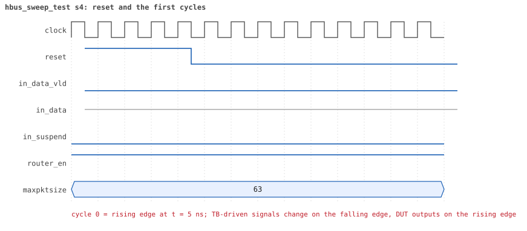
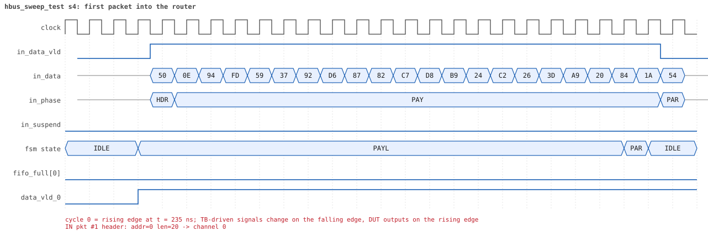
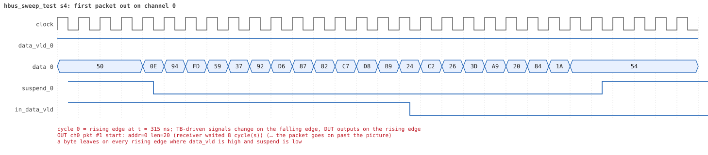
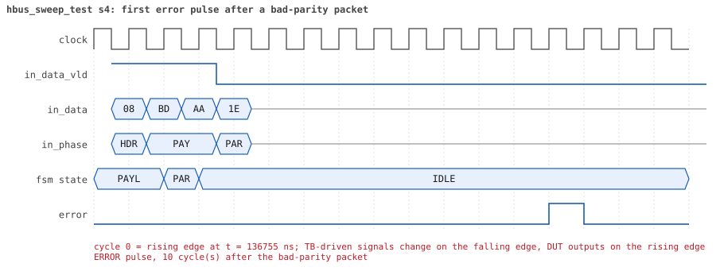
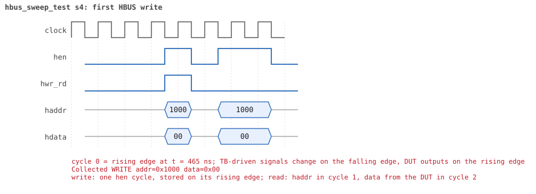
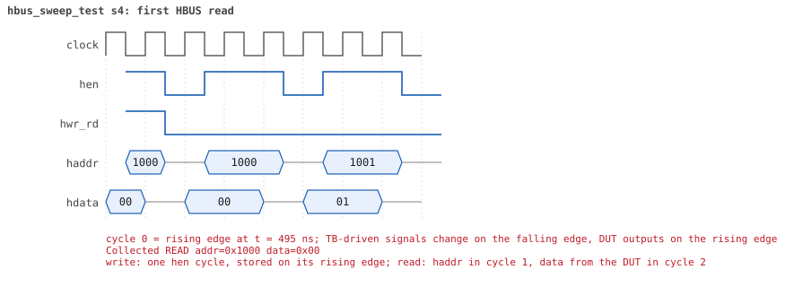

# hbus_sweep_test seed 4

**Result:** PASSED (0 UVM_ERROR, 0 UVM_WARNING, 0 UVM_FATAL) · bench `yapp_project_tb` · sim time 315us · wall 108.6 s · log [`hbus_sweep_test_s4.log`](hbus_sweep_test_s4.log)

Waves: `hbus_sweep_test_s4.fst` (GTKWave, Surfer or the VS Code wave viewer).
[Open the waves in Surfer](https://app.surfer-project.org/?load_url=https%3A%2F%2Fraw.githubusercontent.com%2Ftamirgabgab%2FQcom-Mentoring%2Fmain%2Fyapp_project%2Fregression%2Fyapp_project_tb%2Fhbus_sweep_test_s4%2Fhbus_sweep_test_s4.fst&startup_commands=run_command_file_from_url%20https%3A%2F%2Fraw.githubusercontent.com%2Ftamirgabgab%2FQcom-Mentoring%2Fmain%2Fyapp_project%2Ftb%2Fyapp_router.sucl) (web app, the signals already in groups: `yapp_project/tb/yapp_router.sucl`).

## Summary

- YAPP driver quiet in this test (verbosity UVM_NONE); the input monitor saw **1021** packet(s).
- Router: **1** forwarded, **1020** dropped (1020 oversized).
- Packets out: ch0 **1**, ch1 **0**, ch2 **0**.
- Scoreboard: 1 matched, 0 mismatched, 0 unexpected.
- Back-pressure: in_suspend asserted **0** time(s).
- Error pulses: 1020.
- HBUS: 1459 write(s), 3628 read(s).

## Stages

| time (ns) | stage |
|---|---|
| 0 | 1. one 20-byte packet to address 0, so yapp_pkt_mem holds known bytes |
| 480 | 2. every address 0x1000..0x100f, registers and holes: write 0x00, 0xff, 0x55, 0xaa, read the window back |
| 32520 | 3. ctrl_reg and en_reg: walking one and walking zero |
| 34160 | 4. yapp_pkt_mem (read-only): write every byte, the reads still return the packet |
| 68080 | 5. the unmapped range 0x1050..0x10ff: the edges and 6 addresses in between, write and read 0 |
| 72320 | 6. yapp_mem: every byte written and read back with 0x00, 0xff, 0x55, 0xaa and a random value |
| 136320 | 7. the counters at 0, in between and at 255: maxpktsize = 1, 2-byte packets with bad parity |
| 136520 | 7.1 en_reg = 0x17: 255 packets to address 0, counters read after 100 and after 255 |
| 180830 | 7.2 en_reg = 0x21: 255 packets to address 1, counters read after 100 and after 255 |
| 226260 | 7.3 en_reg = 0x41: 255 packets to address 2, counters read after 100 and after 255 |
| 270270 | 7.4 en_reg = 0x81: 255 packets to address 3, counters read after 100 and after 255 |
| 313760 | 8. ctrl_reg and en_reg back to their reset values, every register read |
| 314220 | sweep done: 1021 packets, 3628 HBUS reads |
| 314715 | 9. the four HBUS coverage collectors are at 100 % and every read matched the model |
| 314715 | done: 3585 HBUS reads checked against the model, 0 mismatches, 43 memory bytes never written |

## Pictures

**reset and the first cycles**

**first packet into the router**

**first packet out on channel 0**

**first error pulse after a bad-parity packet**

**first HBUS write**

**first HBUS read**

## Timeline

11348 events; this table keeps the 10317 of the test, the DUT, the host bus, the checkers' reports and every warning or error, and only the first 1500 of those. The full list is in the log.

| time (ns) | who | event |
|---|---|---|
| 0 | **test** | STAGE: 1. one 20-byte packet to address 0, so yapp_pkt_mem holds known bytes |
| 0 | **DUT** | RESET asserted |
| 50 | **DUT** | RESET released: router_en=1 maxpktsize=63 |
| 265 | **DUT** | IN  pkt #1 header: addr=0 len=20 -> channel 0 |
| 355 | **DUT** | OUT ch0 pkt #1 start: addr=0 len=20 (receiver waited 8 cycle(s)) |
| 475 | **DUT** | IN  pkt #1 complete: addr=0 len=20 parity=ok forwarded, 22 bytes in 22 cycles (held 0) |
| 475 | reference | Packet forwarded: addr=0 len=20 -> channel 0 |
| 480 | **test** | STAGE: 2. every address 0x1000..0x100f, registers and holes: write 0x00, 0xff, 0x55, 0xaa, read the window back |
| 505 | **DUT** | CONFIG router_en=1 maxpktsize=0 |
| 505 | hbus monitor | Collected WRITE addr=0x1000 data=0x00 |
| 505 | reference | maxpktsize is now 0 |
| 535 | hbus monitor | Collected READ  addr=0x1000 data=0x00 |
| 565 | hbus monitor | Collected READ  addr=0x1001 data=0x01 |
| 595 | hbus monitor | Collected READ  addr=0x1002 data=0x00 |
| 625 | hbus monitor | Collected READ  addr=0x1003 data=0x00 |
| 655 | hbus monitor | Collected READ  addr=0x1004 data=0x00 |
| 675 | **DUT** | OUT ch0 pkt #1 done: 22 bytes in 33 cycles |
| 675 | scoreboard | ch0 pkt matched: addr=0 len=20 (1 matched so far) |
| 685 | hbus monitor | Collected READ  addr=0x1005 data=0x00 |
| 715 | hbus monitor | Collected READ  addr=0x1006 data=0x00 |
| 745 | hbus monitor | Collected READ  addr=0x1007 data=0x00 |
| 775 | hbus monitor | Collected READ  addr=0x1008 data=0x00 |
| 805 | hbus monitor | Collected READ  addr=0x1009 data=0x00 |
| 835 | hbus monitor | Collected READ  addr=0x100a data=0x00 |
| 865 | hbus monitor | Collected READ  addr=0x100b data=0x00 |
| 895 | hbus monitor | Collected READ  addr=0x100c data=0x00 |
| 925 | hbus monitor | Collected READ  addr=0x100d data=0x14 |
| 955 | hbus monitor | Collected READ  addr=0x100e data=0x00 |
| 985 | hbus monitor | Collected READ  addr=0x100f data=0x00 |
| 1005 | **DUT** | CONFIG router_en=1 maxpktsize=63 |
| 1005 | hbus monitor | Collected WRITE addr=0x1000 data=0xff |
| 1005 | reference | maxpktsize is now 63 |
| 1035 | hbus monitor | Collected READ  addr=0x1000 data=0xff |
| 1065 | hbus monitor | Collected READ  addr=0x1001 data=0x01 |
| 1095 | hbus monitor | Collected READ  addr=0x1002 data=0x00 |
| 1125 | hbus monitor | Collected READ  addr=0x1003 data=0x00 |
| 1155 | hbus monitor | Collected READ  addr=0x1004 data=0x00 |
| 1185 | hbus monitor | Collected READ  addr=0x1005 data=0x00 |
| 1215 | hbus monitor | Collected READ  addr=0x1006 data=0x00 |
| 1245 | hbus monitor | Collected READ  addr=0x1007 data=0x00 |
| 1275 | hbus monitor | Collected READ  addr=0x1008 data=0x00 |
| 1305 | hbus monitor | Collected READ  addr=0x1009 data=0x00 |
| 1335 | hbus monitor | Collected READ  addr=0x100a data=0x00 |
| 1365 | hbus monitor | Collected READ  addr=0x100b data=0x00 |
| 1395 | hbus monitor | Collected READ  addr=0x100c data=0x00 |
| 1425 | hbus monitor | Collected READ  addr=0x100d data=0x14 |
| 1455 | hbus monitor | Collected READ  addr=0x100e data=0x00 |
| 1485 | hbus monitor | Collected READ  addr=0x100f data=0x00 |
| 1505 | **DUT** | CONFIG router_en=1 maxpktsize=21 |
| 1505 | hbus monitor | Collected WRITE addr=0x1000 data=0x55 |
| 1505 | reference | maxpktsize is now 21 |
| 1535 | hbus monitor | Collected READ  addr=0x1000 data=0x55 |
| 1565 | hbus monitor | Collected READ  addr=0x1001 data=0x01 |
| 1595 | hbus monitor | Collected READ  addr=0x1002 data=0x00 |
| 1625 | hbus monitor | Collected READ  addr=0x1003 data=0x00 |
| 1655 | hbus monitor | Collected READ  addr=0x1004 data=0x00 |
| 1685 | hbus monitor | Collected READ  addr=0x1005 data=0x00 |
| 1715 | hbus monitor | Collected READ  addr=0x1006 data=0x00 |
| 1745 | hbus monitor | Collected READ  addr=0x1007 data=0x00 |
| 1775 | hbus monitor | Collected READ  addr=0x1008 data=0x00 |
| 1805 | hbus monitor | Collected READ  addr=0x1009 data=0x00 |
| 1835 | hbus monitor | Collected READ  addr=0x100a data=0x00 |
| 1865 | hbus monitor | Collected READ  addr=0x100b data=0x00 |
| 1895 | hbus monitor | Collected READ  addr=0x100c data=0x00 |
| 1925 | hbus monitor | Collected READ  addr=0x100d data=0x14 |
| 1955 | hbus monitor | Collected READ  addr=0x100e data=0x00 |
| 1985 | hbus monitor | Collected READ  addr=0x100f data=0x00 |
| 2005 | **DUT** | CONFIG router_en=1 maxpktsize=42 |
| 2005 | hbus monitor | Collected WRITE addr=0x1000 data=0xaa |
| 2005 | reference | maxpktsize is now 42 |
| 2035 | hbus monitor | Collected READ  addr=0x1000 data=0xaa |
| 2065 | hbus monitor | Collected READ  addr=0x1001 data=0x01 |
| 2095 | hbus monitor | Collected READ  addr=0x1002 data=0x00 |
| 2125 | hbus monitor | Collected READ  addr=0x1003 data=0x00 |
| 2155 | hbus monitor | Collected READ  addr=0x1004 data=0x00 |
| 2185 | hbus monitor | Collected READ  addr=0x1005 data=0x00 |
| 2215 | hbus monitor | Collected READ  addr=0x1006 data=0x00 |
| 2245 | hbus monitor | Collected READ  addr=0x1007 data=0x00 |
| 2275 | hbus monitor | Collected READ  addr=0x1008 data=0x00 |
| 2305 | hbus monitor | Collected READ  addr=0x1009 data=0x00 |
| 2335 | hbus monitor | Collected READ  addr=0x100a data=0x00 |
| 2365 | hbus monitor | Collected READ  addr=0x100b data=0x00 |
| 2395 | hbus monitor | Collected READ  addr=0x100c data=0x00 |
| 2425 | hbus monitor | Collected READ  addr=0x100d data=0x14 |
| 2455 | hbus monitor | Collected READ  addr=0x100e data=0x00 |
| 2485 | hbus monitor | Collected READ  addr=0x100f data=0x00 |
| 2505 | **DUT** | CONFIG router_en=0 maxpktsize=42 |
| 2505 | hbus monitor | Collected WRITE addr=0x1001 data=0x00 |
| 2505 | reference | router_en is now 0 (en_reg 0x00) |
| 2535 | hbus monitor | Collected READ  addr=0x1000 data=0xaa |
| 2565 | hbus monitor | Collected READ  addr=0x1001 data=0x00 |
| 2595 | hbus monitor | Collected READ  addr=0x1002 data=0x00 |
| 2625 | hbus monitor | Collected READ  addr=0x1003 data=0x00 |
| 2655 | hbus monitor | Collected READ  addr=0x1004 data=0x00 |
| 2685 | hbus monitor | Collected READ  addr=0x1005 data=0x00 |
| 2715 | hbus monitor | Collected READ  addr=0x1006 data=0x00 |
| 2745 | hbus monitor | Collected READ  addr=0x1007 data=0x00 |
| 2775 | hbus monitor | Collected READ  addr=0x1008 data=0x00 |
| 2805 | hbus monitor | Collected READ  addr=0x1009 data=0x00 |
| 2835 | hbus monitor | Collected READ  addr=0x100a data=0x00 |
| 2865 | hbus monitor | Collected READ  addr=0x100b data=0x00 |
| 2895 | hbus monitor | Collected READ  addr=0x100c data=0x00 |
| 2925 | hbus monitor | Collected READ  addr=0x100d data=0x14 |
| 2955 | hbus monitor | Collected READ  addr=0x100e data=0x00 |
| 2985 | hbus monitor | Collected READ  addr=0x100f data=0x00 |
| 3005 | **DUT** | CONFIG router_en=1 maxpktsize=42 |
| 3005 | hbus monitor | Collected WRITE addr=0x1001 data=0xff |
| 3005 | reference | router_en is now 1 (en_reg 0xff) |
| 3035 | hbus monitor | Collected READ  addr=0x1000 data=0xaa |
| 3065 | hbus monitor | Collected READ  addr=0x1001 data=0xff |
| 3095 | hbus monitor | Collected READ  addr=0x1002 data=0x00 |
| 3125 | hbus monitor | Collected READ  addr=0x1003 data=0x00 |
| 3155 | hbus monitor | Collected READ  addr=0x1004 data=0x00 |
| 3185 | hbus monitor | Collected READ  addr=0x1005 data=0x00 |
| 3215 | hbus monitor | Collected READ  addr=0x1006 data=0x00 |
| 3245 | hbus monitor | Collected READ  addr=0x1007 data=0x00 |
| 3275 | hbus monitor | Collected READ  addr=0x1008 data=0x00 |
| 3305 | hbus monitor | Collected READ  addr=0x1009 data=0x00 |
| 3335 | hbus monitor | Collected READ  addr=0x100a data=0x00 |
| 3365 | hbus monitor | Collected READ  addr=0x100b data=0x00 |
| 3395 | hbus monitor | Collected READ  addr=0x100c data=0x00 |
| 3425 | hbus monitor | Collected READ  addr=0x100d data=0x14 |
| 3455 | hbus monitor | Collected READ  addr=0x100e data=0x00 |
| 3485 | hbus monitor | Collected READ  addr=0x100f data=0x00 |
| 3505 | hbus monitor | Collected WRITE addr=0x1001 data=0x55 |
| 3505 | reference | router_en is now 1 (en_reg 0x55) |
| 3535 | hbus monitor | Collected READ  addr=0x1000 data=0xaa |
| 3565 | hbus monitor | Collected READ  addr=0x1001 data=0x55 |
| 3595 | hbus monitor | Collected READ  addr=0x1002 data=0x00 |
| 3625 | hbus monitor | Collected READ  addr=0x1003 data=0x00 |
| 3655 | hbus monitor | Collected READ  addr=0x1004 data=0x00 |
| 3685 | hbus monitor | Collected READ  addr=0x1005 data=0x00 |
| 3715 | hbus monitor | Collected READ  addr=0x1006 data=0x00 |
| 3745 | hbus monitor | Collected READ  addr=0x1007 data=0x00 |
| 3775 | hbus monitor | Collected READ  addr=0x1008 data=0x00 |
| 3805 | hbus monitor | Collected READ  addr=0x1009 data=0x00 |
| 3835 | hbus monitor | Collected READ  addr=0x100a data=0x00 |
| 3865 | hbus monitor | Collected READ  addr=0x100b data=0x00 |
| 3895 | hbus monitor | Collected READ  addr=0x100c data=0x00 |
| 3925 | hbus monitor | Collected READ  addr=0x100d data=0x14 |
| 3955 | hbus monitor | Collected READ  addr=0x100e data=0x00 |
| 3985 | hbus monitor | Collected READ  addr=0x100f data=0x00 |
| 4005 | **DUT** | CONFIG router_en=0 maxpktsize=42 |
| 4005 | hbus monitor | Collected WRITE addr=0x1001 data=0xaa |
| 4005 | reference | router_en is now 0 (en_reg 0xaa) |
| 4035 | hbus monitor | Collected READ  addr=0x1000 data=0xaa |
| 4065 | hbus monitor | Collected READ  addr=0x1001 data=0xaa |
| 4095 | hbus monitor | Collected READ  addr=0x1002 data=0x00 |
| 4125 | hbus monitor | Collected READ  addr=0x1003 data=0x00 |
| 4155 | hbus monitor | Collected READ  addr=0x1004 data=0x00 |
| 4185 | hbus monitor | Collected READ  addr=0x1005 data=0x00 |
| 4215 | hbus monitor | Collected READ  addr=0x1006 data=0x00 |
| 4245 | hbus monitor | Collected READ  addr=0x1007 data=0x00 |
| 4275 | hbus monitor | Collected READ  addr=0x1008 data=0x00 |
| 4305 | hbus monitor | Collected READ  addr=0x1009 data=0x00 |
| 4335 | hbus monitor | Collected READ  addr=0x100a data=0x00 |
| 4365 | hbus monitor | Collected READ  addr=0x100b data=0x00 |
| 4395 | hbus monitor | Collected READ  addr=0x100c data=0x00 |
| 4425 | hbus monitor | Collected READ  addr=0x100d data=0x14 |
| 4455 | hbus monitor | Collected READ  addr=0x100e data=0x00 |
| 4485 | hbus monitor | Collected READ  addr=0x100f data=0x00 |
| 4505 | hbus monitor | Collected WRITE addr=0x1002 data=0x00 |
| 4535 | hbus monitor | Collected READ  addr=0x1000 data=0xaa |
| 4565 | hbus monitor | Collected READ  addr=0x1001 data=0xaa |
| 4595 | hbus monitor | Collected READ  addr=0x1002 data=0x00 |
| 4625 | hbus monitor | Collected READ  addr=0x1003 data=0x00 |
| 4655 | hbus monitor | Collected READ  addr=0x1004 data=0x00 |
| 4685 | hbus monitor | Collected READ  addr=0x1005 data=0x00 |
| 4715 | hbus monitor | Collected READ  addr=0x1006 data=0x00 |
| 4745 | hbus monitor | Collected READ  addr=0x1007 data=0x00 |
| 4775 | hbus monitor | Collected READ  addr=0x1008 data=0x00 |
| 4805 | hbus monitor | Collected READ  addr=0x1009 data=0x00 |
| 4835 | hbus monitor | Collected READ  addr=0x100a data=0x00 |
| 4865 | hbus monitor | Collected READ  addr=0x100b data=0x00 |
| 4895 | hbus monitor | Collected READ  addr=0x100c data=0x00 |
| 4925 | hbus monitor | Collected READ  addr=0x100d data=0x14 |
| 4955 | hbus monitor | Collected READ  addr=0x100e data=0x00 |
| 4985 | hbus monitor | Collected READ  addr=0x100f data=0x00 |
| 5005 | hbus monitor | Collected WRITE addr=0x1002 data=0xff |
| 5035 | hbus monitor | Collected READ  addr=0x1000 data=0xaa |
| 5065 | hbus monitor | Collected READ  addr=0x1001 data=0xaa |
| 5095 | hbus monitor | Collected READ  addr=0x1002 data=0x00 |
| 5125 | hbus monitor | Collected READ  addr=0x1003 data=0x00 |
| 5155 | hbus monitor | Collected READ  addr=0x1004 data=0x00 |
| 5185 | hbus monitor | Collected READ  addr=0x1005 data=0x00 |
| 5215 | hbus monitor | Collected READ  addr=0x1006 data=0x00 |
| 5245 | hbus monitor | Collected READ  addr=0x1007 data=0x00 |
| 5275 | hbus monitor | Collected READ  addr=0x1008 data=0x00 |
| 5305 | hbus monitor | Collected READ  addr=0x1009 data=0x00 |
| 5335 | hbus monitor | Collected READ  addr=0x100a data=0x00 |
| 5365 | hbus monitor | Collected READ  addr=0x100b data=0x00 |
| 5395 | hbus monitor | Collected READ  addr=0x100c data=0x00 |
| 5425 | hbus monitor | Collected READ  addr=0x100d data=0x14 |
| 5455 | hbus monitor | Collected READ  addr=0x100e data=0x00 |
| 5485 | hbus monitor | Collected READ  addr=0x100f data=0x00 |
| 5505 | hbus monitor | Collected WRITE addr=0x1002 data=0x55 |
| 5535 | hbus monitor | Collected READ  addr=0x1000 data=0xaa |
| 5565 | hbus monitor | Collected READ  addr=0x1001 data=0xaa |
| 5595 | hbus monitor | Collected READ  addr=0x1002 data=0x00 |
| 5625 | hbus monitor | Collected READ  addr=0x1003 data=0x00 |
| 5655 | hbus monitor | Collected READ  addr=0x1004 data=0x00 |
| 5685 | hbus monitor | Collected READ  addr=0x1005 data=0x00 |
| 5715 | hbus monitor | Collected READ  addr=0x1006 data=0x00 |
| 5745 | hbus monitor | Collected READ  addr=0x1007 data=0x00 |
| 5775 | hbus monitor | Collected READ  addr=0x1008 data=0x00 |
| 5805 | hbus monitor | Collected READ  addr=0x1009 data=0x00 |
| 5835 | hbus monitor | Collected READ  addr=0x100a data=0x00 |
| 5865 | hbus monitor | Collected READ  addr=0x100b data=0x00 |
| 5895 | hbus monitor | Collected READ  addr=0x100c data=0x00 |
| 5925 | hbus monitor | Collected READ  addr=0x100d data=0x14 |
| 5955 | hbus monitor | Collected READ  addr=0x100e data=0x00 |
| 5985 | hbus monitor | Collected READ  addr=0x100f data=0x00 |
| 6005 | hbus monitor | Collected WRITE addr=0x1002 data=0xaa |
| 6035 | hbus monitor | Collected READ  addr=0x1000 data=0xaa |
| 6065 | hbus monitor | Collected READ  addr=0x1001 data=0xaa |
| 6095 | hbus monitor | Collected READ  addr=0x1002 data=0x00 |
| 6125 | hbus monitor | Collected READ  addr=0x1003 data=0x00 |
| 6155 | hbus monitor | Collected READ  addr=0x1004 data=0x00 |
| 6185 | hbus monitor | Collected READ  addr=0x1005 data=0x00 |
| 6215 | hbus monitor | Collected READ  addr=0x1006 data=0x00 |
| 6245 | hbus monitor | Collected READ  addr=0x1007 data=0x00 |
| 6275 | hbus monitor | Collected READ  addr=0x1008 data=0x00 |
| 6305 | hbus monitor | Collected READ  addr=0x1009 data=0x00 |
| 6335 | hbus monitor | Collected READ  addr=0x100a data=0x00 |
| 6365 | hbus monitor | Collected READ  addr=0x100b data=0x00 |
| 6395 | hbus monitor | Collected READ  addr=0x100c data=0x00 |
| 6425 | hbus monitor | Collected READ  addr=0x100d data=0x14 |
| 6455 | hbus monitor | Collected READ  addr=0x100e data=0x00 |
| 6485 | hbus monitor | Collected READ  addr=0x100f data=0x00 |
| 6505 | hbus monitor | Collected WRITE addr=0x1003 data=0x00 |
| 6535 | hbus monitor | Collected READ  addr=0x1000 data=0xaa |
| 6565 | hbus monitor | Collected READ  addr=0x1001 data=0xaa |
| 6595 | hbus monitor | Collected READ  addr=0x1002 data=0x00 |
| 6625 | hbus monitor | Collected READ  addr=0x1003 data=0x00 |
| 6655 | hbus monitor | Collected READ  addr=0x1004 data=0x00 |
| 6685 | hbus monitor | Collected READ  addr=0x1005 data=0x00 |
| 6715 | hbus monitor | Collected READ  addr=0x1006 data=0x00 |
| 6745 | hbus monitor | Collected READ  addr=0x1007 data=0x00 |
| 6775 | hbus monitor | Collected READ  addr=0x1008 data=0x00 |
| 6805 | hbus monitor | Collected READ  addr=0x1009 data=0x00 |
| 6835 | hbus monitor | Collected READ  addr=0x100a data=0x00 |
| 6865 | hbus monitor | Collected READ  addr=0x100b data=0x00 |
| 6895 | hbus monitor | Collected READ  addr=0x100c data=0x00 |
| 6925 | hbus monitor | Collected READ  addr=0x100d data=0x14 |
| 6955 | hbus monitor | Collected READ  addr=0x100e data=0x00 |
| 6985 | hbus monitor | Collected READ  addr=0x100f data=0x00 |
| 7005 | hbus monitor | Collected WRITE addr=0x1003 data=0xff |
| 7035 | hbus monitor | Collected READ  addr=0x1000 data=0xaa |
| 7065 | hbus monitor | Collected READ  addr=0x1001 data=0xaa |
| 7095 | hbus monitor | Collected READ  addr=0x1002 data=0x00 |
| 7125 | hbus monitor | Collected READ  addr=0x1003 data=0x00 |
| 7155 | hbus monitor | Collected READ  addr=0x1004 data=0x00 |
| 7185 | hbus monitor | Collected READ  addr=0x1005 data=0x00 |
| 7215 | hbus monitor | Collected READ  addr=0x1006 data=0x00 |
| 7245 | hbus monitor | Collected READ  addr=0x1007 data=0x00 |
| 7275 | hbus monitor | Collected READ  addr=0x1008 data=0x00 |
| 7305 | hbus monitor | Collected READ  addr=0x1009 data=0x00 |
| 7335 | hbus monitor | Collected READ  addr=0x100a data=0x00 |
| 7365 | hbus monitor | Collected READ  addr=0x100b data=0x00 |
| 7395 | hbus monitor | Collected READ  addr=0x100c data=0x00 |
| 7425 | hbus monitor | Collected READ  addr=0x100d data=0x14 |
| 7455 | hbus monitor | Collected READ  addr=0x100e data=0x00 |
| 7485 | hbus monitor | Collected READ  addr=0x100f data=0x00 |
| 7505 | hbus monitor | Collected WRITE addr=0x1003 data=0x55 |
| 7535 | hbus monitor | Collected READ  addr=0x1000 data=0xaa |
| 7565 | hbus monitor | Collected READ  addr=0x1001 data=0xaa |
| 7595 | hbus monitor | Collected READ  addr=0x1002 data=0x00 |
| 7625 | hbus monitor | Collected READ  addr=0x1003 data=0x00 |
| 7655 | hbus monitor | Collected READ  addr=0x1004 data=0x00 |
| 7685 | hbus monitor | Collected READ  addr=0x1005 data=0x00 |
| 7715 | hbus monitor | Collected READ  addr=0x1006 data=0x00 |
| 7745 | hbus monitor | Collected READ  addr=0x1007 data=0x00 |
| 7775 | hbus monitor | Collected READ  addr=0x1008 data=0x00 |
| 7805 | hbus monitor | Collected READ  addr=0x1009 data=0x00 |
| 7835 | hbus monitor | Collected READ  addr=0x100a data=0x00 |
| 7865 | hbus monitor | Collected READ  addr=0x100b data=0x00 |
| 7895 | hbus monitor | Collected READ  addr=0x100c data=0x00 |
| 7925 | hbus monitor | Collected READ  addr=0x100d data=0x14 |
| 7955 | hbus monitor | Collected READ  addr=0x100e data=0x00 |
| 7985 | hbus monitor | Collected READ  addr=0x100f data=0x00 |
| 8005 | hbus monitor | Collected WRITE addr=0x1003 data=0xaa |
| 8035 | hbus monitor | Collected READ  addr=0x1000 data=0xaa |
| 8065 | hbus monitor | Collected READ  addr=0x1001 data=0xaa |
| 8095 | hbus monitor | Collected READ  addr=0x1002 data=0x00 |
| 8125 | hbus monitor | Collected READ  addr=0x1003 data=0x00 |
| 8155 | hbus monitor | Collected READ  addr=0x1004 data=0x00 |
| 8185 | hbus monitor | Collected READ  addr=0x1005 data=0x00 |
| 8215 | hbus monitor | Collected READ  addr=0x1006 data=0x00 |
| 8245 | hbus monitor | Collected READ  addr=0x1007 data=0x00 |
| 8275 | hbus monitor | Collected READ  addr=0x1008 data=0x00 |
| 8305 | hbus monitor | Collected READ  addr=0x1009 data=0x00 |
| 8335 | hbus monitor | Collected READ  addr=0x100a data=0x00 |
| 8365 | hbus monitor | Collected READ  addr=0x100b data=0x00 |
| 8395 | hbus monitor | Collected READ  addr=0x100c data=0x00 |
| 8425 | hbus monitor | Collected READ  addr=0x100d data=0x14 |
| 8455 | hbus monitor | Collected READ  addr=0x100e data=0x00 |
| 8485 | hbus monitor | Collected READ  addr=0x100f data=0x00 |
| 8505 | hbus monitor | Collected WRITE addr=0x1004 data=0x00 |
| 8535 | hbus monitor | Collected READ  addr=0x1000 data=0xaa |
| 8565 | hbus monitor | Collected READ  addr=0x1001 data=0xaa |
| 8595 | hbus monitor | Collected READ  addr=0x1002 data=0x00 |
| 8625 | hbus monitor | Collected READ  addr=0x1003 data=0x00 |
| 8655 | hbus monitor | Collected READ  addr=0x1004 data=0x00 |
| 8685 | hbus monitor | Collected READ  addr=0x1005 data=0x00 |
| 8715 | hbus monitor | Collected READ  addr=0x1006 data=0x00 |
| 8745 | hbus monitor | Collected READ  addr=0x1007 data=0x00 |
| 8775 | hbus monitor | Collected READ  addr=0x1008 data=0x00 |
| 8805 | hbus monitor | Collected READ  addr=0x1009 data=0x00 |
| 8835 | hbus monitor | Collected READ  addr=0x100a data=0x00 |
| 8865 | hbus monitor | Collected READ  addr=0x100b data=0x00 |
| 8895 | hbus monitor | Collected READ  addr=0x100c data=0x00 |
| 8925 | hbus monitor | Collected READ  addr=0x100d data=0x14 |
| 8955 | hbus monitor | Collected READ  addr=0x100e data=0x00 |
| 8985 | hbus monitor | Collected READ  addr=0x100f data=0x00 |
| 9005 | hbus monitor | Collected WRITE addr=0x1004 data=0xff |
| 9035 | hbus monitor | Collected READ  addr=0x1000 data=0xaa |
| 9065 | hbus monitor | Collected READ  addr=0x1001 data=0xaa |
| 9095 | hbus monitor | Collected READ  addr=0x1002 data=0x00 |
| 9125 | hbus monitor | Collected READ  addr=0x1003 data=0x00 |
| 9155 | hbus monitor | Collected READ  addr=0x1004 data=0x00 |
| 9185 | hbus monitor | Collected READ  addr=0x1005 data=0x00 |
| 9215 | hbus monitor | Collected READ  addr=0x1006 data=0x00 |
| 9245 | hbus monitor | Collected READ  addr=0x1007 data=0x00 |
| 9275 | hbus monitor | Collected READ  addr=0x1008 data=0x00 |
| 9305 | hbus monitor | Collected READ  addr=0x1009 data=0x00 |
| 9335 | hbus monitor | Collected READ  addr=0x100a data=0x00 |
| 9365 | hbus monitor | Collected READ  addr=0x100b data=0x00 |
| 9395 | hbus monitor | Collected READ  addr=0x100c data=0x00 |
| 9425 | hbus monitor | Collected READ  addr=0x100d data=0x14 |
| 9455 | hbus monitor | Collected READ  addr=0x100e data=0x00 |
| 9485 | hbus monitor | Collected READ  addr=0x100f data=0x00 |
| 9505 | hbus monitor | Collected WRITE addr=0x1004 data=0x55 |
| 9535 | hbus monitor | Collected READ  addr=0x1000 data=0xaa |
| 9565 | hbus monitor | Collected READ  addr=0x1001 data=0xaa |
| 9595 | hbus monitor | Collected READ  addr=0x1002 data=0x00 |
| 9625 | hbus monitor | Collected READ  addr=0x1003 data=0x00 |
| 9655 | hbus monitor | Collected READ  addr=0x1004 data=0x00 |
| 9685 | hbus monitor | Collected READ  addr=0x1005 data=0x00 |
| 9715 | hbus monitor | Collected READ  addr=0x1006 data=0x00 |
| 9745 | hbus monitor | Collected READ  addr=0x1007 data=0x00 |
| 9775 | hbus monitor | Collected READ  addr=0x1008 data=0x00 |
| 9805 | hbus monitor | Collected READ  addr=0x1009 data=0x00 |
| 9835 | hbus monitor | Collected READ  addr=0x100a data=0x00 |
| 9865 | hbus monitor | Collected READ  addr=0x100b data=0x00 |
| 9895 | hbus monitor | Collected READ  addr=0x100c data=0x00 |
| 9925 | hbus monitor | Collected READ  addr=0x100d data=0x14 |
| 9955 | hbus monitor | Collected READ  addr=0x100e data=0x00 |
| 9985 | hbus monitor | Collected READ  addr=0x100f data=0x00 |
| 10005 | hbus monitor | Collected WRITE addr=0x1004 data=0xaa |
| 10035 | hbus monitor | Collected READ  addr=0x1000 data=0xaa |
| 10065 | hbus monitor | Collected READ  addr=0x1001 data=0xaa |
| 10095 | hbus monitor | Collected READ  addr=0x1002 data=0x00 |
| 10125 | hbus monitor | Collected READ  addr=0x1003 data=0x00 |
| 10155 | hbus monitor | Collected READ  addr=0x1004 data=0x00 |
| 10185 | hbus monitor | Collected READ  addr=0x1005 data=0x00 |
| 10215 | hbus monitor | Collected READ  addr=0x1006 data=0x00 |
| 10245 | hbus monitor | Collected READ  addr=0x1007 data=0x00 |
| 10275 | hbus monitor | Collected READ  addr=0x1008 data=0x00 |
| 10305 | hbus monitor | Collected READ  addr=0x1009 data=0x00 |
| 10335 | hbus monitor | Collected READ  addr=0x100a data=0x00 |
| 10365 | hbus monitor | Collected READ  addr=0x100b data=0x00 |
| 10395 | hbus monitor | Collected READ  addr=0x100c data=0x00 |
| 10425 | hbus monitor | Collected READ  addr=0x100d data=0x14 |
| 10455 | hbus monitor | Collected READ  addr=0x100e data=0x00 |
| 10485 | hbus monitor | Collected READ  addr=0x100f data=0x00 |
| 10505 | hbus monitor | Collected WRITE addr=0x1005 data=0x00 |
| 10535 | hbus monitor | Collected READ  addr=0x1000 data=0xaa |
| 10565 | hbus monitor | Collected READ  addr=0x1001 data=0xaa |
| 10595 | hbus monitor | Collected READ  addr=0x1002 data=0x00 |
| 10625 | hbus monitor | Collected READ  addr=0x1003 data=0x00 |
| 10655 | hbus monitor | Collected READ  addr=0x1004 data=0x00 |
| 10685 | hbus monitor | Collected READ  addr=0x1005 data=0x00 |
| 10715 | hbus monitor | Collected READ  addr=0x1006 data=0x00 |
| 10745 | hbus monitor | Collected READ  addr=0x1007 data=0x00 |
| 10775 | hbus monitor | Collected READ  addr=0x1008 data=0x00 |
| 10805 | hbus monitor | Collected READ  addr=0x1009 data=0x00 |
| 10835 | hbus monitor | Collected READ  addr=0x100a data=0x00 |
| 10865 | hbus monitor | Collected READ  addr=0x100b data=0x00 |
| 10895 | hbus monitor | Collected READ  addr=0x100c data=0x00 |
| 10925 | hbus monitor | Collected READ  addr=0x100d data=0x14 |
| 10955 | hbus monitor | Collected READ  addr=0x100e data=0x00 |
| 10985 | hbus monitor | Collected READ  addr=0x100f data=0x00 |
| 11005 | hbus monitor | Collected WRITE addr=0x1005 data=0xff |
| 11035 | hbus monitor | Collected READ  addr=0x1000 data=0xaa |
| 11065 | hbus monitor | Collected READ  addr=0x1001 data=0xaa |
| 11095 | hbus monitor | Collected READ  addr=0x1002 data=0x00 |
| 11125 | hbus monitor | Collected READ  addr=0x1003 data=0x00 |
| 11155 | hbus monitor | Collected READ  addr=0x1004 data=0x00 |
| 11185 | hbus monitor | Collected READ  addr=0x1005 data=0x00 |
| 11215 | hbus monitor | Collected READ  addr=0x1006 data=0x00 |
| 11245 | hbus monitor | Collected READ  addr=0x1007 data=0x00 |
| 11275 | hbus monitor | Collected READ  addr=0x1008 data=0x00 |
| 11305 | hbus monitor | Collected READ  addr=0x1009 data=0x00 |
| 11335 | hbus monitor | Collected READ  addr=0x100a data=0x00 |
| 11365 | hbus monitor | Collected READ  addr=0x100b data=0x00 |
| 11395 | hbus monitor | Collected READ  addr=0x100c data=0x00 |
| 11425 | hbus monitor | Collected READ  addr=0x100d data=0x14 |
| 11455 | hbus monitor | Collected READ  addr=0x100e data=0x00 |
| 11485 | hbus monitor | Collected READ  addr=0x100f data=0x00 |
| 11505 | hbus monitor | Collected WRITE addr=0x1005 data=0x55 |
| 11535 | hbus monitor | Collected READ  addr=0x1000 data=0xaa |
| 11565 | hbus monitor | Collected READ  addr=0x1001 data=0xaa |
| 11595 | hbus monitor | Collected READ  addr=0x1002 data=0x00 |
| 11625 | hbus monitor | Collected READ  addr=0x1003 data=0x00 |
| 11655 | hbus monitor | Collected READ  addr=0x1004 data=0x00 |
| 11685 | hbus monitor | Collected READ  addr=0x1005 data=0x00 |
| 11715 | hbus monitor | Collected READ  addr=0x1006 data=0x00 |
| 11745 | hbus monitor | Collected READ  addr=0x1007 data=0x00 |
| 11775 | hbus monitor | Collected READ  addr=0x1008 data=0x00 |
| 11805 | hbus monitor | Collected READ  addr=0x1009 data=0x00 |
| 11835 | hbus monitor | Collected READ  addr=0x100a data=0x00 |
| 11865 | hbus monitor | Collected READ  addr=0x100b data=0x00 |
| 11895 | hbus monitor | Collected READ  addr=0x100c data=0x00 |
| 11925 | hbus monitor | Collected READ  addr=0x100d data=0x14 |
| 11955 | hbus monitor | Collected READ  addr=0x100e data=0x00 |
| 11985 | hbus monitor | Collected READ  addr=0x100f data=0x00 |
| 12005 | hbus monitor | Collected WRITE addr=0x1005 data=0xaa |
| 12035 | hbus monitor | Collected READ  addr=0x1000 data=0xaa |
| 12065 | hbus monitor | Collected READ  addr=0x1001 data=0xaa |
| 12095 | hbus monitor | Collected READ  addr=0x1002 data=0x00 |
| 12125 | hbus monitor | Collected READ  addr=0x1003 data=0x00 |
| 12155 | hbus monitor | Collected READ  addr=0x1004 data=0x00 |
| 12185 | hbus monitor | Collected READ  addr=0x1005 data=0x00 |
| 12215 | hbus monitor | Collected READ  addr=0x1006 data=0x00 |
| 12245 | hbus monitor | Collected READ  addr=0x1007 data=0x00 |
| 12275 | hbus monitor | Collected READ  addr=0x1008 data=0x00 |
| 12305 | hbus monitor | Collected READ  addr=0x1009 data=0x00 |
| 12335 | hbus monitor | Collected READ  addr=0x100a data=0x00 |
| 12365 | hbus monitor | Collected READ  addr=0x100b data=0x00 |
| 12395 | hbus monitor | Collected READ  addr=0x100c data=0x00 |
| 12425 | hbus monitor | Collected READ  addr=0x100d data=0x14 |
| 12455 | hbus monitor | Collected READ  addr=0x100e data=0x00 |
| 12485 | hbus monitor | Collected READ  addr=0x100f data=0x00 |
| 12505 | hbus monitor | Collected WRITE addr=0x1006 data=0x00 |
| 12535 | hbus monitor | Collected READ  addr=0x1000 data=0xaa |
| 12565 | hbus monitor | Collected READ  addr=0x1001 data=0xaa |
| 12595 | hbus monitor | Collected READ  addr=0x1002 data=0x00 |
| 12625 | hbus monitor | Collected READ  addr=0x1003 data=0x00 |
| 12655 | hbus monitor | Collected READ  addr=0x1004 data=0x00 |
| 12685 | hbus monitor | Collected READ  addr=0x1005 data=0x00 |
| 12715 | hbus monitor | Collected READ  addr=0x1006 data=0x00 |
| 12745 | hbus monitor | Collected READ  addr=0x1007 data=0x00 |
| 12775 | hbus monitor | Collected READ  addr=0x1008 data=0x00 |
| 12805 | hbus monitor | Collected READ  addr=0x1009 data=0x00 |
| 12835 | hbus monitor | Collected READ  addr=0x100a data=0x00 |
| 12865 | hbus monitor | Collected READ  addr=0x100b data=0x00 |
| 12895 | hbus monitor | Collected READ  addr=0x100c data=0x00 |
| 12925 | hbus monitor | Collected READ  addr=0x100d data=0x14 |
| 12955 | hbus monitor | Collected READ  addr=0x100e data=0x00 |
| 12985 | hbus monitor | Collected READ  addr=0x100f data=0x00 |
| 13005 | hbus monitor | Collected WRITE addr=0x1006 data=0xff |
| 13035 | hbus monitor | Collected READ  addr=0x1000 data=0xaa |
| 13065 | hbus monitor | Collected READ  addr=0x1001 data=0xaa |
| 13095 | hbus monitor | Collected READ  addr=0x1002 data=0x00 |
| 13125 | hbus monitor | Collected READ  addr=0x1003 data=0x00 |
| 13155 | hbus monitor | Collected READ  addr=0x1004 data=0x00 |
| 13185 | hbus monitor | Collected READ  addr=0x1005 data=0x00 |
| 13215 | hbus monitor | Collected READ  addr=0x1006 data=0x00 |
| 13245 | hbus monitor | Collected READ  addr=0x1007 data=0x00 |
| 13275 | hbus monitor | Collected READ  addr=0x1008 data=0x00 |
| 13305 | hbus monitor | Collected READ  addr=0x1009 data=0x00 |
| 13335 | hbus monitor | Collected READ  addr=0x100a data=0x00 |
| 13365 | hbus monitor | Collected READ  addr=0x100b data=0x00 |
| 13395 | hbus monitor | Collected READ  addr=0x100c data=0x00 |
| 13425 | hbus monitor | Collected READ  addr=0x100d data=0x14 |
| 13455 | hbus monitor | Collected READ  addr=0x100e data=0x00 |
| 13485 | hbus monitor | Collected READ  addr=0x100f data=0x00 |
| 13505 | hbus monitor | Collected WRITE addr=0x1006 data=0x55 |
| 13535 | hbus monitor | Collected READ  addr=0x1000 data=0xaa |
| 13565 | hbus monitor | Collected READ  addr=0x1001 data=0xaa |
| 13595 | hbus monitor | Collected READ  addr=0x1002 data=0x00 |
| 13625 | hbus monitor | Collected READ  addr=0x1003 data=0x00 |
| 13655 | hbus monitor | Collected READ  addr=0x1004 data=0x00 |
| 13685 | hbus monitor | Collected READ  addr=0x1005 data=0x00 |
| 13715 | hbus monitor | Collected READ  addr=0x1006 data=0x00 |
| 13745 | hbus monitor | Collected READ  addr=0x1007 data=0x00 |
| 13775 | hbus monitor | Collected READ  addr=0x1008 data=0x00 |
| 13805 | hbus monitor | Collected READ  addr=0x1009 data=0x00 |
| 13835 | hbus monitor | Collected READ  addr=0x100a data=0x00 |
| 13865 | hbus monitor | Collected READ  addr=0x100b data=0x00 |
| 13895 | hbus monitor | Collected READ  addr=0x100c data=0x00 |
| 13925 | hbus monitor | Collected READ  addr=0x100d data=0x14 |
| 13955 | hbus monitor | Collected READ  addr=0x100e data=0x00 |
| 13985 | hbus monitor | Collected READ  addr=0x100f data=0x00 |
| 14005 | hbus monitor | Collected WRITE addr=0x1006 data=0xaa |
| 14035 | hbus monitor | Collected READ  addr=0x1000 data=0xaa |
| 14065 | hbus monitor | Collected READ  addr=0x1001 data=0xaa |
| 14095 | hbus monitor | Collected READ  addr=0x1002 data=0x00 |
| 14125 | hbus monitor | Collected READ  addr=0x1003 data=0x00 |
| 14155 | hbus monitor | Collected READ  addr=0x1004 data=0x00 |
| 14185 | hbus monitor | Collected READ  addr=0x1005 data=0x00 |
| 14215 | hbus monitor | Collected READ  addr=0x1006 data=0x00 |
| 14245 | hbus monitor | Collected READ  addr=0x1007 data=0x00 |
| 14275 | hbus monitor | Collected READ  addr=0x1008 data=0x00 |
| 14305 | hbus monitor | Collected READ  addr=0x1009 data=0x00 |
| 14335 | hbus monitor | Collected READ  addr=0x100a data=0x00 |
| 14365 | hbus monitor | Collected READ  addr=0x100b data=0x00 |
| 14395 | hbus monitor | Collected READ  addr=0x100c data=0x00 |
| 14425 | hbus monitor | Collected READ  addr=0x100d data=0x14 |
| 14455 | hbus monitor | Collected READ  addr=0x100e data=0x00 |
| 14485 | hbus monitor | Collected READ  addr=0x100f data=0x00 |
| 14505 | hbus monitor | Collected WRITE addr=0x1007 data=0x00 |
| 14535 | hbus monitor | Collected READ  addr=0x1000 data=0xaa |
| 14565 | hbus monitor | Collected READ  addr=0x1001 data=0xaa |
| 14595 | hbus monitor | Collected READ  addr=0x1002 data=0x00 |
| 14625 | hbus monitor | Collected READ  addr=0x1003 data=0x00 |
| 14655 | hbus monitor | Collected READ  addr=0x1004 data=0x00 |
| 14685 | hbus monitor | Collected READ  addr=0x1005 data=0x00 |
| 14715 | hbus monitor | Collected READ  addr=0x1006 data=0x00 |
| 14745 | hbus monitor | Collected READ  addr=0x1007 data=0x00 |
| 14775 | hbus monitor | Collected READ  addr=0x1008 data=0x00 |
| 14805 | hbus monitor | Collected READ  addr=0x1009 data=0x00 |
| 14835 | hbus monitor | Collected READ  addr=0x100a data=0x00 |
| 14865 | hbus monitor | Collected READ  addr=0x100b data=0x00 |
| 14895 | hbus monitor | Collected READ  addr=0x100c data=0x00 |
| 14925 | hbus monitor | Collected READ  addr=0x100d data=0x14 |
| 14955 | hbus monitor | Collected READ  addr=0x100e data=0x00 |
| 14985 | hbus monitor | Collected READ  addr=0x100f data=0x00 |
| 15005 | hbus monitor | Collected WRITE addr=0x1007 data=0xff |
| 15035 | hbus monitor | Collected READ  addr=0x1000 data=0xaa |
| 15065 | hbus monitor | Collected READ  addr=0x1001 data=0xaa |
| 15095 | hbus monitor | Collected READ  addr=0x1002 data=0x00 |
| 15125 | hbus monitor | Collected READ  addr=0x1003 data=0x00 |
| 15155 | hbus monitor | Collected READ  addr=0x1004 data=0x00 |
| 15185 | hbus monitor | Collected READ  addr=0x1005 data=0x00 |
| 15215 | hbus monitor | Collected READ  addr=0x1006 data=0x00 |
| 15245 | hbus monitor | Collected READ  addr=0x1007 data=0x00 |
| 15275 | hbus monitor | Collected READ  addr=0x1008 data=0x00 |
| 15305 | hbus monitor | Collected READ  addr=0x1009 data=0x00 |
| 15335 | hbus monitor | Collected READ  addr=0x100a data=0x00 |
| 15365 | hbus monitor | Collected READ  addr=0x100b data=0x00 |
| 15395 | hbus monitor | Collected READ  addr=0x100c data=0x00 |
| 15425 | hbus monitor | Collected READ  addr=0x100d data=0x14 |
| 15455 | hbus monitor | Collected READ  addr=0x100e data=0x00 |
| 15485 | hbus monitor | Collected READ  addr=0x100f data=0x00 |
| 15505 | hbus monitor | Collected WRITE addr=0x1007 data=0x55 |
| 15535 | hbus monitor | Collected READ  addr=0x1000 data=0xaa |
| 15565 | hbus monitor | Collected READ  addr=0x1001 data=0xaa |
| 15595 | hbus monitor | Collected READ  addr=0x1002 data=0x00 |
| 15625 | hbus monitor | Collected READ  addr=0x1003 data=0x00 |
| 15655 | hbus monitor | Collected READ  addr=0x1004 data=0x00 |
| 15685 | hbus monitor | Collected READ  addr=0x1005 data=0x00 |
| 15715 | hbus monitor | Collected READ  addr=0x1006 data=0x00 |
| 15745 | hbus monitor | Collected READ  addr=0x1007 data=0x00 |
| 15775 | hbus monitor | Collected READ  addr=0x1008 data=0x00 |
| 15805 | hbus monitor | Collected READ  addr=0x1009 data=0x00 |
| 15835 | hbus monitor | Collected READ  addr=0x100a data=0x00 |
| 15865 | hbus monitor | Collected READ  addr=0x100b data=0x00 |
| 15895 | hbus monitor | Collected READ  addr=0x100c data=0x00 |
| 15925 | hbus monitor | Collected READ  addr=0x100d data=0x14 |
| 15955 | hbus monitor | Collected READ  addr=0x100e data=0x00 |
| 15985 | hbus monitor | Collected READ  addr=0x100f data=0x00 |
| 16005 | hbus monitor | Collected WRITE addr=0x1007 data=0xaa |
| 16035 | hbus monitor | Collected READ  addr=0x1000 data=0xaa |
| 16065 | hbus monitor | Collected READ  addr=0x1001 data=0xaa |
| 16095 | hbus monitor | Collected READ  addr=0x1002 data=0x00 |
| 16125 | hbus monitor | Collected READ  addr=0x1003 data=0x00 |
| 16155 | hbus monitor | Collected READ  addr=0x1004 data=0x00 |
| 16185 | hbus monitor | Collected READ  addr=0x1005 data=0x00 |
| 16215 | hbus monitor | Collected READ  addr=0x1006 data=0x00 |
| 16245 | hbus monitor | Collected READ  addr=0x1007 data=0x00 |
| 16275 | hbus monitor | Collected READ  addr=0x1008 data=0x00 |
| 16305 | hbus monitor | Collected READ  addr=0x1009 data=0x00 |
| 16335 | hbus monitor | Collected READ  addr=0x100a data=0x00 |
| 16365 | hbus monitor | Collected READ  addr=0x100b data=0x00 |
| 16395 | hbus monitor | Collected READ  addr=0x100c data=0x00 |
| 16425 | hbus monitor | Collected READ  addr=0x100d data=0x14 |
| 16455 | hbus monitor | Collected READ  addr=0x100e data=0x00 |
| 16485 | hbus monitor | Collected READ  addr=0x100f data=0x00 |
| 16505 | hbus monitor | Collected WRITE addr=0x1008 data=0x00 |
| 16535 | hbus monitor | Collected READ  addr=0x1000 data=0xaa |
| 16565 | hbus monitor | Collected READ  addr=0x1001 data=0xaa |
| 16595 | hbus monitor | Collected READ  addr=0x1002 data=0x00 |
| 16625 | hbus monitor | Collected READ  addr=0x1003 data=0x00 |
| 16655 | hbus monitor | Collected READ  addr=0x1004 data=0x00 |
| 16685 | hbus monitor | Collected READ  addr=0x1005 data=0x00 |
| 16715 | hbus monitor | Collected READ  addr=0x1006 data=0x00 |
| 16745 | hbus monitor | Collected READ  addr=0x1007 data=0x00 |
| 16775 | hbus monitor | Collected READ  addr=0x1008 data=0x00 |
| 16805 | hbus monitor | Collected READ  addr=0x1009 data=0x00 |
| 16835 | hbus monitor | Collected READ  addr=0x100a data=0x00 |
| 16865 | hbus monitor | Collected READ  addr=0x100b data=0x00 |
| 16895 | hbus monitor | Collected READ  addr=0x100c data=0x00 |
| 16925 | hbus monitor | Collected READ  addr=0x100d data=0x14 |
| 16955 | hbus monitor | Collected READ  addr=0x100e data=0x00 |
| 16985 | hbus monitor | Collected READ  addr=0x100f data=0x00 |
| 17005 | hbus monitor | Collected WRITE addr=0x1008 data=0xff |
| 17035 | hbus monitor | Collected READ  addr=0x1000 data=0xaa |
| 17065 | hbus monitor | Collected READ  addr=0x1001 data=0xaa |
| 17095 | hbus monitor | Collected READ  addr=0x1002 data=0x00 |
| 17125 | hbus monitor | Collected READ  addr=0x1003 data=0x00 |
| 17155 | hbus monitor | Collected READ  addr=0x1004 data=0x00 |
| 17185 | hbus monitor | Collected READ  addr=0x1005 data=0x00 |
| 17215 | hbus monitor | Collected READ  addr=0x1006 data=0x00 |
| 17245 | hbus monitor | Collected READ  addr=0x1007 data=0x00 |
| 17275 | hbus monitor | Collected READ  addr=0x1008 data=0x00 |
| 17305 | hbus monitor | Collected READ  addr=0x1009 data=0x00 |
| 17335 | hbus monitor | Collected READ  addr=0x100a data=0x00 |
| 17365 | hbus monitor | Collected READ  addr=0x100b data=0x00 |
| 17395 | hbus monitor | Collected READ  addr=0x100c data=0x00 |
| 17425 | hbus monitor | Collected READ  addr=0x100d data=0x14 |
| 17455 | hbus monitor | Collected READ  addr=0x100e data=0x00 |
| 17485 | hbus monitor | Collected READ  addr=0x100f data=0x00 |
| 17505 | hbus monitor | Collected WRITE addr=0x1008 data=0x55 |
| 17535 | hbus monitor | Collected READ  addr=0x1000 data=0xaa |
| 17565 | hbus monitor | Collected READ  addr=0x1001 data=0xaa |
| 17595 | hbus monitor | Collected READ  addr=0x1002 data=0x00 |
| 17625 | hbus monitor | Collected READ  addr=0x1003 data=0x00 |
| 17655 | hbus monitor | Collected READ  addr=0x1004 data=0x00 |
| 17685 | hbus monitor | Collected READ  addr=0x1005 data=0x00 |
| 17715 | hbus monitor | Collected READ  addr=0x1006 data=0x00 |
| 17745 | hbus monitor | Collected READ  addr=0x1007 data=0x00 |
| 17775 | hbus monitor | Collected READ  addr=0x1008 data=0x00 |
| 17805 | hbus monitor | Collected READ  addr=0x1009 data=0x00 |
| 17835 | hbus monitor | Collected READ  addr=0x100a data=0x00 |
| 17865 | hbus monitor | Collected READ  addr=0x100b data=0x00 |
| 17895 | hbus monitor | Collected READ  addr=0x100c data=0x00 |
| 17925 | hbus monitor | Collected READ  addr=0x100d data=0x14 |
| 17955 | hbus monitor | Collected READ  addr=0x100e data=0x00 |
| 17985 | hbus monitor | Collected READ  addr=0x100f data=0x00 |
| 18005 | hbus monitor | Collected WRITE addr=0x1008 data=0xaa |
| 18035 | hbus monitor | Collected READ  addr=0x1000 data=0xaa |
| 18065 | hbus monitor | Collected READ  addr=0x1001 data=0xaa |
| 18095 | hbus monitor | Collected READ  addr=0x1002 data=0x00 |
| 18125 | hbus monitor | Collected READ  addr=0x1003 data=0x00 |
| 18155 | hbus monitor | Collected READ  addr=0x1004 data=0x00 |
| 18185 | hbus monitor | Collected READ  addr=0x1005 data=0x00 |
| 18215 | hbus monitor | Collected READ  addr=0x1006 data=0x00 |
| 18245 | hbus monitor | Collected READ  addr=0x1007 data=0x00 |
| 18275 | hbus monitor | Collected READ  addr=0x1008 data=0x00 |
| 18305 | hbus monitor | Collected READ  addr=0x1009 data=0x00 |
| 18335 | hbus monitor | Collected READ  addr=0x100a data=0x00 |
| 18365 | hbus monitor | Collected READ  addr=0x100b data=0x00 |
| 18395 | hbus monitor | Collected READ  addr=0x100c data=0x00 |
| 18425 | hbus monitor | Collected READ  addr=0x100d data=0x14 |
| 18455 | hbus monitor | Collected READ  addr=0x100e data=0x00 |
| 18485 | hbus monitor | Collected READ  addr=0x100f data=0x00 |
| 18505 | hbus monitor | Collected WRITE addr=0x1009 data=0x00 |
| 18535 | hbus monitor | Collected READ  addr=0x1000 data=0xaa |
| 18565 | hbus monitor | Collected READ  addr=0x1001 data=0xaa |
| 18595 | hbus monitor | Collected READ  addr=0x1002 data=0x00 |
| 18625 | hbus monitor | Collected READ  addr=0x1003 data=0x00 |
| 18655 | hbus monitor | Collected READ  addr=0x1004 data=0x00 |
| 18685 | hbus monitor | Collected READ  addr=0x1005 data=0x00 |
| 18715 | hbus monitor | Collected READ  addr=0x1006 data=0x00 |
| 18745 | hbus monitor | Collected READ  addr=0x1007 data=0x00 |
| 18775 | hbus monitor | Collected READ  addr=0x1008 data=0x00 |
| 18805 | hbus monitor | Collected READ  addr=0x1009 data=0x00 |
| 18835 | hbus monitor | Collected READ  addr=0x100a data=0x00 |
| 18865 | hbus monitor | Collected READ  addr=0x100b data=0x00 |
| 18895 | hbus monitor | Collected READ  addr=0x100c data=0x00 |
| 18925 | hbus monitor | Collected READ  addr=0x100d data=0x14 |
| 18955 | hbus monitor | Collected READ  addr=0x100e data=0x00 |
| 18985 | hbus monitor | Collected READ  addr=0x100f data=0x00 |
| 19005 | hbus monitor | Collected WRITE addr=0x1009 data=0xff |
| 19035 | hbus monitor | Collected READ  addr=0x1000 data=0xaa |
| 19065 | hbus monitor | Collected READ  addr=0x1001 data=0xaa |
| 19095 | hbus monitor | Collected READ  addr=0x1002 data=0x00 |
| 19125 | hbus monitor | Collected READ  addr=0x1003 data=0x00 |
| 19155 | hbus monitor | Collected READ  addr=0x1004 data=0x00 |
| 19185 | hbus monitor | Collected READ  addr=0x1005 data=0x00 |
| 19215 | hbus monitor | Collected READ  addr=0x1006 data=0x00 |
| 19245 | hbus monitor | Collected READ  addr=0x1007 data=0x00 |
| 19275 | hbus monitor | Collected READ  addr=0x1008 data=0x00 |
| 19305 | hbus monitor | Collected READ  addr=0x1009 data=0x00 |
| 19335 | hbus monitor | Collected READ  addr=0x100a data=0x00 |
| 19365 | hbus monitor | Collected READ  addr=0x100b data=0x00 |
| 19395 | hbus monitor | Collected READ  addr=0x100c data=0x00 |
| 19425 | hbus monitor | Collected READ  addr=0x100d data=0x14 |
| 19455 | hbus monitor | Collected READ  addr=0x100e data=0x00 |
| 19485 | hbus monitor | Collected READ  addr=0x100f data=0x00 |
| 19505 | hbus monitor | Collected WRITE addr=0x1009 data=0x55 |
| 19535 | hbus monitor | Collected READ  addr=0x1000 data=0xaa |
| 19565 | hbus monitor | Collected READ  addr=0x1001 data=0xaa |
| 19595 | hbus monitor | Collected READ  addr=0x1002 data=0x00 |
| 19625 | hbus monitor | Collected READ  addr=0x1003 data=0x00 |
| 19655 | hbus monitor | Collected READ  addr=0x1004 data=0x00 |
| 19685 | hbus monitor | Collected READ  addr=0x1005 data=0x00 |
| 19715 | hbus monitor | Collected READ  addr=0x1006 data=0x00 |
| 19745 | hbus monitor | Collected READ  addr=0x1007 data=0x00 |
| 19775 | hbus monitor | Collected READ  addr=0x1008 data=0x00 |
| 19805 | hbus monitor | Collected READ  addr=0x1009 data=0x00 |
| 19835 | hbus monitor | Collected READ  addr=0x100a data=0x00 |
| 19865 | hbus monitor | Collected READ  addr=0x100b data=0x00 |
| 19895 | hbus monitor | Collected READ  addr=0x100c data=0x00 |
| 19925 | hbus monitor | Collected READ  addr=0x100d data=0x14 |
| 19955 | hbus monitor | Collected READ  addr=0x100e data=0x00 |
| 19985 | hbus monitor | Collected READ  addr=0x100f data=0x00 |
| 20005 | hbus monitor | Collected WRITE addr=0x1009 data=0xaa |
| 20035 | hbus monitor | Collected READ  addr=0x1000 data=0xaa |
| 20065 | hbus monitor | Collected READ  addr=0x1001 data=0xaa |
| 20095 | hbus monitor | Collected READ  addr=0x1002 data=0x00 |
| 20125 | hbus monitor | Collected READ  addr=0x1003 data=0x00 |
| 20155 | hbus monitor | Collected READ  addr=0x1004 data=0x00 |
| 20185 | hbus monitor | Collected READ  addr=0x1005 data=0x00 |
| 20215 | hbus monitor | Collected READ  addr=0x1006 data=0x00 |
| 20245 | hbus monitor | Collected READ  addr=0x1007 data=0x00 |
| 20275 | hbus monitor | Collected READ  addr=0x1008 data=0x00 |
| 20305 | hbus monitor | Collected READ  addr=0x1009 data=0x00 |
| 20335 | hbus monitor | Collected READ  addr=0x100a data=0x00 |
| 20365 | hbus monitor | Collected READ  addr=0x100b data=0x00 |
| 20395 | hbus monitor | Collected READ  addr=0x100c data=0x00 |
| 20425 | hbus monitor | Collected READ  addr=0x100d data=0x14 |
| 20455 | hbus monitor | Collected READ  addr=0x100e data=0x00 |
| 20485 | hbus monitor | Collected READ  addr=0x100f data=0x00 |
| 20505 | hbus monitor | Collected WRITE addr=0x100a data=0x00 |
| 20535 | hbus monitor | Collected READ  addr=0x1000 data=0xaa |
| 20565 | hbus monitor | Collected READ  addr=0x1001 data=0xaa |
| 20595 | hbus monitor | Collected READ  addr=0x1002 data=0x00 |
| 20625 | hbus monitor | Collected READ  addr=0x1003 data=0x00 |
| 20655 | hbus monitor | Collected READ  addr=0x1004 data=0x00 |
| 20685 | hbus monitor | Collected READ  addr=0x1005 data=0x00 |
| 20715 | hbus monitor | Collected READ  addr=0x1006 data=0x00 |
| 20745 | hbus monitor | Collected READ  addr=0x1007 data=0x00 |
| 20775 | hbus monitor | Collected READ  addr=0x1008 data=0x00 |
| 20805 | hbus monitor | Collected READ  addr=0x1009 data=0x00 |
| 20835 | hbus monitor | Collected READ  addr=0x100a data=0x00 |
| 20865 | hbus monitor | Collected READ  addr=0x100b data=0x00 |
| 20895 | hbus monitor | Collected READ  addr=0x100c data=0x00 |
| 20925 | hbus monitor | Collected READ  addr=0x100d data=0x14 |
| 20955 | hbus monitor | Collected READ  addr=0x100e data=0x00 |
| 20985 | hbus monitor | Collected READ  addr=0x100f data=0x00 |
| 21005 | hbus monitor | Collected WRITE addr=0x100a data=0xff |
| 21035 | hbus monitor | Collected READ  addr=0x1000 data=0xaa |
| 21065 | hbus monitor | Collected READ  addr=0x1001 data=0xaa |
| 21095 | hbus monitor | Collected READ  addr=0x1002 data=0x00 |
| 21125 | hbus monitor | Collected READ  addr=0x1003 data=0x00 |
| 21155 | hbus monitor | Collected READ  addr=0x1004 data=0x00 |
| 21185 | hbus monitor | Collected READ  addr=0x1005 data=0x00 |
| 21215 | hbus monitor | Collected READ  addr=0x1006 data=0x00 |
| 21245 | hbus monitor | Collected READ  addr=0x1007 data=0x00 |
| 21275 | hbus monitor | Collected READ  addr=0x1008 data=0x00 |
| 21305 | hbus monitor | Collected READ  addr=0x1009 data=0x00 |
| 21335 | hbus monitor | Collected READ  addr=0x100a data=0x00 |
| 21365 | hbus monitor | Collected READ  addr=0x100b data=0x00 |
| 21395 | hbus monitor | Collected READ  addr=0x100c data=0x00 |
| 21425 | hbus monitor | Collected READ  addr=0x100d data=0x14 |
| 21455 | hbus monitor | Collected READ  addr=0x100e data=0x00 |
| 21485 | hbus monitor | Collected READ  addr=0x100f data=0x00 |
| 21505 | hbus monitor | Collected WRITE addr=0x100a data=0x55 |
| 21535 | hbus monitor | Collected READ  addr=0x1000 data=0xaa |
| 21565 | hbus monitor | Collected READ  addr=0x1001 data=0xaa |
| 21595 | hbus monitor | Collected READ  addr=0x1002 data=0x00 |
| 21625 | hbus monitor | Collected READ  addr=0x1003 data=0x00 |
| 21655 | hbus monitor | Collected READ  addr=0x1004 data=0x00 |
| 21685 | hbus monitor | Collected READ  addr=0x1005 data=0x00 |
| 21715 | hbus monitor | Collected READ  addr=0x1006 data=0x00 |
| 21745 | hbus monitor | Collected READ  addr=0x1007 data=0x00 |
| 21775 | hbus monitor | Collected READ  addr=0x1008 data=0x00 |
| 21805 | hbus monitor | Collected READ  addr=0x1009 data=0x00 |
| 21835 | hbus monitor | Collected READ  addr=0x100a data=0x00 |
| 21865 | hbus monitor | Collected READ  addr=0x100b data=0x00 |
| 21895 | hbus monitor | Collected READ  addr=0x100c data=0x00 |
| 21925 | hbus monitor | Collected READ  addr=0x100d data=0x14 |
| 21955 | hbus monitor | Collected READ  addr=0x100e data=0x00 |
| 21985 | hbus monitor | Collected READ  addr=0x100f data=0x00 |
| 22005 | hbus monitor | Collected WRITE addr=0x100a data=0xaa |
| 22035 | hbus monitor | Collected READ  addr=0x1000 data=0xaa |
| 22065 | hbus monitor | Collected READ  addr=0x1001 data=0xaa |
| 22095 | hbus monitor | Collected READ  addr=0x1002 data=0x00 |
| 22125 | hbus monitor | Collected READ  addr=0x1003 data=0x00 |
| 22155 | hbus monitor | Collected READ  addr=0x1004 data=0x00 |
| 22185 | hbus monitor | Collected READ  addr=0x1005 data=0x00 |
| 22215 | hbus monitor | Collected READ  addr=0x1006 data=0x00 |
| 22245 | hbus monitor | Collected READ  addr=0x1007 data=0x00 |
| 22275 | hbus monitor | Collected READ  addr=0x1008 data=0x00 |
| 22305 | hbus monitor | Collected READ  addr=0x1009 data=0x00 |
| 22335 | hbus monitor | Collected READ  addr=0x100a data=0x00 |
| 22365 | hbus monitor | Collected READ  addr=0x100b data=0x00 |
| 22395 | hbus monitor | Collected READ  addr=0x100c data=0x00 |
| 22425 | hbus monitor | Collected READ  addr=0x100d data=0x14 |
| 22455 | hbus monitor | Collected READ  addr=0x100e data=0x00 |
| 22485 | hbus monitor | Collected READ  addr=0x100f data=0x00 |
| 22505 | hbus monitor | Collected WRITE addr=0x100b data=0x00 |
| 22535 | hbus monitor | Collected READ  addr=0x1000 data=0xaa |
| 22565 | hbus monitor | Collected READ  addr=0x1001 data=0xaa |
| 22595 | hbus monitor | Collected READ  addr=0x1002 data=0x00 |
| 22625 | hbus monitor | Collected READ  addr=0x1003 data=0x00 |
| 22655 | hbus monitor | Collected READ  addr=0x1004 data=0x00 |
| 22685 | hbus monitor | Collected READ  addr=0x1005 data=0x00 |
| 22715 | hbus monitor | Collected READ  addr=0x1006 data=0x00 |
| 22745 | hbus monitor | Collected READ  addr=0x1007 data=0x00 |
| 22775 | hbus monitor | Collected READ  addr=0x1008 data=0x00 |
| 22805 | hbus monitor | Collected READ  addr=0x1009 data=0x00 |
| 22835 | hbus monitor | Collected READ  addr=0x100a data=0x00 |
| 22865 | hbus monitor | Collected READ  addr=0x100b data=0x00 |
| 22895 | hbus monitor | Collected READ  addr=0x100c data=0x00 |
| 22925 | hbus monitor | Collected READ  addr=0x100d data=0x14 |
| 22955 | hbus monitor | Collected READ  addr=0x100e data=0x00 |
| 22985 | hbus monitor | Collected READ  addr=0x100f data=0x00 |
| 23005 | hbus monitor | Collected WRITE addr=0x100b data=0xff |
| 23035 | hbus monitor | Collected READ  addr=0x1000 data=0xaa |
| 23065 | hbus monitor | Collected READ  addr=0x1001 data=0xaa |
| 23095 | hbus monitor | Collected READ  addr=0x1002 data=0x00 |
| 23125 | hbus monitor | Collected READ  addr=0x1003 data=0x00 |
| 23155 | hbus monitor | Collected READ  addr=0x1004 data=0x00 |
| 23185 | hbus monitor | Collected READ  addr=0x1005 data=0x00 |
| 23215 | hbus monitor | Collected READ  addr=0x1006 data=0x00 |
| 23245 | hbus monitor | Collected READ  addr=0x1007 data=0x00 |
| 23275 | hbus monitor | Collected READ  addr=0x1008 data=0x00 |
| 23305 | hbus monitor | Collected READ  addr=0x1009 data=0x00 |
| 23335 | hbus monitor | Collected READ  addr=0x100a data=0x00 |
| 23365 | hbus monitor | Collected READ  addr=0x100b data=0x00 |
| 23395 | hbus monitor | Collected READ  addr=0x100c data=0x00 |
| 23425 | hbus monitor | Collected READ  addr=0x100d data=0x14 |
| 23455 | hbus monitor | Collected READ  addr=0x100e data=0x00 |
| 23485 | hbus monitor | Collected READ  addr=0x100f data=0x00 |
| 23505 | hbus monitor | Collected WRITE addr=0x100b data=0x55 |
| 23535 | hbus monitor | Collected READ  addr=0x1000 data=0xaa |
| 23565 | hbus monitor | Collected READ  addr=0x1001 data=0xaa |
| 23595 | hbus monitor | Collected READ  addr=0x1002 data=0x00 |
| 23625 | hbus monitor | Collected READ  addr=0x1003 data=0x00 |
| 23655 | hbus monitor | Collected READ  addr=0x1004 data=0x00 |
| 23685 | hbus monitor | Collected READ  addr=0x1005 data=0x00 |
| 23715 | hbus monitor | Collected READ  addr=0x1006 data=0x00 |
| 23745 | hbus monitor | Collected READ  addr=0x1007 data=0x00 |
| 23775 | hbus monitor | Collected READ  addr=0x1008 data=0x00 |
| 23805 | hbus monitor | Collected READ  addr=0x1009 data=0x00 |
| 23835 | hbus monitor | Collected READ  addr=0x100a data=0x00 |
| 23865 | hbus monitor | Collected READ  addr=0x100b data=0x00 |
| 23895 | hbus monitor | Collected READ  addr=0x100c data=0x00 |
| 23925 | hbus monitor | Collected READ  addr=0x100d data=0x14 |
| 23955 | hbus monitor | Collected READ  addr=0x100e data=0x00 |
| 23985 | hbus monitor | Collected READ  addr=0x100f data=0x00 |
| 24005 | hbus monitor | Collected WRITE addr=0x100b data=0xaa |
| 24035 | hbus monitor | Collected READ  addr=0x1000 data=0xaa |
| 24065 | hbus monitor | Collected READ  addr=0x1001 data=0xaa |
| 24095 | hbus monitor | Collected READ  addr=0x1002 data=0x00 |
| 24125 | hbus monitor | Collected READ  addr=0x1003 data=0x00 |
| 24155 | hbus monitor | Collected READ  addr=0x1004 data=0x00 |
| 24185 | hbus monitor | Collected READ  addr=0x1005 data=0x00 |
| 24215 | hbus monitor | Collected READ  addr=0x1006 data=0x00 |
| 24245 | hbus monitor | Collected READ  addr=0x1007 data=0x00 |
| 24275 | hbus monitor | Collected READ  addr=0x1008 data=0x00 |
| 24305 | hbus monitor | Collected READ  addr=0x1009 data=0x00 |
| 24335 | hbus monitor | Collected READ  addr=0x100a data=0x00 |
| 24365 | hbus monitor | Collected READ  addr=0x100b data=0x00 |
| 24395 | hbus monitor | Collected READ  addr=0x100c data=0x00 |
| 24425 | hbus monitor | Collected READ  addr=0x100d data=0x14 |
| 24455 | hbus monitor | Collected READ  addr=0x100e data=0x00 |
| 24485 | hbus monitor | Collected READ  addr=0x100f data=0x00 |
| 24505 | hbus monitor | Collected WRITE addr=0x100c data=0x00 |
| 24535 | hbus monitor | Collected READ  addr=0x1000 data=0xaa |
| 24565 | hbus monitor | Collected READ  addr=0x1001 data=0xaa |
| 24595 | hbus monitor | Collected READ  addr=0x1002 data=0x00 |
| 24625 | hbus monitor | Collected READ  addr=0x1003 data=0x00 |
| 24655 | hbus monitor | Collected READ  addr=0x1004 data=0x00 |
| 24685 | hbus monitor | Collected READ  addr=0x1005 data=0x00 |
| 24715 | hbus monitor | Collected READ  addr=0x1006 data=0x00 |
| 24745 | hbus monitor | Collected READ  addr=0x1007 data=0x00 |
| 24775 | hbus monitor | Collected READ  addr=0x1008 data=0x00 |
| 24805 | hbus monitor | Collected READ  addr=0x1009 data=0x00 |
| 24835 | hbus monitor | Collected READ  addr=0x100a data=0x00 |
| 24865 | hbus monitor | Collected READ  addr=0x100b data=0x00 |
| 24895 | hbus monitor | Collected READ  addr=0x100c data=0x00 |
| 24925 | hbus monitor | Collected READ  addr=0x100d data=0x14 |
| 24955 | hbus monitor | Collected READ  addr=0x100e data=0x00 |
| 24985 | hbus monitor | Collected READ  addr=0x100f data=0x00 |
| 25005 | hbus monitor | Collected WRITE addr=0x100c data=0xff |
| 25035 | hbus monitor | Collected READ  addr=0x1000 data=0xaa |
| 25065 | hbus monitor | Collected READ  addr=0x1001 data=0xaa |
| 25095 | hbus monitor | Collected READ  addr=0x1002 data=0x00 |
| 25125 | hbus monitor | Collected READ  addr=0x1003 data=0x00 |
| 25155 | hbus monitor | Collected READ  addr=0x1004 data=0x00 |
| 25185 | hbus monitor | Collected READ  addr=0x1005 data=0x00 |
| 25215 | hbus monitor | Collected READ  addr=0x1006 data=0x00 |
| 25245 | hbus monitor | Collected READ  addr=0x1007 data=0x00 |
| 25275 | hbus monitor | Collected READ  addr=0x1008 data=0x00 |
| 25305 | hbus monitor | Collected READ  addr=0x1009 data=0x00 |
| 25335 | hbus monitor | Collected READ  addr=0x100a data=0x00 |
| 25365 | hbus monitor | Collected READ  addr=0x100b data=0x00 |
| 25395 | hbus monitor | Collected READ  addr=0x100c data=0x00 |
| 25425 | hbus monitor | Collected READ  addr=0x100d data=0x14 |
| 25455 | hbus monitor | Collected READ  addr=0x100e data=0x00 |
| 25485 | hbus monitor | Collected READ  addr=0x100f data=0x00 |
| 25505 | hbus monitor | Collected WRITE addr=0x100c data=0x55 |
| 25535 | hbus monitor | Collected READ  addr=0x1000 data=0xaa |
| 25565 | hbus monitor | Collected READ  addr=0x1001 data=0xaa |
| 25595 | hbus monitor | Collected READ  addr=0x1002 data=0x00 |
| 25625 | hbus monitor | Collected READ  addr=0x1003 data=0x00 |
| 25655 | hbus monitor | Collected READ  addr=0x1004 data=0x00 |
| 25685 | hbus monitor | Collected READ  addr=0x1005 data=0x00 |
| 25715 | hbus monitor | Collected READ  addr=0x1006 data=0x00 |
| 25745 | hbus monitor | Collected READ  addr=0x1007 data=0x00 |
| 25775 | hbus monitor | Collected READ  addr=0x1008 data=0x00 |
| 25805 | hbus monitor | Collected READ  addr=0x1009 data=0x00 |
| 25835 | hbus monitor | Collected READ  addr=0x100a data=0x00 |
| 25865 | hbus monitor | Collected READ  addr=0x100b data=0x00 |
| 25895 | hbus monitor | Collected READ  addr=0x100c data=0x00 |
| 25925 | hbus monitor | Collected READ  addr=0x100d data=0x14 |
| 25955 | hbus monitor | Collected READ  addr=0x100e data=0x00 |
| 25985 | hbus monitor | Collected READ  addr=0x100f data=0x00 |
| 26005 | hbus monitor | Collected WRITE addr=0x100c data=0xaa |
| 26035 | hbus monitor | Collected READ  addr=0x1000 data=0xaa |
| 26065 | hbus monitor | Collected READ  addr=0x1001 data=0xaa |
| 26095 | hbus monitor | Collected READ  addr=0x1002 data=0x00 |
| 26125 | hbus monitor | Collected READ  addr=0x1003 data=0x00 |
| 26155 | hbus monitor | Collected READ  addr=0x1004 data=0x00 |
| 26185 | hbus monitor | Collected READ  addr=0x1005 data=0x00 |
| 26215 | hbus monitor | Collected READ  addr=0x1006 data=0x00 |
| 26245 | hbus monitor | Collected READ  addr=0x1007 data=0x00 |
| 26275 | hbus monitor | Collected READ  addr=0x1008 data=0x00 |
| 26305 | hbus monitor | Collected READ  addr=0x1009 data=0x00 |
| 26335 | hbus monitor | Collected READ  addr=0x100a data=0x00 |
| 26365 | hbus monitor | Collected READ  addr=0x100b data=0x00 |
| 26395 | hbus monitor | Collected READ  addr=0x100c data=0x00 |
| 26425 | hbus monitor | Collected READ  addr=0x100d data=0x14 |
| 26455 | hbus monitor | Collected READ  addr=0x100e data=0x00 |
| 26485 | hbus monitor | Collected READ  addr=0x100f data=0x00 |
| 26505 | hbus monitor | Collected WRITE addr=0x100d data=0x00 |
| 26535 | hbus monitor | Collected READ  addr=0x1000 data=0xaa |
| 26565 | hbus monitor | Collected READ  addr=0x1001 data=0xaa |
| 26595 | hbus monitor | Collected READ  addr=0x1002 data=0x00 |
| 26625 | hbus monitor | Collected READ  addr=0x1003 data=0x00 |
| 26655 | hbus monitor | Collected READ  addr=0x1004 data=0x00 |
| 26685 | hbus monitor | Collected READ  addr=0x1005 data=0x00 |
| 26715 | hbus monitor | Collected READ  addr=0x1006 data=0x00 |
| 26745 | hbus monitor | Collected READ  addr=0x1007 data=0x00 |
| 26775 | hbus monitor | Collected READ  addr=0x1008 data=0x00 |
| 26805 | hbus monitor | Collected READ  addr=0x1009 data=0x00 |
| 26835 | hbus monitor | Collected READ  addr=0x100a data=0x00 |
| 26865 | hbus monitor | Collected READ  addr=0x100b data=0x00 |
| 26895 | hbus monitor | Collected READ  addr=0x100c data=0x00 |
| 26925 | hbus monitor | Collected READ  addr=0x100d data=0x14 |
| 26955 | hbus monitor | Collected READ  addr=0x100e data=0x00 |
| 26985 | hbus monitor | Collected READ  addr=0x100f data=0x00 |
| 27005 | hbus monitor | Collected WRITE addr=0x100d data=0xff |
| 27035 | hbus monitor | Collected READ  addr=0x1000 data=0xaa |
| 27065 | hbus monitor | Collected READ  addr=0x1001 data=0xaa |
| 27095 | hbus monitor | Collected READ  addr=0x1002 data=0x00 |
| 27125 | hbus monitor | Collected READ  addr=0x1003 data=0x00 |
| 27155 | hbus monitor | Collected READ  addr=0x1004 data=0x00 |
| 27185 | hbus monitor | Collected READ  addr=0x1005 data=0x00 |
| 27215 | hbus monitor | Collected READ  addr=0x1006 data=0x00 |
| 27245 | hbus monitor | Collected READ  addr=0x1007 data=0x00 |
| 27275 | hbus monitor | Collected READ  addr=0x1008 data=0x00 |
| 27305 | hbus monitor | Collected READ  addr=0x1009 data=0x00 |
| 27335 | hbus monitor | Collected READ  addr=0x100a data=0x00 |
| 27365 | hbus monitor | Collected READ  addr=0x100b data=0x00 |
| 27395 | hbus monitor | Collected READ  addr=0x100c data=0x00 |
| 27425 | hbus monitor | Collected READ  addr=0x100d data=0x14 |
| 27455 | hbus monitor | Collected READ  addr=0x100e data=0x00 |
| 27485 | hbus monitor | Collected READ  addr=0x100f data=0x00 |
| 27505 | hbus monitor | Collected WRITE addr=0x100d data=0x55 |
| 27535 | hbus monitor | Collected READ  addr=0x1000 data=0xaa |
| 27565 | hbus monitor | Collected READ  addr=0x1001 data=0xaa |
| 27595 | hbus monitor | Collected READ  addr=0x1002 data=0x00 |
| 27625 | hbus monitor | Collected READ  addr=0x1003 data=0x00 |
| 27655 | hbus monitor | Collected READ  addr=0x1004 data=0x00 |
| 27685 | hbus monitor | Collected READ  addr=0x1005 data=0x00 |
| 27715 | hbus monitor | Collected READ  addr=0x1006 data=0x00 |
| 27745 | hbus monitor | Collected READ  addr=0x1007 data=0x00 |
| 27775 | hbus monitor | Collected READ  addr=0x1008 data=0x00 |
| 27805 | hbus monitor | Collected READ  addr=0x1009 data=0x00 |
| 27835 | hbus monitor | Collected READ  addr=0x100a data=0x00 |
| 27865 | hbus monitor | Collected READ  addr=0x100b data=0x00 |
| 27895 | hbus monitor | Collected READ  addr=0x100c data=0x00 |
| 27925 | hbus monitor | Collected READ  addr=0x100d data=0x14 |
| 27955 | hbus monitor | Collected READ  addr=0x100e data=0x00 |
| 27985 | hbus monitor | Collected READ  addr=0x100f data=0x00 |
| 28005 | hbus monitor | Collected WRITE addr=0x100d data=0xaa |
| 28035 | hbus monitor | Collected READ  addr=0x1000 data=0xaa |
| 28065 | hbus monitor | Collected READ  addr=0x1001 data=0xaa |
| 28095 | hbus monitor | Collected READ  addr=0x1002 data=0x00 |
| 28125 | hbus monitor | Collected READ  addr=0x1003 data=0x00 |
| 28155 | hbus monitor | Collected READ  addr=0x1004 data=0x00 |
| 28185 | hbus monitor | Collected READ  addr=0x1005 data=0x00 |
| 28215 | hbus monitor | Collected READ  addr=0x1006 data=0x00 |
| 28245 | hbus monitor | Collected READ  addr=0x1007 data=0x00 |
| 28275 | hbus monitor | Collected READ  addr=0x1008 data=0x00 |
| 28305 | hbus monitor | Collected READ  addr=0x1009 data=0x00 |
| 28335 | hbus monitor | Collected READ  addr=0x100a data=0x00 |
| 28365 | hbus monitor | Collected READ  addr=0x100b data=0x00 |
| 28395 | hbus monitor | Collected READ  addr=0x100c data=0x00 |
| 28425 | hbus monitor | Collected READ  addr=0x100d data=0x14 |
| 28455 | hbus monitor | Collected READ  addr=0x100e data=0x00 |
| 28485 | hbus monitor | Collected READ  addr=0x100f data=0x00 |
| 28505 | hbus monitor | Collected WRITE addr=0x100e data=0x00 |
| 28535 | hbus monitor | Collected READ  addr=0x1000 data=0xaa |
| 28565 | hbus monitor | Collected READ  addr=0x1001 data=0xaa |
| 28595 | hbus monitor | Collected READ  addr=0x1002 data=0x00 |
| 28625 | hbus monitor | Collected READ  addr=0x1003 data=0x00 |
| 28655 | hbus monitor | Collected READ  addr=0x1004 data=0x00 |
| 28685 | hbus monitor | Collected READ  addr=0x1005 data=0x00 |
| 28715 | hbus monitor | Collected READ  addr=0x1006 data=0x00 |
| 28745 | hbus monitor | Collected READ  addr=0x1007 data=0x00 |
| 28775 | hbus monitor | Collected READ  addr=0x1008 data=0x00 |
| 28805 | hbus monitor | Collected READ  addr=0x1009 data=0x00 |
| 28835 | hbus monitor | Collected READ  addr=0x100a data=0x00 |
| 28865 | hbus monitor | Collected READ  addr=0x100b data=0x00 |
| 28895 | hbus monitor | Collected READ  addr=0x100c data=0x00 |
| 28925 | hbus monitor | Collected READ  addr=0x100d data=0x14 |
| 28955 | hbus monitor | Collected READ  addr=0x100e data=0x00 |
| 28985 | hbus monitor | Collected READ  addr=0x100f data=0x00 |
| 29005 | hbus monitor | Collected WRITE addr=0x100e data=0xff |
| 29035 | hbus monitor | Collected READ  addr=0x1000 data=0xaa |
| 29065 | hbus monitor | Collected READ  addr=0x1001 data=0xaa |
| 29095 | hbus monitor | Collected READ  addr=0x1002 data=0x00 |
| 29125 | hbus monitor | Collected READ  addr=0x1003 data=0x00 |
| 29155 | hbus monitor | Collected READ  addr=0x1004 data=0x00 |
| 29185 | hbus monitor | Collected READ  addr=0x1005 data=0x00 |
| 29215 | hbus monitor | Collected READ  addr=0x1006 data=0x00 |
| 29245 | hbus monitor | Collected READ  addr=0x1007 data=0x00 |
| 29275 | hbus monitor | Collected READ  addr=0x1008 data=0x00 |
| 29305 | hbus monitor | Collected READ  addr=0x1009 data=0x00 |
| 29335 | hbus monitor | Collected READ  addr=0x100a data=0x00 |
| 29365 | hbus monitor | Collected READ  addr=0x100b data=0x00 |
| 29395 | hbus monitor | Collected READ  addr=0x100c data=0x00 |
| 29425 | hbus monitor | Collected READ  addr=0x100d data=0x14 |
| 29455 | hbus monitor | Collected READ  addr=0x100e data=0x00 |
| 29485 | hbus monitor | Collected READ  addr=0x100f data=0x00 |
| 29505 | hbus monitor | Collected WRITE addr=0x100e data=0x55 |
| 29535 | hbus monitor | Collected READ  addr=0x1000 data=0xaa |
| 29565 | hbus monitor | Collected READ  addr=0x1001 data=0xaa |
| 29595 | hbus monitor | Collected READ  addr=0x1002 data=0x00 |
| 29625 | hbus monitor | Collected READ  addr=0x1003 data=0x00 |
| 29655 | hbus monitor | Collected READ  addr=0x1004 data=0x00 |
| 29685 | hbus monitor | Collected READ  addr=0x1005 data=0x00 |
| 29715 | hbus monitor | Collected READ  addr=0x1006 data=0x00 |
| 29745 | hbus monitor | Collected READ  addr=0x1007 data=0x00 |
| 29775 | hbus monitor | Collected READ  addr=0x1008 data=0x00 |
| 29805 | hbus monitor | Collected READ  addr=0x1009 data=0x00 |
| 29835 | hbus monitor | Collected READ  addr=0x100a data=0x00 |
| 29865 | hbus monitor | Collected READ  addr=0x100b data=0x00 |
| 29895 | hbus monitor | Collected READ  addr=0x100c data=0x00 |
| 29925 | hbus monitor | Collected READ  addr=0x100d data=0x14 |
| 29955 | hbus monitor | Collected READ  addr=0x100e data=0x00 |
| 29985 | hbus monitor | Collected READ  addr=0x100f data=0x00 |
| 30005 | hbus monitor | Collected WRITE addr=0x100e data=0xaa |
| 30035 | hbus monitor | Collected READ  addr=0x1000 data=0xaa |
| 30065 | hbus monitor | Collected READ  addr=0x1001 data=0xaa |
| 30095 | hbus monitor | Collected READ  addr=0x1002 data=0x00 |
| 30125 | hbus monitor | Collected READ  addr=0x1003 data=0x00 |
| 30155 | hbus monitor | Collected READ  addr=0x1004 data=0x00 |
| 30185 | hbus monitor | Collected READ  addr=0x1005 data=0x00 |
| 30215 | hbus monitor | Collected READ  addr=0x1006 data=0x00 |
| 30245 | hbus monitor | Collected READ  addr=0x1007 data=0x00 |
| 30275 | hbus monitor | Collected READ  addr=0x1008 data=0x00 |
| 30305 | hbus monitor | Collected READ  addr=0x1009 data=0x00 |
| 30335 | hbus monitor | Collected READ  addr=0x100a data=0x00 |
| 30365 | hbus monitor | Collected READ  addr=0x100b data=0x00 |
| 30395 | hbus monitor | Collected READ  addr=0x100c data=0x00 |
| 30425 | hbus monitor | Collected READ  addr=0x100d data=0x14 |
| 30455 | hbus monitor | Collected READ  addr=0x100e data=0x00 |
| 30485 | hbus monitor | Collected READ  addr=0x100f data=0x00 |
| 30505 | hbus monitor | Collected WRITE addr=0x100f data=0x00 |
| 30535 | hbus monitor | Collected READ  addr=0x1000 data=0xaa |
| 30565 | hbus monitor | Collected READ  addr=0x1001 data=0xaa |
| 30595 | hbus monitor | Collected READ  addr=0x1002 data=0x00 |
| 30625 | hbus monitor | Collected READ  addr=0x1003 data=0x00 |
| 30655 | hbus monitor | Collected READ  addr=0x1004 data=0x00 |
| 30685 | hbus monitor | Collected READ  addr=0x1005 data=0x00 |
| 30715 | hbus monitor | Collected READ  addr=0x1006 data=0x00 |
| 30745 | hbus monitor | Collected READ  addr=0x1007 data=0x00 |
| 30775 | hbus monitor | Collected READ  addr=0x1008 data=0x00 |
| 30805 | hbus monitor | Collected READ  addr=0x1009 data=0x00 |
| 30835 | hbus monitor | Collected READ  addr=0x100a data=0x00 |
| 30865 | hbus monitor | Collected READ  addr=0x100b data=0x00 |
| 30895 | hbus monitor | Collected READ  addr=0x100c data=0x00 |
| 30925 | hbus monitor | Collected READ  addr=0x100d data=0x14 |
| 30955 | hbus monitor | Collected READ  addr=0x100e data=0x00 |
| 30985 | hbus monitor | Collected READ  addr=0x100f data=0x00 |
| 31005 | hbus monitor | Collected WRITE addr=0x100f data=0xff |
| 31035 | hbus monitor | Collected READ  addr=0x1000 data=0xaa |
| 31065 | hbus monitor | Collected READ  addr=0x1001 data=0xaa |
| 31095 | hbus monitor | Collected READ  addr=0x1002 data=0x00 |
| 31125 | hbus monitor | Collected READ  addr=0x1003 data=0x00 |
| 31155 | hbus monitor | Collected READ  addr=0x1004 data=0x00 |
| 31185 | hbus monitor | Collected READ  addr=0x1005 data=0x00 |
| 31215 | hbus monitor | Collected READ  addr=0x1006 data=0x00 |
| 31245 | hbus monitor | Collected READ  addr=0x1007 data=0x00 |
| 31275 | hbus monitor | Collected READ  addr=0x1008 data=0x00 |
| 31305 | hbus monitor | Collected READ  addr=0x1009 data=0x00 |
| 31335 | hbus monitor | Collected READ  addr=0x100a data=0x00 |
| 31365 | hbus monitor | Collected READ  addr=0x100b data=0x00 |
| 31395 | hbus monitor | Collected READ  addr=0x100c data=0x00 |
| 31425 | hbus monitor | Collected READ  addr=0x100d data=0x14 |
| 31455 | hbus monitor | Collected READ  addr=0x100e data=0x00 |
| 31485 | hbus monitor | Collected READ  addr=0x100f data=0x00 |
| 31505 | hbus monitor | Collected WRITE addr=0x100f data=0x55 |
| 31535 | hbus monitor | Collected READ  addr=0x1000 data=0xaa |
| 31565 | hbus monitor | Collected READ  addr=0x1001 data=0xaa |
| 31595 | hbus monitor | Collected READ  addr=0x1002 data=0x00 |
| 31625 | hbus monitor | Collected READ  addr=0x1003 data=0x00 |
| 31655 | hbus monitor | Collected READ  addr=0x1004 data=0x00 |
| 31685 | hbus monitor | Collected READ  addr=0x1005 data=0x00 |
| 31715 | hbus monitor | Collected READ  addr=0x1006 data=0x00 |
| 31745 | hbus monitor | Collected READ  addr=0x1007 data=0x00 |
| 31775 | hbus monitor | Collected READ  addr=0x1008 data=0x00 |
| 31805 | hbus monitor | Collected READ  addr=0x1009 data=0x00 |
| 31835 | hbus monitor | Collected READ  addr=0x100a data=0x00 |
| 31865 | hbus monitor | Collected READ  addr=0x100b data=0x00 |
| 31895 | hbus monitor | Collected READ  addr=0x100c data=0x00 |
| 31925 | hbus monitor | Collected READ  addr=0x100d data=0x14 |
| 31955 | hbus monitor | Collected READ  addr=0x100e data=0x00 |
| 31985 | hbus monitor | Collected READ  addr=0x100f data=0x00 |
| 32005 | hbus monitor | Collected WRITE addr=0x100f data=0xaa |
| 32035 | hbus monitor | Collected READ  addr=0x1000 data=0xaa |
| 32065 | hbus monitor | Collected READ  addr=0x1001 data=0xaa |
| 32095 | hbus monitor | Collected READ  addr=0x1002 data=0x00 |
| 32125 | hbus monitor | Collected READ  addr=0x1003 data=0x00 |
| 32155 | hbus monitor | Collected READ  addr=0x1004 data=0x00 |
| 32185 | hbus monitor | Collected READ  addr=0x1005 data=0x00 |
| 32215 | hbus monitor | Collected READ  addr=0x1006 data=0x00 |
| 32245 | hbus monitor | Collected READ  addr=0x1007 data=0x00 |
| 32275 | hbus monitor | Collected READ  addr=0x1008 data=0x00 |
| 32305 | hbus monitor | Collected READ  addr=0x1009 data=0x00 |
| 32335 | hbus monitor | Collected READ  addr=0x100a data=0x00 |
| 32365 | hbus monitor | Collected READ  addr=0x100b data=0x00 |
| 32395 | hbus monitor | Collected READ  addr=0x100c data=0x00 |
| 32425 | hbus monitor | Collected READ  addr=0x100d data=0x14 |
| 32455 | hbus monitor | Collected READ  addr=0x100e data=0x00 |
| 32485 | hbus monitor | Collected READ  addr=0x100f data=0x00 |
| 32505 | **DUT** | CONFIG router_en=0 maxpktsize=63 |
| 32505 | hbus monitor | Collected WRITE addr=0x1000 data=0x3f |
| 32505 | reference | maxpktsize is now 63 |
| 32520 | **test** | STAGE: 3. ctrl_reg and en_reg: walking one and walking zero |
| 32525 | **DUT** | CONFIG router_en=1 maxpktsize=63 |
| 32525 | hbus monitor | Collected WRITE addr=0x1001 data=0x01 |
| 32525 | reference | router_en is now 1 (en_reg 0x01) |
| 32545 | **DUT** | CONFIG router_en=1 maxpktsize=1 |
| 32545 | hbus monitor | Collected WRITE addr=0x1000 data=0x01 |
| 32545 | reference | maxpktsize is now 1 |
| 32575 | hbus monitor | Collected READ  addr=0x1000 data=0x01 |
| 32595 | **DUT** | CONFIG router_en=1 maxpktsize=62 |
| 32595 | hbus monitor | Collected WRITE addr=0x1000 data=0xfe |
| 32595 | reference | maxpktsize is now 62 |
| 32625 | hbus monitor | Collected READ  addr=0x1000 data=0xfe |
| 32645 | **DUT** | CONFIG router_en=1 maxpktsize=2 |
| 32645 | hbus monitor | Collected WRITE addr=0x1000 data=0x02 |
| 32645 | reference | maxpktsize is now 2 |
| 32675 | hbus monitor | Collected READ  addr=0x1000 data=0x02 |
| 32695 | **DUT** | CONFIG router_en=1 maxpktsize=61 |
| 32695 | hbus monitor | Collected WRITE addr=0x1000 data=0xfd |
| 32695 | reference | maxpktsize is now 61 |
| 32725 | hbus monitor | Collected READ  addr=0x1000 data=0xfd |
| 32745 | **DUT** | CONFIG router_en=1 maxpktsize=4 |
| 32745 | hbus monitor | Collected WRITE addr=0x1000 data=0x04 |
| 32745 | reference | maxpktsize is now 4 |
| 32775 | hbus monitor | Collected READ  addr=0x1000 data=0x04 |
| 32795 | **DUT** | CONFIG router_en=1 maxpktsize=59 |
| 32795 | hbus monitor | Collected WRITE addr=0x1000 data=0xfb |
| 32795 | reference | maxpktsize is now 59 |
| 32825 | hbus monitor | Collected READ  addr=0x1000 data=0xfb |
| 32845 | **DUT** | CONFIG router_en=1 maxpktsize=8 |
| 32845 | hbus monitor | Collected WRITE addr=0x1000 data=0x08 |
| 32845 | reference | maxpktsize is now 8 |
| 32875 | hbus monitor | Collected READ  addr=0x1000 data=0x08 |
| 32895 | **DUT** | CONFIG router_en=1 maxpktsize=55 |
| 32895 | hbus monitor | Collected WRITE addr=0x1000 data=0xf7 |
| 32895 | reference | maxpktsize is now 55 |
| 32925 | hbus monitor | Collected READ  addr=0x1000 data=0xf7 |
| 32945 | **DUT** | CONFIG router_en=1 maxpktsize=16 |
| 32945 | hbus monitor | Collected WRITE addr=0x1000 data=0x10 |
| 32945 | reference | maxpktsize is now 16 |
| 32975 | hbus monitor | Collected READ  addr=0x1000 data=0x10 |
| 32995 | **DUT** | CONFIG router_en=1 maxpktsize=47 |
| 32995 | hbus monitor | Collected WRITE addr=0x1000 data=0xef |
| 32995 | reference | maxpktsize is now 47 |
| 33025 | hbus monitor | Collected READ  addr=0x1000 data=0xef |
| 33045 | **DUT** | CONFIG router_en=1 maxpktsize=32 |
| 33045 | hbus monitor | Collected WRITE addr=0x1000 data=0x20 |
| 33045 | reference | maxpktsize is now 32 |
| 33075 | hbus monitor | Collected READ  addr=0x1000 data=0x20 |
| 33095 | **DUT** | CONFIG router_en=1 maxpktsize=31 |
| 33095 | hbus monitor | Collected WRITE addr=0x1000 data=0xdf |
| 33095 | reference | maxpktsize is now 31 |
| 33125 | hbus monitor | Collected READ  addr=0x1000 data=0xdf |
| 33145 | **DUT** | CONFIG router_en=1 maxpktsize=0 |
| 33145 | hbus monitor | Collected WRITE addr=0x1000 data=0x40 |
| 33145 | reference | maxpktsize is now 0 |
| 33175 | hbus monitor | Collected READ  addr=0x1000 data=0x40 |
| 33195 | **DUT** | CONFIG router_en=1 maxpktsize=63 |
| 33195 | hbus monitor | Collected WRITE addr=0x1000 data=0xbf |
| 33195 | reference | maxpktsize is now 63 |
| 33225 | hbus monitor | Collected READ  addr=0x1000 data=0xbf |
| 33245 | **DUT** | CONFIG router_en=1 maxpktsize=0 |
| 33245 | hbus monitor | Collected WRITE addr=0x1000 data=0x80 |
| 33245 | reference | maxpktsize is now 0 |
| 33275 | hbus monitor | Collected READ  addr=0x1000 data=0x80 |
| 33295 | **DUT** | CONFIG router_en=1 maxpktsize=63 |
| 33295 | hbus monitor | Collected WRITE addr=0x1000 data=0x7f |
| 33295 | reference | maxpktsize is now 63 |
| 33325 | hbus monitor | Collected READ  addr=0x1000 data=0x7f |
| 33345 | hbus monitor | Collected WRITE addr=0x1001 data=0x01 |
| 33345 | reference | router_en is now 1 (en_reg 0x01) |
| 33375 | hbus monitor | Collected READ  addr=0x1001 data=0x01 |
| 33395 | **DUT** | CONFIG router_en=0 maxpktsize=63 |
| 33395 | hbus monitor | Collected WRITE addr=0x1001 data=0xfe |
| 33395 | reference | router_en is now 0 (en_reg 0xfe) |
| 33425 | hbus monitor | Collected READ  addr=0x1001 data=0xfe |
| 33445 | hbus monitor | Collected WRITE addr=0x1001 data=0x02 |
| 33445 | reference | router_en is now 0 (en_reg 0x02) |
| 33475 | hbus monitor | Collected READ  addr=0x1001 data=0x02 |
| 33495 | **DUT** | CONFIG router_en=1 maxpktsize=63 |
| 33495 | hbus monitor | Collected WRITE addr=0x1001 data=0xfd |
| 33495 | reference | router_en is now 1 (en_reg 0xfd) |
| 33525 | hbus monitor | Collected READ  addr=0x1001 data=0xfd |
| 33545 | **DUT** | CONFIG router_en=0 maxpktsize=63 |
| 33545 | hbus monitor | Collected WRITE addr=0x1001 data=0x04 |
| 33545 | reference | router_en is now 0 (en_reg 0x04) |
| 33575 | hbus monitor | Collected READ  addr=0x1001 data=0x04 |
| 33595 | **DUT** | CONFIG router_en=1 maxpktsize=63 |
| 33595 | hbus monitor | Collected WRITE addr=0x1001 data=0xfb |
| 33595 | reference | router_en is now 1 (en_reg 0xfb) |
| 33625 | hbus monitor | Collected READ  addr=0x1001 data=0xfb |
| 33645 | **DUT** | CONFIG router_en=0 maxpktsize=63 |
| 33645 | hbus monitor | Collected WRITE addr=0x1001 data=0x08 |
| 33645 | reference | router_en is now 0 (en_reg 0x08) |
| 33675 | hbus monitor | Collected READ  addr=0x1001 data=0x08 |
| 33695 | **DUT** | CONFIG router_en=1 maxpktsize=63 |
| 33695 | hbus monitor | Collected WRITE addr=0x1001 data=0xf7 |
| 33695 | reference | router_en is now 1 (en_reg 0xf7) |
| 33725 | hbus monitor | Collected READ  addr=0x1001 data=0xf7 |
| 33745 | **DUT** | CONFIG router_en=0 maxpktsize=63 |
| 33745 | hbus monitor | Collected WRITE addr=0x1001 data=0x10 |
| 33745 | reference | router_en is now 0 (en_reg 0x10) |
| 33775 | hbus monitor | Collected READ  addr=0x1001 data=0x10 |
| 33795 | **DUT** | CONFIG router_en=1 maxpktsize=63 |
| 33795 | hbus monitor | Collected WRITE addr=0x1001 data=0xef |
| 33795 | reference | router_en is now 1 (en_reg 0xef) |
| 33825 | hbus monitor | Collected READ  addr=0x1001 data=0xef |
| 33845 | **DUT** | CONFIG router_en=0 maxpktsize=63 |
| 33845 | hbus monitor | Collected WRITE addr=0x1001 data=0x20 |
| 33845 | reference | router_en is now 0 (en_reg 0x20) |
| 33875 | hbus monitor | Collected READ  addr=0x1001 data=0x20 |
| 33895 | **DUT** | CONFIG router_en=1 maxpktsize=63 |
| 33895 | hbus monitor | Collected WRITE addr=0x1001 data=0xdf |
| 33895 | reference | router_en is now 1 (en_reg 0xdf) |
| 33925 | hbus monitor | Collected READ  addr=0x1001 data=0xdf |
| 33945 | **DUT** | CONFIG router_en=0 maxpktsize=63 |
| 33945 | hbus monitor | Collected WRITE addr=0x1001 data=0x40 |
| 33945 | reference | router_en is now 0 (en_reg 0x40) |
| 33975 | hbus monitor | Collected READ  addr=0x1001 data=0x40 |
| 33995 | **DUT** | CONFIG router_en=1 maxpktsize=63 |
| 33995 | hbus monitor | Collected WRITE addr=0x1001 data=0xbf |
| 33995 | reference | router_en is now 1 (en_reg 0xbf) |
| 34025 | hbus monitor | Collected READ  addr=0x1001 data=0xbf |
| 34045 | **DUT** | CONFIG router_en=0 maxpktsize=63 |
| 34045 | hbus monitor | Collected WRITE addr=0x1001 data=0x80 |
| 34045 | reference | router_en is now 0 (en_reg 0x80) |
| 34075 | hbus monitor | Collected READ  addr=0x1001 data=0x80 |
| 34095 | **DUT** | CONFIG router_en=1 maxpktsize=63 |
| 34095 | hbus monitor | Collected WRITE addr=0x1001 data=0x7f |
| 34095 | reference | router_en is now 1 (en_reg 0x7f) |
| 34125 | hbus monitor | Collected READ  addr=0x1001 data=0x7f |
| 34145 | hbus monitor | Collected WRITE addr=0x1000 data=0x3f |
| 34145 | reference | maxpktsize is now 63 |
| 34160 | **test** | STAGE: 4. yapp_pkt_mem (read-only): write every byte, the reads still return the packet |
| 34165 | hbus monitor | Collected WRITE addr=0x1001 data=0x01 |
| 34165 | reference | router_en is now 1 (en_reg 0x01) |
| 34185 | hbus monitor | Collected WRITE addr=0x1010 data=0xd4 |
| 34215 | hbus monitor | Collected READ  addr=0x1010 data=0x50 |
| 34245 | hbus monitor | Collected READ  addr=0x1000 data=0x3f |
| 34275 | hbus monitor | Collected READ  addr=0x1001 data=0x01 |
| 34305 | hbus monitor | Collected READ  addr=0x1002 data=0x00 |
| 34335 | hbus monitor | Collected READ  addr=0x1003 data=0x00 |
| 34365 | hbus monitor | Collected READ  addr=0x1004 data=0x00 |
| 34395 | hbus monitor | Collected READ  addr=0x1005 data=0x00 |
| 34425 | hbus monitor | Collected READ  addr=0x1006 data=0x00 |
| 34455 | hbus monitor | Collected READ  addr=0x1007 data=0x00 |
| 34485 | hbus monitor | Collected READ  addr=0x1008 data=0x00 |
| 34515 | hbus monitor | Collected READ  addr=0x1009 data=0x00 |
| 34545 | hbus monitor | Collected READ  addr=0x100a data=0x00 |
| 34575 | hbus monitor | Collected READ  addr=0x100b data=0x00 |
| 34605 | hbus monitor | Collected READ  addr=0x100c data=0x00 |
| 34635 | hbus monitor | Collected READ  addr=0x100d data=0x14 |
| 34665 | hbus monitor | Collected READ  addr=0x100e data=0x00 |
| 34695 | hbus monitor | Collected READ  addr=0x100f data=0x00 |
| 34715 | hbus monitor | Collected WRITE addr=0x1011 data=0x93 |
| 34745 | hbus monitor | Collected READ  addr=0x1011 data=0x0e |
| 34775 | hbus monitor | Collected READ  addr=0x1000 data=0x3f |
| 34805 | hbus monitor | Collected READ  addr=0x1001 data=0x01 |
| 34835 | hbus monitor | Collected READ  addr=0x1002 data=0x00 |
| 34865 | hbus monitor | Collected READ  addr=0x1003 data=0x00 |
| 34895 | hbus monitor | Collected READ  addr=0x1004 data=0x00 |
| 34925 | hbus monitor | Collected READ  addr=0x1005 data=0x00 |
| 34955 | hbus monitor | Collected READ  addr=0x1006 data=0x00 |
| 34985 | hbus monitor | Collected READ  addr=0x1007 data=0x00 |
| 35015 | hbus monitor | Collected READ  addr=0x1008 data=0x00 |
| 35045 | hbus monitor | Collected READ  addr=0x1009 data=0x00 |
| 35075 | hbus monitor | Collected READ  addr=0x100a data=0x00 |
| 35105 | hbus monitor | Collected READ  addr=0x100b data=0x00 |
| 35135 | hbus monitor | Collected READ  addr=0x100c data=0x00 |
| 35165 | hbus monitor | Collected READ  addr=0x100d data=0x14 |
| 35195 | hbus monitor | Collected READ  addr=0x100e data=0x00 |
| 35225 | hbus monitor | Collected READ  addr=0x100f data=0x00 |
| 35245 | hbus monitor | Collected WRITE addr=0x1012 data=0xbf |
| 35275 | hbus monitor | Collected READ  addr=0x1012 data=0x94 |
| 35305 | hbus monitor | Collected READ  addr=0x1000 data=0x3f |
| 35335 | hbus monitor | Collected READ  addr=0x1001 data=0x01 |
| 35365 | hbus monitor | Collected READ  addr=0x1002 data=0x00 |
| 35395 | hbus monitor | Collected READ  addr=0x1003 data=0x00 |
| 35425 | hbus monitor | Collected READ  addr=0x1004 data=0x00 |
| 35455 | hbus monitor | Collected READ  addr=0x1005 data=0x00 |
| 35485 | hbus monitor | Collected READ  addr=0x1006 data=0x00 |
| 35515 | hbus monitor | Collected READ  addr=0x1007 data=0x00 |
| 35545 | hbus monitor | Collected READ  addr=0x1008 data=0x00 |
| 35575 | hbus monitor | Collected READ  addr=0x1009 data=0x00 |
| 35605 | hbus monitor | Collected READ  addr=0x100a data=0x00 |
| 35635 | hbus monitor | Collected READ  addr=0x100b data=0x00 |
| 35665 | hbus monitor | Collected READ  addr=0x100c data=0x00 |
| 35695 | hbus monitor | Collected READ  addr=0x100d data=0x14 |
| 35725 | hbus monitor | Collected READ  addr=0x100e data=0x00 |
| 35755 | hbus monitor | Collected READ  addr=0x100f data=0x00 |
| 35775 | hbus monitor | Collected WRITE addr=0x1013 data=0x3c |
| 35805 | hbus monitor | Collected READ  addr=0x1013 data=0xfd |
| 35835 | hbus monitor | Collected READ  addr=0x1000 data=0x3f |
| 35865 | hbus monitor | Collected READ  addr=0x1001 data=0x01 |
| 35895 | hbus monitor | Collected READ  addr=0x1002 data=0x00 |
| 35925 | hbus monitor | Collected READ  addr=0x1003 data=0x00 |
| 35955 | hbus monitor | Collected READ  addr=0x1004 data=0x00 |
| 35985 | hbus monitor | Collected READ  addr=0x1005 data=0x00 |
| 36015 | hbus monitor | Collected READ  addr=0x1006 data=0x00 |
| 36045 | hbus monitor | Collected READ  addr=0x1007 data=0x00 |
| 36075 | hbus monitor | Collected READ  addr=0x1008 data=0x00 |
| 36105 | hbus monitor | Collected READ  addr=0x1009 data=0x00 |
| 36135 | hbus monitor | Collected READ  addr=0x100a data=0x00 |
| 36165 | hbus monitor | Collected READ  addr=0x100b data=0x00 |
| 36195 | hbus monitor | Collected READ  addr=0x100c data=0x00 |
| 36225 | hbus monitor | Collected READ  addr=0x100d data=0x14 |
| 36255 | hbus monitor | Collected READ  addr=0x100e data=0x00 |
| 36285 | hbus monitor | Collected READ  addr=0x100f data=0x00 |
| 36305 | hbus monitor | Collected WRITE addr=0x1014 data=0x6f |
| 36335 | hbus monitor | Collected READ  addr=0x1014 data=0x59 |
| 36365 | hbus monitor | Collected READ  addr=0x1000 data=0x3f |
| 36395 | hbus monitor | Collected READ  addr=0x1001 data=0x01 |
| 36425 | hbus monitor | Collected READ  addr=0x1002 data=0x00 |
| 36455 | hbus monitor | Collected READ  addr=0x1003 data=0x00 |
| 36485 | hbus monitor | Collected READ  addr=0x1004 data=0x00 |
| 36515 | hbus monitor | Collected READ  addr=0x1005 data=0x00 |
| 36545 | hbus monitor | Collected READ  addr=0x1006 data=0x00 |
| 36575 | hbus monitor | Collected READ  addr=0x1007 data=0x00 |
| 36605 | hbus monitor | Collected READ  addr=0x1008 data=0x00 |
| 36635 | hbus monitor | Collected READ  addr=0x1009 data=0x00 |
| 36665 | hbus monitor | Collected READ  addr=0x100a data=0x00 |
| 36695 | hbus monitor | Collected READ  addr=0x100b data=0x00 |
| 36725 | hbus monitor | Collected READ  addr=0x100c data=0x00 |
| 36755 | hbus monitor | Collected READ  addr=0x100d data=0x14 |
| 36785 | hbus monitor | Collected READ  addr=0x100e data=0x00 |
| 36815 | hbus monitor | Collected READ  addr=0x100f data=0x00 |
| 36835 | hbus monitor | Collected WRITE addr=0x1015 data=0x8b |
| 36865 | hbus monitor | Collected READ  addr=0x1015 data=0x37 |
| 36895 | hbus monitor | Collected READ  addr=0x1000 data=0x3f |
| 36925 | hbus monitor | Collected READ  addr=0x1001 data=0x01 |
| 36955 | hbus monitor | Collected READ  addr=0x1002 data=0x00 |
| 36985 | hbus monitor | Collected READ  addr=0x1003 data=0x00 |
| 37015 | hbus monitor | Collected READ  addr=0x1004 data=0x00 |
| 37045 | hbus monitor | Collected READ  addr=0x1005 data=0x00 |
| 37075 | hbus monitor | Collected READ  addr=0x1006 data=0x00 |
| 37105 | hbus monitor | Collected READ  addr=0x1007 data=0x00 |
| 37135 | hbus monitor | Collected READ  addr=0x1008 data=0x00 |
| 37165 | hbus monitor | Collected READ  addr=0x1009 data=0x00 |
| 37195 | hbus monitor | Collected READ  addr=0x100a data=0x00 |
| 37225 | hbus monitor | Collected READ  addr=0x100b data=0x00 |
| 37255 | hbus monitor | Collected READ  addr=0x100c data=0x00 |
| 37285 | hbus monitor | Collected READ  addr=0x100d data=0x14 |
| 37315 | hbus monitor | Collected READ  addr=0x100e data=0x00 |
| 37345 | hbus monitor | Collected READ  addr=0x100f data=0x00 |
| 37365 | hbus monitor | Collected WRITE addr=0x1016 data=0x53 |
| 37395 | hbus monitor | Collected READ  addr=0x1016 data=0x92 |
| 37425 | hbus monitor | Collected READ  addr=0x1000 data=0x3f |
| 37455 | hbus monitor | Collected READ  addr=0x1001 data=0x01 |
| 37485 | hbus monitor | Collected READ  addr=0x1002 data=0x00 |
| 37515 | hbus monitor | Collected READ  addr=0x1003 data=0x00 |
| 37545 | hbus monitor | Collected READ  addr=0x1004 data=0x00 |
| 37575 | hbus monitor | Collected READ  addr=0x1005 data=0x00 |
| 37605 | hbus monitor | Collected READ  addr=0x1006 data=0x00 |
| 37635 | hbus monitor | Collected READ  addr=0x1007 data=0x00 |
| 37665 | hbus monitor | Collected READ  addr=0x1008 data=0x00 |
| 37695 | hbus monitor | Collected READ  addr=0x1009 data=0x00 |
| 37725 | hbus monitor | Collected READ  addr=0x100a data=0x00 |
| 37755 | hbus monitor | Collected READ  addr=0x100b data=0x00 |
| 37785 | hbus monitor | Collected READ  addr=0x100c data=0x00 |
| 37815 | hbus monitor | Collected READ  addr=0x100d data=0x14 |
| 37845 | hbus monitor | Collected READ  addr=0x100e data=0x00 |
| 37875 | hbus monitor | Collected READ  addr=0x100f data=0x00 |
| 37895 | hbus monitor | Collected WRITE addr=0x1017 data=0x44 |
| 37925 | hbus monitor | Collected READ  addr=0x1017 data=0xd6 |
| 37955 | hbus monitor | Collected READ  addr=0x1000 data=0x3f |
| 37985 | hbus monitor | Collected READ  addr=0x1001 data=0x01 |
| 38015 | hbus monitor | Collected READ  addr=0x1002 data=0x00 |
| 38045 | hbus monitor | Collected READ  addr=0x1003 data=0x00 |
| 38075 | hbus monitor | Collected READ  addr=0x1004 data=0x00 |
| 38105 | hbus monitor | Collected READ  addr=0x1005 data=0x00 |
| 38135 | hbus monitor | Collected READ  addr=0x1006 data=0x00 |
| 38165 | hbus monitor | Collected READ  addr=0x1007 data=0x00 |
| 38195 | hbus monitor | Collected READ  addr=0x1008 data=0x00 |
| 38225 | hbus monitor | Collected READ  addr=0x1009 data=0x00 |
| 38255 | hbus monitor | Collected READ  addr=0x100a data=0x00 |
| 38285 | hbus monitor | Collected READ  addr=0x100b data=0x00 |
| 38315 | hbus monitor | Collected READ  addr=0x100c data=0x00 |
| 38345 | hbus monitor | Collected READ  addr=0x100d data=0x14 |
| 38375 | hbus monitor | Collected READ  addr=0x100e data=0x00 |
| 38405 | hbus monitor | Collected READ  addr=0x100f data=0x00 |
| 38425 | hbus monitor | Collected WRITE addr=0x1018 data=0x3d |
| 38455 | hbus monitor | Collected READ  addr=0x1018 data=0x87 |
| 38485 | hbus monitor | Collected READ  addr=0x1000 data=0x3f |
| 38515 | hbus monitor | Collected READ  addr=0x1001 data=0x01 |
| 38545 | hbus monitor | Collected READ  addr=0x1002 data=0x00 |
| 38575 | hbus monitor | Collected READ  addr=0x1003 data=0x00 |
| 38605 | hbus monitor | Collected READ  addr=0x1004 data=0x00 |
| 38635 | hbus monitor | Collected READ  addr=0x1005 data=0x00 |
| 38665 | hbus monitor | Collected READ  addr=0x1006 data=0x00 |
| 38695 | hbus monitor | Collected READ  addr=0x1007 data=0x00 |
| 38725 | hbus monitor | Collected READ  addr=0x1008 data=0x00 |
| 38755 | hbus monitor | Collected READ  addr=0x1009 data=0x00 |
| 38785 | hbus monitor | Collected READ  addr=0x100a data=0x00 |
| 38815 | hbus monitor | Collected READ  addr=0x100b data=0x00 |
| 38845 | hbus monitor | Collected READ  addr=0x100c data=0x00 |
| 38875 | hbus monitor | Collected READ  addr=0x100d data=0x14 |
| 38905 | hbus monitor | Collected READ  addr=0x100e data=0x00 |
| 38935 | hbus monitor | Collected READ  addr=0x100f data=0x00 |
| 38955 | hbus monitor | Collected WRITE addr=0x1019 data=0x38 |
| 38985 | hbus monitor | Collected READ  addr=0x1019 data=0x82 |
| 39015 | hbus monitor | Collected READ  addr=0x1000 data=0x3f |
| 39045 | hbus monitor | Collected READ  addr=0x1001 data=0x01 |
| 39075 | hbus monitor | Collected READ  addr=0x1002 data=0x00 |
| 39105 | hbus monitor | Collected READ  addr=0x1003 data=0x00 |
| 39135 | hbus monitor | Collected READ  addr=0x1004 data=0x00 |
| 39165 | hbus monitor | Collected READ  addr=0x1005 data=0x00 |
| 39195 | hbus monitor | Collected READ  addr=0x1006 data=0x00 |
| 39225 | hbus monitor | Collected READ  addr=0x1007 data=0x00 |
| 39255 | hbus monitor | Collected READ  addr=0x1008 data=0x00 |
| 39285 | hbus monitor | Collected READ  addr=0x1009 data=0x00 |
| 39315 | hbus monitor | Collected READ  addr=0x100a data=0x00 |
| 39345 | hbus monitor | Collected READ  addr=0x100b data=0x00 |
| 39375 | hbus monitor | Collected READ  addr=0x100c data=0x00 |
| 39405 | hbus monitor | Collected READ  addr=0x100d data=0x14 |
| 39435 | hbus monitor | Collected READ  addr=0x100e data=0x00 |
| 39465 | hbus monitor | Collected READ  addr=0x100f data=0x00 |
| 39485 | hbus monitor | Collected WRITE addr=0x101a data=0x80 |
| 39515 | hbus monitor | Collected READ  addr=0x101a data=0xc7 |
| 39545 | hbus monitor | Collected READ  addr=0x1000 data=0x3f |
| 39575 | hbus monitor | Collected READ  addr=0x1001 data=0x01 |
| 39605 | hbus monitor | Collected READ  addr=0x1002 data=0x00 |
| 39635 | hbus monitor | Collected READ  addr=0x1003 data=0x00 |
| 39665 | hbus monitor | Collected READ  addr=0x1004 data=0x00 |
| 39695 | hbus monitor | Collected READ  addr=0x1005 data=0x00 |
| 39725 | hbus monitor | Collected READ  addr=0x1006 data=0x00 |
| 39755 | hbus monitor | Collected READ  addr=0x1007 data=0x00 |
| 39785 | hbus monitor | Collected READ  addr=0x1008 data=0x00 |
| 39815 | hbus monitor | Collected READ  addr=0x1009 data=0x00 |
| 39845 | hbus monitor | Collected READ  addr=0x100a data=0x00 |
| 39875 | hbus monitor | Collected READ  addr=0x100b data=0x00 |
| 39905 | hbus monitor | Collected READ  addr=0x100c data=0x00 |
| 39935 | hbus monitor | Collected READ  addr=0x100d data=0x14 |
| 39965 | hbus monitor | Collected READ  addr=0x100e data=0x00 |
| 39995 | hbus monitor | Collected READ  addr=0x100f data=0x00 |
| 40015 | hbus monitor | Collected WRITE addr=0x101b data=0x8b |
| 40045 | hbus monitor | Collected READ  addr=0x101b data=0xd8 |
| 40075 | hbus monitor | Collected READ  addr=0x1000 data=0x3f |
| 40105 | hbus monitor | Collected READ  addr=0x1001 data=0x01 |
| 40135 | hbus monitor | Collected READ  addr=0x1002 data=0x00 |
| 40165 | hbus monitor | Collected READ  addr=0x1003 data=0x00 |
| 40195 | hbus monitor | Collected READ  addr=0x1004 data=0x00 |
| 40225 | hbus monitor | Collected READ  addr=0x1005 data=0x00 |
| 40255 | hbus monitor | Collected READ  addr=0x1006 data=0x00 |
| 40285 | hbus monitor | Collected READ  addr=0x1007 data=0x00 |
| 40315 | hbus monitor | Collected READ  addr=0x1008 data=0x00 |
| 40345 | hbus monitor | Collected READ  addr=0x1009 data=0x00 |
| 40375 | hbus monitor | Collected READ  addr=0x100a data=0x00 |
| 40405 | hbus monitor | Collected READ  addr=0x100b data=0x00 |
| 40435 | hbus monitor | Collected READ  addr=0x100c data=0x00 |
| 40465 | hbus monitor | Collected READ  addr=0x100d data=0x14 |
| 40495 | hbus monitor | Collected READ  addr=0x100e data=0x00 |
| 40525 | hbus monitor | Collected READ  addr=0x100f data=0x00 |
| 40545 | hbus monitor | Collected WRITE addr=0x101c data=0x87 |
| 40575 | hbus monitor | Collected READ  addr=0x101c data=0xb9 |
| 40605 | hbus monitor | Collected READ  addr=0x1000 data=0x3f |
| 40635 | hbus monitor | Collected READ  addr=0x1001 data=0x01 |
| 40665 | hbus monitor | Collected READ  addr=0x1002 data=0x00 |
| 40695 | hbus monitor | Collected READ  addr=0x1003 data=0x00 |
| 40725 | hbus monitor | Collected READ  addr=0x1004 data=0x00 |
| 40755 | hbus monitor | Collected READ  addr=0x1005 data=0x00 |
| 40785 | hbus monitor | Collected READ  addr=0x1006 data=0x00 |
| 40815 | hbus monitor | Collected READ  addr=0x1007 data=0x00 |
| 40845 | hbus monitor | Collected READ  addr=0x1008 data=0x00 |
| 40875 | hbus monitor | Collected READ  addr=0x1009 data=0x00 |
| 40905 | hbus monitor | Collected READ  addr=0x100a data=0x00 |
| 40935 | hbus monitor | Collected READ  addr=0x100b data=0x00 |
| 40965 | hbus monitor | Collected READ  addr=0x100c data=0x00 |
| 40995 | hbus monitor | Collected READ  addr=0x100d data=0x14 |
| 41025 | hbus monitor | Collected READ  addr=0x100e data=0x00 |
| 41055 | hbus monitor | Collected READ  addr=0x100f data=0x00 |
| 41075 | hbus monitor | Collected WRITE addr=0x101d data=0x83 |
| 41105 | hbus monitor | Collected READ  addr=0x101d data=0x24 |
| 41135 | hbus monitor | Collected READ  addr=0x1000 data=0x3f |
| 41165 | hbus monitor | Collected READ  addr=0x1001 data=0x01 |
| 41195 | hbus monitor | Collected READ  addr=0x1002 data=0x00 |
| 41225 | hbus monitor | Collected READ  addr=0x1003 data=0x00 |
| 41255 | hbus monitor | Collected READ  addr=0x1004 data=0x00 |
| 41285 | hbus monitor | Collected READ  addr=0x1005 data=0x00 |
| 41315 | hbus monitor | Collected READ  addr=0x1006 data=0x00 |
| 41345 | hbus monitor | Collected READ  addr=0x1007 data=0x00 |
| 41375 | hbus monitor | Collected READ  addr=0x1008 data=0x00 |
| 41405 | hbus monitor | Collected READ  addr=0x1009 data=0x00 |
| 41435 | hbus monitor | Collected READ  addr=0x100a data=0x00 |
| 41465 | hbus monitor | Collected READ  addr=0x100b data=0x00 |
| 41495 | hbus monitor | Collected READ  addr=0x100c data=0x00 |
