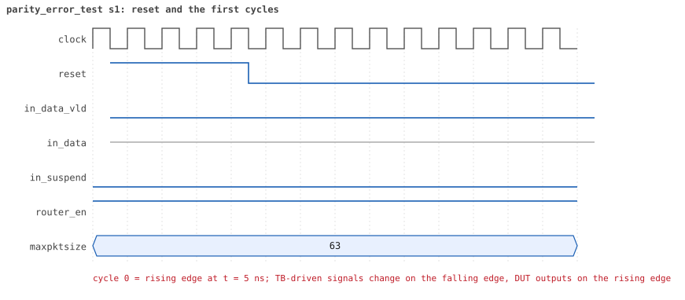
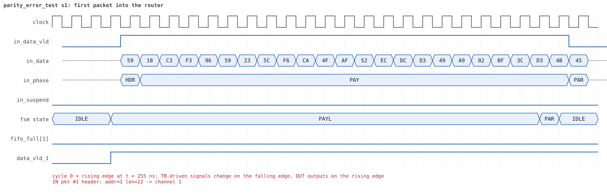
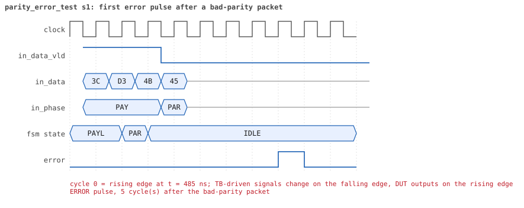
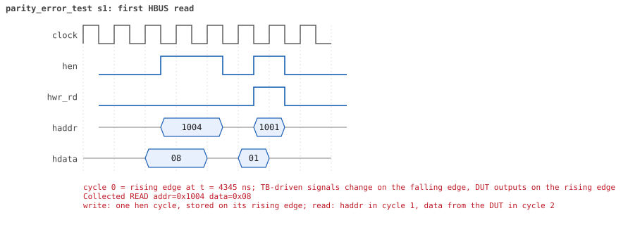

# parity_error_test  seed 1

**Result:** PASSED (0 UVM_ERROR, 0 UVM_WARNING, 0 UVM_FATAL) · bench `yapp_project_tb` · sim time 7us · log `parity_error_test_s1.log`

Waves: `parity_error_test_s1.fst` (GTKWave, Surfer or the VS Code wave viewer); signal trace: `signals.csv`.
[Open the waves in Surfer](https://app.surfer-project.org/?load_url=https%3A%2F%2Fraw.githubusercontent.com%2Ftamirgabgab%2FQcom-Mentoring%2Fmain%2Fyapp_project%2Fregression%2Fyapp_project_tb%2Fparity_error_test_s1%2Fparity_error_test_s1.fst&startup_commands=run_command_file_from_url%20https%3A%2F%2Fraw.githubusercontent.com%2Ftamirgabgab%2FQcom-Mentoring%2Fmain%2Fyapp_project%2Ftb%2Fyapp_router.sucl) (web app, the signals already in groups: `yapp_project/tb/yapp_router.sucl`).

## Summary

- YAPP driver sent **12** packet(s) (12 with bad parity); the input monitor saw 12.
- Router: **12** forwarded, **0** dropped.
- Packets out: ch0 **2**, ch1 **3**, ch2 **7**.
- Scoreboard: 12 matched, 0 mismatched, 0 unexpected.
- Back-pressure: in_suspend asserted **1** time(s), longest hold 7 cycle(s).
- Error pulses: 12.
- HBUS: 2 write(s), 2 read(s).

## Stages

| time (ns) | stage |
|---|---|
| 0 | 1. en_reg=0x03 (parity counter on): 8 bad-parity packets, 8 pulses, counter 8, all delivered |
| 4380 | 2. en_reg=0x01 (counter off): 4 more bad packets, pulses still come, counter stays 8 |

## Pictures

**reset and the first cycles**

**first packet into the router**

**first packet out on channel 1**

**first back-pressure on the input port**

**first error pulse after a bad-parity packet**

**first HBUS write**

**first HBUS read**

## Timeline

195 events (the same list is in `timeline.csv`).

| time (ns) | who | event |
|---|---|---|
| 0 | yapp monitor | YAPP monitor running |
| 0 | **test** | STAGE: 1. en_reg=0x03 (parity counter on): 8 bad-parity packets, 8 pulses, counter 8, all delivered |
| 0 | clk/rst driver | Starting clock (period 10) and holding reset for 5 cycles |
| 0 | **DUT** | RESET asserted |
| 50 | **DUT** | RESET released: router_en=1 maxpktsize=63 |
| 70 | hbus driver | Executed WRITE addr=0x1001 data=0x03 |
| 70 | yapp driver | TX pkt #1: addr=1 len=22 parity=bad delay=20 |
| 75 | hbus monitor | Collected WRITE addr=0x1001 data=0x03 |
| 75 | reference | router_en is now 1 (en_reg 0x03) |
| 285 | **DUT** | IN  pkt #1 header: addr=1 len=22 -> channel 1 |
| 375 | **DUT** | OUT ch1 pkt #1 start: addr=1 len=22 (receiver waited 8 cycle(s)) |
| 515 | **DUT** | IN  pkt #1 complete: addr=1 len=22 parity=BAD forwarded, 24 bytes in 24 cycles (held 0) |
| 515 | yapp monitor | RX pkt #1 on the input: addr=1 len=22 parity=bad gap=23 |
| 515 | reference | Packet forwarded: addr=1 len=22 -> channel 1 |
| 520 | yapp driver | TX pkt #1 accepted by the DUT |
| 520 | yapp driver | TX pkt #2: addr=0 len=42 parity=bad delay=19 |
| 570 | **DUT** | ERROR pulse, 5 cycle(s) after the bad-parity packet |
| 570 | error checker | error pulse 5 cycles after the bad packet (0 still owed) |
| 600 | ch1 driver | ch1: packet consumed (response delay 8) |
| 615 | **DUT** | OUT ch1 pkt #1 done: 24 bytes in 25 cycles |
| 615 | ch1 monitor | ch1 RX pkt #1: addr=1 len=22 parity=bad |
| 615 | scoreboard | ch1 pkt matched: addr=1 len=22 (1 matched so far) |
| 715 | **DUT** | IN  pkt #2 header: addr=0 len=42 -> channel 0 |
| 755 | **DUT** | OUT ch0 pkt #1 start: addr=0 len=42 (receiver waited 3 cycle(s)) |
| 790 | ch1 driver | ch1: packet consumed (response delay 0) |
| 1145 | **DUT** | IN  pkt #2 complete: addr=0 len=42 parity=BAD forwarded, 44 bytes in 44 cycles (held 0) |
| 1145 | yapp monitor | RX pkt #2 on the input: addr=0 len=42 parity=bad gap=19 |
| 1145 | reference | Packet forwarded: addr=0 len=42 -> channel 0 |
| 1150 | yapp driver | TX pkt #2 accepted by the DUT |
| 1150 | yapp driver | TX pkt #3: addr=2 len=26 parity=bad delay=4 |
| 1180 | ch0 driver | ch0: packet consumed (response delay 3) |
| 1190 | **DUT** | ERROR pulse, 4 cycle(s) after the bad-parity packet |
| 1190 | error checker | error pulse 4 cycles after the bad packet (0 still owed) |
| 1195 | **DUT** | IN  pkt #3 header: addr=2 len=26 -> channel 2 |
| 1275 | **DUT** | OUT ch0 pkt #1 done: 44 bytes in 53 cycles |
| 1275 | ch0 monitor | ch0 RX pkt #1: addr=0 len=42 parity=bad |
| 1275 | scoreboard | ch0 pkt matched: addr=0 len=42 (2 matched so far) |
| 1285 | **DUT** | OUT ch2 pkt #1 start: addr=2 len=26 (receiver waited 8 cycle(s)) |
| 1465 | **DUT** | IN  pkt #3 complete: addr=2 len=26 parity=BAD forwarded, 28 bytes in 28 cycles (held 0) |
| 1465 | yapp monitor | RX pkt #3 on the input: addr=2 len=26 parity=bad gap=4 |
| 1465 | reference | Packet forwarded: addr=2 len=26 -> channel 2 |
| 1470 | yapp driver | TX pkt #3 accepted by the DUT |
| 1470 | yapp driver | TX pkt #4: addr=2 len=30 parity=bad delay=9 |
| 1510 | **DUT** | ERROR pulse, 4 cycle(s) after the bad-parity packet |
| 1510 | error checker | error pulse 4 cycles after the bad packet (0 still owed) |
| 1550 | ch2 driver | ch2: packet consumed (response delay 8) |
| 1565 | **DUT** | IN  pkt #4 header: addr=2 len=30 -> channel 2 |
| 1645 | **DUT** | OUT ch2 pkt #1 done: 28 bytes in 37 cycles |
| 1645 | ch2 monitor | ch2 RX pkt #1: addr=2 len=26 parity=bad |
| 1645 | scoreboard | ch2 pkt matched: addr=2 len=26 (3 matched so far) |
| 1655 | **DUT** | OUT ch2 pkt #2 start: addr=2 len=30 (receiver waited 0 cycle(s)) |
| 1800 | ch0 driver | ch0: packet consumed (response delay 8) |
| 1875 | **DUT** | IN  pkt #4 complete: addr=2 len=30 parity=BAD forwarded, 32 bytes in 32 cycles (held 0) |
| 1875 | yapp monitor | RX pkt #4 on the input: addr=2 len=30 parity=bad gap=9 |
| 1875 | reference | Packet forwarded: addr=2 len=30 -> channel 2 |
| 1880 | yapp driver | TX pkt #4 accepted by the DUT |
| 1880 | yapp driver | TX pkt #5: addr=0 len=57 parity=bad delay=20 |
| 1950 | **DUT** | ERROR pulse, 7 cycle(s) after the bad-parity packet |
| 1950 | error checker | error pulse 7 cycles after the bad packet (0 still owed) |
| 1965 | **DUT** | OUT ch2 pkt #2 done: 32 bytes in 32 cycles |
| 1965 | ch2 monitor | ch2 RX pkt #2: addr=2 len=30 parity=bad |
| 1965 | scoreboard | ch2 pkt matched: addr=2 len=30 (4 matched so far) |
| 2000 | ch2 driver | ch2: packet consumed (response delay 8) |
| 2085 | **DUT** | IN  pkt #5 header: addr=0 len=57 -> channel 0 |
| 2145 | **DUT** | OUT ch0 pkt #2 start: addr=0 len=57 (receiver waited 5 cycle(s)) |
| 2665 | **DUT** | IN  pkt #5 complete: addr=0 len=57 parity=BAD forwarded, 59 bytes in 59 cycles (held 0) |
| 2665 | yapp monitor | RX pkt #5 on the input: addr=0 len=57 parity=bad gap=20 |
| 2665 | reference | Packet forwarded: addr=0 len=57 -> channel 0 |
| 2670 | yapp driver | TX pkt #5 accepted by the DUT |
| 2670 | yapp driver | TX pkt #6: addr=1 len=30 parity=bad delay=17 |
| 2720 | ch0 driver | ch0: packet consumed (response delay 5) |
| 2730 | **DUT** | ERROR pulse, 6 cycle(s) after the bad-parity packet |
| 2730 | error checker | error pulse 6 cycles after the bad packet (0 still owed) |
| 2755 | **DUT** | OUT ch0 pkt #2 done: 59 bytes in 62 cycles |
| 2755 | ch0 monitor | ch0 RX pkt #2: addr=0 len=57 parity=bad |
| 2755 | scoreboard | ch0 pkt matched: addr=0 len=57 (5 matched so far) |
| 2845 | **DUT** | IN  pkt #6 header: addr=1 len=30 -> channel 1 |
| 2915 | **DUT** | OUT ch1 pkt #2 start: addr=1 len=30 (receiver waited 6 cycle(s)) |
| 3155 | **DUT** | IN  pkt #6 complete: addr=1 len=30 parity=BAD forwarded, 32 bytes in 32 cycles (held 0) |
| 3155 | yapp monitor | RX pkt #6 on the input: addr=1 len=30 parity=bad gap=17 |
| 3155 | reference | Packet forwarded: addr=1 len=30 -> channel 1 |
| 3160 | yapp driver | TX pkt #6 accepted by the DUT |
| 3160 | yapp driver | TX pkt #7: addr=2 len=17 parity=bad delay=4 |
| 3180 | ch0 driver | ch0: packet consumed (response delay 2) |
| 3205 | **DUT** | IN  pkt #7 header: addr=2 len=17 -> channel 2 |
| 3220 | ch1 driver | ch1: packet consumed (response delay 6) |
| 3230 | **DUT** | ERROR pulse, 7 cycle(s) after the bad-parity packet |
| 3230 | error checker | error pulse 7 cycles after the bad packet (0 still owed) |
| 3315 | **DUT** | OUT ch2 pkt #3 start: addr=2 len=17 (receiver waited 10 cycle(s)) |
| 3335 | **DUT** | OUT ch1 pkt #2 done: 32 bytes in 43 cycles |
| 3335 | ch1 monitor | ch1 RX pkt #2: addr=1 len=30 parity=bad |
| 3335 | scoreboard | ch1 pkt matched: addr=1 len=30 (6 matched so far) |
| 3385 | **DUT** | IN  pkt #7 complete: addr=2 len=17 parity=BAD forwarded, 19 bytes in 19 cycles (held 0) |
| 3385 | yapp monitor | RX pkt #7 on the input: addr=2 len=17 parity=bad gap=4 |
| 3385 | reference | Packet forwarded: addr=2 len=17 -> channel 2 |
| 3390 | yapp driver | TX pkt #7 accepted by the DUT |
| 3390 | yapp driver | TX pkt #8: addr=1 len=58 parity=bad delay=3 |
| 3425 | **DUT** | IN  pkt #8 header: addr=1 len=58 -> channel 1 |
| 3430 | **DUT** | ERROR pulse, 4 cycle(s) after the bad-parity packet |
| 3430 | error checker | error pulse 4 cycles after the bad packet (0 still owed) |
| 3435 | **DUT** | OUT ch1 pkt #3 start: addr=1 len=58 (receiver waited 0 cycle(s)) |
| 3490 | ch2 driver | ch2: packet consumed (response delay 10) |
| 3565 | **DUT** | OUT ch2 pkt #3 done: 19 bytes in 26 cycles |
| 3565 | ch2 monitor | ch2 RX pkt #3: addr=2 len=17 parity=bad |
| 3565 | scoreboard | ch2 pkt matched: addr=2 len=17 (7 matched so far) |
| 3690 | ch1 driver | ch1: packet consumed (response delay 10) |
| 3810 | ch2 driver | ch2: packet consumed (response delay 6) |
| 3930 | ch1 driver | ch1: packet consumed (response delay 10) |
| 3975 | **DUT** | SUSPEND asserted: FIFO 1 full, byte 0xd2 held (pkt #8) |
| 4045 | **DUT** | SUSPEND released after 7 cycle(s) |
| 4085 | **DUT** | IN  pkt #8 complete: addr=1 len=58 parity=BAD forwarded, 60 bytes in 67 cycles (held 7) |
| 4085 | yapp monitor | RX pkt #8 on the input: addr=1 len=58 parity=bad gap=3 |
| 4085 | reference | Packet forwarded: addr=1 len=58 -> channel 1 |
| 4090 | yapp driver | TX pkt #8 accepted by the DUT |
| 4130 | **DUT** | ERROR pulse, 4 cycle(s) after the bad-parity packet |
| 4130 | error checker | error pulse 4 cycles after the bad packet (0 still owed) |
| 4235 | **DUT** | OUT ch1 pkt #3 done: 60 bytes in 81 cycles |
| 4235 | ch1 monitor | ch1 RX pkt #3: addr=1 len=58 parity=bad |
| 4235 | scoreboard | ch1 pkt matched: addr=1 len=58 (8 matched so far) |
| 4380 | hbus driver | Executed READ  addr=0x1004 data=0x08 |
| 4380 | **test** | parity_err_cnt_reg reads 8 as expected |
| 4380 | **test** | STAGE: 2. en_reg=0x01 (counter off): 4 more bad packets, pulses still come, counter stays 8 |
| 4385 | hbus monitor | Collected READ  addr=0x1004 data=0x08 |
| 4400 | hbus driver | Executed WRITE addr=0x1001 data=0x01 |
| 4400 | yapp driver | TX pkt #9: addr=2 len=29 parity=bad delay=1 |
| 4405 | hbus monitor | Collected WRITE addr=0x1001 data=0x01 |
| 4405 | reference | router_en is now 1 (en_reg 0x01) |
| 4425 | **DUT** | IN  pkt #9 header: addr=2 len=29 -> channel 2 |
| 4465 | **DUT** | OUT ch2 pkt #4 start: addr=2 len=29 (receiver waited 3 cycle(s)) |
| 4600 | ch1 driver | ch1: packet consumed (response delay 9) |
| 4725 | **DUT** | IN  pkt #9 complete: addr=2 len=29 parity=BAD forwarded, 31 bytes in 31 cycles (held 0) |
| 4725 | yapp monitor | RX pkt #9 on the input: addr=2 len=29 parity=bad gap=33 |
| 4725 | reference | Packet forwarded: addr=2 len=29 -> channel 2 |
| 4730 | yapp driver | TX pkt #9 accepted by the DUT |
| 4730 | yapp driver | TX pkt #10: addr=2 len=49 parity=bad delay=16 |
| 4760 | ch2 driver | ch2: packet consumed (response delay 3) |
| 4770 | **DUT** | ERROR pulse, 4 cycle(s) after the bad-parity packet |
| 4770 | error checker | error pulse 4 cycles after the bad packet (0 still owed) |
| 4835 | **DUT** | OUT ch2 pkt #4 done: 31 bytes in 38 cycles |
| 4835 | ch2 monitor | ch2 RX pkt #4: addr=2 len=29 parity=bad |
| 4835 | scoreboard | ch2 pkt matched: addr=2 len=29 (9 matched so far) |
| 4895 | **DUT** | IN  pkt #10 header: addr=2 len=49 -> channel 2 |
| 4905 | **DUT** | OUT ch2 pkt #5 start: addr=2 len=49 (receiver waited 0 cycle(s)) |
| 5220 | ch2 driver | ch2: packet consumed (response delay 6) |
| 5395 | **DUT** | IN  pkt #10 complete: addr=2 len=49 parity=BAD forwarded, 51 bytes in 51 cycles (held 0) |
| 5395 | yapp monitor | RX pkt #10 on the input: addr=2 len=49 parity=bad gap=16 |
| 5395 | reference | Packet forwarded: addr=2 len=49 -> channel 2 |
| 5400 | yapp driver | TX pkt #10 accepted by the DUT |
| 5400 | yapp driver | TX pkt #11: addr=2 len=6 parity=bad delay=2 |
| 5425 | **DUT** | IN  pkt #11 header: addr=2 len=6 -> channel 2 |
| 5470 | **DUT** | ERROR pulse, 7 cycle(s) after the bad-parity packet |
| 5470 | error checker | error pulse 7 cycles after the bad packet (0 still owed) |
| 5495 | **DUT** | IN  pkt #11 complete: addr=2 len=6 parity=BAD forwarded, 8 bytes in 8 cycles (held 0) |
| 5495 | **DUT** | OUT ch2 pkt #5 done: 51 bytes in 60 cycles |
| 5495 | ch2 monitor | ch2 RX pkt #5: addr=2 len=49 parity=bad |
| 5495 | scoreboard | ch2 pkt matched: addr=2 len=49 (10 matched so far) |
| 5495 | yapp monitor | RX pkt #11 on the input: addr=2 len=6 parity=bad gap=2 |
| 5495 | reference | Packet forwarded: addr=2 len=6 -> channel 2 |
| 5500 | yapp driver | TX pkt #11 accepted by the DUT |
| 5500 | yapp driver | TX pkt #12: addr=2 len=55 parity=bad delay=20 |
| 5505 | **DUT** | OUT ch2 pkt #6 start: addr=2 len=6 (receiver waited 0 cycle(s)) |
| 5510 | **DUT** | ERROR pulse, 1 cycle(s) after the bad-parity packet |
| 5510 | error checker | error pulse 1 cycles after the bad packet (0 still owed) |
| 5575 | **DUT** | OUT ch2 pkt #6 done: 8 bytes in 8 cycles |
| 5575 | ch2 monitor | ch2 RX pkt #6: addr=2 len=6 parity=bad |
| 5575 | scoreboard | ch2 pkt matched: addr=2 len=6 (11 matched so far) |
| 5705 | **DUT** | IN  pkt #12 header: addr=2 len=55 -> channel 2 |
| 5715 | **DUT** | OUT ch2 pkt #7 start: addr=2 len=55 (receiver waited 0 cycle(s)) |
| 5830 | ch2 driver | ch2: packet consumed (response delay 8) |
| 6220 | ch2 driver | ch2: packet consumed (response delay 7) |
| 6265 | **DUT** | IN  pkt #12 complete: addr=2 len=55 parity=BAD forwarded, 57 bytes in 57 cycles (held 0) |
| 6265 | yapp monitor | RX pkt #12 on the input: addr=2 len=55 parity=bad gap=20 |
| 6265 | reference | Packet forwarded: addr=2 len=55 -> channel 2 |
| 6270 | yapp driver | TX pkt #12 accepted by the DUT |
| 6310 | **DUT** | ERROR pulse, 4 cycle(s) after the bad-parity packet |
| 6310 | error checker | error pulse 4 cycles after the bad packet (0 still owed) |
| 6415 | **DUT** | OUT ch2 pkt #7 done: 57 bytes in 71 cycles |
| 6415 | ch2 monitor | ch2 RX pkt #7: addr=2 len=55 parity=bad |
| 6415 | scoreboard | ch2 pkt matched: addr=2 len=55 (12 matched so far) |
| 6560 | hbus driver | Executed READ  addr=0x1004 data=0x08 |
| 6560 | **test** | parity_err_cnt_reg reads 8 as expected |
| 6565 | hbus monitor | Collected READ  addr=0x1004 data=0x08 |
| 6760 | error checker | error pulse report: 12 bad packets, 12 pulses, 0 outside 1..10 cycles, at most 1 owed at once |
| 6760 | ch0 monitor | Channel 0 report: 2 packets collected |
| 6760 | ch1 monitor | Channel 1 report: 3 packets collected |
| 6760 | ch2 monitor | Channel 2 report: 7 packets collected |
| 6760 | hbus monitor | HBUS report: 2 writes, 2 reads |
| 6760 | coverage | Coverage of the router configuration: 30.4% |
| 6760 | reference |  |
| 6760 | scoreboard |  |
| 6760 | yapp driver | YAPP driver report: 12 packets sent |
| 6760 | coverage | YAPP gap coverage: 11 gaps sampled, coverage 50.0% |
| 6760 | yapp monitor | YAPP monitor report: 12 packets collected, 12 with bad parity |
| 6760 | yapp monitor | YAPP gaps: 0 back to back, 0 of 1 cycle, 1 of 2, 10 longer |
| 6760 | coverage | YAPP packet coverage: 12 packets sampled, coverage 56.7% |
