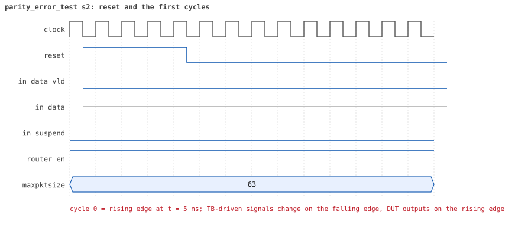
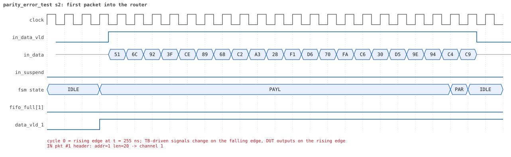
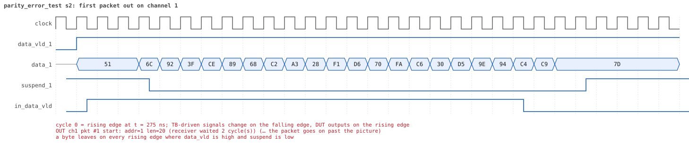
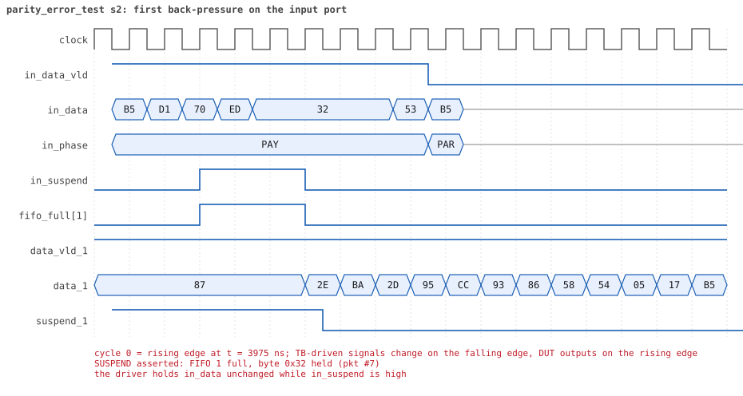
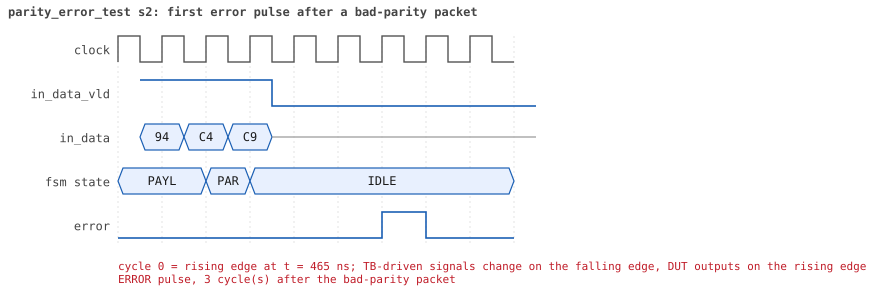
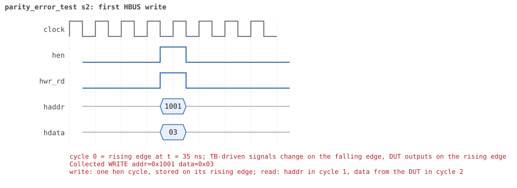
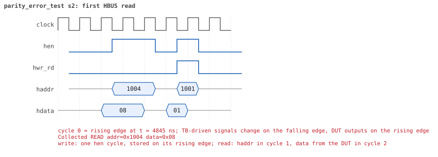

# parity_error_test  seed 2

**Result:** PASSED (0 UVM_ERROR, 0 UVM_WARNING, 0 UVM_FATAL) · bench `yapp_project_tb` · sim time 7us · log `parity_error_test_s2.log`

Waves: `parity_error_test_s2.fst` (GTKWave, Surfer or the VS Code wave viewer); signal trace: `signals.csv`.
[Open the waves in Surfer](https://app.surfer-project.org/?load_url=https%3A%2F%2Fraw.githubusercontent.com%2Ftamirgabgab%2FQcom-Mentoring%2Fmain%2Fyapp_project%2Fregression%2Fyapp_project_tb%2Fparity_error_test_s2%2Fparity_error_test_s2.fst&startup_commands=run_command_file_from_url%20https%3A%2F%2Fraw.githubusercontent.com%2Ftamirgabgab%2FQcom-Mentoring%2Fmain%2Fyapp_project%2Ftb%2Fyapp_router.sucl) (web app, the signals already in groups: `yapp_project/tb/yapp_router.sucl`).

## Summary

- YAPP driver sent **12** packet(s) (12 with bad parity); the input monitor saw 12.
- Router: **12** forwarded, **0** dropped.
- Packets out: ch0 **1**, ch1 **8**, ch2 **3**.
- Scoreboard: 12 matched, 0 mismatched, 0 unexpected.
- Back-pressure: in_suspend asserted **1** time(s), longest hold 3 cycle(s).
- Error pulses: 12.
- HBUS: 2 write(s), 2 read(s).

## Stages

| time (ns) | stage |
|---|---|
| 0 | 1. en_reg=0x03 (parity counter on): 8 bad-parity packets, 8 pulses, counter 8, all delivered |
| 4880 | 2. en_reg=0x01 (counter off): 4 more bad packets, pulses still come, counter stays 8 |

## Pictures

**reset and the first cycles**

**first packet into the router**

**first packet out on channel 1**

**first back-pressure on the input port**

**first error pulse after a bad-parity packet**

**first HBUS write**

**first HBUS read**

## Timeline

196 events (the same list is in `timeline.csv`).

| time (ns) | who | event |
|---|---|---|
| 0 | yapp monitor | YAPP monitor running |
| 0 | **test** | STAGE: 1. en_reg=0x03 (parity counter on): 8 bad-parity packets, 8 pulses, counter 8, all delivered |
| 0 | clk/rst driver | Starting clock (period 10) and holding reset for 5 cycles |
| 0 | **DUT** | RESET asserted |
| 50 | **DUT** | RESET released: router_en=1 maxpktsize=63 |
| 70 | hbus driver | Executed WRITE addr=0x1001 data=0x03 |
| 70 | yapp driver | TX pkt #1: addr=1 len=20 parity=bad delay=20 |
| 75 | hbus monitor | Collected WRITE addr=0x1001 data=0x03 |
| 75 | reference | router_en is now 1 (en_reg 0x03) |
| 285 | **DUT** | IN  pkt #1 header: addr=1 len=20 -> channel 1 |
| 315 | **DUT** | OUT ch1 pkt #1 start: addr=1 len=20 (receiver waited 2 cycle(s)) |
| 495 | **DUT** | IN  pkt #1 complete: addr=1 len=20 parity=BAD forwarded, 22 bytes in 22 cycles (held 0) |
| 495 | yapp monitor | RX pkt #1 on the input: addr=1 len=20 parity=bad gap=23 |
| 495 | reference | Packet forwarded: addr=1 len=20 -> channel 1 |
| 500 | yapp driver | TX pkt #1 accepted by the DUT |
| 500 | yapp driver | TX pkt #2: addr=1 len=30 parity=bad delay=11 |
| 520 | ch1 driver | ch1: packet consumed (response delay 2) |
| 530 | **DUT** | ERROR pulse, 3 cycle(s) after the bad-parity packet |
| 530 | error checker | error pulse 3 cycles after the bad packet (0 still owed) |
| 605 | **DUT** | OUT ch1 pkt #1 done: 22 bytes in 30 cycles |
| 605 | ch1 monitor | ch1 RX pkt #1: addr=1 len=20 parity=bad |
| 605 | scoreboard | ch1 pkt matched: addr=1 len=20 (1 matched so far) |
| 615 | **DUT** | IN  pkt #2 header: addr=1 len=30 -> channel 1 |
| 625 | **DUT** | OUT ch1 pkt #2 start: addr=1 len=30 (receiver waited 0 cycle(s)) |
| 920 | ch1 driver | ch1: packet consumed (response delay 7) |
| 925 | **DUT** | IN  pkt #2 complete: addr=1 len=30 parity=BAD forwarded, 32 bytes in 32 cycles (held 0) |
| 925 | yapp monitor | RX pkt #2 on the input: addr=1 len=30 parity=bad gap=11 |
| 925 | reference | Packet forwarded: addr=1 len=30 -> channel 1 |
| 930 | yapp driver | TX pkt #2 accepted by the DUT |
| 930 | yapp driver | TX pkt #3: addr=2 len=59 parity=bad delay=8 |
| 1010 | **DUT** | ERROR pulse, 8 cycle(s) after the bad-parity packet |
| 1010 | error checker | error pulse 8 cycles after the bad packet (0 still owed) |
| 1015 | **DUT** | IN  pkt #3 header: addr=2 len=59 -> channel 2 |
| 1035 | **DUT** | OUT ch1 pkt #2 done: 32 bytes in 42 cycles |
| 1035 | ch1 monitor | ch1 RX pkt #2: addr=1 len=30 parity=bad |
| 1035 | scoreboard | ch1 pkt matched: addr=1 len=30 (2 matched so far) |
| 1125 | **DUT** | OUT ch2 pkt #1 start: addr=2 len=59 (receiver waited 10 cycle(s)) |
| 1615 | **DUT** | IN  pkt #3 complete: addr=2 len=59 parity=BAD forwarded, 61 bytes in 61 cycles (held 0) |
| 1615 | yapp monitor | RX pkt #3 on the input: addr=2 len=59 parity=bad gap=8 |
| 1615 | reference | Packet forwarded: addr=2 len=59 -> channel 2 |
| 1620 | yapp driver | TX pkt #3 accepted by the DUT |
| 1620 | yapp driver | TX pkt #4: addr=2 len=49 parity=bad delay=20 |
| 1650 | **DUT** | ERROR pulse, 3 cycle(s) after the bad-parity packet |
| 1650 | error checker | error pulse 3 cycles after the bad packet (0 still owed) |
| 1650 | ch1 driver | ch1: packet consumed (response delay 9) |
| 1720 | ch2 driver | ch2: packet consumed (response delay 10) |
| 1825 | **DUT** | IN  pkt #4 header: addr=2 len=49 -> channel 2 |
| 1835 | **DUT** | OUT ch2 pkt #1 done: 61 bytes in 72 cycles |
| 1835 | ch2 monitor | ch2 RX pkt #1: addr=2 len=59 parity=bad |
| 1835 | scoreboard | ch2 pkt matched: addr=2 len=59 (3 matched so far) |
| 1845 | **DUT** | OUT ch2 pkt #2 start: addr=2 len=49 (receiver waited 0 cycle(s)) |
| 2180 | ch2 driver | ch2: packet consumed (response delay 10) |
| 2325 | **DUT** | IN  pkt #4 complete: addr=2 len=49 parity=BAD forwarded, 51 bytes in 51 cycles (held 0) |
| 2325 | yapp monitor | RX pkt #4 on the input: addr=2 len=49 parity=bad gap=20 |
| 2325 | reference | Packet forwarded: addr=2 len=49 -> channel 2 |
| 2330 | yapp driver | TX pkt #4 accepted by the DUT |
| 2330 | yapp driver | TX pkt #5: addr=1 len=30 parity=bad delay=16 |
| 2370 | **DUT** | ERROR pulse, 4 cycle(s) after the bad-parity packet |
| 2370 | error checker | error pulse 4 cycles after the bad packet (0 still owed) |
| 2395 | **DUT** | OUT ch2 pkt #2 done: 51 bytes in 56 cycles |
| 2395 | ch2 monitor | ch2 RX pkt #2: addr=2 len=49 parity=bad |
| 2395 | scoreboard | ch2 pkt matched: addr=2 len=49 (4 matched so far) |
| 2440 | ch2 driver | ch2: packet consumed (response delay 4) |
| 2495 | **DUT** | IN  pkt #5 header: addr=1 len=30 -> channel 1 |
| 2585 | **DUT** | OUT ch1 pkt #3 start: addr=1 len=30 (receiver waited 8 cycle(s)) |
| 2805 | **DUT** | IN  pkt #5 complete: addr=1 len=30 parity=BAD forwarded, 32 bytes in 32 cycles (held 0) |
| 2805 | yapp monitor | RX pkt #5 on the input: addr=1 len=30 parity=bad gap=16 |
| 2805 | reference | Packet forwarded: addr=1 len=30 -> channel 1 |
| 2810 | yapp driver | TX pkt #5 accepted by the DUT |
| 2810 | yapp driver | TX pkt #6: addr=1 len=47 parity=bad delay=14 |
| 2850 | **DUT** | ERROR pulse, 4 cycle(s) after the bad-parity packet |
| 2850 | error checker | error pulse 4 cycles after the bad packet (0 still owed) |
| 2890 | ch1 driver | ch1: packet consumed (response delay 8) |
| 2915 | **DUT** | OUT ch1 pkt #3 done: 32 bytes in 34 cycles |
| 2915 | ch1 monitor | ch1 RX pkt #3: addr=1 len=30 parity=bad |
| 2915 | scoreboard | ch1 pkt matched: addr=1 len=30 (5 matched so far) |
| 2955 | **DUT** | IN  pkt #6 header: addr=1 len=47 -> channel 1 |
| 2965 | **DUT** | OUT ch1 pkt #4 start: addr=1 len=47 (receiver waited 0 cycle(s)) |
| 3130 | ch1 driver | ch1: packet consumed (response delay 1) |
| 3390 | ch1 driver | ch1: packet consumed (response delay 9) |
| 3435 | **DUT** | IN  pkt #6 complete: addr=1 len=47 parity=BAD forwarded, 49 bytes in 49 cycles (held 0) |
| 3435 | yapp monitor | RX pkt #6 on the input: addr=1 len=47 parity=bad gap=14 |
| 3435 | reference | Packet forwarded: addr=1 len=47 -> channel 1 |
| 3440 | yapp driver | TX pkt #6 accepted by the DUT |
| 3440 | yapp driver | TX pkt #7: addr=1 len=42 parity=bad delay=16 |
| 3470 | **DUT** | ERROR pulse, 3 cycle(s) after the bad-parity packet |
| 3470 | error checker | error pulse 3 cycles after the bad packet (0 still owed) |
| 3510 | ch1 driver | ch1: packet consumed (response delay 3) |
| 3605 | **DUT** | IN  pkt #7 header: addr=1 len=42 -> channel 1 |
| 3675 | **DUT** | OUT ch1 pkt #4 done: 49 bytes in 72 cycles |
| 3675 | ch1 monitor | ch1 RX pkt #4: addr=1 len=47 parity=bad |
| 3675 | scoreboard | ch1 pkt matched: addr=1 len=47 (6 matched so far) |
| 3685 | **DUT** | OUT ch1 pkt #5 start: addr=1 len=42 (receiver waited 0 cycle(s)) |
| 3930 | ch1 driver | ch1: packet consumed (response delay 8) |
| 4015 | **DUT** | SUSPEND asserted: FIFO 1 full, byte 0x32 held (pkt #7) |
| 4045 | **DUT** | SUSPEND released after 3 cycle(s) |
| 4065 | **DUT** | IN  pkt #7 complete: addr=1 len=42 parity=BAD forwarded, 44 bytes in 47 cycles (held 3) |
| 4065 | yapp monitor | RX pkt #7 on the input: addr=1 len=42 parity=bad gap=16 |
| 4065 | reference | Packet forwarded: addr=1 len=42 -> channel 1 |
| 4070 | yapp driver | TX pkt #7 accepted by the DUT |
| 4070 | yapp driver | TX pkt #8: addr=1 len=43 parity=bad delay=20 |
| 4090 | **DUT** | ERROR pulse, 2 cycle(s) after the bad-parity packet |
| 4090 | error checker | error pulse 2 cycles after the bad packet (0 still owed) |
| 4215 | **DUT** | OUT ch1 pkt #5 done: 44 bytes in 54 cycles |
| 4215 | ch1 monitor | ch1 RX pkt #5: addr=1 len=42 parity=bad |
| 4215 | scoreboard | ch1 pkt matched: addr=1 len=42 (7 matched so far) |
| 4275 | **DUT** | IN  pkt #8 header: addr=1 len=43 -> channel 1 |
| 4285 | **DUT** | OUT ch1 pkt #6 start: addr=1 len=43 (receiver waited 0 cycle(s)) |
| 4370 | ch1 driver | ch1: packet consumed (response delay 9) |
| 4715 | **DUT** | IN  pkt #8 complete: addr=1 len=43 parity=BAD forwarded, 45 bytes in 45 cycles (held 0) |
| 4715 | yapp monitor | RX pkt #8 on the input: addr=1 len=43 parity=bad gap=20 |
| 4715 | reference | Packet forwarded: addr=1 len=43 -> channel 1 |
| 4720 | yapp driver | TX pkt #8 accepted by the DUT |
| 4735 | **DUT** | OUT ch1 pkt #6 done: 45 bytes in 46 cycles |
| 4735 | ch1 monitor | ch1 RX pkt #6: addr=1 len=43 parity=bad |
| 4735 | scoreboard | ch1 pkt matched: addr=1 len=43 (8 matched so far) |
| 4750 | **DUT** | ERROR pulse, 3 cycle(s) after the bad-parity packet |
| 4750 | error checker | error pulse 3 cycles after the bad packet (0 still owed) |
| 4800 | ch1 driver | ch1: packet consumed (response delay 0) |
| 4880 | hbus driver | Executed READ  addr=0x1004 data=0x08 |
| 4880 | **test** | parity_err_cnt_reg reads 8 as expected |
| 4880 | **test** | STAGE: 2. en_reg=0x01 (counter off): 4 more bad packets, pulses still come, counter stays 8 |
| 4885 | hbus monitor | Collected READ  addr=0x1004 data=0x08 |
| 4900 | hbus driver | Executed WRITE addr=0x1001 data=0x01 |
| 4900 | yapp driver | TX pkt #9: addr=2 len=17 parity=bad delay=15 |
| 4905 | hbus monitor | Collected WRITE addr=0x1001 data=0x01 |
| 4905 | reference | router_en is now 1 (en_reg 0x01) |
| 5065 | **DUT** | IN  pkt #9 header: addr=2 len=17 -> channel 2 |
| 5155 | **DUT** | OUT ch2 pkt #3 start: addr=2 len=17 (receiver waited 8 cycle(s)) |
| 5245 | **DUT** | IN  pkt #9 complete: addr=2 len=17 parity=BAD forwarded, 19 bytes in 19 cycles (held 0) |
| 5245 | yapp monitor | RX pkt #9 on the input: addr=2 len=17 parity=bad gap=34 |
| 5245 | reference | Packet forwarded: addr=2 len=17 -> channel 2 |
| 5250 | yapp driver | TX pkt #9 accepted by the DUT |
| 5250 | yapp driver | TX pkt #10: addr=1 len=49 parity=bad delay=18 |
| 5330 | **DUT** | ERROR pulse, 8 cycle(s) after the bad-parity packet |
| 5330 | error checker | error pulse 8 cycles after the bad packet (0 still owed) |
| 5330 | ch2 driver | ch2: packet consumed (response delay 8) |
| 5375 | **DUT** | OUT ch2 pkt #3 done: 19 bytes in 23 cycles |
| 5375 | ch2 monitor | ch2 RX pkt #3: addr=2 len=17 parity=bad |
| 5375 | scoreboard | ch2 pkt matched: addr=2 len=17 (9 matched so far) |
| 5435 | **DUT** | IN  pkt #10 header: addr=1 len=49 -> channel 1 |
| 5525 | **DUT** | OUT ch1 pkt #7 start: addr=1 len=49 (receiver waited 8 cycle(s)) |
| 5530 | ch2 driver | ch2: packet consumed (response delay 3) |
| 5935 | **DUT** | IN  pkt #10 complete: addr=1 len=49 parity=BAD forwarded, 51 bytes in 51 cycles (held 0) |
| 5935 | yapp monitor | RX pkt #10 on the input: addr=1 len=49 parity=bad gap=18 |
| 5935 | reference | Packet forwarded: addr=1 len=49 -> channel 1 |
| 5940 | yapp driver | TX pkt #10 accepted by the DUT |
| 5940 | yapp driver | TX pkt #11: addr=0 len=2 parity=bad delay=20 |
| 5970 | **DUT** | ERROR pulse, 3 cycle(s) after the bad-parity packet |
| 5970 | error checker | error pulse 3 cycles after the bad packet (0 still owed) |
| 6020 | ch1 driver | ch1: packet consumed (response delay 8) |
| 6055 | **DUT** | OUT ch1 pkt #7 done: 51 bytes in 54 cycles |
| 6055 | ch1 monitor | ch1 RX pkt #7: addr=1 len=49 parity=bad |
| 6055 | scoreboard | ch1 pkt matched: addr=1 len=49 (10 matched so far) |
| 6145 | **DUT** | IN  pkt #11 header: addr=0 len=2 -> channel 0 |
| 6155 | **DUT** | OUT ch0 pkt #1 start: addr=0 len=2 (receiver waited 0 cycle(s)) |
| 6175 | **DUT** | IN  pkt #11 complete: addr=0 len=2 parity=BAD forwarded, 4 bytes in 4 cycles (held 0) |
| 6175 | yapp monitor | RX pkt #11 on the input: addr=0 len=2 parity=bad gap=20 |
| 6175 | reference | Packet forwarded: addr=0 len=2 -> channel 0 |
| 6180 | ch0 driver | ch0: packet consumed (response delay 0) |
| 6180 | yapp driver | TX pkt #11 accepted by the DUT |
| 6180 | yapp driver | TX pkt #12: addr=1 len=1 parity=bad delay=16 |
| 6230 | **DUT** | ERROR pulse, 5 cycle(s) after the bad-parity packet |
| 6230 | error checker | error pulse 5 cycles after the bad packet (0 still owed) |
| 6265 | **DUT** | OUT ch0 pkt #1 done: 4 bytes in 12 cycles |
| 6265 | ch0 monitor | ch0 RX pkt #1: addr=0 len=2 parity=bad |
| 6265 | scoreboard | ch0 pkt matched: addr=0 len=2 (11 matched so far) |
| 6345 | **DUT** | IN  pkt #12 header: addr=1 len=1 -> channel 1 |
| 6355 | **DUT** | OUT ch1 pkt #8 start: addr=1 len=1 (receiver waited 0 cycle(s)) |
| 6365 | **DUT** | IN  pkt #12 complete: addr=1 len=1 parity=BAD forwarded, 3 bytes in 3 cycles (held 0) |
| 6365 | yapp monitor | RX pkt #12 on the input: addr=1 len=1 parity=bad gap=16 |
| 6365 | reference | Packet forwarded: addr=1 len=1 -> channel 1 |
| 6370 | yapp driver | TX pkt #12 accepted by the DUT |
| 6375 | **DUT** | OUT ch1 pkt #8 done: 3 bytes in 3 cycles |
| 6375 | ch1 monitor | ch1 RX pkt #8: addr=1 len=1 parity=bad |
| 6375 | scoreboard | ch1 pkt matched: addr=1 len=1 (12 matched so far) |
| 6450 | **DUT** | ERROR pulse, 8 cycle(s) after the bad-parity packet |
| 6450 | error checker | error pulse 8 cycles after the bad packet (0 still owed) |
| 6450 | ch0 driver | ch0: packet consumed (response delay 7) |
| 6470 | ch1 driver | ch1: packet consumed (response delay 2) |
| 6520 | hbus driver | Executed READ  addr=0x1004 data=0x08 |
| 6520 | **test** | parity_err_cnt_reg reads 8 as expected |
| 6525 | hbus monitor | Collected READ  addr=0x1004 data=0x08 |
| 6720 | error checker | error pulse report: 12 bad packets, 12 pulses, 0 outside 1..10 cycles, at most 1 owed at once |
| 6720 | ch0 monitor | Channel 0 report: 1 packets collected |
| 6720 | ch1 monitor | Channel 1 report: 8 packets collected |
| 6720 | ch2 monitor | Channel 2 report: 3 packets collected |
| 6720 | hbus monitor | HBUS report: 2 writes, 2 reads |
| 6720 | coverage | Coverage of the router configuration: 30.4% |
| 6720 | reference |  |
| 6720 | scoreboard |  |
| 6720 | yapp driver | YAPP driver report: 12 packets sent |
| 6720 | coverage | YAPP gap coverage: 11 gaps sampled, coverage 25.0% |
| 6720 | yapp monitor | YAPP monitor report: 12 packets collected, 12 with bad parity |
| 6720 | yapp monitor | YAPP gaps: 0 back to back, 0 of 1 cycle, 0 of 2, 11 longer |
| 6720 | coverage | YAPP packet coverage: 12 packets sampled, coverage 60.0% |
