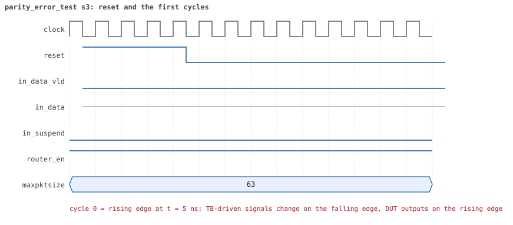
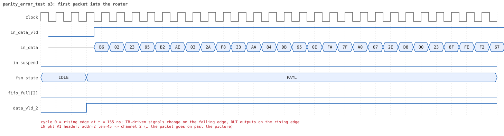
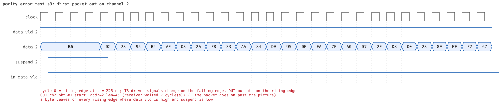
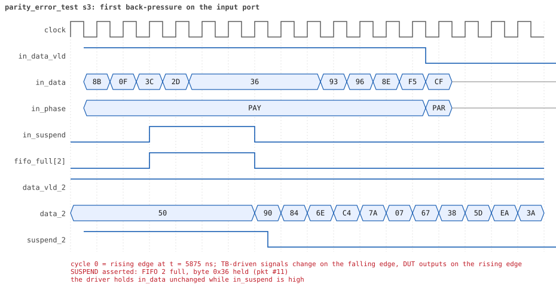
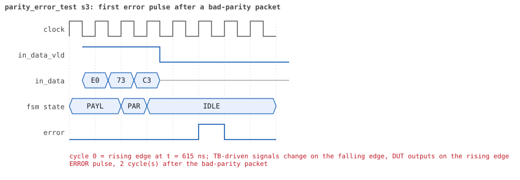
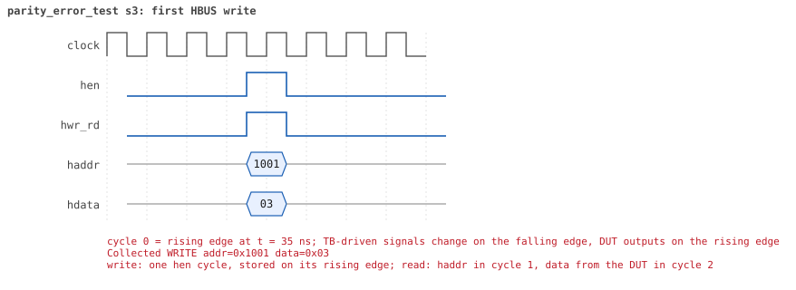
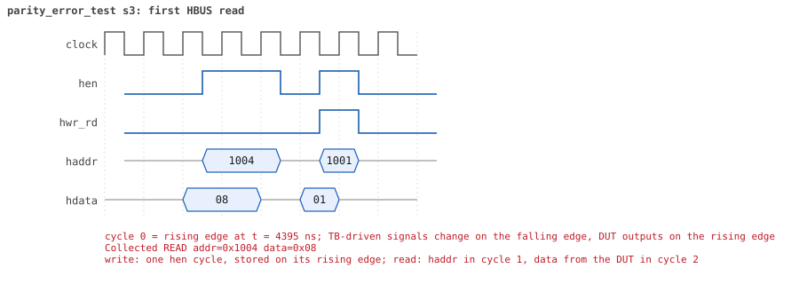

# parity_error_test  seed 3

**Result:** PASSED (0 UVM_ERROR, 0 UVM_WARNING, 0 UVM_FATAL) · bench `yapp_project_tb` · sim time 7us · log `parity_error_test_s3.log`

Waves: `parity_error_test_s3.fst` (GTKWave, Surfer or the VS Code wave viewer); signal trace: `signals.csv`.
[Open the waves in Surfer](https://app.surfer-project.org/?load_url=https%3A%2F%2Fraw.githubusercontent.com%2Ftamirgabgab%2FQcom-Mentoring%2Fmain%2Fyapp_project%2Fregression%2Fyapp_project_tb%2Fparity_error_test_s3%2Fparity_error_test_s3.fst&startup_commands=run_command_file_from_url%20https%3A%2F%2Fraw.githubusercontent.com%2Ftamirgabgab%2FQcom-Mentoring%2Fmain%2Fyapp_project%2Ftb%2Fyapp_router.sucl) (web app, the signals already in groups: `yapp_project/tb/yapp_router.sucl`).

## Summary

- YAPP driver sent **12** packet(s) (12 with bad parity); the input monitor saw 12.
- Router: **12** forwarded, **0** dropped.
- Packets out: ch0 **2**, ch1 **1**, ch2 **9**.
- Scoreboard: 12 matched, 0 mismatched, 0 unexpected.
- Back-pressure: in_suspend asserted **2** time(s), longest hold 4 cycle(s).
- Error pulses: 12.
- HBUS: 2 write(s), 2 read(s).

## Stages

| time (ns) | stage |
|---|---|
| 0 | 1. en_reg=0x03 (parity counter on): 8 bad-parity packets, 8 pulses, counter 8, all delivered |
| 4430 | 2. en_reg=0x01 (counter off): 4 more bad packets, pulses still come, counter stays 8 |

## Pictures

**reset and the first cycles**

**first packet into the router**

**first packet out on channel 2**

**first back-pressure on the input port**

**first error pulse after a bad-parity packet**

**first HBUS write**

**first HBUS read**

## Timeline

200 events (the same list is in `timeline.csv`).

| time (ns) | who | event |
|---|---|---|
| 0 | yapp monitor | YAPP monitor running |
| 0 | **test** | STAGE: 1. en_reg=0x03 (parity counter on): 8 bad-parity packets, 8 pulses, counter 8, all delivered |
| 0 | clk/rst driver | Starting clock (period 10) and holding reset for 5 cycles |
| 0 | **DUT** | RESET asserted |
| 50 | **DUT** | RESET released: router_en=1 maxpktsize=63 |
| 70 | hbus driver | Executed WRITE addr=0x1001 data=0x03 |
| 70 | yapp driver | TX pkt #1: addr=2 len=45 parity=bad delay=10 |
| 75 | hbus monitor | Collected WRITE addr=0x1001 data=0x03 |
| 75 | reference | router_en is now 1 (en_reg 0x03) |
| 185 | **DUT** | IN  pkt #1 header: addr=2 len=45 -> channel 2 |
| 265 | **DUT** | OUT ch2 pkt #1 start: addr=2 len=45 (receiver waited 7 cycle(s)) |
| 645 | **DUT** | IN  pkt #1 complete: addr=2 len=45 parity=BAD forwarded, 47 bytes in 47 cycles (held 0) |
| 645 | yapp monitor | RX pkt #1 on the input: addr=2 len=45 parity=bad gap=13 |
| 645 | reference | Packet forwarded: addr=2 len=45 -> channel 2 |
| 650 | yapp driver | TX pkt #1 accepted by the DUT |
| 650 | yapp driver | TX pkt #2: addr=0 len=34 parity=bad delay=20 |
| 670 | **DUT** | ERROR pulse, 2 cycle(s) after the bad-parity packet |
| 670 | error checker | error pulse 2 cycles after the bad packet (0 still owed) |
| 720 | ch2 driver | ch2: packet consumed (response delay 7) |
| 775 | **DUT** | OUT ch2 pkt #1 done: 47 bytes in 52 cycles |
| 775 | ch2 monitor | ch2 RX pkt #1: addr=2 len=45 parity=bad |
| 775 | scoreboard | ch2 pkt matched: addr=2 len=45 (1 matched so far) |
| 855 | **DUT** | IN  pkt #2 header: addr=0 len=34 -> channel 0 |
| 955 | **DUT** | OUT ch0 pkt #1 start: addr=0 len=34 (receiver waited 9 cycle(s)) |
| 1140 | ch2 driver | ch2: packet consumed (response delay 4) |
| 1205 | **DUT** | IN  pkt #2 complete: addr=0 len=34 parity=BAD forwarded, 36 bytes in 36 cycles (held 0) |
| 1205 | yapp monitor | RX pkt #2 on the input: addr=0 len=34 parity=bad gap=20 |
| 1205 | reference | Packet forwarded: addr=0 len=34 -> channel 0 |
| 1210 | yapp driver | TX pkt #2 accepted by the DUT |
| 1210 | yapp driver | TX pkt #3: addr=2 len=49 parity=bad delay=19 |
| 1250 | **DUT** | ERROR pulse, 4 cycle(s) after the bad-parity packet |
| 1250 | error checker | error pulse 4 cycles after the bad packet (0 still owed) |
| 1300 | ch0 driver | ch0: packet consumed (response delay 9) |
| 1325 | **DUT** | OUT ch0 pkt #1 done: 36 bytes in 38 cycles |
| 1325 | ch0 monitor | ch0 RX pkt #1: addr=0 len=34 parity=bad |
| 1325 | scoreboard | ch0 pkt matched: addr=0 len=34 (2 matched so far) |
| 1370 | ch0 driver | ch0: packet consumed (response delay 1) |
| 1405 | **DUT** | IN  pkt #3 header: addr=2 len=49 -> channel 2 |
| 1445 | **DUT** | OUT ch2 pkt #2 start: addr=2 len=49 (receiver waited 3 cycle(s)) |
| 1905 | **DUT** | IN  pkt #3 complete: addr=2 len=49 parity=BAD forwarded, 51 bytes in 51 cycles (held 0) |
| 1905 | yapp monitor | RX pkt #3 on the input: addr=2 len=49 parity=bad gap=19 |
| 1905 | reference | Packet forwarded: addr=2 len=49 -> channel 2 |
| 1910 | yapp driver | TX pkt #3 accepted by the DUT |
| 1910 | yapp driver | TX pkt #4: addr=2 len=13 parity=bad delay=19 |
| 1940 | ch2 driver | ch2: packet consumed (response delay 3) |
| 2010 | **DUT** | ERROR pulse, 10 cycle(s) after the bad-parity packet |
| 2010 | error checker | error pulse 10 cycles after the bad packet (0 still owed) |
| 2055 | **DUT** | OUT ch2 pkt #2 done: 51 bytes in 62 cycles |
| 2055 | ch2 monitor | ch2 RX pkt #2: addr=2 len=49 parity=bad |
| 2055 | scoreboard | ch2 pkt matched: addr=2 len=49 (3 matched so far) |
| 2105 | **DUT** | IN  pkt #4 header: addr=2 len=13 -> channel 2 |
| 2115 | **DUT** | OUT ch2 pkt #3 start: addr=2 len=13 (receiver waited 0 cycle(s)) |
| 2245 | **DUT** | IN  pkt #4 complete: addr=2 len=13 parity=BAD forwarded, 15 bytes in 15 cycles (held 0) |
| 2245 | yapp monitor | RX pkt #4 on the input: addr=2 len=13 parity=bad gap=19 |
| 2245 | reference | Packet forwarded: addr=2 len=13 -> channel 2 |
| 2250 | yapp driver | TX pkt #4 accepted by the DUT |
| 2250 | yapp driver | TX pkt #5: addr=0 len=50 parity=bad delay=19 |
| 2255 | **DUT** | OUT ch2 pkt #3 done: 15 bytes in 15 cycles |
| 2255 | ch2 monitor | ch2 RX pkt #3: addr=2 len=13 parity=bad |
| 2255 | scoreboard | ch2 pkt matched: addr=2 len=13 (4 matched so far) |
| 2270 | **DUT** | ERROR pulse, 2 cycle(s) after the bad-parity packet |
| 2270 | error checker | error pulse 2 cycles after the bad packet (0 still owed) |
| 2445 | **DUT** | IN  pkt #5 header: addr=0 len=50 -> channel 0 |
| 2515 | **DUT** | OUT ch0 pkt #2 start: addr=0 len=50 (receiver waited 6 cycle(s)) |
| 2620 | ch2 driver | ch2: packet consumed (response delay 10) |
| 2955 | **DUT** | IN  pkt #5 complete: addr=0 len=50 parity=BAD forwarded, 52 bytes in 52 cycles (held 0) |
| 2955 | yapp monitor | RX pkt #5 on the input: addr=0 len=50 parity=bad gap=19 |
| 2955 | reference | Packet forwarded: addr=0 len=50 -> channel 0 |
| 2960 | yapp driver | TX pkt #5 accepted by the DUT |
| 2960 | yapp driver | TX pkt #6: addr=1 len=37 parity=bad delay=16 |
| 2990 | **DUT** | ERROR pulse, 3 cycle(s) after the bad-parity packet |
| 2990 | error checker | error pulse 3 cycles after the bad packet (0 still owed) |
| 3020 | ch0 driver | ch0: packet consumed (response delay 6) |
| 3115 | **DUT** | OUT ch0 pkt #2 done: 52 bytes in 61 cycles |
| 3115 | ch0 monitor | ch0 RX pkt #2: addr=0 len=50 parity=bad |
| 3115 | scoreboard | ch0 pkt matched: addr=0 len=50 (5 matched so far) |
| 3120 | ch0 driver | ch0: packet consumed (response delay 8) |
| 3125 | **DUT** | IN  pkt #6 header: addr=1 len=37 -> channel 1 |
| 3165 | **DUT** | OUT ch1 pkt #1 start: addr=1 len=37 (receiver waited 3 cycle(s)) |
| 3505 | **DUT** | IN  pkt #6 complete: addr=1 len=37 parity=BAD forwarded, 39 bytes in 39 cycles (held 0) |
| 3505 | yapp monitor | RX pkt #6 on the input: addr=1 len=37 parity=bad gap=16 |
| 3505 | reference | Packet forwarded: addr=1 len=37 -> channel 1 |
| 3510 | yapp driver | TX pkt #6 accepted by the DUT |
| 3510 | yapp driver | TX pkt #7: addr=2 len=33 parity=bad delay=11 |
| 3540 | ch1 driver | ch1: packet consumed (response delay 3) |
| 3575 | **DUT** | OUT ch1 pkt #1 done: 39 bytes in 42 cycles |
| 3575 | ch1 monitor | ch1 RX pkt #1: addr=1 len=37 parity=bad |
| 3575 | scoreboard | ch1 pkt matched: addr=1 len=37 (6 matched so far) |
| 3610 | **DUT** | ERROR pulse, 10 cycle(s) after the bad-parity packet |
| 3610 | error checker | error pulse 10 cycles after the bad packet (0 still owed) |
| 3625 | **DUT** | IN  pkt #7 header: addr=2 len=33 -> channel 2 |
| 3705 | **DUT** | OUT ch2 pkt #4 start: addr=2 len=33 (receiver waited 7 cycle(s)) |
| 3965 | **DUT** | IN  pkt #7 complete: addr=2 len=33 parity=BAD forwarded, 35 bytes in 35 cycles (held 0) |
| 3965 | yapp monitor | RX pkt #7 on the input: addr=2 len=33 parity=bad gap=11 |
| 3965 | reference | Packet forwarded: addr=2 len=33 -> channel 2 |
| 3970 | yapp driver | TX pkt #7 accepted by the DUT |
| 3970 | yapp driver | TX pkt #8: addr=2 len=11 parity=bad delay=18 |
| 4040 | ch2 driver | ch2: packet consumed (response delay 7) |
| 4050 | **DUT** | ERROR pulse, 8 cycle(s) after the bad-parity packet |
| 4050 | error checker | error pulse 8 cycles after the bad packet (0 still owed) |
| 4140 | ch1 driver | ch1: packet consumed (response delay 2) |
| 4145 | **DUT** | OUT ch2 pkt #4 done: 35 bytes in 45 cycles |
| 4145 | ch2 monitor | ch2 RX pkt #4: addr=2 len=33 parity=bad |
| 4145 | scoreboard | ch2 pkt matched: addr=2 len=33 (7 matched so far) |
| 4155 | **DUT** | IN  pkt #8 header: addr=2 len=11 -> channel 2 |
| 4165 | **DUT** | OUT ch2 pkt #5 start: addr=2 len=11 (receiver waited 0 cycle(s)) |
| 4275 | **DUT** | IN  pkt #8 complete: addr=2 len=11 parity=BAD forwarded, 13 bytes in 13 cycles (held 0) |
| 4275 | yapp monitor | RX pkt #8 on the input: addr=2 len=11 parity=bad gap=18 |
| 4275 | reference | Packet forwarded: addr=2 len=11 -> channel 2 |
| 4280 | yapp driver | TX pkt #8 accepted by the DUT |
| 4285 | **DUT** | OUT ch2 pkt #5 done: 13 bytes in 13 cycles |
| 4285 | ch2 monitor | ch2 RX pkt #5: addr=2 len=11 parity=bad |
| 4285 | scoreboard | ch2 pkt matched: addr=2 len=11 (8 matched so far) |
| 4350 | **DUT** | ERROR pulse, 7 cycle(s) after the bad-parity packet |
| 4350 | error checker | error pulse 7 cycles after the bad packet (0 still owed) |
| 4420 | ch2 driver | ch2: packet consumed (response delay 9) |
| 4430 | hbus driver | Executed READ  addr=0x1004 data=0x08 |
| 4430 | **test** | parity_err_cnt_reg reads 8 as expected |
| 4430 | **test** | STAGE: 2. en_reg=0x01 (counter off): 4 more bad packets, pulses still come, counter stays 8 |
| 4435 | hbus monitor | Collected READ  addr=0x1004 data=0x08 |
| 4450 | hbus driver | Executed WRITE addr=0x1001 data=0x01 |
| 4450 | yapp driver | TX pkt #9: addr=2 len=43 parity=bad delay=17 |
| 4455 | hbus monitor | Collected WRITE addr=0x1001 data=0x01 |
| 4455 | reference | router_en is now 1 (en_reg 0x01) |
| 4635 | **DUT** | IN  pkt #9 header: addr=2 len=43 -> channel 2 |
| 4715 | **DUT** | OUT ch2 pkt #6 start: addr=2 len=43 (receiver waited 7 cycle(s)) |
| 5075 | **DUT** | IN  pkt #9 complete: addr=2 len=43 parity=BAD forwarded, 45 bytes in 45 cycles (held 0) |
| 5075 | yapp monitor | RX pkt #9 on the input: addr=2 len=43 parity=bad gap=35 |
| 5075 | reference | Packet forwarded: addr=2 len=43 -> channel 2 |
| 5080 | yapp driver | TX pkt #9 accepted by the DUT |
| 5080 | yapp driver | TX pkt #10: addr=2 len=28 parity=bad delay=5 |
| 5135 | **DUT** | IN  pkt #10 header: addr=2 len=28 -> channel 2 |
| 5150 | **DUT** | ERROR pulse, 7 cycle(s) after the bad-parity packet |
| 5150 | error checker | error pulse 7 cycles after the bad packet (0 still owed) |
| 5150 | ch2 driver | ch2: packet consumed (response delay 7) |
| 5175 | **DUT** | OUT ch2 pkt #6 done: 45 bytes in 47 cycles |
| 5175 | ch2 monitor | ch2 RX pkt #6: addr=2 len=43 parity=bad |
| 5175 | scoreboard | ch2 pkt matched: addr=2 len=43 (9 matched so far) |
| 5185 | **DUT** | OUT ch2 pkt #7 start: addr=2 len=28 (receiver waited 0 cycle(s)) |
| 5425 | **DUT** | IN  pkt #10 complete: addr=2 len=28 parity=BAD forwarded, 30 bytes in 30 cycles (held 0) |
| 5425 | yapp monitor | RX pkt #10 on the input: addr=2 len=28 parity=bad gap=5 |
| 5425 | reference | Packet forwarded: addr=2 len=28 -> channel 2 |
| 5430 | yapp driver | TX pkt #10 accepted by the DUT |
| 5430 | yapp driver | TX pkt #11: addr=2 len=49 parity=bad delay=3 |
| 5440 | ch2 driver | ch2: packet consumed (response delay 1) |
| 5465 | **DUT** | IN  pkt #11 header: addr=2 len=49 -> channel 2 |
| 5530 | **DUT** | ERROR pulse, 10 cycle(s) after the bad-parity packet |
| 5530 | error checker | error pulse 10 cycles after the bad packet (0 still owed) |
| 5535 | **DUT** | OUT ch2 pkt #7 done: 30 bytes in 36 cycles |
| 5535 | ch2 monitor | ch2 RX pkt #7: addr=2 len=28 parity=bad |
| 5535 | scoreboard | ch2 pkt matched: addr=2 len=28 (10 matched so far) |
| 5545 | **DUT** | OUT ch2 pkt #8 start: addr=2 len=49 (receiver waited 0 cycle(s)) |
| 5830 | ch2 driver | ch2: packet consumed (response delay 5) |
| 5915 | **DUT** | SUSPEND asserted: FIFO 2 full, byte 0x36 held (pkt #11) |
| 5955 | **DUT** | SUSPEND released after 4 cycle(s) |
| 6005 | **DUT** | IN  pkt #11 complete: addr=2 len=49 parity=BAD forwarded, 51 bytes in 55 cycles (held 4) |
| 6005 | yapp monitor | RX pkt #11 on the input: addr=2 len=49 parity=bad gap=3 |
| 6005 | reference | Packet forwarded: addr=2 len=49 -> channel 2 |
| 6010 | yapp driver | TX pkt #11 accepted by the DUT |
| 6010 | yapp driver | TX pkt #12: addr=2 len=19 parity=bad delay=6 |
| 6050 | **DUT** | ERROR pulse, 4 cycle(s) after the bad-parity packet |
| 6050 | error checker | error pulse 4 cycles after the bad packet (0 still owed) |
| 6075 | **DUT** | IN  pkt #12 header: addr=2 len=19 -> channel 2 |
| 6150 | ch2 driver | ch2: packet consumed (response delay 10) |
| 6225 | **DUT** | SUSPEND asserted: FIFO 2 full, byte 0x81 held (pkt #12) |
| 6255 | **DUT** | OUT ch2 pkt #8 done: 51 bytes in 72 cycles |
| 6255 | ch2 monitor | ch2 RX pkt #8: addr=2 len=49 parity=bad |
| 6255 | scoreboard | ch2 pkt matched: addr=2 len=49 (11 matched so far) |
| 6265 | **DUT** | SUSPEND released after 4 cycle(s) |
| 6265 | **DUT** | OUT ch2 pkt #9 start: addr=2 len=19 (receiver waited 0 cycle(s)) |
| 6315 | **DUT** | IN  pkt #12 complete: addr=2 len=19 parity=BAD forwarded, 21 bytes in 25 cycles (held 4) |
| 6315 | yapp monitor | RX pkt #12 on the input: addr=2 len=19 parity=bad gap=6 |
| 6315 | reference | Packet forwarded: addr=2 len=19 -> channel 2 |
| 6320 | yapp driver | TX pkt #12 accepted by the DUT |
| 6350 | **DUT** | ERROR pulse, 3 cycle(s) after the bad-parity packet |
| 6350 | error checker | error pulse 3 cycles after the bad packet (0 still owed) |
| 6465 | **DUT** | OUT ch2 pkt #9 done: 21 bytes in 21 cycles |
| 6465 | ch2 monitor | ch2 RX pkt #9: addr=2 len=19 parity=bad |
| 6465 | scoreboard | ch2 pkt matched: addr=2 len=19 (12 matched so far) |
| 6610 | hbus driver | Executed READ  addr=0x1004 data=0x08 |
| 6610 | **test** | parity_err_cnt_reg reads 8 as expected |
| 6615 | hbus monitor | Collected READ  addr=0x1004 data=0x08 |
| 6770 | ch2 driver | ch2: packet consumed (response delay 9) |
| 6810 | error checker | error pulse report: 12 bad packets, 12 pulses, 0 outside 1..10 cycles, at most 1 owed at once |
| 6810 | ch0 monitor | Channel 0 report: 2 packets collected |
| 6810 | ch1 monitor | Channel 1 report: 1 packets collected |
| 6810 | ch2 monitor | Channel 2 report: 9 packets collected |
| 6810 | hbus monitor | HBUS report: 2 writes, 2 reads |
| 6810 | coverage | Coverage of the router configuration: 30.4% |
| 6810 | coverage | HBUS address coverage: 4 accesses sampled, coverage 7.8% |
| 6810 | coverage | HBUS register bits coverage: 2 writes to ctrl_reg/en_reg, coverage 45.5% |
| 6810 | coverage | HBUS counter value coverage: 2 counter reads sampled, coverage 11.1% |
| 6810 | coverage | HBUS yapp_mem data coverage: 0 accesses sampled, coverage 0.0% |
| 6810 | reference |  |
| 6810 | scoreboard |  |
| 6810 | yapp driver | YAPP driver report: 12 packets sent |
| 6810 | coverage | YAPP gap coverage: 11 gaps sampled, coverage 25.0% |
| 6810 | yapp monitor | YAPP monitor report: 12 packets collected, 12 with bad parity |
| 6810 | yapp monitor | YAPP gaps: 0 back to back, 0 of 1 cycle, 0 of 2, 11 longer |
| 6810 | coverage | YAPP packet coverage: 12 packets sampled, coverage 50.0% |
