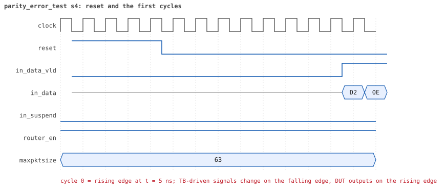
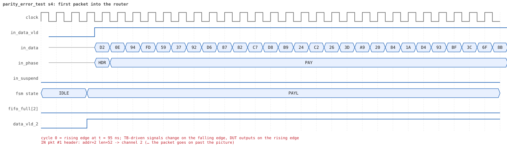
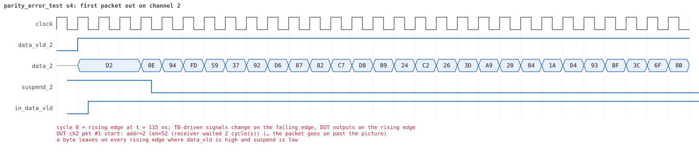
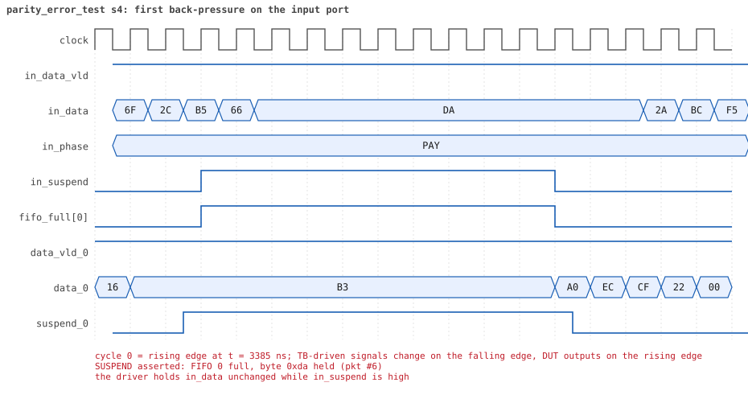
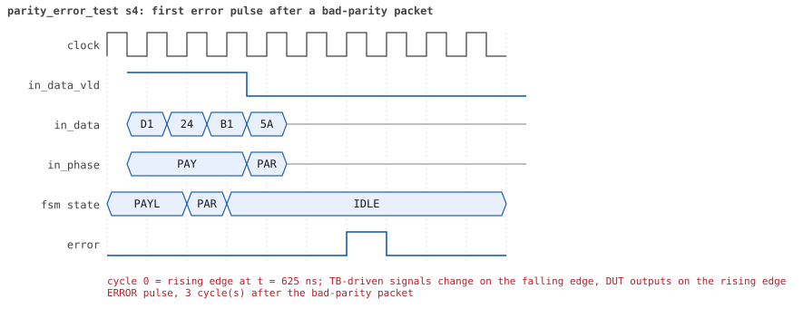
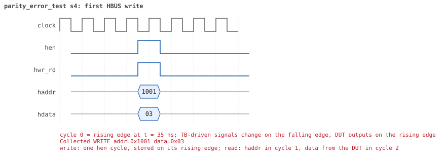
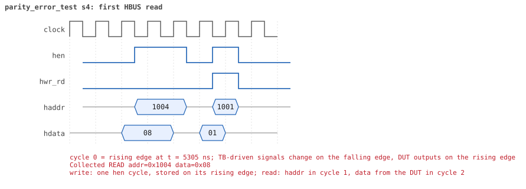

# parity_error_test  seed 4

**Result:** PASSED (0 UVM_ERROR, 0 UVM_WARNING, 0 UVM_FATAL) · bench `yapp_project_tb` · sim time 8us · log `parity_error_test_s4.log`

Waves: `parity_error_test_s4.fst` (GTKWave, Surfer or the VS Code wave viewer); signal trace: `signals.csv`.
[Open the waves in Surfer](https://app.surfer-project.org/?load_url=https%3A%2F%2Fraw.githubusercontent.com%2Ftamirgabgab%2FQcom-Mentoring%2Fmain%2Fyapp_project%2Fregression%2Fyapp_project_tb%2Fparity_error_test_s4%2Fparity_error_test_s4.fst&startup_commands=run_command_file_from_url%20https%3A%2F%2Fraw.githubusercontent.com%2Ftamirgabgab%2FQcom-Mentoring%2Fmain%2Fyapp_project%2Ftb%2Fyapp_router.sucl) (web app, the signals already in groups: `yapp_project/tb/yapp_router.sucl`).

## Summary

- YAPP driver sent **12** packet(s) (12 with bad parity); the input monitor saw 12.
- Router: **12** forwarded, **0** dropped.
- Packets out: ch0 **8**, ch1 **2**, ch2 **2**.
- Scoreboard: 12 matched, 0 mismatched, 0 unexpected.
- Back-pressure: in_suspend asserted **2** time(s), longest hold 10 cycle(s).
- Error pulses: 12.
- HBUS: 2 write(s), 2 read(s).

## Stages

| time (ns) | stage |
|---|---|
| 0 | 1. en_reg=0x03 (parity counter on): 8 bad-parity packets, 8 pulses, counter 8, all delivered |
| 5340 | 2. en_reg=0x01 (counter off): 4 more bad packets, pulses still come, counter stays 8 |

## Pictures

**reset and the first cycles**

**first packet into the router**

**first packet out on channel 2**

**first back-pressure on the input port**

**first error pulse after a bad-parity packet**

**first HBUS write**

**first HBUS read**

## Timeline

198 events (the same list is in `timeline.csv`).

| time (ns) | who | event |
|---|---|---|
| 0 | yapp monitor | YAPP monitor running |
| 0 | **test** | STAGE: 1. en_reg=0x03 (parity counter on): 8 bad-parity packets, 8 pulses, counter 8, all delivered |
| 0 | clk/rst driver | Starting clock (period 10) and holding reset for 5 cycles |
| 0 | **DUT** | RESET asserted |
| 50 | **DUT** | RESET released: router_en=1 maxpktsize=63 |
| 70 | hbus driver | Executed WRITE addr=0x1001 data=0x03 |
| 70 | yapp driver | TX pkt #1: addr=2 len=52 parity=bad delay=4 |
| 75 | hbus monitor | Collected WRITE addr=0x1001 data=0x03 |
| 75 | reference | router_en is now 1 (en_reg 0x03) |
| 125 | **DUT** | IN  pkt #1 header: addr=2 len=52 -> channel 2 |
| 155 | **DUT** | OUT ch2 pkt #1 start: addr=2 len=52 (receiver waited 2 cycle(s)) |
| 655 | **DUT** | IN  pkt #1 complete: addr=2 len=52 parity=BAD forwarded, 54 bytes in 54 cycles (held 0) |
| 655 | yapp monitor | RX pkt #1 on the input: addr=2 len=52 parity=bad gap=7 |
| 655 | reference | Packet forwarded: addr=2 len=52 -> channel 2 |
| 660 | yapp driver | TX pkt #1 accepted by the DUT |
| 660 | yapp driver | TX pkt #2: addr=1 len=58 parity=bad delay=19 |
| 680 | ch2 driver | ch2: packet consumed (response delay 2) |
| 690 | **DUT** | ERROR pulse, 3 cycle(s) after the bad-parity packet |
| 690 | error checker | error pulse 3 cycles after the bad packet (0 still owed) |
| 795 | **DUT** | OUT ch2 pkt #1 done: 54 bytes in 65 cycles |
| 795 | ch2 monitor | ch2 RX pkt #1: addr=2 len=52 parity=bad |
| 795 | scoreboard | ch2 pkt matched: addr=2 len=52 (1 matched so far) |
| 855 | **DUT** | IN  pkt #2 header: addr=1 len=58 -> channel 1 |
| 965 | **DUT** | OUT ch1 pkt #1 start: addr=1 len=58 (receiver waited 10 cycle(s)) |
| 1020 | ch2 driver | ch2: packet consumed (response delay 10) |
| 1445 | **DUT** | IN  pkt #2 complete: addr=1 len=58 parity=BAD forwarded, 60 bytes in 60 cycles (held 0) |
| 1445 | yapp monitor | RX pkt #2 on the input: addr=1 len=58 parity=bad gap=19 |
| 1445 | reference | Packet forwarded: addr=1 len=58 -> channel 1 |
| 1450 | yapp driver | TX pkt #2 accepted by the DUT |
| 1450 | yapp driver | TX pkt #3: addr=0 len=60 parity=bad delay=20 |
| 1470 | **DUT** | ERROR pulse, 2 cycle(s) after the bad-parity packet |
| 1470 | error checker | error pulse 2 cycles after the bad packet (0 still owed) |
| 1550 | ch1 driver | ch1: packet consumed (response delay 10) |
| 1605 | **DUT** | OUT ch1 pkt #1 done: 60 bytes in 65 cycles |
| 1605 | ch1 monitor | ch1 RX pkt #1: addr=1 len=58 parity=bad |
| 1605 | scoreboard | ch1 pkt matched: addr=1 len=58 (2 matched so far) |
| 1655 | **DUT** | IN  pkt #3 header: addr=0 len=60 -> channel 0 |
| 1745 | **DUT** | OUT ch0 pkt #1 start: addr=0 len=60 (receiver waited 8 cycle(s)) |
| 1870 | ch1 driver | ch1: packet consumed (response delay 4) |
| 2265 | **DUT** | IN  pkt #3 complete: addr=0 len=60 parity=BAD forwarded, 62 bytes in 62 cycles (held 0) |
| 2265 | yapp monitor | RX pkt #3 on the input: addr=0 len=60 parity=bad gap=20 |
| 2265 | reference | Packet forwarded: addr=0 len=60 -> channel 0 |
| 2270 | yapp driver | TX pkt #3 accepted by the DUT |
| 2270 | yapp driver | TX pkt #4: addr=0 len=12 parity=bad delay=12 |
| 2310 | **DUT** | ERROR pulse, 4 cycle(s) after the bad-parity packet |
| 2310 | error checker | error pulse 4 cycles after the bad packet (0 still owed) |
| 2350 | ch0 driver | ch0: packet consumed (response delay 8) |
| 2395 | **DUT** | IN  pkt #4 header: addr=0 len=12 -> channel 0 |
| 2465 | **DUT** | OUT ch0 pkt #1 done: 62 bytes in 73 cycles |
| 2465 | ch0 monitor | ch0 RX pkt #1: addr=0 len=60 parity=bad |
| 2465 | scoreboard | ch0 pkt matched: addr=0 len=60 (3 matched so far) |
| 2475 | **DUT** | OUT ch0 pkt #2 start: addr=0 len=12 (receiver waited 0 cycle(s)) |
| 2525 | **DUT** | IN  pkt #4 complete: addr=0 len=12 parity=BAD forwarded, 14 bytes in 14 cycles (held 0) |
| 2525 | yapp monitor | RX pkt #4 on the input: addr=0 len=12 parity=bad gap=12 |
| 2525 | reference | Packet forwarded: addr=0 len=12 -> channel 0 |
| 2530 | yapp driver | TX pkt #4 accepted by the DUT |
| 2530 | yapp driver | TX pkt #5: addr=0 len=53 parity=bad delay=20 |
| 2605 | **DUT** | OUT ch0 pkt #2 done: 14 bytes in 14 cycles |
| 2605 | ch0 monitor | ch0 RX pkt #2: addr=0 len=12 parity=bad |
| 2605 | scoreboard | ch0 pkt matched: addr=0 len=12 (4 matched so far) |
| 2610 | **DUT** | ERROR pulse, 8 cycle(s) after the bad-parity packet |
| 2610 | error checker | error pulse 8 cycles after the bad packet (0 still owed) |
| 2735 | **DUT** | IN  pkt #5 header: addr=0 len=53 -> channel 0 |
| 2745 | **DUT** | OUT ch0 pkt #3 start: addr=0 len=53 (receiver waited 0 cycle(s)) |
| 2970 | ch0 driver | ch0: packet consumed (response delay 10) |
| 3270 | ch0 driver | ch0: packet consumed (response delay 5) |
| 3275 | **DUT** | IN  pkt #5 complete: addr=0 len=53 parity=BAD forwarded, 55 bytes in 55 cycles (held 0) |
| 3275 | yapp monitor | RX pkt #5 on the input: addr=0 len=53 parity=bad gap=20 |
| 3275 | reference | Packet forwarded: addr=0 len=53 -> channel 0 |
| 3280 | yapp driver | TX pkt #5 accepted by the DUT |
| 3280 | yapp driver | TX pkt #6: addr=0 len=25 parity=bad delay=4 |
| 3310 | **DUT** | ERROR pulse, 3 cycle(s) after the bad-parity packet |
| 3310 | error checker | error pulse 3 cycles after the bad packet (0 still owed) |
| 3325 | **DUT** | IN  pkt #6 header: addr=0 len=25 -> channel 0 |
| 3400 | ch0 driver | ch0: packet consumed (response delay 10) |
| 3425 | **DUT** | SUSPEND asserted: FIFO 0 full, byte 0xda held (pkt #6) |
| 3525 | **DUT** | SUSPEND released after 10 cycle(s) |
| 3565 | **DUT** | OUT ch0 pkt #3 done: 55 bytes in 83 cycles |
| 3565 | ch0 monitor | ch0 RX pkt #3: addr=0 len=53 parity=bad |
| 3565 | scoreboard | ch0 pkt matched: addr=0 len=53 (5 matched so far) |
| 3575 | **DUT** | OUT ch0 pkt #4 start: addr=0 len=25 (receiver waited 0 cycle(s)) |
| 3685 | **DUT** | IN  pkt #6 complete: addr=0 len=25 parity=BAD forwarded, 27 bytes in 37 cycles (held 10) |
| 3685 | yapp monitor | RX pkt #6 on the input: addr=0 len=25 parity=bad gap=4 |
| 3685 | reference | Packet forwarded: addr=0 len=25 -> channel 0 |
| 3690 | yapp driver | TX pkt #6 accepted by the DUT |
| 3690 | yapp driver | TX pkt #7: addr=0 len=39 parity=bad delay=20 |
| 3710 | **DUT** | ERROR pulse, 2 cycle(s) after the bad-parity packet |
| 3710 | error checker | error pulse 2 cycles after the bad packet (0 still owed) |
| 3835 | **DUT** | OUT ch0 pkt #4 done: 27 bytes in 27 cycles |
| 3835 | ch0 monitor | ch0 RX pkt #4: addr=0 len=25 parity=bad |
| 3835 | scoreboard | ch0 pkt matched: addr=0 len=25 (6 matched so far) |
| 3895 | **DUT** | IN  pkt #7 header: addr=0 len=39 -> channel 0 |
| 3905 | **DUT** | OUT ch0 pkt #5 start: addr=0 len=39 (receiver waited 0 cycle(s)) |
| 3960 | ch0 driver | ch0: packet consumed (response delay 10) |
| 4295 | **DUT** | IN  pkt #7 complete: addr=0 len=39 parity=BAD forwarded, 41 bytes in 41 cycles (held 0) |
| 4295 | yapp monitor | RX pkt #7 on the input: addr=0 len=39 parity=bad gap=20 |
| 4295 | reference | Packet forwarded: addr=0 len=39 -> channel 0 |
| 4300 | yapp driver | TX pkt #7 accepted by the DUT |
| 4300 | yapp driver | TX pkt #8: addr=0 len=50 parity=bad delay=20 |
| 4390 | **DUT** | ERROR pulse, 9 cycle(s) after the bad-parity packet |
| 4390 | error checker | error pulse 9 cycles after the bad packet (0 still owed) |
| 4395 | **DUT** | OUT ch0 pkt #5 done: 41 bytes in 50 cycles |
| 4395 | ch0 monitor | ch0 RX pkt #5: addr=0 len=39 parity=bad |
| 4395 | scoreboard | ch0 pkt matched: addr=0 len=39 (7 matched so far) |
| 4505 | **DUT** | IN  pkt #8 header: addr=0 len=50 -> channel 0 |
| 4515 | **DUT** | OUT ch0 pkt #6 start: addr=0 len=50 (receiver waited 0 cycle(s)) |
| 4660 | ch0 driver | ch0: packet consumed (response delay 8) |
| 4790 | ch0 driver | ch0: packet consumed (response delay 10) |
| 4835 | **DUT** | SUSPEND asserted: FIFO 0 full, byte 0x8b held (pkt #8) |
| 4865 | **DUT** | SUSPEND released after 3 cycle(s) |
| 5045 | **DUT** | IN  pkt #8 complete: addr=0 len=50 parity=BAD forwarded, 52 bytes in 55 cycles (held 3) |
| 5045 | yapp monitor | RX pkt #8 on the input: addr=0 len=50 parity=bad gap=20 |
| 5045 | reference | Packet forwarded: addr=0 len=50 -> channel 0 |
| 5050 | yapp driver | TX pkt #8 accepted by the DUT |
| 5090 | **DUT** | ERROR pulse, 4 cycle(s) after the bad-parity packet |
| 5090 | error checker | error pulse 4 cycles after the bad packet (0 still owed) |
| 5195 | **DUT** | OUT ch0 pkt #6 done: 52 bytes in 69 cycles |
| 5195 | ch0 monitor | ch0 RX pkt #6: addr=0 len=50 parity=bad |
| 5195 | scoreboard | ch0 pkt matched: addr=0 len=50 (8 matched so far) |
| 5340 | hbus driver | Executed READ  addr=0x1004 data=0x08 |
| 5340 | **test** | parity_err_cnt_reg reads 8 as expected |
| 5340 | **test** | STAGE: 2. en_reg=0x01 (counter off): 4 more bad packets, pulses still come, counter stays 8 |
| 5345 | hbus monitor | Collected READ  addr=0x1004 data=0x08 |
| 5360 | ch0 driver | ch0: packet consumed (response delay 5) |
| 5360 | hbus driver | Executed WRITE addr=0x1001 data=0x01 |
| 5360 | yapp driver | TX pkt #9: addr=0 len=50 parity=bad delay=4 |
| 5365 | hbus monitor | Collected WRITE addr=0x1001 data=0x01 |
| 5365 | reference | router_en is now 1 (en_reg 0x01) |
| 5415 | **DUT** | IN  pkt #9 header: addr=0 len=50 -> channel 0 |
| 5515 | **DUT** | OUT ch0 pkt #7 start: addr=0 len=50 (receiver waited 9 cycle(s)) |
| 5925 | **DUT** | IN  pkt #9 complete: addr=0 len=50 parity=BAD forwarded, 52 bytes in 52 cycles (held 0) |
| 5925 | yapp monitor | RX pkt #9 on the input: addr=0 len=50 parity=bad gap=36 |
| 5925 | reference | Packet forwarded: addr=0 len=50 -> channel 0 |
| 5930 | yapp driver | TX pkt #9 accepted by the DUT |
| 5930 | yapp driver | TX pkt #10: addr=1 len=32 parity=bad delay=1 |
| 5945 | **DUT** | IN  pkt #10 header: addr=1 len=32 -> channel 1 |
| 5950 | **DUT** | ERROR pulse, 2 cycle(s) after the bad-parity packet |
| 5950 | error checker | error pulse 2 cycles after the bad packet (0 still owed) |
| 6020 | ch0 driver | ch0: packet consumed (response delay 9) |
| 6035 | **DUT** | OUT ch1 pkt #2 start: addr=1 len=32 (receiver waited 8 cycle(s)) |
| 6075 | **DUT** | OUT ch0 pkt #7 done: 52 bytes in 57 cycles |
| 6075 | ch0 monitor | ch0 RX pkt #7: addr=0 len=50 parity=bad |
| 6075 | scoreboard | ch0 pkt matched: addr=0 len=50 (9 matched so far) |
| 6100 | ch0 driver | ch0: packet consumed (response delay 4) |
| 6275 | **DUT** | IN  pkt #10 complete: addr=1 len=32 parity=BAD forwarded, 34 bytes in 34 cycles (held 0) |
| 6275 | yapp monitor | RX pkt #10 on the input: addr=1 len=32 parity=bad gap=1 |
| 6275 | reference | Packet forwarded: addr=1 len=32 -> channel 1 |
| 6280 | yapp driver | TX pkt #10 accepted by the DUT |
| 6280 | yapp driver | TX pkt #11: addr=2 len=38 parity=bad delay=10 |
| 6330 | **DUT** | ERROR pulse, 5 cycle(s) after the bad-parity packet |
| 6330 | error checker | error pulse 5 cycles after the bad packet (0 still owed) |
| 6360 | ch1 driver | ch1: packet consumed (response delay 8) |
| 6385 | **DUT** | IN  pkt #11 header: addr=2 len=38 -> channel 2 |
| 6395 | **DUT** | OUT ch2 pkt #2 start: addr=2 len=38 (receiver waited 0 cycle(s)) |
| 6445 | **DUT** | OUT ch1 pkt #2 done: 34 bytes in 42 cycles |
| 6445 | ch1 monitor | ch1 RX pkt #2: addr=1 len=32 parity=bad |
| 6445 | scoreboard | ch1 pkt matched: addr=1 len=32 (10 matched so far) |
| 6775 | **DUT** | IN  pkt #11 complete: addr=2 len=38 parity=BAD forwarded, 40 bytes in 40 cycles (held 0) |
| 6775 | yapp monitor | RX pkt #11 on the input: addr=2 len=38 parity=bad gap=10 |
| 6775 | reference | Packet forwarded: addr=2 len=38 -> channel 2 |
| 6780 | ch2 driver | ch2: packet consumed (response delay 0) |
| 6780 | yapp driver | TX pkt #11 accepted by the DUT |
| 6780 | yapp driver | TX pkt #12: addr=0 len=46 parity=bad delay=16 |
| 6790 | **DUT** | ERROR pulse, 1 cycle(s) after the bad-parity packet |
| 6790 | error checker | error pulse 1 cycles after the bad packet (0 still owed) |
| 6865 | **DUT** | OUT ch2 pkt #2 done: 40 bytes in 48 cycles |
| 6865 | ch2 monitor | ch2 RX pkt #2: addr=2 len=38 parity=bad |
| 6865 | scoreboard | ch2 pkt matched: addr=2 len=38 (11 matched so far) |
| 6945 | **DUT** | IN  pkt #12 header: addr=0 len=46 -> channel 0 |
| 6985 | **DUT** | OUT ch0 pkt #8 start: addr=0 len=46 (receiver waited 3 cycle(s)) |
| 7030 | ch1 driver | ch1: packet consumed (response delay 7) |
| 7150 | ch2 driver | ch2: packet consumed (response delay 7) |
| 7415 | **DUT** | IN  pkt #12 complete: addr=0 len=46 parity=BAD forwarded, 48 bytes in 48 cycles (held 0) |
| 7415 | yapp monitor | RX pkt #12 on the input: addr=0 len=46 parity=bad gap=16 |
| 7415 | reference | Packet forwarded: addr=0 len=46 -> channel 0 |
| 7420 | yapp driver | TX pkt #12 accepted by the DUT |
| 7430 | **DUT** | ERROR pulse, 1 cycle(s) after the bad-parity packet |
| 7430 | error checker | error pulse 1 cycles after the bad packet (0 still owed) |
| 7450 | ch0 driver | ch0: packet consumed (response delay 3) |
| 7495 | **DUT** | OUT ch0 pkt #8 done: 48 bytes in 52 cycles |
| 7495 | ch0 monitor | ch0 RX pkt #8: addr=0 len=46 parity=bad |
| 7495 | scoreboard | ch0 pkt matched: addr=0 len=46 (12 matched so far) |
| 7640 | hbus driver | Executed READ  addr=0x1004 data=0x08 |
| 7640 | **test** | parity_err_cnt_reg reads 8 as expected |
| 7645 | hbus monitor | Collected READ  addr=0x1004 data=0x08 |
| 7840 | error checker | error pulse report: 12 bad packets, 12 pulses, 0 outside 1..10 cycles, at most 1 owed at once |
| 7840 | ch0 monitor | Channel 0 report: 8 packets collected |
| 7840 | ch1 monitor | Channel 1 report: 2 packets collected |
| 7840 | ch2 monitor | Channel 2 report: 2 packets collected |
| 7840 | hbus monitor | HBUS report: 2 writes, 2 reads |
| 7840 | coverage | Coverage of the router configuration: 30.4% |
| 7840 | reference |  |
| 7840 | scoreboard |  |
| 7840 | yapp driver | YAPP driver report: 12 packets sent |
| 7840 | coverage | YAPP gap coverage: 11 gaps sampled, coverage 50.0% |
| 7840 | yapp monitor | YAPP monitor report: 12 packets collected, 12 with bad parity |
| 7840 | yapp monitor | YAPP gaps: 0 back to back, 1 of 1 cycle, 0 of 2, 10 longer |
| 7840 | coverage | YAPP packet coverage: 12 packets sampled, coverage 53.3% |
