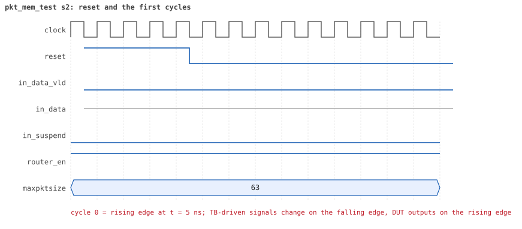
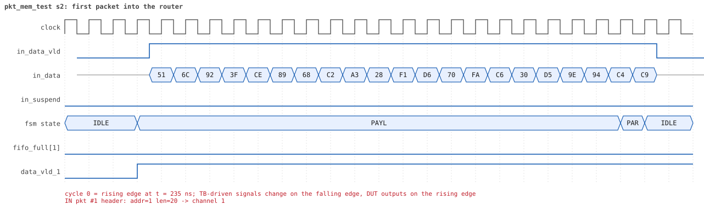
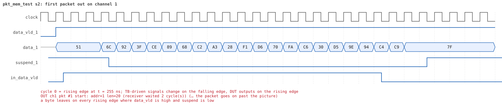
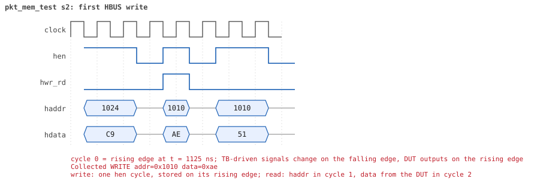
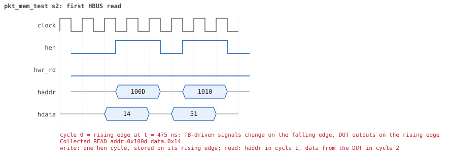

# pkt_mem_test  seed 2

**Result:** PASSED (0 UVM_ERROR, 0 UVM_WARNING, 0 UVM_FATAL) · bench `yapp_project_tb` · sim time 2us · log `pkt_mem_test_s2.log`

Waves: `pkt_mem_test_s2.fst` (GTKWave, Surfer or the VS Code wave viewer); signal trace: `signals.csv`.

## Summary

- YAPP driver sent **2** packet(s) (0 with bad parity); the input monitor saw 2.
- Router: **1** forwarded, **1** dropped (1 oversized).
- Packets out: ch0 **0**, ch1 **1**, ch2 **0**.
- Scoreboard: 1 matched, 0 mismatched, 0 unexpected.
- Back-pressure: in_suspend asserted **0** time(s).
- Error pulses: 0.
- HBUS: 3 write(s), 34 read(s).

## Stages

| time (ns) | stage |
|---|---|
| 0 | 1. one packet (addr 1, 20 bytes): mem_size_reg and yapp_pkt_mem hold it byte by byte |
| 1140 | 2. a raw HBUS write to yapp_pkt_mem[0] is ignored (read-only memory) |
| 1190 | 3. ctrl_reg=5, then a 9-byte packet: dropped as oversized but still stored |

## Pictures

**reset and the first cycles**

**first packet into the router**

**first packet out on channel 1**

**first HBUS write**

**first HBUS read**

## Timeline

116 events (the same list is in `timeline.csv`).

| time (ns) | who | event |
|---|---|---|
| 0 | yapp monitor | YAPP monitor running |
| 0 | **test** | STAGE: 1. one packet (addr 1, 20 bytes): mem_size_reg and yapp_pkt_mem hold it byte by byte |
| 0 | clk/rst driver | Starting clock (period 10) and holding reset for 5 cycles |
| 0 | **DUT** | RESET asserted |
| 50 | **DUT** | RESET released: router_en=1 maxpktsize=63 |
| 50 | yapp driver | TX pkt #1: addr=1 len=20 parity=good delay=20 |
| 265 | **DUT** | IN  pkt #1 header: addr=1 len=20 -> channel 1 |
| 295 | **DUT** | OUT ch1 pkt #1 start: addr=1 len=20 (receiver waited 2 cycle(s)) |
| 475 | **DUT** | IN  pkt #1 complete: addr=1 len=20 parity=ok forwarded, 22 bytes in 22 cycles (held 0) |
| 475 | yapp monitor | RX pkt #1 on the input: addr=1 len=20 parity=good gap=21 |
| 475 | reference | Packet forwarded: addr=1 len=20 -> channel 1 |
| 480 | yapp driver | TX pkt #1 accepted by the DUT |
| 500 | ch1 driver | ch1: packet consumed (response delay 2) |
| 510 | hbus driver | Executed READ  addr=0x100d data=0x14 |
| 515 | hbus monitor | Collected READ  addr=0x100d data=0x14 |
| 540 | hbus driver | Executed READ  addr=0x1010 data=0x51 |
| 545 | hbus monitor | Collected READ  addr=0x1010 data=0x51 |
| 570 | hbus driver | Executed READ  addr=0x1011 data=0x6c |
| 575 | hbus monitor | Collected READ  addr=0x1011 data=0x6c |
| 585 | **DUT** | OUT ch1 pkt #1 done: 22 bytes in 30 cycles |
| 585 | ch1 monitor | ch1 RX pkt #1: addr=1 len=20 parity=good |
| 585 | scoreboard | ch1 pkt matched: addr=1 len=20 (1 matched so far) |
| 600 | hbus driver | Executed READ  addr=0x1012 data=0x92 |
| 605 | hbus monitor | Collected READ  addr=0x1012 data=0x92 |
| 630 | hbus driver | Executed READ  addr=0x1013 data=0x3f |
| 635 | hbus monitor | Collected READ  addr=0x1013 data=0x3f |
| 660 | hbus driver | Executed READ  addr=0x1014 data=0xce |
| 665 | hbus monitor | Collected READ  addr=0x1014 data=0xce |
| 690 | hbus driver | Executed READ  addr=0x1015 data=0x89 |
| 695 | hbus monitor | Collected READ  addr=0x1015 data=0x89 |
| 720 | hbus driver | Executed READ  addr=0x1016 data=0x68 |
| 725 | hbus monitor | Collected READ  addr=0x1016 data=0x68 |
| 750 | hbus driver | Executed READ  addr=0x1017 data=0xc2 |
| 755 | hbus monitor | Collected READ  addr=0x1017 data=0xc2 |
| 780 | hbus driver | Executed READ  addr=0x1018 data=0xa3 |
| 785 | hbus monitor | Collected READ  addr=0x1018 data=0xa3 |
| 810 | hbus driver | Executed READ  addr=0x1019 data=0x28 |
| 815 | hbus monitor | Collected READ  addr=0x1019 data=0x28 |
| 840 | hbus driver | Executed READ  addr=0x101a data=0xf1 |
| 845 | hbus monitor | Collected READ  addr=0x101a data=0xf1 |
| 870 | hbus driver | Executed READ  addr=0x101b data=0xd6 |
| 875 | hbus monitor | Collected READ  addr=0x101b data=0xd6 |
| 900 | ch1 driver | ch1: packet consumed (response delay 7) |
| 900 | hbus driver | Executed READ  addr=0x101c data=0x70 |
| 905 | hbus monitor | Collected READ  addr=0x101c data=0x70 |
| 930 | hbus driver | Executed READ  addr=0x101d data=0xfa |
| 935 | hbus monitor | Collected READ  addr=0x101d data=0xfa |
| 960 | hbus driver | Executed READ  addr=0x101e data=0xc6 |
| 965 | hbus monitor | Collected READ  addr=0x101e data=0xc6 |
| 990 | hbus driver | Executed READ  addr=0x101f data=0x30 |
| 995 | hbus monitor | Collected READ  addr=0x101f data=0x30 |
| 1020 | hbus driver | Executed READ  addr=0x1020 data=0xd5 |
| 1025 | hbus monitor | Collected READ  addr=0x1020 data=0xd5 |
| 1050 | hbus driver | Executed READ  addr=0x1021 data=0x9e |
| 1055 | hbus monitor | Collected READ  addr=0x1021 data=0x9e |
| 1080 | hbus driver | Executed READ  addr=0x1022 data=0x94 |
| 1085 | hbus monitor | Collected READ  addr=0x1022 data=0x94 |
| 1110 | hbus driver | Executed READ  addr=0x1023 data=0xc4 |
| 1115 | hbus monitor | Collected READ  addr=0x1023 data=0xc4 |
| 1140 | hbus driver | Executed READ  addr=0x1024 data=0xc9 |
| 1140 | **test** | packet (addr 1, length 20) stored byte by byte |
| 1140 | **test** | STAGE: 2. a raw HBUS write to yapp_pkt_mem[0] is ignored (read-only memory) |
| 1145 | hbus monitor | Collected READ  addr=0x1024 data=0xc9 |
| 1160 | hbus driver | Executed WRITE addr=0x1010 data=0xae |
| 1165 | hbus monitor | Collected WRITE addr=0x1010 data=0xae |
| 1190 | hbus driver | Executed READ  addr=0x1010 data=0x51 |
| 1190 | **test** | write to yapp_pkt_mem ignored, as it should be |
| 1190 | **test** | STAGE: 3. ctrl_reg=5, then a 9-byte packet: dropped as oversized but still stored |
| 1195 | hbus monitor | Collected READ  addr=0x1010 data=0x51 |
| 1210 | hbus driver | Executed WRITE addr=0x1000 data=0x05 |
| 1210 | yapp driver | TX pkt #2: addr=2 len=9 parity=good delay=11 |
| 1215 | **DUT** | CONFIG router_en=1 maxpktsize=5 |
| 1215 | hbus monitor | Collected WRITE addr=0x1000 data=0x05 |
| 1215 | reference | maxpktsize is now 5 |
| 1335 | **DUT** | IN  pkt #2 header: addr=2 len=9 -> DROP (oversized: len 9 > maxpktsize 5) |
| 1435 | **DUT** | IN  pkt #2 complete: addr=2 len=9 parity=ok dropped, 11 bytes in 11 cycles (held 0) |
| 1435 | yapp monitor | RX pkt #2 on the input: addr=2 len=9 parity=good gap=85 |
| 1435 | reference | Packet dropped: length 9 > maxpktsize 5 (addr=2) |
| 1435 | **DUT** | ROUTER DROPS PACKET addr=2 length=9 (length > maxpktsize) |
| 1440 | yapp driver | TX pkt #2 accepted by the DUT |
| 1470 | hbus driver | Executed READ  addr=0x100d data=0x09 |
| 1475 | hbus monitor | Collected READ  addr=0x100d data=0x09 |
| 1500 | hbus driver | Executed READ  addr=0x1010 data=0x26 |
| 1505 | hbus monitor | Collected READ  addr=0x1010 data=0x26 |
| 1530 | hbus driver | Executed READ  addr=0x1011 data=0x1d |
| 1535 | hbus monitor | Collected READ  addr=0x1011 data=0x1d |
| 1560 | hbus driver | Executed READ  addr=0x1012 data=0xed |
| 1565 | hbus monitor | Collected READ  addr=0x1012 data=0xed |
| 1590 | hbus driver | Executed READ  addr=0x1013 data=0x12 |
| 1595 | hbus monitor | Collected READ  addr=0x1013 data=0x12 |
| 1620 | hbus driver | Executed READ  addr=0x1014 data=0x14 |
| 1625 | hbus monitor | Collected READ  addr=0x1014 data=0x14 |
| 1650 | hbus driver | Executed READ  addr=0x1015 data=0x05 |
| 1655 | hbus monitor | Collected READ  addr=0x1015 data=0x05 |
| 1680 | hbus driver | Executed READ  addr=0x1016 data=0x01 |
| 1685 | hbus monitor | Collected READ  addr=0x1016 data=0x01 |
| 1710 | hbus driver | Executed READ  addr=0x1017 data=0xab |
| 1715 | hbus monitor | Collected READ  addr=0x1017 data=0xab |
| 1740 | hbus driver | Executed READ  addr=0x1018 data=0x09 |
| 1745 | hbus monitor | Collected READ  addr=0x1018 data=0x09 |
| 1770 | hbus driver | Executed READ  addr=0x1019 data=0xaf |
| 1770 | **test** | packet (addr 2, length 9) stored byte by byte |
| 1775 | hbus monitor | Collected READ  addr=0x1019 data=0xaf |
| 1790 | hbus driver | Executed WRITE addr=0x1000 data=0x3f |
| 1795 | **DUT** | CONFIG router_en=1 maxpktsize=63 |
| 1795 | hbus monitor | Collected WRITE addr=0x1000 data=0x3f |
| 1795 | reference | maxpktsize is now 63 |
| 1990 | ch0 monitor | Channel 0 report: 0 packets collected |
| 1990 | ch1 monitor | Channel 1 report: 1 packets collected |
| 1990 | ch2 monitor | Channel 2 report: 0 packets collected |
| 1990 | hbus monitor | HBUS report: 3 writes, 34 reads |
| 1990 | reference |  |
| 1990 | scoreboard |  |
| 1990 | yapp driver | YAPP driver report: 2 packets sent |
| 1990 | yapp monitor | YAPP monitor report: 2 packets collected, coverage 23.3% |
| 1990 | yapp monitor | YAPP gaps: 0 back to back, 0 of 1 cycle, 0 of 2, 1 longer (gap coverage 25.0%) |
