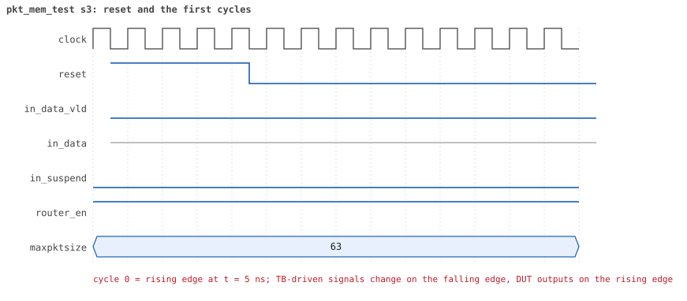
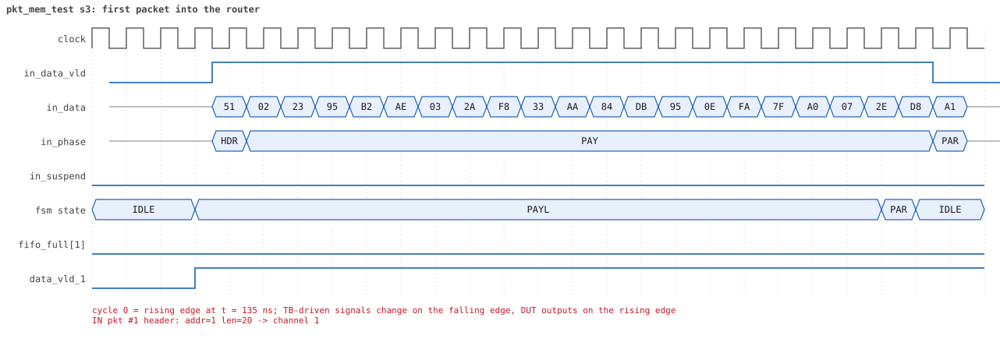
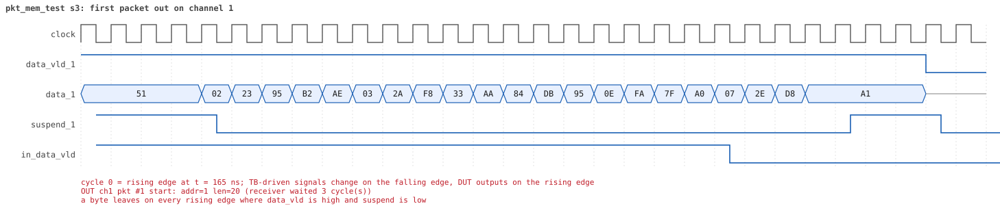
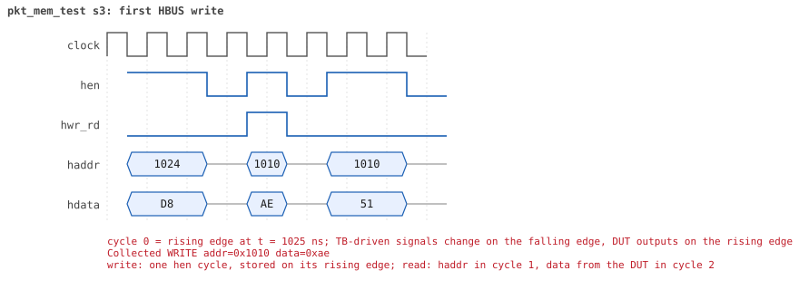
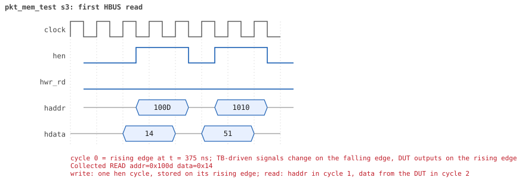

# pkt_mem_test seed 3

**Result:** PASSED (0 UVM_ERROR, 0 UVM_WARNING, 0 UVM_FATAL) · bench `yapp_project_tb` · sim time 2us · wall 0.4 s · log [`pkt_mem_test_s3.log`](pkt_mem_test_s3.log)

Waves: `pkt_mem_test_s3.fst` (GTKWave, Surfer or the VS Code wave viewer).
[Open the waves in Surfer](https://app.surfer-project.org/?load_url=https%3A%2F%2Fraw.githubusercontent.com%2Ftamirgabgab%2FQcom-Mentoring%2Fmain%2Fyapp_project%2Fregression%2Fyapp_project_tb%2Fpkt_mem_test_s3%2Fpkt_mem_test_s3.fst&startup_commands=run_command_file_from_url%20https%3A%2F%2Fraw.githubusercontent.com%2Ftamirgabgab%2FQcom-Mentoring%2Fmain%2Fyapp_project%2Ftb%2Fyapp_router.sucl) (web app, the signals already in groups: `yapp_project/tb/yapp_router.sucl`).

## Summary

- YAPP driver sent **2** packet(s) (0 with bad parity); the input monitor saw 2.
- Router: **1** forwarded, **1** dropped (1 oversized).
- Packets out: ch0 **0**, ch1 **1**, ch2 **0**.
- Scoreboard: 1 matched, 0 mismatched, 0 unexpected.
- Back-pressure: in_suspend asserted **0** time(s).
- Error pulses: 0.
- HBUS: 3 write(s), 34 read(s).

## Stages

| time (ns) | stage |
|---|---|
| 0 | 1. one packet (addr 1, 20 bytes): mem_size_reg and yapp_pkt_mem hold it byte by byte |
| 1040 | 2. a raw HBUS write to yapp_pkt_mem[0] is ignored (read-only memory) |
| 1090 | 3. ctrl_reg=5, then a 9-byte packet: dropped as oversized but still stored |

## Pictures

**reset and the first cycles**

**first packet into the router**

**first packet out on channel 1**

**first HBUS write**

**first HBUS read**

## Timeline

123 events.

| time (ns) | who | event |
|---|---|---|
| 0 | yapp monitor | YAPP monitor running |
| 0 | **test** | STAGE: 1. one packet (addr 1, 20 bytes): mem_size_reg and yapp_pkt_mem hold it byte by byte |
| 0 | clk/rst driver | Starting clock (period 10) and holding reset for 5 cycles |
| 0 | **DUT** | RESET asserted |
| 50 | **DUT** | RESET released: router_en=1 maxpktsize=63 |
| 50 | yapp driver | TX pkt #1: addr=1 len=20 parity=good delay=10 |
| 165 | **DUT** | IN  pkt #1 header: addr=1 len=20 -> channel 1 |
| 205 | **DUT** | OUT ch1 pkt #1 start: addr=1 len=20 (receiver waited 3 cycle(s)) |
| 375 | **DUT** | IN  pkt #1 complete: addr=1 len=20 parity=ok forwarded, 22 bytes in 22 cycles (held 0) |
| 375 | yapp monitor | RX pkt #1 on the input: addr=1 len=20 parity=good gap=11 |
| 375 | reference | Packet forwarded: addr=1 len=20 -> channel 1 |
| 380 | yapp driver | TX pkt #1 accepted by the DUT |
| 410 | ch1 driver | ch1: packet consumed (response delay 3) |
| 410 | hbus driver | Executed READ  addr=0x100d data=0x14 |
| 415 | hbus monitor | Collected READ  addr=0x100d data=0x14 |
| 440 | hbus driver | Executed READ  addr=0x1010 data=0x51 |
| 445 | **DUT** | OUT ch1 pkt #1 done: 22 bytes in 25 cycles |
| 445 | ch1 monitor | ch1 RX pkt #1: addr=1 len=20 parity=good |
| 445 | scoreboard | ch1 pkt matched: addr=1 len=20 (1 matched so far) |
| 445 | hbus monitor | Collected READ  addr=0x1010 data=0x51 |
| 470 | hbus driver | Executed READ  addr=0x1011 data=0x02 |
| 475 | hbus monitor | Collected READ  addr=0x1011 data=0x02 |
| 500 | hbus driver | Executed READ  addr=0x1012 data=0x23 |
| 505 | hbus monitor | Collected READ  addr=0x1012 data=0x23 |
| 530 | hbus driver | Executed READ  addr=0x1013 data=0x95 |
| 535 | hbus monitor | Collected READ  addr=0x1013 data=0x95 |
| 560 | hbus driver | Executed READ  addr=0x1014 data=0xb2 |
| 565 | hbus monitor | Collected READ  addr=0x1014 data=0xb2 |
| 590 | hbus driver | Executed READ  addr=0x1015 data=0xae |
| 595 | hbus monitor | Collected READ  addr=0x1015 data=0xae |
| 620 | hbus driver | Executed READ  addr=0x1016 data=0x03 |
| 625 | hbus monitor | Collected READ  addr=0x1016 data=0x03 |
| 650 | hbus driver | Executed READ  addr=0x1017 data=0x2a |
| 655 | hbus monitor | Collected READ  addr=0x1017 data=0x2a |
| 680 | hbus driver | Executed READ  addr=0x1018 data=0xf8 |
| 685 | hbus monitor | Collected READ  addr=0x1018 data=0xf8 |
| 710 | hbus driver | Executed READ  addr=0x1019 data=0x33 |
| 715 | hbus monitor | Collected READ  addr=0x1019 data=0x33 |
| 740 | hbus driver | Executed READ  addr=0x101a data=0xaa |
| 745 | hbus monitor | Collected READ  addr=0x101a data=0xaa |
| 770 | hbus driver | Executed READ  addr=0x101b data=0x84 |
| 775 | hbus monitor | Collected READ  addr=0x101b data=0x84 |
| 800 | hbus driver | Executed READ  addr=0x101c data=0xdb |
| 805 | hbus monitor | Collected READ  addr=0x101c data=0xdb |
| 830 | hbus driver | Executed READ  addr=0x101d data=0x95 |
| 835 | hbus monitor | Collected READ  addr=0x101d data=0x95 |
| 850 | ch1 driver | ch1: packet consumed (response delay 2) |
| 860 | hbus driver | Executed READ  addr=0x101e data=0x0e |
| 865 | hbus monitor | Collected READ  addr=0x101e data=0x0e |
| 890 | hbus driver | Executed READ  addr=0x101f data=0xfa |
| 895 | hbus monitor | Collected READ  addr=0x101f data=0xfa |
| 920 | hbus driver | Executed READ  addr=0x1020 data=0x7f |
| 925 | hbus monitor | Collected READ  addr=0x1020 data=0x7f |
| 950 | hbus driver | Executed READ  addr=0x1021 data=0xa0 |
| 955 | hbus monitor | Collected READ  addr=0x1021 data=0xa0 |
| 980 | hbus driver | Executed READ  addr=0x1022 data=0x07 |
| 985 | hbus monitor | Collected READ  addr=0x1022 data=0x07 |
| 1010 | hbus driver | Executed READ  addr=0x1023 data=0x2e |
| 1015 | hbus monitor | Collected READ  addr=0x1023 data=0x2e |
| 1040 | hbus driver | Executed READ  addr=0x1024 data=0xd8 |
| 1040 | **test** | packet (addr 1, length 20) stored byte by byte |
| 1040 | **test** | STAGE: 2. a raw HBUS write to yapp_pkt_mem[0] is ignored (read-only memory) |
| 1045 | hbus monitor | Collected READ  addr=0x1024 data=0xd8 |
| 1060 | hbus driver | Executed WRITE addr=0x1010 data=0xae |
| 1065 | hbus monitor | Collected WRITE addr=0x1010 data=0xae |
| 1090 | hbus driver | Executed READ  addr=0x1010 data=0x51 |
| 1090 | **test** | write to yapp_pkt_mem ignored, as it should be |
| 1090 | **test** | STAGE: 3. ctrl_reg=5, then a 9-byte packet: dropped as oversized but still stored |
| 1095 | hbus monitor | Collected READ  addr=0x1010 data=0x51 |
| 1110 | hbus driver | Executed WRITE addr=0x1000 data=0x05 |
| 1110 | yapp driver | TX pkt #2: addr=2 len=9 parity=good delay=20 |
| 1115 | **DUT** | CONFIG router_en=1 maxpktsize=5 |
| 1115 | hbus monitor | Collected WRITE addr=0x1000 data=0x05 |
| 1115 | reference | maxpktsize is now 5 |
| 1325 | **DUT** | IN  pkt #2 header: addr=2 len=9 -> DROP (oversized: len 9 > maxpktsize 5) |
| 1425 | **DUT** | IN  pkt #2 complete: addr=2 len=9 parity=ok dropped, 11 bytes in 11 cycles (held 0) |
| 1425 | yapp monitor | RX pkt #2 on the input: addr=2 len=9 parity=good gap=94 |
| 1425 | reference | Packet dropped: length 9 > maxpktsize 5 (addr=2) |
| 1425 | **DUT** | ROUTER DROPS PACKET addr=2 length=9 (length > maxpktsize) |
| 1430 | yapp driver | TX pkt #2 accepted by the DUT |
| 1460 | hbus driver | Executed READ  addr=0x100d data=0x09 |
| 1465 | hbus monitor | Collected READ  addr=0x100d data=0x09 |
| 1490 | hbus driver | Executed READ  addr=0x1010 data=0x26 |
| 1495 | hbus monitor | Collected READ  addr=0x1010 data=0x26 |
| 1520 | hbus driver | Executed READ  addr=0x1011 data=0x00 |
| 1525 | hbus monitor | Collected READ  addr=0x1011 data=0x00 |
| 1550 | hbus driver | Executed READ  addr=0x1012 data=0x23 |
| 1555 | hbus monitor | Collected READ  addr=0x1012 data=0x23 |
| 1580 | hbus driver | Executed READ  addr=0x1013 data=0x8f |
| 1585 | hbus monitor | Collected READ  addr=0x1013 data=0x8f |
| 1610 | hbus driver | Executed READ  addr=0x1014 data=0xfe |
| 1615 | hbus monitor | Collected READ  addr=0x1014 data=0xfe |
| 1640 | hbus driver | Executed READ  addr=0x1015 data=0xf2 |
| 1645 | hbus monitor | Collected READ  addr=0x1015 data=0xf2 |
| 1670 | hbus driver | Executed READ  addr=0x1016 data=0x67 |
| 1675 | hbus monitor | Collected READ  addr=0x1016 data=0x67 |
| 1700 | hbus driver | Executed READ  addr=0x1017 data=0x9a |
| 1705 | hbus monitor | Collected READ  addr=0x1017 data=0x9a |
| 1730 | hbus driver | Executed READ  addr=0x1018 data=0x1e |
| 1735 | hbus monitor | Collected READ  addr=0x1018 data=0x1e |
| 1760 | hbus driver | Executed READ  addr=0x1019 data=0x13 |
| 1760 | **test** | packet (addr 2, length 9) stored byte by byte |
| 1765 | hbus monitor | Collected READ  addr=0x1019 data=0x13 |
| 1780 | hbus driver | Executed WRITE addr=0x1000 data=0x3f |
| 1785 | **DUT** | CONFIG router_en=1 maxpktsize=63 |
| 1785 | hbus monitor | Collected WRITE addr=0x1000 data=0x3f |
| 1785 | reference | maxpktsize is now 63 |
| 1980 | ch0 monitor | Channel 0 report: 0 packets collected |
| 1980 | ch1 monitor | Channel 1 report: 1 packets collected |
| 1980 | ch2 monitor | Channel 2 report: 0 packets collected |
| 1980 | hbus monitor | HBUS report: 3 writes, 34 reads |
| 1980 | coverage | Coverage of the router configuration: 43.5% · maxpktsize 0 / 1 / 2..61 / 62 / 63 : 0 / 0 / 1 / 0 / 1 packets · length < max / = max / max+1 / > max+1 : 1 / 0 / 0 / 1 · forwarded good / bad : 1 / 0 · dropped address 3 good / bad : 0 / 0 · dropped oversized good / bad : 1 / 0 · counter enables none / mixed / all : 2 / 0 / 0 |
| 1980 | coverage | HBUS address coverage: 37 accesses sampled, coverage 14.3% |
| 1980 | coverage | HBUS register bits coverage: 2 writes to ctrl_reg/en_reg, coverage 52.3% |
| 1980 | coverage | HBUS counter value coverage: 0 counter reads sampled, coverage 0.0% |
| 1980 | coverage | HBUS yapp_mem data coverage: 0 accesses sampled, coverage 0.0% |
| 1980 | reference | --- Reference model report --- · forwarded to scoreboard : 1 · dropped (router disabled) : 0 · dropped (oversized) : 1 · dropped (address 3) : 0 · counters parity/oversized/addr0..3 : 0 / 0 / 0 0 0 0 |
| 1980 | scoreboard | --- Scoreboard report --- · packets received : 1 · packets matched : 1 · packets mismatched: 0 · packets unexpected: 0 · packets to addr 3 : 0 · left in queue 0/1/2: 0 / 0 / 0 |
| 1980 | yapp driver | YAPP driver report: 2 packets sent |
| 1980 | coverage | YAPP gap coverage: 1 gaps sampled, coverage 25.0% |
| 1980 | yapp monitor | YAPP monitor report: 2 packets collected, 0 with bad parity |
| 1980 | yapp monitor | YAPP gaps: 0 back to back, 0 of 1 cycle, 0 of 2, 1 longer |
| 1980 | coverage | YAPP packet coverage: 2 packets sampled, coverage 23.3% |
