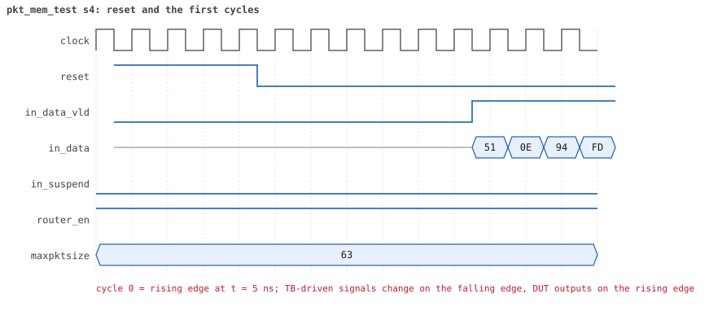
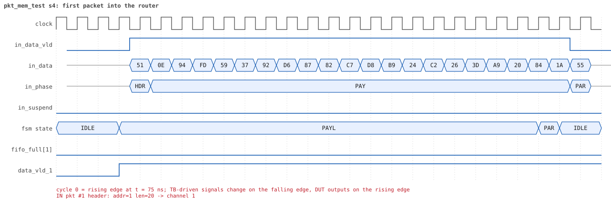
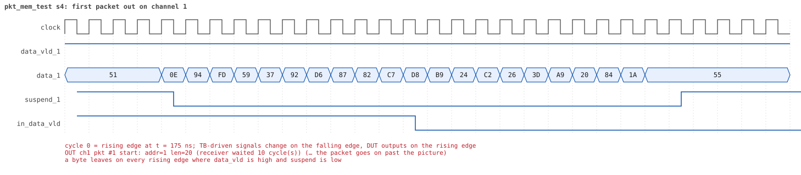
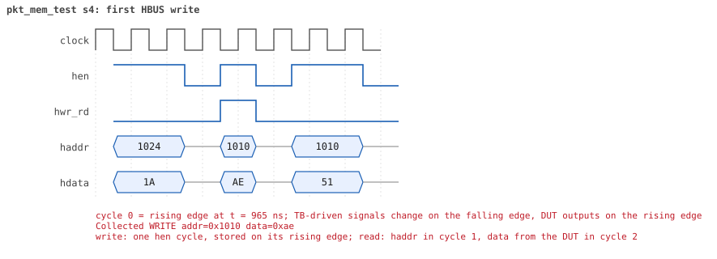
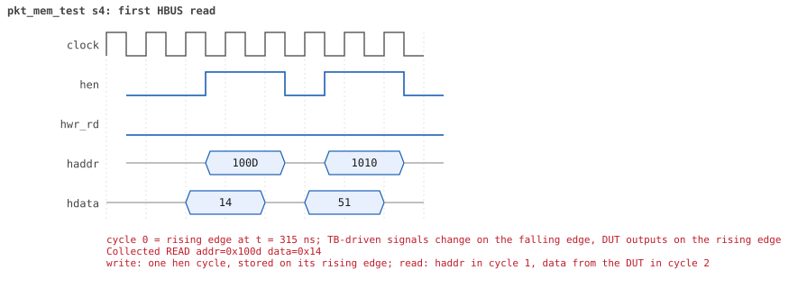

# pkt_mem_test  seed 4

**Result:** PASSED (0 UVM_ERROR, 0 UVM_WARNING, 0 UVM_FATAL) · bench `yapp_project_tb` · sim time 2us · log `pkt_mem_test_s4.log`

Waves: `pkt_mem_test_s4.fst` (GTKWave, Surfer or the VS Code wave viewer); signal trace: `signals.csv`.
[Open the waves in Surfer](https://app.surfer-project.org/?load_url=https%3A%2F%2Fraw.githubusercontent.com%2Ftamirgabgab%2FQcom-Mentoring%2Fmain%2Fyapp_project%2Fregression%2Fyapp_project_tb%2Fpkt_mem_test_s4%2Fpkt_mem_test_s4.fst&startup_commands=run_command_file_from_url%20https%3A%2F%2Fraw.githubusercontent.com%2Ftamirgabgab%2FQcom-Mentoring%2Fmain%2Fyapp_project%2Ftb%2Fyapp_router.sucl) (web app, the signals already in groups: `yapp_project/tb/yapp_router.sucl`).

## Summary

- YAPP driver sent **2** packet(s) (0 with bad parity); the input monitor saw 2.
- Router: **1** forwarded, **1** dropped (1 oversized).
- Packets out: ch0 **0**, ch1 **1**, ch2 **0**.
- Scoreboard: 1 matched, 0 mismatched, 0 unexpected.
- Back-pressure: in_suspend asserted **0** time(s).
- Error pulses: 0.
- HBUS: 3 write(s), 34 read(s).

## Stages

| time (ns) | stage |
|---|---|
| 0 | 1. one packet (addr 1, 20 bytes): mem_size_reg and yapp_pkt_mem hold it byte by byte |
| 980 | 2. a raw HBUS write to yapp_pkt_mem[0] is ignored (read-only memory) |
| 1030 | 3. ctrl_reg=5, then a 9-byte packet: dropped as oversized but still stored |

## Pictures

**reset and the first cycles**

**first packet into the router**

**first packet out on channel 1**

**first HBUS write**

**first HBUS read**

## Timeline

117 events (the same list is in `timeline.csv`).

| time (ns) | who | event |
|---|---|---|
| 0 | yapp monitor | YAPP monitor running |
| 0 | **test** | STAGE: 1. one packet (addr 1, 20 bytes): mem_size_reg and yapp_pkt_mem hold it byte by byte |
| 0 | clk/rst driver | Starting clock (period 10) and holding reset for 5 cycles |
| 0 | **DUT** | RESET asserted |
| 50 | **DUT** | RESET released: router_en=1 maxpktsize=63 |
| 50 | yapp driver | TX pkt #1: addr=1 len=20 parity=good delay=4 |
| 105 | **DUT** | IN  pkt #1 header: addr=1 len=20 -> channel 1 |
| 215 | **DUT** | OUT ch1 pkt #1 start: addr=1 len=20 (receiver waited 10 cycle(s)) |
| 315 | **DUT** | IN  pkt #1 complete: addr=1 len=20 parity=ok forwarded, 22 bytes in 22 cycles (held 0) |
| 315 | yapp monitor | RX pkt #1 on the input: addr=1 len=20 parity=good gap=5 |
| 315 | reference | Packet forwarded: addr=1 len=20 -> channel 1 |
| 320 | yapp driver | TX pkt #1 accepted by the DUT |
| 350 | hbus driver | Executed READ  addr=0x100d data=0x14 |
| 355 | hbus monitor | Collected READ  addr=0x100d data=0x14 |
| 380 | hbus driver | Executed READ  addr=0x1010 data=0x51 |
| 385 | hbus monitor | Collected READ  addr=0x1010 data=0x51 |
| 410 | hbus driver | Executed READ  addr=0x1011 data=0x0e |
| 415 | hbus monitor | Collected READ  addr=0x1011 data=0x0e |
| 420 | ch1 driver | ch1: packet consumed (response delay 10) |
| 440 | hbus driver | Executed READ  addr=0x1012 data=0x94 |
| 445 | hbus monitor | Collected READ  addr=0x1012 data=0x94 |
| 470 | hbus driver | Executed READ  addr=0x1013 data=0xfd |
| 475 | **DUT** | OUT ch1 pkt #1 done: 22 bytes in 27 cycles |
| 475 | ch1 monitor | ch1 RX pkt #1: addr=1 len=20 parity=good |
| 475 | scoreboard | ch1 pkt matched: addr=1 len=20 (1 matched so far) |
| 475 | hbus monitor | Collected READ  addr=0x1013 data=0xfd |
| 500 | hbus driver | Executed READ  addr=0x1014 data=0x59 |
| 505 | hbus monitor | Collected READ  addr=0x1014 data=0x59 |
| 530 | hbus driver | Executed READ  addr=0x1015 data=0x37 |
| 535 | hbus monitor | Collected READ  addr=0x1015 data=0x37 |
| 560 | hbus driver | Executed READ  addr=0x1016 data=0x92 |
| 565 | hbus monitor | Collected READ  addr=0x1016 data=0x92 |
| 590 | hbus driver | Executed READ  addr=0x1017 data=0xd6 |
| 595 | hbus monitor | Collected READ  addr=0x1017 data=0xd6 |
| 620 | hbus driver | Executed READ  addr=0x1018 data=0x87 |
| 625 | hbus monitor | Collected READ  addr=0x1018 data=0x87 |
| 650 | hbus driver | Executed READ  addr=0x1019 data=0x82 |
| 655 | hbus monitor | Collected READ  addr=0x1019 data=0x82 |
| 680 | hbus driver | Executed READ  addr=0x101a data=0xc7 |
| 685 | hbus monitor | Collected READ  addr=0x101a data=0xc7 |
| 690 | ch1 driver | ch1: packet consumed (response delay 4) |
| 710 | hbus driver | Executed READ  addr=0x101b data=0xd8 |
| 715 | hbus monitor | Collected READ  addr=0x101b data=0xd8 |
| 740 | hbus driver | Executed READ  addr=0x101c data=0xb9 |
| 745 | hbus monitor | Collected READ  addr=0x101c data=0xb9 |
| 770 | hbus driver | Executed READ  addr=0x101d data=0x24 |
| 775 | hbus monitor | Collected READ  addr=0x101d data=0x24 |
| 800 | hbus driver | Executed READ  addr=0x101e data=0xc2 |
| 805 | hbus monitor | Collected READ  addr=0x101e data=0xc2 |
| 830 | hbus driver | Executed READ  addr=0x101f data=0x26 |
| 835 | hbus monitor | Collected READ  addr=0x101f data=0x26 |
| 860 | hbus driver | Executed READ  addr=0x1020 data=0x3d |
| 865 | hbus monitor | Collected READ  addr=0x1020 data=0x3d |
| 890 | hbus driver | Executed READ  addr=0x1021 data=0xa9 |
| 895 | hbus monitor | Collected READ  addr=0x1021 data=0xa9 |
| 920 | hbus driver | Executed READ  addr=0x1022 data=0x20 |
| 925 | hbus monitor | Collected READ  addr=0x1022 data=0x20 |
| 950 | hbus driver | Executed READ  addr=0x1023 data=0x84 |
| 955 | hbus monitor | Collected READ  addr=0x1023 data=0x84 |
| 980 | hbus driver | Executed READ  addr=0x1024 data=0x1a |
| 980 | **test** | packet (addr 1, length 20) stored byte by byte |
| 980 | **test** | STAGE: 2. a raw HBUS write to yapp_pkt_mem[0] is ignored (read-only memory) |
| 985 | hbus monitor | Collected READ  addr=0x1024 data=0x1a |
| 1000 | hbus driver | Executed WRITE addr=0x1010 data=0xae |
| 1005 | hbus monitor | Collected WRITE addr=0x1010 data=0xae |
| 1030 | hbus driver | Executed READ  addr=0x1010 data=0x51 |
| 1030 | **test** | write to yapp_pkt_mem ignored, as it should be |
| 1030 | **test** | STAGE: 3. ctrl_reg=5, then a 9-byte packet: dropped as oversized but still stored |
| 1035 | hbus monitor | Collected READ  addr=0x1010 data=0x51 |
| 1050 | hbus driver | Executed WRITE addr=0x1000 data=0x05 |
| 1050 | yapp driver | TX pkt #2: addr=2 len=9 parity=good delay=19 |
| 1055 | **DUT** | CONFIG router_en=1 maxpktsize=5 |
| 1055 | hbus monitor | Collected WRITE addr=0x1000 data=0x05 |
| 1055 | reference | maxpktsize is now 5 |
| 1255 | **DUT** | IN  pkt #2 header: addr=2 len=9 -> DROP (oversized: len 9 > maxpktsize 5) |
| 1355 | **DUT** | IN  pkt #2 complete: addr=2 len=9 parity=ok dropped, 11 bytes in 11 cycles (held 0) |
| 1355 | yapp monitor | RX pkt #2 on the input: addr=2 len=9 parity=good gap=93 |
| 1355 | reference | Packet dropped: length 9 > maxpktsize 5 (addr=2) |
| 1355 | **DUT** | ROUTER DROPS PACKET addr=2 length=9 (length > maxpktsize) |
| 1360 | yapp driver | TX pkt #2 accepted by the DUT |
| 1390 | hbus driver | Executed READ  addr=0x100d data=0x09 |
| 1395 | hbus monitor | Collected READ  addr=0x100d data=0x09 |
| 1420 | hbus driver | Executed READ  addr=0x1010 data=0x26 |
| 1425 | hbus monitor | Collected READ  addr=0x1010 data=0x26 |
| 1450 | hbus driver | Executed READ  addr=0x1011 data=0xd4 |
| 1455 | hbus monitor | Collected READ  addr=0x1011 data=0xd4 |
| 1480 | hbus driver | Executed READ  addr=0x1012 data=0x93 |
| 1485 | hbus monitor | Collected READ  addr=0x1012 data=0x93 |
| 1510 | hbus driver | Executed READ  addr=0x1013 data=0xbf |
| 1515 | hbus monitor | Collected READ  addr=0x1013 data=0xbf |
| 1540 | hbus driver | Executed READ  addr=0x1014 data=0x3c |
| 1545 | hbus monitor | Collected READ  addr=0x1014 data=0x3c |
| 1570 | hbus driver | Executed READ  addr=0x1015 data=0x6f |
| 1575 | hbus monitor | Collected READ  addr=0x1015 data=0x6f |
| 1600 | hbus driver | Executed READ  addr=0x1016 data=0x8b |
| 1605 | hbus monitor | Collected READ  addr=0x1016 data=0x8b |
| 1630 | hbus driver | Executed READ  addr=0x1017 data=0x53 |
| 1635 | hbus monitor | Collected READ  addr=0x1017 data=0x53 |
| 1660 | hbus driver | Executed READ  addr=0x1018 data=0x44 |
| 1665 | hbus monitor | Collected READ  addr=0x1018 data=0x44 |
| 1690 | hbus driver | Executed READ  addr=0x1019 data=0x3d |
| 1690 | **test** | packet (addr 2, length 9) stored byte by byte |
| 1695 | hbus monitor | Collected READ  addr=0x1019 data=0x3d |
| 1710 | hbus driver | Executed WRITE addr=0x1000 data=0x3f |
| 1715 | **DUT** | CONFIG router_en=1 maxpktsize=63 |
| 1715 | hbus monitor | Collected WRITE addr=0x1000 data=0x3f |
| 1715 | reference | maxpktsize is now 63 |
| 1910 | ch0 monitor | Channel 0 report: 0 packets collected |
| 1910 | ch1 monitor | Channel 1 report: 1 packets collected |
| 1910 | ch2 monitor | Channel 2 report: 0 packets collected |
| 1910 | hbus monitor | HBUS report: 3 writes, 34 reads |
| 1910 | reference |  |
| 1910 | reference | Coverage of the router configuration: 43.5% |
| 1910 | scoreboard |  |
| 1910 | yapp driver | YAPP driver report: 2 packets sent |
| 1910 | yapp monitor | YAPP monitor report: 2 packets collected, coverage 23.3% |
| 1910 | yapp monitor | YAPP gaps: 0 back to back, 0 of 1 cycle, 0 of 2, 1 longer (gap coverage 25.0%) |
