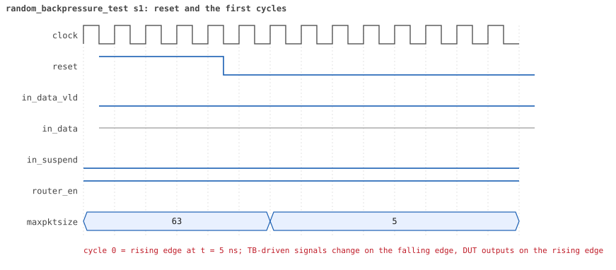
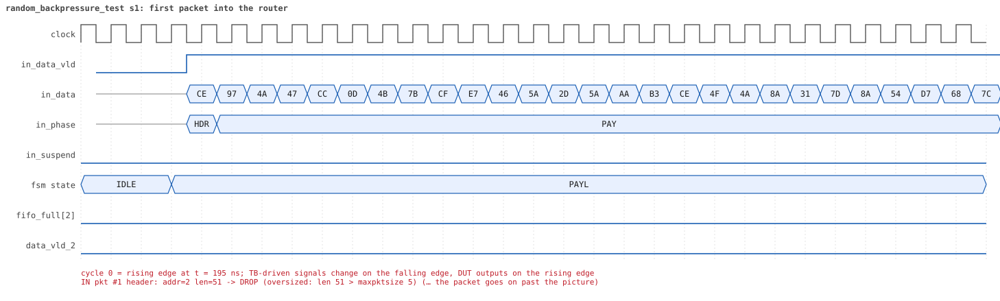
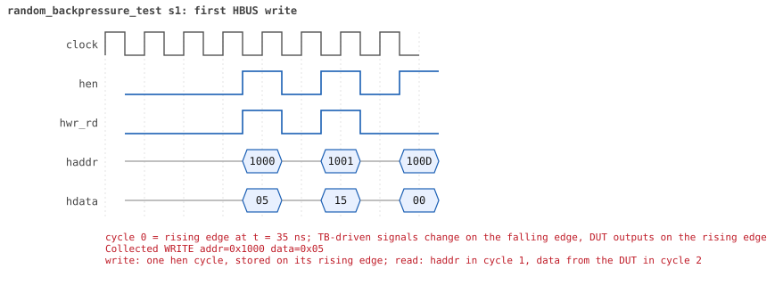

# random_backpressure_test seed 1

**Result:** PASSED (0 UVM_ERROR, 0 UVM_WARNING, 0 UVM_FATAL) · bench `yapp_project_tb` · sim time 18us · wall 8.2 s · log [`random_backpressure_test_s1.log`](random_backpressure_test_s1.log)

Waves: `random_backpressure_test_s1.fst` (GTKWave, Surfer or the VS Code wave viewer).
[Open the waves in Surfer](https://app.surfer-project.org/?load_url=https%3A%2F%2Fraw.githubusercontent.com%2Ftamirgabgab%2FQcom-Mentoring%2Fmain%2Fyapp_project%2Fregression%2Fyapp_project_tb%2Frandom_backpressure_test_s1%2Frandom_backpressure_test_s1.fst&startup_commands=run_command_file_from_url%20https%3A%2F%2Fraw.githubusercontent.com%2Ftamirgabgab%2FQcom-Mentoring%2Fmain%2Fyapp_project%2Ftb%2Fyapp_router.sucl) (web app, the signals already in groups: `yapp_project/tb/yapp_router.sucl`).

## Summary

- YAPP driver sent **25** packet(s) (0 with bad parity); the input monitor saw 25.
- Router: **8** forwarded, **17** dropped (17 oversized).
- Packets out: ch0 **2**, ch1 **1**, ch2 **5**.
- Scoreboard: 8 matched, 0 mismatched, 0 unexpected.
- Back-pressure: in_suspend asserted **8** time(s), longest hold 34 cycle(s).
- Error pulses: 0.
- HBUS: 25 write(s), 108 read(s).

## Stages

| time (ns) | stage |
|---|---|
| 0 | receivers: ch0 RX_SLOW, ch1 RX_STALLY, ch2 RX_SLOW |
| 0 | random scenario: 25 packets in 6 bursts |
| 200 | burst 1/6: ctrl=0x05 (maxpktsize 5) en=0x15 (router on, counter enables 0001010), 4 packet(s) |
| 2530 | burst 1/6 sent: addr0..3 0/0/4/0, bad parity 0, gap 0 3, length 46..63 |
| 2710 | burst 2/6: ctrl=0x46 (maxpktsize 6) en=0xf9 (router on, counter enables 1111100), 4 packet(s) |
| 4550 | burst 2/6 sent: addr0..3 1/0/3/0, bad parity 0, gap 0 3, length 39..47 |
| 4780 | burst 3/6: ctrl=0xc1 (maxpktsize 1) en=0xe3 (router on, counter enables 1110001), 4 packet(s) |
| 7030 | burst 3/6 sent: addr0..3 1/2/1/0, bad parity 0, gap 0 2, length 17..63 |
| 7390 | burst 4/6: ctrl=0x2c (maxpktsize 44) en=0x87 (router on, counter enables 1000011), 4 packet(s) |
| 9420 | burst 4/6 sent: addr0..3 0/2/2/0, bad parity 0, gap 0 2, length 22..49 |
| 9710 | burst 5/6: ctrl=0x3b (maxpktsize 59) en=0xff (router on, counter enables 1111111), 5 packet(s) |
| 12550 | burst 5/6 sent: addr0..3 2/0/3/0, bad parity 0, gap 0 4, length 23..62 |
| 12890 | burst 6/6: ctrl=0xbd (maxpktsize 61) en=0xff (router on, counter enables 1111111), 4 packet(s) |
| 15740 | burst 6/6 sent: addr0..3 0/0/4/0, bad parity 0, gap 0 3, length 18..63 |
| 15740 | final reads: every register and the stored packet, checked against the reference model |
| 18045 | done: 25 packets (8 forwarded, 17 dropped), 0 storm burst(s), 8 scoreboard matches, 107 HBUS reads checked, 0 error pulses for 0 bad packets |

## Pictures

**reset and the first cycles**

**first packet into the router**

**first packet out on channel 1**

**first back-pressure on the input port**

**first HBUS write**

**first HBUS read**

## Timeline

550 events.

| time (ns) | who | event |
|---|---|---|
| 0 | yapp monitor | YAPP monitor running |
| 0 | **test** | STAGE: receivers: ch0 RX_SLOW, ch1 RX_STALLY, ch2 RX_SLOW |
| 0 | **test** | STAGE: random scenario: 25 packets in 6 bursts |
| 0 | clk/rst driver | Starting clock (period 10) and holding reset for 5 cycles |
| 0 | **DUT** | RESET asserted |
| 50 | **DUT** | RESET released: router_en=1 maxpktsize=63 |
| 70 | hbus driver | Executed WRITE addr=0x1000 data=0x05 |
| 75 | **DUT** | CONFIG router_en=1 maxpktsize=5 |
| 75 | hbus monitor | Collected WRITE addr=0x1000 data=0x05 |
| 75 | reference | maxpktsize is now 5 |
| 90 | hbus driver | Executed WRITE addr=0x1001 data=0x15 |
| 95 | hbus monitor | Collected WRITE addr=0x1001 data=0x15 |
| 95 | reference | router_en is now 1 (en_reg 0x15) |
| 120 | hbus driver | Executed READ  addr=0x100d data=0x00 |
| 125 | hbus monitor | Collected READ  addr=0x100d data=0x00 |
| 140 | hbus driver | Executed WRITE addr=0x11f9 data=0x85 |
| 145 | hbus monitor | Collected WRITE addr=0x11f9 data=0x85 |
| 170 | hbus driver | Executed READ  addr=0x11f9 data=0x85 |
| 175 | hbus monitor | Collected READ  addr=0x11f9 data=0x85 |
| 200 | hbus driver | Executed READ  addr=0x1024 data=0x00 |
| 200 | **test** | STAGE: burst 1/6: ctrl=0x05 (maxpktsize 5) en=0x15 (router on, counter enables 0001010), 4 packet(s) |
| 200 | yapp driver | TX pkt #1: addr=2 len=51 parity=good delay=1 |
| 205 | hbus monitor | Collected READ  addr=0x1024 data=0x00 |
| 225 | **DUT** | IN  pkt #1 header: addr=2 len=51 -> DROP (oversized: len 51 > maxpktsize 5) |
| 745 | **DUT** | IN  pkt #1 complete: addr=2 len=51 parity=ok dropped, 53 bytes in 53 cycles (held 0) |
| 745 | yapp monitor | RX pkt #1 on the input: addr=2 len=51 parity=good gap=17 |
| 745 | reference | Packet dropped: length 51 > maxpktsize 5 (addr=2) |
| 745 | **DUT** | ROUTER DROPS PACKET addr=2 length=51 (length > maxpktsize) |
| 750 | yapp driver | TX pkt #1 accepted by the DUT |
| 750 | yapp driver | TX pkt #2: addr=2 len=46 parity=good delay=0 |
| 755 | **DUT** | IN  pkt #2 header: addr=2 len=46 -> DROP (oversized: len 46 > maxpktsize 5) |
| 1225 | **DUT** | IN  pkt #2 complete: addr=2 len=46 parity=ok dropped, 48 bytes in 48 cycles (held 0) |
| 1225 | yapp monitor | RX pkt #2 on the input: addr=2 len=46 parity=good gap=0 |
| 1225 | reference | Packet dropped: length 46 > maxpktsize 5 (addr=2) |
| 1225 | **DUT** | ROUTER DROPS PACKET addr=2 length=46 (length > maxpktsize) |
| 1230 | yapp driver | TX pkt #2 accepted by the DUT |
| 1230 | yapp driver | TX pkt #3: addr=2 len=63 parity=good delay=0 |
| 1235 | **DUT** | IN  pkt #3 header: addr=2 len=63 -> DROP (oversized: len 63 > maxpktsize 5) |
| 1875 | **DUT** | IN  pkt #3 complete: addr=2 len=63 parity=ok dropped, 65 bytes in 65 cycles (held 0) |
| 1875 | yapp monitor | RX pkt #3 on the input: addr=2 len=63 parity=good gap=0 |
| 1875 | reference | Packet dropped: length 63 > maxpktsize 5 (addr=2) |
| 1875 | **DUT** | ROUTER DROPS PACKET addr=2 length=63 (length > maxpktsize) |
| 1880 | yapp driver | TX pkt #3 accepted by the DUT |
| 1880 | yapp driver | TX pkt #4: addr=2 len=63 parity=good delay=0 |
| 1885 | **DUT** | IN  pkt #4 header: addr=2 len=63 -> DROP (oversized: len 63 > maxpktsize 5) |
| 2525 | **DUT** | IN  pkt #4 complete: addr=2 len=63 parity=ok dropped, 65 bytes in 65 cycles (held 0) |
| 2525 | yapp monitor | RX pkt #4 on the input: addr=2 len=63 parity=good gap=0 |
| 2525 | reference | Packet dropped: length 63 > maxpktsize 5 (addr=2) |
| 2525 | **DUT** | ROUTER DROPS PACKET addr=2 length=63 (length > maxpktsize) |
| 2530 | yapp driver | TX pkt #4 accepted by the DUT |
| 2530 | **test** | STAGE: burst 1/6 sent: addr0..3 0/0/4/0, bad parity 0, gap 0 3, length 46..63 |
| 2550 | hbus driver | Executed WRITE addr=0x1000 data=0x46 |
| 2555 | **DUT** | CONFIG router_en=1 maxpktsize=6 |
| 2555 | hbus monitor | Collected WRITE addr=0x1000 data=0x46 |
| 2555 | reference | maxpktsize is now 6 |
| 2570 | hbus driver | Executed WRITE addr=0x1001 data=0xf9 |
| 2575 | hbus monitor | Collected WRITE addr=0x1001 data=0xf9 |
| 2575 | reference | router_en is now 1 (en_reg 0xf9) |
| 2600 | hbus driver | Executed READ  addr=0x1029 data=0x66 |
| 2605 | hbus monitor | Collected READ  addr=0x1029 data=0x66 |
| 2620 | hbus driver | Executed WRITE addr=0x11d1 data=0x53 |
| 2625 | hbus monitor | Collected WRITE addr=0x11d1 data=0x53 |
| 2650 | hbus driver | Executed READ  addr=0x11d1 data=0x53 |
| 2655 | hbus monitor | Collected READ  addr=0x11d1 data=0x53 |
| 2680 | hbus driver | Executed READ  addr=0x1034 data=0x90 |
| 2685 | hbus monitor | Collected READ  addr=0x1034 data=0x90 |
| 2710 | hbus driver | Executed READ  addr=0x1026 data=0x1e |
| 2710 | **test** | STAGE: burst 2/6: ctrl=0x46 (maxpktsize 6) en=0xf9 (router on, counter enables 1111100), 4 packet(s) |
| 2710 | yapp driver | TX pkt #5: addr=2 len=40 parity=good delay=0 |
| 2715 | hbus monitor | Collected READ  addr=0x1026 data=0x1e |
| 2725 | **DUT** | IN  pkt #5 header: addr=2 len=40 -> DROP (oversized: len 40 > maxpktsize 6) |
| 3135 | **DUT** | IN  pkt #5 complete: addr=2 len=40 parity=ok dropped, 42 bytes in 42 cycles (held 0) |
| 3135 | yapp monitor | RX pkt #5 on the input: addr=2 len=40 parity=good gap=19 |
| 3135 | reference | Packet dropped: length 40 > maxpktsize 6 (addr=2) |
| 3135 | **DUT** | ROUTER DROPS PACKET addr=2 length=40 (length > maxpktsize) |
| 3140 | yapp driver | TX pkt #5 accepted by the DUT |
| 3140 | yapp driver | TX pkt #6: addr=2 len=47 parity=good delay=0 |
| 3145 | **DUT** | IN  pkt #6 header: addr=2 len=47 -> DROP (oversized: len 47 > maxpktsize 6) |
| 3625 | **DUT** | IN  pkt #6 complete: addr=2 len=47 parity=ok dropped, 49 bytes in 49 cycles (held 0) |
| 3625 | yapp monitor | RX pkt #6 on the input: addr=2 len=47 parity=good gap=0 |
| 3625 | reference | Packet dropped: length 47 > maxpktsize 6 (addr=2) |
| 3625 | **DUT** | ROUTER DROPS PACKET addr=2 length=47 (length > maxpktsize) |
| 3630 | yapp driver | TX pkt #6 accepted by the DUT |
| 3630 | yapp driver | TX pkt #7: addr=2 len=39 parity=good delay=2 |
| 3655 | **DUT** | IN  pkt #7 header: addr=2 len=39 -> DROP (oversized: len 39 > maxpktsize 6) |
| 4055 | **DUT** | IN  pkt #7 complete: addr=2 len=39 parity=ok dropped, 41 bytes in 41 cycles (held 0) |
| 4055 | yapp monitor | RX pkt #7 on the input: addr=2 len=39 parity=good gap=2 |
| 4055 | reference | Packet dropped: length 39 > maxpktsize 6 (addr=2) |
| 4055 | **DUT** | ROUTER DROPS PACKET addr=2 length=39 (length > maxpktsize) |
| 4060 | yapp driver | TX pkt #7 accepted by the DUT |
| 4060 | yapp driver | TX pkt #8: addr=0 len=47 parity=good delay=0 |
| 4065 | **DUT** | IN  pkt #8 header: addr=0 len=47 -> DROP (oversized: len 47 > maxpktsize 6) |
| 4545 | **DUT** | IN  pkt #8 complete: addr=0 len=47 parity=ok dropped, 49 bytes in 49 cycles (held 0) |
| 4545 | yapp monitor | RX pkt #8 on the input: addr=0 len=47 parity=good gap=0 |
| 4545 | reference | Packet dropped: length 47 > maxpktsize 6 (addr=0) |
| 4545 | **DUT** | ROUTER DROPS PACKET addr=0 length=47 (length > maxpktsize) |
| 4550 | yapp driver | TX pkt #8 accepted by the DUT |
| 4550 | **test** | STAGE: burst 2/6 sent: addr0..3 1/0/3/0, bad parity 0, gap 0 3, length 39..47 |
| 4570 | hbus driver | Executed WRITE addr=0x1000 data=0xc1 |
| 4575 | **DUT** | CONFIG router_en=1 maxpktsize=1 |
| 4575 | hbus monitor | Collected WRITE addr=0x1000 data=0xc1 |
| 4575 | reference | maxpktsize is now 1 |
| 4590 | hbus driver | Executed WRITE addr=0x1001 data=0xe3 |
| 4595 | hbus monitor | Collected WRITE addr=0x1001 data=0xe3 |
| 4595 | reference | router_en is now 1 (en_reg 0xe3) |
| 4610 | hbus driver | Executed WRITE addr=0x11c6 data=0xe2 |
| 4615 | hbus monitor | Collected WRITE addr=0x11c6 data=0xe2 |
| 4640 | hbus driver | Executed READ  addr=0x11c6 data=0xe2 |
| 4645 | hbus monitor | Collected READ  addr=0x11c6 data=0xe2 |
| 4670 | hbus driver | Executed READ  addr=0x1005 data=0x04 |
| 4675 | hbus monitor | Collected READ  addr=0x1005 data=0x04 |
| 4700 | hbus driver | Executed READ  addr=0x104b data=0x18 |
| 4705 | hbus monitor | Collected READ  addr=0x104b data=0x18 |
| 4730 | hbus driver | Executed READ  addr=0x1002 data=0x00 |
| 4735 | hbus monitor | Collected READ  addr=0x1002 data=0x00 |
| 4750 | hbus driver | Executed WRITE addr=0x118a data=0x33 |
| 4755 | hbus monitor | Collected WRITE addr=0x118a data=0x33 |
| 4780 | hbus driver | Executed READ  addr=0x118a data=0x33 |
| 4780 | **test** | STAGE: burst 3/6: ctrl=0xc1 (maxpktsize 1) en=0xe3 (router on, counter enables 1110001), 4 packet(s) |
| 4780 | yapp driver | TX pkt #9: addr=2 len=54 parity=good delay=0 |
| 4785 | hbus monitor | Collected READ  addr=0x118a data=0x33 |
| 4795 | **DUT** | IN  pkt #9 header: addr=2 len=54 -> DROP (oversized: len 54 > maxpktsize 1) |
| 5345 | **DUT** | IN  pkt #9 complete: addr=2 len=54 parity=ok dropped, 56 bytes in 56 cycles (held 0) |
| 5345 | yapp monitor | RX pkt #9 on the input: addr=2 len=54 parity=good gap=24 |
| 5345 | reference | Packet dropped: length 54 > maxpktsize 1 (addr=2) |
| 5345 | **DUT** | ROUTER DROPS PACKET addr=2 length=54 (length > maxpktsize) |
| 5350 | yapp driver | TX pkt #9 accepted by the DUT |
| 5350 | yapp driver | TX pkt #10: addr=0 len=17 parity=good delay=0 |
| 5355 | **DUT** | IN  pkt #10 header: addr=0 len=17 -> DROP (oversized: len 17 > maxpktsize 1) |
| 5535 | **DUT** | IN  pkt #10 complete: addr=0 len=17 parity=ok dropped, 19 bytes in 19 cycles (held 0) |
| 5535 | yapp monitor | RX pkt #10 on the input: addr=0 len=17 parity=good gap=0 |
| 5535 | reference | Packet dropped: length 17 > maxpktsize 1 (addr=0) |
| 5535 | **DUT** | ROUTER DROPS PACKET addr=0 length=17 (length > maxpktsize) |
| 5540 | yapp driver | TX pkt #10 accepted by the DUT |
| 5540 | yapp driver | TX pkt #11: addr=1 len=63 parity=good delay=18 |
| 5725 | **DUT** | IN  pkt #11 header: addr=1 len=63 -> DROP (oversized: len 63 > maxpktsize 1) |
| 6365 | **DUT** | IN  pkt #11 complete: addr=1 len=63 parity=ok dropped, 65 bytes in 65 cycles (held 0) |
| 6365 | yapp monitor | RX pkt #11 on the input: addr=1 len=63 parity=good gap=18 |
| 6365 | reference | Packet dropped: length 63 > maxpktsize 1 (addr=1) |
| 6365 | **DUT** | ROUTER DROPS PACKET addr=1 length=63 (length > maxpktsize) |
| 6370 | yapp driver | TX pkt #11 accepted by the DUT |
| 6370 | yapp driver | TX pkt #12: addr=1 len=63 parity=good delay=1 |
| 6385 | **DUT** | IN  pkt #12 header: addr=1 len=63 -> DROP (oversized: len 63 > maxpktsize 1) |
| 7025 | **DUT** | IN  pkt #12 complete: addr=1 len=63 parity=ok dropped, 65 bytes in 65 cycles (held 0) |
| 7025 | yapp monitor | RX pkt #12 on the input: addr=1 len=63 parity=good gap=1 |
| 7025 | reference | Packet dropped: length 63 > maxpktsize 1 (addr=1) |
| 7025 | **DUT** | ROUTER DROPS PACKET addr=1 length=63 (length > maxpktsize) |
| 7030 | yapp driver | TX pkt #12 accepted by the DUT |
| 7030 | **test** | STAGE: burst 3/6 sent: addr0..3 1/2/1/0, bad parity 0, gap 0 2, length 17..63 |
| 7050 | hbus driver | Executed WRITE addr=0x1000 data=0x2c |
| 7055 | **DUT** | CONFIG router_en=1 maxpktsize=44 |
| 7055 | hbus monitor | Collected WRITE addr=0x1000 data=0x2c |
| 7055 | reference | maxpktsize is now 44 |
| 7070 | hbus driver | Executed WRITE addr=0x1001 data=0x87 |
| 7075 | hbus monitor | Collected WRITE addr=0x1001 data=0x87 |
| 7075 | reference | router_en is now 1 (en_reg 0x87) |
| 7090 | hbus driver | Executed WRITE addr=0x1101 data=0x59 |
| 7095 | hbus monitor | Collected WRITE addr=0x1101 data=0x59 |
| 7120 | hbus driver | Executed READ  addr=0x1101 data=0x59 |
| 7125 | hbus monitor | Collected READ  addr=0x1101 data=0x59 |
| 7150 | hbus driver | Executed READ  addr=0x10b9 data=0x00 |
| 7155 | hbus monitor | Collected READ  addr=0x10b9 data=0x00 |
| 7180 | hbus driver | Executed READ  addr=0x101a data=0x87 |
| 7185 | hbus monitor | Collected READ  addr=0x101a data=0x87 |
| 7200 | hbus driver | Executed WRITE addr=0x11dc data=0xc2 |
| 7205 | hbus monitor | Collected WRITE addr=0x11dc data=0xc2 |
| 7230 | hbus driver | Executed READ  addr=0x11dc data=0xc2 |
| 7235 | hbus monitor | Collected READ  addr=0x11dc data=0xc2 |
| 7250 | hbus driver | Executed WRITE addr=0x1188 data=0x26 |
| 7255 | hbus monitor | Collected WRITE addr=0x1188 data=0x26 |
| 7280 | hbus driver | Executed READ  addr=0x1188 data=0x26 |
| 7285 | hbus monitor | Collected READ  addr=0x1188 data=0x26 |
| 7310 | hbus driver | Executed READ  addr=0x1001 data=0x87 |
| 7315 | hbus monitor | Collected READ  addr=0x1001 data=0x87 |
| 7330 | hbus driver | Executed WRITE addr=0x1135 data=0xde |
| 7335 | hbus monitor | Collected WRITE addr=0x1135 data=0xde |
| 7360 | hbus driver | Executed READ  addr=0x1135 data=0xde |
| 7365 | hbus monitor | Collected READ  addr=0x1135 data=0xde |
| 7390 | hbus driver | Executed READ  addr=0x1032 data=0x17 |
| 7390 | **test** | STAGE: burst 4/6: ctrl=0x2c (maxpktsize 44) en=0x87 (router on, counter enables 1000011), 4 packet(s) |
| 7390 | yapp driver | TX pkt #13: addr=1 len=22 parity=good delay=0 |
| 7395 | hbus monitor | Collected READ  addr=0x1032 data=0x17 |
| 7405 | **DUT** | IN  pkt #13 header: addr=1 len=22 -> channel 1 |
| 7495 | **DUT** | OUT ch1 pkt #1 start: addr=1 len=22 (receiver waited 8 cycle(s)) |
| 7635 | **DUT** | IN  pkt #13 complete: addr=1 len=22 parity=ok forwarded, 24 bytes in 24 cycles (held 0) |
| 7635 | yapp monitor | RX pkt #13 on the input: addr=1 len=22 parity=good gap=37 |
| 7635 | reference | Packet forwarded: addr=1 len=22 -> channel 1 |
| 7640 | yapp driver | TX pkt #13 accepted by the DUT |
| 7640 | yapp driver | TX pkt #14: addr=2 len=44 parity=good delay=3 |
| 7675 | **DUT** | IN  pkt #14 header: addr=2 len=44 -> channel 2 |
| 7720 | ch1 driver | ch1: packet consumed (response delay 8) |
| 7795 | **DUT** | OUT ch1 pkt #1 done: 24 bytes in 31 cycles |
| 7795 | ch1 monitor | ch1 RX pkt #1: addr=1 len=22 parity=good |
| 7795 | scoreboard | ch1 pkt matched: addr=1 len=22 (1 matched so far) |
| 7835 | **DUT** | SUSPEND asserted: FIFO 2 full, byte 0x47 held (pkt #14) |
| 8085 | **DUT** | OUT ch2 pkt #1 start: addr=2 len=44 (receiver waited 40 cycle(s)) |
| 8095 | **DUT** | SUSPEND released after 26 cycle(s) |
| 8330 | ch1 driver | ch1: packet consumed (response delay 6) |
| 8385 | **DUT** | IN  pkt #14 complete: addr=2 len=44 parity=ok forwarded, 46 bytes in 72 cycles (held 26) |
| 8385 | yapp monitor | RX pkt #14 on the input: addr=2 len=44 parity=good gap=3 |
| 8385 | reference | Packet forwarded: addr=2 len=44 -> channel 2 |
| 8390 | yapp driver | TX pkt #14 accepted by the DUT |
| 8390 | yapp driver | TX pkt #15: addr=1 len=47 parity=good delay=0 |
| 8395 | **DUT** | IN  pkt #15 header: addr=1 len=47 -> DROP (oversized: len 47 > maxpktsize 44) |
| 8530 | ch2 driver | ch2: packet consumed (response delay 40) |
| 8775 | **DUT** | OUT ch2 pkt #1 done: 46 bytes in 70 cycles |
| 8775 | ch2 monitor | ch2 RX pkt #1: addr=2 len=44 parity=good |
| 8775 | scoreboard | ch2 pkt matched: addr=2 len=44 (2 matched so far) |
| 8875 | **DUT** | IN  pkt #15 complete: addr=1 len=47 parity=ok dropped, 49 bytes in 49 cycles (held 0) |
| 8875 | yapp monitor | RX pkt #15 on the input: addr=1 len=47 parity=good gap=0 |
| 8875 | reference | Packet dropped: length 47 > maxpktsize 44 (addr=1) |
| 8875 | **DUT** | ROUTER DROPS PACKET addr=1 length=47 (length > maxpktsize) |
| 8880 | yapp driver | TX pkt #15 accepted by the DUT |
| 8880 | yapp driver | TX pkt #16: addr=2 len=49 parity=good delay=3 |
| 8915 | **DUT** | IN  pkt #16 header: addr=2 len=49 -> DROP (oversized: len 49 > maxpktsize 44) |
| 9200 | ch2 driver | ch2: packet consumed (response delay 23) |
| 9415 | **DUT** | IN  pkt #16 complete: addr=2 len=49 parity=ok dropped, 51 bytes in 51 cycles (held 0) |
| 9415 | yapp monitor | RX pkt #16 on the input: addr=2 len=49 parity=good gap=3 |
| 9415 | reference | Packet dropped: length 49 > maxpktsize 44 (addr=2) |
| 9415 | **DUT** | ROUTER DROPS PACKET addr=2 length=49 (length > maxpktsize) |
| 9420 | yapp driver | TX pkt #16 accepted by the DUT |
| 9420 | **test** | STAGE: burst 4/6 sent: addr0..3 0/2/2/0, bad parity 0, gap 0 2, length 22..49 |
| 9440 | hbus driver | Executed WRITE addr=0x1000 data=0x3b |
| 9445 | **DUT** | CONFIG router_en=1 maxpktsize=59 |
| 9445 | hbus monitor | Collected WRITE addr=0x1000 data=0x3b |
| 9445 | reference | maxpktsize is now 59 |
| 9460 | hbus driver | Executed WRITE addr=0x1001 data=0xff |
| 9465 | hbus monitor | Collected WRITE addr=0x1001 data=0xff |
| 9465 | reference | router_en is now 1 (en_reg 0xff) |
| 9490 | hbus driver | Executed READ  addr=0x100b data=0x04 |
| 9495 | hbus monitor | Collected READ  addr=0x100b data=0x04 |
| 9520 | hbus driver | Executed READ  addr=0x100a data=0x02 |
| 9525 | hbus monitor | Collected READ  addr=0x100a data=0x02 |
| 9540 | hbus driver | Executed WRITE addr=0x1157 data=0xba |
| 9545 | hbus monitor | Collected WRITE addr=0x1157 data=0xba |
| 9570 | hbus driver | Executed READ  addr=0x1157 data=0xba |
| 9575 | hbus monitor | Collected READ  addr=0x1157 data=0xba |
| 9600 | hbus driver | Executed READ  addr=0x1031 data=0x54 |
| 9605 | hbus monitor | Collected READ  addr=0x1031 data=0x54 |
| 9620 | hbus driver | Executed WRITE addr=0x118a data=0xb9 |
| 9625 | hbus monitor | Collected WRITE addr=0x118a data=0xb9 |
| 9650 | hbus driver | Executed READ  addr=0x118a data=0xb9 |
| 9655 | hbus monitor | Collected READ  addr=0x118a data=0xb9 |
| 9680 | hbus driver | Executed READ  addr=0x10f3 data=0x00 |
| 9685 | hbus monitor | Collected READ  addr=0x10f3 data=0x00 |
| 9710 | hbus driver | Executed READ  addr=0x1006 data=0x00 |
| 9710 | **test** | STAGE: burst 5/6: ctrl=0x3b (maxpktsize 59) en=0xff (router on, counter enables 1111111), 5 packet(s) |
| 9710 | yapp driver | TX pkt #17: addr=2 len=62 parity=good delay=3 |
| 9715 | hbus monitor | Collected READ  addr=0x1006 data=0x00 |
| 9755 | **DUT** | IN  pkt #17 header: addr=2 len=62 -> DROP (oversized: len 62 > maxpktsize 59) |
| 10385 | **DUT** | IN  pkt #17 complete: addr=2 len=62 parity=ok dropped, 64 bytes in 64 cycles (held 0) |
| 10385 | yapp monitor | RX pkt #17 on the input: addr=2 len=62 parity=good gap=33 |
| 10385 | reference | Packet dropped: length 62 > maxpktsize 59 (addr=2) |
| 10385 | **DUT** | ROUTER DROPS PACKET addr=2 length=62 (length > maxpktsize) |
| 10390 | yapp driver | TX pkt #17 accepted by the DUT |
| 10390 | yapp driver | TX pkt #18: addr=2 len=61 parity=good delay=0 |
| 10395 | **DUT** | IN  pkt #18 header: addr=2 len=61 -> DROP (oversized: len 61 > maxpktsize 59) |
| 11015 | **DUT** | IN  pkt #18 complete: addr=2 len=61 parity=ok dropped, 63 bytes in 63 cycles (held 0) |
| 11015 | yapp monitor | RX pkt #18 on the input: addr=2 len=61 parity=good gap=0 |
| 11015 | reference | Packet dropped: length 61 > maxpktsize 59 (addr=2) |
| 11015 | **DUT** | ROUTER DROPS PACKET addr=2 length=61 (length > maxpktsize) |
| 11020 | yapp driver | TX pkt #18 accepted by the DUT |
| 11020 | yapp driver | TX pkt #19: addr=2 len=27 parity=good delay=0 |
| 11025 | **DUT** | IN  pkt #19 header: addr=2 len=27 -> channel 2 |
| 11185 | **DUT** | SUSPEND asserted: FIFO 2 full, byte 0x25 held (pkt #19) |
| 11335 | **DUT** | OUT ch2 pkt #2 start: addr=2 len=27 (receiver waited 30 cycle(s)) |
| 11345 | **DUT** | SUSPEND released after 16 cycle(s) |
| 11465 | **DUT** | IN  pkt #19 complete: addr=2 len=27 parity=ok forwarded, 29 bytes in 45 cycles (held 16) |
| 11465 | yapp monitor | RX pkt #19 on the input: addr=2 len=27 parity=good gap=0 |
| 11465 | reference | Packet forwarded: addr=2 len=27 -> channel 2 |
| 11470 | yapp driver | TX pkt #19 accepted by the DUT |
| 11470 | yapp driver | TX pkt #20: addr=0 len=23 parity=good delay=0 |
| 11475 | **DUT** | IN  pkt #20 header: addr=0 len=23 -> channel 0 |
| 11610 | ch2 driver | ch2: packet consumed (response delay 30) |
| 11635 | **DUT** | SUSPEND asserted: FIFO 0 full, byte 0xeb held (pkt #20) |
| 11775 | **DUT** | OUT ch0 pkt #1 start: addr=0 len=23 (receiver waited 29 cycle(s)) |
| 11785 | **DUT** | SUSPEND released after 15 cycle(s) |
| 11865 | **DUT** | IN  pkt #20 complete: addr=0 len=23 parity=ok forwarded, 25 bytes in 40 cycles (held 15) |
| 11865 | yapp monitor | RX pkt #20 on the input: addr=0 len=23 parity=good gap=0 |
| 11865 | reference | Packet forwarded: addr=0 len=23 -> channel 0 |
| 11870 | yapp driver | TX pkt #20 accepted by the DUT |
| 11870 | yapp driver | TX pkt #21: addr=0 len=42 parity=good delay=0 |
| 11875 | **DUT** | IN  pkt #21 header: addr=0 len=42 -> channel 0 |
| 11935 | **DUT** | OUT ch2 pkt #2 done: 29 bytes in 61 cycles |
| 11935 | ch2 monitor | ch2 RX pkt #2: addr=2 len=27 parity=good |
| 11935 | scoreboard | ch2 pkt matched: addr=2 len=27 (3 matched so far) |
| 12010 | ch0 driver | ch0: packet consumed (response delay 29) |
| 12025 | **DUT** | SUSPEND asserted: FIFO 0 full, byte 0xd3 held (pkt #21) |
| 12255 | **DUT** | OUT ch0 pkt #1 done: 25 bytes in 49 cycles |
| 12255 | ch0 monitor | ch0 RX pkt #1: addr=0 len=23 parity=good |
| 12255 | scoreboard | ch0 pkt matched: addr=0 len=23 (4 matched so far) |
| 12265 | **DUT** | SUSPEND released after 24 cycle(s) |
| 12265 | **DUT** | OUT ch0 pkt #2 start: addr=0 len=42 (receiver waited 0 cycle(s)) |
| 12270 | ch2 driver | ch2: packet consumed (response delay 31) |
| 12545 | **DUT** | IN  pkt #21 complete: addr=0 len=42 parity=ok forwarded, 44 bytes in 68 cycles (held 24) |
| 12545 | yapp monitor | RX pkt #21 on the input: addr=0 len=42 parity=good gap=0 |
| 12545 | reference | Packet forwarded: addr=0 len=42 -> channel 0 |
| 12550 | yapp driver | TX pkt #21 accepted by the DUT |
| 12550 | **test** | STAGE: burst 5/6 sent: addr0..3 2/0/3/0, bad parity 0, gap 0 4, length 23..62 |
| 12570 | hbus driver | Executed WRITE addr=0x1000 data=0xbd |
| 12575 | **DUT** | CONFIG router_en=1 maxpktsize=61 |
| 12575 | hbus monitor | Collected WRITE addr=0x1000 data=0xbd |
| 12575 | reference | maxpktsize is now 61 |
| 12590 | hbus driver | Executed WRITE addr=0x1001 data=0xff |
| 12595 | hbus monitor | Collected WRITE addr=0x1001 data=0xff |
| 12595 | reference | router_en is now 1 (en_reg 0xff) |
| 12620 | hbus driver | Executed READ  addr=0x100b data=0x07 |
| 12625 | hbus monitor | Collected READ  addr=0x100b data=0x07 |
| 12640 | hbus driver | Executed WRITE addr=0x11f2 data=0xa4 |
| 12645 | hbus monitor | Collected WRITE addr=0x11f2 data=0xa4 |
| 12670 | hbus driver | Executed READ  addr=0x11f2 data=0xa4 |
| 12675 | hbus monitor | Collected READ  addr=0x11f2 data=0xa4 |
| 12695 | **DUT** | OUT ch0 pkt #2 done: 44 bytes in 44 cycles |
| 12695 | ch0 monitor | ch0 RX pkt #2: addr=0 len=42 parity=good |
| 12695 | scoreboard | ch0 pkt matched: addr=0 len=42 (5 matched so far) |
| 12700 | hbus driver | Executed READ  addr=0x100d data=0x2a |
| 12705 | hbus monitor | Collected READ  addr=0x100d data=0x2a |
| 12730 | hbus driver | Executed READ  addr=0x1005 data=0x08 |
| 12735 | hbus monitor | Collected READ  addr=0x1005 data=0x08 |
| 12750 | hbus driver | Executed WRITE addr=0x11a0 data=0x85 |
| 12755 | hbus monitor | Collected WRITE addr=0x11a0 data=0x85 |
| 12780 | hbus driver | Executed READ  addr=0x11a0 data=0x85 |
| 12785 | hbus monitor | Collected READ  addr=0x11a0 data=0x85 |
| 12810 | hbus driver | Executed READ  addr=0x1009 data=0x03 |
| 12815 | hbus monitor | Collected READ  addr=0x1009 data=0x03 |
| 12830 | hbus driver | Executed WRITE addr=0x11e2 data=0x91 |
| 12835 | hbus monitor | Collected WRITE addr=0x11e2 data=0x91 |
| 12860 | hbus driver | Executed READ  addr=0x11e2 data=0x91 |
| 12865 | hbus monitor | Collected READ  addr=0x11e2 data=0x91 |
| 12870 | ch0 driver | ch0: packet consumed (response delay 23) |
| 12890 | hbus driver | Executed READ  addr=0x1004 data=0x00 |
| 12890 | **test** | STAGE: burst 6/6: ctrl=0xbd (maxpktsize 61) en=0xff (router on, counter enables 1111111), 4 packet(s) |
| 12890 | yapp driver | TX pkt #22: addr=2 len=18 parity=good delay=0 |
| 12895 | hbus monitor | Collected READ  addr=0x1004 data=0x00 |
| 12905 | **DUT** | IN  pkt #22 header: addr=2 len=18 -> channel 2 |
| 13065 | **DUT** | SUSPEND asserted: FIFO 2 full, byte 0x1d held (pkt #22) |
| 13115 | **DUT** | OUT ch2 pkt #3 start: addr=2 len=18 (receiver waited 20 cycle(s)) |
| 13125 | **DUT** | SUSPEND released after 6 cycle(s) |
| 13155 | **DUT** | IN  pkt #22 complete: addr=2 len=18 parity=ok forwarded, 20 bytes in 26 cycles (held 6) |
| 13155 | yapp monitor | RX pkt #22 on the input: addr=2 len=18 parity=good gap=35 |
| 13155 | reference | Packet forwarded: addr=2 len=18 -> channel 2 |
| 13160 | yapp driver | TX pkt #22 accepted by the DUT |
| 13160 | yapp driver | TX pkt #23: addr=2 len=58 parity=good delay=2 |
| 13185 | **DUT** | IN  pkt #23 header: addr=2 len=58 -> channel 2 |
| 13300 | ch2 driver | ch2: packet consumed (response delay 20) |
| 13335 | **DUT** | SUSPEND asserted: FIFO 2 full, byte 0x1a held (pkt #23) |
| 13665 | **DUT** | OUT ch2 pkt #3 done: 20 bytes in 56 cycles |
| 13665 | ch2 monitor | ch2 RX pkt #3: addr=2 len=18 parity=good |
| 13665 | scoreboard | ch2 pkt matched: addr=2 len=18 (6 matched so far) |
| 13675 | **DUT** | SUSPEND released after 34 cycle(s) |
| 13675 | **DUT** | OUT ch2 pkt #4 start: addr=2 len=58 (receiver waited 0 cycle(s)) |
| 13730 | ch2 driver | ch2: packet consumed (response delay 35) |
| 13745 | **DUT** | SUSPEND asserted: FIFO 2 full, byte 0xc6 held (pkt #23) |
| 14085 | **DUT** | SUSPEND released after 34 cycle(s) |
| 14455 | **DUT** | IN  pkt #23 complete: addr=2 len=58 parity=ok forwarded, 60 bytes in 128 cycles (held 68) |
| 14455 | yapp monitor | RX pkt #23 on the input: addr=2 len=58 parity=good gap=2 |
| 14455 | reference | Packet forwarded: addr=2 len=58 -> channel 2 |
| 14460 | yapp driver | TX pkt #23 accepted by the DUT |
| 14460 | yapp driver | TX pkt #24: addr=2 len=37 parity=good delay=0 |
| 14465 | **DUT** | IN  pkt #24 header: addr=2 len=37 -> channel 2 |
| 14605 | **DUT** | OUT ch2 pkt #4 done: 60 bytes in 94 cycles |
| 14605 | ch2 monitor | ch2 RX pkt #4: addr=2 len=58 parity=good |
| 14605 | scoreboard | ch2 pkt matched: addr=2 len=58 (7 matched so far) |
| 14615 | **DUT** | OUT ch2 pkt #5 start: addr=2 len=37 (receiver waited 0 cycle(s)) |
| 14650 | ch2 driver | ch2: packet consumed (response delay 33) |
| 14665 | **DUT** | SUSPEND asserted: FIFO 2 full, byte 0xef held (pkt #24) |
| 14905 | **DUT** | SUSPEND released after 24 cycle(s) |
| 15085 | **DUT** | IN  pkt #24 complete: addr=2 len=37 parity=ok forwarded, 39 bytes in 63 cycles (held 24) |
| 15085 | yapp monitor | RX pkt #24 on the input: addr=2 len=37 parity=good gap=0 |
| 15085 | reference | Packet forwarded: addr=2 len=37 -> channel 2 |
| 15090 | yapp driver | TX pkt #24 accepted by the DUT |
| 15090 | yapp driver | TX pkt #25: addr=2 len=63 parity=good delay=0 |
| 15095 | **DUT** | IN  pkt #25 header: addr=2 len=63 -> DROP (oversized: len 63 > maxpktsize 61) |
| 15230 | ch2 driver | ch2: packet consumed (response delay 23) |
| 15645 | **DUT** | OUT ch2 pkt #5 done: 39 bytes in 104 cycles |
| 15645 | ch2 monitor | ch2 RX pkt #5: addr=2 len=37 parity=good |
| 15645 | scoreboard | ch2 pkt matched: addr=2 len=37 (8 matched so far) |
| 15735 | **DUT** | IN  pkt #25 complete: addr=2 len=63 parity=ok dropped, 65 bytes in 65 cycles (held 0) |
| 15735 | yapp monitor | RX pkt #25 on the input: addr=2 len=63 parity=good gap=0 |
| 15735 | reference | Packet dropped: length 63 > maxpktsize 61 (addr=2) |
| 15735 | **DUT** | ROUTER DROPS PACKET addr=2 length=63 (length > maxpktsize) |
| 15740 | yapp driver | TX pkt #25 accepted by the DUT |
| 15740 | **test** | STAGE: burst 6/6 sent: addr0..3 0/0/4/0, bad parity 0, gap 0 3, length 18..63 |
| 15740 | **test** | STAGE: final reads: every register and the stored packet, checked against the reference model |
| 15770 | hbus driver | Executed READ  addr=0x1000 data=0xbd |
| 15775 | hbus monitor | Collected READ  addr=0x1000 data=0xbd |
| 15800 | hbus driver | Executed READ  addr=0x1001 data=0xff |
| 15805 | hbus monitor | Collected READ  addr=0x1001 data=0xff |
| 15830 | hbus driver | Executed READ  addr=0x1004 data=0x00 |
| 15835 | hbus monitor | Collected READ  addr=0x1004 data=0x00 |
| 15860 | hbus driver | Executed READ  addr=0x1005 data=0x09 |
| 15865 | hbus monitor | Collected READ  addr=0x1005 data=0x09 |
| 15890 | hbus driver | Executed READ  addr=0x1006 data=0x00 |
| 15895 | hbus monitor | Collected READ  addr=0x1006 data=0x00 |
| 15920 | hbus driver | Executed READ  addr=0x1009 data=0x03 |
| 15925 | hbus monitor | Collected READ  addr=0x1009 data=0x03 |
| 15950 | hbus driver | Executed READ  addr=0x100a data=0x02 |
| 15955 | hbus monitor | Collected READ  addr=0x100a data=0x02 |
| 15980 | hbus driver | Executed READ  addr=0x100b data=0x0b |
| 15985 | hbus monitor | Collected READ  addr=0x100b data=0x0b |
| 16010 | hbus driver | Executed READ  addr=0x100d data=0x3f |
| 16015 | hbus monitor | Collected READ  addr=0x100d data=0x3f |
| 16040 | hbus driver | Executed READ  addr=0x1010 data=0xfe |
| 16045 | hbus monitor | Collected READ  addr=0x1010 data=0xfe |
| 16070 | hbus driver | Executed READ  addr=0x1011 data=0x5d |
| 16075 | hbus monitor | Collected READ  addr=0x1011 data=0x5d |
| 16090 | ch2 driver | ch2: packet consumed (response delay 40) |
| 16100 | hbus driver | Executed READ  addr=0x1012 data=0xd7 |
| 16105 | hbus monitor | Collected READ  addr=0x1012 data=0xd7 |
| 16130 | hbus driver | Executed READ  addr=0x1013 data=0xe8 |
| 16135 | hbus monitor | Collected READ  addr=0x1013 data=0xe8 |
| 16160 | hbus driver | Executed READ  addr=0x1014 data=0x1d |
| 16165 | hbus monitor | Collected READ  addr=0x1014 data=0x1d |
| 16190 | hbus driver | Executed READ  addr=0x1015 data=0xa0 |
| 16195 | hbus monitor | Collected READ  addr=0x1015 data=0xa0 |
| 16220 | hbus driver | Executed READ  addr=0x1016 data=0xa4 |
| 16225 | hbus monitor | Collected READ  addr=0x1016 data=0xa4 |
| 16250 | hbus driver | Executed READ  addr=0x1017 data=0x47 |
| 16255 | hbus monitor | Collected READ  addr=0x1017 data=0x47 |
| 16280 | hbus driver | Executed READ  addr=0x1018 data=0x61 |
| 16285 | hbus monitor | Collected READ  addr=0x1018 data=0x61 |
| 16310 | hbus driver | Executed READ  addr=0x1019 data=0x78 |
| 16315 | hbus monitor | Collected READ  addr=0x1019 data=0x78 |
| 16340 | hbus driver | Executed READ  addr=0x101a data=0x2b |
| 16345 | hbus monitor | Collected READ  addr=0x101a data=0x2b |
| 16370 | hbus driver | Executed READ  addr=0x101b data=0x85 |
| 16375 | hbus monitor | Collected READ  addr=0x101b data=0x85 |
| 16400 | hbus driver | Executed READ  addr=0x101c data=0x68 |
| 16405 | hbus monitor | Collected READ  addr=0x101c data=0x68 |
| 16430 | hbus driver | Executed READ  addr=0x101d data=0x8f |
| 16435 | hbus monitor | Collected READ  addr=0x101d data=0x8f |
| 16460 | hbus driver | Executed READ  addr=0x101e data=0x2c |
| 16465 | hbus monitor | Collected READ  addr=0x101e data=0x2c |
| 16490 | hbus driver | Executed READ  addr=0x101f data=0xf6 |
| 16495 | hbus monitor | Collected READ  addr=0x101f data=0xf6 |
| 16520 | hbus driver | Executed READ  addr=0x1020 data=0xfe |
| 16525 | hbus monitor | Collected READ  addr=0x1020 data=0xfe |
| 16550 | hbus driver | Executed READ  addr=0x1021 data=0xdf |
| 16555 | hbus monitor | Collected READ  addr=0x1021 data=0xdf |
| 16580 | hbus driver | Executed READ  addr=0x1022 data=0x68 |
| 16585 | hbus monitor | Collected READ  addr=0x1022 data=0x68 |
| 16610 | hbus driver | Executed READ  addr=0x1023 data=0xf2 |
| 16615 | hbus monitor | Collected READ  addr=0x1023 data=0xf2 |
| 16640 | hbus driver | Executed READ  addr=0x1024 data=0x64 |
| 16645 | hbus monitor | Collected READ  addr=0x1024 data=0x64 |
| 16670 | hbus driver | Executed READ  addr=0x1025 data=0x6c |
| 16675 | hbus monitor | Collected READ  addr=0x1025 data=0x6c |
| 16700 | hbus driver | Executed READ  addr=0x1026 data=0xa3 |
| 16705 | hbus monitor | Collected READ  addr=0x1026 data=0xa3 |
| 16730 | hbus driver | Executed READ  addr=0x1027 data=0x15 |
| 16735 | hbus monitor | Collected READ  addr=0x1027 data=0x15 |
| 16760 | hbus driver | Executed READ  addr=0x1028 data=0xb8 |
| 16765 | hbus monitor | Collected READ  addr=0x1028 data=0xb8 |
| 16790 | hbus driver | Executed READ  addr=0x1029 data=0x42 |
| 16795 | hbus monitor | Collected READ  addr=0x1029 data=0x42 |
| 16820 | hbus driver | Executed READ  addr=0x102a data=0x8a |
| 16825 | hbus monitor | Collected READ  addr=0x102a data=0x8a |
| 16850 | hbus driver | Executed READ  addr=0x102b data=0x22 |
| 16855 | hbus monitor | Collected READ  addr=0x102b data=0x22 |
| 16880 | hbus driver | Executed READ  addr=0x102c data=0x6c |
| 16885 | hbus monitor | Collected READ  addr=0x102c data=0x6c |
| 16910 | hbus driver | Executed READ  addr=0x102d data=0x3f |
| 16915 | hbus monitor | Collected READ  addr=0x102d data=0x3f |
| 16940 | hbus driver | Executed READ  addr=0x102e data=0x60 |
| 16945 | hbus monitor | Collected READ  addr=0x102e data=0x60 |
| 16970 | hbus driver | Executed READ  addr=0x102f data=0x77 |
| 16975 | hbus monitor | Collected READ  addr=0x102f data=0x77 |
| 17000 | hbus driver | Executed READ  addr=0x1030 data=0xfb |
| 17005 | hbus monitor | Collected READ  addr=0x1030 data=0xfb |
| 17030 | hbus driver | Executed READ  addr=0x1031 data=0x03 |
| 17035 | hbus monitor | Collected READ  addr=0x1031 data=0x03 |
| 17060 | hbus driver | Executed READ  addr=0x1032 data=0xf8 |
| 17065 | hbus monitor | Collected READ  addr=0x1032 data=0xf8 |
| 17090 | hbus driver | Executed READ  addr=0x1033 data=0x7e |
| 17095 | hbus monitor | Collected READ  addr=0x1033 data=0x7e |
| 17120 | hbus driver | Executed READ  addr=0x1034 data=0xa8 |
| 17125 | hbus monitor | Collected READ  addr=0x1034 data=0xa8 |
| 17150 | hbus driver | Executed READ  addr=0x1035 data=0x11 |
| 17155 | hbus monitor | Collected READ  addr=0x1035 data=0x11 |
| 17180 | hbus driver | Executed READ  addr=0x1036 data=0xe1 |
| 17185 | hbus monitor | Collected READ  addr=0x1036 data=0xe1 |
| 17210 | hbus driver | Executed READ  addr=0x1037 data=0x35 |
| 17215 | hbus monitor | Collected READ  addr=0x1037 data=0x35 |
| 17240 | hbus driver | Executed READ  addr=0x1038 data=0x2c |
| 17245 | hbus monitor | Collected READ  addr=0x1038 data=0x2c |
| 17270 | hbus driver | Executed READ  addr=0x1039 data=0x6a |
| 17275 | hbus monitor | Collected READ  addr=0x1039 data=0x6a |
| 17300 | hbus driver | Executed READ  addr=0x103a data=0x3c |
| 17305 | hbus monitor | Collected READ  addr=0x103a data=0x3c |
| 17330 | hbus driver | Executed READ  addr=0x103b data=0x17 |
| 17335 | hbus monitor | Collected READ  addr=0x103b data=0x17 |
| 17360 | hbus driver | Executed READ  addr=0x103c data=0x4e |
| 17365 | hbus monitor | Collected READ  addr=0x103c data=0x4e |
| 17390 | hbus driver | Executed READ  addr=0x103d data=0x86 |
| 17395 | hbus monitor | Collected READ  addr=0x103d data=0x86 |
| 17420 | hbus driver | Executed READ  addr=0x103e data=0x11 |
| 17425 | hbus monitor | Collected READ  addr=0x103e data=0x11 |
| 17450 | hbus driver | Executed READ  addr=0x103f data=0xc6 |
| 17455 | hbus monitor | Collected READ  addr=0x103f data=0xc6 |
| 17480 | hbus driver | Executed READ  addr=0x1040 data=0x11 |
| 17485 | hbus monitor | Collected READ  addr=0x1040 data=0x11 |
| 17510 | hbus driver | Executed READ  addr=0x1041 data=0x74 |
| 17515 | hbus monitor | Collected READ  addr=0x1041 data=0x74 |
| 17540 | hbus driver | Executed READ  addr=0x1042 data=0xa4 |
| 17545 | hbus monitor | Collected READ  addr=0x1042 data=0xa4 |
| 17570 | hbus driver | Executed READ  addr=0x1043 data=0x59 |
| 17575 | hbus monitor | Collected READ  addr=0x1043 data=0x59 |
| 17600 | hbus driver | Executed READ  addr=0x1044 data=0x96 |
| 17605 | hbus monitor | Collected READ  addr=0x1044 data=0x96 |
| 17630 | hbus driver | Executed READ  addr=0x1045 data=0xc9 |
| 17635 | hbus monitor | Collected READ  addr=0x1045 data=0xc9 |
| 17660 | hbus driver | Executed READ  addr=0x1046 data=0x05 |
| 17665 | hbus monitor | Collected READ  addr=0x1046 data=0x05 |
| 17690 | hbus driver | Executed READ  addr=0x1047 data=0xea |
| 17695 | hbus monitor | Collected READ  addr=0x1047 data=0xea |
| 17720 | hbus driver | Executed READ  addr=0x1048 data=0x31 |
| 17725 | hbus monitor | Collected READ  addr=0x1048 data=0x31 |
| 17750 | hbus driver | Executed READ  addr=0x1049 data=0xa9 |
| 17755 | hbus monitor | Collected READ  addr=0x1049 data=0xa9 |
| 17780 | hbus driver | Executed READ  addr=0x104a data=0x65 |
| 17785 | hbus monitor | Collected READ  addr=0x104a data=0x65 |
| 17810 | hbus driver | Executed READ  addr=0x104b data=0x37 |
| 17815 | hbus monitor | Collected READ  addr=0x104b data=0x37 |
| 17840 | hbus driver | Executed READ  addr=0x104c data=0x79 |
| 17845 | hbus monitor | Collected READ  addr=0x104c data=0x79 |
| 17870 | hbus driver | Executed READ  addr=0x104d data=0x8e |
| 17875 | hbus monitor | Collected READ  addr=0x104d data=0x8e |
| 17900 | hbus driver | Executed READ  addr=0x104e data=0x69 |
| 17905 | hbus monitor | Collected READ  addr=0x104e data=0x69 |
| 17930 | hbus driver | Executed READ  addr=0x104f data=0xab |
| 17935 | hbus monitor | Collected READ  addr=0x104f data=0xab |
| 18045 | **test** | STAGE: done: 25 packets (8 forwarded, 17 dropped), 0 storm burst(s), 8 scoreboard matches, 107 HBUS reads checked, 0 error pulses for 0 bad packets |
| 18245 | error checker | error pulse report: 0 bad packets, 0 pulses, 0 outside 1..10 cycles, at most 0 owed at once |
| 18245 | ch0 monitor | Channel 0 report: 2 packets collected |
| 18245 | ch1 monitor | Channel 1 report: 1 packets collected |
| 18245 | ch2 monitor | Channel 2 report: 5 packets collected |
| 18245 | hbus monitor | HBUS report: 25 writes, 108 reads |
| 18245 | coverage | Coverage of the router configuration: 52.2% · maxpktsize 0 / 1 / 2..61 / 62 / 63 : 0 / 4 / 21 / 0 / 0 packets · length < max / = max / max+1 / > max+1 : 7 / 1 / 0 / 17 · forwarded good / bad : 8 / 0 · dropped address 3 good / bad : 0 / 0 · dropped oversized good / bad : 17 / 0 · counter enables none / mixed / all : 0 / 16 / 9 |
| 18245 | coverage | HBUS address coverage: 133 accesses sampled, coverage 45.5% |
| 18245 | coverage | HBUS register bits coverage: 12 writes to ctrl_reg/en_reg, coverage 97.7% |
| 18245 | coverage | HBUS counter value coverage: 14 counter reads sampled, coverage 51.9% |
| 18245 | coverage | HBUS yapp_mem data coverage: 26 accesses sampled, coverage 29.4% |
| 18245 | reference | --- Reference model report --- · forwarded to scoreboard : 8 · dropped (router disabled) : 0 · dropped (oversized) : 17 · dropped (address 3) : 0 · counters parity/oversized/addr0..3 : 0 / 9 / 3 2 11 0 |
| 18245 | reference | HBUS reads checked against the model: 107 (0 mismatches, 1 of memory bytes never written) |
| 18245 | scoreboard | --- Scoreboard report --- · packets received : 8 · packets matched : 8 · packets mismatched: 0 · packets unexpected: 0 · packets to addr 3 : 0 · left in queue 0/1/2: 0 / 0 / 0 |
| 18245 | yapp driver | YAPP driver report: 25 packets sent |
| 18245 | coverage | YAPP gap coverage: 24 gaps sampled, coverage 100.0% |
| 18245 | yapp monitor | YAPP monitor report: 25 packets collected, 0 with bad parity |
| 18245 | yapp monitor | YAPP gaps: 13 back to back, 1 of 1 cycle, 2 of 2, 8 longer |
| 18245 | coverage | YAPP packet coverage: 25 packets sampled, coverage 33.3% |
