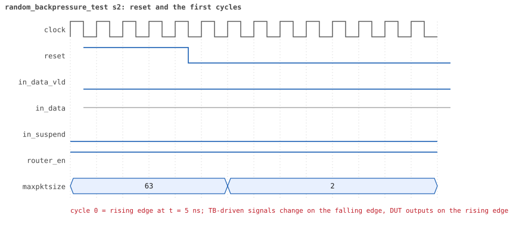
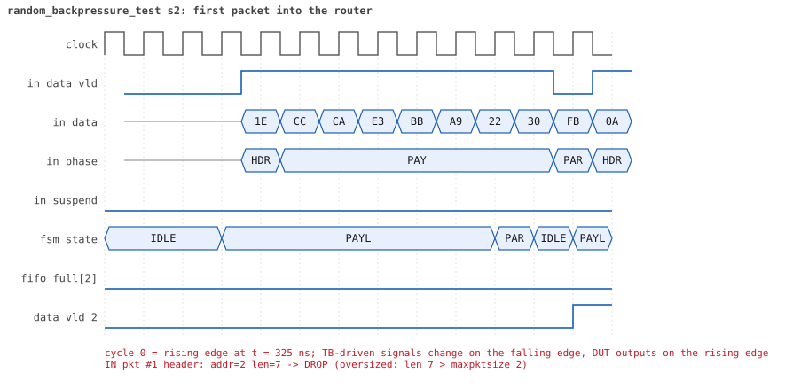
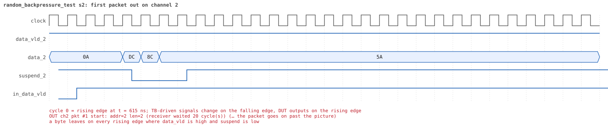
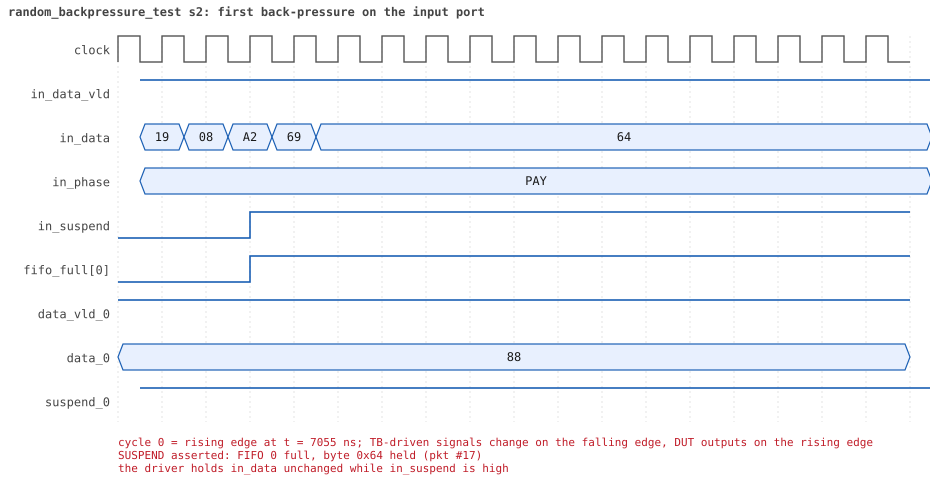
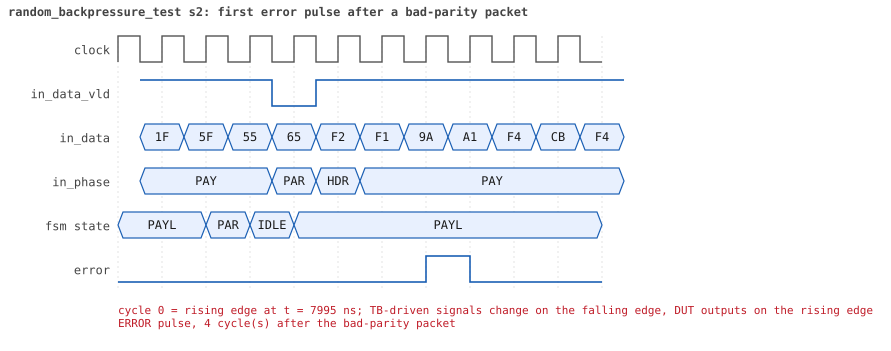
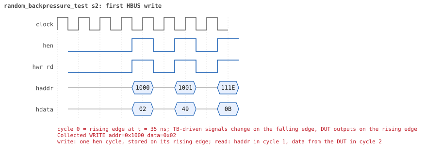
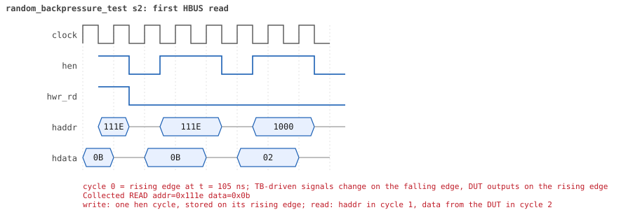

# random_backpressure_test  seed 2

**Result:** PASSED (0 UVM_ERROR, 0 UVM_WARNING, 0 UVM_FATAL) · bench `yapp_project_tb` · sim time 44us · log `random_backpressure_test_s2.log`

Waves: `random_backpressure_test_s2.fst` (GTKWave, Surfer or the VS Code wave viewer); signal trace: `signals.csv`.
[Open the waves in Surfer](https://app.surfer-project.org/?load_url=https%3A%2F%2Fraw.githubusercontent.com%2Ftamirgabgab%2FQcom-Mentoring%2Fmain%2Fyapp_project%2Fregression%2Fyapp_project_tb%2Frandom_backpressure_test_s2%2Frandom_backpressure_test_s2.fst&startup_commands=run_command_file_from_url%20https%3A%2F%2Fraw.githubusercontent.com%2Ftamirgabgab%2FQcom-Mentoring%2Fmain%2Fyapp_project%2Ftb%2Fyapp_router.sucl) (web app, the signals already in groups: `yapp_project/tb/yapp_router.sucl`).

## Summary

- YAPP driver sent **83** packet(s) (3 with bad parity); the input monitor saw 83.
- Router: **25** forwarded, **58** dropped (57 oversized, 1 illegal address 3).
- Packets out: ch0 **5**, ch1 **7**, ch2 **13**.
- Scoreboard: 25 matched, 0 mismatched, 0 unexpected.
- Back-pressure: in_suspend asserted **17** time(s), longest hold 41 cycle(s).
- Error pulses: 3.
- HBUS: 32 write(s), 89 read(s).

## Stages

| time (ns) | stage |
|---|---|
| 0 | receivers: ch0 RX_SLOW, ch1 RX_NORMAL, ch2 RX_SLOW |
| 0 | random scenario: 83 packets in 6 bursts |
| 330 | burst 1/6: ctrl=0x02 (maxpktsize 2) en=0x49 (router on, counter enables 0100100), 13 packet(s) |
| 4980 | burst 1/6 sent: addr0..3 2/4/7/0, bad parity 0, gap 0 9, length 1..62 |
| 5330 | burst 2/6: ctrl=0x22 (maxpktsize 34) en=0xff (router on, counter enables 1111111), 14 packet(s) |
| 12260 | burst 2/6 sent: addr0..3 4/3/7/0, bad parity 1, gap 0 8, length 10..62 |
| 12490 | burst 3/6: ctrl=0x81 (maxpktsize 1) en=0x63 (router on, counter enables 0110001), 14 packet(s) |
| 17260 | burst 3/6 sent: addr0..3 4/3/7/0, bad parity 0, gap 0 11, length 1..63 |
| 17520 | burst 4/6: ctrl=0x21 (maxpktsize 33) en=0xc7 (router on, counter enables 1100011), 14 packet(s) |
| 24050 | burst 4/6 sent: addr0..3 1/7/6/0, bad parity 0, gap 0 10, length 4..62 |
| 24330 | burst 5/6: ctrl=0x05 (maxpktsize 5) en=0xaf (router on, counter enables 1010111), 13 packet(s) |
| 31250 | burst 5/6 sent: addr0..3 4/5/4/0, bad parity 1, gap 0 9, length 32..63 |
| 31630 | burst 6/6: ctrl=0xfe (maxpktsize 62) en=0xff (router on, counter enables 1111111), 15 packet(s) |
| 42000 | burst 6/6 sent: addr0..3 3/4/7/1, bad parity 1, gap 0 9, length 9..63 |
| 42000 | final reads: every register and the stored packet, checked against the reference model |
| 43645 | done: 83 packets (25 forwarded, 58 dropped), 0 storm burst(s), 25 scoreboard matches, 89 HBUS reads checked, 3 error pulses for 3 bad packets |

## Pictures

**reset and the first cycles**

**first packet into the router**

**first packet out on channel 2**

**first back-pressure on the input port**

**first error pulse after a bad-parity packet**

**first HBUS write**

**first HBUS read**

## Timeline

1040 events (the same list is in `timeline.csv`).

| time (ns) | who | event |
|---|---|---|
| 0 | yapp monitor | YAPP monitor running |
| 0 | **test** | STAGE: receivers: ch0 RX_SLOW, ch1 RX_NORMAL, ch2 RX_SLOW |
| 0 | **test** | STAGE: random scenario: 83 packets in 6 bursts |
| 0 | clk/rst driver | Starting clock (period 10) and holding reset for 5 cycles |
| 0 | **DUT** | RESET asserted |
| 50 | **DUT** | RESET released: router_en=1 maxpktsize=63 |
| 70 | hbus driver | Executed WRITE addr=0x1000 data=0x02 |
| 75 | **DUT** | CONFIG router_en=1 maxpktsize=2 |
| 75 | hbus monitor | Collected WRITE addr=0x1000 data=0x02 |
| 75 | reference | maxpktsize is now 2 |
| 90 | hbus driver | Executed WRITE addr=0x1001 data=0x49 |
| 95 | hbus monitor | Collected WRITE addr=0x1001 data=0x49 |
| 95 | reference | router_en is now 1 (en_reg 0x49) |
| 110 | hbus driver | Executed WRITE addr=0x111e data=0x0b |
| 115 | hbus monitor | Collected WRITE addr=0x111e data=0x0b |
| 140 | hbus driver | Executed READ  addr=0x111e data=0x0b |
| 145 | hbus monitor | Collected READ  addr=0x111e data=0x0b |
| 170 | hbus driver | Executed READ  addr=0x1000 data=0x02 |
| 175 | hbus monitor | Collected READ  addr=0x1000 data=0x02 |
| 200 | hbus driver | Executed READ  addr=0x1006 data=0x00 |
| 205 | hbus monitor | Collected READ  addr=0x1006 data=0x00 |
| 230 | hbus driver | Executed READ  addr=0x100d data=0x00 |
| 235 | hbus monitor | Collected READ  addr=0x100d data=0x00 |
| 250 | hbus driver | Executed WRITE addr=0x116f data=0xb8 |
| 255 | hbus monitor | Collected WRITE addr=0x116f data=0xb8 |
| 280 | hbus driver | Executed READ  addr=0x116f data=0xb8 |
| 285 | hbus monitor | Collected READ  addr=0x116f data=0xb8 |
| 300 | hbus driver | Executed WRITE addr=0x1142 data=0x20 |
| 305 | hbus monitor | Collected WRITE addr=0x1142 data=0x20 |
| 330 | hbus driver | Executed READ  addr=0x1142 data=0x20 |
| 330 | **test** | STAGE: burst 1/6: ctrl=0x02 (maxpktsize 2) en=0x49 (router on, counter enables 0100100), 13 packet(s) |
| 330 | yapp driver | TX pkt #1: addr=2 len=7 parity=good delay=1 |
| 335 | hbus monitor | Collected READ  addr=0x1142 data=0x20 |
| 355 | **DUT** | IN  pkt #1 header: addr=2 len=7 -> DROP (oversized: len 7 > maxpktsize 2) |
| 435 | **DUT** | IN  pkt #1 complete: addr=2 len=7 parity=ok dropped, 9 bytes in 9 cycles (held 0) |
| 435 | yapp monitor | RX pkt #1 on the input: addr=2 len=7 parity=good gap=30 |
| 435 | reference | Packet dropped: length 7 > maxpktsize 2 (addr=2) |
| 435 | **DUT** | ROUTER DROPS PACKET addr=2 length=7 (length > maxpktsize) |
| 440 | yapp driver | TX pkt #1 accepted by the DUT |
| 440 | yapp driver | TX pkt #2: addr=2 len=2 parity=good delay=0 |
| 445 | **DUT** | IN  pkt #2 header: addr=2 len=2 -> channel 2 |
| 475 | **DUT** | IN  pkt #2 complete: addr=2 len=2 parity=ok forwarded, 4 bytes in 4 cycles (held 0) |
| 475 | yapp monitor | RX pkt #2 on the input: addr=2 len=2 parity=good gap=0 |
| 475 | reference | Packet forwarded: addr=2 len=2 -> channel 2 |
| 480 | yapp driver | TX pkt #2 accepted by the DUT |
| 480 | yapp driver | TX pkt #3: addr=1 len=12 parity=good delay=0 |
| 485 | **DUT** | IN  pkt #3 header: addr=1 len=12 -> DROP (oversized: len 12 > maxpktsize 2) |
| 615 | **DUT** | IN  pkt #3 complete: addr=1 len=12 parity=ok dropped, 14 bytes in 14 cycles (held 0) |
| 615 | yapp monitor | RX pkt #3 on the input: addr=1 len=12 parity=good gap=0 |
| 615 | reference | Packet dropped: length 12 > maxpktsize 2 (addr=1) |
| 615 | **DUT** | ROUTER DROPS PACKET addr=1 length=12 (length > maxpktsize) |
| 620 | yapp driver | TX pkt #3 accepted by the DUT |
| 620 | yapp driver | TX pkt #4: addr=2 len=51 parity=good delay=0 |
| 625 | **DUT** | IN  pkt #4 header: addr=2 len=51 -> DROP (oversized: len 51 > maxpktsize 2) |
| 655 | **DUT** | OUT ch2 pkt #1 start: addr=2 len=2 (receiver waited 20 cycle(s)) |
| 680 | ch2 driver | ch2: packet consumed (response delay 20) |
| 1015 | **DUT** | OUT ch2 pkt #1 done: 4 bytes in 37 cycles |
| 1015 | ch2 monitor | ch2 RX pkt #1: addr=2 len=2 parity=good |
| 1015 | scoreboard | ch2 pkt matched: addr=2 len=2 (1 matched so far) |
| 1145 | **DUT** | IN  pkt #4 complete: addr=2 len=51 parity=ok dropped, 53 bytes in 53 cycles (held 0) |
| 1145 | yapp monitor | RX pkt #4 on the input: addr=2 len=51 parity=good gap=0 |
| 1145 | reference | Packet dropped: length 51 > maxpktsize 2 (addr=2) |
| 1145 | **DUT** | ROUTER DROPS PACKET addr=2 length=51 (length > maxpktsize) |
| 1150 | yapp driver | TX pkt #4 accepted by the DUT |
| 1150 | yapp driver | TX pkt #5: addr=1 len=27 parity=good delay=3 |
| 1185 | **DUT** | IN  pkt #5 header: addr=1 len=27 -> DROP (oversized: len 27 > maxpktsize 2) |
| 1240 | ch2 driver | ch2: packet consumed (response delay 32) |
| 1465 | **DUT** | IN  pkt #5 complete: addr=1 len=27 parity=ok dropped, 29 bytes in 29 cycles (held 0) |
| 1465 | yapp monitor | RX pkt #5 on the input: addr=1 len=27 parity=good gap=3 |
| 1465 | reference | Packet dropped: length 27 > maxpktsize 2 (addr=1) |
| 1465 | **DUT** | ROUTER DROPS PACKET addr=1 length=27 (length > maxpktsize) |
| 1470 | yapp driver | TX pkt #5 accepted by the DUT |
| 1470 | yapp driver | TX pkt #6: addr=2 len=54 parity=good delay=0 |
| 1475 | **DUT** | IN  pkt #6 header: addr=2 len=54 -> DROP (oversized: len 54 > maxpktsize 2) |
| 2025 | **DUT** | IN  pkt #6 complete: addr=2 len=54 parity=ok dropped, 56 bytes in 56 cycles (held 0) |
| 2025 | yapp monitor | RX pkt #6 on the input: addr=2 len=54 parity=good gap=0 |
| 2025 | reference | Packet dropped: length 54 > maxpktsize 2 (addr=2) |
| 2025 | **DUT** | ROUTER DROPS PACKET addr=2 length=54 (length > maxpktsize) |
| 2030 | yapp driver | TX pkt #6 accepted by the DUT |
| 2030 | yapp driver | TX pkt #7: addr=1 len=62 parity=good delay=9 |
| 2125 | **DUT** | IN  pkt #7 header: addr=1 len=62 -> DROP (oversized: len 62 > maxpktsize 2) |
| 2755 | **DUT** | IN  pkt #7 complete: addr=1 len=62 parity=ok dropped, 64 bytes in 64 cycles (held 0) |
| 2755 | yapp monitor | RX pkt #7 on the input: addr=1 len=62 parity=good gap=9 |
| 2755 | reference | Packet dropped: length 62 > maxpktsize 2 (addr=1) |
| 2755 | **DUT** | ROUTER DROPS PACKET addr=1 length=62 (length > maxpktsize) |
| 2760 | yapp driver | TX pkt #7 accepted by the DUT |
| 2760 | yapp driver | TX pkt #8: addr=2 len=41 parity=good delay=0 |
| 2765 | **DUT** | IN  pkt #8 header: addr=2 len=41 -> DROP (oversized: len 41 > maxpktsize 2) |
| 3185 | **DUT** | IN  pkt #8 complete: addr=2 len=41 parity=ok dropped, 43 bytes in 43 cycles (held 0) |
| 3185 | yapp monitor | RX pkt #8 on the input: addr=2 len=41 parity=good gap=0 |
| 3185 | reference | Packet dropped: length 41 > maxpktsize 2 (addr=2) |
| 3185 | **DUT** | ROUTER DROPS PACKET addr=2 length=41 (length > maxpktsize) |
| 3190 | yapp driver | TX pkt #8 accepted by the DUT |
| 3190 | yapp driver | TX pkt #9: addr=2 len=1 parity=good delay=1 |
| 3205 | **DUT** | IN  pkt #9 header: addr=2 len=1 -> channel 2 |
| 3225 | **DUT** | IN  pkt #9 complete: addr=2 len=1 parity=ok forwarded, 3 bytes in 3 cycles (held 0) |
| 3225 | yapp monitor | RX pkt #9 on the input: addr=2 len=1 parity=good gap=1 |
| 3225 | reference | Packet forwarded: addr=2 len=1 -> channel 2 |
| 3230 | yapp driver | TX pkt #9 accepted by the DUT |
| 3230 | yapp driver | TX pkt #10: addr=0 len=23 parity=good delay=0 |
| 3235 | **DUT** | IN  pkt #10 header: addr=0 len=23 -> DROP (oversized: len 23 > maxpktsize 2) |
| 3475 | **DUT** | IN  pkt #10 complete: addr=0 len=23 parity=ok dropped, 25 bytes in 25 cycles (held 0) |
| 3475 | yapp monitor | RX pkt #10 on the input: addr=0 len=23 parity=good gap=0 |
| 3475 | reference | Packet dropped: length 23 > maxpktsize 2 (addr=0) |
| 3475 | **DUT** | ROUTER DROPS PACKET addr=0 length=23 (length > maxpktsize) |
| 3480 | yapp driver | TX pkt #10 accepted by the DUT |
| 3480 | yapp driver | TX pkt #11: addr=0 len=54 parity=good delay=0 |
| 3485 | **DUT** | IN  pkt #11 header: addr=0 len=54 -> DROP (oversized: len 54 > maxpktsize 2) |
| 3615 | **DUT** | OUT ch2 pkt #2 start: addr=2 len=1 (receiver waited 40 cycle(s)) |
| 3630 | ch2 driver | ch2: packet consumed (response delay 40) |
| 3965 | **DUT** | OUT ch2 pkt #2 done: 3 bytes in 36 cycles |
| 3965 | ch2 monitor | ch2 RX pkt #2: addr=2 len=1 parity=good |
| 3965 | scoreboard | ch2 pkt matched: addr=2 len=1 (2 matched so far) |
| 4035 | **DUT** | IN  pkt #11 complete: addr=0 len=54 parity=ok dropped, 56 bytes in 56 cycles (held 0) |
| 4035 | yapp monitor | RX pkt #11 on the input: addr=0 len=54 parity=good gap=0 |
| 4035 | reference | Packet dropped: length 54 > maxpktsize 2 (addr=0) |
| 4035 | **DUT** | ROUTER DROPS PACKET addr=0 length=54 (length > maxpktsize) |
| 4040 | ch2 driver | ch2: packet consumed (response delay 32) |
| 4040 | yapp driver | TX pkt #11 accepted by the DUT |
| 4040 | yapp driver | TX pkt #12: addr=1 len=41 parity=good delay=0 |
| 4045 | **DUT** | IN  pkt #12 header: addr=1 len=41 -> DROP (oversized: len 41 > maxpktsize 2) |
| 4465 | **DUT** | IN  pkt #12 complete: addr=1 len=41 parity=ok dropped, 43 bytes in 43 cycles (held 0) |
| 4465 | yapp monitor | RX pkt #12 on the input: addr=1 len=41 parity=good gap=0 |
| 4465 | reference | Packet dropped: length 41 > maxpktsize 2 (addr=1) |
| 4465 | **DUT** | ROUTER DROPS PACKET addr=1 length=41 (length > maxpktsize) |
| 4470 | yapp driver | TX pkt #12 accepted by the DUT |
| 4470 | yapp driver | TX pkt #13: addr=2 len=49 parity=good delay=0 |
| 4475 | **DUT** | IN  pkt #13 header: addr=2 len=49 -> DROP (oversized: len 49 > maxpktsize 2) |
| 4975 | **DUT** | IN  pkt #13 complete: addr=2 len=49 parity=ok dropped, 51 bytes in 51 cycles (held 0) |
| 4975 | yapp monitor | RX pkt #13 on the input: addr=2 len=49 parity=good gap=0 |
| 4975 | reference | Packet dropped: length 49 > maxpktsize 2 (addr=2) |
| 4975 | **DUT** | ROUTER DROPS PACKET addr=2 length=49 (length > maxpktsize) |
| 4980 | yapp driver | TX pkt #13 accepted by the DUT |
| 4980 | **test** | STAGE: burst 1/6 sent: addr0..3 2/4/7/0, bad parity 0, gap 0 9, length 1..62 |
| 5000 | hbus driver | Executed WRITE addr=0x1000 data=0x22 |
| 5005 | **DUT** | CONFIG router_en=1 maxpktsize=34 |
| 5005 | hbus monitor | Collected WRITE addr=0x1000 data=0x22 |
| 5005 | reference | maxpktsize is now 34 |
| 5020 | hbus driver | Executed WRITE addr=0x1001 data=0xff |
| 5025 | hbus monitor | Collected WRITE addr=0x1001 data=0xff |
| 5025 | reference | router_en is now 1 (en_reg 0xff) |
| 5040 | hbus driver | Executed WRITE addr=0x11c2 data=0x94 |
| 5045 | hbus monitor | Collected WRITE addr=0x11c2 data=0x94 |
| 5070 | hbus driver | Executed READ  addr=0x11c2 data=0x94 |
| 5075 | hbus monitor | Collected READ  addr=0x11c2 data=0x94 |
| 5100 | hbus driver | Executed READ  addr=0x100f data=0x00 |
| 5105 | hbus monitor | Collected READ  addr=0x100f data=0x00 |
| 5120 | hbus driver | Executed WRITE addr=0x1158 data=0xd3 |
| 5125 | hbus monitor | Collected WRITE addr=0x1158 data=0xd3 |
| 5150 | hbus driver | Executed READ  addr=0x1158 data=0xd3 |
| 5155 | hbus monitor | Collected READ  addr=0x1158 data=0xd3 |
| 5170 | hbus driver | Executed WRITE addr=0x1199 data=0x90 |
| 5175 | hbus monitor | Collected WRITE addr=0x1199 data=0x90 |
| 5200 | hbus driver | Executed READ  addr=0x1199 data=0x90 |
| 5205 | hbus monitor | Collected READ  addr=0x1199 data=0x90 |
| 5220 | hbus driver | Executed WRITE addr=0x1140 data=0x6c |
| 5225 | hbus monitor | Collected WRITE addr=0x1140 data=0x6c |
| 5250 | hbus driver | Executed READ  addr=0x1140 data=0x6c |
| 5255 | hbus monitor | Collected READ  addr=0x1140 data=0x6c |
| 5270 | hbus driver | Executed WRITE addr=0x11bb data=0xb4 |
| 5275 | hbus monitor | Collected WRITE addr=0x11bb data=0xb4 |
| 5300 | hbus driver | Executed READ  addr=0x11bb data=0xb4 |
| 5305 | hbus monitor | Collected READ  addr=0x11bb data=0xb4 |
| 5330 | hbus driver | Executed READ  addr=0x10e0 data=0x00 |
| 5330 | **test** | STAGE: burst 2/6: ctrl=0x22 (maxpktsize 34) en=0xff (router on, counter enables 1111111), 14 packet(s) |
| 5330 | yapp driver | TX pkt #14: addr=2 len=54 parity=good delay=2 |
| 5335 | hbus monitor | Collected READ  addr=0x10e0 data=0x00 |
| 5365 | **DUT** | IN  pkt #14 header: addr=2 len=54 -> DROP (oversized: len 54 > maxpktsize 34) |
| 5915 | **DUT** | IN  pkt #14 complete: addr=2 len=54 parity=ok dropped, 56 bytes in 56 cycles (held 0) |
| 5915 | yapp monitor | RX pkt #14 on the input: addr=2 len=54 parity=good gap=38 |
| 5915 | reference | Packet dropped: length 54 > maxpktsize 34 (addr=2) |
| 5915 | **DUT** | ROUTER DROPS PACKET addr=2 length=54 (length > maxpktsize) |
| 5920 | yapp driver | TX pkt #14 accepted by the DUT |
| 5920 | yapp driver | TX pkt #15: addr=2 len=43 parity=good delay=0 |
| 5925 | **DUT** | IN  pkt #15 header: addr=2 len=43 -> DROP (oversized: len 43 > maxpktsize 34) |
| 6365 | **DUT** | IN  pkt #15 complete: addr=2 len=43 parity=ok dropped, 45 bytes in 45 cycles (held 0) |
| 6365 | yapp monitor | RX pkt #15 on the input: addr=2 len=43 parity=good gap=0 |
| 6365 | reference | Packet dropped: length 43 > maxpktsize 34 (addr=2) |
| 6365 | **DUT** | ROUTER DROPS PACKET addr=2 length=43 (length > maxpktsize) |
| 6370 | yapp driver | TX pkt #15 accepted by the DUT |
| 6370 | yapp driver | TX pkt #16: addr=2 len=54 parity=good delay=0 |
| 6375 | **DUT** | IN  pkt #16 header: addr=2 len=54 -> DROP (oversized: len 54 > maxpktsize 34) |
| 6925 | **DUT** | IN  pkt #16 complete: addr=2 len=54 parity=ok dropped, 56 bytes in 56 cycles (held 0) |
| 6925 | yapp monitor | RX pkt #16 on the input: addr=2 len=54 parity=good gap=0 |
| 6925 | reference | Packet dropped: length 54 > maxpktsize 34 (addr=2) |
| 6925 | **DUT** | ROUTER DROPS PACKET addr=2 length=54 (length > maxpktsize) |
| 6930 | yapp driver | TX pkt #16 accepted by the DUT |
| 6930 | yapp driver | TX pkt #17: addr=0 len=34 parity=good delay=0 |
| 6935 | **DUT** | IN  pkt #17 header: addr=0 len=34 -> channel 0 |
| 7095 | **DUT** | SUSPEND asserted: FIFO 0 full, byte 0x64 held (pkt #17) |
| 7345 | **DUT** | OUT ch0 pkt #1 start: addr=0 len=34 (receiver waited 40 cycle(s)) |
| 7355 | **DUT** | SUSPEND released after 26 cycle(s) |
| 7545 | **DUT** | IN  pkt #17 complete: addr=0 len=34 parity=ok forwarded, 36 bytes in 62 cycles (held 26) |
| 7545 | yapp monitor | RX pkt #17 on the input: addr=0 len=34 parity=good gap=0 |
| 7545 | reference | Packet forwarded: addr=0 len=34 -> channel 0 |
| 7550 | yapp driver | TX pkt #17 accepted by the DUT |
| 7550 | yapp driver | TX pkt #18: addr=1 len=33 parity=good delay=0 |
| 7555 | **DUT** | IN  pkt #18 header: addr=1 len=33 -> channel 1 |
| 7605 | **DUT** | OUT ch1 pkt #1 start: addr=1 len=33 (receiver waited 4 cycle(s)) |
| 7690 | ch0 driver | ch0: packet consumed (response delay 40) |
| 7895 | **DUT** | IN  pkt #18 complete: addr=1 len=33 parity=ok forwarded, 35 bytes in 35 cycles (held 0) |
| 7895 | yapp monitor | RX pkt #18 on the input: addr=1 len=33 parity=good gap=0 |
| 7895 | reference | Packet forwarded: addr=1 len=33 -> channel 1 |
| 7900 | yapp driver | TX pkt #18 accepted by the DUT |
| 7900 | yapp driver | TX pkt #19: addr=2 len=11 parity=bad delay=0 |
| 7905 | **DUT** | IN  pkt #19 header: addr=2 len=11 -> channel 2 |
| 7940 | ch1 driver | ch1: packet consumed (response delay 4) |
| 7985 | **DUT** | OUT ch1 pkt #1 done: 35 bytes in 39 cycles |
| 7985 | ch1 monitor | ch1 RX pkt #1: addr=1 len=33 parity=good |
| 7985 | scoreboard | ch1 pkt matched: addr=1 len=33 (3 matched so far) |
| 8025 | **DUT** | IN  pkt #19 complete: addr=2 len=11 parity=BAD forwarded, 13 bytes in 13 cycles (held 0) |
| 8025 | yapp monitor | RX pkt #19 on the input: addr=2 len=11 parity=bad gap=0 |
| 8025 | reference | Packet forwarded: addr=2 len=11 -> channel 2 |
| 8030 | yapp driver | TX pkt #19 accepted by the DUT |
| 8030 | yapp driver | TX pkt #20: addr=2 len=60 parity=good delay=0 |
| 8035 | **DUT** | IN  pkt #20 header: addr=2 len=60 -> DROP (oversized: len 60 > maxpktsize 34) |
| 8070 | **DUT** | ERROR pulse, 4 cycle(s) after the bad-parity packet |
| 8070 | error checker | error pulse 4 cycles after the bad packet (0 still owed) |
| 8105 | **DUT** | OUT ch0 pkt #1 done: 36 bytes in 77 cycles |
| 8105 | ch0 monitor | ch0 RX pkt #1: addr=0 len=34 parity=good |
| 8105 | scoreboard | ch0 pkt matched: addr=0 len=34 (4 matched so far) |
| 8110 | ch0 driver | ch0: packet consumed (response delay 40) |
| 8130 | ch1 driver | ch1: packet consumed (response delay 3) |
| 8255 | **DUT** | OUT ch2 pkt #3 start: addr=2 len=11 (receiver waited 34 cycle(s)) |
| 8370 | ch2 driver | ch2: packet consumed (response delay 34) |
| 8605 | **DUT** | OUT ch2 pkt #3 done: 13 bytes in 36 cycles |
| 8605 | ch2 monitor | ch2 RX pkt #3: addr=2 len=11 parity=bad |
| 8605 | scoreboard | ch2 pkt matched: addr=2 len=11 (5 matched so far) |
| 8645 | **DUT** | IN  pkt #20 complete: addr=2 len=60 parity=ok dropped, 62 bytes in 62 cycles (held 0) |
| 8645 | yapp monitor | RX pkt #20 on the input: addr=2 len=60 parity=good gap=0 |
| 8645 | reference | Packet dropped: length 60 > maxpktsize 34 (addr=2) |
| 8645 | **DUT** | ROUTER DROPS PACKET addr=2 length=60 (length > maxpktsize) |
| 8650 | yapp driver | TX pkt #20 accepted by the DUT |
| 8650 | yapp driver | TX pkt #21: addr=1 len=60 parity=good delay=1 |
| 8665 | **DUT** | IN  pkt #21 header: addr=1 len=60 -> DROP (oversized: len 60 > maxpktsize 34) |
| 8860 | ch2 driver | ch2: packet consumed (response delay 22) |
| 9275 | **DUT** | IN  pkt #21 complete: addr=1 len=60 parity=ok dropped, 62 bytes in 62 cycles (held 0) |
| 9275 | yapp monitor | RX pkt #21 on the input: addr=1 len=60 parity=good gap=1 |
| 9275 | reference | Packet dropped: length 60 > maxpktsize 34 (addr=1) |
| 9275 | **DUT** | ROUTER DROPS PACKET addr=1 length=60 (length > maxpktsize) |
| 9280 | yapp driver | TX pkt #21 accepted by the DUT |
| 9280 | yapp driver | TX pkt #22: addr=0 len=47 parity=good delay=19 |
| 9475 | **DUT** | IN  pkt #22 header: addr=0 len=47 -> DROP (oversized: len 47 > maxpktsize 34) |
| 9955 | **DUT** | IN  pkt #22 complete: addr=0 len=47 parity=ok dropped, 49 bytes in 49 cycles (held 0) |
| 9955 | yapp monitor | RX pkt #22 on the input: addr=0 len=47 parity=good gap=19 |
| 9955 | reference | Packet dropped: length 47 > maxpktsize 34 (addr=0) |
| 9955 | **DUT** | ROUTER DROPS PACKET addr=0 length=47 (length > maxpktsize) |
| 9960 | yapp driver | TX pkt #22 accepted by the DUT |
| 9960 | yapp driver | TX pkt #23: addr=2 len=39 parity=good delay=3 |
| 9995 | **DUT** | IN  pkt #23 header: addr=2 len=39 -> DROP (oversized: len 39 > maxpktsize 34) |
| 10395 | **DUT** | IN  pkt #23 complete: addr=2 len=39 parity=ok dropped, 41 bytes in 41 cycles (held 0) |
| 10395 | yapp monitor | RX pkt #23 on the input: addr=2 len=39 parity=good gap=3 |
| 10395 | reference | Packet dropped: length 39 > maxpktsize 34 (addr=2) |
| 10395 | **DUT** | ROUTER DROPS PACKET addr=2 length=39 (length > maxpktsize) |
| 10400 | yapp driver | TX pkt #23 accepted by the DUT |
| 10400 | yapp driver | TX pkt #24: addr=1 len=56 parity=good delay=2 |
| 10425 | **DUT** | IN  pkt #24 header: addr=1 len=56 -> DROP (oversized: len 56 > maxpktsize 34) |
| 10995 | **DUT** | IN  pkt #24 complete: addr=1 len=56 parity=ok dropped, 58 bytes in 58 cycles (held 0) |
| 10995 | yapp monitor | RX pkt #24 on the input: addr=1 len=56 parity=good gap=2 |
| 10995 | reference | Packet dropped: length 56 > maxpktsize 34 (addr=1) |
| 10995 | **DUT** | ROUTER DROPS PACKET addr=1 length=56 (length > maxpktsize) |
| 11000 | yapp driver | TX pkt #24 accepted by the DUT |
| 11000 | yapp driver | TX pkt #25: addr=0 len=62 parity=good delay=0 |
| 11005 | **DUT** | IN  pkt #25 header: addr=0 len=62 -> DROP (oversized: len 62 > maxpktsize 34) |
| 11635 | **DUT** | IN  pkt #25 complete: addr=0 len=62 parity=ok dropped, 64 bytes in 64 cycles (held 0) |
| 11635 | yapp monitor | RX pkt #25 on the input: addr=0 len=62 parity=good gap=0 |
| 11635 | reference | Packet dropped: length 62 > maxpktsize 34 (addr=0) |
| 11635 | **DUT** | ROUTER DROPS PACKET addr=0 length=62 (length > maxpktsize) |
| 11640 | yapp driver | TX pkt #25 accepted by the DUT |
| 11640 | yapp driver | TX pkt #26: addr=0 len=10 parity=good delay=7 |
| 11715 | **DUT** | IN  pkt #26 header: addr=0 len=10 -> channel 0 |
| 11825 | **DUT** | IN  pkt #26 complete: addr=0 len=10 parity=ok forwarded, 12 bytes in 12 cycles (held 0) |
| 11825 | yapp monitor | RX pkt #26 on the input: addr=0 len=10 parity=good gap=7 |
| 11825 | reference | Packet forwarded: addr=0 len=10 -> channel 0 |
| 11830 | yapp driver | TX pkt #26 accepted by the DUT |
| 11830 | yapp driver | TX pkt #27: addr=2 len=19 parity=good delay=0 |
| 11835 | **DUT** | IN  pkt #27 header: addr=2 len=19 -> channel 2 |
| 11995 | **DUT** | SUSPEND asserted: FIFO 2 full, byte 0xda held (pkt #27) |
| 12125 | **DUT** | OUT ch0 pkt #2 start: addr=0 len=10 (receiver waited 40 cycle(s)) |
| 12205 | **DUT** | OUT ch2 pkt #4 start: addr=2 len=19 (receiver waited 36 cycle(s)) |
| 12215 | **DUT** | SUSPEND released after 22 cycle(s) |
| 12230 | ch0 driver | ch0: packet consumed (response delay 40) |
| 12255 | **DUT** | IN  pkt #27 complete: addr=2 len=19 parity=ok forwarded, 21 bytes in 43 cycles (held 22) |
| 12255 | yapp monitor | RX pkt #27 on the input: addr=2 len=19 parity=good gap=0 |
| 12255 | reference | Packet forwarded: addr=2 len=19 -> channel 2 |
| 12260 | yapp driver | TX pkt #27 accepted by the DUT |
| 12260 | **test** | STAGE: burst 2/6 sent: addr0..3 4/3/7/0, bad parity 1, gap 0 8, length 10..62 |
| 12280 | hbus driver | Executed WRITE addr=0x1000 data=0x81 |
| 12285 | **DUT** | CONFIG router_en=1 maxpktsize=1 |
| 12285 | hbus monitor | Collected WRITE addr=0x1000 data=0x81 |
| 12285 | reference | maxpktsize is now 1 |
| 12300 | hbus driver | Executed WRITE addr=0x1001 data=0x63 |
| 12305 | hbus monitor | Collected WRITE addr=0x1001 data=0x63 |
| 12305 | reference | router_en is now 1 (en_reg 0x63) |
| 12330 | hbus driver | Executed READ  addr=0x10ff data=0x00 |
| 12335 | hbus monitor | Collected READ  addr=0x10ff data=0x00 |
| 12360 | hbus driver | Executed READ  addr=0x10d4 data=0x00 |
| 12365 | hbus monitor | Collected READ  addr=0x10d4 data=0x00 |
| 12380 | hbus driver | Executed WRITE addr=0x1113 data=0xb3 |
| 12385 | hbus monitor | Collected WRITE addr=0x1113 data=0xb3 |
| 12400 | ch2 driver | ch2: packet consumed (response delay 36) |
| 12410 | hbus driver | Executed READ  addr=0x1113 data=0xb3 |
| 12415 | hbus monitor | Collected READ  addr=0x1113 data=0xb3 |
| 12430 | hbus driver | Executed WRITE addr=0x1103 data=0x2f |
| 12435 | hbus monitor | Collected WRITE addr=0x1103 data=0x2f |
| 12460 | hbus driver | Executed READ  addr=0x1103 data=0x2f |
| 12465 | hbus monitor | Collected READ  addr=0x1103 data=0x2f |
| 12490 | hbus driver | Executed READ  addr=0x10f0 data=0x00 |
| 12490 | **test** | STAGE: burst 3/6: ctrl=0x81 (maxpktsize 1) en=0x63 (router on, counter enables 0110001), 14 packet(s) |
| 12490 | yapp driver | TX pkt #28: addr=2 len=19 parity=good delay=1 |
| 12495 | hbus monitor | Collected READ  addr=0x10f0 data=0x00 |
| 12515 | **DUT** | IN  pkt #28 header: addr=2 len=19 -> DROP (oversized: len 19 > maxpktsize 1) |
| 12645 | **DUT** | OUT ch0 pkt #2 done: 12 bytes in 53 cycles |
| 12645 | **DUT** | OUT ch2 pkt #4 done: 21 bytes in 45 cycles |
| 12645 | ch0 monitor | ch0 RX pkt #2: addr=0 len=10 parity=good |
| 12645 | scoreboard | ch0 pkt matched: addr=0 len=10 (6 matched so far) |
| 12645 | ch2 monitor | ch2 RX pkt #4: addr=2 len=19 parity=good |
| 12645 | scoreboard | ch2 pkt matched: addr=2 len=19 (7 matched so far) |
| 12670 | ch0 driver | ch0: packet consumed (response delay 40) |
| 12715 | **DUT** | IN  pkt #28 complete: addr=2 len=19 parity=ok dropped, 21 bytes in 21 cycles (held 0) |
| 12715 | yapp monitor | RX pkt #28 on the input: addr=2 len=19 parity=good gap=25 |
| 12715 | reference | Packet dropped: length 19 > maxpktsize 1 (addr=2) |
| 12715 | **DUT** | ROUTER DROPS PACKET addr=2 length=19 (length > maxpktsize) |
| 12720 | yapp driver | TX pkt #28 accepted by the DUT |
| 12720 | yapp driver | TX pkt #29: addr=1 len=46 parity=good delay=3 |
| 12755 | **DUT** | IN  pkt #29 header: addr=1 len=46 -> DROP (oversized: len 46 > maxpktsize 1) |
| 12930 | ch2 driver | ch2: packet consumed (response delay 23) |
| 13225 | **DUT** | IN  pkt #29 complete: addr=1 len=46 parity=ok dropped, 48 bytes in 48 cycles (held 0) |
| 13225 | yapp monitor | RX pkt #29 on the input: addr=1 len=46 parity=good gap=3 |
| 13225 | reference | Packet dropped: length 46 > maxpktsize 1 (addr=1) |
| 13225 | **DUT** | ROUTER DROPS PACKET addr=1 length=46 (length > maxpktsize) |
| 13230 | yapp driver | TX pkt #29 accepted by the DUT |
| 13230 | yapp driver | TX pkt #30: addr=2 len=18 parity=good delay=0 |
| 13235 | **DUT** | IN  pkt #30 header: addr=2 len=18 -> DROP (oversized: len 18 > maxpktsize 1) |
| 13425 | **DUT** | IN  pkt #30 complete: addr=2 len=18 parity=ok dropped, 20 bytes in 20 cycles (held 0) |
| 13425 | yapp monitor | RX pkt #30 on the input: addr=2 len=18 parity=good gap=0 |
| 13425 | reference | Packet dropped: length 18 > maxpktsize 1 (addr=2) |
| 13425 | **DUT** | ROUTER DROPS PACKET addr=2 length=18 (length > maxpktsize) |
| 13430 | yapp driver | TX pkt #30 accepted by the DUT |
| 13430 | yapp driver | TX pkt #31: addr=2 len=30 parity=good delay=3 |
| 13465 | **DUT** | IN  pkt #31 header: addr=2 len=30 -> DROP (oversized: len 30 > maxpktsize 1) |
| 13775 | **DUT** | IN  pkt #31 complete: addr=2 len=30 parity=ok dropped, 32 bytes in 32 cycles (held 0) |
| 13775 | yapp monitor | RX pkt #31 on the input: addr=2 len=30 parity=good gap=3 |
| 13775 | reference | Packet dropped: length 30 > maxpktsize 1 (addr=2) |
| 13775 | **DUT** | ROUTER DROPS PACKET addr=2 length=30 (length > maxpktsize) |
| 13780 | yapp driver | TX pkt #31 accepted by the DUT |
| 13780 | yapp driver | TX pkt #32: addr=0 len=29 parity=good delay=0 |
| 13785 | **DUT** | IN  pkt #32 header: addr=0 len=29 -> DROP (oversized: len 29 > maxpktsize 1) |
| 14085 | **DUT** | IN  pkt #32 complete: addr=0 len=29 parity=ok dropped, 31 bytes in 31 cycles (held 0) |
| 14085 | yapp monitor | RX pkt #32 on the input: addr=0 len=29 parity=good gap=0 |
| 14085 | reference | Packet dropped: length 29 > maxpktsize 1 (addr=0) |
| 14085 | **DUT** | ROUTER DROPS PACKET addr=0 length=29 (length > maxpktsize) |
| 14090 | yapp driver | TX pkt #32 accepted by the DUT |
| 14090 | yapp driver | TX pkt #33: addr=0 len=40 parity=good delay=0 |
| 14095 | **DUT** | IN  pkt #33 header: addr=0 len=40 -> DROP (oversized: len 40 > maxpktsize 1) |
| 14505 | **DUT** | IN  pkt #33 complete: addr=0 len=40 parity=ok dropped, 42 bytes in 42 cycles (held 0) |
| 14505 | yapp monitor | RX pkt #33 on the input: addr=0 len=40 parity=good gap=0 |
| 14505 | reference | Packet dropped: length 40 > maxpktsize 1 (addr=0) |
| 14505 | **DUT** | ROUTER DROPS PACKET addr=0 length=40 (length > maxpktsize) |
| 14510 | yapp driver | TX pkt #33 accepted by the DUT |
| 14510 | yapp driver | TX pkt #34: addr=2 len=43 parity=good delay=0 |
| 14515 | **DUT** | IN  pkt #34 header: addr=2 len=43 -> DROP (oversized: len 43 > maxpktsize 1) |
| 14955 | **DUT** | IN  pkt #34 complete: addr=2 len=43 parity=ok dropped, 45 bytes in 45 cycles (held 0) |
| 14955 | yapp monitor | RX pkt #34 on the input: addr=2 len=43 parity=good gap=0 |
| 14955 | reference | Packet dropped: length 43 > maxpktsize 1 (addr=2) |
| 14955 | **DUT** | ROUTER DROPS PACKET addr=2 length=43 (length > maxpktsize) |
| 14960 | yapp driver | TX pkt #34 accepted by the DUT |
| 14960 | yapp driver | TX pkt #35: addr=0 len=30 parity=good delay=0 |
| 14965 | **DUT** | IN  pkt #35 header: addr=0 len=30 -> DROP (oversized: len 30 > maxpktsize 1) |
| 15275 | **DUT** | IN  pkt #35 complete: addr=0 len=30 parity=ok dropped, 32 bytes in 32 cycles (held 0) |
| 15275 | yapp monitor | RX pkt #35 on the input: addr=0 len=30 parity=good gap=0 |
| 15275 | reference | Packet dropped: length 30 > maxpktsize 1 (addr=0) |
| 15275 | **DUT** | ROUTER DROPS PACKET addr=0 length=30 (length > maxpktsize) |
| 15280 | yapp driver | TX pkt #35 accepted by the DUT |
| 15280 | yapp driver | TX pkt #36: addr=0 len=13 parity=good delay=0 |
| 15285 | **DUT** | IN  pkt #36 header: addr=0 len=13 -> DROP (oversized: len 13 > maxpktsize 1) |
| 15425 | **DUT** | IN  pkt #36 complete: addr=0 len=13 parity=ok dropped, 15 bytes in 15 cycles (held 0) |
| 15425 | yapp monitor | RX pkt #36 on the input: addr=0 len=13 parity=good gap=0 |
| 15425 | reference | Packet dropped: length 13 > maxpktsize 1 (addr=0) |
| 15425 | **DUT** | ROUTER DROPS PACKET addr=0 length=13 (length > maxpktsize) |
| 15430 | yapp driver | TX pkt #36 accepted by the DUT |
| 15430 | yapp driver | TX pkt #37: addr=1 len=60 parity=good delay=0 |
| 15435 | **DUT** | IN  pkt #37 header: addr=1 len=60 -> DROP (oversized: len 60 > maxpktsize 1) |
| 16045 | **DUT** | IN  pkt #37 complete: addr=1 len=60 parity=ok dropped, 62 bytes in 62 cycles (held 0) |
| 16045 | yapp monitor | RX pkt #37 on the input: addr=1 len=60 parity=good gap=0 |
| 16045 | reference | Packet dropped: length 60 > maxpktsize 1 (addr=1) |
| 16045 | **DUT** | ROUTER DROPS PACKET addr=1 length=60 (length > maxpktsize) |
| 16050 | yapp driver | TX pkt #37 accepted by the DUT |
| 16050 | yapp driver | TX pkt #38: addr=2 len=63 parity=good delay=0 |
| 16055 | **DUT** | IN  pkt #38 header: addr=2 len=63 -> DROP (oversized: len 63 > maxpktsize 1) |
| 16695 | **DUT** | IN  pkt #38 complete: addr=2 len=63 parity=ok dropped, 65 bytes in 65 cycles (held 0) |
| 16695 | yapp monitor | RX pkt #38 on the input: addr=2 len=63 parity=good gap=0 |
| 16695 | reference | Packet dropped: length 63 > maxpktsize 1 (addr=2) |
| 16695 | **DUT** | ROUTER DROPS PACKET addr=2 length=63 (length > maxpktsize) |
| 16700 | yapp driver | TX pkt #38 accepted by the DUT |
| 16700 | yapp driver | TX pkt #39: addr=2 len=42 parity=good delay=0 |
| 16705 | **DUT** | IN  pkt #39 header: addr=2 len=42 -> DROP (oversized: len 42 > maxpktsize 1) |
| 17135 | **DUT** | IN  pkt #39 complete: addr=2 len=42 parity=ok dropped, 44 bytes in 44 cycles (held 0) |
| 17135 | yapp monitor | RX pkt #39 on the input: addr=2 len=42 parity=good gap=0 |
| 17135 | reference | Packet dropped: length 42 > maxpktsize 1 (addr=2) |
| 17135 | **DUT** | ROUTER DROPS PACKET addr=2 length=42 (length > maxpktsize) |
| 17140 | yapp driver | TX pkt #39 accepted by the DUT |
| 17140 | yapp driver | TX pkt #40: addr=2 len=7 parity=good delay=0 |
| 17145 | **DUT** | IN  pkt #40 header: addr=2 len=7 -> DROP (oversized: len 7 > maxpktsize 1) |
| 17225 | **DUT** | IN  pkt #40 complete: addr=2 len=7 parity=ok dropped, 9 bytes in 9 cycles (held 0) |
| 17225 | yapp monitor | RX pkt #40 on the input: addr=2 len=7 parity=good gap=0 |
| 17225 | reference | Packet dropped: length 7 > maxpktsize 1 (addr=2) |
| 17225 | **DUT** | ROUTER DROPS PACKET addr=2 length=7 (length > maxpktsize) |
| 17230 | yapp driver | TX pkt #40 accepted by the DUT |
| 17230 | yapp driver | TX pkt #41: addr=1 len=1 parity=good delay=0 |
| 17235 | **DUT** | IN  pkt #41 header: addr=1 len=1 -> channel 1 |
| 17255 | **DUT** | IN  pkt #41 complete: addr=1 len=1 parity=ok forwarded, 3 bytes in 3 cycles (held 0) |
| 17255 | yapp monitor | RX pkt #41 on the input: addr=1 len=1 parity=good gap=0 |
| 17255 | reference | Packet forwarded: addr=1 len=1 -> channel 1 |
| 17260 | yapp driver | TX pkt #41 accepted by the DUT |
| 17260 | **test** | STAGE: burst 3/6 sent: addr0..3 4/3/7/0, bad parity 0, gap 0 11, length 1..63 |
| 17280 | hbus driver | Executed WRITE addr=0x1000 data=0x21 |
| 17285 | **DUT** | CONFIG router_en=1 maxpktsize=33 |
| 17285 | hbus monitor | Collected WRITE addr=0x1000 data=0x21 |
| 17285 | reference | maxpktsize is now 33 |
| 17300 | hbus driver | Executed WRITE addr=0x1001 data=0xc7 |
| 17305 | hbus monitor | Collected WRITE addr=0x1001 data=0xc7 |
| 17305 | reference | router_en is now 1 (en_reg 0xc7) |
| 17320 | hbus driver | Executed WRITE addr=0x110e data=0xd2 |
| 17325 | **DUT** | OUT ch1 pkt #2 start: addr=1 len=1 (receiver waited 8 cycle(s)) |
| 17325 | hbus monitor | Collected WRITE addr=0x110e data=0xd2 |
| 17340 | ch1 driver | ch1: packet consumed (response delay 8) |
| 17350 | hbus driver | Executed READ  addr=0x110e data=0xd2 |
| 17355 | **DUT** | OUT ch1 pkt #2 done: 3 bytes in 4 cycles |
| 17355 | ch1 monitor | ch1 RX pkt #2: addr=1 len=1 parity=good |
| 17355 | scoreboard | ch1 pkt matched: addr=1 len=1 (8 matched so far) |
| 17355 | hbus monitor | Collected READ  addr=0x110e data=0xd2 |
| 17380 | hbus driver | Executed READ  addr=0x10f2 data=0x00 |
| 17385 | hbus monitor | Collected READ  addr=0x10f2 data=0x00 |
| 17400 | hbus driver | Executed WRITE addr=0x11e0 data=0x8d |
| 17405 | hbus monitor | Collected WRITE addr=0x11e0 data=0x8d |
| 17430 | hbus driver | Executed READ  addr=0x11e0 data=0x8d |
| 17435 | hbus monitor | Collected READ  addr=0x11e0 data=0x8d |
| 17460 | hbus driver | Executed READ  addr=0x1023 data=0xc1 |
| 17465 | hbus monitor | Collected READ  addr=0x1023 data=0xc1 |
| 17490 | hbus driver | Executed READ  addr=0x100d data=0x01 |
| 17495 | hbus monitor | Collected READ  addr=0x100d data=0x01 |
| 17520 | hbus driver | Executed READ  addr=0x100c data=0x00 |
| 17520 | **test** | STAGE: burst 4/6: ctrl=0x21 (maxpktsize 33) en=0xc7 (router on, counter enables 1100011), 14 packet(s) |
| 17520 | yapp driver | TX pkt #42: addr=2 len=4 parity=good delay=0 |
| 17525 | hbus monitor | Collected READ  addr=0x100c data=0x00 |
| 17535 | **DUT** | IN  pkt #42 header: addr=2 len=4 -> channel 2 |
| 17585 | **DUT** | IN  pkt #42 complete: addr=2 len=4 parity=ok forwarded, 6 bytes in 6 cycles (held 0) |
| 17585 | yapp monitor | RX pkt #42 on the input: addr=2 len=4 parity=good gap=27 |
| 17585 | reference | Packet forwarded: addr=2 len=4 -> channel 2 |
| 17590 | yapp driver | TX pkt #42 accepted by the DUT |
| 17590 | yapp driver | TX pkt #43: addr=2 len=20 parity=good delay=0 |
| 17595 | **DUT** | IN  pkt #43 header: addr=2 len=20 -> channel 2 |
| 17695 | **DUT** | SUSPEND asserted: FIFO 2 full, byte 0x7e held (pkt #43) |
| 17760 | ch1 driver | ch1: packet consumed (response delay 0) |
| 17795 | **DUT** | OUT ch2 pkt #5 start: addr=2 len=4 (receiver waited 25 cycle(s)) |
| 17805 | **DUT** | SUSPEND released after 11 cycle(s) |
| 17840 | ch2 driver | ch2: packet consumed (response delay 25) |
| 17855 | **DUT** | SUSPEND asserted: FIFO 2 full, byte 0xa2 held (pkt #43) |
| 18125 | **DUT** | OUT ch2 pkt #5 done: 6 bytes in 34 cycles |
| 18125 | ch2 monitor | ch2 RX pkt #5: addr=2 len=4 parity=good |
| 18125 | scoreboard | ch2 pkt matched: addr=2 len=4 (9 matched so far) |
| 18135 | **DUT** | SUSPEND released after 28 cycle(s) |
| 18135 | **DUT** | OUT ch2 pkt #6 start: addr=2 len=20 (receiver waited 0 cycle(s)) |
| 18195 | **DUT** | IN  pkt #43 complete: addr=2 len=20 parity=ok forwarded, 22 bytes in 61 cycles (held 39) |
| 18195 | yapp monitor | RX pkt #43 on the input: addr=2 len=20 parity=good gap=0 |
| 18195 | reference | Packet forwarded: addr=2 len=20 -> channel 2 |
| 18200 | yapp driver | TX pkt #43 accepted by the DUT |
| 18200 | yapp driver | TX pkt #44: addr=1 len=43 parity=good delay=1 |
| 18215 | **DUT** | IN  pkt #44 header: addr=1 len=43 -> DROP (oversized: len 43 > maxpktsize 33) |
| 18345 | **DUT** | OUT ch2 pkt #6 done: 22 bytes in 22 cycles |
| 18345 | ch2 monitor | ch2 RX pkt #6: addr=2 len=20 parity=good |
| 18345 | scoreboard | ch2 pkt matched: addr=2 len=20 (10 matched so far) |
| 18620 | ch2 driver | ch2: packet consumed (response delay 27) |
| 18655 | **DUT** | IN  pkt #44 complete: addr=1 len=43 parity=ok dropped, 45 bytes in 45 cycles (held 0) |
| 18655 | yapp monitor | RX pkt #44 on the input: addr=1 len=43 parity=good gap=1 |
| 18655 | reference | Packet dropped: length 43 > maxpktsize 33 (addr=1) |
| 18655 | **DUT** | ROUTER DROPS PACKET addr=1 length=43 (length > maxpktsize) |
| 18660 | yapp driver | TX pkt #44 accepted by the DUT |
| 18660 | yapp driver | TX pkt #45: addr=0 len=47 parity=good delay=0 |
| 18665 | **DUT** | IN  pkt #45 header: addr=0 len=47 -> DROP (oversized: len 47 > maxpktsize 33) |
| 19145 | **DUT** | IN  pkt #45 complete: addr=0 len=47 parity=ok dropped, 49 bytes in 49 cycles (held 0) |
| 19145 | yapp monitor | RX pkt #45 on the input: addr=0 len=47 parity=good gap=0 |
| 19145 | reference | Packet dropped: length 47 > maxpktsize 33 (addr=0) |
| 19145 | **DUT** | ROUTER DROPS PACKET addr=0 length=47 (length > maxpktsize) |
| 19150 | yapp driver | TX pkt #45 accepted by the DUT |
| 19150 | yapp driver | TX pkt #46: addr=2 len=43 parity=good delay=2 |
| 19175 | **DUT** | IN  pkt #46 header: addr=2 len=43 -> DROP (oversized: len 43 > maxpktsize 33) |
| 19615 | **DUT** | IN  pkt #46 complete: addr=2 len=43 parity=ok dropped, 45 bytes in 45 cycles (held 0) |
| 19615 | yapp monitor | RX pkt #46 on the input: addr=2 len=43 parity=good gap=2 |
| 19615 | reference | Packet dropped: length 43 > maxpktsize 33 (addr=2) |
| 19615 | **DUT** | ROUTER DROPS PACKET addr=2 length=43 (length > maxpktsize) |
| 19620 | yapp driver | TX pkt #46 accepted by the DUT |
| 19620 | yapp driver | TX pkt #47: addr=2 len=42 parity=good delay=0 |
| 19625 | **DUT** | IN  pkt #47 header: addr=2 len=42 -> DROP (oversized: len 42 > maxpktsize 33) |
| 20055 | **DUT** | IN  pkt #47 complete: addr=2 len=42 parity=ok dropped, 44 bytes in 44 cycles (held 0) |
| 20055 | yapp monitor | RX pkt #47 on the input: addr=2 len=42 parity=good gap=0 |
| 20055 | reference | Packet dropped: length 42 > maxpktsize 33 (addr=2) |
| 20055 | **DUT** | ROUTER DROPS PACKET addr=2 length=42 (length > maxpktsize) |
| 20060 | yapp driver | TX pkt #47 accepted by the DUT |
| 20060 | yapp driver | TX pkt #48: addr=2 len=41 parity=good delay=0 |
| 20065 | **DUT** | IN  pkt #48 header: addr=2 len=41 -> DROP (oversized: len 41 > maxpktsize 33) |
| 20485 | **DUT** | IN  pkt #48 complete: addr=2 len=41 parity=ok dropped, 43 bytes in 43 cycles (held 0) |
| 20485 | yapp monitor | RX pkt #48 on the input: addr=2 len=41 parity=good gap=0 |
| 20485 | reference | Packet dropped: length 41 > maxpktsize 33 (addr=2) |
| 20485 | **DUT** | ROUTER DROPS PACKET addr=2 length=41 (length > maxpktsize) |
| 20490 | yapp driver | TX pkt #48 accepted by the DUT |
| 20490 | yapp driver | TX pkt #49: addr=2 len=32 parity=good delay=0 |
| 20495 | **DUT** | IN  pkt #49 header: addr=2 len=32 -> channel 2 |
| 20655 | **DUT** | SUSPEND asserted: FIFO 2 full, byte 0x5f held (pkt #49) |
| 20735 | **DUT** | OUT ch2 pkt #7 start: addr=2 len=32 (receiver waited 23 cycle(s)) |
| 20745 | **DUT** | SUSPEND released after 9 cycle(s) |
| 20915 | **DUT** | IN  pkt #49 complete: addr=2 len=32 parity=ok forwarded, 34 bytes in 43 cycles (held 9) |
| 20915 | yapp monitor | RX pkt #49 on the input: addr=2 len=32 parity=good gap=0 |
| 20915 | reference | Packet forwarded: addr=2 len=32 -> channel 2 |
| 20920 | yapp driver | TX pkt #49 accepted by the DUT |
| 20920 | yapp driver | TX pkt #50: addr=1 len=28 parity=good delay=0 |
| 20925 | **DUT** | IN  pkt #50 header: addr=1 len=28 -> channel 1 |
| 21035 | **DUT** | OUT ch1 pkt #3 start: addr=1 len=28 (receiver waited 10 cycle(s)) |
| 21060 | ch2 driver | ch2: packet consumed (response delay 23) |
| 21215 | **DUT** | IN  pkt #50 complete: addr=1 len=28 parity=ok forwarded, 30 bytes in 30 cycles (held 0) |
| 21215 | yapp monitor | RX pkt #50 on the input: addr=1 len=28 parity=good gap=0 |
| 21215 | reference | Packet forwarded: addr=1 len=28 -> channel 1 |
| 21220 | yapp driver | TX pkt #50 accepted by the DUT |
| 21220 | yapp driver | TX pkt #51: addr=1 len=43 parity=good delay=0 |
| 21225 | **DUT** | IN  pkt #51 header: addr=1 len=43 -> DROP (oversized: len 43 > maxpktsize 33) |
| 21320 | ch1 driver | ch1: packet consumed (response delay 10) |
| 21365 | **DUT** | OUT ch1 pkt #3 done: 30 bytes in 34 cycles |
| 21365 | ch1 monitor | ch1 RX pkt #3: addr=1 len=28 parity=good |
| 21365 | scoreboard | ch1 pkt matched: addr=1 len=28 (11 matched so far) |
| 21475 | **DUT** | OUT ch2 pkt #7 done: 34 bytes in 75 cycles |
| 21475 | ch2 monitor | ch2 RX pkt #7: addr=2 len=32 parity=good |
| 21475 | scoreboard | ch2 pkt matched: addr=2 len=32 (12 matched so far) |
| 21665 | **DUT** | IN  pkt #51 complete: addr=1 len=43 parity=ok dropped, 45 bytes in 45 cycles (held 0) |
| 21665 | yapp monitor | RX pkt #51 on the input: addr=1 len=43 parity=good gap=0 |
| 21665 | reference | Packet dropped: length 43 > maxpktsize 33 (addr=1) |
| 21665 | **DUT** | ROUTER DROPS PACKET addr=1 length=43 (length > maxpktsize) |
| 21670 | yapp driver | TX pkt #51 accepted by the DUT |
| 21670 | yapp driver | TX pkt #52: addr=1 len=60 parity=good delay=2 |
| 21690 | ch1 driver | ch1: packet consumed (response delay 3) |
| 21695 | **DUT** | IN  pkt #52 header: addr=1 len=60 -> DROP (oversized: len 60 > maxpktsize 33) |
| 21700 | ch2 driver | ch2: packet consumed (response delay 40) |
| 22305 | **DUT** | IN  pkt #52 complete: addr=1 len=60 parity=ok dropped, 62 bytes in 62 cycles (held 0) |
| 22305 | yapp monitor | RX pkt #52 on the input: addr=1 len=60 parity=good gap=2 |
| 22305 | reference | Packet dropped: length 60 > maxpktsize 33 (addr=1) |
| 22305 | **DUT** | ROUTER DROPS PACKET addr=1 length=60 (length > maxpktsize) |
| 22310 | yapp driver | TX pkt #52 accepted by the DUT |
| 22310 | yapp driver | TX pkt #53: addr=1 len=62 parity=good delay=0 |
| 22315 | **DUT** | IN  pkt #53 header: addr=1 len=62 -> DROP (oversized: len 62 > maxpktsize 33) |
| 22945 | **DUT** | IN  pkt #53 complete: addr=1 len=62 parity=ok dropped, 64 bytes in 64 cycles (held 0) |
| 22945 | yapp monitor | RX pkt #53 on the input: addr=1 len=62 parity=good gap=0 |
| 22945 | reference | Packet dropped: length 62 > maxpktsize 33 (addr=1) |
| 22945 | **DUT** | ROUTER DROPS PACKET addr=1 length=62 (length > maxpktsize) |
| 22950 | yapp driver | TX pkt #53 accepted by the DUT |
| 22950 | yapp driver | TX pkt #54: addr=1 len=62 parity=good delay=0 |
| 22955 | **DUT** | IN  pkt #54 header: addr=1 len=62 -> DROP (oversized: len 62 > maxpktsize 33) |
| 23585 | **DUT** | IN  pkt #54 complete: addr=1 len=62 parity=ok dropped, 64 bytes in 64 cycles (held 0) |
| 23585 | yapp monitor | RX pkt #54 on the input: addr=1 len=62 parity=good gap=0 |
| 23585 | reference | Packet dropped: length 62 > maxpktsize 33 (addr=1) |
| 23585 | **DUT** | ROUTER DROPS PACKET addr=1 length=62 (length > maxpktsize) |
| 23590 | yapp driver | TX pkt #54 accepted by the DUT |
| 23590 | yapp driver | TX pkt #55: addr=1 len=43 parity=good delay=1 |
| 23605 | **DUT** | IN  pkt #55 header: addr=1 len=43 -> DROP (oversized: len 43 > maxpktsize 33) |
| 24045 | **DUT** | IN  pkt #55 complete: addr=1 len=43 parity=ok dropped, 45 bytes in 45 cycles (held 0) |
| 24045 | yapp monitor | RX pkt #55 on the input: addr=1 len=43 parity=good gap=1 |
| 24045 | reference | Packet dropped: length 43 > maxpktsize 33 (addr=1) |
| 24045 | **DUT** | ROUTER DROPS PACKET addr=1 length=43 (length > maxpktsize) |
| 24050 | yapp driver | TX pkt #55 accepted by the DUT |
| 24050 | **test** | STAGE: burst 4/6 sent: addr0..3 1/7/6/0, bad parity 0, gap 0 10, length 4..62 |
| 24070 | hbus driver | Executed WRITE addr=0x1000 data=0x05 |
| 24075 | **DUT** | CONFIG router_en=1 maxpktsize=5 |
| 24075 | hbus monitor | Collected WRITE addr=0x1000 data=0x05 |
| 24075 | reference | maxpktsize is now 5 |
| 24090 | hbus driver | Executed WRITE addr=0x1001 data=0xaf |
| 24095 | hbus monitor | Collected WRITE addr=0x1001 data=0xaf |
| 24095 | reference | router_en is now 1 (en_reg 0xaf) |
| 24110 | hbus driver | Executed WRITE addr=0x1109 data=0xe7 |
| 24115 | hbus monitor | Collected WRITE addr=0x1109 data=0xe7 |
| 24140 | hbus driver | Executed READ  addr=0x1109 data=0xe7 |
| 24145 | hbus monitor | Collected READ  addr=0x1109 data=0xe7 |
| 24170 | hbus driver | Executed READ  addr=0x100a data=0x06 |
| 24175 | hbus monitor | Collected READ  addr=0x100a data=0x06 |
| 24190 | hbus driver | Executed WRITE addr=0x114c data=0xbe |
| 24195 | hbus monitor | Collected WRITE addr=0x114c data=0xbe |
| 24220 | hbus driver | Executed READ  addr=0x114c data=0xbe |
| 24225 | hbus monitor | Collected READ  addr=0x114c data=0xbe |
| 24240 | hbus driver | Executed WRITE addr=0x118a data=0x84 |
| 24245 | hbus monitor | Collected WRITE addr=0x118a data=0x84 |
| 24270 | hbus driver | Executed READ  addr=0x118a data=0x84 |
| 24275 | hbus monitor | Collected READ  addr=0x118a data=0x84 |
| 24300 | hbus driver | Executed READ  addr=0x1029 data=0x9d |
| 24305 | hbus monitor | Collected READ  addr=0x1029 data=0x9d |
| 24330 | hbus driver | Executed READ  addr=0x100a data=0x06 |
| 24330 | **test** | STAGE: burst 5/6: ctrl=0x05 (maxpktsize 5) en=0xaf (router on, counter enables 1010111), 13 packet(s) |
| 24330 | yapp driver | TX pkt #56: addr=2 len=62 parity=good delay=0 |
| 24335 | hbus monitor | Collected READ  addr=0x100a data=0x06 |
| 24345 | **DUT** | IN  pkt #56 header: addr=2 len=62 -> DROP (oversized: len 62 > maxpktsize 5) |
| 24975 | **DUT** | IN  pkt #56 complete: addr=2 len=62 parity=ok dropped, 64 bytes in 64 cycles (held 0) |
| 24975 | yapp monitor | RX pkt #56 on the input: addr=2 len=62 parity=good gap=29 |
| 24975 | reference | Packet dropped: length 62 > maxpktsize 5 (addr=2) |
| 24975 | **DUT** | ROUTER DROPS PACKET addr=2 length=62 (length > maxpktsize) |
| 24980 | yapp driver | TX pkt #56 accepted by the DUT |
| 24980 | yapp driver | TX pkt #57: addr=1 len=58 parity=good delay=0 |
| 24985 | **DUT** | IN  pkt #57 header: addr=1 len=58 -> DROP (oversized: len 58 > maxpktsize 5) |
| 25575 | **DUT** | IN  pkt #57 complete: addr=1 len=58 parity=ok dropped, 60 bytes in 60 cycles (held 0) |
| 25575 | yapp monitor | RX pkt #57 on the input: addr=1 len=58 parity=good gap=0 |
| 25575 | reference | Packet dropped: length 58 > maxpktsize 5 (addr=1) |
| 25575 | **DUT** | ROUTER DROPS PACKET addr=1 length=58 (length > maxpktsize) |
| 25580 | yapp driver | TX pkt #57 accepted by the DUT |
| 25580 | yapp driver | TX pkt #58: addr=0 len=58 parity=good delay=0 |
| 25585 | **DUT** | IN  pkt #58 header: addr=0 len=58 -> DROP (oversized: len 58 > maxpktsize 5) |
| 26175 | **DUT** | IN  pkt #58 complete: addr=0 len=58 parity=ok dropped, 60 bytes in 60 cycles (held 0) |
| 26175 | yapp monitor | RX pkt #58 on the input: addr=0 len=58 parity=good gap=0 |
| 26175 | reference | Packet dropped: length 58 > maxpktsize 5 (addr=0) |
| 26175 | **DUT** | ROUTER DROPS PACKET addr=0 length=58 (length > maxpktsize) |
| 26180 | yapp driver | TX pkt #58 accepted by the DUT |
| 26180 | yapp driver | TX pkt #59: addr=0 len=45 parity=good delay=0 |
| 26185 | **DUT** | IN  pkt #59 header: addr=0 len=45 -> DROP (oversized: len 45 > maxpktsize 5) |
| 26645 | **DUT** | IN  pkt #59 complete: addr=0 len=45 parity=ok dropped, 47 bytes in 47 cycles (held 0) |
| 26645 | yapp monitor | RX pkt #59 on the input: addr=0 len=45 parity=good gap=0 |
| 26645 | reference | Packet dropped: length 45 > maxpktsize 5 (addr=0) |
| 26645 | **DUT** | ROUTER DROPS PACKET addr=0 length=45 (length > maxpktsize) |
| 26650 | yapp driver | TX pkt #59 accepted by the DUT |
| 26650 | yapp driver | TX pkt #60: addr=2 len=63 parity=good delay=2 |
| 26675 | **DUT** | IN  pkt #60 header: addr=2 len=63 -> DROP (oversized: len 63 > maxpktsize 5) |
| 27315 | **DUT** | IN  pkt #60 complete: addr=2 len=63 parity=ok dropped, 65 bytes in 65 cycles (held 0) |
| 27315 | yapp monitor | RX pkt #60 on the input: addr=2 len=63 parity=good gap=2 |
| 27315 | reference | Packet dropped: length 63 > maxpktsize 5 (addr=2) |
| 27315 | **DUT** | ROUTER DROPS PACKET addr=2 length=63 (length > maxpktsize) |
| 27320 | yapp driver | TX pkt #60 accepted by the DUT |
| 27320 | yapp driver | TX pkt #61: addr=2 len=53 parity=good delay=1 |
| 27335 | **DUT** | IN  pkt #61 header: addr=2 len=53 -> DROP (oversized: len 53 > maxpktsize 5) |
| 27875 | **DUT** | IN  pkt #61 complete: addr=2 len=53 parity=ok dropped, 55 bytes in 55 cycles (held 0) |
| 27875 | yapp monitor | RX pkt #61 on the input: addr=2 len=53 parity=good gap=1 |
| 27875 | reference | Packet dropped: length 53 > maxpktsize 5 (addr=2) |
| 27875 | **DUT** | ROUTER DROPS PACKET addr=2 length=53 (length > maxpktsize) |
| 27880 | yapp driver | TX pkt #61 accepted by the DUT |
| 27880 | yapp driver | TX pkt #62: addr=1 len=41 parity=good delay=0 |
| 27885 | **DUT** | IN  pkt #62 header: addr=1 len=41 -> DROP (oversized: len 41 > maxpktsize 5) |
| 28305 | **DUT** | IN  pkt #62 complete: addr=1 len=41 parity=ok dropped, 43 bytes in 43 cycles (held 0) |
| 28305 | yapp monitor | RX pkt #62 on the input: addr=1 len=41 parity=good gap=0 |
| 28305 | reference | Packet dropped: length 41 > maxpktsize 5 (addr=1) |
| 28305 | **DUT** | ROUTER DROPS PACKET addr=1 length=41 (length > maxpktsize) |
| 28310 | yapp driver | TX pkt #62 accepted by the DUT |
| 28310 | yapp driver | TX pkt #63: addr=2 len=59 parity=good delay=0 |
| 28315 | **DUT** | IN  pkt #63 header: addr=2 len=59 -> DROP (oversized: len 59 > maxpktsize 5) |
| 28915 | **DUT** | IN  pkt #63 complete: addr=2 len=59 parity=ok dropped, 61 bytes in 61 cycles (held 0) |
| 28915 | yapp monitor | RX pkt #63 on the input: addr=2 len=59 parity=good gap=0 |
| 28915 | reference | Packet dropped: length 59 > maxpktsize 5 (addr=2) |
| 28915 | **DUT** | ROUTER DROPS PACKET addr=2 length=59 (length > maxpktsize) |
| 28920 | yapp driver | TX pkt #63 accepted by the DUT |
| 28920 | yapp driver | TX pkt #64: addr=1 len=45 parity=good delay=2 |
| 28945 | **DUT** | IN  pkt #64 header: addr=1 len=45 -> DROP (oversized: len 45 > maxpktsize 5) |
| 29405 | **DUT** | IN  pkt #64 complete: addr=1 len=45 parity=ok dropped, 47 bytes in 47 cycles (held 0) |
| 29405 | yapp monitor | RX pkt #64 on the input: addr=1 len=45 parity=good gap=2 |
| 29405 | reference | Packet dropped: length 45 > maxpktsize 5 (addr=1) |
| 29405 | **DUT** | ROUTER DROPS PACKET addr=1 length=45 (length > maxpktsize) |
| 29410 | yapp driver | TX pkt #64 accepted by the DUT |
| 29410 | yapp driver | TX pkt #65: addr=1 len=32 parity=good delay=0 |
| 29415 | **DUT** | IN  pkt #65 header: addr=1 len=32 -> DROP (oversized: len 32 > maxpktsize 5) |
| 29745 | **DUT** | IN  pkt #65 complete: addr=1 len=32 parity=ok dropped, 34 bytes in 34 cycles (held 0) |
| 29745 | yapp monitor | RX pkt #65 on the input: addr=1 len=32 parity=good gap=0 |
| 29745 | reference | Packet dropped: length 32 > maxpktsize 5 (addr=1) |
| 29745 | **DUT** | ROUTER DROPS PACKET addr=1 length=32 (length > maxpktsize) |
| 29750 | yapp driver | TX pkt #65 accepted by the DUT |
| 29750 | yapp driver | TX pkt #66: addr=1 len=53 parity=bad delay=1 |
| 29765 | **DUT** | IN  pkt #66 header: addr=1 len=53 -> DROP (oversized: len 53 > maxpktsize 5) |
| 30305 | **DUT** | IN  pkt #66 complete: addr=1 len=53 parity=BAD dropped, 55 bytes in 55 cycles (held 0) |
| 30305 | yapp monitor | RX pkt #66 on the input: addr=1 len=53 parity=bad gap=1 |
| 30305 | reference | Packet dropped: length 53 > maxpktsize 5 (addr=1) |
| 30305 | **DUT** | ROUTER DROPS PACKET addr=1 length=53 (length > maxpktsize) |
| 30310 | yapp driver | TX pkt #66 accepted by the DUT |
| 30310 | yapp driver | TX pkt #67: addr=0 len=47 parity=good delay=0 |
| 30315 | **DUT** | IN  pkt #67 header: addr=0 len=47 -> DROP (oversized: len 47 > maxpktsize 5) |
| 30330 | **DUT** | ERROR pulse, 2 cycle(s) after the bad-parity packet |
| 30330 | error checker | error pulse 2 cycles after the bad packet (0 still owed) |
| 30795 | **DUT** | IN  pkt #67 complete: addr=0 len=47 parity=ok dropped, 49 bytes in 49 cycles (held 0) |
| 30795 | yapp monitor | RX pkt #67 on the input: addr=0 len=47 parity=good gap=0 |
| 30795 | reference | Packet dropped: length 47 > maxpktsize 5 (addr=0) |
| 30795 | **DUT** | ROUTER DROPS PACKET addr=0 length=47 (length > maxpktsize) |
| 30800 | yapp driver | TX pkt #67 accepted by the DUT |
| 30800 | yapp driver | TX pkt #68: addr=0 len=43 parity=good delay=0 |
| 30805 | **DUT** | IN  pkt #68 header: addr=0 len=43 -> DROP (oversized: len 43 > maxpktsize 5) |
| 31245 | **DUT** | IN  pkt #68 complete: addr=0 len=43 parity=ok dropped, 45 bytes in 45 cycles (held 0) |
| 31245 | yapp monitor | RX pkt #68 on the input: addr=0 len=43 parity=good gap=0 |
| 31245 | reference | Packet dropped: length 43 > maxpktsize 5 (addr=0) |
| 31245 | **DUT** | ROUTER DROPS PACKET addr=0 length=43 (length > maxpktsize) |
| 31250 | yapp driver | TX pkt #68 accepted by the DUT |
| 31250 | **test** | STAGE: burst 5/6 sent: addr0..3 4/5/4/0, bad parity 1, gap 0 9, length 32..63 |
| 31270 | hbus driver | Executed WRITE addr=0x1000 data=0xfe |
| 31275 | **DUT** | CONFIG router_en=1 maxpktsize=62 |
| 31275 | hbus monitor | Collected WRITE addr=0x1000 data=0xfe |
| 31275 | reference | maxpktsize is now 62 |
| 31290 | hbus driver | Executed WRITE addr=0x1001 data=0xff |
| 31295 | hbus monitor | Collected WRITE addr=0x1001 data=0xff |
| 31295 | reference | router_en is now 1 (en_reg 0xff) |
| 31320 | hbus driver | Executed READ  addr=0x100d data=0x2b |
| 31325 | hbus monitor | Collected READ  addr=0x100d data=0x2b |
| 31350 | hbus driver | Executed READ  addr=0x100d data=0x2b |
| 31355 | hbus monitor | Collected READ  addr=0x100d data=0x2b |
| 31380 | hbus driver | Executed READ  addr=0x100d data=0x2b |
| 31385 | hbus monitor | Collected READ  addr=0x100d data=0x2b |
| 31400 | hbus driver | Executed WRITE addr=0x117c data=0x67 |
| 31405 | hbus monitor | Collected WRITE addr=0x117c data=0x67 |
| 31430 | hbus driver | Executed READ  addr=0x117c data=0x67 |
| 31435 | hbus monitor | Collected READ  addr=0x117c data=0x67 |
| 31450 | hbus driver | Executed WRITE addr=0x1191 data=0x0d |
| 31455 | hbus monitor | Collected WRITE addr=0x1191 data=0x0d |
| 31480 | hbus driver | Executed READ  addr=0x1191 data=0x0d |
| 31485 | hbus monitor | Collected READ  addr=0x1191 data=0x0d |
| 31500 | hbus driver | Executed WRITE addr=0x11e0 data=0x2a |
| 31505 | hbus monitor | Collected WRITE addr=0x11e0 data=0x2a |
| 31530 | hbus driver | Executed READ  addr=0x11e0 data=0x2a |
| 31535 | hbus monitor | Collected READ  addr=0x11e0 data=0x2a |
| 31550 | hbus driver | Executed WRITE addr=0x11ec data=0xd0 |
| 31555 | hbus monitor | Collected WRITE addr=0x11ec data=0xd0 |
| 31580 | hbus driver | Executed READ  addr=0x11ec data=0xd0 |
| 31585 | hbus monitor | Collected READ  addr=0x11ec data=0xd0 |
| 31600 | hbus driver | Executed WRITE addr=0x11b2 data=0x74 |
| 31605 | hbus monitor | Collected WRITE addr=0x11b2 data=0x74 |
| 31630 | hbus driver | Executed READ  addr=0x11b2 data=0x74 |
| 31630 | **test** | STAGE: burst 6/6: ctrl=0xfe (maxpktsize 62) en=0xff (router on, counter enables 1111111), 15 packet(s) |
| 31630 | yapp driver | TX pkt #69: addr=2 len=63 parity=good delay=0 |
| 31635 | hbus monitor | Collected READ  addr=0x11b2 data=0x74 |
| 31645 | **DUT** | IN  pkt #69 header: addr=2 len=63 -> DROP (oversized: len 63 > maxpktsize 62) |
| 32285 | **DUT** | IN  pkt #69 complete: addr=2 len=63 parity=ok dropped, 65 bytes in 65 cycles (held 0) |
| 32285 | yapp monitor | RX pkt #69 on the input: addr=2 len=63 parity=good gap=39 |
| 32285 | reference | Packet dropped: length 63 > maxpktsize 62 (addr=2) |
| 32285 | **DUT** | ROUTER DROPS PACKET addr=2 length=63 (length > maxpktsize) |
| 32290 | yapp driver | TX pkt #69 accepted by the DUT |
| 32290 | yapp driver | TX pkt #70: addr=1 len=34 parity=good delay=0 |
| 32295 | **DUT** | IN  pkt #70 header: addr=1 len=34 -> channel 1 |
| 32355 | **DUT** | OUT ch1 pkt #4 start: addr=1 len=34 (receiver waited 5 cycle(s)) |
| 32645 | **DUT** | IN  pkt #70 complete: addr=1 len=34 parity=ok forwarded, 36 bytes in 36 cycles (held 0) |
| 32645 | yapp monitor | RX pkt #70 on the input: addr=1 len=34 parity=good gap=0 |
| 32645 | reference | Packet forwarded: addr=1 len=34 -> channel 1 |
| 32650 | yapp driver | TX pkt #70 accepted by the DUT |
| 32650 | yapp driver | TX pkt #71: addr=1 len=56 parity=good delay=0 |
| 32655 | **DUT** | IN  pkt #71 header: addr=1 len=56 -> channel 1 |
| 32700 | ch1 driver | ch1: packet consumed (response delay 5) |
| 32765 | **DUT** | OUT ch1 pkt #4 done: 36 bytes in 42 cycles |
| 32765 | ch1 monitor | ch1 RX pkt #4: addr=1 len=34 parity=good |
| 32765 | scoreboard | ch1 pkt matched: addr=1 len=34 (13 matched so far) |
| 32775 | **DUT** | OUT ch1 pkt #5 start: addr=1 len=56 (receiver waited 0 cycle(s)) |
| 33225 | **DUT** | IN  pkt #71 complete: addr=1 len=56 parity=ok forwarded, 58 bytes in 58 cycles (held 0) |
| 33225 | yapp monitor | RX pkt #71 on the input: addr=1 len=56 parity=good gap=0 |
| 33225 | reference | Packet forwarded: addr=1 len=56 -> channel 1 |
| 33230 | ch1 driver | ch1: packet consumed (response delay 5) |
| 33230 | yapp driver | TX pkt #71 accepted by the DUT |
| 33230 | yapp driver | TX pkt #72: addr=2 len=25 parity=good delay=0 |
| 33235 | **DUT** | IN  pkt #72 header: addr=2 len=25 -> channel 2 |
| 33395 | **DUT** | SUSPEND asserted: FIFO 2 full, byte 0x3b held (pkt #72) |
| 33430 | ch1 driver | ch1: packet consumed (response delay 8) |
| 33495 | **DUT** | OUT ch1 pkt #5 done: 58 bytes in 73 cycles |
| 33495 | ch1 monitor | ch1 RX pkt #5: addr=1 len=56 parity=good |
| 33495 | scoreboard | ch1 pkt matched: addr=1 len=56 (14 matched so far) |
| 33570 | ch1 driver | ch1: packet consumed (response delay 5) |
| 33605 | **DUT** | OUT ch2 pkt #8 start: addr=2 len=25 (receiver waited 36 cycle(s)) |
| 33615 | **DUT** | SUSPEND released after 22 cycle(s) |
| 33715 | **DUT** | IN  pkt #72 complete: addr=2 len=25 parity=ok forwarded, 27 bytes in 49 cycles (held 22) |
| 33715 | yapp monitor | RX pkt #72 on the input: addr=2 len=25 parity=good gap=0 |
| 33715 | reference | Packet forwarded: addr=2 len=25 -> channel 2 |
| 33720 | yapp driver | TX pkt #72 accepted by the DUT |
| 33720 | yapp driver | TX pkt #73: addr=1 len=58 parity=good delay=1 |
| 33735 | **DUT** | IN  pkt #73 header: addr=1 len=58 -> channel 1 |
| 33775 | **DUT** | OUT ch1 pkt #6 start: addr=1 len=58 (receiver waited 3 cycle(s)) |
| 33860 | ch2 driver | ch2: packet consumed (response delay 36) |
| 34195 | **DUT** | OUT ch2 pkt #8 done: 27 bytes in 60 cycles |
| 34195 | ch2 monitor | ch2 RX pkt #8: addr=2 len=25 parity=good |
| 34195 | scoreboard | ch2 pkt matched: addr=2 len=25 (15 matched so far) |
| 34325 | **DUT** | IN  pkt #73 complete: addr=1 len=58 parity=ok forwarded, 60 bytes in 60 cycles (held 0) |
| 34325 | yapp monitor | RX pkt #73 on the input: addr=1 len=58 parity=good gap=1 |
| 34325 | reference | Packet forwarded: addr=1 len=58 -> channel 1 |
| 34330 | yapp driver | TX pkt #73 accepted by the DUT |
| 34330 | yapp driver | TX pkt #74: addr=1 len=48 parity=good delay=15 |
| 34360 | ch1 driver | ch1: packet consumed (response delay 3) |
| 34405 | **DUT** | OUT ch1 pkt #6 done: 60 bytes in 64 cycles |
| 34405 | ch1 monitor | ch1 RX pkt #6: addr=1 len=58 parity=good |
| 34405 | scoreboard | ch1 pkt matched: addr=1 len=58 (16 matched so far) |
| 34485 | **DUT** | IN  pkt #74 header: addr=1 len=48 -> channel 1 |
| 34495 | **DUT** | OUT ch1 pkt #7 start: addr=1 len=48 (receiver waited 0 cycle(s)) |
| 34510 | ch2 driver | ch2: packet consumed (response delay 32) |
| 34975 | **DUT** | IN  pkt #74 complete: addr=1 len=48 parity=ok forwarded, 50 bytes in 50 cycles (held 0) |
| 34975 | yapp monitor | RX pkt #74 on the input: addr=1 len=48 parity=good gap=15 |
| 34975 | reference | Packet forwarded: addr=1 len=48 -> channel 1 |
| 34980 | yapp driver | TX pkt #74 accepted by the DUT |
| 34980 | yapp driver | TX pkt #75: addr=3 len=59 parity=bad delay=1 |
| 34985 | **DUT** | OUT ch1 pkt #7 done: 50 bytes in 50 cycles |
| 34985 | ch1 monitor | ch1 RX pkt #7: addr=1 len=48 parity=good |
| 34985 | scoreboard | ch1 pkt matched: addr=1 len=48 (17 matched so far) |
| 34990 | ch1 driver | ch1: packet consumed (response delay 3) |
| 34995 | **DUT** | IN  pkt #75 header: addr=3 len=59 -> DROP (illegal address 3) |
| 35595 | **DUT** | IN  pkt #75 complete: addr=3 len=59 parity=BAD dropped, 61 bytes in 61 cycles (held 0) |
| 35595 | yapp monitor | RX pkt #75 on the input: addr=3 len=59 parity=bad gap=1 |
| 35595 | reference | Packet dropped: illegal address 3 (len=59) |
| 35595 | **DUT** | ROUTER DROPS PACKET addr=3 length=59 (    illegal address) |
| 35600 | yapp driver | TX pkt #75 accepted by the DUT |
| 35600 | yapp driver | TX pkt #76: addr=2 len=53 parity=good delay=0 |
| 35605 | **DUT** | IN  pkt #76 header: addr=2 len=53 -> channel 2 |
| 35630 | **DUT** | ERROR pulse, 3 cycle(s) after the bad-parity packet |
| 35630 | error checker | error pulse 3 cycles after the bad packet (0 still owed) |
| 35765 | **DUT** | SUSPEND asserted: FIFO 2 full, byte 0xe6 held (pkt #76) |
| 35875 | **DUT** | OUT ch2 pkt #9 start: addr=2 len=53 (receiver waited 26 cycle(s)) |
| 35885 | **DUT** | SUSPEND released after 12 cycle(s) |
| 36265 | **DUT** | IN  pkt #76 complete: addr=2 len=53 parity=ok forwarded, 55 bytes in 67 cycles (held 12) |
| 36265 | yapp monitor | RX pkt #76 on the input: addr=2 len=53 parity=good gap=0 |
| 36265 | reference | Packet forwarded: addr=2 len=53 -> channel 2 |
| 36270 | yapp driver | TX pkt #76 accepted by the DUT |
| 36270 | yapp driver | TX pkt #77: addr=0 len=40 parity=good delay=1 |
| 36285 | **DUT** | IN  pkt #77 header: addr=0 len=40 -> channel 0 |
| 36410 | ch2 driver | ch2: packet consumed (response delay 26) |
| 36445 | **DUT** | SUSPEND asserted: FIFO 0 full, byte 0x33 held (pkt #77) |
| 36625 | **DUT** | OUT ch0 pkt #3 start: addr=0 len=40 (receiver waited 33 cycle(s)) |
| 36635 | **DUT** | SUSPEND released after 19 cycle(s) |
| 36725 | **DUT** | OUT ch2 pkt #9 done: 55 bytes in 86 cycles |
| 36725 | ch2 monitor | ch2 RX pkt #9: addr=2 len=53 parity=good |
| 36725 | scoreboard | ch2 pkt matched: addr=2 len=53 (18 matched so far) |
| 36885 | **DUT** | IN  pkt #77 complete: addr=0 len=40 parity=ok forwarded, 42 bytes in 61 cycles (held 19) |
| 36885 | yapp monitor | RX pkt #77 on the input: addr=0 len=40 parity=good gap=1 |
| 36885 | reference | Packet forwarded: addr=0 len=40 -> channel 0 |
| 36890 | yapp driver | TX pkt #77 accepted by the DUT |
| 36890 | yapp driver | TX pkt #78: addr=0 len=58 parity=good delay=2 |
| 36910 | ch2 driver | ch2: packet consumed (response delay 30) |
| 36915 | **DUT** | IN  pkt #78 header: addr=0 len=58 -> channel 0 |
| 37030 | ch0 driver | ch0: packet consumed (response delay 33) |
| 37065 | **DUT** | SUSPEND asserted: FIFO 0 full, byte 0xff held (pkt #78) |
| 37315 | **DUT** | OUT ch0 pkt #3 done: 42 bytes in 70 cycles |
| 37315 | ch0 monitor | ch0 RX pkt #3: addr=0 len=40 parity=good |
| 37315 | scoreboard | ch0 pkt matched: addr=0 len=40 (19 matched so far) |
| 37325 | **DUT** | SUSPEND released after 26 cycle(s) |
| 37325 | **DUT** | OUT ch0 pkt #4 start: addr=0 len=58 (receiver waited 0 cycle(s)) |
| 37765 | **DUT** | IN  pkt #78 complete: addr=0 len=58 parity=ok forwarded, 60 bytes in 86 cycles (held 26) |
| 37765 | yapp monitor | RX pkt #78 on the input: addr=0 len=58 parity=good gap=2 |
| 37765 | reference | Packet forwarded: addr=0 len=58 -> channel 0 |
| 37770 | yapp driver | TX pkt #78 accepted by the DUT |
| 37770 | yapp driver | TX pkt #79: addr=2 len=9 parity=good delay=0 |
| 37775 | **DUT** | IN  pkt #79 header: addr=2 len=9 -> channel 2 |
| 37870 | ch0 driver | ch0: packet consumed (response delay 27) |
| 37875 | **DUT** | IN  pkt #79 complete: addr=2 len=9 parity=ok forwarded, 11 bytes in 11 cycles (held 0) |
| 37875 | yapp monitor | RX pkt #79 on the input: addr=2 len=9 parity=good gap=0 |
| 37875 | reference | Packet forwarded: addr=2 len=9 -> channel 2 |
| 37880 | yapp driver | TX pkt #79 accepted by the DUT |
| 37880 | yapp driver | TX pkt #80: addr=2 len=57 parity=good delay=6 |
| 37945 | **DUT** | IN  pkt #80 header: addr=2 len=57 -> channel 2 |
| 37995 | **DUT** | SUSPEND asserted: FIFO 2 full, byte 0x59 held (pkt #80) |
| 38125 | **DUT** | OUT ch2 pkt #10 start: addr=2 len=9 (receiver waited 34 cycle(s)) |
| 38135 | **DUT** | SUSPEND released after 14 cycle(s) |
| 38175 | **DUT** | OUT ch0 pkt #4 done: 60 bytes in 86 cycles |
| 38175 | ch0 monitor | ch0 RX pkt #4: addr=0 len=58 parity=good |
| 38175 | scoreboard | ch0 pkt matched: addr=0 len=58 (20 matched so far) |
| 38220 | ch2 driver | ch2: packet consumed (response delay 34) |
| 38235 | **DUT** | SUSPEND asserted: FIFO 2 full, byte 0x9a held (pkt #80) |
| 38435 | **DUT** | OUT ch2 pkt #10 done: 11 bytes in 32 cycles |
| 38435 | ch2 monitor | ch2 RX pkt #10: addr=2 len=9 parity=good |
| 38435 | scoreboard | ch2 pkt matched: addr=2 len=9 (21 matched so far) |
| 38445 | **DUT** | SUSPEND released after 21 cycle(s) |
| 38445 | **DUT** | OUT ch2 pkt #11 start: addr=2 len=57 (receiver waited 0 cycle(s)) |
| 38570 | ch0 driver | ch0: packet consumed (response delay 25) |
| 38860 | ch2 driver | ch2: packet consumed (response delay 20) |
| 38875 | **DUT** | SUSPEND asserted: FIFO 2 full, byte 0x98 held (pkt #80) |
| 39255 | **DUT** | IN  pkt #80 complete: addr=2 len=57 parity=ok forwarded, 59 bytes in 132 cycles (held 73) |
| 39255 | **DUT** | SUSPEND released after 38 cycle(s) |
| 39255 | yapp monitor | RX pkt #80 on the input: addr=2 len=57 parity=good gap=6 |
| 39255 | reference | Packet forwarded: addr=2 len=57 -> channel 2 |
| 39260 | yapp driver | TX pkt #80 accepted by the DUT |
| 39260 | yapp driver | TX pkt #81: addr=0 len=44 parity=good delay=0 |
| 39265 | **DUT** | IN  pkt #81 header: addr=0 len=44 -> channel 0 |
| 39370 | ch2 driver | ch2: packet consumed (response delay 37) |
| 39425 | **DUT** | SUSPEND asserted: FIFO 0 full, byte 0x39 held (pkt #81) |
| 39565 | **DUT** | OUT ch0 pkt #5 start: addr=0 len=44 (receiver waited 29 cycle(s)) |
| 39575 | **DUT** | SUSPEND released after 15 cycle(s) |
| 39815 | **DUT** | OUT ch2 pkt #11 done: 59 bytes in 138 cycles |
| 39815 | ch2 monitor | ch2 RX pkt #11: addr=2 len=57 parity=good |
| 39815 | scoreboard | ch2 pkt matched: addr=2 len=57 (22 matched so far) |
| 39865 | **DUT** | IN  pkt #81 complete: addr=0 len=44 parity=ok forwarded, 46 bytes in 61 cycles (held 15) |
| 39865 | yapp monitor | RX pkt #81 on the input: addr=0 len=44 parity=good gap=0 |
| 39865 | reference | Packet forwarded: addr=0 len=44 -> channel 0 |
| 39870 | yapp driver | TX pkt #81 accepted by the DUT |
| 39870 | yapp driver | TX pkt #82: addr=2 len=38 parity=good delay=0 |
| 39875 | **DUT** | IN  pkt #82 header: addr=2 len=38 -> channel 2 |
| 39885 | **DUT** | OUT ch2 pkt #12 start: addr=2 len=38 (receiver waited 0 cycle(s)) |
| 40010 | ch0 driver | ch0: packet consumed (response delay 29) |
| 40210 | ch2 driver | ch2: packet consumed (response delay 40) |
| 40265 | **DUT** | IN  pkt #82 complete: addr=2 len=38 parity=ok forwarded, 40 bytes in 40 cycles (held 0) |
| 40265 | yapp monitor | RX pkt #82 on the input: addr=2 len=38 parity=good gap=0 |
| 40265 | reference | Packet forwarded: addr=2 len=38 -> channel 2 |
| 40270 | yapp driver | TX pkt #82 accepted by the DUT |
| 40270 | yapp driver | TX pkt #83: addr=2 len=41 parity=good delay=0 |
| 40275 | **DUT** | IN  pkt #83 header: addr=2 len=41 -> channel 2 |
| 40365 | **DUT** | SUSPEND asserted: FIFO 2 full, byte 0x56 held (pkt #83) |
| 40385 | **DUT** | OUT ch0 pkt #5 done: 46 bytes in 83 cycles |
| 40385 | ch0 monitor | ch0 RX pkt #5: addr=0 len=44 parity=good |
| 40385 | scoreboard | ch0 pkt matched: addr=0 len=44 (23 matched so far) |
| 40585 | **DUT** | SUSPEND released after 22 cycle(s) |
| 40635 | **DUT** | OUT ch2 pkt #12 done: 40 bytes in 76 cycles |
| 40635 | ch2 monitor | ch2 RX pkt #12: addr=2 len=38 parity=good |
| 40635 | scoreboard | ch2 pkt matched: addr=2 len=38 (24 matched so far) |
| 40645 | **DUT** | OUT ch2 pkt #13 start: addr=2 len=41 (receiver waited 0 cycle(s)) |
| 40670 | ch2 driver | ch2: packet consumed (response delay 35) |
| 40685 | **DUT** | SUSPEND asserted: FIFO 2 full, byte 0x33 held (pkt #83) |
| 40950 | ch0 driver | ch0: packet consumed (response delay 36) |
| 41095 | **DUT** | SUSPEND released after 41 cycle(s) |
| 41200 | ch2 driver | ch2: packet consumed (response delay 40) |
| 41215 | **DUT** | SUSPEND asserted: FIFO 2 full, byte 0x75 held (pkt #83) |
| 41515 | **DUT** | SUSPEND released after 30 cycle(s) |
| 41520 | ch2 driver | ch2: packet consumed (response delay 29) |
| 41535 | **DUT** | SUSPEND asserted: FIFO 2 full, byte 0xfe held (pkt #83) |
| 41905 | **DUT** | SUSPEND released after 37 cycle(s) |
| 41995 | **DUT** | IN  pkt #83 complete: addr=2 len=41 parity=ok forwarded, 43 bytes in 173 cycles (held 130) |
| 41995 | yapp monitor | RX pkt #83 on the input: addr=2 len=41 parity=good gap=0 |
| 41995 | reference | Packet forwarded: addr=2 len=41 -> channel 2 |
| 42000 | yapp driver | TX pkt #83 accepted by the DUT |
| 42000 | **test** | STAGE: burst 6/6 sent: addr0..3 3/4/7/1, bad parity 1, gap 0 9, length 9..63 |
| 42000 | **test** | STAGE: final reads: every register and the stored packet, checked against the reference model |
| 42030 | hbus driver | Executed READ  addr=0x1000 data=0xfe |
| 42035 | hbus monitor | Collected READ  addr=0x1000 data=0xfe |
| 42060 | hbus driver | Executed READ  addr=0x1001 data=0xff |
| 42065 | hbus monitor | Collected READ  addr=0x1001 data=0xff |
| 42090 | hbus driver | Executed READ  addr=0x1004 data=0x03 |
| 42095 | hbus monitor | Collected READ  addr=0x1004 data=0x03 |
| 42100 | ch2 driver | ch2: packet consumed (response delay 36) |
| 42120 | hbus driver | Executed READ  addr=0x1005 data=0x21 |
| 42125 | hbus monitor | Collected READ  addr=0x1005 data=0x21 |
| 42150 | hbus driver | Executed READ  addr=0x1006 data=0x01 |
| 42155 | hbus monitor | Collected READ  addr=0x1006 data=0x01 |
| 42180 | hbus driver | Executed READ  addr=0x1009 data=0x07 |
| 42185 | hbus monitor | Collected READ  addr=0x1009 data=0x07 |
| 42210 | hbus driver | Executed READ  addr=0x100a data=0x0f |
| 42215 | hbus monitor | Collected READ  addr=0x100a data=0x0f |
| 42240 | hbus driver | Executed READ  addr=0x100b data=0x22 |
| 42245 | hbus monitor | Collected READ  addr=0x100b data=0x22 |
| 42270 | hbus driver | Executed READ  addr=0x100d data=0x29 |
| 42275 | hbus monitor | Collected READ  addr=0x100d data=0x29 |
| 42300 | hbus driver | Executed READ  addr=0x1010 data=0xa6 |
| 42305 | hbus monitor | Collected READ  addr=0x1010 data=0xa6 |
| 42330 | hbus driver | Executed READ  addr=0x1011 data=0xbc |
| 42335 | hbus monitor | Collected READ  addr=0x1011 data=0xbc |
| 42360 | hbus driver | Executed READ  addr=0x1012 data=0x88 |
| 42365 | hbus monitor | Collected READ  addr=0x1012 data=0x88 |
| 42390 | hbus driver | Executed READ  addr=0x1013 data=0x2e |
| 42395 | hbus monitor | Collected READ  addr=0x1013 data=0x2e |
| 42420 | hbus driver | Executed READ  addr=0x1014 data=0xf0 |
| 42425 | hbus monitor | Collected READ  addr=0x1014 data=0xf0 |
| 42450 | hbus driver | Executed READ  addr=0x1015 data=0xec |
| 42455 | hbus monitor | Collected READ  addr=0x1015 data=0xec |
| 42480 | hbus driver | Executed READ  addr=0x1016 data=0x6a |
| 42485 | hbus monitor | Collected READ  addr=0x1016 data=0x6a |
| 42505 | **DUT** | OUT ch2 pkt #13 done: 43 bytes in 187 cycles |
| 42505 | ch2 monitor | ch2 RX pkt #13: addr=2 len=41 parity=good |
| 42505 | scoreboard | ch2 pkt matched: addr=2 len=41 (25 matched so far) |
| 42510 | hbus driver | Executed READ  addr=0x1017 data=0x63 |
| 42515 | hbus monitor | Collected READ  addr=0x1017 data=0x63 |
| 42540 | hbus driver | Executed READ  addr=0x1018 data=0x8d |
| 42545 | hbus monitor | Collected READ  addr=0x1018 data=0x8d |
| 42560 | ch2 driver | ch2: packet consumed (response delay 35) |
| 42570 | hbus driver | Executed READ  addr=0x1019 data=0x56 |
| 42575 | hbus monitor | Collected READ  addr=0x1019 data=0x56 |
| 42600 | hbus driver | Executed READ  addr=0x101a data=0x5e |
| 42605 | hbus monitor | Collected READ  addr=0x101a data=0x5e |
| 42630 | hbus driver | Executed READ  addr=0x101b data=0xbc |
| 42635 | hbus monitor | Collected READ  addr=0x101b data=0xbc |
| 42660 | hbus driver | Executed READ  addr=0x101c data=0x54 |
| 42665 | hbus monitor | Collected READ  addr=0x101c data=0x54 |
| 42690 | hbus driver | Executed READ  addr=0x101d data=0x34 |
| 42695 | hbus monitor | Collected READ  addr=0x101d data=0x34 |
| 42720 | hbus driver | Executed READ  addr=0x101e data=0x28 |
| 42725 | hbus monitor | Collected READ  addr=0x101e data=0x28 |
| 42750 | hbus driver | Executed READ  addr=0x101f data=0x04 |
| 42755 | hbus monitor | Collected READ  addr=0x101f data=0x04 |
| 42780 | hbus driver | Executed READ  addr=0x1020 data=0x5b |
| 42785 | hbus monitor | Collected READ  addr=0x1020 data=0x5b |
| 42810 | hbus driver | Executed READ  addr=0x1021 data=0x50 |
| 42815 | hbus monitor | Collected READ  addr=0x1021 data=0x50 |
| 42840 | hbus driver | Executed READ  addr=0x1022 data=0x57 |
| 42845 | hbus monitor | Collected READ  addr=0x1022 data=0x57 |
| 42870 | hbus driver | Executed READ  addr=0x1023 data=0x33 |
| 42875 | hbus monitor | Collected READ  addr=0x1023 data=0x33 |
| 42900 | hbus driver | Executed READ  addr=0x1024 data=0x49 |
| 42905 | hbus monitor | Collected READ  addr=0x1024 data=0x49 |
| 42930 | hbus driver | Executed READ  addr=0x1025 data=0xee |
| 42935 | hbus monitor | Collected READ  addr=0x1025 data=0xee |
| 42960 | hbus driver | Executed READ  addr=0x1026 data=0x30 |
| 42965 | hbus monitor | Collected READ  addr=0x1026 data=0x30 |
| 42990 | hbus driver | Executed READ  addr=0x1027 data=0xbf |
| 42995 | hbus monitor | Collected READ  addr=0x1027 data=0xbf |
| 43020 | hbus driver | Executed READ  addr=0x1028 data=0x9c |
| 43025 | hbus monitor | Collected READ  addr=0x1028 data=0x9c |
| 43050 | hbus driver | Executed READ  addr=0x1029 data=0x7d |
| 43055 | hbus monitor | Collected READ  addr=0x1029 data=0x7d |
| 43080 | hbus driver | Executed READ  addr=0x102a data=0x37 |
| 43085 | hbus monitor | Collected READ  addr=0x102a data=0x37 |
| 43110 | hbus driver | Executed READ  addr=0x102b data=0x90 |
| 43115 | hbus monitor | Collected READ  addr=0x102b data=0x90 |
| 43140 | hbus driver | Executed READ  addr=0x102c data=0x57 |
| 43145 | hbus monitor | Collected READ  addr=0x102c data=0x57 |
| 43170 | hbus driver | Executed READ  addr=0x102d data=0x6a |
| 43175 | hbus monitor | Collected READ  addr=0x102d data=0x6a |
| 43200 | hbus driver | Executed READ  addr=0x102e data=0xf5 |
| 43205 | hbus monitor | Collected READ  addr=0x102e data=0xf5 |
| 43230 | hbus driver | Executed READ  addr=0x102f data=0x75 |
| 43235 | hbus monitor | Collected READ  addr=0x102f data=0x75 |
| 43260 | hbus driver | Executed READ  addr=0x1030 data=0x2b |
| 43265 | hbus monitor | Collected READ  addr=0x1030 data=0x2b |
| 43290 | hbus driver | Executed READ  addr=0x1031 data=0xfe |
| 43295 | hbus monitor | Collected READ  addr=0x1031 data=0xfe |
| 43320 | hbus driver | Executed READ  addr=0x1032 data=0xcf |
| 43325 | hbus monitor | Collected READ  addr=0x1032 data=0xcf |
| 43350 | hbus driver | Executed READ  addr=0x1033 data=0x2f |
| 43355 | hbus monitor | Collected READ  addr=0x1033 data=0x2f |
| 43380 | hbus driver | Executed READ  addr=0x1034 data=0x05 |
| 43385 | hbus monitor | Collected READ  addr=0x1034 data=0x05 |
| 43410 | hbus driver | Executed READ  addr=0x1035 data=0xa4 |
| 43415 | hbus monitor | Collected READ  addr=0x1035 data=0xa4 |
| 43440 | hbus driver | Executed READ  addr=0x1036 data=0x26 |
| 43445 | hbus monitor | Collected READ  addr=0x1036 data=0x26 |
| 43470 | hbus driver | Executed READ  addr=0x1037 data=0x40 |
| 43475 | hbus monitor | Collected READ  addr=0x1037 data=0x40 |
| 43500 | hbus driver | Executed READ  addr=0x1038 data=0x83 |
| 43505 | hbus monitor | Collected READ  addr=0x1038 data=0x83 |
| 43530 | hbus driver | Executed READ  addr=0x1039 data=0x6e |
| 43535 | hbus monitor | Collected READ  addr=0x1039 data=0x6e |
| 43645 | **test** | STAGE: done: 83 packets (25 forwarded, 58 dropped), 0 storm burst(s), 25 scoreboard matches, 89 HBUS reads checked, 3 error pulses for 3 bad packets |
| 43845 | error checker | error pulse report: 3 bad packets, 3 pulses, 0 outside 1..10 cycles, at most 1 owed at once |
| 43845 | ch0 monitor | Channel 0 report: 5 packets collected |
| 43845 | ch1 monitor | Channel 1 report: 7 packets collected |
| 43845 | ch2 monitor | Channel 2 report: 13 packets collected |
| 43845 | hbus monitor | HBUS report: 32 writes, 89 reads |
| 43845 | coverage | Coverage of the router configuration: 82.6% |
| 43845 | coverage | HBUS address coverage: 121 accesses sampled, coverage 48.1% |
| 43845 | coverage | HBUS register bits coverage: 12 writes to ctrl_reg/en_reg, coverage 97.7% |
| 43845 | coverage | HBUS counter value coverage: 9 counter reads sampled, coverage 55.6% |
| 43845 | coverage | HBUS yapp_mem data coverage: 40 accesses sampled, coverage 29.4% |
| 43845 | reference |  |
| 43845 | reference | HBUS reads checked against the model: 89 (0 mismatches, 0 of memory bytes never written) |
| 43845 | scoreboard |  |
| 43845 | yapp driver | YAPP driver report: 83 packets sent |
| 43845 | coverage | YAPP gap coverage: 82 gaps sampled, coverage 100.0% |
| 43845 | yapp monitor | YAPP monitor report: 83 packets collected, 3 with bad parity |
| 43845 | yapp monitor | YAPP gaps: 53 back to back, 9 of 1 cycle, 6 of 2, 14 longer |
| 43845 | coverage | YAPP packet coverage: 83 packets sampled, coverage 56.7% |
