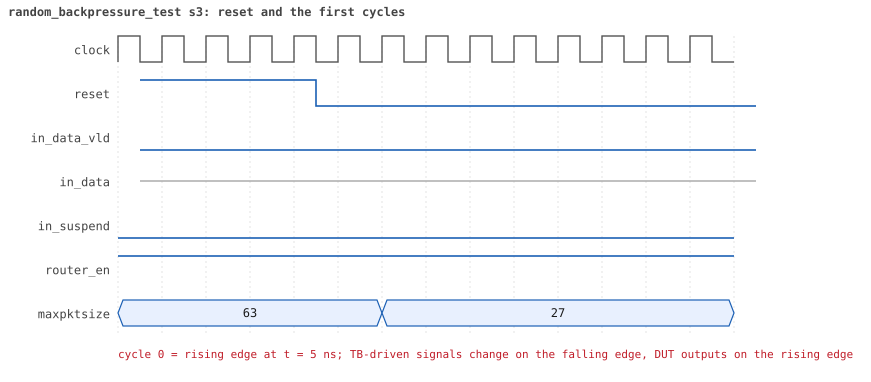
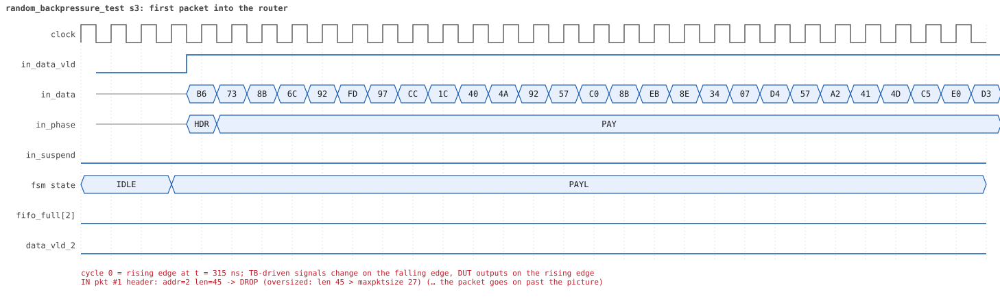
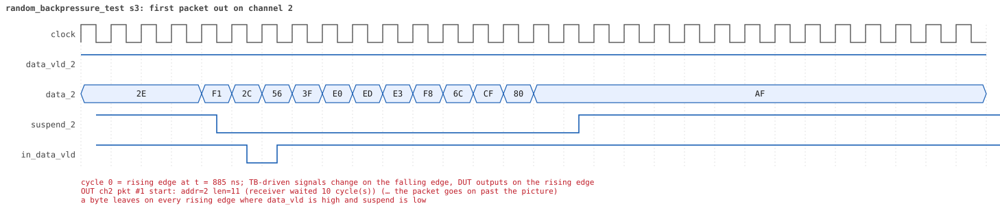
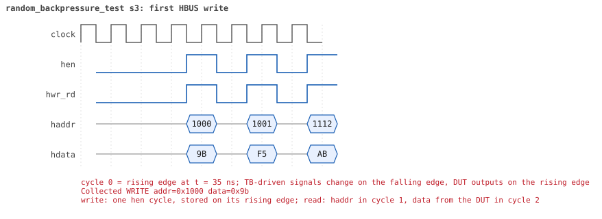
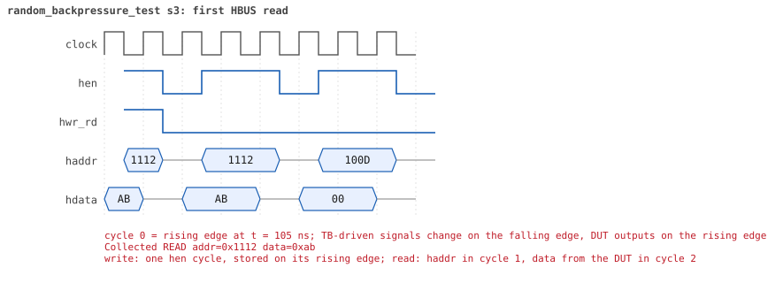

# random_backpressure_test  seed 3

**Result:** PASSED (0 UVM_ERROR, 0 UVM_WARNING, 0 UVM_FATAL) · bench `yapp_project_tb` · sim time 13us · log `random_backpressure_test_s3.log`

Waves: `random_backpressure_test_s3.fst` (GTKWave, Surfer or the VS Code wave viewer); signal trace: `signals.csv`.
[Open the waves in Surfer](https://app.surfer-project.org/?load_url=https%3A%2F%2Fraw.githubusercontent.com%2Ftamirgabgab%2FQcom-Mentoring%2Fmain%2Fyapp_project%2Fregression%2Fyapp_project_tb%2Frandom_backpressure_test_s3%2Frandom_backpressure_test_s3.fst&startup_commands=run_command_file_from_url%20https%3A%2F%2Fraw.githubusercontent.com%2Ftamirgabgab%2FQcom-Mentoring%2Fmain%2Fyapp_project%2Ftb%2Fyapp_router.sucl) (web app, the signals already in groups: `yapp_project/tb/yapp_router.sucl`).

## Summary

- YAPP driver sent **23** packet(s) (0 with bad parity); the input monitor saw 23.
- Router: **5** forwarded, **18** dropped (18 oversized).
- Packets out: ch0 **2**, ch1 **0**, ch2 **3**.
- Scoreboard: 5 matched, 0 mismatched, 0 unexpected.
- Back-pressure: in_suspend asserted **0** time(s).
- Error pulses: 0.
- HBUS: 24 write(s), 41 read(s).

## Stages

| time (ns) | stage |
|---|---|
| 0 | receivers: ch0 RX_SLOW, ch1 RX_FAST, ch2 RX_STALLY |
| 0 | random scenario: 23 packets in 5 bursts |
| 330 | burst 1/5: ctrl=0x9b (maxpktsize 27) en=0xf5 (router on, counter enables 1111010), 5 packet(s) |
| 2300 | burst 1/5 sent: addr0..3 0/3/2/0, bad parity 0, gap 0 4, length 11..45 |
| 2630 | burst 2/5: ctrl=0x9b (maxpktsize 27) en=0xff (router on, counter enables 1111111), 5 packet(s) |
| 5070 | burst 2/5 sent: addr0..3 1/2/2/0, bad parity 0, gap 0 5, length 27..63 |
| 5270 | burst 3/5: ctrl=0xe1 (maxpktsize 33) en=0x93 (router on, counter enables 1001001), 5 packet(s) |
| 7540 | burst 3/5 sent: addr0..3 2/0/3/0, bad parity 0, gap 0 5, length 10..57 |
| 7800 | burst 4/5: ctrl=0xde (maxpktsize 30) en=0x53 (router on, counter enables 0101001), 4 packet(s) |
| 9880 | burst 4/5 sent: addr0..3 1/2/0/1, bad parity 0, gap 0 2, length 33..63 |
| 10190 | burst 5/5: ctrl=0xa0 (maxpktsize 32) en=0x5b (router on, counter enables 0101101), 4 packet(s) |
| 11150 | burst 5/5 sent: addr0..3 1/2/1/0, bad parity 0, gap 0 3, length 1..47 |
| 11150 | final reads: every register and the stored packet, checked against the reference model |
| 12625 | done: 23 packets (5 forwarded, 18 dropped), 0 storm burst(s), 5 scoreboard matches, 41 HBUS reads checked, 0 error pulses for 0 bad packets |

## Pictures

**reset and the first cycles**

**first packet into the router**

**first packet out on channel 2**

**first HBUS write**

**first HBUS read**

## Timeline

362 events (the same list is in `timeline.csv`).

| time (ns) | who | event |
|---|---|---|
| 0 | yapp monitor | YAPP monitor running |
| 0 | **test** | STAGE: receivers: ch0 RX_SLOW, ch1 RX_FAST, ch2 RX_STALLY |
| 0 | **test** | STAGE: random scenario: 23 packets in 5 bursts |
| 0 | clk/rst driver | Starting clock (period 10) and holding reset for 5 cycles |
| 0 | **DUT** | RESET asserted |
| 50 | **DUT** | RESET released: router_en=1 maxpktsize=63 |
| 70 | hbus driver | Executed WRITE addr=0x1000 data=0x9b |
| 75 | **DUT** | CONFIG router_en=1 maxpktsize=27 |
| 75 | hbus monitor | Collected WRITE addr=0x1000 data=0x9b |
| 75 | reference | maxpktsize is now 27 |
| 90 | hbus driver | Executed WRITE addr=0x1001 data=0xf5 |
| 95 | hbus monitor | Collected WRITE addr=0x1001 data=0xf5 |
| 95 | reference | router_en is now 1 (en_reg 0xf5) |
| 110 | hbus driver | Executed WRITE addr=0x1112 data=0xab |
| 115 | hbus monitor | Collected WRITE addr=0x1112 data=0xab |
| 140 | hbus driver | Executed READ  addr=0x1112 data=0xab |
| 145 | hbus monitor | Collected READ  addr=0x1112 data=0xab |
| 170 | hbus driver | Executed READ  addr=0x100d data=0x00 |
| 175 | hbus monitor | Collected READ  addr=0x100d data=0x00 |
| 190 | hbus driver | Executed WRITE addr=0x11e4 data=0x17 |
| 195 | hbus monitor | Collected WRITE addr=0x11e4 data=0x17 |
| 220 | hbus driver | Executed READ  addr=0x11e4 data=0x17 |
| 225 | hbus monitor | Collected READ  addr=0x11e4 data=0x17 |
| 250 | hbus driver | Executed READ  addr=0x1009 data=0x00 |
| 255 | hbus monitor | Collected READ  addr=0x1009 data=0x00 |
| 270 | hbus driver | Executed WRITE addr=0x1104 data=0x94 |
| 275 | hbus monitor | Collected WRITE addr=0x1104 data=0x94 |
| 300 | hbus driver | Executed READ  addr=0x1104 data=0x94 |
| 305 | hbus monitor | Collected READ  addr=0x1104 data=0x94 |
| 330 | hbus driver | Executed READ  addr=0x1001 data=0xf5 |
| 330 | **test** | STAGE: burst 1/5: ctrl=0x9b (maxpktsize 27) en=0xf5 (router on, counter enables 1111010), 5 packet(s) |
| 330 | yapp driver | TX pkt #1: addr=2 len=45 parity=good delay=0 |
| 335 | hbus monitor | Collected READ  addr=0x1001 data=0xf5 |
| 345 | **DUT** | IN  pkt #1 header: addr=2 len=45 -> DROP (oversized: len 45 > maxpktsize 27) |
| 805 | **DUT** | IN  pkt #1 complete: addr=2 len=45 parity=ok dropped, 47 bytes in 47 cycles (held 0) |
| 805 | yapp monitor | RX pkt #1 on the input: addr=2 len=45 parity=good gap=29 |
| 805 | reference | Packet dropped: length 45 > maxpktsize 27 (addr=2) |
| 805 | **DUT** | ROUTER DROPS PACKET addr=2 length=45 (length > maxpktsize) |
| 810 | yapp driver | TX pkt #1 accepted by the DUT |
| 810 | yapp driver | TX pkt #2: addr=2 len=11 parity=good delay=0 |
| 815 | **DUT** | IN  pkt #2 header: addr=2 len=11 -> channel 2 |
| 925 | **DUT** | OUT ch2 pkt #1 start: addr=2 len=11 (receiver waited 10 cycle(s)) |
| 935 | **DUT** | IN  pkt #2 complete: addr=2 len=11 parity=ok forwarded, 13 bytes in 13 cycles (held 0) |
| 935 | yapp monitor | RX pkt #2 on the input: addr=2 len=11 parity=good gap=0 |
| 935 | reference | Packet forwarded: addr=2 len=11 -> channel 2 |
| 940 | yapp driver | TX pkt #2 accepted by the DUT |
| 940 | yapp driver | TX pkt #3: addr=1 len=43 parity=good delay=0 |
| 945 | **DUT** | IN  pkt #3 header: addr=1 len=43 -> DROP (oversized: len 43 > maxpktsize 27) |
| 1040 | ch2 driver | ch2: packet consumed (response delay 10) |
| 1385 | **DUT** | IN  pkt #3 complete: addr=1 len=43 parity=ok dropped, 45 bytes in 45 cycles (held 0) |
| 1385 | yapp monitor | RX pkt #3 on the input: addr=1 len=43 parity=good gap=0 |
| 1385 | reference | Packet dropped: length 43 > maxpktsize 27 (addr=1) |
| 1385 | **DUT** | ROUTER DROPS PACKET addr=1 length=43 (length > maxpktsize) |
| 1390 | yapp driver | TX pkt #3 accepted by the DUT |
| 1390 | yapp driver | TX pkt #4: addr=1 len=45 parity=good delay=1 |
| 1405 | **DUT** | IN  pkt #4 header: addr=1 len=45 -> DROP (oversized: len 45 > maxpktsize 27) |
| 1865 | **DUT** | IN  pkt #4 complete: addr=1 len=45 parity=ok dropped, 47 bytes in 47 cycles (held 0) |
| 1865 | yapp monitor | RX pkt #4 on the input: addr=1 len=45 parity=good gap=1 |
| 1865 | reference | Packet dropped: length 45 > maxpktsize 27 (addr=1) |
| 1865 | **DUT** | ROUTER DROPS PACKET addr=1 length=45 (length > maxpktsize) |
| 1870 | yapp driver | TX pkt #4 accepted by the DUT |
| 1870 | yapp driver | TX pkt #5: addr=1 len=41 parity=good delay=0 |
| 1875 | **DUT** | IN  pkt #5 header: addr=1 len=41 -> DROP (oversized: len 41 > maxpktsize 27) |
| 2185 | **DUT** | OUT ch2 pkt #1 done: 13 bytes in 127 cycles |
| 2185 | ch2 monitor | ch2 RX pkt #1: addr=2 len=11 parity=good |
| 2185 | scoreboard | ch2 pkt matched: addr=2 len=11 (1 matched so far) |
| 2295 | **DUT** | IN  pkt #5 complete: addr=1 len=41 parity=ok dropped, 43 bytes in 43 cycles (held 0) |
| 2295 | yapp monitor | RX pkt #5 on the input: addr=1 len=41 parity=good gap=0 |
| 2295 | reference | Packet dropped: length 41 > maxpktsize 27 (addr=1) |
| 2295 | **DUT** | ROUTER DROPS PACKET addr=1 length=41 (length > maxpktsize) |
| 2300 | yapp driver | TX pkt #5 accepted by the DUT |
| 2300 | **test** | STAGE: burst 1/5 sent: addr0..3 0/3/2/0, bad parity 0, gap 0 4, length 11..45 |
| 2320 | hbus driver | Executed WRITE addr=0x1000 data=0x9b |
| 2325 | hbus monitor | Collected WRITE addr=0x1000 data=0x9b |
| 2325 | reference | maxpktsize is now 27 |
| 2340 | hbus driver | Executed WRITE addr=0x1001 data=0xff |
| 2345 | hbus monitor | Collected WRITE addr=0x1001 data=0xff |
| 2345 | reference | router_en is now 1 (en_reg 0xff) |
| 2370 | hbus driver | Executed READ  addr=0x1021 data=0x4d |
| 2375 | hbus monitor | Collected READ  addr=0x1021 data=0x4d |
| 2400 | hbus driver | Executed READ  addr=0x1006 data=0x00 |
| 2405 | hbus monitor | Collected READ  addr=0x1006 data=0x00 |
| 2420 | hbus driver | Executed WRITE addr=0x119f data=0xdc |
| 2425 | hbus monitor | Collected WRITE addr=0x119f data=0xdc |
| 2450 | hbus driver | Executed READ  addr=0x119f data=0xdc |
| 2455 | hbus monitor | Collected READ  addr=0x119f data=0xdc |
| 2480 | hbus driver | Executed READ  addr=0x1009 data=0x00 |
| 2485 | hbus monitor | Collected READ  addr=0x1009 data=0x00 |
| 2500 | hbus driver | Executed WRITE addr=0x1178 data=0x8f |
| 2505 | hbus monitor | Collected WRITE addr=0x1178 data=0x8f |
| 2530 | hbus driver | Executed READ  addr=0x1178 data=0x8f |
| 2535 | hbus monitor | Collected READ  addr=0x1178 data=0x8f |
| 2550 | hbus driver | Executed WRITE addr=0x114a data=0x8a |
| 2555 | hbus monitor | Collected WRITE addr=0x114a data=0x8a |
| 2580 | hbus driver | Executed READ  addr=0x114a data=0x8a |
| 2585 | hbus monitor | Collected READ  addr=0x114a data=0x8a |
| 2600 | hbus driver | Executed WRITE addr=0x11cb data=0x0a |
| 2605 | hbus monitor | Collected WRITE addr=0x11cb data=0x0a |
| 2620 | ch2 driver | ch2: packet consumed (response delay 113) |
| 2630 | hbus driver | Executed READ  addr=0x11cb data=0x0a |
| 2630 | **test** | STAGE: burst 2/5: ctrl=0x9b (maxpktsize 27) en=0xff (router on, counter enables 1111111), 5 packet(s) |
| 2630 | yapp driver | TX pkt #6: addr=1 len=56 parity=good delay=0 |
| 2635 | hbus monitor | Collected READ  addr=0x11cb data=0x0a |
| 2645 | **DUT** | IN  pkt #6 header: addr=1 len=56 -> DROP (oversized: len 56 > maxpktsize 27) |
| 3215 | **DUT** | IN  pkt #6 complete: addr=1 len=56 parity=ok dropped, 58 bytes in 58 cycles (held 0) |
| 3215 | yapp monitor | RX pkt #6 on the input: addr=1 len=56 parity=good gap=34 |
| 3215 | reference | Packet dropped: length 56 > maxpktsize 27 (addr=1) |
| 3215 | **DUT** | ROUTER DROPS PACKET addr=1 length=56 (length > maxpktsize) |
| 3220 | yapp driver | TX pkt #6 accepted by the DUT |
| 3220 | yapp driver | TX pkt #7: addr=0 len=43 parity=good delay=0 |
| 3225 | **DUT** | IN  pkt #7 header: addr=0 len=43 -> DROP (oversized: len 43 > maxpktsize 27) |
| 3665 | **DUT** | IN  pkt #7 complete: addr=0 len=43 parity=ok dropped, 45 bytes in 45 cycles (held 0) |
| 3665 | yapp monitor | RX pkt #7 on the input: addr=0 len=43 parity=good gap=0 |
| 3665 | reference | Packet dropped: length 43 > maxpktsize 27 (addr=0) |
| 3665 | **DUT** | ROUTER DROPS PACKET addr=0 length=43 (length > maxpktsize) |
| 3670 | yapp driver | TX pkt #7 accepted by the DUT |
| 3670 | yapp driver | TX pkt #8: addr=2 len=44 parity=good delay=0 |
| 3675 | **DUT** | IN  pkt #8 header: addr=2 len=44 -> DROP (oversized: len 44 > maxpktsize 27) |
| 4125 | **DUT** | IN  pkt #8 complete: addr=2 len=44 parity=ok dropped, 46 bytes in 46 cycles (held 0) |
| 4125 | yapp monitor | RX pkt #8 on the input: addr=2 len=44 parity=good gap=0 |
| 4125 | reference | Packet dropped: length 44 > maxpktsize 27 (addr=2) |
| 4125 | **DUT** | ROUTER DROPS PACKET addr=2 length=44 (length > maxpktsize) |
| 4130 | yapp driver | TX pkt #8 accepted by the DUT |
| 4130 | yapp driver | TX pkt #9: addr=1 len=63 parity=good delay=0 |
| 4135 | **DUT** | IN  pkt #9 header: addr=1 len=63 -> DROP (oversized: len 63 > maxpktsize 27) |
| 4775 | **DUT** | IN  pkt #9 complete: addr=1 len=63 parity=ok dropped, 65 bytes in 65 cycles (held 0) |
| 4775 | yapp monitor | RX pkt #9 on the input: addr=1 len=63 parity=good gap=0 |
| 4775 | reference | Packet dropped: length 63 > maxpktsize 27 (addr=1) |
| 4775 | **DUT** | ROUTER DROPS PACKET addr=1 length=63 (length > maxpktsize) |
| 4780 | yapp driver | TX pkt #9 accepted by the DUT |
| 4780 | yapp driver | TX pkt #10: addr=2 len=27 parity=good delay=0 |
| 4785 | **DUT** | IN  pkt #10 header: addr=2 len=27 -> channel 2 |
| 4875 | **DUT** | OUT ch2 pkt #2 start: addr=2 len=27 (receiver waited 8 cycle(s)) |
| 5065 | **DUT** | IN  pkt #10 complete: addr=2 len=27 parity=ok forwarded, 29 bytes in 29 cycles (held 0) |
| 5065 | yapp monitor | RX pkt #10 on the input: addr=2 len=27 parity=good gap=0 |
| 5065 | reference | Packet forwarded: addr=2 len=27 -> channel 2 |
| 5070 | yapp driver | TX pkt #10 accepted by the DUT |
| 5070 | **test** | STAGE: burst 2/5 sent: addr0..3 1/2/2/0, bad parity 0, gap 0 5, length 27..63 |
| 5090 | hbus driver | Executed WRITE addr=0x1000 data=0xe1 |
| 5095 | **DUT** | CONFIG router_en=1 maxpktsize=33 |
| 5095 | hbus monitor | Collected WRITE addr=0x1000 data=0xe1 |
| 5095 | reference | maxpktsize is now 33 |
| 5110 | hbus driver | Executed WRITE addr=0x1001 data=0x93 |
| 5115 | hbus monitor | Collected WRITE addr=0x1001 data=0x93 |
| 5115 | reference | router_en is now 1 (en_reg 0x93) |
| 5140 | hbus driver | Executed READ  addr=0x1000 data=0xe1 |
| 5145 | hbus monitor | Collected READ  addr=0x1000 data=0xe1 |
| 5150 | ch2 driver | ch2: packet consumed (response delay 8) |
| 5160 | hbus driver | Executed WRITE addr=0x1139 data=0x39 |
| 5165 | hbus monitor | Collected WRITE addr=0x1139 data=0x39 |
| 5190 | hbus driver | Executed READ  addr=0x1139 data=0x39 |
| 5195 | hbus monitor | Collected READ  addr=0x1139 data=0x39 |
| 5210 | hbus driver | Executed WRITE addr=0x113c data=0x7d |
| 5215 | **DUT** | OUT ch2 pkt #2 done: 29 bytes in 35 cycles |
| 5215 | ch2 monitor | ch2 RX pkt #2: addr=2 len=27 parity=good |
| 5215 | scoreboard | ch2 pkt matched: addr=2 len=27 (2 matched so far) |
| 5215 | hbus monitor | Collected WRITE addr=0x113c data=0x7d |
| 5240 | hbus driver | Executed READ  addr=0x113c data=0x7d |
| 5245 | hbus monitor | Collected READ  addr=0x113c data=0x7d |
| 5270 | hbus driver | Executed READ  addr=0x100d data=0x1b |
| 5270 | **test** | STAGE: burst 3/5: ctrl=0xe1 (maxpktsize 33) en=0x93 (router on, counter enables 1001001), 5 packet(s) |
| 5270 | yapp driver | TX pkt #11: addr=0 len=48 parity=good delay=0 |
| 5275 | hbus monitor | Collected READ  addr=0x100d data=0x1b |
| 5285 | **DUT** | IN  pkt #11 header: addr=0 len=48 -> DROP (oversized: len 48 > maxpktsize 33) |
| 5660 | ch2 driver | ch2: packet consumed (response delay 5) |
| 5775 | **DUT** | IN  pkt #11 complete: addr=0 len=48 parity=ok dropped, 50 bytes in 50 cycles (held 0) |
| 5775 | yapp monitor | RX pkt #11 on the input: addr=0 len=48 parity=good gap=21 |
| 5775 | reference | Packet dropped: length 48 > maxpktsize 33 (addr=0) |
| 5775 | **DUT** | ROUTER DROPS PACKET addr=0 length=48 (length > maxpktsize) |
| 5780 | yapp driver | TX pkt #11 accepted by the DUT |
| 5780 | yapp driver | TX pkt #12: addr=2 len=47 parity=good delay=0 |
| 5785 | **DUT** | IN  pkt #12 header: addr=2 len=47 -> DROP (oversized: len 47 > maxpktsize 33) |
| 6265 | **DUT** | IN  pkt #12 complete: addr=2 len=47 parity=ok dropped, 49 bytes in 49 cycles (held 0) |
| 6265 | yapp monitor | RX pkt #12 on the input: addr=2 len=47 parity=good gap=0 |
| 6265 | reference | Packet dropped: length 47 > maxpktsize 33 (addr=2) |
| 6265 | **DUT** | ROUTER DROPS PACKET addr=2 length=47 (length > maxpktsize) |
| 6270 | yapp driver | TX pkt #12 accepted by the DUT |
| 6270 | yapp driver | TX pkt #13: addr=2 len=57 parity=good delay=0 |
| 6275 | **DUT** | IN  pkt #13 header: addr=2 len=57 -> DROP (oversized: len 57 > maxpktsize 33) |
| 6855 | **DUT** | IN  pkt #13 complete: addr=2 len=57 parity=ok dropped, 59 bytes in 59 cycles (held 0) |
| 6855 | yapp monitor | RX pkt #13 on the input: addr=2 len=57 parity=good gap=0 |
| 6855 | reference | Packet dropped: length 57 > maxpktsize 33 (addr=2) |
| 6855 | **DUT** | ROUTER DROPS PACKET addr=2 length=57 (length > maxpktsize) |
| 6860 | yapp driver | TX pkt #13 accepted by the DUT |
| 6860 | yapp driver | TX pkt #14: addr=2 len=54 parity=good delay=0 |
| 6865 | **DUT** | IN  pkt #14 header: addr=2 len=54 -> DROP (oversized: len 54 > maxpktsize 33) |
| 7415 | **DUT** | IN  pkt #14 complete: addr=2 len=54 parity=ok dropped, 56 bytes in 56 cycles (held 0) |
| 7415 | yapp monitor | RX pkt #14 on the input: addr=2 len=54 parity=good gap=0 |
| 7415 | reference | Packet dropped: length 54 > maxpktsize 33 (addr=2) |
| 7415 | **DUT** | ROUTER DROPS PACKET addr=2 length=54 (length > maxpktsize) |
| 7420 | yapp driver | TX pkt #14 accepted by the DUT |
| 7420 | yapp driver | TX pkt #15: addr=0 len=10 parity=good delay=0 |
| 7425 | **DUT** | IN  pkt #15 header: addr=0 len=10 -> channel 0 |
| 7535 | **DUT** | IN  pkt #15 complete: addr=0 len=10 parity=ok forwarded, 12 bytes in 12 cycles (held 0) |
| 7535 | yapp monitor | RX pkt #15 on the input: addr=0 len=10 parity=good gap=0 |
| 7535 | reference | Packet forwarded: addr=0 len=10 -> channel 0 |
| 7540 | yapp driver | TX pkt #15 accepted by the DUT |
| 7540 | **test** | STAGE: burst 3/5 sent: addr0..3 2/0/3/0, bad parity 0, gap 0 5, length 10..57 |
| 7560 | hbus driver | Executed WRITE addr=0x1000 data=0xde |
| 7565 | **DUT** | CONFIG router_en=1 maxpktsize=30 |
| 7565 | hbus monitor | Collected WRITE addr=0x1000 data=0xde |
| 7565 | reference | maxpktsize is now 30 |
| 7580 | hbus driver | Executed WRITE addr=0x1001 data=0x53 |
| 7585 | hbus monitor | Collected WRITE addr=0x1001 data=0x53 |
| 7585 | reference | router_en is now 1 (en_reg 0x53) |
| 7600 | hbus driver | Executed WRITE addr=0x113b data=0x10 |
| 7605 | hbus monitor | Collected WRITE addr=0x113b data=0x10 |
| 7630 | hbus driver | Executed READ  addr=0x113b data=0x10 |
| 7635 | hbus monitor | Collected READ  addr=0x113b data=0x10 |
| 7660 | hbus driver | Executed READ  addr=0x100d data=0x0a |
| 7665 | hbus monitor | Collected READ  addr=0x100d data=0x0a |
| 7680 | hbus driver | Executed WRITE addr=0x11b2 data=0x4c |
| 7685 | hbus monitor | Collected WRITE addr=0x11b2 data=0x4c |
| 7710 | hbus driver | Executed READ  addr=0x11b2 data=0x4c |
| 7715 | hbus monitor | Collected READ  addr=0x11b2 data=0x4c |
| 7740 | hbus driver | Executed READ  addr=0x100f data=0x00 |
| 7745 | hbus monitor | Collected READ  addr=0x100f data=0x00 |
| 7770 | hbus driver | Executed READ  addr=0x103a data=0x48 |
| 7775 | hbus monitor | Collected READ  addr=0x103a data=0x48 |
| 7800 | hbus driver | Executed READ  addr=0x10f3 data=0x00 |
| 7800 | **test** | STAGE: burst 4/5: ctrl=0xde (maxpktsize 30) en=0x53 (router on, counter enables 0101001), 4 packet(s) |
| 7800 | yapp driver | TX pkt #16: addr=0 len=53 parity=good delay=1 |
| 7805 | **DUT** | OUT ch0 pkt #1 start: addr=0 len=10 (receiver waited 37 cycle(s)) |
| 7805 | hbus monitor | Collected READ  addr=0x10f3 data=0x00 |
| 7825 | **DUT** | IN  pkt #16 header: addr=0 len=53 -> DROP (oversized: len 53 > maxpktsize 30) |
| 7910 | ch0 driver | ch0: packet consumed (response delay 37) |
| 8255 | **DUT** | OUT ch0 pkt #1 done: 12 bytes in 46 cycles |
| 8255 | ch0 monitor | ch0 RX pkt #1: addr=0 len=10 parity=good |
| 8255 | scoreboard | ch0 pkt matched: addr=0 len=10 (3 matched so far) |
| 8365 | **DUT** | IN  pkt #16 complete: addr=0 len=53 parity=ok dropped, 55 bytes in 55 cycles (held 0) |
| 8365 | yapp monitor | RX pkt #16 on the input: addr=0 len=53 parity=good gap=28 |
| 8365 | reference | Packet dropped: length 53 > maxpktsize 30 (addr=0) |
| 8365 | **DUT** | ROUTER DROPS PACKET addr=0 length=53 (length > maxpktsize) |
| 8370 | yapp driver | TX pkt #16 accepted by the DUT |
| 8370 | yapp driver | TX pkt #17: addr=3 len=33 parity=good delay=0 |
| 8375 | **DUT** | IN  pkt #17 header: addr=3 len=33 -> DROP (oversized: len 33 > maxpktsize 30) |
| 8490 | ch0 driver | ch0: packet consumed (response delay 33) |
| 8715 | **DUT** | IN  pkt #17 complete: addr=3 len=33 parity=ok dropped, 35 bytes in 35 cycles (held 0) |
| 8715 | yapp monitor | RX pkt #17 on the input: addr=3 len=33 parity=good gap=0 |
| 8715 | reference | Packet dropped: illegal address 3 (len=33) |
| 8715 | **DUT** | ROUTER DROPS PACKET addr=3 length=33 (    illegal address) |
| 8720 | yapp driver | TX pkt #17 accepted by the DUT |
| 8720 | yapp driver | TX pkt #18: addr=1 len=47 parity=good delay=0 |
| 8725 | **DUT** | IN  pkt #18 header: addr=1 len=47 -> DROP (oversized: len 47 > maxpktsize 30) |
| 9205 | **DUT** | IN  pkt #18 complete: addr=1 len=47 parity=ok dropped, 49 bytes in 49 cycles (held 0) |
| 9205 | yapp monitor | RX pkt #18 on the input: addr=1 len=47 parity=good gap=0 |
| 9205 | reference | Packet dropped: length 47 > maxpktsize 30 (addr=1) |
| 9205 | **DUT** | ROUTER DROPS PACKET addr=1 length=47 (length > maxpktsize) |
| 9210 | yapp driver | TX pkt #18 accepted by the DUT |
| 9210 | yapp driver | TX pkt #19: addr=1 len=63 parity=good delay=2 |
| 9235 | **DUT** | IN  pkt #19 header: addr=1 len=63 -> DROP (oversized: len 63 > maxpktsize 30) |
| 9875 | **DUT** | IN  pkt #19 complete: addr=1 len=63 parity=ok dropped, 65 bytes in 65 cycles (held 0) |
| 9875 | yapp monitor | RX pkt #19 on the input: addr=1 len=63 parity=good gap=2 |
| 9875 | reference | Packet dropped: length 63 > maxpktsize 30 (addr=1) |
| 9875 | **DUT** | ROUTER DROPS PACKET addr=1 length=63 (length > maxpktsize) |
| 9880 | yapp driver | TX pkt #19 accepted by the DUT |
| 9880 | **test** | STAGE: burst 4/5 sent: addr0..3 1/2/0/1, bad parity 0, gap 0 2, length 33..63 |
| 9900 | hbus driver | Executed WRITE addr=0x1000 data=0xa0 |
| 9905 | **DUT** | CONFIG router_en=1 maxpktsize=32 |
| 9905 | hbus monitor | Collected WRITE addr=0x1000 data=0xa0 |
| 9905 | reference | maxpktsize is now 32 |
| 9920 | hbus driver | Executed WRITE addr=0x1001 data=0x5b |
| 9925 | hbus monitor | Collected WRITE addr=0x1001 data=0x5b |
| 9925 | reference | router_en is now 1 (en_reg 0x5b) |
| 9940 | hbus driver | Executed WRITE addr=0x115d data=0x9f |
| 9945 | hbus monitor | Collected WRITE addr=0x115d data=0x9f |
| 9970 | hbus driver | Executed READ  addr=0x115d data=0x9f |
| 9975 | hbus monitor | Collected READ  addr=0x115d data=0x9f |
| 10000 | hbus driver | Executed READ  addr=0x100f data=0x00 |
| 10005 | hbus monitor | Collected READ  addr=0x100f data=0x00 |
| 10030 | hbus driver | Executed READ  addr=0x1015 data=0x58 |
| 10035 | hbus monitor | Collected READ  addr=0x1015 data=0x58 |
| 10060 | hbus driver | Executed READ  addr=0x1018 data=0xd5 |
| 10065 | hbus monitor | Collected READ  addr=0x1018 data=0xd5 |
| 10080 | hbus driver | Executed WRITE addr=0x1104 data=0xda |
| 10085 | hbus monitor | Collected WRITE addr=0x1104 data=0xda |
| 10110 | hbus driver | Executed READ  addr=0x1104 data=0xda |
| 10115 | hbus monitor | Collected READ  addr=0x1104 data=0xda |
| 10140 | hbus driver | Executed READ  addr=0x101d data=0x5a |
| 10145 | hbus monitor | Collected READ  addr=0x101d data=0x5a |
| 10160 | hbus driver | Executed WRITE addr=0x11f4 data=0x7c |
| 10165 | hbus monitor | Collected WRITE addr=0x11f4 data=0x7c |
| 10190 | hbus driver | Executed READ  addr=0x11f4 data=0x7c |
| 10190 | **test** | STAGE: burst 5/5: ctrl=0xa0 (maxpktsize 32) en=0x5b (router on, counter enables 0101101), 4 packet(s) |
| 10190 | yapp driver | TX pkt #20: addr=1 len=34 parity=good delay=0 |
| 10195 | hbus monitor | Collected READ  addr=0x11f4 data=0x7c |
| 10205 | **DUT** | IN  pkt #20 header: addr=1 len=34 -> DROP (oversized: len 34 > maxpktsize 32) |
| 10555 | **DUT** | IN  pkt #20 complete: addr=1 len=34 parity=ok dropped, 36 bytes in 36 cycles (held 0) |
| 10555 | yapp monitor | RX pkt #20 on the input: addr=1 len=34 parity=good gap=32 |
| 10555 | reference | Packet dropped: length 34 > maxpktsize 32 (addr=1) |
| 10555 | **DUT** | ROUTER DROPS PACKET addr=1 length=34 (length > maxpktsize) |
| 10560 | yapp driver | TX pkt #20 accepted by the DUT |
| 10560 | yapp driver | TX pkt #21: addr=0 len=3 parity=good delay=0 |
| 10565 | **DUT** | IN  pkt #21 header: addr=0 len=3 -> channel 0 |
| 10605 | **DUT** | IN  pkt #21 complete: addr=0 len=3 parity=ok forwarded, 5 bytes in 5 cycles (held 0) |
| 10605 | yapp monitor | RX pkt #21 on the input: addr=0 len=3 parity=good gap=0 |
| 10605 | reference | Packet forwarded: addr=0 len=3 -> channel 0 |
| 10610 | yapp driver | TX pkt #21 accepted by the DUT |
| 10610 | yapp driver | TX pkt #22: addr=1 len=47 parity=good delay=2 |
| 10635 | **DUT** | IN  pkt #22 header: addr=1 len=47 -> DROP (oversized: len 47 > maxpktsize 32) |
| 10955 | **DUT** | OUT ch0 pkt #2 start: addr=0 len=3 (receiver waited 38 cycle(s)) |
| 10990 | ch0 driver | ch0: packet consumed (response delay 38) |
| 11115 | **DUT** | IN  pkt #22 complete: addr=1 len=47 parity=ok dropped, 49 bytes in 49 cycles (held 0) |
| 11115 | yapp monitor | RX pkt #22 on the input: addr=1 len=47 parity=good gap=2 |
| 11115 | reference | Packet dropped: length 47 > maxpktsize 32 (addr=1) |
| 11115 | **DUT** | ROUTER DROPS PACKET addr=1 length=47 (length > maxpktsize) |
| 11120 | yapp driver | TX pkt #22 accepted by the DUT |
| 11120 | yapp driver | TX pkt #23: addr=2 len=1 parity=good delay=0 |
| 11125 | **DUT** | IN  pkt #23 header: addr=2 len=1 -> channel 2 |
| 11145 | **DUT** | IN  pkt #23 complete: addr=2 len=1 parity=ok forwarded, 3 bytes in 3 cycles (held 0) |
| 11145 | yapp monitor | RX pkt #23 on the input: addr=2 len=1 parity=good gap=0 |
| 11145 | reference | Packet forwarded: addr=2 len=1 -> channel 2 |
| 11150 | yapp driver | TX pkt #23 accepted by the DUT |
| 11150 | **test** | STAGE: burst 5/5 sent: addr0..3 1/2/1/0, bad parity 0, gap 0 3, length 1..47 |
| 11150 | **test** | STAGE: final reads: every register and the stored packet, checked against the reference model |
| 11180 | hbus driver | Executed READ  addr=0x1000 data=0xa0 |
| 11185 | hbus monitor | Collected READ  addr=0x1000 data=0xa0 |
| 11210 | hbus driver | Executed READ  addr=0x1001 data=0x5b |
| 11215 | hbus monitor | Collected READ  addr=0x1001 data=0x5b |
| 11240 | hbus driver | Executed READ  addr=0x1004 data=0x00 |
| 11245 | hbus monitor | Collected READ  addr=0x1004 data=0x00 |
| 11270 | hbus driver | Executed READ  addr=0x1005 data=0x08 |
| 11275 | hbus monitor | Collected READ  addr=0x1005 data=0x08 |
| 11300 | hbus driver | Executed READ  addr=0x1006 data=0x00 |
| 11305 | hbus monitor | Collected READ  addr=0x1006 data=0x00 |
| 11330 | hbus driver | Executed READ  addr=0x1009 data=0x05 |
| 11335 | hbus monitor | Collected READ  addr=0x1009 data=0x05 |
| 11360 | hbus driver | Executed READ  addr=0x100a data=0x05 |
| 11365 | hbus monitor | Collected READ  addr=0x100a data=0x05 |
| 11390 | hbus driver | Executed READ  addr=0x100b data=0x05 |
| 11395 | hbus monitor | Collected READ  addr=0x100b data=0x05 |
| 11405 | **DUT** | OUT ch0 pkt #2 done: 5 bytes in 46 cycles |
| 11405 | ch0 monitor | ch0 RX pkt #2: addr=0 len=3 parity=good |
| 11405 | scoreboard | ch0 pkt matched: addr=0 len=3 (4 matched so far) |
| 11420 | hbus driver | Executed READ  addr=0x100d data=0x01 |
| 11425 | hbus monitor | Collected READ  addr=0x100d data=0x01 |
| 11450 | hbus driver | Executed READ  addr=0x1010 data=0x06 |
| 11455 | hbus monitor | Collected READ  addr=0x1010 data=0x06 |
| 11480 | hbus driver | Executed READ  addr=0x1011 data=0x65 |
| 11485 | hbus monitor | Collected READ  addr=0x1011 data=0x65 |
| 11790 | ch0 driver | ch0: packet consumed (response delay 40) |
| 12375 | **DUT** | OUT ch2 pkt #3 start: addr=2 len=1 (receiver waited 124 cycle(s)) |
| 12390 | ch2 driver | ch2: packet consumed (response delay 124) |
| 12505 | **DUT** | OUT ch2 pkt #3 done: 3 bytes in 14 cycles |
| 12505 | ch2 monitor | ch2 RX pkt #3: addr=2 len=1 parity=good |
| 12505 | scoreboard | ch2 pkt matched: addr=2 len=1 (5 matched so far) |
| 12625 | **test** | STAGE: done: 23 packets (5 forwarded, 18 dropped), 0 storm burst(s), 5 scoreboard matches, 41 HBUS reads checked, 0 error pulses for 0 bad packets |
| 12750 | ch2 driver | ch2: packet consumed (response delay 10) |
| 12825 | error checker | error pulse report: 0 bad packets, 0 pulses, 0 outside 1..10 cycles, at most 0 owed at once |
| 12825 | ch0 monitor | Channel 0 report: 2 packets collected |
| 12825 | ch1 monitor | Channel 1 report: 0 packets collected |
| 12825 | ch2 monitor | Channel 2 report: 3 packets collected |
| 12825 | hbus monitor | HBUS report: 24 writes, 41 reads |
| 12825 | coverage | Coverage of the router configuration: 56.5% |
| 12825 | reference |  |
| 12825 | reference | HBUS reads checked against the model: 41 (0 mismatches, 0 of memory bytes never written) |
| 12825 | scoreboard |  |
| 12825 | yapp driver | YAPP driver report: 23 packets sent |
| 12825 | coverage | YAPP gap coverage: 22 gaps sampled, coverage 100.0% |
| 12825 | yapp monitor | YAPP monitor report: 23 packets collected, 0 with bad parity |
| 12825 | yapp monitor | YAPP gaps: 15 back to back, 1 of 1 cycle, 2 of 2, 4 longer |
| 12825 | coverage | YAPP packet coverage: 23 packets sampled, coverage 43.3% |
