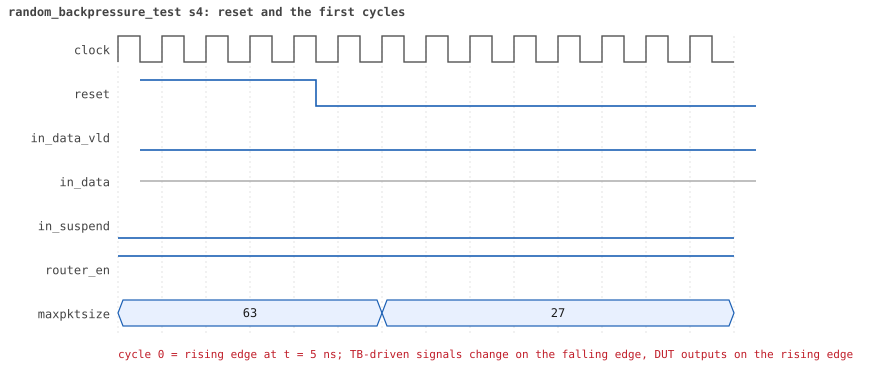
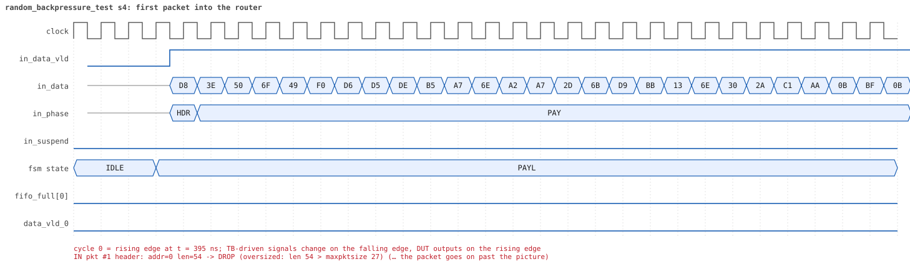
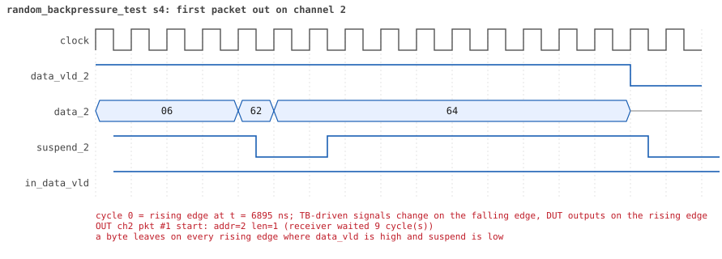
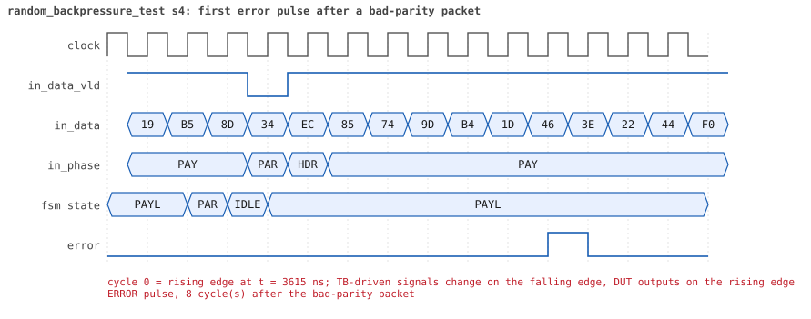
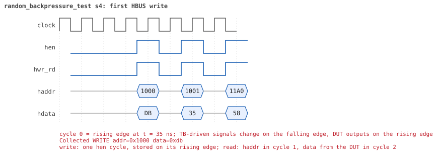
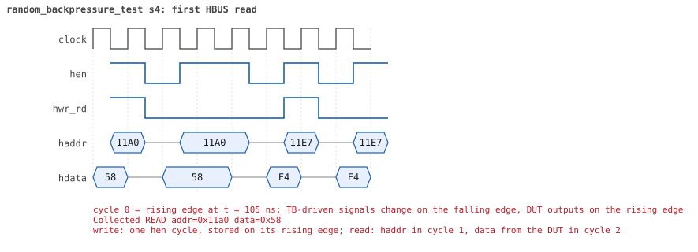

# random_backpressure_test  seed 4

**Result:** PASSED (0 UVM_ERROR, 0 UVM_WARNING, 0 UVM_FATAL) · bench `yapp_project_tb` · sim time 17us · log `random_backpressure_test_s4.log`

Waves: `random_backpressure_test_s4.fst` (GTKWave, Surfer or the VS Code wave viewer); signal trace: `signals.csv`.
[Open the waves in Surfer](https://app.surfer-project.org/?load_url=https%3A%2F%2Fraw.githubusercontent.com%2Ftamirgabgab%2FQcom-Mentoring%2Fmain%2Fyapp_project%2Fregression%2Fyapp_project_tb%2Frandom_backpressure_test_s4%2Frandom_backpressure_test_s4.fst&startup_commands=run_command_file_from_url%20https%3A%2F%2Fraw.githubusercontent.com%2Ftamirgabgab%2FQcom-Mentoring%2Fmain%2Fyapp_project%2Ftb%2Fyapp_router.sucl) (web app, the signals already in groups: `yapp_project/tb/yapp_router.sucl`).

## Summary

- YAPP driver sent **31** packet(s) (2 with bad parity); the input monitor saw 31.
- Router: **2** forwarded, **29** dropped (29 oversized).
- Packets out: ch0 **0**, ch1 **1**, ch2 **1**.
- Scoreboard: 2 matched, 0 mismatched, 0 unexpected.
- Back-pressure: in_suspend asserted **0** time(s).
- Error pulses: 2.
- HBUS: 22 write(s), 87 read(s).

## Stages

| time (ns) | stage |
|---|---|
| 0 | receivers: ch0 RX_STALLY, ch1 RX_STALLY, ch2 RX_STALLY |
| 0 | random scenario: 31 packets in 4 bursts |
| 410 | burst 1/4: ctrl=0xdb (maxpktsize 27) en=0x35 (router on, counter enables 0011010), 9 packet(s) |
| 5340 | burst 1/4 sent: addr0..3 5/2/1/1, bad parity 1, gap 0 6, length 41..59 |
| 5680 | burst 2/4: ctrl=0x83 (maxpktsize 3) en=0xeb (router on, counter enables 1110101), 7 packet(s) |
| 7990 | burst 2/4 sent: addr0..3 2/1/4/0, bad parity 1, gap 0 4, length 1..59 |
| 8320 | burst 3/4: ctrl=0x02 (maxpktsize 2) en=0xff (router on, counter enables 1111111), 7 packet(s) |
| 11000 | burst 3/4 sent: addr0..3 1/3/3/0, bad parity 0, gap 0 5, length 2..59 |
| 11220 | burst 4/4: ctrl=0x54 (maxpktsize 20) en=0xb5 (router on, counter enables 1011010), 8 packet(s) |
| 14980 | burst 4/4 sent: addr0..3 3/3/2/0, bad parity 0, gap 0 5, length 36..61 |
| 14980 | final reads: every register and the stored packet, checked against the reference model |
| 16895 | done: 31 packets (2 forwarded, 29 dropped), 0 storm burst(s), 2 scoreboard matches, 87 HBUS reads checked, 2 error pulses for 2 bad packets |

## Pictures

**reset and the first cycles**

**first packet into the router**

**first packet out on channel 2**

**first error pulse after a bad-parity packet**

**first HBUS write**

**first HBUS read**

## Timeline

495 events (the same list is in `timeline.csv`).

| time (ns) | who | event |
|---|---|---|
| 0 | yapp monitor | YAPP monitor running |
| 0 | **test** | STAGE: receivers: ch0 RX_STALLY, ch1 RX_STALLY, ch2 RX_STALLY |
| 0 | **test** | STAGE: random scenario: 31 packets in 4 bursts |
| 0 | clk/rst driver | Starting clock (period 10) and holding reset for 5 cycles |
| 0 | **DUT** | RESET asserted |
| 50 | **DUT** | RESET released: router_en=1 maxpktsize=63 |
| 70 | hbus driver | Executed WRITE addr=0x1000 data=0xdb |
| 75 | **DUT** | CONFIG router_en=1 maxpktsize=27 |
| 75 | hbus monitor | Collected WRITE addr=0x1000 data=0xdb |
| 75 | reference | maxpktsize is now 27 |
| 90 | hbus driver | Executed WRITE addr=0x1001 data=0x35 |
| 95 | hbus monitor | Collected WRITE addr=0x1001 data=0x35 |
| 95 | reference | router_en is now 1 (en_reg 0x35) |
| 110 | hbus driver | Executed WRITE addr=0x11a0 data=0x58 |
| 115 | hbus monitor | Collected WRITE addr=0x11a0 data=0x58 |
| 140 | hbus driver | Executed READ  addr=0x11a0 data=0x58 |
| 145 | hbus monitor | Collected READ  addr=0x11a0 data=0x58 |
| 160 | hbus driver | Executed WRITE addr=0x11e7 data=0xf4 |
| 165 | hbus monitor | Collected WRITE addr=0x11e7 data=0xf4 |
| 190 | hbus driver | Executed READ  addr=0x11e7 data=0xf4 |
| 195 | hbus monitor | Collected READ  addr=0x11e7 data=0xf4 |
| 210 | hbus driver | Executed WRITE addr=0x1108 data=0xf8 |
| 215 | hbus monitor | Collected WRITE addr=0x1108 data=0xf8 |
| 240 | hbus driver | Executed READ  addr=0x1108 data=0xf8 |
| 245 | hbus monitor | Collected READ  addr=0x1108 data=0xf8 |
| 270 | hbus driver | Executed READ  addr=0x100f data=0x00 |
| 275 | hbus monitor | Collected READ  addr=0x100f data=0x00 |
| 300 | hbus driver | Executed READ  addr=0x1004 data=0x00 |
| 305 | hbus monitor | Collected READ  addr=0x1004 data=0x00 |
| 330 | hbus driver | Executed READ  addr=0x100d data=0x00 |
| 335 | hbus monitor | Collected READ  addr=0x100d data=0x00 |
| 360 | hbus driver | Executed READ  addr=0x10f4 data=0x00 |
| 365 | hbus monitor | Collected READ  addr=0x10f4 data=0x00 |
| 380 | hbus driver | Executed WRITE addr=0x11f4 data=0x67 |
| 385 | hbus monitor | Collected WRITE addr=0x11f4 data=0x67 |
| 410 | hbus driver | Executed READ  addr=0x11f4 data=0x67 |
| 410 | **test** | STAGE: burst 1/4: ctrl=0xdb (maxpktsize 27) en=0x35 (router on, counter enables 0011010), 9 packet(s) |
| 410 | yapp driver | TX pkt #1: addr=0 len=54 parity=good delay=0 |
| 415 | hbus monitor | Collected READ  addr=0x11f4 data=0x67 |
| 425 | **DUT** | IN  pkt #1 header: addr=0 len=54 -> DROP (oversized: len 54 > maxpktsize 27) |
| 975 | **DUT** | IN  pkt #1 complete: addr=0 len=54 parity=ok dropped, 56 bytes in 56 cycles (held 0) |
| 975 | yapp monitor | RX pkt #1 on the input: addr=0 len=54 parity=good gap=37 |
| 975 | reference | Packet dropped: length 54 > maxpktsize 27 (addr=0) |
| 975 | **DUT** | ROUTER DROPS PACKET addr=0 length=54 (length > maxpktsize) |
| 980 | yapp driver | TX pkt #1 accepted by the DUT |
| 980 | yapp driver | TX pkt #2: addr=3 len=57 parity=good delay=2 |
| 1005 | **DUT** | IN  pkt #2 header: addr=3 len=57 -> DROP (oversized: len 57 > maxpktsize 27) |
| 1585 | **DUT** | IN  pkt #2 complete: addr=3 len=57 parity=ok dropped, 59 bytes in 59 cycles (held 0) |
| 1585 | yapp monitor | RX pkt #2 on the input: addr=3 len=57 parity=good gap=2 |
| 1585 | reference | Packet dropped: illegal address 3 (len=57) |
| 1585 | **DUT** | ROUTER DROPS PACKET addr=3 length=57 (    illegal address) |
| 1590 | yapp driver | TX pkt #2 accepted by the DUT |
| 1590 | yapp driver | TX pkt #3: addr=0 len=54 parity=good delay=0 |
| 1595 | **DUT** | IN  pkt #3 header: addr=0 len=54 -> DROP (oversized: len 54 > maxpktsize 27) |
| 2145 | **DUT** | IN  pkt #3 complete: addr=0 len=54 parity=ok dropped, 56 bytes in 56 cycles (held 0) |
| 2145 | yapp monitor | RX pkt #3 on the input: addr=0 len=54 parity=good gap=0 |
| 2145 | reference | Packet dropped: length 54 > maxpktsize 27 (addr=0) |
| 2145 | **DUT** | ROUTER DROPS PACKET addr=0 length=54 (length > maxpktsize) |
| 2150 | yapp driver | TX pkt #3 accepted by the DUT |
| 2150 | yapp driver | TX pkt #4: addr=1 len=50 parity=good delay=0 |
| 2155 | **DUT** | IN  pkt #4 header: addr=1 len=50 -> DROP (oversized: len 50 > maxpktsize 27) |
| 2665 | **DUT** | IN  pkt #4 complete: addr=1 len=50 parity=ok dropped, 52 bytes in 52 cycles (held 0) |
| 2665 | yapp monitor | RX pkt #4 on the input: addr=1 len=50 parity=good gap=0 |
| 2665 | reference | Packet dropped: length 50 > maxpktsize 27 (addr=1) |
| 2665 | **DUT** | ROUTER DROPS PACKET addr=1 length=50 (length > maxpktsize) |
| 2670 | yapp driver | TX pkt #4 accepted by the DUT |
| 2670 | yapp driver | TX pkt #5: addr=1 len=53 parity=good delay=0 |
| 2675 | **DUT** | IN  pkt #5 header: addr=1 len=53 -> DROP (oversized: len 53 > maxpktsize 27) |
| 3215 | **DUT** | IN  pkt #5 complete: addr=1 len=53 parity=ok dropped, 55 bytes in 55 cycles (held 0) |
| 3215 | yapp monitor | RX pkt #5 on the input: addr=1 len=53 parity=good gap=0 |
| 3215 | reference | Packet dropped: length 53 > maxpktsize 27 (addr=1) |
| 3215 | **DUT** | ROUTER DROPS PACKET addr=1 length=53 (length > maxpktsize) |
| 3220 | yapp driver | TX pkt #5 accepted by the DUT |
| 3220 | yapp driver | TX pkt #6: addr=2 len=41 parity=bad delay=0 |
| 3225 | **DUT** | IN  pkt #6 header: addr=2 len=41 -> DROP (oversized: len 41 > maxpktsize 27) |
| 3645 | **DUT** | IN  pkt #6 complete: addr=2 len=41 parity=BAD dropped, 43 bytes in 43 cycles (held 0) |
| 3645 | yapp monitor | RX pkt #6 on the input: addr=2 len=41 parity=bad gap=0 |
| 3645 | reference | Packet dropped: length 41 > maxpktsize 27 (addr=2) |
| 3645 | **DUT** | ROUTER DROPS PACKET addr=2 length=41 (length > maxpktsize) |
| 3650 | yapp driver | TX pkt #6 accepted by the DUT |
| 3650 | yapp driver | TX pkt #7: addr=0 len=59 parity=good delay=0 |
| 3655 | **DUT** | IN  pkt #7 header: addr=0 len=59 -> DROP (oversized: len 59 > maxpktsize 27) |
| 3730 | **DUT** | ERROR pulse, 8 cycle(s) after the bad-parity packet |
| 3730 | error checker | error pulse 8 cycles after the bad packet (0 still owed) |
| 4255 | **DUT** | IN  pkt #7 complete: addr=0 len=59 parity=ok dropped, 61 bytes in 61 cycles (held 0) |
| 4255 | yapp monitor | RX pkt #7 on the input: addr=0 len=59 parity=good gap=0 |
| 4255 | reference | Packet dropped: length 59 > maxpktsize 27 (addr=0) |
| 4255 | **DUT** | ROUTER DROPS PACKET addr=0 length=59 (length > maxpktsize) |
| 4260 | yapp driver | TX pkt #7 accepted by the DUT |
| 4260 | yapp driver | TX pkt #8: addr=0 len=43 parity=good delay=1 |
| 4275 | **DUT** | IN  pkt #8 header: addr=0 len=43 -> DROP (oversized: len 43 > maxpktsize 27) |
| 4715 | **DUT** | IN  pkt #8 complete: addr=0 len=43 parity=ok dropped, 45 bytes in 45 cycles (held 0) |
| 4715 | yapp monitor | RX pkt #8 on the input: addr=0 len=43 parity=good gap=1 |
| 4715 | reference | Packet dropped: length 43 > maxpktsize 27 (addr=0) |
| 4715 | **DUT** | ROUTER DROPS PACKET addr=0 length=43 (length > maxpktsize) |
| 4720 | yapp driver | TX pkt #8 accepted by the DUT |
| 4720 | yapp driver | TX pkt #9: addr=0 len=45 parity=good delay=15 |
| 4875 | **DUT** | IN  pkt #9 header: addr=0 len=45 -> DROP (oversized: len 45 > maxpktsize 27) |
| 5335 | **DUT** | IN  pkt #9 complete: addr=0 len=45 parity=ok dropped, 47 bytes in 47 cycles (held 0) |
| 5335 | yapp monitor | RX pkt #9 on the input: addr=0 len=45 parity=good gap=15 |
| 5335 | reference | Packet dropped: length 45 > maxpktsize 27 (addr=0) |
| 5335 | **DUT** | ROUTER DROPS PACKET addr=0 length=45 (length > maxpktsize) |
| 5340 | yapp driver | TX pkt #9 accepted by the DUT |
| 5340 | **test** | STAGE: burst 1/4 sent: addr0..3 5/2/1/1, bad parity 1, gap 0 6, length 41..59 |
| 5360 | hbus driver | Executed WRITE addr=0x1000 data=0x83 |
| 5365 | **DUT** | CONFIG router_en=1 maxpktsize=3 |
| 5365 | hbus monitor | Collected WRITE addr=0x1000 data=0x83 |
| 5365 | reference | maxpktsize is now 3 |
| 5380 | hbus driver | Executed WRITE addr=0x1001 data=0xeb |
| 5385 | hbus monitor | Collected WRITE addr=0x1001 data=0xeb |
| 5385 | reference | router_en is now 1 (en_reg 0xeb) |
| 5400 | hbus driver | Executed WRITE addr=0x117e data=0xe9 |
| 5405 | hbus monitor | Collected WRITE addr=0x117e data=0xe9 |
| 5430 | hbus driver | Executed READ  addr=0x117e data=0xe9 |
| 5435 | hbus monitor | Collected READ  addr=0x117e data=0xe9 |
| 5460 | hbus driver | Executed READ  addr=0x1004 data=0x00 |
| 5465 | hbus monitor | Collected READ  addr=0x1004 data=0x00 |
| 5480 | hbus driver | Executed WRITE addr=0x117c data=0x4e |
| 5485 | hbus monitor | Collected WRITE addr=0x117c data=0x4e |
| 5510 | hbus driver | Executed READ  addr=0x117c data=0x4e |
| 5515 | hbus monitor | Collected READ  addr=0x117c data=0x4e |
| 5540 | hbus driver | Executed READ  addr=0x100d data=0x2d |
| 5545 | hbus monitor | Collected READ  addr=0x100d data=0x2d |
| 5560 | hbus driver | Executed WRITE addr=0x11c4 data=0xe3 |
| 5565 | hbus monitor | Collected WRITE addr=0x11c4 data=0xe3 |
| 5590 | hbus driver | Executed READ  addr=0x11c4 data=0xe3 |
| 5595 | hbus monitor | Collected READ  addr=0x11c4 data=0xe3 |
| 5620 | hbus driver | Executed READ  addr=0x1000 data=0x83 |
| 5625 | hbus monitor | Collected READ  addr=0x1000 data=0x83 |
| 5650 | hbus driver | Executed READ  addr=0x102b data=0x44 |
| 5655 | hbus monitor | Collected READ  addr=0x102b data=0x44 |
| 5680 | hbus driver | Executed READ  addr=0x100d data=0x2d |
| 5680 | **test** | STAGE: burst 2/4: ctrl=0x83 (maxpktsize 3) en=0xeb (router on, counter enables 1110101), 7 packet(s) |
| 5680 | yapp driver | TX pkt #10: addr=2 len=59 parity=good delay=2 |
| 5685 | hbus monitor | Collected READ  addr=0x100d data=0x2d |
| 5715 | **DUT** | IN  pkt #10 header: addr=2 len=59 -> DROP (oversized: len 59 > maxpktsize 3) |
| 6315 | **DUT** | IN  pkt #10 complete: addr=2 len=59 parity=ok dropped, 61 bytes in 61 cycles (held 0) |
| 6315 | yapp monitor | RX pkt #10 on the input: addr=2 len=59 parity=good gap=37 |
| 6315 | reference | Packet dropped: length 59 > maxpktsize 3 (addr=2) |
| 6315 | **DUT** | ROUTER DROPS PACKET addr=2 length=59 (length > maxpktsize) |
| 6320 | yapp driver | TX pkt #10 accepted by the DUT |
| 6320 | yapp driver | TX pkt #11: addr=1 len=24 parity=good delay=0 |
| 6325 | **DUT** | IN  pkt #11 header: addr=1 len=24 -> DROP (oversized: len 24 > maxpktsize 3) |
| 6575 | **DUT** | IN  pkt #11 complete: addr=1 len=24 parity=ok dropped, 26 bytes in 26 cycles (held 0) |
| 6575 | yapp monitor | RX pkt #11 on the input: addr=1 len=24 parity=good gap=0 |
| 6575 | reference | Packet dropped: length 24 > maxpktsize 3 (addr=1) |
| 6575 | **DUT** | ROUTER DROPS PACKET addr=1 length=24 (length > maxpktsize) |
| 6580 | yapp driver | TX pkt #11 accepted by the DUT |
| 6580 | yapp driver | TX pkt #12: addr=2 len=20 parity=good delay=2 |
| 6605 | **DUT** | IN  pkt #12 header: addr=2 len=20 -> DROP (oversized: len 20 > maxpktsize 3) |
| 6815 | **DUT** | IN  pkt #12 complete: addr=2 len=20 parity=ok dropped, 22 bytes in 22 cycles (held 0) |
| 6815 | yapp monitor | RX pkt #12 on the input: addr=2 len=20 parity=good gap=2 |
| 6815 | reference | Packet dropped: length 20 > maxpktsize 3 (addr=2) |
| 6815 | **DUT** | ROUTER DROPS PACKET addr=2 length=20 (length > maxpktsize) |
| 6820 | yapp driver | TX pkt #12 accepted by the DUT |
| 6820 | yapp driver | TX pkt #13: addr=2 len=1 parity=good delay=1 |
| 6835 | **DUT** | IN  pkt #13 header: addr=2 len=1 -> channel 2 |
| 6855 | **DUT** | IN  pkt #13 complete: addr=2 len=1 parity=ok forwarded, 3 bytes in 3 cycles (held 0) |
| 6855 | yapp monitor | RX pkt #13 on the input: addr=2 len=1 parity=good gap=1 |
| 6855 | reference | Packet forwarded: addr=2 len=1 -> channel 2 |
| 6860 | yapp driver | TX pkt #13 accepted by the DUT |
| 6860 | yapp driver | TX pkt #14: addr=0 len=43 parity=good delay=0 |
| 6865 | **DUT** | IN  pkt #14 header: addr=0 len=43 -> DROP (oversized: len 43 > maxpktsize 3) |
| 6935 | **DUT** | OUT ch2 pkt #1 start: addr=2 len=1 (receiver waited 9 cycle(s)) |
| 6950 | ch2 driver | ch2: packet consumed (response delay 9) |
| 7045 | **DUT** | OUT ch2 pkt #1 done: 3 bytes in 12 cycles |
| 7045 | ch2 monitor | ch2 RX pkt #1: addr=2 len=1 parity=good |
| 7045 | scoreboard | ch2 pkt matched: addr=2 len=1 (1 matched so far) |
| 7300 | ch2 driver | ch2: packet consumed (response delay 8) |
| 7305 | **DUT** | IN  pkt #14 complete: addr=0 len=43 parity=ok dropped, 45 bytes in 45 cycles (held 0) |
| 7305 | yapp monitor | RX pkt #14 on the input: addr=0 len=43 parity=good gap=0 |
| 7305 | reference | Packet dropped: length 43 > maxpktsize 3 (addr=0) |
| 7305 | **DUT** | ROUTER DROPS PACKET addr=0 length=43 (length > maxpktsize) |
| 7310 | yapp driver | TX pkt #14 accepted by the DUT |
| 7310 | yapp driver | TX pkt #15: addr=0 len=18 parity=good delay=0 |
| 7315 | **DUT** | IN  pkt #15 header: addr=0 len=18 -> DROP (oversized: len 18 > maxpktsize 3) |
| 7505 | **DUT** | IN  pkt #15 complete: addr=0 len=18 parity=ok dropped, 20 bytes in 20 cycles (held 0) |
| 7505 | yapp monitor | RX pkt #15 on the input: addr=0 len=18 parity=good gap=0 |
| 7505 | reference | Packet dropped: length 18 > maxpktsize 3 (addr=0) |
| 7505 | **DUT** | ROUTER DROPS PACKET addr=0 length=18 (length > maxpktsize) |
| 7510 | yapp driver | TX pkt #15 accepted by the DUT |
| 7510 | yapp driver | TX pkt #16: addr=2 len=46 parity=bad delay=0 |
| 7515 | **DUT** | IN  pkt #16 header: addr=2 len=46 -> DROP (oversized: len 46 > maxpktsize 3) |
| 7985 | **DUT** | IN  pkt #16 complete: addr=2 len=46 parity=BAD dropped, 48 bytes in 48 cycles (held 0) |
| 7985 | yapp monitor | RX pkt #16 on the input: addr=2 len=46 parity=bad gap=0 |
| 7985 | reference | Packet dropped: length 46 > maxpktsize 3 (addr=2) |
| 7985 | **DUT** | ROUTER DROPS PACKET addr=2 length=46 (length > maxpktsize) |
| 7990 | yapp driver | TX pkt #16 accepted by the DUT |
| 7990 | **test** | STAGE: burst 2/4 sent: addr0..3 2/1/4/0, bad parity 1, gap 0 4, length 1..59 |
| 8010 | hbus driver | Executed WRITE addr=0x1000 data=0x02 |
| 8015 | **DUT** | CONFIG router_en=1 maxpktsize=2 |
| 8015 | hbus monitor | Collected WRITE addr=0x1000 data=0x02 |
| 8015 | reference | maxpktsize is now 2 |
| 8030 | hbus driver | Executed WRITE addr=0x1001 data=0xff |
| 8035 | hbus monitor | Collected WRITE addr=0x1001 data=0xff |
| 8035 | reference | router_en is now 1 (en_reg 0xff) |
| 8050 | hbus driver | Executed WRITE addr=0x1104 data=0xaf |
| 8055 | hbus monitor | Collected WRITE addr=0x1104 data=0xaf |
| 8080 | hbus driver | Executed READ  addr=0x1104 data=0xaf |
| 8085 | hbus monitor | Collected READ  addr=0x1104 data=0xaf |
| 8090 | **DUT** | ERROR pulse, 10 cycle(s) after the bad-parity packet |
| 8090 | error checker | error pulse 10 cycles after the bad packet (0 still owed) |
| 8110 | hbus driver | Executed READ  addr=0x1044 data=0xc9 |
| 8115 | hbus monitor | Collected READ  addr=0x1044 data=0xc9 |
| 8130 | hbus driver | Executed WRITE addr=0x1114 data=0xf3 |
| 8135 | hbus monitor | Collected WRITE addr=0x1114 data=0xf3 |
| 8160 | hbus driver | Executed READ  addr=0x1114 data=0xf3 |
| 8165 | hbus monitor | Collected READ  addr=0x1114 data=0xf3 |
| 8190 | hbus driver | Executed READ  addr=0x100d data=0x2e |
| 8195 | hbus monitor | Collected READ  addr=0x100d data=0x2e |
| 8220 | hbus driver | Executed READ  addr=0x103f data=0xd5 |
| 8225 | hbus monitor | Collected READ  addr=0x103f data=0xd5 |
| 8240 | hbus driver | Executed WRITE addr=0x114e data=0x0d |
| 8245 | hbus monitor | Collected WRITE addr=0x114e data=0x0d |
| 8270 | hbus driver | Executed READ  addr=0x114e data=0x0d |
| 8275 | hbus monitor | Collected READ  addr=0x114e data=0x0d |
| 8290 | hbus driver | Executed WRITE addr=0x1123 data=0xfd |
| 8295 | hbus monitor | Collected WRITE addr=0x1123 data=0xfd |
| 8320 | hbus driver | Executed READ  addr=0x1123 data=0xfd |
| 8320 | **test** | STAGE: burst 3/4: ctrl=0x02 (maxpktsize 2) en=0xff (router on, counter enables 1111111), 7 packet(s) |
| 8320 | yapp driver | TX pkt #17: addr=1 len=2 parity=good delay=0 |
| 8325 | hbus monitor | Collected READ  addr=0x1123 data=0xfd |
| 8335 | **DUT** | IN  pkt #17 header: addr=1 len=2 -> channel 1 |
| 8365 | **DUT** | IN  pkt #17 complete: addr=1 len=2 parity=ok forwarded, 4 bytes in 4 cycles (held 0) |
| 8365 | yapp monitor | RX pkt #17 on the input: addr=1 len=2 parity=good gap=34 |
| 8365 | reference | Packet forwarded: addr=1 len=2 -> channel 1 |
| 8370 | yapp driver | TX pkt #17 accepted by the DUT |
| 8370 | yapp driver | TX pkt #18: addr=0 len=44 parity=good delay=1 |
| 8385 | **DUT** | IN  pkt #18 header: addr=0 len=44 -> DROP (oversized: len 44 > maxpktsize 2) |
| 8445 | **DUT** | OUT ch1 pkt #1 start: addr=1 len=2 (receiver waited 10 cycle(s)) |
| 8470 | ch1 driver | ch1: packet consumed (response delay 10) |
| 8575 | **DUT** | OUT ch1 pkt #1 done: 4 bytes in 14 cycles |
| 8575 | ch1 monitor | ch1 RX pkt #1: addr=1 len=2 parity=good |
| 8575 | scoreboard | ch1 pkt matched: addr=1 len=2 (2 matched so far) |
| 8835 | **DUT** | IN  pkt #18 complete: addr=0 len=44 parity=ok dropped, 46 bytes in 46 cycles (held 0) |
| 8835 | yapp monitor | RX pkt #18 on the input: addr=0 len=44 parity=good gap=1 |
| 8835 | reference | Packet dropped: length 44 > maxpktsize 2 (addr=0) |
| 8835 | **DUT** | ROUTER DROPS PACKET addr=0 length=44 (length > maxpktsize) |
| 8840 | yapp driver | TX pkt #18 accepted by the DUT |
| 8840 | yapp driver | TX pkt #19: addr=2 len=44 parity=good delay=0 |
| 8845 | **DUT** | IN  pkt #19 header: addr=2 len=44 -> DROP (oversized: len 44 > maxpktsize 2) |
| 9060 | ch1 driver | ch1: packet consumed (response delay 9) |
| 9295 | **DUT** | IN  pkt #19 complete: addr=2 len=44 parity=ok dropped, 46 bytes in 46 cycles (held 0) |
| 9295 | yapp monitor | RX pkt #19 on the input: addr=2 len=44 parity=good gap=0 |
| 9295 | reference | Packet dropped: length 44 > maxpktsize 2 (addr=2) |
| 9295 | **DUT** | ROUTER DROPS PACKET addr=2 length=44 (length > maxpktsize) |
| 9300 | yapp driver | TX pkt #19 accepted by the DUT |
| 9300 | yapp driver | TX pkt #20: addr=2 len=59 parity=good delay=2 |
| 9325 | **DUT** | IN  pkt #20 header: addr=2 len=59 -> DROP (oversized: len 59 > maxpktsize 2) |
| 9925 | **DUT** | IN  pkt #20 complete: addr=2 len=59 parity=ok dropped, 61 bytes in 61 cycles (held 0) |
| 9925 | yapp monitor | RX pkt #20 on the input: addr=2 len=59 parity=good gap=2 |
| 9925 | reference | Packet dropped: length 59 > maxpktsize 2 (addr=2) |
| 9925 | **DUT** | ROUTER DROPS PACKET addr=2 length=59 (length > maxpktsize) |
| 9930 | yapp driver | TX pkt #20 accepted by the DUT |
| 9930 | yapp driver | TX pkt #21: addr=2 len=33 parity=good delay=0 |
| 9935 | **DUT** | IN  pkt #21 header: addr=2 len=33 -> DROP (oversized: len 33 > maxpktsize 2) |
| 10275 | **DUT** | IN  pkt #21 complete: addr=2 len=33 parity=ok dropped, 35 bytes in 35 cycles (held 0) |
| 10275 | yapp monitor | RX pkt #21 on the input: addr=2 len=33 parity=good gap=0 |
| 10275 | reference | Packet dropped: length 33 > maxpktsize 2 (addr=2) |
| 10275 | **DUT** | ROUTER DROPS PACKET addr=2 length=33 (length > maxpktsize) |
| 10280 | yapp driver | TX pkt #21 accepted by the DUT |
| 10280 | yapp driver | TX pkt #22: addr=1 len=41 parity=good delay=0 |
| 10285 | **DUT** | IN  pkt #22 header: addr=1 len=41 -> DROP (oversized: len 41 > maxpktsize 2) |
| 10705 | **DUT** | IN  pkt #22 complete: addr=1 len=41 parity=ok dropped, 43 bytes in 43 cycles (held 0) |
| 10705 | yapp monitor | RX pkt #22 on the input: addr=1 len=41 parity=good gap=0 |
| 10705 | reference | Packet dropped: length 41 > maxpktsize 2 (addr=1) |
| 10705 | **DUT** | ROUTER DROPS PACKET addr=1 length=41 (length > maxpktsize) |
| 10710 | yapp driver | TX pkt #22 accepted by the DUT |
| 10710 | yapp driver | TX pkt #23: addr=1 len=27 parity=good delay=0 |
| 10715 | **DUT** | IN  pkt #23 header: addr=1 len=27 -> DROP (oversized: len 27 > maxpktsize 2) |
| 10995 | **DUT** | IN  pkt #23 complete: addr=1 len=27 parity=ok dropped, 29 bytes in 29 cycles (held 0) |
| 10995 | yapp monitor | RX pkt #23 on the input: addr=1 len=27 parity=good gap=0 |
| 10995 | reference | Packet dropped: length 27 > maxpktsize 2 (addr=1) |
| 10995 | **DUT** | ROUTER DROPS PACKET addr=1 length=27 (length > maxpktsize) |
| 11000 | yapp driver | TX pkt #23 accepted by the DUT |
| 11000 | **test** | STAGE: burst 3/4 sent: addr0..3 1/3/3/0, bad parity 0, gap 0 5, length 2..59 |
| 11020 | hbus driver | Executed WRITE addr=0x1000 data=0x54 |
| 11025 | **DUT** | CONFIG router_en=1 maxpktsize=20 |
| 11025 | hbus monitor | Collected WRITE addr=0x1000 data=0x54 |
| 11025 | reference | maxpktsize is now 20 |
| 11040 | hbus driver | Executed WRITE addr=0x1001 data=0xb5 |
| 11045 | hbus monitor | Collected WRITE addr=0x1001 data=0xb5 |
| 11045 | reference | router_en is now 1 (en_reg 0xb5) |
| 11060 | hbus driver | Executed WRITE addr=0x1158 data=0xf1 |
| 11065 | hbus monitor | Collected WRITE addr=0x1158 data=0xf1 |
| 11090 | hbus driver | Executed READ  addr=0x1158 data=0xf1 |
| 11095 | hbus monitor | Collected READ  addr=0x1158 data=0xf1 |
| 11120 | hbus driver | Executed READ  addr=0x1000 data=0x54 |
| 11125 | hbus monitor | Collected READ  addr=0x1000 data=0x54 |
| 11140 | hbus driver | Executed WRITE addr=0x11f5 data=0x87 |
| 11145 | hbus monitor | Collected WRITE addr=0x11f5 data=0x87 |
| 11170 | hbus driver | Executed READ  addr=0x11f5 data=0x87 |
| 11175 | hbus monitor | Collected READ  addr=0x11f5 data=0x87 |
| 11190 | hbus driver | Executed WRITE addr=0x116d data=0xc4 |
| 11195 | hbus monitor | Collected WRITE addr=0x116d data=0xc4 |
| 11220 | hbus driver | Executed READ  addr=0x116d data=0xc4 |
| 11220 | **test** | STAGE: burst 4/4: ctrl=0x54 (maxpktsize 20) en=0xb5 (router on, counter enables 1011010), 8 packet(s) |
| 11220 | yapp driver | TX pkt #24: addr=0 len=43 parity=good delay=0 |
| 11225 | hbus monitor | Collected READ  addr=0x116d data=0xc4 |
| 11235 | **DUT** | IN  pkt #24 header: addr=0 len=43 -> DROP (oversized: len 43 > maxpktsize 20) |
| 11675 | **DUT** | IN  pkt #24 complete: addr=0 len=43 parity=ok dropped, 45 bytes in 45 cycles (held 0) |
| 11675 | yapp monitor | RX pkt #24 on the input: addr=0 len=43 parity=good gap=23 |
| 11675 | reference | Packet dropped: length 43 > maxpktsize 20 (addr=0) |
| 11675 | **DUT** | ROUTER DROPS PACKET addr=0 length=43 (length > maxpktsize) |
| 11680 | yapp driver | TX pkt #24 accepted by the DUT |
| 11680 | yapp driver | TX pkt #25: addr=2 len=36 parity=good delay=0 |
| 11685 | **DUT** | IN  pkt #25 header: addr=2 len=36 -> DROP (oversized: len 36 > maxpktsize 20) |
| 12055 | **DUT** | IN  pkt #25 complete: addr=2 len=36 parity=ok dropped, 38 bytes in 38 cycles (held 0) |
| 12055 | yapp monitor | RX pkt #25 on the input: addr=2 len=36 parity=good gap=0 |
| 12055 | reference | Packet dropped: length 36 > maxpktsize 20 (addr=2) |
| 12055 | **DUT** | ROUTER DROPS PACKET addr=2 length=36 (length > maxpktsize) |
| 12060 | yapp driver | TX pkt #25 accepted by the DUT |
| 12060 | yapp driver | TX pkt #26: addr=2 len=40 parity=good delay=1 |
| 12075 | **DUT** | IN  pkt #26 header: addr=2 len=40 -> DROP (oversized: len 40 > maxpktsize 20) |
| 12485 | **DUT** | IN  pkt #26 complete: addr=2 len=40 parity=ok dropped, 42 bytes in 42 cycles (held 0) |
| 12485 | yapp monitor | RX pkt #26 on the input: addr=2 len=40 parity=good gap=1 |
| 12485 | reference | Packet dropped: length 40 > maxpktsize 20 (addr=2) |
| 12485 | **DUT** | ROUTER DROPS PACKET addr=2 length=40 (length > maxpktsize) |
| 12490 | yapp driver | TX pkt #26 accepted by the DUT |
| 12490 | yapp driver | TX pkt #27: addr=1 len=47 parity=good delay=0 |
| 12495 | **DUT** | IN  pkt #27 header: addr=1 len=47 -> DROP (oversized: len 47 > maxpktsize 20) |
| 12975 | **DUT** | IN  pkt #27 complete: addr=1 len=47 parity=ok dropped, 49 bytes in 49 cycles (held 0) |
| 12975 | yapp monitor | RX pkt #27 on the input: addr=1 len=47 parity=good gap=0 |
| 12975 | reference | Packet dropped: length 47 > maxpktsize 20 (addr=1) |
| 12975 | **DUT** | ROUTER DROPS PACKET addr=1 length=47 (length > maxpktsize) |
| 12980 | yapp driver | TX pkt #27 accepted by the DUT |
| 12980 | yapp driver | TX pkt #28: addr=1 len=41 parity=good delay=0 |
| 12985 | **DUT** | IN  pkt #28 header: addr=1 len=41 -> DROP (oversized: len 41 > maxpktsize 20) |
| 13405 | **DUT** | IN  pkt #28 complete: addr=1 len=41 parity=ok dropped, 43 bytes in 43 cycles (held 0) |
| 13405 | yapp monitor | RX pkt #28 on the input: addr=1 len=41 parity=good gap=0 |
| 13405 | reference | Packet dropped: length 41 > maxpktsize 20 (addr=1) |
| 13405 | **DUT** | ROUTER DROPS PACKET addr=1 length=41 (length > maxpktsize) |
| 13410 | yapp driver | TX pkt #28 accepted by the DUT |
| 13410 | yapp driver | TX pkt #29: addr=0 len=61 parity=good delay=1 |
| 13425 | **DUT** | IN  pkt #29 header: addr=0 len=61 -> DROP (oversized: len 61 > maxpktsize 20) |
| 14045 | **DUT** | IN  pkt #29 complete: addr=0 len=61 parity=ok dropped, 63 bytes in 63 cycles (held 0) |
| 14045 | yapp monitor | RX pkt #29 on the input: addr=0 len=61 parity=good gap=1 |
| 14045 | reference | Packet dropped: length 61 > maxpktsize 20 (addr=0) |
| 14045 | **DUT** | ROUTER DROPS PACKET addr=0 length=61 (length > maxpktsize) |
| 14050 | yapp driver | TX pkt #29 accepted by the DUT |
| 14050 | yapp driver | TX pkt #30: addr=0 len=36 parity=good delay=3 |
| 14085 | **DUT** | IN  pkt #30 header: addr=0 len=36 -> DROP (oversized: len 36 > maxpktsize 20) |
| 14455 | **DUT** | IN  pkt #30 complete: addr=0 len=36 parity=ok dropped, 38 bytes in 38 cycles (held 0) |
| 14455 | yapp monitor | RX pkt #30 on the input: addr=0 len=36 parity=good gap=3 |
| 14455 | reference | Packet dropped: length 36 > maxpktsize 20 (addr=0) |
| 14455 | **DUT** | ROUTER DROPS PACKET addr=0 length=36 (length > maxpktsize) |
| 14460 | yapp driver | TX pkt #30 accepted by the DUT |
| 14460 | yapp driver | TX pkt #31: addr=1 len=50 parity=good delay=0 |
| 14465 | **DUT** | IN  pkt #31 header: addr=1 len=50 -> DROP (oversized: len 50 > maxpktsize 20) |
| 14975 | **DUT** | IN  pkt #31 complete: addr=1 len=50 parity=ok dropped, 52 bytes in 52 cycles (held 0) |
| 14975 | yapp monitor | RX pkt #31 on the input: addr=1 len=50 parity=good gap=0 |
| 14975 | reference | Packet dropped: length 50 > maxpktsize 20 (addr=1) |
| 14975 | **DUT** | ROUTER DROPS PACKET addr=1 length=50 (length > maxpktsize) |
| 14980 | yapp driver | TX pkt #31 accepted by the DUT |
| 14980 | **test** | STAGE: burst 4/4 sent: addr0..3 3/3/2/0, bad parity 0, gap 0 5, length 36..61 |
| 14980 | **test** | STAGE: final reads: every register and the stored packet, checked against the reference model |
| 15010 | hbus driver | Executed READ  addr=0x1000 data=0x54 |
| 15015 | hbus monitor | Collected READ  addr=0x1000 data=0x54 |
| 15040 | hbus driver | Executed READ  addr=0x1001 data=0xb5 |
| 15045 | hbus monitor | Collected READ  addr=0x1001 data=0xb5 |
| 15070 | hbus driver | Executed READ  addr=0x1004 data=0x01 |
| 15075 | hbus monitor | Collected READ  addr=0x1004 data=0x01 |
| 15100 | hbus driver | Executed READ  addr=0x1005 data=0x17 |
| 15105 | hbus monitor | Collected READ  addr=0x1005 data=0x17 |
| 15130 | hbus driver | Executed READ  addr=0x1006 data=0x00 |
| 15135 | hbus monitor | Collected READ  addr=0x1006 data=0x00 |
| 15160 | hbus driver | Executed READ  addr=0x1009 data=0x09 |
| 15165 | hbus monitor | Collected READ  addr=0x1009 data=0x09 |
| 15190 | hbus driver | Executed READ  addr=0x100a data=0x09 |
| 15195 | hbus monitor | Collected READ  addr=0x100a data=0x09 |
| 15220 | hbus driver | Executed READ  addr=0x100b data=0x07 |
| 15225 | hbus monitor | Collected READ  addr=0x100b data=0x07 |
| 15250 | hbus driver | Executed READ  addr=0x100d data=0x32 |
| 15255 | hbus monitor | Collected READ  addr=0x100d data=0x32 |
| 15280 | hbus driver | Executed READ  addr=0x1010 data=0xc9 |
| 15285 | hbus monitor | Collected READ  addr=0x1010 data=0xc9 |
| 15310 | hbus driver | Executed READ  addr=0x1011 data=0x41 |
| 15315 | hbus monitor | Collected READ  addr=0x1011 data=0x41 |
| 15340 | hbus driver | Executed READ  addr=0x1012 data=0x32 |
| 15345 | hbus monitor | Collected READ  addr=0x1012 data=0x32 |
| 15370 | hbus driver | Executed READ  addr=0x1013 data=0x66 |
| 15375 | hbus monitor | Collected READ  addr=0x1013 data=0x66 |
| 15400 | hbus driver | Executed READ  addr=0x1014 data=0xfb |
| 15405 | hbus monitor | Collected READ  addr=0x1014 data=0xfb |
| 15430 | hbus driver | Executed READ  addr=0x1015 data=0x54 |
| 15435 | hbus monitor | Collected READ  addr=0x1015 data=0x54 |
| 15460 | hbus driver | Executed READ  addr=0x1016 data=0x49 |
| 15465 | hbus monitor | Collected READ  addr=0x1016 data=0x49 |
| 15490 | hbus driver | Executed READ  addr=0x1017 data=0x70 |
| 15495 | hbus monitor | Collected READ  addr=0x1017 data=0x70 |
| 15520 | hbus driver | Executed READ  addr=0x1018 data=0x24 |
| 15525 | hbus monitor | Collected READ  addr=0x1018 data=0x24 |
| 15550 | hbus driver | Executed READ  addr=0x1019 data=0x37 |
| 15555 | hbus monitor | Collected READ  addr=0x1019 data=0x37 |
| 15580 | hbus driver | Executed READ  addr=0x101a data=0x57 |
| 15585 | hbus monitor | Collected READ  addr=0x101a data=0x57 |
| 15610 | hbus driver | Executed READ  addr=0x101b data=0x13 |
| 15615 | hbus monitor | Collected READ  addr=0x101b data=0x13 |
| 15640 | hbus driver | Executed READ  addr=0x101c data=0xbd |
| 15645 | hbus monitor | Collected READ  addr=0x101c data=0xbd |
| 15670 | hbus driver | Executed READ  addr=0x101d data=0x1a |
| 15675 | hbus monitor | Collected READ  addr=0x101d data=0x1a |
| 15700 | hbus driver | Executed READ  addr=0x101e data=0x81 |
| 15705 | hbus monitor | Collected READ  addr=0x101e data=0x81 |
| 15730 | hbus driver | Executed READ  addr=0x101f data=0x85 |
| 15735 | hbus monitor | Collected READ  addr=0x101f data=0x85 |
| 15760 | hbus driver | Executed READ  addr=0x1020 data=0x0e |
| 15765 | hbus monitor | Collected READ  addr=0x1020 data=0x0e |
| 15790 | hbus driver | Executed READ  addr=0x1021 data=0x47 |
| 15795 | hbus monitor | Collected READ  addr=0x1021 data=0x47 |
| 15820 | hbus driver | Executed READ  addr=0x1022 data=0xfe |
| 15825 | hbus monitor | Collected READ  addr=0x1022 data=0xfe |
| 15850 | hbus driver | Executed READ  addr=0x1023 data=0x94 |
| 15855 | hbus monitor | Collected READ  addr=0x1023 data=0x94 |
| 15880 | hbus driver | Executed READ  addr=0x1024 data=0x74 |
| 15885 | hbus monitor | Collected READ  addr=0x1024 data=0x74 |
| 15910 | hbus driver | Executed READ  addr=0x1025 data=0x7a |
| 15915 | hbus monitor | Collected READ  addr=0x1025 data=0x7a |
| 15940 | hbus driver | Executed READ  addr=0x1026 data=0xc4 |
| 15945 | hbus monitor | Collected READ  addr=0x1026 data=0xc4 |
| 15970 | hbus driver | Executed READ  addr=0x1027 data=0xc5 |
| 15975 | hbus monitor | Collected READ  addr=0x1027 data=0xc5 |
| 16000 | hbus driver | Executed READ  addr=0x1028 data=0xaf |
| 16005 | hbus monitor | Collected READ  addr=0x1028 data=0xaf |
| 16030 | hbus driver | Executed READ  addr=0x1029 data=0x32 |
| 16035 | hbus monitor | Collected READ  addr=0x1029 data=0x32 |
| 16060 | hbus driver | Executed READ  addr=0x102a data=0x23 |
| 16065 | hbus monitor | Collected READ  addr=0x102a data=0x23 |
| 16090 | hbus driver | Executed READ  addr=0x102b data=0xb6 |
| 16095 | hbus monitor | Collected READ  addr=0x102b data=0xb6 |
| 16120 | hbus driver | Executed READ  addr=0x102c data=0x92 |
| 16125 | hbus monitor | Collected READ  addr=0x102c data=0x92 |
| 16150 | hbus driver | Executed READ  addr=0x102d data=0x6c |
| 16155 | hbus monitor | Collected READ  addr=0x102d data=0x6c |
| 16180 | hbus driver | Executed READ  addr=0x102e data=0xc4 |
| 16185 | hbus monitor | Collected READ  addr=0x102e data=0xc4 |
| 16210 | hbus driver | Executed READ  addr=0x102f data=0x94 |
| 16215 | hbus monitor | Collected READ  addr=0x102f data=0x94 |
| 16240 | hbus driver | Executed READ  addr=0x1030 data=0xd3 |
| 16245 | hbus monitor | Collected READ  addr=0x1030 data=0xd3 |
| 16270 | hbus driver | Executed READ  addr=0x1031 data=0xea |
| 16275 | hbus monitor | Collected READ  addr=0x1031 data=0xea |
| 16300 | hbus driver | Executed READ  addr=0x1032 data=0xcd |
| 16305 | hbus monitor | Collected READ  addr=0x1032 data=0xcd |
| 16330 | hbus driver | Executed READ  addr=0x1033 data=0xef |
| 16335 | hbus monitor | Collected READ  addr=0x1033 data=0xef |
| 16360 | hbus driver | Executed READ  addr=0x1034 data=0xf4 |
| 16365 | hbus monitor | Collected READ  addr=0x1034 data=0xf4 |
| 16390 | hbus driver | Executed READ  addr=0x1035 data=0xe3 |
| 16395 | hbus monitor | Collected READ  addr=0x1035 data=0xe3 |
| 16420 | hbus driver | Executed READ  addr=0x1036 data=0xb7 |
| 16425 | hbus monitor | Collected READ  addr=0x1036 data=0xb7 |
| 16450 | hbus driver | Executed READ  addr=0x1037 data=0x09 |
| 16455 | hbus monitor | Collected READ  addr=0x1037 data=0x09 |
| 16480 | hbus driver | Executed READ  addr=0x1038 data=0x52 |
| 16485 | hbus monitor | Collected READ  addr=0x1038 data=0x52 |
| 16510 | hbus driver | Executed READ  addr=0x1039 data=0x4a |
| 16515 | hbus monitor | Collected READ  addr=0x1039 data=0x4a |
| 16540 | hbus driver | Executed READ  addr=0x103a data=0x8c |
| 16545 | hbus monitor | Collected READ  addr=0x103a data=0x8c |
| 16570 | hbus driver | Executed READ  addr=0x103b data=0x23 |
| 16575 | hbus monitor | Collected READ  addr=0x103b data=0x23 |
| 16600 | hbus driver | Executed READ  addr=0x103c data=0x62 |
| 16605 | hbus monitor | Collected READ  addr=0x103c data=0x62 |
| 16630 | hbus driver | Executed READ  addr=0x103d data=0xfb |
| 16635 | hbus monitor | Collected READ  addr=0x103d data=0xfb |
| 16660 | hbus driver | Executed READ  addr=0x103e data=0x37 |
| 16665 | hbus monitor | Collected READ  addr=0x103e data=0x37 |
| 16690 | hbus driver | Executed READ  addr=0x103f data=0x6b |
| 16695 | hbus monitor | Collected READ  addr=0x103f data=0x6b |
| 16720 | hbus driver | Executed READ  addr=0x1040 data=0x0e |
| 16725 | hbus monitor | Collected READ  addr=0x1040 data=0x0e |
| 16750 | hbus driver | Executed READ  addr=0x1041 data=0x39 |
| 16755 | hbus monitor | Collected READ  addr=0x1041 data=0x39 |
| 16780 | hbus driver | Executed READ  addr=0x1042 data=0xf7 |
| 16785 | hbus monitor | Collected READ  addr=0x1042 data=0xf7 |
| 16895 | **test** | STAGE: done: 31 packets (2 forwarded, 29 dropped), 0 storm burst(s), 2 scoreboard matches, 87 HBUS reads checked, 2 error pulses for 2 bad packets |
| 17095 | error checker | error pulse report: 2 bad packets, 2 pulses, 0 outside 1..10 cycles, at most 1 owed at once |
| 17095 | ch0 monitor | Channel 0 report: 0 packets collected |
| 17095 | ch1 monitor | Channel 1 report: 1 packets collected |
| 17095 | ch2 monitor | Channel 2 report: 1 packets collected |
| 17095 | hbus monitor | HBUS report: 22 writes, 87 reads |
| 17095 | coverage | Coverage of the router configuration: 65.2% |
| 17095 | coverage | HBUS address coverage: 109 accesses sampled, coverage 42.9% |
| 17095 | coverage | HBUS register bits coverage: 8 writes to ctrl_reg/en_reg, coverage 93.2% |
| 17095 | coverage | HBUS counter value coverage: 8 counter reads sampled, coverage 55.6% |
| 17095 | coverage | HBUS yapp_mem data coverage: 28 accesses sampled, coverage 29.4% |
| 17095 | reference |  |
| 17095 | reference | HBUS reads checked against the model: 87 (0 mismatches, 0 of memory bytes never written) |
| 17095 | scoreboard |  |
| 17095 | yapp driver | YAPP driver report: 31 packets sent |
| 17095 | coverage | YAPP gap coverage: 30 gaps sampled, coverage 100.0% |
| 17095 | yapp monitor | YAPP monitor report: 31 packets collected, 2 with bad parity |
| 17095 | yapp monitor | YAPP gaps: 17 back to back, 5 of 1 cycle, 3 of 2, 5 longer |
| 17095 | coverage | YAPP packet coverage: 31 packets sampled, coverage 50.0% |
