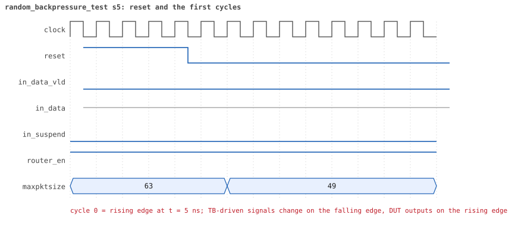
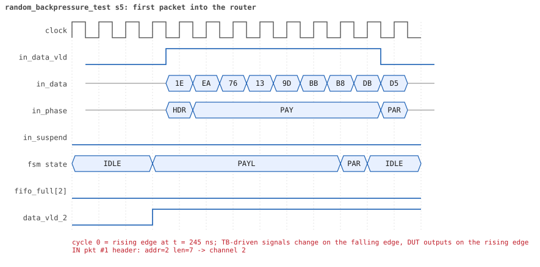
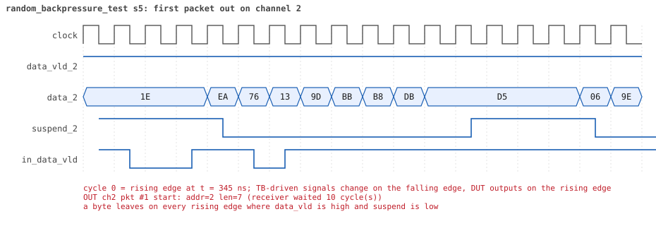
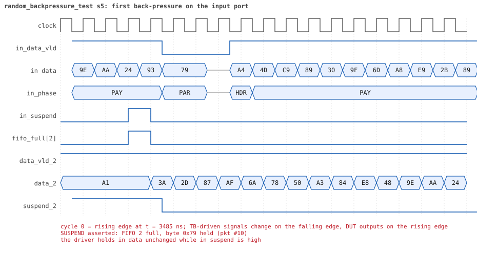
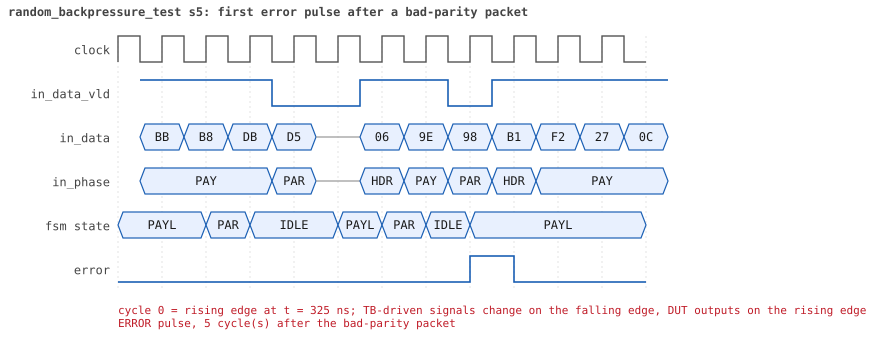
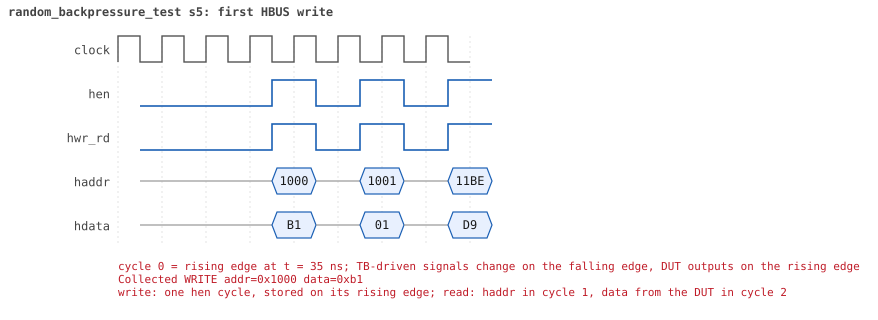
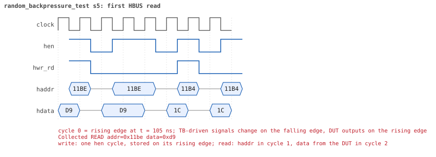

# random_backpressure_test seed 5

**Result:** PASSED (0 UVM_ERROR, 0 UVM_WARNING, 0 UVM_FATAL) · bench `yapp_project_tb` · sim time 40us · wall 17.9 s · log [`random_backpressure_test_s5.log`](random_backpressure_test_s5.log)

Waves: `random_backpressure_test_s5.fst` (GTKWave, Surfer or the VS Code wave viewer).
[Open the waves in Surfer](https://app.surfer-project.org/?load_url=https%3A%2F%2Fraw.githubusercontent.com%2Ftamirgabgab%2FQcom-Mentoring%2Fmain%2Fyapp_project%2Fregression%2Fyapp_project_tb%2Frandom_backpressure_test_s5%2Frandom_backpressure_test_s5.fst&startup_commands=run_command_file_from_url%20https%3A%2F%2Fraw.githubusercontent.com%2Ftamirgabgab%2FQcom-Mentoring%2Fmain%2Fyapp_project%2Ftb%2Fyapp_router.sucl) (web app, the signals already in groups: `yapp_project/tb/yapp_router.sucl`).

## Summary

- YAPP driver sent **85** packet(s) (9 with bad parity); the input monitor saw 85.
- Router: **46** forwarded, **39** dropped (39 oversized).
- Packets out: ch0 **12**, ch1 **10**, ch2 **24**.
- Scoreboard: 46 matched, 0 mismatched, 0 unexpected.
- Back-pressure: in_suspend asserted **4** time(s), longest hold 11 cycle(s).
- Error pulses: 9.
- HBUS: 31 write(s), 99 read(s).

## Stages

| time (ns) | stage |
|---|---|
| 0 | receivers: ch0 RX_FAST, ch1 RX_STALLY, ch2 RX_NORMAL |
| 0 | random scenario: 85 packets in 6 bursts |
| 240 | burst 1/6: ctrl=0xb1 (maxpktsize 49) en=0x01 (router on, counter enables 0000000), 14 packet(s) |
| 5510 | burst 1/6 sent: addr0..3 1/3/10/0, bad parity 1, gap 0 9, length 1..61 |
| 5850 | burst 2/6: ctrl=0xf4 (maxpktsize 52) en=0x31 (router on, counter enables 0011000), 14 packet(s) |
| 11610 | burst 2/6 sent: addr0..3 5/3/6/0, bad parity 4, gap 0 9, length 5..61 |
| 11850 | burst 3/6: ctrl=0xd0 (maxpktsize 16) en=0x0b (router on, counter enables 0000101), 14 packet(s) |
| 17380 | burst 3/6 sent: addr0..3 6/3/5/0, bad parity 0, gap 0 11, length 4..59 |
| 17660 | burst 4/6: ctrl=0x04 (maxpktsize 4) en=0xd1 (router on, counter enables 1101000), 15 packet(s) |
| 24010 | burst 4/6 sent: addr0..3 3/2/10/0, bad parity 0, gap 0 13, length 1..63 |
| 24240 | burst 5/6: ctrl=0xad (maxpktsize 45) en=0xb7 (router on, counter enables 1011011), 14 packet(s) |
| 30660 | burst 5/6 sent: addr0..3 5/3/6/0, bad parity 3, gap 0 9, length 8..63 |
| 31020 | burst 6/6: ctrl=0x6e (maxpktsize 46) en=0x27 (router on, counter enables 0010011), 14 packet(s) |
| 38000 | burst 6/6 sent: addr0..3 4/3/7/0, bad parity 1, gap 0 9, length 21..63 |
| 38000 | final reads: every register and the stored packet, checked against the reference model |
| 40065 | done: 85 packets (46 forwarded, 39 dropped), 0 storm burst(s), 46 scoreboard matches, 99 HBUS reads checked, 9 error pulses for 9 bad packets |

## Pictures

**reset and the first cycles**

**first packet into the router**

**first packet out on channel 2**

**first back-pressure on the input port**

**first error pulse after a bad-parity packet**

**first HBUS write**

**first HBUS read**

## Timeline

1152 events.

| time (ns) | who | event |
|---|---|---|
| 0 | yapp monitor | YAPP monitor running |
| 0 | **test** | STAGE: receivers: ch0 RX_FAST, ch1 RX_STALLY, ch2 RX_NORMAL |
| 0 | **test** | STAGE: random scenario: 85 packets in 6 bursts |
| 0 | clk/rst driver | Starting clock (period 10) and holding reset for 5 cycles |
| 0 | **DUT** | RESET asserted |
| 50 | **DUT** | RESET released: router_en=1 maxpktsize=63 |
| 70 | hbus driver | Executed WRITE addr=0x1000 data=0xb1 |
| 75 | **DUT** | CONFIG router_en=1 maxpktsize=49 |
| 75 | hbus monitor | Collected WRITE addr=0x1000 data=0xb1 |
| 75 | reference | maxpktsize is now 49 |
| 90 | hbus driver | Executed WRITE addr=0x1001 data=0x01 |
| 95 | hbus monitor | Collected WRITE addr=0x1001 data=0x01 |
| 95 | reference | router_en is now 1 (en_reg 0x01) |
| 110 | hbus driver | Executed WRITE addr=0x11be data=0xd9 |
| 115 | hbus monitor | Collected WRITE addr=0x11be data=0xd9 |
| 140 | hbus driver | Executed READ  addr=0x11be data=0xd9 |
| 145 | hbus monitor | Collected READ  addr=0x11be data=0xd9 |
| 160 | hbus driver | Executed WRITE addr=0x11b4 data=0x1c |
| 165 | hbus monitor | Collected WRITE addr=0x11b4 data=0x1c |
| 190 | hbus driver | Executed READ  addr=0x11b4 data=0x1c |
| 195 | hbus monitor | Collected READ  addr=0x11b4 data=0x1c |
| 210 | hbus driver | Executed WRITE addr=0x11ce data=0x17 |
| 215 | hbus monitor | Collected WRITE addr=0x11ce data=0x17 |
| 240 | hbus driver | Executed READ  addr=0x11ce data=0x17 |
| 240 | **test** | STAGE: burst 1/6: ctrl=0xb1 (maxpktsize 49) en=0x01 (router on, counter enables 0000000), 14 packet(s) |
| 240 | yapp driver | TX pkt #1: addr=2 len=7 parity=bad delay=2 |
| 245 | hbus monitor | Collected READ  addr=0x11ce data=0x17 |
| 275 | **DUT** | IN  pkt #1 header: addr=2 len=7 -> channel 2 |
| 355 | **DUT** | IN  pkt #1 complete: addr=2 len=7 parity=BAD forwarded, 9 bytes in 9 cycles (held 0) |
| 355 | yapp monitor | RX pkt #1 on the input: addr=2 len=7 parity=bad gap=22 |
| 355 | reference | Packet forwarded: addr=2 len=7 -> channel 2 |
| 360 | yapp driver | TX pkt #1 accepted by the DUT |
| 360 | yapp driver | TX pkt #2: addr=2 len=1 parity=good delay=1 |
| 375 | **DUT** | IN  pkt #2 header: addr=2 len=1 -> channel 2 |
| 385 | **DUT** | OUT ch2 pkt #1 start: addr=2 len=7 (receiver waited 10 cycle(s)) |
| 395 | **DUT** | IN  pkt #2 complete: addr=2 len=1 parity=ok forwarded, 3 bytes in 3 cycles (held 0) |
| 395 | yapp monitor | RX pkt #2 on the input: addr=2 len=1 parity=good gap=1 |
| 395 | reference | Packet forwarded: addr=2 len=1 -> channel 2 |
| 400 | yapp driver | TX pkt #2 accepted by the DUT |
| 400 | yapp driver | TX pkt #3: addr=1 len=44 parity=good delay=0 |
| 405 | **DUT** | IN  pkt #3 header: addr=1 len=44 -> channel 1 |
| 410 | **DUT** | ERROR pulse, 5 cycle(s) after the bad-parity packet |
| 410 | error checker | error pulse 5 cycles after the bad packet (0 still owed) |
| 460 | ch2 driver | ch2: packet consumed (response delay 10) |
| 475 | **DUT** | OUT ch1 pkt #1 start: addr=1 len=44 (receiver waited 6 cycle(s)) |
| 505 | **DUT** | OUT ch2 pkt #1 done: 9 bytes in 13 cycles |
| 505 | ch2 monitor | ch2 RX pkt #1: addr=2 len=7 parity=bad |
| 505 | scoreboard | ch2 pkt matched: addr=2 len=7 (1 matched so far) |
| 515 | **DUT** | OUT ch2 pkt #2 start: addr=2 len=1 (receiver waited 0 cycle(s)) |
| 535 | **DUT** | OUT ch2 pkt #2 done: 3 bytes in 3 cycles |
| 535 | ch2 monitor | ch2 RX pkt #2: addr=2 len=1 parity=good |
| 535 | scoreboard | ch2 pkt matched: addr=2 len=1 (2 matched so far) |
| 855 | **DUT** | IN  pkt #3 complete: addr=1 len=44 parity=ok forwarded, 46 bytes in 46 cycles (held 0) |
| 855 | yapp monitor | RX pkt #3 on the input: addr=1 len=44 parity=good gap=0 |
| 855 | reference | Packet forwarded: addr=1 len=44 -> channel 1 |
| 860 | yapp driver | TX pkt #3 accepted by the DUT |
| 860 | yapp driver | TX pkt #4: addr=2 len=48 parity=good delay=0 |
| 865 | **DUT** | IN  pkt #4 header: addr=2 len=48 -> channel 2 |
| 875 | **DUT** | OUT ch2 pkt #3 start: addr=2 len=48 (receiver waited 0 cycle(s)) |
| 920 | ch1 driver | ch1: packet consumed (response delay 6) |
| 965 | **DUT** | OUT ch1 pkt #1 done: 46 bytes in 50 cycles |
| 965 | ch1 monitor | ch1 RX pkt #1: addr=1 len=44 parity=good |
| 965 | scoreboard | ch1 pkt matched: addr=1 len=44 (3 matched so far) |
| 1040 | ch2 driver | ch2: packet consumed (response delay 3) |
| 1210 | ch2 driver | ch2: packet consumed (response delay 6) |
| 1290 | ch2 driver | ch2: packet consumed (response delay 0) |
| 1355 | **DUT** | IN  pkt #4 complete: addr=2 len=48 parity=ok forwarded, 50 bytes in 50 cycles (held 0) |
| 1355 | yapp monitor | RX pkt #4 on the input: addr=2 len=48 parity=good gap=0 |
| 1355 | reference | Packet forwarded: addr=2 len=48 -> channel 2 |
| 1360 | yapp driver | TX pkt #4 accepted by the DUT |
| 1360 | yapp driver | TX pkt #5: addr=2 len=61 parity=good delay=0 |
| 1365 | **DUT** | IN  pkt #5 header: addr=2 len=61 -> DROP (oversized: len 61 > maxpktsize 49) |
| 1460 | ch1 driver | ch1: packet consumed (response delay 3) |
| 1525 | **DUT** | OUT ch2 pkt #3 done: 50 bytes in 66 cycles |
| 1525 | ch2 monitor | ch2 RX pkt #3: addr=2 len=48 parity=good |
| 1525 | scoreboard | ch2 pkt matched: addr=2 len=48 (4 matched so far) |
| 1680 | ch2 driver | ch2: packet consumed (response delay 7) |
| 1985 | **DUT** | IN  pkt #5 complete: addr=2 len=61 parity=ok dropped, 63 bytes in 63 cycles (held 0) |
| 1985 | yapp monitor | RX pkt #5 on the input: addr=2 len=61 parity=good gap=0 |
| 1985 | reference | Packet dropped: length 61 > maxpktsize 49 (addr=2) |
| 1985 | **DUT** | ROUTER DROPS PACKET addr=2 length=61 (length > maxpktsize) |
| 1990 | yapp driver | TX pkt #5 accepted by the DUT |
| 1990 | yapp driver | TX pkt #6: addr=2 len=37 parity=good delay=0 |
| 1995 | **DUT** | IN  pkt #6 header: addr=2 len=37 -> channel 2 |
| 2055 | **DUT** | OUT ch2 pkt #4 start: addr=2 len=37 (receiver waited 5 cycle(s)) |
| 2375 | **DUT** | IN  pkt #6 complete: addr=2 len=37 parity=ok forwarded, 39 bytes in 39 cycles (held 0) |
| 2375 | yapp monitor | RX pkt #6 on the input: addr=2 len=37 parity=good gap=0 |
| 2375 | reference | Packet forwarded: addr=2 len=37 -> channel 2 |
| 2380 | yapp driver | TX pkt #6 accepted by the DUT |
| 2380 | yapp driver | TX pkt #7: addr=2 len=14 parity=good delay=0 |
| 2385 | **DUT** | IN  pkt #7 header: addr=2 len=14 -> channel 2 |
| 2430 | ch2 driver | ch2: packet consumed (response delay 5) |
| 2465 | **DUT** | OUT ch2 pkt #4 done: 39 bytes in 42 cycles |
| 2465 | ch2 monitor | ch2 RX pkt #4: addr=2 len=37 parity=good |
| 2465 | scoreboard | ch2 pkt matched: addr=2 len=37 (5 matched so far) |
| 2475 | **DUT** | OUT ch2 pkt #5 start: addr=2 len=14 (receiver waited 0 cycle(s)) |
| 2535 | **DUT** | IN  pkt #7 complete: addr=2 len=14 parity=ok forwarded, 16 bytes in 16 cycles (held 0) |
| 2535 | yapp monitor | RX pkt #7 on the input: addr=2 len=14 parity=good gap=0 |
| 2535 | reference | Packet forwarded: addr=2 len=14 -> channel 2 |
| 2540 | yapp driver | TX pkt #7 accepted by the DUT |
| 2540 | yapp driver | TX pkt #8: addr=1 len=51 parity=good delay=0 |
| 2545 | **DUT** | IN  pkt #8 header: addr=1 len=51 -> DROP (oversized: len 51 > maxpktsize 49) |
| 2625 | **DUT** | OUT ch2 pkt #5 done: 16 bytes in 16 cycles |
| 2625 | ch2 monitor | ch2 RX pkt #5: addr=2 len=14 parity=good |
| 2625 | scoreboard | ch2 pkt matched: addr=2 len=14 (6 matched so far) |
| 2960 | ch2 driver | ch2: packet consumed (response delay 2) |
| 3065 | **DUT** | IN  pkt #8 complete: addr=1 len=51 parity=ok dropped, 53 bytes in 53 cycles (held 0) |
| 3065 | yapp monitor | RX pkt #8 on the input: addr=1 len=51 parity=good gap=0 |
| 3065 | reference | Packet dropped: length 51 > maxpktsize 49 (addr=1) |
| 3065 | **DUT** | ROUTER DROPS PACKET addr=1 length=51 (length > maxpktsize) |
| 3070 | yapp driver | TX pkt #8 accepted by the DUT |
| 3070 | yapp driver | TX pkt #9: addr=2 len=28 parity=good delay=0 |
| 3075 | **DUT** | IN  pkt #9 header: addr=2 len=28 -> channel 2 |
| 3135 | **DUT** | OUT ch2 pkt #6 start: addr=2 len=28 (receiver waited 5 cycle(s)) |
| 3365 | **DUT** | IN  pkt #9 complete: addr=2 len=28 parity=ok forwarded, 30 bytes in 30 cycles (held 0) |
| 3365 | yapp monitor | RX pkt #9 on the input: addr=2 len=28 parity=good gap=0 |
| 3365 | reference | Packet forwarded: addr=2 len=28 -> channel 2 |
| 3370 | yapp driver | TX pkt #9 accepted by the DUT |
| 3370 | yapp driver | TX pkt #10: addr=2 len=14 parity=good delay=0 |
| 3375 | **DUT** | IN  pkt #10 header: addr=2 len=14 -> channel 2 |
| 3420 | ch2 driver | ch2: packet consumed (response delay 5) |
| 3525 | **DUT** | SUSPEND asserted: FIFO 2 full, byte 0x79 held (pkt #10) |
| 3525 | **DUT** | OUT ch2 pkt #6 done: 30 bytes in 40 cycles |
| 3525 | ch2 monitor | ch2 RX pkt #6: addr=2 len=28 parity=good |
| 3525 | scoreboard | ch2 pkt matched: addr=2 len=28 (7 matched so far) |
| 3535 | **DUT** | IN  pkt #10 complete: addr=2 len=14 parity=ok forwarded, 16 bytes in 17 cycles (held 1) |
| 3535 | **DUT** | SUSPEND released after 1 cycle(s) |
| 3535 | **DUT** | OUT ch2 pkt #7 start: addr=2 len=14 (receiver waited 0 cycle(s)) |
| 3535 | yapp monitor | RX pkt #10 on the input: addr=2 len=14 parity=good gap=0 |
| 3535 | reference | Packet forwarded: addr=2 len=14 -> channel 2 |
| 3540 | yapp driver | TX pkt #10 accepted by the DUT |
| 3540 | yapp driver | TX pkt #11: addr=0 len=41 parity=good delay=1 |
| 3555 | **DUT** | IN  pkt #11 header: addr=0 len=41 -> channel 0 |
| 3565 | **DUT** | OUT ch0 pkt #1 start: addr=0 len=41 (receiver waited 0 cycle(s)) |
| 3685 | **DUT** | OUT ch2 pkt #7 done: 16 bytes in 16 cycles |
| 3685 | ch2 monitor | ch2 RX pkt #7: addr=2 len=14 parity=good |
| 3685 | scoreboard | ch2 pkt matched: addr=2 len=14 (8 matched so far) |
| 3930 | ch2 driver | ch2: packet consumed (response delay 9) |
| 3975 | **DUT** | IN  pkt #11 complete: addr=0 len=41 parity=ok forwarded, 43 bytes in 43 cycles (held 0) |
| 3975 | yapp monitor | RX pkt #11 on the input: addr=0 len=41 parity=good gap=1 |
| 3975 | reference | Packet forwarded: addr=0 len=41 -> channel 0 |
| 3980 | ch0 driver | ch0: packet consumed (response delay 0) |
| 3980 | yapp driver | TX pkt #11 accepted by the DUT |
| 3980 | yapp driver | TX pkt #12: addr=1 len=49 parity=good delay=3 |
| 3995 | **DUT** | OUT ch0 pkt #1 done: 43 bytes in 44 cycles |
| 3995 | ch0 monitor | ch0 RX pkt #1: addr=0 len=41 parity=good |
| 3995 | scoreboard | ch0 pkt matched: addr=0 len=41 (9 matched so far) |
| 4010 | ch0 driver | ch0: packet consumed (response delay 0) |
| 4015 | **DUT** | IN  pkt #12 header: addr=1 len=49 -> channel 1 |
| 4065 | **DUT** | OUT ch1 pkt #2 start: addr=1 len=49 (receiver waited 4 cycle(s)) |
| 4515 | **DUT** | IN  pkt #12 complete: addr=1 len=49 parity=ok forwarded, 51 bytes in 51 cycles (held 0) |
| 4515 | yapp monitor | RX pkt #12 on the input: addr=1 len=49 parity=good gap=3 |
| 4515 | reference | Packet forwarded: addr=1 len=49 -> channel 1 |
| 4520 | yapp driver | TX pkt #12 accepted by the DUT |
| 4520 | yapp driver | TX pkt #13: addr=2 len=45 parity=good delay=3 |
| 4555 | **DUT** | IN  pkt #13 header: addr=2 len=45 -> channel 2 |
| 4560 | ch1 driver | ch1: packet consumed (response delay 4) |
| 4655 | **DUT** | OUT ch1 pkt #2 done: 51 bytes in 60 cycles |
| 4655 | ch1 monitor | ch1 RX pkt #2: addr=1 len=49 parity=good |
| 4655 | scoreboard | ch1 pkt matched: addr=1 len=49 (10 matched so far) |
| 4665 | **DUT** | OUT ch2 pkt #8 start: addr=2 len=45 (receiver waited 10 cycle(s)) |
| 4690 | ch1 driver | ch1: packet consumed (response delay 8) |
| 5015 | **DUT** | IN  pkt #13 complete: addr=2 len=45 parity=ok forwarded, 47 bytes in 47 cycles (held 0) |
| 5015 | yapp monitor | RX pkt #13 on the input: addr=2 len=45 parity=good gap=3 |
| 5015 | reference | Packet forwarded: addr=2 len=45 -> channel 2 |
| 5020 | yapp driver | TX pkt #13 accepted by the DUT |
| 5020 | yapp driver | TX pkt #14: addr=2 len=42 parity=good delay=0 |
| 5025 | **DUT** | IN  pkt #14 header: addr=2 len=42 -> channel 2 |
| 5120 | ch2 driver | ch2: packet consumed (response delay 10) |
| 5175 | **DUT** | SUSPEND asserted: FIFO 2 full, byte 0x1a held (pkt #14) |
| 5215 | **DUT** | OUT ch2 pkt #8 done: 47 bytes in 56 cycles |
| 5215 | ch2 monitor | ch2 RX pkt #8: addr=2 len=45 parity=good |
| 5215 | scoreboard | ch2 pkt matched: addr=2 len=45 (11 matched so far) |
| 5225 | **DUT** | SUSPEND released after 5 cycle(s) |
| 5225 | **DUT** | OUT ch2 pkt #9 start: addr=2 len=42 (receiver waited 0 cycle(s)) |
| 5505 | **DUT** | IN  pkt #14 complete: addr=2 len=42 parity=ok forwarded, 44 bytes in 49 cycles (held 5) |
| 5505 | yapp monitor | RX pkt #14 on the input: addr=2 len=42 parity=good gap=0 |
| 5505 | reference | Packet forwarded: addr=2 len=42 -> channel 2 |
| 5510 | yapp driver | TX pkt #14 accepted by the DUT |
| 5510 | **test** | STAGE: burst 1/6 sent: addr0..3 1/3/10/0, bad parity 1, gap 0 9, length 1..61 |
| 5530 | hbus driver | Executed WRITE addr=0x1000 data=0xf4 |
| 5535 | **DUT** | CONFIG router_en=1 maxpktsize=52 |
| 5535 | hbus monitor | Collected WRITE addr=0x1000 data=0xf4 |
| 5535 | reference | maxpktsize is now 52 |
| 5550 | hbus driver | Executed WRITE addr=0x1001 data=0x31 |
| 5555 | hbus monitor | Collected WRITE addr=0x1001 data=0x31 |
| 5555 | reference | router_en is now 1 (en_reg 0x31) |
| 5580 | hbus driver | Executed READ  addr=0x10d1 data=0x00 |
| 5585 | hbus monitor | Collected READ  addr=0x10d1 data=0x00 |
| 5610 | hbus driver | Executed READ  addr=0x100d data=0x2a |
| 5615 | hbus monitor | Collected READ  addr=0x100d data=0x2a |
| 5630 | hbus driver | Executed WRITE addr=0x1189 data=0xa1 |
| 5635 | hbus monitor | Collected WRITE addr=0x1189 data=0xa1 |
| 5655 | **DUT** | OUT ch2 pkt #9 done: 44 bytes in 44 cycles |
| 5655 | ch2 monitor | ch2 RX pkt #9: addr=2 len=42 parity=good |
| 5655 | scoreboard | ch2 pkt matched: addr=2 len=42 (12 matched so far) |
| 5660 | hbus driver | Executed READ  addr=0x1189 data=0xa1 |
| 5665 | hbus monitor | Collected READ  addr=0x1189 data=0xa1 |
| 5670 | ch2 driver | ch2: packet consumed (response delay 8) |
| 5690 | hbus driver | Executed READ  addr=0x101b data=0xcf |
| 5695 | hbus monitor | Collected READ  addr=0x101b data=0xcf |
| 5720 | hbus driver | Executed READ  addr=0x1001 data=0x31 |
| 5725 | hbus monitor | Collected READ  addr=0x1001 data=0x31 |
| 5740 | hbus driver | Executed WRITE addr=0x1165 data=0xc0 |
| 5745 | hbus monitor | Collected WRITE addr=0x1165 data=0xc0 |
| 5770 | hbus driver | Executed READ  addr=0x1165 data=0xc0 |
| 5775 | hbus monitor | Collected READ  addr=0x1165 data=0xc0 |
| 5790 | hbus driver | Executed WRITE addr=0x1177 data=0xe9 |
| 5795 | hbus monitor | Collected WRITE addr=0x1177 data=0xe9 |
| 5820 | hbus driver | Executed READ  addr=0x1177 data=0xe9 |
| 5825 | hbus monitor | Collected READ  addr=0x1177 data=0xe9 |
| 5850 | hbus driver | Executed READ  addr=0x1033 data=0x1a |
| 5850 | **test** | STAGE: burst 2/6: ctrl=0xf4 (maxpktsize 52) en=0x31 (router on, counter enables 0011000), 14 packet(s) |
| 5850 | yapp driver | TX pkt #15: addr=1 len=18 parity=good delay=0 |
| 5855 | hbus monitor | Collected READ  addr=0x1033 data=0x1a |
| 5865 | **DUT** | IN  pkt #15 header: addr=1 len=18 -> channel 1 |
| 5925 | **DUT** | OUT ch1 pkt #3 start: addr=1 len=18 (receiver waited 5 cycle(s)) |
| 6055 | **DUT** | IN  pkt #15 complete: addr=1 len=18 parity=ok forwarded, 20 bytes in 20 cycles (held 0) |
| 6055 | yapp monitor | RX pkt #15 on the input: addr=1 len=18 parity=good gap=35 |
| 6055 | reference | Packet forwarded: addr=1 len=18 -> channel 1 |
| 6060 | yapp driver | TX pkt #15 accepted by the DUT |
| 6060 | yapp driver | TX pkt #16: addr=1 len=12 parity=good delay=0 |
| 6065 | **DUT** | IN  pkt #16 header: addr=1 len=12 -> channel 1 |
| 6110 | ch1 driver | ch1: packet consumed (response delay 5) |
| 6195 | **DUT** | IN  pkt #16 complete: addr=1 len=12 parity=ok forwarded, 14 bytes in 14 cycles (held 0) |
| 6195 | yapp monitor | RX pkt #16 on the input: addr=1 len=12 parity=good gap=0 |
| 6195 | reference | Packet forwarded: addr=1 len=12 -> channel 1 |
| 6200 | yapp driver | TX pkt #16 accepted by the DUT |
| 6200 | yapp driver | TX pkt #17: addr=0 len=42 parity=bad delay=16 |
| 6365 | **DUT** | IN  pkt #17 header: addr=0 len=42 -> channel 0 |
| 6375 | **DUT** | OUT ch0 pkt #2 start: addr=0 len=42 (receiver waited 0 cycle(s)) |
| 6795 | **DUT** | IN  pkt #17 complete: addr=0 len=42 parity=BAD forwarded, 44 bytes in 44 cycles (held 0) |
| 6795 | yapp monitor | RX pkt #17 on the input: addr=0 len=42 parity=bad gap=16 |
| 6795 | reference | Packet forwarded: addr=0 len=42 -> channel 0 |
| 6800 | ch0 driver | ch0: packet consumed (response delay 0) |
| 6800 | yapp driver | TX pkt #17 accepted by the DUT |
| 6800 | yapp driver | TX pkt #18: addr=0 len=49 parity=good delay=5 |
| 6815 | **DUT** | OUT ch0 pkt #2 done: 44 bytes in 45 cycles |
| 6815 | ch0 monitor | ch0 RX pkt #2: addr=0 len=42 parity=bad |
| 6815 | scoreboard | ch0 pkt matched: addr=0 len=42 (13 matched so far) |
| 6830 | **DUT** | ERROR pulse, 3 cycle(s) after the bad-parity packet |
| 6830 | error checker | error pulse 3 cycles after the bad packet (0 still owed) |
| 6855 | **DUT** | IN  pkt #18 header: addr=0 len=49 -> channel 0 |
| 6865 | **DUT** | OUT ch0 pkt #3 start: addr=0 len=49 (receiver waited 0 cycle(s)) |
| 6900 | ch0 driver | ch0: packet consumed (response delay 0) |
| 6975 | **DUT** | OUT ch1 pkt #3 done: 20 bytes in 106 cycles |
| 6975 | ch1 monitor | ch1 RX pkt #3: addr=1 len=18 parity=good |
| 6975 | scoreboard | ch1 pkt matched: addr=1 len=18 (14 matched so far) |
| 6985 | **DUT** | OUT ch1 pkt #4 start: addr=1 len=12 (receiver waited 0 cycle(s)) |
| 7115 | **DUT** | OUT ch1 pkt #4 done: 14 bytes in 14 cycles |
| 7115 | ch1 monitor | ch1 RX pkt #4: addr=1 len=12 parity=good |
| 7115 | scoreboard | ch1 pkt matched: addr=1 len=12 (15 matched so far) |
| 7230 | ch1 driver | ch1: packet consumed (response delay 85) |
| 7355 | **DUT** | IN  pkt #18 complete: addr=0 len=49 parity=ok forwarded, 51 bytes in 51 cycles (held 0) |
| 7355 | yapp monitor | RX pkt #18 on the input: addr=0 len=49 parity=good gap=5 |
| 7355 | reference | Packet forwarded: addr=0 len=49 -> channel 0 |
| 7360 | yapp driver | TX pkt #18 accepted by the DUT |
| 7360 | yapp driver | TX pkt #19: addr=2 len=61 parity=good delay=0 |
| 7365 | **DUT** | IN  pkt #19 header: addr=2 len=61 -> DROP (oversized: len 61 > maxpktsize 52) |
| 7375 | **DUT** | OUT ch0 pkt #3 done: 51 bytes in 52 cycles |
| 7375 | ch0 monitor | ch0 RX pkt #3: addr=0 len=49 parity=good |
| 7375 | scoreboard | ch0 pkt matched: addr=0 len=49 (16 matched so far) |
| 7520 | ch0 driver | ch0: packet consumed (response delay 0) |
| 7985 | **DUT** | IN  pkt #19 complete: addr=2 len=61 parity=ok dropped, 63 bytes in 63 cycles (held 0) |
| 7985 | yapp monitor | RX pkt #19 on the input: addr=2 len=61 parity=good gap=0 |
| 7985 | reference | Packet dropped: length 61 > maxpktsize 52 (addr=2) |
| 7985 | **DUT** | ROUTER DROPS PACKET addr=2 length=61 (length > maxpktsize) |
| 7990 | yapp driver | TX pkt #19 accepted by the DUT |
| 7990 | yapp driver | TX pkt #20: addr=0 len=40 parity=bad delay=2 |
| 8015 | **DUT** | IN  pkt #20 header: addr=0 len=40 -> channel 0 |
| 8025 | **DUT** | OUT ch0 pkt #4 start: addr=0 len=40 (receiver waited 0 cycle(s)) |
| 8425 | **DUT** | IN  pkt #20 complete: addr=0 len=40 parity=BAD forwarded, 42 bytes in 42 cycles (held 0) |
| 8425 | yapp monitor | RX pkt #20 on the input: addr=0 len=40 parity=bad gap=2 |
| 8425 | reference | Packet forwarded: addr=0 len=40 -> channel 0 |
| 8430 | ch0 driver | ch0: packet consumed (response delay 0) |
| 8430 | yapp driver | TX pkt #20 accepted by the DUT |
| 8430 | yapp driver | TX pkt #21: addr=0 len=49 parity=good delay=0 |
| 8435 | **DUT** | IN  pkt #21 header: addr=0 len=49 -> channel 0 |
| 8445 | **DUT** | OUT ch0 pkt #4 done: 42 bytes in 43 cycles |
| 8445 | ch0 monitor | ch0 RX pkt #4: addr=0 len=40 parity=bad |
| 8445 | scoreboard | ch0 pkt matched: addr=0 len=40 (17 matched so far) |
| 8455 | **DUT** | OUT ch0 pkt #5 start: addr=0 len=49 (receiver waited 0 cycle(s)) |
| 8490 | **DUT** | ERROR pulse, 6 cycle(s) after the bad-parity packet |
| 8490 | error checker | error pulse 6 cycles after the bad packet (0 still owed) |
| 8500 | ch0 driver | ch0: packet consumed (response delay 0) |
| 8580 | ch0 driver | ch0: packet consumed (response delay 0) |
| 8935 | **DUT** | IN  pkt #21 complete: addr=0 len=49 parity=ok forwarded, 51 bytes in 51 cycles (held 0) |
| 8935 | yapp monitor | RX pkt #21 on the input: addr=0 len=49 parity=good gap=0 |
| 8935 | reference | Packet forwarded: addr=0 len=49 -> channel 0 |
| 8940 | yapp driver | TX pkt #21 accepted by the DUT |
| 8940 | yapp driver | TX pkt #22: addr=2 len=5 parity=good delay=0 |
| 8945 | **DUT** | IN  pkt #22 header: addr=2 len=5 -> channel 2 |
| 8975 | **DUT** | OUT ch0 pkt #5 done: 51 bytes in 53 cycles |
| 8975 | **DUT** | OUT ch2 pkt #10 start: addr=2 len=5 (receiver waited 2 cycle(s)) |
| 8975 | ch0 monitor | ch0 RX pkt #5: addr=0 len=49 parity=good |
| 8975 | scoreboard | ch0 pkt matched: addr=0 len=49 (18 matched so far) |
| 9005 | **DUT** | IN  pkt #22 complete: addr=2 len=5 parity=ok forwarded, 7 bytes in 7 cycles (held 0) |
| 9005 | yapp monitor | RX pkt #22 on the input: addr=2 len=5 parity=good gap=0 |
| 9005 | reference | Packet forwarded: addr=2 len=5 -> channel 2 |
| 9010 | yapp driver | TX pkt #22 accepted by the DUT |
| 9010 | yapp driver | TX pkt #23: addr=2 len=51 parity=good delay=0 |
| 9015 | **DUT** | IN  pkt #23 header: addr=2 len=51 -> channel 2 |
| 9030 | ch2 driver | ch2: packet consumed (response delay 2) |
| 9135 | **DUT** | OUT ch2 pkt #10 done: 7 bytes in 17 cycles |
| 9135 | ch2 monitor | ch2 RX pkt #10: addr=2 len=5 parity=good |
| 9135 | scoreboard | ch2 pkt matched: addr=2 len=5 (19 matched so far) |
| 9145 | **DUT** | OUT ch2 pkt #11 start: addr=2 len=51 (receiver waited 0 cycle(s)) |
| 9190 | ch0 driver | ch0: packet consumed (response delay 0) |
| 9535 | **DUT** | IN  pkt #23 complete: addr=2 len=51 parity=ok forwarded, 53 bytes in 53 cycles (held 0) |
| 9535 | yapp monitor | RX pkt #23 on the input: addr=2 len=51 parity=good gap=0 |
| 9535 | reference | Packet forwarded: addr=2 len=51 -> channel 2 |
| 9540 | yapp driver | TX pkt #23 accepted by the DUT |
| 9540 | yapp driver | TX pkt #24: addr=2 len=12 parity=bad delay=1 |
| 9555 | **DUT** | IN  pkt #24 header: addr=2 len=12 -> channel 2 |
| 9590 | ch2 driver | ch2: packet consumed (response delay 9) |
| 9635 | **DUT** | SUSPEND asserted: FIFO 2 full, byte 0xfb held (pkt #24) |
| 9665 | **DUT** | SUSPEND released after 3 cycle(s) |
| 9715 | **DUT** | IN  pkt #24 complete: addr=2 len=12 parity=BAD forwarded, 14 bytes in 17 cycles (held 3) |
| 9715 | yapp monitor | RX pkt #24 on the input: addr=2 len=12 parity=bad gap=1 |
| 9715 | reference | Packet forwarded: addr=2 len=12 -> channel 2 |
| 9720 | yapp driver | TX pkt #24 accepted by the DUT |
| 9720 | yapp driver | TX pkt #25: addr=2 len=41 parity=good delay=0 |
| 9725 | **DUT** | IN  pkt #25 header: addr=2 len=41 -> channel 2 |
| 9725 | **DUT** | OUT ch2 pkt #11 done: 53 bytes in 59 cycles |
| 9725 | ch2 monitor | ch2 RX pkt #11: addr=2 len=51 parity=good |
| 9725 | scoreboard | ch2 pkt matched: addr=2 len=51 (20 matched so far) |
| 9735 | **DUT** | OUT ch2 pkt #12 start: addr=2 len=12 (receiver waited 0 cycle(s)) |
| 9790 | **DUT** | ERROR pulse, 7 cycle(s) after the bad-parity packet |
| 9790 | error checker | error pulse 7 cycles after the bad packet (0 still owed) |
| 9865 | **DUT** | OUT ch2 pkt #12 done: 14 bytes in 14 cycles |
| 9865 | ch2 monitor | ch2 RX pkt #12: addr=2 len=12 parity=bad |
| 9865 | scoreboard | ch2 pkt matched: addr=2 len=12 (21 matched so far) |
| 9875 | **DUT** | OUT ch2 pkt #13 start: addr=2 len=41 (receiver waited 0 cycle(s)) |
| 9970 | ch2 driver | ch2: packet consumed (response delay 5) |
| 9985 | **DUT** | SUSPEND asserted: FIFO 2 full, byte 0x26 held (pkt #25) |
| 10095 | **DUT** | SUSPEND released after 11 cycle(s) |
| 10255 | **DUT** | IN  pkt #25 complete: addr=2 len=41 parity=ok forwarded, 43 bytes in 54 cycles (held 11) |
| 10255 | yapp monitor | RX pkt #25 on the input: addr=2 len=41 parity=good gap=0 |
| 10255 | reference | Packet forwarded: addr=2 len=41 -> channel 2 |
| 10260 | yapp driver | TX pkt #25 accepted by the DUT |
| 10260 | yapp driver | TX pkt #26: addr=0 len=29 parity=good delay=0 |
| 10265 | **DUT** | IN  pkt #26 header: addr=0 len=29 -> channel 0 |
| 10275 | **DUT** | OUT ch0 pkt #6 start: addr=0 len=29 (receiver waited 0 cycle(s)) |
| 10350 | ch2 driver | ch2: packet consumed (response delay 10) |
| 10415 | **DUT** | OUT ch2 pkt #13 done: 43 bytes in 55 cycles |
| 10415 | ch2 monitor | ch2 RX pkt #13: addr=2 len=41 parity=good |
| 10415 | scoreboard | ch2 pkt matched: addr=2 len=41 (22 matched so far) |
| 10460 | ch2 driver | ch2: packet consumed (response delay 0) |
| 10565 | **DUT** | IN  pkt #26 complete: addr=0 len=29 parity=ok forwarded, 31 bytes in 31 cycles (held 0) |
| 10565 | yapp monitor | RX pkt #26 on the input: addr=0 len=29 parity=good gap=0 |
| 10565 | reference | Packet forwarded: addr=0 len=29 -> channel 0 |
| 10570 | ch0 driver | ch0: packet consumed (response delay 0) |
| 10570 | yapp driver | TX pkt #26 accepted by the DUT |
| 10570 | yapp driver | TX pkt #27: addr=1 len=45 parity=good delay=0 |
| 10575 | **DUT** | IN  pkt #27 header: addr=1 len=45 -> channel 1 |
| 10585 | **DUT** | OUT ch0 pkt #6 done: 31 bytes in 32 cycles |
| 10585 | ch0 monitor | ch0 RX pkt #6: addr=0 len=29 parity=good |
| 10585 | scoreboard | ch0 pkt matched: addr=0 len=29 (23 matched so far) |
| 10685 | **DUT** | OUT ch1 pkt #5 start: addr=1 len=45 (receiver waited 10 cycle(s)) |
| 10910 | ch0 driver | ch0: packet consumed (response delay 0) |
| 11035 | **DUT** | IN  pkt #27 complete: addr=1 len=45 parity=ok forwarded, 47 bytes in 47 cycles (held 0) |
| 11035 | yapp monitor | RX pkt #27 on the input: addr=1 len=45 parity=good gap=0 |
| 11035 | reference | Packet forwarded: addr=1 len=45 -> channel 1 |
| 11040 | yapp driver | TX pkt #27 accepted by the DUT |
| 11040 | yapp driver | TX pkt #28: addr=2 len=52 parity=bad delay=3 |
| 11075 | **DUT** | IN  pkt #28 header: addr=2 len=52 -> channel 2 |
| 11095 | **DUT** | OUT ch2 pkt #14 start: addr=2 len=52 (receiver waited 1 cycle(s)) |
| 11140 | ch1 driver | ch1: packet consumed (response delay 10) |
| 11235 | **DUT** | OUT ch1 pkt #5 done: 47 bytes in 56 cycles |
| 11235 | ch1 monitor | ch1 RX pkt #5: addr=1 len=45 parity=good |
| 11235 | scoreboard | ch1 pkt matched: addr=1 len=45 (24 matched so far) |
| 11605 | **DUT** | IN  pkt #28 complete: addr=2 len=52 parity=BAD forwarded, 54 bytes in 54 cycles (held 0) |
| 11605 | yapp monitor | RX pkt #28 on the input: addr=2 len=52 parity=bad gap=3 |
| 11605 | reference | Packet forwarded: addr=2 len=52 -> channel 2 |
| 11610 | yapp driver | TX pkt #28 accepted by the DUT |
| 11610 | **test** | STAGE: burst 2/6 sent: addr0..3 5/3/6/0, bad parity 4, gap 0 9, length 5..61 |
| 11620 | ch2 driver | ch2: packet consumed (response delay 1) |
| 11630 | hbus driver | Executed WRITE addr=0x1000 data=0xd0 |
| 11635 | **DUT** | CONFIG router_en=1 maxpktsize=16 |
| 11635 | hbus monitor | Collected WRITE addr=0x1000 data=0xd0 |
| 11635 | reference | maxpktsize is now 16 |
| 11650 | **DUT** | ERROR pulse, 4 cycle(s) after the bad-parity packet |
| 11650 | error checker | error pulse 4 cycles after the bad packet (0 still owed) |
| 11650 | hbus driver | Executed WRITE addr=0x1001 data=0x0b |
| 11655 | hbus monitor | Collected WRITE addr=0x1001 data=0x0b |
| 11655 | reference | router_en is now 1 (en_reg 0x0b) |
| 11670 | hbus driver | Executed WRITE addr=0x11b5 data=0x1f |
| 11675 | hbus monitor | Collected WRITE addr=0x11b5 data=0x1f |
| 11700 | hbus driver | Executed READ  addr=0x11b5 data=0x1f |
| 11705 | hbus monitor | Collected READ  addr=0x11b5 data=0x1f |
| 11720 | hbus driver | Executed WRITE addr=0x11e2 data=0xe9 |
| 11725 | **DUT** | OUT ch2 pkt #14 done: 54 bytes in 64 cycles |
| 11725 | ch2 monitor | ch2 RX pkt #14: addr=2 len=52 parity=bad |
| 11725 | scoreboard | ch2 pkt matched: addr=2 len=52 (25 matched so far) |
| 11725 | hbus monitor | Collected WRITE addr=0x11e2 data=0xe9 |
| 11750 | hbus driver | Executed READ  addr=0x11e2 data=0xe9 |
| 11755 | hbus monitor | Collected READ  addr=0x11e2 data=0xe9 |
| 11770 | ch1 driver | ch1: packet consumed (response delay 8) |
| 11770 | hbus driver | Executed WRITE addr=0x11bf data=0x68 |
| 11775 | hbus monitor | Collected WRITE addr=0x11bf data=0x68 |
| 11800 | hbus driver | Executed READ  addr=0x11bf data=0x68 |
| 11805 | hbus monitor | Collected READ  addr=0x11bf data=0x68 |
| 11820 | hbus driver | Executed WRITE addr=0x110b data=0x1c |
| 11825 | hbus monitor | Collected WRITE addr=0x110b data=0x1c |
| 11850 | hbus driver | Executed READ  addr=0x110b data=0x1c |
| 11850 | **test** | STAGE: burst 3/6: ctrl=0xd0 (maxpktsize 16) en=0x0b (router on, counter enables 0000101), 14 packet(s) |
| 11850 | yapp driver | TX pkt #29: addr=1 len=40 parity=good delay=0 |
| 11855 | hbus monitor | Collected READ  addr=0x110b data=0x1c |
| 11865 | **DUT** | IN  pkt #29 header: addr=1 len=40 -> DROP (oversized: len 40 > maxpktsize 16) |
| 11950 | ch2 driver | ch2: packet consumed (response delay 9) |
| 12275 | **DUT** | IN  pkt #29 complete: addr=1 len=40 parity=ok dropped, 42 bytes in 42 cycles (held 0) |
| 12275 | yapp monitor | RX pkt #29 on the input: addr=1 len=40 parity=good gap=25 |
| 12275 | reference | Packet dropped: length 40 > maxpktsize 16 (addr=1) |
| 12275 | **DUT** | ROUTER DROPS PACKET addr=1 length=40 (length > maxpktsize) |
| 12280 | yapp driver | TX pkt #29 accepted by the DUT |
| 12280 | yapp driver | TX pkt #30: addr=2 len=4 parity=good delay=0 |
| 12285 | **DUT** | IN  pkt #30 header: addr=2 len=4 -> channel 2 |
| 12335 | **DUT** | IN  pkt #30 complete: addr=2 len=4 parity=ok forwarded, 6 bytes in 6 cycles (held 0) |
| 12335 | yapp monitor | RX pkt #30 on the input: addr=2 len=4 parity=good gap=0 |
| 12335 | reference | Packet forwarded: addr=2 len=4 -> channel 2 |
| 12340 | yapp driver | TX pkt #30 accepted by the DUT |
| 12340 | yapp driver | TX pkt #31: addr=0 len=43 parity=good delay=0 |
| 12345 | **DUT** | IN  pkt #31 header: addr=0 len=43 -> DROP (oversized: len 43 > maxpktsize 16) |
| 12375 | **DUT** | OUT ch2 pkt #15 start: addr=2 len=4 (receiver waited 8 cycle(s)) |
| 12420 | ch2 driver | ch2: packet consumed (response delay 8) |
| 12535 | **DUT** | OUT ch2 pkt #15 done: 6 bytes in 17 cycles |
| 12535 | ch2 monitor | ch2 RX pkt #15: addr=2 len=4 parity=good |
| 12535 | scoreboard | ch2 pkt matched: addr=2 len=4 (26 matched so far) |
| 12785 | **DUT** | IN  pkt #31 complete: addr=0 len=43 parity=ok dropped, 45 bytes in 45 cycles (held 0) |
| 12785 | yapp monitor | RX pkt #31 on the input: addr=0 len=43 parity=good gap=0 |
| 12785 | reference | Packet dropped: length 43 > maxpktsize 16 (addr=0) |
| 12785 | **DUT** | ROUTER DROPS PACKET addr=0 length=43 (length > maxpktsize) |
| 12790 | yapp driver | TX pkt #31 accepted by the DUT |
| 12790 | yapp driver | TX pkt #32: addr=0 len=43 parity=good delay=0 |
| 12795 | **DUT** | IN  pkt #32 header: addr=0 len=43 -> DROP (oversized: len 43 > maxpktsize 16) |
| 13010 | ch2 driver | ch2: packet consumed (response delay 10) |
| 13235 | **DUT** | IN  pkt #32 complete: addr=0 len=43 parity=ok dropped, 45 bytes in 45 cycles (held 0) |
| 13235 | yapp monitor | RX pkt #32 on the input: addr=0 len=43 parity=good gap=0 |
| 13235 | reference | Packet dropped: length 43 > maxpktsize 16 (addr=0) |
| 13235 | **DUT** | ROUTER DROPS PACKET addr=0 length=43 (length > maxpktsize) |
| 13240 | yapp driver | TX pkt #32 accepted by the DUT |
| 13240 | yapp driver | TX pkt #33: addr=0 len=49 parity=good delay=0 |
| 13245 | **DUT** | IN  pkt #33 header: addr=0 len=49 -> DROP (oversized: len 49 > maxpktsize 16) |
| 13745 | **DUT** | IN  pkt #33 complete: addr=0 len=49 parity=ok dropped, 51 bytes in 51 cycles (held 0) |
| 13745 | yapp monitor | RX pkt #33 on the input: addr=0 len=49 parity=good gap=0 |
| 13745 | reference | Packet dropped: length 49 > maxpktsize 16 (addr=0) |
| 13745 | **DUT** | ROUTER DROPS PACKET addr=0 length=49 (length > maxpktsize) |
| 13750 | yapp driver | TX pkt #33 accepted by the DUT |
| 13750 | yapp driver | TX pkt #34: addr=1 len=46 parity=good delay=0 |
| 13755 | **DUT** | IN  pkt #34 header: addr=1 len=46 -> DROP (oversized: len 46 > maxpktsize 16) |
| 14225 | **DUT** | IN  pkt #34 complete: addr=1 len=46 parity=ok dropped, 48 bytes in 48 cycles (held 0) |
| 14225 | yapp monitor | RX pkt #34 on the input: addr=1 len=46 parity=good gap=0 |
| 14225 | reference | Packet dropped: length 46 > maxpktsize 16 (addr=1) |
| 14225 | **DUT** | ROUTER DROPS PACKET addr=1 length=46 (length > maxpktsize) |
| 14230 | yapp driver | TX pkt #34 accepted by the DUT |
| 14230 | yapp driver | TX pkt #35: addr=2 len=31 parity=good delay=0 |
| 14235 | **DUT** | IN  pkt #35 header: addr=2 len=31 -> DROP (oversized: len 31 > maxpktsize 16) |
| 14555 | **DUT** | IN  pkt #35 complete: addr=2 len=31 parity=ok dropped, 33 bytes in 33 cycles (held 0) |
| 14555 | yapp monitor | RX pkt #35 on the input: addr=2 len=31 parity=good gap=0 |
| 14555 | reference | Packet dropped: length 31 > maxpktsize 16 (addr=2) |
| 14555 | **DUT** | ROUTER DROPS PACKET addr=2 length=31 (length > maxpktsize) |
| 14560 | yapp driver | TX pkt #35 accepted by the DUT |
| 14560 | yapp driver | TX pkt #36: addr=2 len=10 parity=good delay=1 |
| 14575 | **DUT** | IN  pkt #36 header: addr=2 len=10 -> channel 2 |
| 14595 | **DUT** | OUT ch2 pkt #16 start: addr=2 len=10 (receiver waited 1 cycle(s)) |
| 14685 | **DUT** | IN  pkt #36 complete: addr=2 len=10 parity=ok forwarded, 12 bytes in 12 cycles (held 0) |
| 14685 | yapp monitor | RX pkt #36 on the input: addr=2 len=10 parity=good gap=1 |
| 14685 | reference | Packet forwarded: addr=2 len=10 -> channel 2 |
| 14690 | yapp driver | TX pkt #36 accepted by the DUT |
| 14690 | yapp driver | TX pkt #37: addr=1 len=53 parity=good delay=0 |
| 14695 | **DUT** | IN  pkt #37 header: addr=1 len=53 -> DROP (oversized: len 53 > maxpktsize 16) |
| 14700 | ch2 driver | ch2: packet consumed (response delay 1) |
| 14785 | **DUT** | OUT ch2 pkt #16 done: 12 bytes in 20 cycles |
| 14785 | ch2 monitor | ch2 RX pkt #16: addr=2 len=10 parity=good |
| 14785 | scoreboard | ch2 pkt matched: addr=2 len=10 (27 matched so far) |
| 15180 | ch2 driver | ch2: packet consumed (response delay 7) |
| 15235 | **DUT** | IN  pkt #37 complete: addr=1 len=53 parity=ok dropped, 55 bytes in 55 cycles (held 0) |
| 15235 | yapp monitor | RX pkt #37 on the input: addr=1 len=53 parity=good gap=0 |
| 15235 | reference | Packet dropped: length 53 > maxpktsize 16 (addr=1) |
| 15235 | **DUT** | ROUTER DROPS PACKET addr=1 length=53 (length > maxpktsize) |
| 15240 | yapp driver | TX pkt #37 accepted by the DUT |
| 15240 | yapp driver | TX pkt #38: addr=2 len=14 parity=good delay=0 |
| 15245 | **DUT** | IN  pkt #38 header: addr=2 len=14 -> channel 2 |
| 15265 | **DUT** | OUT ch2 pkt #17 start: addr=2 len=14 (receiver waited 1 cycle(s)) |
| 15395 | **DUT** | IN  pkt #38 complete: addr=2 len=14 parity=ok forwarded, 16 bytes in 16 cycles (held 0) |
| 15395 | yapp monitor | RX pkt #38 on the input: addr=2 len=14 parity=good gap=0 |
| 15395 | reference | Packet forwarded: addr=2 len=14 -> channel 2 |
| 15400 | yapp driver | TX pkt #38 accepted by the DUT |
| 15400 | yapp driver | TX pkt #39: addr=2 len=27 parity=good delay=1 |
| 15410 | ch2 driver | ch2: packet consumed (response delay 1) |
| 15415 | **DUT** | IN  pkt #39 header: addr=2 len=27 -> DROP (oversized: len 27 > maxpktsize 16) |
| 15485 | **DUT** | OUT ch2 pkt #17 done: 16 bytes in 23 cycles |
| 15485 | ch2 monitor | ch2 RX pkt #17: addr=2 len=14 parity=good |
| 15485 | scoreboard | ch2 pkt matched: addr=2 len=14 (28 matched so far) |
| 15690 | ch2 driver | ch2: packet consumed (response delay 6) |
| 15695 | **DUT** | IN  pkt #39 complete: addr=2 len=27 parity=ok dropped, 29 bytes in 29 cycles (held 0) |
| 15695 | yapp monitor | RX pkt #39 on the input: addr=2 len=27 parity=good gap=1 |
| 15695 | reference | Packet dropped: length 27 > maxpktsize 16 (addr=2) |
| 15695 | **DUT** | ROUTER DROPS PACKET addr=2 length=27 (length > maxpktsize) |
| 15700 | yapp driver | TX pkt #39 accepted by the DUT |
| 15700 | yapp driver | TX pkt #40: addr=0 len=59 parity=good delay=0 |
| 15705 | **DUT** | IN  pkt #40 header: addr=0 len=59 -> DROP (oversized: len 59 > maxpktsize 16) |
| 16305 | **DUT** | IN  pkt #40 complete: addr=0 len=59 parity=ok dropped, 61 bytes in 61 cycles (held 0) |
| 16305 | yapp monitor | RX pkt #40 on the input: addr=0 len=59 parity=good gap=0 |
| 16305 | reference | Packet dropped: length 59 > maxpktsize 16 (addr=0) |
| 16305 | **DUT** | ROUTER DROPS PACKET addr=0 length=59 (length > maxpktsize) |
| 16310 | yapp driver | TX pkt #40 accepted by the DUT |
| 16310 | yapp driver | TX pkt #41: addr=0 len=43 parity=good delay=0 |
| 16315 | **DUT** | IN  pkt #41 header: addr=0 len=43 -> DROP (oversized: len 43 > maxpktsize 16) |
| 16755 | **DUT** | IN  pkt #41 complete: addr=0 len=43 parity=ok dropped, 45 bytes in 45 cycles (held 0) |
| 16755 | yapp monitor | RX pkt #41 on the input: addr=0 len=43 parity=good gap=0 |
| 16755 | reference | Packet dropped: length 43 > maxpktsize 16 (addr=0) |
| 16755 | **DUT** | ROUTER DROPS PACKET addr=0 length=43 (length > maxpktsize) |
| 16760 | yapp driver | TX pkt #41 accepted by the DUT |
| 16760 | yapp driver | TX pkt #42: addr=0 len=59 parity=good delay=1 |
| 16775 | **DUT** | IN  pkt #42 header: addr=0 len=59 -> DROP (oversized: len 59 > maxpktsize 16) |
| 17375 | **DUT** | IN  pkt #42 complete: addr=0 len=59 parity=ok dropped, 61 bytes in 61 cycles (held 0) |
| 17375 | yapp monitor | RX pkt #42 on the input: addr=0 len=59 parity=good gap=1 |
| 17375 | reference | Packet dropped: length 59 > maxpktsize 16 (addr=0) |
| 17375 | **DUT** | ROUTER DROPS PACKET addr=0 length=59 (length > maxpktsize) |
| 17380 | yapp driver | TX pkt #42 accepted by the DUT |
| 17380 | **test** | STAGE: burst 3/6 sent: addr0..3 6/3/5/0, bad parity 0, gap 0 11, length 4..59 |
| 17400 | hbus driver | Executed WRITE addr=0x1000 data=0x04 |
| 17405 | **DUT** | CONFIG router_en=1 maxpktsize=4 |
| 17405 | hbus monitor | Collected WRITE addr=0x1000 data=0x04 |
| 17405 | reference | maxpktsize is now 4 |
| 17420 | hbus driver | Executed WRITE addr=0x1001 data=0xd1 |
| 17425 | hbus monitor | Collected WRITE addr=0x1001 data=0xd1 |
| 17425 | reference | router_en is now 1 (en_reg 0xd1) |
| 17440 | hbus driver | Executed WRITE addr=0x115d data=0x91 |
| 17445 | hbus monitor | Collected WRITE addr=0x115d data=0x91 |
| 17470 | hbus driver | Executed READ  addr=0x115d data=0x91 |
| 17475 | hbus monitor | Collected READ  addr=0x115d data=0x91 |
| 17500 | hbus driver | Executed READ  addr=0x1035 data=0x61 |
| 17505 | hbus monitor | Collected READ  addr=0x1035 data=0x61 |
| 17530 | hbus driver | Executed READ  addr=0x10f2 data=0x00 |
| 17535 | hbus monitor | Collected READ  addr=0x10f2 data=0x00 |
| 17560 | hbus driver | Executed READ  addr=0x10fe data=0x00 |
| 17565 | hbus monitor | Collected READ  addr=0x10fe data=0x00 |
| 17580 | hbus driver | Executed WRITE addr=0x11f7 data=0x98 |
| 17585 | hbus monitor | Collected WRITE addr=0x11f7 data=0x98 |
| 17610 | hbus driver | Executed READ  addr=0x11f7 data=0x98 |
| 17615 | hbus monitor | Collected READ  addr=0x11f7 data=0x98 |
| 17630 | hbus driver | Executed WRITE addr=0x112d data=0xec |
| 17635 | hbus monitor | Collected WRITE addr=0x112d data=0xec |
| 17660 | hbus driver | Executed READ  addr=0x112d data=0xec |
| 17660 | **test** | STAGE: burst 4/6: ctrl=0x04 (maxpktsize 4) en=0xd1 (router on, counter enables 1101000), 15 packet(s) |
| 17660 | yapp driver | TX pkt #43: addr=2 len=8 parity=good delay=0 |
| 17665 | hbus monitor | Collected READ  addr=0x112d data=0xec |
| 17675 | **DUT** | IN  pkt #43 header: addr=2 len=8 -> DROP (oversized: len 8 > maxpktsize 4) |
| 17765 | **DUT** | IN  pkt #43 complete: addr=2 len=8 parity=ok dropped, 10 bytes in 10 cycles (held 0) |
| 17765 | yapp monitor | RX pkt #43 on the input: addr=2 len=8 parity=good gap=29 |
| 17765 | reference | Packet dropped: length 8 > maxpktsize 4 (addr=2) |
| 17765 | **DUT** | ROUTER DROPS PACKET addr=2 length=8 (length > maxpktsize) |
| 17770 | yapp driver | TX pkt #43 accepted by the DUT |
| 17770 | yapp driver | TX pkt #44: addr=2 len=49 parity=good delay=2 |
| 17795 | **DUT** | IN  pkt #44 header: addr=2 len=49 -> DROP (oversized: len 49 > maxpktsize 4) |
| 18295 | **DUT** | IN  pkt #44 complete: addr=2 len=49 parity=ok dropped, 51 bytes in 51 cycles (held 0) |
| 18295 | yapp monitor | RX pkt #44 on the input: addr=2 len=49 parity=good gap=2 |
| 18295 | reference | Packet dropped: length 49 > maxpktsize 4 (addr=2) |
| 18295 | **DUT** | ROUTER DROPS PACKET addr=2 length=49 (length > maxpktsize) |
| 18300 | yapp driver | TX pkt #44 accepted by the DUT |
| 18300 | yapp driver | TX pkt #45: addr=1 len=55 parity=good delay=0 |
| 18305 | **DUT** | IN  pkt #45 header: addr=1 len=55 -> DROP (oversized: len 55 > maxpktsize 4) |
| 18865 | **DUT** | IN  pkt #45 complete: addr=1 len=55 parity=ok dropped, 57 bytes in 57 cycles (held 0) |
| 18865 | yapp monitor | RX pkt #45 on the input: addr=1 len=55 parity=good gap=0 |
| 18865 | reference | Packet dropped: length 55 > maxpktsize 4 (addr=1) |
| 18865 | **DUT** | ROUTER DROPS PACKET addr=1 length=55 (length > maxpktsize) |
| 18870 | yapp driver | TX pkt #45 accepted by the DUT |
| 18870 | yapp driver | TX pkt #46: addr=2 len=1 parity=good delay=0 |
| 18875 | **DUT** | IN  pkt #46 header: addr=2 len=1 -> channel 2 |
| 18895 | **DUT** | IN  pkt #46 complete: addr=2 len=1 parity=ok forwarded, 3 bytes in 3 cycles (held 0) |
| 18895 | **DUT** | OUT ch2 pkt #18 start: addr=2 len=1 (receiver waited 1 cycle(s)) |
| 18895 | yapp monitor | RX pkt #46 on the input: addr=2 len=1 parity=good gap=0 |
| 18895 | reference | Packet forwarded: addr=2 len=1 -> channel 2 |
| 18900 | yapp driver | TX pkt #46 accepted by the DUT |
| 18900 | yapp driver | TX pkt #47: addr=0 len=46 parity=good delay=0 |
| 18905 | **DUT** | IN  pkt #47 header: addr=0 len=46 -> DROP (oversized: len 46 > maxpktsize 4) |
| 18910 | ch2 driver | ch2: packet consumed (response delay 1) |
| 18945 | **DUT** | OUT ch2 pkt #18 done: 3 bytes in 6 cycles |
| 18945 | ch2 monitor | ch2 RX pkt #18: addr=2 len=1 parity=good |
| 18945 | scoreboard | ch2 pkt matched: addr=2 len=1 (29 matched so far) |
| 19375 | **DUT** | IN  pkt #47 complete: addr=0 len=46 parity=ok dropped, 48 bytes in 48 cycles (held 0) |
| 19375 | yapp monitor | RX pkt #47 on the input: addr=0 len=46 parity=good gap=0 |
| 19375 | reference | Packet dropped: length 46 > maxpktsize 4 (addr=0) |
| 19375 | **DUT** | ROUTER DROPS PACKET addr=0 length=46 (length > maxpktsize) |
| 19380 | yapp driver | TX pkt #47 accepted by the DUT |
| 19380 | yapp driver | TX pkt #48: addr=2 len=16 parity=good delay=0 |
| 19385 | **DUT** | IN  pkt #48 header: addr=2 len=16 -> DROP (oversized: len 16 > maxpktsize 4) |
| 19400 | ch2 driver | ch2: packet consumed (response delay 2) |
| 19555 | **DUT** | IN  pkt #48 complete: addr=2 len=16 parity=ok dropped, 18 bytes in 18 cycles (held 0) |
| 19555 | yapp monitor | RX pkt #48 on the input: addr=2 len=16 parity=good gap=0 |
| 19555 | reference | Packet dropped: length 16 > maxpktsize 4 (addr=2) |
| 19555 | **DUT** | ROUTER DROPS PACKET addr=2 length=16 (length > maxpktsize) |
| 19560 | yapp driver | TX pkt #48 accepted by the DUT |
| 19560 | yapp driver | TX pkt #49: addr=2 len=44 parity=good delay=0 |
| 19565 | **DUT** | IN  pkt #49 header: addr=2 len=44 -> DROP (oversized: len 44 > maxpktsize 4) |
| 20015 | **DUT** | IN  pkt #49 complete: addr=2 len=44 parity=ok dropped, 46 bytes in 46 cycles (held 0) |
| 20015 | yapp monitor | RX pkt #49 on the input: addr=2 len=44 parity=good gap=0 |
| 20015 | reference | Packet dropped: length 44 > maxpktsize 4 (addr=2) |
| 20015 | **DUT** | ROUTER DROPS PACKET addr=2 length=44 (length > maxpktsize) |
| 20020 | yapp driver | TX pkt #49 accepted by the DUT |
| 20020 | yapp driver | TX pkt #50: addr=2 len=59 parity=good delay=0 |
| 20025 | **DUT** | IN  pkt #50 header: addr=2 len=59 -> DROP (oversized: len 59 > maxpktsize 4) |
| 20625 | **DUT** | IN  pkt #50 complete: addr=2 len=59 parity=ok dropped, 61 bytes in 61 cycles (held 0) |
| 20625 | yapp monitor | RX pkt #50 on the input: addr=2 len=59 parity=good gap=0 |
| 20625 | reference | Packet dropped: length 59 > maxpktsize 4 (addr=2) |
| 20625 | **DUT** | ROUTER DROPS PACKET addr=2 length=59 (length > maxpktsize) |
| 20630 | yapp driver | TX pkt #50 accepted by the DUT |
| 20630 | yapp driver | TX pkt #51: addr=0 len=40 parity=good delay=0 |
| 20635 | **DUT** | IN  pkt #51 header: addr=0 len=40 -> DROP (oversized: len 40 > maxpktsize 4) |
| 21045 | **DUT** | IN  pkt #51 complete: addr=0 len=40 parity=ok dropped, 42 bytes in 42 cycles (held 0) |
| 21045 | yapp monitor | RX pkt #51 on the input: addr=0 len=40 parity=good gap=0 |
| 21045 | reference | Packet dropped: length 40 > maxpktsize 4 (addr=0) |
| 21045 | **DUT** | ROUTER DROPS PACKET addr=0 length=40 (length > maxpktsize) |
| 21050 | yapp driver | TX pkt #51 accepted by the DUT |
| 21050 | yapp driver | TX pkt #52: addr=0 len=54 parity=good delay=0 |
| 21055 | **DUT** | IN  pkt #52 header: addr=0 len=54 -> DROP (oversized: len 54 > maxpktsize 4) |
| 21605 | **DUT** | IN  pkt #52 complete: addr=0 len=54 parity=ok dropped, 56 bytes in 56 cycles (held 0) |
| 21605 | yapp monitor | RX pkt #52 on the input: addr=0 len=54 parity=good gap=0 |
| 21605 | reference | Packet dropped: length 54 > maxpktsize 4 (addr=0) |
| 21605 | **DUT** | ROUTER DROPS PACKET addr=0 length=54 (length > maxpktsize) |
| 21610 | yapp driver | TX pkt #52 accepted by the DUT |
| 21610 | yapp driver | TX pkt #53: addr=1 len=63 parity=good delay=0 |
| 21615 | **DUT** | IN  pkt #53 header: addr=1 len=63 -> DROP (oversized: len 63 > maxpktsize 4) |
| 22255 | **DUT** | IN  pkt #53 complete: addr=1 len=63 parity=ok dropped, 65 bytes in 65 cycles (held 0) |
| 22255 | yapp monitor | RX pkt #53 on the input: addr=1 len=63 parity=good gap=0 |
| 22255 | reference | Packet dropped: length 63 > maxpktsize 4 (addr=1) |
| 22255 | **DUT** | ROUTER DROPS PACKET addr=1 length=63 (length > maxpktsize) |
| 22260 | yapp driver | TX pkt #53 accepted by the DUT |
| 22260 | yapp driver | TX pkt #54: addr=2 len=32 parity=good delay=0 |
| 22265 | **DUT** | IN  pkt #54 header: addr=2 len=32 -> DROP (oversized: len 32 > maxpktsize 4) |
| 22595 | **DUT** | IN  pkt #54 complete: addr=2 len=32 parity=ok dropped, 34 bytes in 34 cycles (held 0) |
| 22595 | yapp monitor | RX pkt #54 on the input: addr=2 len=32 parity=good gap=0 |
| 22595 | reference | Packet dropped: length 32 > maxpktsize 4 (addr=2) |
| 22595 | **DUT** | ROUTER DROPS PACKET addr=2 length=32 (length > maxpktsize) |
| 22600 | yapp driver | TX pkt #54 accepted by the DUT |
| 22600 | yapp driver | TX pkt #55: addr=2 len=35 parity=good delay=0 |
| 22605 | **DUT** | IN  pkt #55 header: addr=2 len=35 -> DROP (oversized: len 35 > maxpktsize 4) |
| 22965 | **DUT** | IN  pkt #55 complete: addr=2 len=35 parity=ok dropped, 37 bytes in 37 cycles (held 0) |
| 22965 | yapp monitor | RX pkt #55 on the input: addr=2 len=35 parity=good gap=0 |
| 22965 | reference | Packet dropped: length 35 > maxpktsize 4 (addr=2) |
| 22965 | **DUT** | ROUTER DROPS PACKET addr=2 length=35 (length > maxpktsize) |
| 22970 | yapp driver | TX pkt #55 accepted by the DUT |
| 22970 | yapp driver | TX pkt #56: addr=2 len=50 parity=good delay=2 |
| 22995 | **DUT** | IN  pkt #56 header: addr=2 len=50 -> DROP (oversized: len 50 > maxpktsize 4) |
| 23505 | **DUT** | IN  pkt #56 complete: addr=2 len=50 parity=ok dropped, 52 bytes in 52 cycles (held 0) |
| 23505 | yapp monitor | RX pkt #56 on the input: addr=2 len=50 parity=good gap=2 |
| 23505 | reference | Packet dropped: length 50 > maxpktsize 4 (addr=2) |
| 23505 | **DUT** | ROUTER DROPS PACKET addr=2 length=50 (length > maxpktsize) |
| 23510 | yapp driver | TX pkt #56 accepted by the DUT |
| 23510 | yapp driver | TX pkt #57: addr=2 len=48 parity=good delay=0 |
| 23515 | **DUT** | IN  pkt #57 header: addr=2 len=48 -> DROP (oversized: len 48 > maxpktsize 4) |
| 24005 | **DUT** | IN  pkt #57 complete: addr=2 len=48 parity=ok dropped, 50 bytes in 50 cycles (held 0) |
| 24005 | yapp monitor | RX pkt #57 on the input: addr=2 len=48 parity=good gap=0 |
| 24005 | reference | Packet dropped: length 48 > maxpktsize 4 (addr=2) |
| 24005 | **DUT** | ROUTER DROPS PACKET addr=2 length=48 (length > maxpktsize) |
| 24010 | yapp driver | TX pkt #57 accepted by the DUT |
| 24010 | **test** | STAGE: burst 4/6 sent: addr0..3 3/2/10/0, bad parity 0, gap 0 13, length 1..63 |
| 24030 | hbus driver | Executed WRITE addr=0x1000 data=0xad |
| 24035 | **DUT** | CONFIG router_en=1 maxpktsize=45 |
| 24035 | hbus monitor | Collected WRITE addr=0x1000 data=0xad |
| 24035 | reference | maxpktsize is now 45 |
| 24050 | hbus driver | Executed WRITE addr=0x1001 data=0xb7 |
| 24055 | hbus monitor | Collected WRITE addr=0x1001 data=0xb7 |
| 24055 | reference | router_en is now 1 (en_reg 0xb7) |
| 24070 | hbus driver | Executed WRITE addr=0x11b6 data=0x05 |
| 24075 | hbus monitor | Collected WRITE addr=0x11b6 data=0x05 |
| 24100 | hbus driver | Executed READ  addr=0x11b6 data=0x05 |
| 24105 | hbus monitor | Collected READ  addr=0x11b6 data=0x05 |
| 24130 | hbus driver | Executed READ  addr=0x100d data=0x30 |
| 24135 | hbus monitor | Collected READ  addr=0x100d data=0x30 |
| 24160 | hbus driver | Executed READ  addr=0x1007 data=0x00 |
| 24165 | hbus monitor | Collected READ  addr=0x1007 data=0x00 |
| 24180 | hbus driver | Executed WRITE addr=0x114d data=0xf3 |
| 24185 | hbus monitor | Collected WRITE addr=0x114d data=0xf3 |
| 24210 | hbus driver | Executed READ  addr=0x114d data=0xf3 |
| 24215 | hbus monitor | Collected READ  addr=0x114d data=0xf3 |
| 24240 | hbus driver | Executed READ  addr=0x100b data=0x0a |
| 24240 | **test** | STAGE: burst 5/6: ctrl=0xad (maxpktsize 45) en=0xb7 (router on, counter enables 1011011), 14 packet(s) |
| 24240 | yapp driver | TX pkt #58: addr=1 len=23 parity=good delay=0 |
| 24245 | hbus monitor | Collected READ  addr=0x100b data=0x0a |
| 24255 | **DUT** | IN  pkt #58 header: addr=1 len=23 -> channel 1 |
| 24265 | **DUT** | OUT ch1 pkt #6 start: addr=1 len=23 (receiver waited 0 cycle(s)) |
| 24495 | **DUT** | IN  pkt #58 complete: addr=1 len=23 parity=ok forwarded, 25 bytes in 25 cycles (held 0) |
| 24495 | yapp monitor | RX pkt #58 on the input: addr=1 len=23 parity=good gap=24 |
| 24495 | reference | Packet forwarded: addr=1 len=23 -> channel 1 |
| 24500 | ch1 driver | ch1: packet consumed (response delay 0) |
| 24500 | yapp driver | TX pkt #58 accepted by the DUT |
| 24500 | yapp driver | TX pkt #59: addr=2 len=8 parity=good delay=0 |
| 24505 | **DUT** | IN  pkt #59 header: addr=2 len=8 -> channel 2 |
| 24595 | **DUT** | IN  pkt #59 complete: addr=2 len=8 parity=ok forwarded, 10 bytes in 10 cycles (held 0) |
| 24595 | **DUT** | OUT ch1 pkt #6 done: 25 bytes in 34 cycles |
| 24595 | ch1 monitor | ch1 RX pkt #6: addr=1 len=23 parity=good |
| 24595 | scoreboard | ch1 pkt matched: addr=1 len=23 (30 matched so far) |
| 24595 | yapp monitor | RX pkt #59 on the input: addr=2 len=8 parity=good gap=0 |
| 24595 | reference | Packet forwarded: addr=2 len=8 -> channel 2 |
| 24600 | yapp driver | TX pkt #59 accepted by the DUT |
| 24600 | yapp driver | TX pkt #60: addr=0 len=46 parity=good delay=2 |
| 24615 | **DUT** | OUT ch2 pkt #19 start: addr=2 len=8 (receiver waited 10 cycle(s)) |
| 24625 | **DUT** | IN  pkt #60 header: addr=0 len=46 -> DROP (oversized: len 46 > maxpktsize 45) |
| 24700 | ch2 driver | ch2: packet consumed (response delay 10) |
| 24775 | **DUT** | OUT ch2 pkt #19 done: 10 bytes in 17 cycles |
| 24775 | ch2 monitor | ch2 RX pkt #19: addr=2 len=8 parity=good |
| 24775 | scoreboard | ch2 pkt matched: addr=2 len=8 (31 matched so far) |
| 24920 | ch1 driver | ch1: packet consumed (response delay 8) |
| 25095 | **DUT** | IN  pkt #60 complete: addr=0 len=46 parity=ok dropped, 48 bytes in 48 cycles (held 0) |
| 25095 | yapp monitor | RX pkt #60 on the input: addr=0 len=46 parity=good gap=2 |
| 25095 | reference | Packet dropped: length 46 > maxpktsize 45 (addr=0) |
| 25095 | **DUT** | ROUTER DROPS PACKET addr=0 length=46 (length > maxpktsize) |
| 25100 | yapp driver | TX pkt #60 accepted by the DUT |
| 25100 | yapp driver | TX pkt #61: addr=0 len=45 parity=good delay=2 |
| 25125 | **DUT** | IN  pkt #61 header: addr=0 len=45 -> channel 0 |
| 25135 | **DUT** | OUT ch0 pkt #7 start: addr=0 len=45 (receiver waited 0 cycle(s)) |
| 25180 | ch2 driver | ch2: packet consumed (response delay 6) |
| 25585 | **DUT** | IN  pkt #61 complete: addr=0 len=45 parity=ok forwarded, 47 bytes in 47 cycles (held 0) |
| 25585 | yapp monitor | RX pkt #61 on the input: addr=0 len=45 parity=good gap=2 |
| 25585 | reference | Packet forwarded: addr=0 len=45 -> channel 0 |
| 25590 | ch0 driver | ch0: packet consumed (response delay 0) |
| 25590 | yapp driver | TX pkt #61 accepted by the DUT |
| 25590 | yapp driver | TX pkt #62: addr=2 len=43 parity=good delay=3 |
| 25605 | **DUT** | OUT ch0 pkt #7 done: 47 bytes in 48 cycles |
| 25605 | ch0 monitor | ch0 RX pkt #7: addr=0 len=45 parity=good |
| 25605 | scoreboard | ch0 pkt matched: addr=0 len=45 (32 matched so far) |
| 25625 | **DUT** | IN  pkt #62 header: addr=2 len=43 -> channel 2 |
| 25715 | **DUT** | OUT ch2 pkt #20 start: addr=2 len=43 (receiver waited 8 cycle(s)) |
| 25730 | ch0 driver | ch0: packet consumed (response delay 0) |
| 26065 | **DUT** | IN  pkt #62 complete: addr=2 len=43 parity=ok forwarded, 45 bytes in 45 cycles (held 0) |
| 26065 | yapp monitor | RX pkt #62 on the input: addr=2 len=43 parity=good gap=3 |
| 26065 | reference | Packet forwarded: addr=2 len=43 -> channel 2 |
| 26070 | yapp driver | TX pkt #62 accepted by the DUT |
| 26070 | yapp driver | TX pkt #63: addr=1 len=45 parity=bad delay=0 |
| 26075 | **DUT** | IN  pkt #63 header: addr=1 len=45 -> channel 1 |
| 26095 | **DUT** | OUT ch1 pkt #7 start: addr=1 len=45 (receiver waited 1 cycle(s)) |
| 26150 | ch2 driver | ch2: packet consumed (response delay 8) |
| 26165 | **DUT** | OUT ch2 pkt #20 done: 45 bytes in 46 cycles |
| 26165 | ch2 monitor | ch2 RX pkt #20: addr=2 len=43 parity=good |
| 26165 | scoreboard | ch2 pkt matched: addr=2 len=43 (33 matched so far) |
| 26210 | ch2 driver | ch2: packet consumed (response delay 0) |
| 26535 | **DUT** | IN  pkt #63 complete: addr=1 len=45 parity=BAD forwarded, 47 bytes in 47 cycles (held 0) |
| 26535 | yapp monitor | RX pkt #63 on the input: addr=1 len=45 parity=bad gap=0 |
| 26535 | reference | Packet forwarded: addr=1 len=45 -> channel 1 |
| 26540 | yapp driver | TX pkt #63 accepted by the DUT |
| 26540 | yapp driver | TX pkt #64: addr=0 len=43 parity=bad delay=0 |
| 26545 | **DUT** | IN  pkt #64 header: addr=0 len=43 -> channel 0 |
| 26550 | ch1 driver | ch1: packet consumed (response delay 1) |
| 26555 | **DUT** | OUT ch0 pkt #8 start: addr=0 len=43 (receiver waited 0 cycle(s)) |
| 26630 | **DUT** | ERROR pulse, 9 cycle(s) after the bad-parity packet |
| 26630 | error checker | error pulse 9 cycles after the bad packet (0 still owed) |
| 26985 | **DUT** | IN  pkt #64 complete: addr=0 len=43 parity=BAD forwarded, 45 bytes in 45 cycles (held 0) |
| 26985 | yapp monitor | RX pkt #64 on the input: addr=0 len=43 parity=bad gap=0 |
| 26985 | reference | Packet forwarded: addr=0 len=43 -> channel 0 |
| 26990 | ch0 driver | ch0: packet consumed (response delay 0) |
| 26990 | yapp driver | TX pkt #64 accepted by the DUT |
| 26990 | yapp driver | TX pkt #65: addr=0 len=51 parity=good delay=0 |
| 26995 | **DUT** | IN  pkt #65 header: addr=0 len=51 -> DROP (oversized: len 51 > maxpktsize 45) |
| 27005 | **DUT** | OUT ch0 pkt #8 done: 45 bytes in 46 cycles |
| 27005 | ch0 monitor | ch0 RX pkt #8: addr=0 len=43 parity=bad |
| 27005 | scoreboard | ch0 pkt matched: addr=0 len=43 (34 matched so far) |
| 27050 | **DUT** | ERROR pulse, 6 cycle(s) after the bad-parity packet |
| 27050 | error checker | error pulse 6 cycles after the bad packet (0 still owed) |
| 27515 | **DUT** | IN  pkt #65 complete: addr=0 len=51 parity=ok dropped, 53 bytes in 53 cycles (held 0) |
| 27515 | yapp monitor | RX pkt #65 on the input: addr=0 len=51 parity=good gap=0 |
| 27515 | reference | Packet dropped: length 51 > maxpktsize 45 (addr=0) |
| 27515 | **DUT** | ROUTER DROPS PACKET addr=0 length=51 (length > maxpktsize) |
| 27520 | yapp driver | TX pkt #65 accepted by the DUT |
| 27520 | yapp driver | TX pkt #66: addr=2 len=63 parity=bad delay=0 |
| 27525 | **DUT** | IN  pkt #66 header: addr=2 len=63 -> DROP (oversized: len 63 > maxpktsize 45) |
| 27590 | ch0 driver | ch0: packet consumed (response delay 0) |
| 27985 | **DUT** | OUT ch1 pkt #7 done: 47 bytes in 190 cycles |
| 27985 | ch1 monitor | ch1 RX pkt #7: addr=1 len=45 parity=bad |
| 27985 | scoreboard | ch1 pkt matched: addr=1 len=45 (35 matched so far) |
| 28165 | **DUT** | IN  pkt #66 complete: addr=2 len=63 parity=BAD dropped, 65 bytes in 65 cycles (held 0) |
| 28165 | yapp monitor | RX pkt #66 on the input: addr=2 len=63 parity=bad gap=0 |
| 28165 | reference | Packet dropped: length 63 > maxpktsize 45 (addr=2) |
| 28165 | **DUT** | ROUTER DROPS PACKET addr=2 length=63 (length > maxpktsize) |
| 28170 | yapp driver | TX pkt #66 accepted by the DUT |
| 28170 | yapp driver | TX pkt #67: addr=1 len=43 parity=good delay=1 |
| 28185 | **DUT** | IN  pkt #67 header: addr=1 len=43 -> channel 1 |
| 28190 | **DUT** | ERROR pulse, 2 cycle(s) after the bad-parity packet |
| 28190 | error checker | error pulse 2 cycles after the bad packet (0 still owed) |
| 28195 | **DUT** | OUT ch1 pkt #8 start: addr=1 len=43 (receiver waited 0 cycle(s)) |
| 28370 | ch1 driver | ch1: packet consumed (response delay 142) |
| 28625 | **DUT** | IN  pkt #67 complete: addr=1 len=43 parity=ok forwarded, 45 bytes in 45 cycles (held 0) |
| 28625 | yapp monitor | RX pkt #67 on the input: addr=1 len=43 parity=good gap=1 |
| 28625 | reference | Packet forwarded: addr=1 len=43 -> channel 1 |
| 28630 | yapp driver | TX pkt #67 accepted by the DUT |
| 28630 | yapp driver | TX pkt #68: addr=2 len=61 parity=good delay=0 |
| 28635 | **DUT** | IN  pkt #68 header: addr=2 len=61 -> DROP (oversized: len 61 > maxpktsize 45) |
| 28680 | ch1 driver | ch1: packet consumed (response delay 6) |
| 29255 | **DUT** | IN  pkt #68 complete: addr=2 len=61 parity=ok dropped, 63 bytes in 63 cycles (held 0) |
| 29255 | yapp monitor | RX pkt #68 on the input: addr=2 len=61 parity=good gap=0 |
| 29255 | reference | Packet dropped: length 61 > maxpktsize 45 (addr=2) |
| 29255 | **DUT** | ROUTER DROPS PACKET addr=2 length=61 (length > maxpktsize) |
| 29260 | yapp driver | TX pkt #68 accepted by the DUT |
| 29260 | yapp driver | TX pkt #69: addr=2 len=46 parity=good delay=0 |
| 29265 | **DUT** | IN  pkt #69 header: addr=2 len=46 -> DROP (oversized: len 46 > maxpktsize 45) |
| 29445 | **DUT** | OUT ch1 pkt #8 done: 45 bytes in 126 cycles |
| 29445 | ch1 monitor | ch1 RX pkt #8: addr=1 len=43 parity=good |
| 29445 | scoreboard | ch1 pkt matched: addr=1 len=43 (36 matched so far) |
| 29735 | **DUT** | IN  pkt #69 complete: addr=2 len=46 parity=ok dropped, 48 bytes in 48 cycles (held 0) |
| 29735 | yapp monitor | RX pkt #69 on the input: addr=2 len=46 parity=good gap=0 |
| 29735 | reference | Packet dropped: length 46 > maxpktsize 45 (addr=2) |
| 29735 | **DUT** | ROUTER DROPS PACKET addr=2 length=46 (length > maxpktsize) |
| 29740 | yapp driver | TX pkt #69 accepted by the DUT |
| 29740 | yapp driver | TX pkt #70: addr=0 len=32 parity=good delay=0 |
| 29745 | **DUT** | IN  pkt #70 header: addr=0 len=32 -> channel 0 |
| 29755 | **DUT** | OUT ch0 pkt #9 start: addr=0 len=32 (receiver waited 0 cycle(s)) |
| 29960 | ch1 driver | ch1: packet consumed (response delay 73) |
| 30075 | **DUT** | IN  pkt #70 complete: addr=0 len=32 parity=ok forwarded, 34 bytes in 34 cycles (held 0) |
| 30075 | yapp monitor | RX pkt #70 on the input: addr=0 len=32 parity=good gap=0 |
| 30075 | reference | Packet forwarded: addr=0 len=32 -> channel 0 |
| 30080 | ch0 driver | ch0: packet consumed (response delay 0) |
| 30080 | yapp driver | TX pkt #70 accepted by the DUT |
| 30080 | yapp driver | TX pkt #71: addr=2 len=38 parity=good delay=18 |
| 30095 | **DUT** | OUT ch0 pkt #9 done: 34 bytes in 35 cycles |
| 30095 | ch0 monitor | ch0 RX pkt #9: addr=0 len=32 parity=good |
| 30095 | scoreboard | ch0 pkt matched: addr=0 len=32 (37 matched so far) |
| 30265 | **DUT** | IN  pkt #71 header: addr=2 len=38 -> channel 2 |
| 30345 | **DUT** | OUT ch2 pkt #21 start: addr=2 len=38 (receiver waited 7 cycle(s)) |
| 30540 | ch0 driver | ch0: packet consumed (response delay 0) |
| 30655 | **DUT** | IN  pkt #71 complete: addr=2 len=38 parity=ok forwarded, 40 bytes in 40 cycles (held 0) |
| 30655 | yapp monitor | RX pkt #71 on the input: addr=2 len=38 parity=good gap=18 |
| 30655 | reference | Packet forwarded: addr=2 len=38 -> channel 2 |
| 30660 | yapp driver | TX pkt #71 accepted by the DUT |
| 30660 | **test** | STAGE: burst 5/6 sent: addr0..3 5/3/6/0, bad parity 3, gap 0 9, length 8..63 |
| 30680 | hbus driver | Executed WRITE addr=0x1000 data=0x6e |
| 30685 | **DUT** | CONFIG router_en=1 maxpktsize=46 |
| 30685 | hbus monitor | Collected WRITE addr=0x1000 data=0x6e |
| 30685 | reference | maxpktsize is now 46 |
| 30700 | hbus driver | Executed WRITE addr=0x1001 data=0x27 |
| 30705 | hbus monitor | Collected WRITE addr=0x1001 data=0x27 |
| 30705 | reference | router_en is now 1 (en_reg 0x27) |
| 30720 | hbus driver | Executed WRITE addr=0x11ad data=0xa5 |
| 30725 | hbus monitor | Collected WRITE addr=0x11ad data=0xa5 |
| 30730 | ch2 driver | ch2: packet consumed (response delay 7) |
| 30750 | hbus driver | Executed READ  addr=0x11ad data=0xa5 |
| 30755 | hbus monitor | Collected READ  addr=0x11ad data=0xa5 |
| 30780 | hbus driver | Executed READ  addr=0x100b data=0x0a |
| 30785 | hbus monitor | Collected READ  addr=0x100b data=0x0a |
| 30800 | hbus driver | Executed WRITE addr=0x1199 data=0x1e |
| 30805 | **DUT** | OUT ch2 pkt #21 done: 40 bytes in 47 cycles |
| 30805 | ch2 monitor | ch2 RX pkt #21: addr=2 len=38 parity=good |
| 30805 | scoreboard | ch2 pkt matched: addr=2 len=38 (38 matched so far) |
| 30805 | hbus monitor | Collected WRITE addr=0x1199 data=0x1e |
| 30830 | hbus driver | Executed READ  addr=0x1199 data=0x1e |
| 30835 | hbus monitor | Collected READ  addr=0x1199 data=0x1e |
| 30860 | hbus driver | Executed READ  addr=0x1004 data=0x03 |
| 30865 | hbus monitor | Collected READ  addr=0x1004 data=0x03 |
| 30880 | hbus driver | Executed WRITE addr=0x1114 data=0x2f |
| 30885 | hbus monitor | Collected WRITE addr=0x1114 data=0x2f |
| 30910 | hbus driver | Executed READ  addr=0x1114 data=0x2f |
| 30915 | hbus monitor | Collected READ  addr=0x1114 data=0x2f |
| 30930 | hbus driver | Executed WRITE addr=0x1110 data=0x04 |
| 30935 | hbus monitor | Collected WRITE addr=0x1110 data=0x04 |
| 30960 | ch2 driver | ch2: packet consumed (response delay 6) |
| 30960 | hbus driver | Executed READ  addr=0x1110 data=0x04 |
| 30965 | hbus monitor | Collected READ  addr=0x1110 data=0x04 |
| 30990 | hbus driver | Executed READ  addr=0x100d data=0x26 |
| 30995 | hbus monitor | Collected READ  addr=0x100d data=0x26 |
| 31020 | hbus driver | Executed READ  addr=0x1007 data=0x00 |
| 31020 | **test** | STAGE: burst 6/6: ctrl=0x6e (maxpktsize 46) en=0x27 (router on, counter enables 0010011), 14 packet(s) |
| 31020 | yapp driver | TX pkt #72: addr=2 len=21 parity=good delay=0 |
| 31025 | hbus monitor | Collected READ  addr=0x1007 data=0x00 |
| 31035 | **DUT** | IN  pkt #72 header: addr=2 len=21 -> channel 2 |
| 31055 | **DUT** | OUT ch2 pkt #22 start: addr=2 len=21 (receiver waited 1 cycle(s)) |
| 31255 | **DUT** | IN  pkt #72 complete: addr=2 len=21 parity=ok forwarded, 23 bytes in 23 cycles (held 0) |
| 31255 | yapp monitor | RX pkt #72 on the input: addr=2 len=21 parity=good gap=37 |
| 31255 | reference | Packet forwarded: addr=2 len=21 -> channel 2 |
| 31260 | yapp driver | TX pkt #72 accepted by the DUT |
| 31260 | yapp driver | TX pkt #73: addr=2 len=63 parity=good delay=0 |
| 31265 | **DUT** | IN  pkt #73 header: addr=2 len=63 -> DROP (oversized: len 63 > maxpktsize 46) |
| 31270 | ch2 driver | ch2: packet consumed (response delay 1) |
| 31385 | **DUT** | OUT ch2 pkt #22 done: 23 bytes in 34 cycles |
| 31385 | ch2 monitor | ch2 RX pkt #22: addr=2 len=21 parity=good |
| 31385 | scoreboard | ch2 pkt matched: addr=2 len=21 (39 matched so far) |
| 31905 | **DUT** | IN  pkt #73 complete: addr=2 len=63 parity=ok dropped, 65 bytes in 65 cycles (held 0) |
| 31905 | yapp monitor | RX pkt #73 on the input: addr=2 len=63 parity=good gap=0 |
| 31905 | reference | Packet dropped: length 63 > maxpktsize 46 (addr=2) |
| 31905 | **DUT** | ROUTER DROPS PACKET addr=2 length=63 (length > maxpktsize) |
| 31910 | yapp driver | TX pkt #73 accepted by the DUT |
| 31910 | yapp driver | TX pkt #74: addr=2 len=59 parity=good delay=0 |
| 31915 | **DUT** | IN  pkt #74 header: addr=2 len=59 -> DROP (oversized: len 59 > maxpktsize 46) |
| 31930 | ch2 driver | ch2: packet consumed (response delay 10) |
| 32515 | **DUT** | IN  pkt #74 complete: addr=2 len=59 parity=ok dropped, 61 bytes in 61 cycles (held 0) |
| 32515 | yapp monitor | RX pkt #74 on the input: addr=2 len=59 parity=good gap=0 |
| 32515 | reference | Packet dropped: length 59 > maxpktsize 46 (addr=2) |
| 32515 | **DUT** | ROUTER DROPS PACKET addr=2 length=59 (length > maxpktsize) |
| 32520 | yapp driver | TX pkt #74 accepted by the DUT |
| 32520 | yapp driver | TX pkt #75: addr=2 len=50 parity=good delay=0 |
| 32525 | **DUT** | IN  pkt #75 header: addr=2 len=50 -> DROP (oversized: len 50 > maxpktsize 46) |
| 33035 | **DUT** | IN  pkt #75 complete: addr=2 len=50 parity=ok dropped, 52 bytes in 52 cycles (held 0) |
| 33035 | yapp monitor | RX pkt #75 on the input: addr=2 len=50 parity=good gap=0 |
| 33035 | reference | Packet dropped: length 50 > maxpktsize 46 (addr=2) |
| 33035 | **DUT** | ROUTER DROPS PACKET addr=2 length=50 (length > maxpktsize) |
| 33040 | yapp driver | TX pkt #75 accepted by the DUT |
| 33040 | yapp driver | TX pkt #76: addr=0 len=45 parity=good delay=0 |
| 33045 | **DUT** | IN  pkt #76 header: addr=0 len=45 -> channel 0 |
| 33055 | **DUT** | OUT ch0 pkt #10 start: addr=0 len=45 (receiver waited 0 cycle(s)) |
| 33505 | **DUT** | IN  pkt #76 complete: addr=0 len=45 parity=ok forwarded, 47 bytes in 47 cycles (held 0) |
| 33505 | yapp monitor | RX pkt #76 on the input: addr=0 len=45 parity=good gap=0 |
| 33505 | reference | Packet forwarded: addr=0 len=45 -> channel 0 |
| 33510 | ch0 driver | ch0: packet consumed (response delay 0) |
| 33510 | yapp driver | TX pkt #76 accepted by the DUT |
| 33510 | yapp driver | TX pkt #77: addr=0 len=46 parity=good delay=0 |
| 33515 | **DUT** | IN  pkt #77 header: addr=0 len=46 -> channel 0 |
| 33525 | **DUT** | OUT ch0 pkt #10 done: 47 bytes in 48 cycles |
| 33525 | ch0 monitor | ch0 RX pkt #10: addr=0 len=45 parity=good |
| 33525 | scoreboard | ch0 pkt matched: addr=0 len=45 (40 matched so far) |
| 33535 | **DUT** | OUT ch0 pkt #11 start: addr=0 len=46 (receiver waited 0 cycle(s)) |
| 33850 | ch0 driver | ch0: packet consumed (response delay 0) |
| 33985 | **DUT** | IN  pkt #77 complete: addr=0 len=46 parity=ok forwarded, 48 bytes in 48 cycles (held 0) |
| 33985 | yapp monitor | RX pkt #77 on the input: addr=0 len=46 parity=good gap=0 |
| 33985 | reference | Packet forwarded: addr=0 len=46 -> channel 0 |
| 33990 | yapp driver | TX pkt #77 accepted by the DUT |
| 33990 | yapp driver | TX pkt #78: addr=1 len=41 parity=good delay=3 |
| 34015 | **DUT** | OUT ch0 pkt #11 done: 48 bytes in 49 cycles |
| 34015 | ch0 monitor | ch0 RX pkt #11: addr=0 len=46 parity=good |
| 34015 | scoreboard | ch0 pkt matched: addr=0 len=46 (41 matched so far) |
| 34025 | **DUT** | IN  pkt #78 header: addr=1 len=41 -> channel 1 |
| 34055 | **DUT** | OUT ch1 pkt #9 start: addr=1 len=41 (receiver waited 2 cycle(s)) |
| 34445 | **DUT** | IN  pkt #78 complete: addr=1 len=41 parity=ok forwarded, 43 bytes in 43 cycles (held 0) |
| 34445 | yapp monitor | RX pkt #78 on the input: addr=1 len=41 parity=good gap=3 |
| 34445 | reference | Packet forwarded: addr=1 len=41 -> channel 1 |
| 34450 | yapp driver | TX pkt #78 accepted by the DUT |
| 34450 | yapp driver | TX pkt #79: addr=2 len=45 parity=good delay=2 |
| 34470 | ch1 driver | ch1: packet consumed (response delay 2) |
| 34475 | **DUT** | IN  pkt #79 header: addr=2 len=45 -> channel 2 |
| 34480 | ch0 driver | ch0: packet consumed (response delay 0) |
| 34525 | **DUT** | OUT ch2 pkt #23 start: addr=2 len=45 (receiver waited 4 cycle(s)) |
| 34585 | **DUT** | OUT ch1 pkt #9 done: 43 bytes in 54 cycles |
| 34585 | ch1 monitor | ch1 RX pkt #9: addr=1 len=41 parity=good |
| 34585 | scoreboard | ch1 pkt matched: addr=1 len=41 (42 matched so far) |
| 34935 | **DUT** | IN  pkt #79 complete: addr=2 len=45 parity=ok forwarded, 47 bytes in 47 cycles (held 0) |
| 34935 | yapp monitor | RX pkt #79 on the input: addr=2 len=45 parity=good gap=2 |
| 34935 | reference | Packet forwarded: addr=2 len=45 -> channel 2 |
| 34940 | yapp driver | TX pkt #79 accepted by the DUT |
| 34940 | yapp driver | TX pkt #80: addr=1 len=46 parity=good delay=0 |
| 34945 | **DUT** | IN  pkt #80 header: addr=1 len=46 -> channel 1 |
| 34955 | **DUT** | OUT ch1 pkt #10 start: addr=1 len=46 (receiver waited 0 cycle(s)) |
| 34980 | ch2 driver | ch2: packet consumed (response delay 4) |
| 35000 | ch1 driver | ch1: packet consumed (response delay 10) |
| 35055 | **DUT** | OUT ch2 pkt #23 done: 47 bytes in 54 cycles |
| 35055 | ch2 monitor | ch2 RX pkt #23: addr=2 len=45 parity=good |
| 35055 | scoreboard | ch2 pkt matched: addr=2 len=45 (43 matched so far) |
| 35110 | ch2 driver | ch2: packet consumed (response delay 6) |
| 35415 | **DUT** | IN  pkt #80 complete: addr=1 len=46 parity=ok forwarded, 48 bytes in 48 cycles (held 0) |
| 35415 | yapp monitor | RX pkt #80 on the input: addr=1 len=46 parity=good gap=0 |
| 35415 | reference | Packet forwarded: addr=1 len=46 -> channel 1 |
| 35420 | yapp driver | TX pkt #80 accepted by the DUT |
| 35420 | yapp driver | TX pkt #81: addr=0 len=54 parity=good delay=1 |
| 35435 | **DUT** | IN  pkt #81 header: addr=0 len=54 -> DROP (oversized: len 54 > maxpktsize 46) |
| 35525 | **DUT** | OUT ch1 pkt #10 done: 48 bytes in 58 cycles |
| 35525 | ch1 monitor | ch1 RX pkt #10: addr=1 len=46 parity=good |
| 35525 | scoreboard | ch1 pkt matched: addr=1 len=46 (44 matched so far) |
| 35560 | ch1 driver | ch1: packet consumed (response delay 9) |
| 35985 | **DUT** | IN  pkt #81 complete: addr=0 len=54 parity=ok dropped, 56 bytes in 56 cycles (held 0) |
| 35985 | yapp monitor | RX pkt #81 on the input: addr=0 len=54 parity=good gap=1 |
| 35985 | reference | Packet dropped: length 54 > maxpktsize 46 (addr=0) |
| 35985 | **DUT** | ROUTER DROPS PACKET addr=0 length=54 (length > maxpktsize) |
| 35990 | yapp driver | TX pkt #81 accepted by the DUT |
| 35990 | yapp driver | TX pkt #82: addr=1 len=48 parity=good delay=2 |
| 36015 | **DUT** | IN  pkt #82 header: addr=1 len=48 -> DROP (oversized: len 48 > maxpktsize 46) |
| 36505 | **DUT** | IN  pkt #82 complete: addr=1 len=48 parity=ok dropped, 50 bytes in 50 cycles (held 0) |
| 36505 | yapp monitor | RX pkt #82 on the input: addr=1 len=48 parity=good gap=2 |
| 36505 | reference | Packet dropped: length 48 > maxpktsize 46 (addr=1) |
| 36505 | **DUT** | ROUTER DROPS PACKET addr=1 length=48 (length > maxpktsize) |
| 36510 | yapp driver | TX pkt #82 accepted by the DUT |
| 36510 | yapp driver | TX pkt #83: addr=0 len=45 parity=good delay=0 |
| 36515 | **DUT** | IN  pkt #83 header: addr=0 len=45 -> channel 0 |
| 36525 | **DUT** | OUT ch0 pkt #12 start: addr=0 len=45 (receiver waited 0 cycle(s)) |
| 36975 | **DUT** | IN  pkt #83 complete: addr=0 len=45 parity=ok forwarded, 47 bytes in 47 cycles (held 0) |
| 36975 | yapp monitor | RX pkt #83 on the input: addr=0 len=45 parity=good gap=0 |
| 36975 | reference | Packet forwarded: addr=0 len=45 -> channel 0 |
| 36980 | ch0 driver | ch0: packet consumed (response delay 0) |
| 36980 | yapp driver | TX pkt #83 accepted by the DUT |
| 36980 | yapp driver | TX pkt #84: addr=2 len=42 parity=bad delay=0 |
| 36985 | **DUT** | IN  pkt #84 header: addr=2 len=42 -> channel 2 |
| 36995 | **DUT** | OUT ch0 pkt #12 done: 47 bytes in 48 cycles |
| 36995 | ch0 monitor | ch0 RX pkt #12: addr=0 len=45 parity=good |
| 36995 | scoreboard | ch0 pkt matched: addr=0 len=45 (45 matched so far) |
| 37075 | **DUT** | OUT ch2 pkt #24 start: addr=2 len=42 (receiver waited 8 cycle(s)) |
| 37415 | **DUT** | IN  pkt #84 complete: addr=2 len=42 parity=BAD forwarded, 44 bytes in 44 cycles (held 0) |
| 37415 | yapp monitor | RX pkt #84 on the input: addr=2 len=42 parity=bad gap=0 |
| 37415 | reference | Packet forwarded: addr=2 len=42 -> channel 2 |
| 37420 | yapp driver | TX pkt #84 accepted by the DUT |
| 37420 | yapp driver | TX pkt #85: addr=2 len=55 parity=good delay=1 |
| 37435 | **DUT** | IN  pkt #85 header: addr=2 len=55 -> DROP (oversized: len 55 > maxpktsize 46) |
| 37500 | ch2 driver | ch2: packet consumed (response delay 8) |
| 37510 | **DUT** | ERROR pulse, 9 cycle(s) after the bad-parity packet |
| 37510 | error checker | error pulse 9 cycles after the bad packet (0 still owed) |
| 37610 | ch0 driver | ch0: packet consumed (response delay 0) |
| 37615 | **DUT** | OUT ch2 pkt #24 done: 44 bytes in 55 cycles |
| 37615 | ch2 monitor | ch2 RX pkt #24: addr=2 len=42 parity=bad |
| 37615 | scoreboard | ch2 pkt matched: addr=2 len=42 (46 matched so far) |
| 37730 | ch2 driver | ch2: packet consumed (response delay 10) |
| 37995 | **DUT** | IN  pkt #85 complete: addr=2 len=55 parity=ok dropped, 57 bytes in 57 cycles (held 0) |
| 37995 | yapp monitor | RX pkt #85 on the input: addr=2 len=55 parity=good gap=1 |
| 37995 | reference | Packet dropped: length 55 > maxpktsize 46 (addr=2) |
| 37995 | **DUT** | ROUTER DROPS PACKET addr=2 length=55 (length > maxpktsize) |
| 38000 | yapp driver | TX pkt #85 accepted by the DUT |
| 38000 | **test** | STAGE: burst 6/6 sent: addr0..3 4/3/7/0, bad parity 1, gap 0 9, length 21..63 |
| 38000 | **test** | STAGE: final reads: every register and the stored packet, checked against the reference model |
| 38030 | hbus driver | Executed READ  addr=0x1000 data=0x6e |
| 38035 | hbus monitor | Collected READ  addr=0x1000 data=0x6e |
| 38060 | hbus driver | Executed READ  addr=0x1001 data=0x27 |
| 38065 | hbus monitor | Collected READ  addr=0x1001 data=0x27 |
| 38090 | hbus driver | Executed READ  addr=0x1004 data=0x04 |
| 38095 | hbus monitor | Collected READ  addr=0x1004 data=0x04 |
| 38120 | hbus driver | Executed READ  addr=0x1005 data=0x0b |
| 38125 | hbus monitor | Collected READ  addr=0x1005 data=0x0b |
| 38150 | hbus driver | Executed READ  addr=0x1006 data=0x00 |
| 38155 | hbus monitor | Collected READ  addr=0x1006 data=0x00 |
| 38180 | hbus driver | Executed READ  addr=0x1009 data=0x0d |
| 38185 | hbus monitor | Collected READ  addr=0x1009 data=0x0d |
| 38210 | hbus driver | Executed READ  addr=0x100a data=0x09 |
| 38215 | hbus monitor | Collected READ  addr=0x100a data=0x09 |
| 38240 | hbus driver | Executed READ  addr=0x100b data=0x0a |
| 38245 | hbus monitor | Collected READ  addr=0x100b data=0x0a |
| 38270 | hbus driver | Executed READ  addr=0x100d data=0x37 |
| 38275 | hbus monitor | Collected READ  addr=0x100d data=0x37 |
| 38300 | hbus driver | Executed READ  addr=0x1010 data=0xde |
| 38305 | hbus monitor | Collected READ  addr=0x1010 data=0xde |
| 38330 | hbus driver | Executed READ  addr=0x1011 data=0x89 |
| 38335 | hbus monitor | Collected READ  addr=0x1011 data=0x89 |
| 38360 | hbus driver | Executed READ  addr=0x1012 data=0x31 |
| 38365 | hbus monitor | Collected READ  addr=0x1012 data=0x31 |
| 38390 | hbus driver | Executed READ  addr=0x1013 data=0x9d |
| 38395 | hbus monitor | Collected READ  addr=0x1013 data=0x9d |
| 38420 | hbus driver | Executed READ  addr=0x1014 data=0x48 |
| 38425 | hbus monitor | Collected READ  addr=0x1014 data=0x48 |
| 38450 | hbus driver | Executed READ  addr=0x1015 data=0x3b |
| 38455 | hbus monitor | Collected READ  addr=0x1015 data=0x3b |
| 38480 | hbus driver | Executed READ  addr=0x1016 data=0x0c |
| 38485 | hbus monitor | Collected READ  addr=0x1016 data=0x0c |
| 38510 | hbus driver | Executed READ  addr=0x1017 data=0xd0 |
| 38515 | hbus monitor | Collected READ  addr=0x1017 data=0xd0 |
| 38540 | hbus driver | Executed READ  addr=0x1018 data=0x26 |
| 38545 | hbus monitor | Collected READ  addr=0x1018 data=0x26 |
| 38570 | hbus driver | Executed READ  addr=0x1019 data=0x03 |
| 38575 | hbus monitor | Collected READ  addr=0x1019 data=0x03 |
| 38600 | hbus driver | Executed READ  addr=0x101a data=0xb1 |
| 38605 | hbus monitor | Collected READ  addr=0x101a data=0xb1 |
| 38630 | hbus driver | Executed READ  addr=0x101b data=0xf7 |
| 38635 | hbus monitor | Collected READ  addr=0x101b data=0xf7 |
| 38660 | hbus driver | Executed READ  addr=0x101c data=0xd4 |
| 38665 | hbus monitor | Collected READ  addr=0x101c data=0xd4 |
| 38690 | hbus driver | Executed READ  addr=0x101d data=0xbf |
| 38695 | hbus monitor | Collected READ  addr=0x101d data=0xbf |
| 38720 | hbus driver | Executed READ  addr=0x101e data=0xc3 |
| 38725 | hbus monitor | Collected READ  addr=0x101e data=0xc3 |
| 38750 | hbus driver | Executed READ  addr=0x101f data=0xa8 |
| 38755 | hbus monitor | Collected READ  addr=0x101f data=0xa8 |
| 38780 | hbus driver | Executed READ  addr=0x1020 data=0x80 |
| 38785 | hbus monitor | Collected READ  addr=0x1020 data=0x80 |
| 38810 | hbus driver | Executed READ  addr=0x1021 data=0x7a |
| 38815 | hbus monitor | Collected READ  addr=0x1021 data=0x7a |
| 38840 | hbus driver | Executed READ  addr=0x1022 data=0xc3 |
| 38845 | hbus monitor | Collected READ  addr=0x1022 data=0xc3 |
| 38870 | hbus driver | Executed READ  addr=0x1023 data=0xe8 |
| 38875 | hbus monitor | Collected READ  addr=0x1023 data=0xe8 |
| 38900 | hbus driver | Executed READ  addr=0x1024 data=0x38 |
| 38905 | hbus monitor | Collected READ  addr=0x1024 data=0x38 |
| 38930 | hbus driver | Executed READ  addr=0x1025 data=0xbd |
| 38935 | hbus monitor | Collected READ  addr=0x1025 data=0xbd |
| 38960 | hbus driver | Executed READ  addr=0x1026 data=0xea |
| 38965 | hbus monitor | Collected READ  addr=0x1026 data=0xea |
| 38990 | hbus driver | Executed READ  addr=0x1027 data=0x99 |
| 38995 | hbus monitor | Collected READ  addr=0x1027 data=0x99 |
| 39020 | hbus driver | Executed READ  addr=0x1028 data=0x22 |
| 39025 | hbus monitor | Collected READ  addr=0x1028 data=0x22 |
| 39050 | hbus driver | Executed READ  addr=0x1029 data=0x2f |
| 39055 | hbus monitor | Collected READ  addr=0x1029 data=0x2f |
| 39080 | hbus driver | Executed READ  addr=0x102a data=0x92 |
| 39085 | hbus monitor | Collected READ  addr=0x102a data=0x92 |
| 39110 | hbus driver | Executed READ  addr=0x102b data=0xa8 |
| 39115 | hbus monitor | Collected READ  addr=0x102b data=0xa8 |
| 39140 | hbus driver | Executed READ  addr=0x102c data=0x33 |
| 39145 | hbus monitor | Collected READ  addr=0x102c data=0x33 |
| 39170 | hbus driver | Executed READ  addr=0x102d data=0x1e |
| 39175 | hbus monitor | Collected READ  addr=0x102d data=0x1e |
| 39200 | hbus driver | Executed READ  addr=0x102e data=0x4e |
| 39205 | hbus monitor | Collected READ  addr=0x102e data=0x4e |
| 39230 | hbus driver | Executed READ  addr=0x102f data=0xd3 |
| 39235 | hbus monitor | Collected READ  addr=0x102f data=0xd3 |
| 39260 | hbus driver | Executed READ  addr=0x1030 data=0x69 |
| 39265 | hbus monitor | Collected READ  addr=0x1030 data=0x69 |
| 39290 | hbus driver | Executed READ  addr=0x1031 data=0xd6 |
| 39295 | hbus monitor | Collected READ  addr=0x1031 data=0xd6 |
| 39320 | hbus driver | Executed READ  addr=0x1032 data=0x54 |
| 39325 | hbus monitor | Collected READ  addr=0x1032 data=0x54 |
| 39350 | hbus driver | Executed READ  addr=0x1033 data=0xe2 |
| 39355 | hbus monitor | Collected READ  addr=0x1033 data=0xe2 |
| 39380 | hbus driver | Executed READ  addr=0x1034 data=0xc8 |
| 39385 | hbus monitor | Collected READ  addr=0x1034 data=0xc8 |
| 39410 | hbus driver | Executed READ  addr=0x1035 data=0x09 |
| 39415 | hbus monitor | Collected READ  addr=0x1035 data=0x09 |
| 39440 | hbus driver | Executed READ  addr=0x1036 data=0xbd |
| 39445 | hbus monitor | Collected READ  addr=0x1036 data=0xbd |
| 39470 | hbus driver | Executed READ  addr=0x1037 data=0xfd |
| 39475 | hbus monitor | Collected READ  addr=0x1037 data=0xfd |
| 39500 | hbus driver | Executed READ  addr=0x1038 data=0x4b |
| 39505 | hbus monitor | Collected READ  addr=0x1038 data=0x4b |
| 39530 | hbus driver | Executed READ  addr=0x1039 data=0xd0 |
| 39535 | hbus monitor | Collected READ  addr=0x1039 data=0xd0 |
| 39560 | hbus driver | Executed READ  addr=0x103a data=0x72 |
| 39565 | hbus monitor | Collected READ  addr=0x103a data=0x72 |
| 39590 | hbus driver | Executed READ  addr=0x103b data=0x3f |
| 39595 | hbus monitor | Collected READ  addr=0x103b data=0x3f |
| 39620 | hbus driver | Executed READ  addr=0x103c data=0x51 |
| 39625 | hbus monitor | Collected READ  addr=0x103c data=0x51 |
| 39650 | hbus driver | Executed READ  addr=0x103d data=0x2f |
| 39655 | hbus monitor | Collected READ  addr=0x103d data=0x2f |
| 39680 | hbus driver | Executed READ  addr=0x103e data=0x6e |
| 39685 | hbus monitor | Collected READ  addr=0x103e data=0x6e |
| 39710 | hbus driver | Executed READ  addr=0x103f data=0x23 |
| 39715 | hbus monitor | Collected READ  addr=0x103f data=0x23 |
| 39740 | hbus driver | Executed READ  addr=0x1040 data=0x1a |
| 39745 | hbus monitor | Collected READ  addr=0x1040 data=0x1a |
| 39770 | hbus driver | Executed READ  addr=0x1041 data=0x8a |
| 39775 | hbus monitor | Collected READ  addr=0x1041 data=0x8a |
| 39800 | hbus driver | Executed READ  addr=0x1042 data=0x5d |
| 39805 | hbus monitor | Collected READ  addr=0x1042 data=0x5d |
| 39830 | hbus driver | Executed READ  addr=0x1043 data=0xf4 |
| 39835 | hbus monitor | Collected READ  addr=0x1043 data=0xf4 |
| 39860 | hbus driver | Executed READ  addr=0x1044 data=0x58 |
| 39865 | hbus monitor | Collected READ  addr=0x1044 data=0x58 |
| 39890 | hbus driver | Executed READ  addr=0x1045 data=0x50 |
| 39895 | hbus monitor | Collected READ  addr=0x1045 data=0x50 |
| 39920 | hbus driver | Executed READ  addr=0x1046 data=0x4d |
| 39925 | hbus monitor | Collected READ  addr=0x1046 data=0x4d |
| 39950 | hbus driver | Executed READ  addr=0x1047 data=0xe6 |
| 39955 | hbus monitor | Collected READ  addr=0x1047 data=0xe6 |
| 40065 | **test** | STAGE: done: 85 packets (46 forwarded, 39 dropped), 0 storm burst(s), 46 scoreboard matches, 99 HBUS reads checked, 9 error pulses for 9 bad packets |
| 40265 | error checker | error pulse report: 9 bad packets, 9 pulses, 0 outside 1..10 cycles, at most 1 owed at once |
| 40265 | ch0 monitor | Channel 0 report: 12 packets collected |
| 40265 | ch1 monitor | Channel 1 report: 10 packets collected |
| 40265 | ch2 monitor | Channel 2 report: 24 packets collected |
| 40265 | hbus monitor | HBUS report: 31 writes, 99 reads |
| 40265 | coverage | Coverage of the router configuration: 65.2% · maxpktsize 0 / 1 / 2..61 / 62 / 63 : 0 / 0 / 85 / 0 / 0 packets · length < max / = max / max+1 / > max+1 : 40 / 6 / 2 / 37 · forwarded good / bad : 38 / 8 · dropped address 3 good / bad : 0 / 0 · dropped oversized good / bad : 38 / 1 · counter enables none / mixed / all : 14 / 71 / 0 |
| 40265 | coverage | HBUS address coverage: 130 accesses sampled, coverage 42.9% |
| 40265 | coverage | HBUS register bits coverage: 12 writes to ctrl_reg/en_reg, coverage 97.7% |
| 40265 | coverage | HBUS counter value coverage: 9 counter reads sampled, coverage 51.9% |
| 40265 | coverage | HBUS yapp_mem data coverage: 38 accesses sampled, coverage 29.4% |
| 40265 | reference | --- Reference model report --- · forwarded to scoreboard : 46 · dropped (router disabled) : 0 · dropped (oversized) : 39 · dropped (address 3) : 0 · counters parity/oversized/addr0..3 : 4 / 11 / 13 9 10 0 |
| 40265 | reference | HBUS reads checked against the model: 99 (0 mismatches, 0 of memory bytes never written) |
| 40265 | scoreboard | --- Scoreboard report --- · packets received : 46 · packets matched : 46 · packets mismatched: 0 · packets unexpected: 0 · packets to addr 3 : 0 · left in queue 0/1/2: 0 / 0 / 0 |
| 40265 | yapp driver | YAPP driver report: 85 packets sent |
| 40265 | coverage | YAPP gap coverage: 84 gaps sampled, coverage 100.0% |
| 40265 | yapp monitor | YAPP monitor report: 85 packets collected, 9 with bad parity |
| 40265 | yapp monitor | YAPP gaps: 55 back to back, 9 of 1 cycle, 7 of 2, 13 longer |
| 40265 | coverage | YAPP packet coverage: 85 packets sampled, coverage 70.0% |
