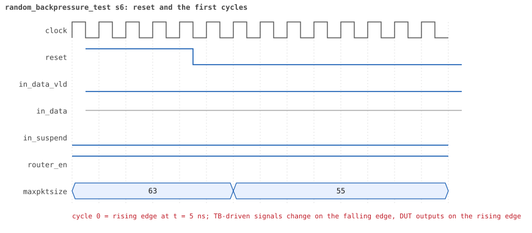
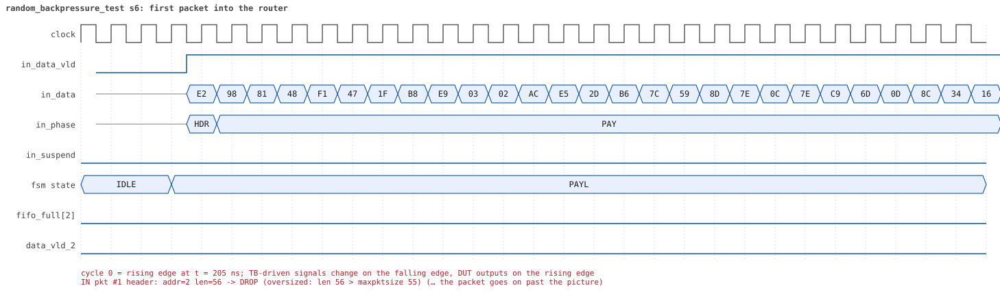
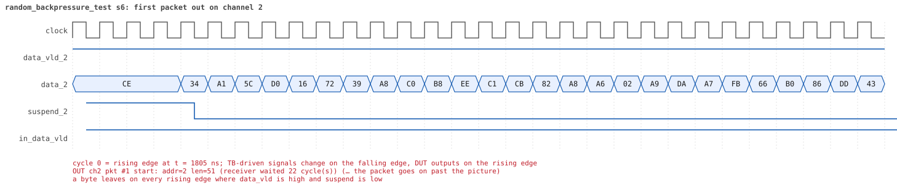
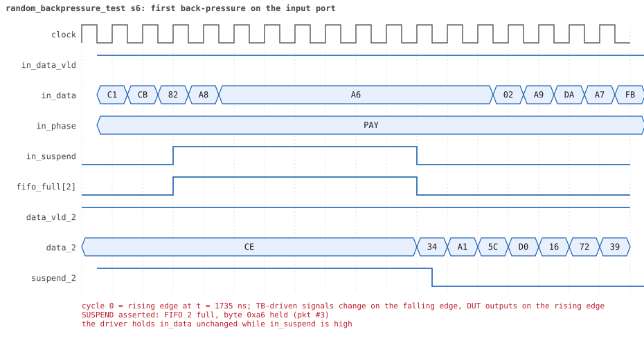
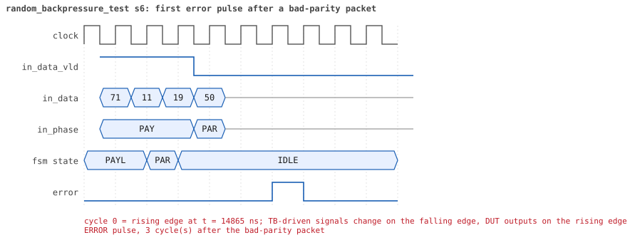
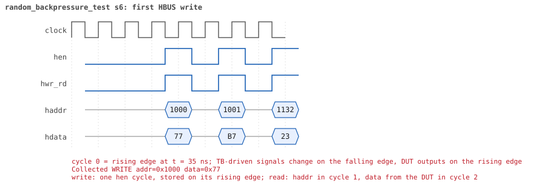
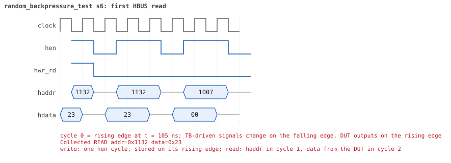

# random_backpressure_test  seed 6

**Result:** PASSED (0 UVM_ERROR, 0 UVM_WARNING, 0 UVM_FATAL) · bench `yapp_project_tb` · sim time 19us · log `random_backpressure_test_s6.log`

Waves: `random_backpressure_test_s6.fst` (GTKWave, Surfer or the VS Code wave viewer); signal trace: `signals.csv`.
[Open the waves in Surfer](https://app.surfer-project.org/?load_url=https%3A%2F%2Fraw.githubusercontent.com%2Ftamirgabgab%2FQcom-Mentoring%2Fmain%2Fyapp_project%2Fregression%2Fyapp_project_tb%2Frandom_backpressure_test_s6%2Frandom_backpressure_test_s6.fst&startup_commands=run_command_file_from_url%20https%3A%2F%2Fraw.githubusercontent.com%2Ftamirgabgab%2FQcom-Mentoring%2Fmain%2Fyapp_project%2Ftb%2Fyapp_router.sucl) (web app, the signals already in groups: `yapp_project/tb/yapp_router.sucl`).

## Summary

- YAPP driver sent **30** packet(s) (1 with bad parity); the input monitor saw 30.
- Router: **12** forwarded, **18** dropped (18 oversized).
- Packets out: ch0 **1**, ch1 **1**, ch2 **10**.
- Scoreboard: 12 matched, 0 mismatched, 0 unexpected.
- Back-pressure: in_suspend asserted **9** time(s), longest hold 41 cycle(s).
- Error pulses: 1.
- HBUS: 12 write(s), 50 read(s).

## Stages

| time (ns) | stage |
|---|---|
| 0 | receivers: ch0 RX_SLOW, ch1 RX_SLOW, ch2 RX_SLOW |
| 0 | random scenario: 30 packets in 2 bursts |
| 220 | burst 1/2: ctrl=0x77 (maxpktsize 55) en=0xb7 (router on, counter enables 1011011), 16 packet(s) |
| 10250 | burst 1/2 sent: addr0..3 1/2/13/0, bad parity 0, gap 0 13, length 6..63 |
| 10650 | burst 2/2: ctrl=0x19 (maxpktsize 25) en=0x67 (router on, counter enables 0110011), 14 packet(s) |
| 17070 | burst 2/2 sent: addr0..3 3/3/8/0, bad parity 1, gap 0 7, length 11..62 |
| 17070 | final reads: every register and the stored packet, checked against the reference model |
| 18355 | done: 30 packets (12 forwarded, 18 dropped), 0 storm burst(s), 12 scoreboard matches, 50 HBUS reads checked, 1 error pulses for 1 bad packets |

## Pictures

**reset and the first cycles**

**first packet into the router**

**first packet out on channel 2**

**first back-pressure on the input port**

**first error pulse after a bad-parity packet**

**first HBUS write**

**first HBUS read**

## Timeline

447 events (the same list is in `timeline.csv`).

| time (ns) | who | event |
|---|---|---|
| 0 | yapp monitor | YAPP monitor running |
| 0 | **test** | STAGE: receivers: ch0 RX_SLOW, ch1 RX_SLOW, ch2 RX_SLOW |
| 0 | **test** | STAGE: random scenario: 30 packets in 2 bursts |
| 0 | clk/rst driver | Starting clock (period 10) and holding reset for 5 cycles |
| 0 | **DUT** | RESET asserted |
| 50 | **DUT** | RESET released: router_en=1 maxpktsize=63 |
| 70 | hbus driver | Executed WRITE addr=0x1000 data=0x77 |
| 75 | **DUT** | CONFIG router_en=1 maxpktsize=55 |
| 75 | hbus monitor | Collected WRITE addr=0x1000 data=0x77 |
| 75 | reference | maxpktsize is now 55 |
| 90 | hbus driver | Executed WRITE addr=0x1001 data=0xb7 |
| 95 | hbus monitor | Collected WRITE addr=0x1001 data=0xb7 |
| 95 | reference | router_en is now 1 (en_reg 0xb7) |
| 110 | hbus driver | Executed WRITE addr=0x1132 data=0x23 |
| 115 | hbus monitor | Collected WRITE addr=0x1132 data=0x23 |
| 140 | hbus driver | Executed READ  addr=0x1132 data=0x23 |
| 145 | hbus monitor | Collected READ  addr=0x1132 data=0x23 |
| 170 | hbus driver | Executed READ  addr=0x1007 data=0x00 |
| 175 | hbus monitor | Collected READ  addr=0x1007 data=0x00 |
| 190 | hbus driver | Executed WRITE addr=0x11cc data=0x65 |
| 195 | hbus monitor | Collected WRITE addr=0x11cc data=0x65 |
| 220 | hbus driver | Executed READ  addr=0x11cc data=0x65 |
| 220 | **test** | STAGE: burst 1/2: ctrl=0x77 (maxpktsize 55) en=0xb7 (router on, counter enables 1011011), 16 packet(s) |
| 220 | yapp driver | TX pkt #1: addr=2 len=56 parity=good delay=0 |
| 225 | hbus monitor | Collected READ  addr=0x11cc data=0x65 |
| 235 | **DUT** | IN  pkt #1 header: addr=2 len=56 -> DROP (oversized: len 56 > maxpktsize 55) |
| 805 | **DUT** | IN  pkt #1 complete: addr=2 len=56 parity=ok dropped, 58 bytes in 58 cycles (held 0) |
| 805 | yapp monitor | RX pkt #1 on the input: addr=2 len=56 parity=good gap=18 |
| 805 | reference | Packet dropped: length 56 > maxpktsize 55 (addr=2) |
| 805 | **DUT** | ROUTER DROPS PACKET addr=2 length=56 (length > maxpktsize) |
| 810 | yapp driver | TX pkt #1 accepted by the DUT |
| 810 | yapp driver | TX pkt #2: addr=2 len=59 parity=good delay=19 |
| 1005 | **DUT** | IN  pkt #2 header: addr=2 len=59 -> DROP (oversized: len 59 > maxpktsize 55) |
| 1605 | **DUT** | IN  pkt #2 complete: addr=2 len=59 parity=ok dropped, 61 bytes in 61 cycles (held 0) |
| 1605 | yapp monitor | RX pkt #2 on the input: addr=2 len=59 parity=good gap=19 |
| 1605 | reference | Packet dropped: length 59 > maxpktsize 55 (addr=2) |
| 1605 | **DUT** | ROUTER DROPS PACKET addr=2 length=59 (length > maxpktsize) |
| 1610 | yapp driver | TX pkt #2 accepted by the DUT |
| 1610 | yapp driver | TX pkt #3: addr=2 len=51 parity=good delay=0 |
| 1615 | **DUT** | IN  pkt #3 header: addr=2 len=51 -> channel 2 |
| 1775 | **DUT** | SUSPEND asserted: FIFO 2 full, byte 0xa6 held (pkt #3) |
| 1845 | **DUT** | OUT ch2 pkt #1 start: addr=2 len=51 (receiver waited 22 cycle(s)) |
| 1855 | **DUT** | SUSPEND released after 8 cycle(s) |
| 2215 | **DUT** | IN  pkt #3 complete: addr=2 len=51 parity=ok forwarded, 53 bytes in 61 cycles (held 8) |
| 2215 | yapp monitor | RX pkt #3 on the input: addr=2 len=51 parity=good gap=0 |
| 2215 | reference | Packet forwarded: addr=2 len=51 -> channel 2 |
| 2220 | yapp driver | TX pkt #3 accepted by the DUT |
| 2220 | yapp driver | TX pkt #4: addr=2 len=24 parity=good delay=0 |
| 2225 | **DUT** | IN  pkt #4 header: addr=2 len=24 -> channel 2 |
| 2360 | ch2 driver | ch2: packet consumed (response delay 22) |
| 2375 | **DUT** | SUSPEND asserted: FIFO 2 full, byte 0xff held (pkt #4) |
| 2765 | **DUT** | OUT ch2 pkt #1 done: 53 bytes in 93 cycles |
| 2765 | ch2 monitor | ch2 RX pkt #1: addr=2 len=51 parity=good |
| 2765 | scoreboard | ch2 pkt matched: addr=2 len=51 (1 matched so far) |
| 2775 | **DUT** | SUSPEND released after 40 cycle(s) |
| 2775 | **DUT** | OUT ch2 pkt #2 start: addr=2 len=24 (receiver waited 0 cycle(s)) |
| 2875 | **DUT** | IN  pkt #4 complete: addr=2 len=24 parity=ok forwarded, 26 bytes in 66 cycles (held 40) |
| 2875 | yapp monitor | RX pkt #4 on the input: addr=2 len=24 parity=good gap=0 |
| 2875 | reference | Packet forwarded: addr=2 len=24 -> channel 2 |
| 2880 | yapp driver | TX pkt #4 accepted by the DUT |
| 2880 | yapp driver | TX pkt #5: addr=2 len=54 parity=good delay=1 |
| 2895 | **DUT** | IN  pkt #5 header: addr=2 len=54 -> channel 2 |
| 3025 | **DUT** | OUT ch2 pkt #2 done: 26 bytes in 26 cycles |
| 3025 | ch2 monitor | ch2 RX pkt #2: addr=2 len=24 parity=good |
| 3025 | scoreboard | ch2 pkt matched: addr=2 len=24 (2 matched so far) |
| 3035 | **DUT** | OUT ch2 pkt #3 start: addr=2 len=54 (receiver waited 0 cycle(s)) |
| 3170 | ch2 driver | ch2: packet consumed (response delay 39) |
| 3195 | **DUT** | SUSPEND asserted: FIFO 2 full, byte 0xef held (pkt #5) |
| 3505 | **DUT** | SUSPEND released after 31 cycle(s) |
| 3755 | **DUT** | IN  pkt #5 complete: addr=2 len=54 parity=ok forwarded, 56 bytes in 87 cycles (held 31) |
| 3755 | yapp monitor | RX pkt #5 on the input: addr=2 len=54 parity=good gap=1 |
| 3755 | reference | Packet forwarded: addr=2 len=54 -> channel 2 |
| 3760 | yapp driver | TX pkt #5 accepted by the DUT |
| 3760 | yapp driver | TX pkt #6: addr=2 len=47 parity=good delay=0 |
| 3765 | **DUT** | IN  pkt #6 header: addr=2 len=47 -> channel 2 |
| 3840 | ch2 driver | ch2: packet consumed (response delay 31) |
| 3855 | **DUT** | SUSPEND asserted: FIFO 2 full, byte 0x3a held (pkt #6) |
| 4265 | **DUT** | SUSPEND released after 41 cycle(s) |
| 4315 | **DUT** | OUT ch2 pkt #3 done: 56 bytes in 129 cycles |
| 4315 | ch2 monitor | ch2 RX pkt #3: addr=2 len=54 parity=good |
| 4315 | scoreboard | ch2 pkt matched: addr=2 len=54 (3 matched so far) |
| 4325 | **DUT** | OUT ch2 pkt #4 start: addr=2 len=47 (receiver waited 0 cycle(s)) |
| 4620 | ch2 driver | ch2: packet consumed (response delay 40) |
| 4635 | **DUT** | SUSPEND asserted: FIFO 2 full, byte 0x9c held (pkt #6) |
| 4895 | **DUT** | SUSPEND released after 26 cycle(s) |
| 4915 | **DUT** | IN  pkt #6 complete: addr=2 len=47 parity=ok forwarded, 49 bytes in 116 cycles (held 67) |
| 4915 | yapp monitor | RX pkt #6 on the input: addr=2 len=47 parity=good gap=0 |
| 4915 | reference | Packet forwarded: addr=2 len=47 -> channel 2 |
| 4920 | yapp driver | TX pkt #6 accepted by the DUT |
| 4920 | yapp driver | TX pkt #7: addr=2 len=43 parity=good delay=0 |
| 4925 | **DUT** | IN  pkt #7 header: addr=2 len=43 -> channel 2 |
| 5040 | ch2 driver | ch2: packet consumed (response delay 25) |
| 5055 | **DUT** | SUSPEND asserted: FIFO 2 full, byte 0xf7 held (pkt #7) |
| 5445 | **DUT** | SUSPEND released after 39 cycle(s) |
| 5455 | **DUT** | OUT ch2 pkt #4 done: 49 bytes in 114 cycles |
| 5455 | ch2 monitor | ch2 RX pkt #4: addr=2 len=47 parity=good |
| 5455 | scoreboard | ch2 pkt matched: addr=2 len=47 (4 matched so far) |
| 5465 | **DUT** | OUT ch2 pkt #5 start: addr=2 len=43 (receiver waited 0 cycle(s)) |
| 5755 | **DUT** | IN  pkt #7 complete: addr=2 len=43 parity=ok forwarded, 45 bytes in 84 cycles (held 39) |
| 5755 | yapp monitor | RX pkt #7 on the input: addr=2 len=43 parity=good gap=0 |
| 5755 | reference | Packet forwarded: addr=2 len=43 -> channel 2 |
| 5760 | yapp driver | TX pkt #7 accepted by the DUT |
| 5760 | yapp driver | TX pkt #8: addr=2 len=63 parity=good delay=0 |
| 5765 | **DUT** | IN  pkt #8 header: addr=2 len=63 -> DROP (oversized: len 63 > maxpktsize 55) |
| 5830 | ch2 driver | ch2: packet consumed (response delay 38) |
| 6315 | **DUT** | OUT ch2 pkt #5 done: 45 bytes in 86 cycles |
| 6315 | ch2 monitor | ch2 RX pkt #5: addr=2 len=43 parity=good |
| 6315 | scoreboard | ch2 pkt matched: addr=2 len=43 (5 matched so far) |
| 6320 | ch2 driver | ch2: packet consumed (response delay 40) |
| 6405 | **DUT** | IN  pkt #8 complete: addr=2 len=63 parity=ok dropped, 65 bytes in 65 cycles (held 0) |
| 6405 | yapp monitor | RX pkt #8 on the input: addr=2 len=63 parity=good gap=0 |
| 6405 | reference | Packet dropped: length 63 > maxpktsize 55 (addr=2) |
| 6405 | **DUT** | ROUTER DROPS PACKET addr=2 length=63 (length > maxpktsize) |
| 6410 | yapp driver | TX pkt #8 accepted by the DUT |
| 6410 | yapp driver | TX pkt #9: addr=0 len=16 parity=good delay=0 |
| 6415 | **DUT** | IN  pkt #9 header: addr=0 len=16 -> channel 0 |
| 6575 | **DUT** | SUSPEND asserted: FIFO 0 full, byte 0xae held (pkt #9) |
| 6825 | **DUT** | OUT ch0 pkt #1 start: addr=0 len=16 (receiver waited 40 cycle(s)) |
| 6835 | **DUT** | SUSPEND released after 26 cycle(s) |
| 6845 | **DUT** | IN  pkt #9 complete: addr=0 len=16 parity=ok forwarded, 18 bytes in 44 cycles (held 26) |
| 6845 | yapp monitor | RX pkt #9 on the input: addr=0 len=16 parity=good gap=0 |
| 6845 | reference | Packet forwarded: addr=0 len=16 -> channel 0 |
| 6850 | yapp driver | TX pkt #9 accepted by the DUT |
| 6850 | yapp driver | TX pkt #10: addr=2 len=50 parity=good delay=0 |
| 6855 | **DUT** | IN  pkt #10 header: addr=2 len=50 -> channel 2 |
| 6990 | ch0 driver | ch0: packet consumed (response delay 40) |
| 7015 | **DUT** | SUSPEND asserted: FIFO 2 full, byte 0x1e held (pkt #10) |
| 7085 | **DUT** | OUT ch2 pkt #6 start: addr=2 len=50 (receiver waited 22 cycle(s)) |
| 7095 | **DUT** | SUSPEND released after 8 cycle(s) |
| 7225 | **DUT** | OUT ch0 pkt #1 done: 18 bytes in 41 cycles |
| 7225 | ch0 monitor | ch0 RX pkt #1: addr=0 len=16 parity=good |
| 7225 | scoreboard | ch0 pkt matched: addr=0 len=16 (6 matched so far) |
| 7445 | **DUT** | IN  pkt #10 complete: addr=2 len=50 parity=ok forwarded, 52 bytes in 60 cycles (held 8) |
| 7445 | yapp monitor | RX pkt #10 on the input: addr=2 len=50 parity=good gap=0 |
| 7445 | reference | Packet forwarded: addr=2 len=50 -> channel 2 |
| 7450 | yapp driver | TX pkt #10 accepted by the DUT |
| 7450 | yapp driver | TX pkt #11: addr=2 len=62 parity=good delay=0 |
| 7455 | **DUT** | IN  pkt #11 header: addr=2 len=62 -> DROP (oversized: len 62 > maxpktsize 55) |
| 7570 | ch0 driver | ch0: packet consumed (response delay 22) |
| 7590 | ch2 driver | ch2: packet consumed (response delay 22) |
| 7895 | **DUT** | OUT ch2 pkt #6 done: 52 bytes in 82 cycles |
| 7895 | ch2 monitor | ch2 RX pkt #6: addr=2 len=50 parity=good |
| 7895 | scoreboard | ch2 pkt matched: addr=2 len=50 (7 matched so far) |
| 8085 | **DUT** | IN  pkt #11 complete: addr=2 len=62 parity=ok dropped, 64 bytes in 64 cycles (held 0) |
| 8085 | yapp monitor | RX pkt #11 on the input: addr=2 len=62 parity=good gap=0 |
| 8085 | reference | Packet dropped: length 62 > maxpktsize 55 (addr=2) |
| 8085 | **DUT** | ROUTER DROPS PACKET addr=2 length=62 (length > maxpktsize) |
| 8090 | yapp driver | TX pkt #11 accepted by the DUT |
| 8090 | yapp driver | TX pkt #12: addr=1 len=63 parity=good delay=0 |
| 8095 | **DUT** | IN  pkt #12 header: addr=1 len=63 -> DROP (oversized: len 63 > maxpktsize 55) |
| 8490 | ch2 driver | ch2: packet consumed (response delay 29) |
| 8735 | **DUT** | IN  pkt #12 complete: addr=1 len=63 parity=ok dropped, 65 bytes in 65 cycles (held 0) |
| 8735 | yapp monitor | RX pkt #12 on the input: addr=1 len=63 parity=good gap=0 |
| 8735 | reference | Packet dropped: length 63 > maxpktsize 55 (addr=1) |
| 8735 | **DUT** | ROUTER DROPS PACKET addr=1 length=63 (length > maxpktsize) |
| 8740 | yapp driver | TX pkt #12 accepted by the DUT |
| 8740 | yapp driver | TX pkt #13: addr=2 len=6 parity=good delay=0 |
| 8745 | **DUT** | IN  pkt #13 header: addr=2 len=6 -> channel 2 |
| 8815 | **DUT** | IN  pkt #13 complete: addr=2 len=6 parity=ok forwarded, 8 bytes in 8 cycles (held 0) |
| 8815 | yapp monitor | RX pkt #13 on the input: addr=2 len=6 parity=good gap=0 |
| 8815 | reference | Packet forwarded: addr=2 len=6 -> channel 2 |
| 8820 | yapp driver | TX pkt #13 accepted by the DUT |
| 8820 | yapp driver | TX pkt #14: addr=1 len=7 parity=good delay=0 |
| 8825 | **DUT** | IN  pkt #14 header: addr=1 len=7 -> channel 1 |
| 8905 | **DUT** | IN  pkt #14 complete: addr=1 len=7 parity=ok forwarded, 9 bytes in 9 cycles (held 0) |
| 8905 | yapp monitor | RX pkt #14 on the input: addr=1 len=7 parity=good gap=0 |
| 8905 | reference | Packet forwarded: addr=1 len=7 -> channel 1 |
| 8910 | yapp driver | TX pkt #14 accepted by the DUT |
| 8910 | yapp driver | TX pkt #15: addr=2 len=57 parity=good delay=0 |
| 8915 | **DUT** | IN  pkt #15 header: addr=2 len=57 -> DROP (oversized: len 57 > maxpktsize 55) |
| 8965 | **DUT** | OUT ch2 pkt #7 start: addr=2 len=6 (receiver waited 21 cycle(s)) |
| 9030 | ch2 driver | ch2: packet consumed (response delay 21) |
| 9225 | **DUT** | OUT ch1 pkt #1 start: addr=1 len=7 (receiver waited 39 cycle(s)) |
| 9300 | ch1 driver | ch1: packet consumed (response delay 39) |
| 9305 | **DUT** | OUT ch2 pkt #7 done: 8 bytes in 35 cycles |
| 9305 | ch2 monitor | ch2 RX pkt #7: addr=2 len=6 parity=good |
| 9305 | scoreboard | ch2 pkt matched: addr=2 len=6 (8 matched so far) |
| 9495 | **DUT** | IN  pkt #15 complete: addr=2 len=57 parity=ok dropped, 59 bytes in 59 cycles (held 0) |
| 9495 | yapp monitor | RX pkt #15 on the input: addr=2 len=57 parity=good gap=0 |
| 9495 | reference | Packet dropped: length 57 > maxpktsize 55 (addr=2) |
| 9495 | **DUT** | ROUTER DROPS PACKET addr=2 length=57 (length > maxpktsize) |
| 9500 | yapp driver | TX pkt #15 accepted by the DUT |
| 9500 | yapp driver | TX pkt #16: addr=2 len=63 parity=good delay=10 |
| 9530 | ch2 driver | ch2: packet consumed (response delay 26) |
| 9605 | **DUT** | IN  pkt #16 header: addr=2 len=63 -> DROP (oversized: len 63 > maxpktsize 55) |
| 9605 | **DUT** | OUT ch1 pkt #1 done: 9 bytes in 39 cycles |
| 9605 | ch1 monitor | ch1 RX pkt #1: addr=1 len=7 parity=good |
| 9605 | scoreboard | ch1 pkt matched: addr=1 len=7 (9 matched so far) |
| 10070 | ch1 driver | ch1: packet consumed (response delay 29) |
| 10245 | **DUT** | IN  pkt #16 complete: addr=2 len=63 parity=ok dropped, 65 bytes in 65 cycles (held 0) |
| 10245 | yapp monitor | RX pkt #16 on the input: addr=2 len=63 parity=good gap=10 |
| 10245 | reference | Packet dropped: length 63 > maxpktsize 55 (addr=2) |
| 10245 | **DUT** | ROUTER DROPS PACKET addr=2 length=63 (length > maxpktsize) |
| 10250 | yapp driver | TX pkt #16 accepted by the DUT |
| 10250 | **test** | STAGE: burst 1/2 sent: addr0..3 1/2/13/0, bad parity 0, gap 0 13, length 6..63 |
| 10270 | hbus driver | Executed WRITE addr=0x1000 data=0x19 |
| 10275 | **DUT** | CONFIG router_en=1 maxpktsize=25 |
| 10275 | hbus monitor | Collected WRITE addr=0x1000 data=0x19 |
| 10275 | reference | maxpktsize is now 25 |
| 10290 | hbus driver | Executed WRITE addr=0x1001 data=0x67 |
| 10295 | hbus monitor | Collected WRITE addr=0x1001 data=0x67 |
| 10295 | reference | router_en is now 1 (en_reg 0x67) |
| 10320 | hbus driver | Executed READ  addr=0x10f0 data=0x00 |
| 10325 | hbus monitor | Collected READ  addr=0x10f0 data=0x00 |
| 10340 | hbus driver | Executed WRITE addr=0x11c3 data=0x3a |
| 10345 | hbus monitor | Collected WRITE addr=0x11c3 data=0x3a |
| 10370 | hbus driver | Executed READ  addr=0x11c3 data=0x3a |
| 10375 | hbus monitor | Collected READ  addr=0x11c3 data=0x3a |
| 10400 | hbus driver | Executed READ  addr=0x100b data=0x00 |
| 10405 | hbus monitor | Collected READ  addr=0x100b data=0x00 |
| 10420 | hbus driver | Executed WRITE addr=0x11bb data=0x05 |
| 10425 | hbus monitor | Collected WRITE addr=0x11bb data=0x05 |
| 10450 | hbus driver | Executed READ  addr=0x11bb data=0x05 |
| 10455 | hbus monitor | Collected READ  addr=0x11bb data=0x05 |
| 10470 | hbus driver | Executed WRITE addr=0x11cd data=0xc4 |
| 10475 | hbus monitor | Collected WRITE addr=0x11cd data=0xc4 |
| 10500 | hbus driver | Executed READ  addr=0x11cd data=0xc4 |
| 10505 | hbus monitor | Collected READ  addr=0x11cd data=0xc4 |
| 10520 | hbus driver | Executed WRITE addr=0x114c data=0x7e |
| 10525 | hbus monitor | Collected WRITE addr=0x114c data=0x7e |
| 10550 | hbus driver | Executed READ  addr=0x114c data=0x7e |
| 10555 | hbus monitor | Collected READ  addr=0x114c data=0x7e |
| 10570 | hbus driver | Executed WRITE addr=0x11fd data=0x23 |
| 10575 | hbus monitor | Collected WRITE addr=0x11fd data=0x23 |
| 10600 | hbus driver | Executed READ  addr=0x11fd data=0x23 |
| 10605 | hbus monitor | Collected READ  addr=0x11fd data=0x23 |
| 10620 | hbus driver | Executed WRITE addr=0x1132 data=0x36 |
| 10625 | hbus monitor | Collected WRITE addr=0x1132 data=0x36 |
| 10650 | hbus driver | Executed READ  addr=0x1132 data=0x36 |
| 10650 | **test** | STAGE: burst 2/2: ctrl=0x19 (maxpktsize 25) en=0x67 (router on, counter enables 0110011), 14 packet(s) |
| 10650 | yapp driver | TX pkt #17: addr=2 len=61 parity=good delay=12 |
| 10655 | hbus monitor | Collected READ  addr=0x1132 data=0x36 |
| 10785 | **DUT** | IN  pkt #17 header: addr=2 len=61 -> DROP (oversized: len 61 > maxpktsize 25) |
| 11405 | **DUT** | IN  pkt #17 complete: addr=2 len=61 parity=ok dropped, 63 bytes in 63 cycles (held 0) |
| 11405 | yapp monitor | RX pkt #17 on the input: addr=2 len=61 parity=good gap=53 |
| 11405 | reference | Packet dropped: length 61 > maxpktsize 25 (addr=2) |
| 11405 | **DUT** | ROUTER DROPS PACKET addr=2 length=61 (length > maxpktsize) |
| 11410 | yapp driver | TX pkt #17 accepted by the DUT |
| 11410 | yapp driver | TX pkt #18: addr=0 len=44 parity=good delay=0 |
| 11415 | **DUT** | IN  pkt #18 header: addr=0 len=44 -> DROP (oversized: len 44 > maxpktsize 25) |
| 11865 | **DUT** | IN  pkt #18 complete: addr=0 len=44 parity=ok dropped, 46 bytes in 46 cycles (held 0) |
| 11865 | yapp monitor | RX pkt #18 on the input: addr=0 len=44 parity=good gap=0 |
| 11865 | reference | Packet dropped: length 44 > maxpktsize 25 (addr=0) |
| 11865 | **DUT** | ROUTER DROPS PACKET addr=0 length=44 (length > maxpktsize) |
| 11870 | yapp driver | TX pkt #18 accepted by the DUT |
| 11870 | yapp driver | TX pkt #19: addr=2 len=11 parity=good delay=3 |
| 11905 | **DUT** | IN  pkt #19 header: addr=2 len=11 -> channel 2 |
| 12025 | **DUT** | IN  pkt #19 complete: addr=2 len=11 parity=ok forwarded, 13 bytes in 13 cycles (held 0) |
| 12025 | yapp monitor | RX pkt #19 on the input: addr=2 len=11 parity=good gap=3 |
| 12025 | reference | Packet forwarded: addr=2 len=11 -> channel 2 |
| 12030 | yapp driver | TX pkt #19 accepted by the DUT |
| 12030 | yapp driver | TX pkt #20: addr=2 len=62 parity=good delay=0 |
| 12035 | **DUT** | IN  pkt #20 header: addr=2 len=62 -> DROP (oversized: len 62 > maxpktsize 25) |
| 12115 | **DUT** | OUT ch2 pkt #8 start: addr=2 len=11 (receiver waited 20 cycle(s)) |
| 12230 | ch2 driver | ch2: packet consumed (response delay 20) |
| 12485 | **DUT** | OUT ch2 pkt #8 done: 13 bytes in 38 cycles |
| 12485 | ch2 monitor | ch2 RX pkt #8: addr=2 len=11 parity=good |
| 12485 | scoreboard | ch2 pkt matched: addr=2 len=11 (10 matched so far) |
| 12570 | ch2 driver | ch2: packet consumed (response delay 24) |
| 12665 | **DUT** | IN  pkt #20 complete: addr=2 len=62 parity=ok dropped, 64 bytes in 64 cycles (held 0) |
| 12665 | yapp monitor | RX pkt #20 on the input: addr=2 len=62 parity=good gap=0 |
| 12665 | reference | Packet dropped: length 62 > maxpktsize 25 (addr=2) |
| 12665 | **DUT** | ROUTER DROPS PACKET addr=2 length=62 (length > maxpktsize) |
| 12670 | yapp driver | TX pkt #20 accepted by the DUT |
| 12670 | yapp driver | TX pkt #21: addr=2 len=14 parity=good delay=0 |
| 12675 | **DUT** | IN  pkt #21 header: addr=2 len=14 -> channel 2 |
| 12825 | **DUT** | IN  pkt #21 complete: addr=2 len=14 parity=ok forwarded, 16 bytes in 16 cycles (held 0) |
| 12825 | yapp monitor | RX pkt #21 on the input: addr=2 len=14 parity=good gap=0 |
| 12825 | reference | Packet forwarded: addr=2 len=14 -> channel 2 |
| 12830 | yapp driver | TX pkt #21 accepted by the DUT |
| 12830 | yapp driver | TX pkt #22: addr=1 len=47 parity=good delay=0 |
| 12835 | **DUT** | IN  pkt #22 header: addr=1 len=47 -> DROP (oversized: len 47 > maxpktsize 25) |
| 12905 | **DUT** | OUT ch2 pkt #9 start: addr=2 len=14 (receiver waited 22 cycle(s)) |
| 13050 | ch2 driver | ch2: packet consumed (response delay 22) |
| 13315 | **DUT** | IN  pkt #22 complete: addr=1 len=47 parity=ok dropped, 49 bytes in 49 cycles (held 0) |
| 13315 | yapp monitor | RX pkt #22 on the input: addr=1 len=47 parity=good gap=0 |
| 13315 | reference | Packet dropped: length 47 > maxpktsize 25 (addr=1) |
| 13315 | **DUT** | ROUTER DROPS PACKET addr=1 length=47 (length > maxpktsize) |
| 13320 | yapp driver | TX pkt #22 accepted by the DUT |
| 13320 | yapp driver | TX pkt #23: addr=1 len=44 parity=good delay=1 |
| 13335 | **DUT** | IN  pkt #23 header: addr=1 len=44 -> DROP (oversized: len 44 > maxpktsize 25) |
| 13375 | **DUT** | OUT ch2 pkt #9 done: 16 bytes in 48 cycles |
| 13375 | ch2 monitor | ch2 RX pkt #9: addr=2 len=14 parity=good |
| 13375 | scoreboard | ch2 pkt matched: addr=2 len=14 (11 matched so far) |
| 13380 | ch2 driver | ch2: packet consumed (response delay 31) |
| 13785 | **DUT** | IN  pkt #23 complete: addr=1 len=44 parity=ok dropped, 46 bytes in 46 cycles (held 0) |
| 13785 | yapp monitor | RX pkt #23 on the input: addr=1 len=44 parity=good gap=1 |
| 13785 | reference | Packet dropped: length 44 > maxpktsize 25 (addr=1) |
| 13785 | **DUT** | ROUTER DROPS PACKET addr=1 length=44 (length > maxpktsize) |
| 13790 | yapp driver | TX pkt #23 accepted by the DUT |
| 13790 | yapp driver | TX pkt #24: addr=2 len=60 parity=good delay=3 |
| 13825 | **DUT** | IN  pkt #24 header: addr=2 len=60 -> DROP (oversized: len 60 > maxpktsize 25) |
| 14435 | **DUT** | IN  pkt #24 complete: addr=2 len=60 parity=ok dropped, 62 bytes in 62 cycles (held 0) |
| 14435 | yapp monitor | RX pkt #24 on the input: addr=2 len=60 parity=good gap=3 |
| 14435 | reference | Packet dropped: length 60 > maxpktsize 25 (addr=2) |
| 14435 | **DUT** | ROUTER DROPS PACKET addr=2 length=60 (length > maxpktsize) |
| 14440 | yapp driver | TX pkt #24 accepted by the DUT |
| 14440 | yapp driver | TX pkt #25: addr=2 len=43 parity=bad delay=1 |
| 14455 | **DUT** | IN  pkt #25 header: addr=2 len=43 -> DROP (oversized: len 43 > maxpktsize 25) |
| 14895 | **DUT** | IN  pkt #25 complete: addr=2 len=43 parity=BAD dropped, 45 bytes in 45 cycles (held 0) |
| 14895 | yapp monitor | RX pkt #25 on the input: addr=2 len=43 parity=bad gap=1 |
| 14895 | reference | Packet dropped: length 43 > maxpktsize 25 (addr=2) |
| 14895 | **DUT** | ROUTER DROPS PACKET addr=2 length=43 (length > maxpktsize) |
| 14900 | yapp driver | TX pkt #25 accepted by the DUT |
| 14900 | yapp driver | TX pkt #26: addr=2 len=33 parity=good delay=13 |
| 14930 | **DUT** | ERROR pulse, 3 cycle(s) after the bad-parity packet |
| 14930 | error checker | error pulse 3 cycles after the bad packet (0 still owed) |
| 15035 | **DUT** | IN  pkt #26 header: addr=2 len=33 -> DROP (oversized: len 33 > maxpktsize 25) |
| 15375 | **DUT** | IN  pkt #26 complete: addr=2 len=33 parity=ok dropped, 35 bytes in 35 cycles (held 0) |
| 15375 | yapp monitor | RX pkt #26 on the input: addr=2 len=33 parity=good gap=13 |
| 15375 | reference | Packet dropped: length 33 > maxpktsize 25 (addr=2) |
| 15375 | **DUT** | ROUTER DROPS PACKET addr=2 length=33 (length > maxpktsize) |
| 15380 | yapp driver | TX pkt #26 accepted by the DUT |
| 15380 | yapp driver | TX pkt #27: addr=2 len=23 parity=good delay=0 |
| 15385 | **DUT** | IN  pkt #27 header: addr=2 len=23 -> channel 2 |
| 15545 | **DUT** | SUSPEND asserted: FIFO 2 full, byte 0xca held (pkt #27) |
| 15675 | **DUT** | OUT ch2 pkt #10 start: addr=2 len=23 (receiver waited 28 cycle(s)) |
| 15685 | **DUT** | SUSPEND released after 14 cycle(s) |
| 15765 | **DUT** | IN  pkt #27 complete: addr=2 len=23 parity=ok forwarded, 25 bytes in 39 cycles (held 14) |
| 15765 | yapp monitor | RX pkt #27 on the input: addr=2 len=23 parity=good gap=0 |
| 15765 | reference | Packet forwarded: addr=2 len=23 -> channel 2 |
| 15770 | yapp driver | TX pkt #27 accepted by the DUT |
| 15770 | yapp driver | TX pkt #28: addr=1 len=36 parity=good delay=0 |
| 15775 | **DUT** | IN  pkt #28 header: addr=1 len=36 -> DROP (oversized: len 36 > maxpktsize 25) |
| 15910 | ch2 driver | ch2: packet consumed (response delay 28) |
| 16135 | **DUT** | OUT ch2 pkt #10 done: 25 bytes in 47 cycles |
| 16135 | ch2 monitor | ch2 RX pkt #10: addr=2 len=23 parity=good |
| 16135 | scoreboard | ch2 pkt matched: addr=2 len=23 (12 matched so far) |
| 16145 | **DUT** | IN  pkt #28 complete: addr=1 len=36 parity=ok dropped, 38 bytes in 38 cycles (held 0) |
| 16145 | yapp monitor | RX pkt #28 on the input: addr=1 len=36 parity=good gap=0 |
| 16145 | reference | Packet dropped: length 36 > maxpktsize 25 (addr=1) |
| 16145 | **DUT** | ROUTER DROPS PACKET addr=1 length=36 (length > maxpktsize) |
| 16150 | yapp driver | TX pkt #28 accepted by the DUT |
| 16150 | yapp driver | TX pkt #29: addr=0 len=58 parity=good delay=1 |
| 16165 | **DUT** | IN  pkt #29 header: addr=0 len=58 -> DROP (oversized: len 58 > maxpktsize 25) |
| 16610 | ch2 driver | ch2: packet consumed (response delay 21) |
| 16755 | **DUT** | IN  pkt #29 complete: addr=0 len=58 parity=ok dropped, 60 bytes in 60 cycles (held 0) |
| 16755 | yapp monitor | RX pkt #29 on the input: addr=0 len=58 parity=good gap=1 |
| 16755 | reference | Packet dropped: length 58 > maxpktsize 25 (addr=0) |
| 16755 | **DUT** | ROUTER DROPS PACKET addr=0 length=58 (length > maxpktsize) |
| 16760 | yapp driver | TX pkt #29 accepted by the DUT |
| 16760 | yapp driver | TX pkt #30: addr=0 len=29 parity=good delay=0 |
| 16765 | **DUT** | IN  pkt #30 header: addr=0 len=29 -> DROP (oversized: len 29 > maxpktsize 25) |
| 17065 | **DUT** | IN  pkt #30 complete: addr=0 len=29 parity=ok dropped, 31 bytes in 31 cycles (held 0) |
| 17065 | yapp monitor | RX pkt #30 on the input: addr=0 len=29 parity=good gap=0 |
| 17065 | reference | Packet dropped: length 29 > maxpktsize 25 (addr=0) |
| 17065 | **DUT** | ROUTER DROPS PACKET addr=0 length=29 (length > maxpktsize) |
| 17070 | yapp driver | TX pkt #30 accepted by the DUT |
| 17070 | **test** | STAGE: burst 2/2 sent: addr0..3 3/3/8/0, bad parity 1, gap 0 7, length 11..62 |
| 17070 | **test** | STAGE: final reads: every register and the stored packet, checked against the reference model |
| 17100 | hbus driver | Executed READ  addr=0x1000 data=0x19 |
| 17105 | hbus monitor | Collected READ  addr=0x1000 data=0x19 |
| 17130 | hbus driver | Executed READ  addr=0x1001 data=0x67 |
| 17135 | hbus monitor | Collected READ  addr=0x1001 data=0x67 |
| 17160 | hbus driver | Executed READ  addr=0x1004 data=0x01 |
| 17165 | hbus monitor | Collected READ  addr=0x1004 data=0x01 |
| 17190 | hbus driver | Executed READ  addr=0x1005 data=0x12 |
| 17195 | hbus monitor | Collected READ  addr=0x1005 data=0x12 |
| 17220 | hbus driver | Executed READ  addr=0x1006 data=0x00 |
| 17225 | hbus monitor | Collected READ  addr=0x1006 data=0x00 |
| 17250 | hbus driver | Executed READ  addr=0x1009 data=0x01 |
| 17255 | hbus monitor | Collected READ  addr=0x1009 data=0x01 |
| 17280 | hbus driver | Executed READ  addr=0x100a data=0x05 |
| 17285 | hbus monitor | Collected READ  addr=0x100a data=0x05 |
| 17310 | hbus driver | Executed READ  addr=0x100b data=0x08 |
| 17315 | hbus monitor | Collected READ  addr=0x100b data=0x08 |
| 17340 | hbus driver | Executed READ  addr=0x100d data=0x1d |
| 17345 | hbus monitor | Collected READ  addr=0x100d data=0x1d |
| 17370 | hbus driver | Executed READ  addr=0x1010 data=0x74 |
| 17375 | hbus monitor | Collected READ  addr=0x1010 data=0x74 |
| 17400 | hbus driver | Executed READ  addr=0x1011 data=0x43 |
| 17405 | hbus monitor | Collected READ  addr=0x1011 data=0x43 |
| 17430 | hbus driver | Executed READ  addr=0x1012 data=0x23 |
| 17435 | hbus monitor | Collected READ  addr=0x1012 data=0x23 |
| 17460 | hbus driver | Executed READ  addr=0x1013 data=0x63 |
| 17465 | hbus monitor | Collected READ  addr=0x1013 data=0x63 |
| 17490 | hbus driver | Executed READ  addr=0x1014 data=0x5a |
| 17495 | hbus monitor | Collected READ  addr=0x1014 data=0x5a |
| 17520 | hbus driver | Executed READ  addr=0x1015 data=0xb3 |
| 17525 | hbus monitor | Collected READ  addr=0x1015 data=0xb3 |
| 17550 | hbus driver | Executed READ  addr=0x1016 data=0x48 |
| 17555 | hbus monitor | Collected READ  addr=0x1016 data=0x48 |
| 17580 | hbus driver | Executed READ  addr=0x1017 data=0x9b |
| 17585 | hbus monitor | Collected READ  addr=0x1017 data=0x9b |
| 17610 | hbus driver | Executed READ  addr=0x1018 data=0xb2 |
| 17615 | hbus monitor | Collected READ  addr=0x1018 data=0xb2 |
| 17640 | hbus driver | Executed READ  addr=0x1019 data=0x90 |
| 17645 | hbus monitor | Collected READ  addr=0x1019 data=0x90 |
| 17670 | hbus driver | Executed READ  addr=0x101a data=0xa9 |
| 17675 | hbus monitor | Collected READ  addr=0x101a data=0xa9 |
| 17700 | hbus driver | Executed READ  addr=0x101b data=0x70 |
| 17705 | hbus monitor | Collected READ  addr=0x101b data=0x70 |
| 17730 | hbus driver | Executed READ  addr=0x101c data=0xd9 |
| 17735 | hbus monitor | Collected READ  addr=0x101c data=0xd9 |
| 17760 | hbus driver | Executed READ  addr=0x101d data=0x70 |
| 17765 | hbus monitor | Collected READ  addr=0x101d data=0x70 |
| 17790 | hbus driver | Executed READ  addr=0x101e data=0x94 |
| 17795 | hbus monitor | Collected READ  addr=0x101e data=0x94 |
| 17820 | hbus driver | Executed READ  addr=0x101f data=0xf2 |
| 17825 | hbus monitor | Collected READ  addr=0x101f data=0xf2 |
| 17850 | hbus driver | Executed READ  addr=0x1020 data=0xad |
| 17855 | hbus monitor | Collected READ  addr=0x1020 data=0xad |
| 17880 | hbus driver | Executed READ  addr=0x1021 data=0xf6 |
| 17885 | hbus monitor | Collected READ  addr=0x1021 data=0xf6 |
| 17910 | hbus driver | Executed READ  addr=0x1022 data=0x32 |
| 17915 | hbus monitor | Collected READ  addr=0x1022 data=0x32 |
| 17940 | hbus driver | Executed READ  addr=0x1023 data=0x78 |
| 17945 | hbus monitor | Collected READ  addr=0x1023 data=0x78 |
| 17970 | hbus driver | Executed READ  addr=0x1024 data=0x9d |
| 17975 | hbus monitor | Collected READ  addr=0x1024 data=0x9d |
| 18000 | hbus driver | Executed READ  addr=0x1025 data=0x54 |
| 18005 | hbus monitor | Collected READ  addr=0x1025 data=0x54 |
| 18030 | hbus driver | Executed READ  addr=0x1026 data=0x4a |
| 18035 | hbus monitor | Collected READ  addr=0x1026 data=0x4a |
| 18060 | hbus driver | Executed READ  addr=0x1027 data=0x4b |
| 18065 | hbus monitor | Collected READ  addr=0x1027 data=0x4b |
| 18090 | hbus driver | Executed READ  addr=0x1028 data=0xad |
| 18095 | hbus monitor | Collected READ  addr=0x1028 data=0xad |
| 18120 | hbus driver | Executed READ  addr=0x1029 data=0xb5 |
| 18125 | hbus monitor | Collected READ  addr=0x1029 data=0xb5 |
| 18150 | hbus driver | Executed READ  addr=0x102a data=0xf7 |
| 18155 | hbus monitor | Collected READ  addr=0x102a data=0xf7 |
| 18180 | hbus driver | Executed READ  addr=0x102b data=0xdc |
| 18185 | hbus monitor | Collected READ  addr=0x102b data=0xdc |
| 18210 | hbus driver | Executed READ  addr=0x102c data=0xbb |
| 18215 | hbus monitor | Collected READ  addr=0x102c data=0xbb |
| 18240 | hbus driver | Executed READ  addr=0x102d data=0x1d |
| 18245 | hbus monitor | Collected READ  addr=0x102d data=0x1d |
| 18355 | **test** | STAGE: done: 30 packets (12 forwarded, 18 dropped), 0 storm burst(s), 12 scoreboard matches, 50 HBUS reads checked, 1 error pulses for 1 bad packets |
| 18555 | error checker | error pulse report: 1 bad packets, 1 pulses, 0 outside 1..10 cycles, at most 1 owed at once |
| 18555 | ch0 monitor | Channel 0 report: 1 packets collected |
| 18555 | ch1 monitor | Channel 1 report: 1 packets collected |
| 18555 | ch2 monitor | Channel 2 report: 10 packets collected |
| 18555 | hbus monitor | HBUS report: 12 writes, 50 reads |
| 18555 | coverage | Coverage of the router configuration: 52.2% |
| 18555 | coverage | HBUS address coverage: 62 accesses sampled, coverage 42.9% |
| 18555 | coverage | HBUS register bits coverage: 4 writes to ctrl_reg/en_reg, coverage 81.8% |
| 18555 | coverage | HBUS counter value coverage: 7 counter reads sampled, coverage 55.6% |
| 18555 | coverage | HBUS yapp_mem data coverage: 16 accesses sampled, coverage 29.4% |
| 18555 | reference |  |
| 18555 | reference | HBUS reads checked against the model: 50 (0 mismatches, 0 of memory bytes never written) |
| 18555 | scoreboard |  |
| 18555 | yapp driver | YAPP driver report: 30 packets sent |
| 18555 | coverage | YAPP gap coverage: 29 gaps sampled, coverage 75.0% |
| 18555 | yapp monitor | YAPP monitor report: 30 packets collected, 1 with bad parity |
| 18555 | yapp monitor | YAPP gaps: 19 back to back, 4 of 1 cycle, 0 of 2, 6 longer |
| 18555 | coverage | YAPP packet coverage: 30 packets sampled, coverage 46.7% |
