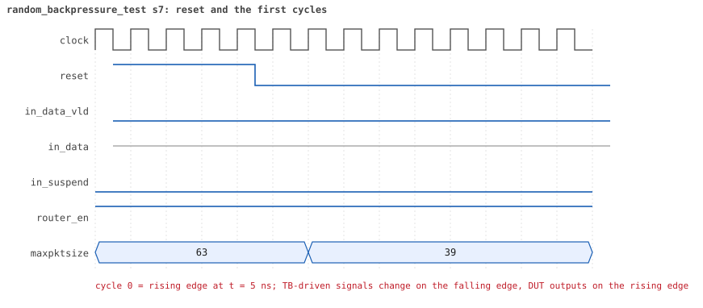
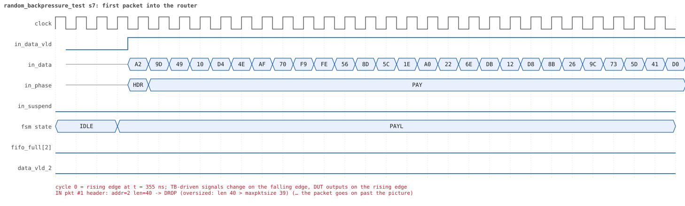
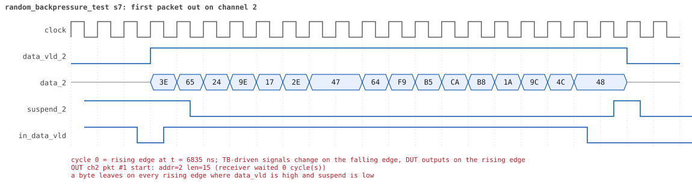
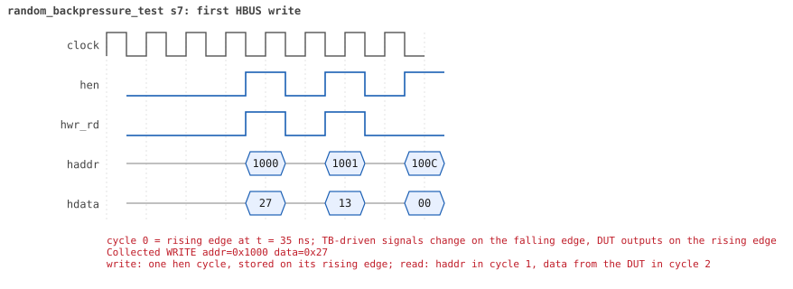
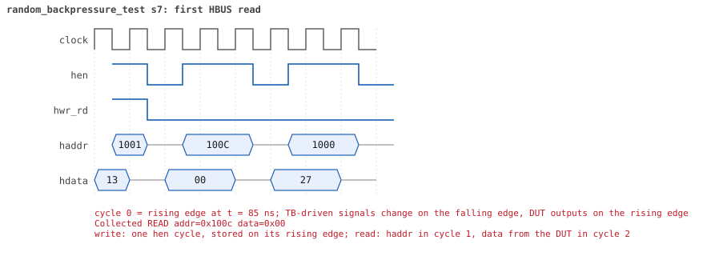

# random_backpressure_test  seed 7

**Result:** PASSED (0 UVM_ERROR, 0 UVM_WARNING, 0 UVM_FATAL) · bench `yapp_project_tb` · sim time 13us · log `random_backpressure_test_s7.log`

Waves: `random_backpressure_test_s7.fst` (GTKWave, Surfer or the VS Code wave viewer); signal trace: `signals.csv`.
[Open the waves in Surfer](https://app.surfer-project.org/?load_url=https%3A%2F%2Fraw.githubusercontent.com%2Ftamirgabgab%2FQcom-Mentoring%2Fmain%2Fyapp_project%2Fregression%2Fyapp_project_tb%2Frandom_backpressure_test_s7%2Frandom_backpressure_test_s7.fst&startup_commands=run_command_file_from_url%20https%3A%2F%2Fraw.githubusercontent.com%2Ftamirgabgab%2FQcom-Mentoring%2Fmain%2Fyapp_project%2Ftb%2Fyapp_router.sucl) (web app, the signals already in groups: `yapp_project/tb/yapp_router.sucl`).

## Summary

- YAPP driver sent **18** packet(s) (0 with bad parity); the input monitor saw 18.
- Router: **3** forwarded, **15** dropped (15 oversized).
- Packets out: ch0 **0**, ch1 **0**, ch2 **3**.
- Scoreboard: 3 matched, 0 mismatched, 0 unexpected.
- Back-pressure: in_suspend asserted **0** time(s).
- Error pulses: 0.
- HBUS: 31 write(s), 111 read(s).

## Stages

| time (ns) | stage |
|---|---|
| 0 | receivers: ch0 RX_STALLY, ch1 RX_SLOW, ch2 RX_FAST |
| 0 | random scenario: 18 packets in 6 bursts |
| 370 | burst 1/6: ctrl=0x27 (maxpktsize 39) en=0x13 (router on, counter enables 0001001), 3 packet(s) |
| 1870 | burst 1/6 sent: addr0..3 0/0/3/0, bad parity 0, gap 0 2, length 40..56 |
| 2050 | burst 2/6: ctrl=0xc6 (maxpktsize 6) en=0x01 (router on, counter enables 0000000), 2 packet(s) |
| 3230 | burst 2/6 sent: addr0..3 0/0/2/0, bad parity 0, gap 0 1, length 51..61 |
| 3590 | burst 3/6: ctrl=0x5f (maxpktsize 31) en=0xc7 (router on, counter enables 1100011), 3 packet(s) |
| 5520 | burst 3/6 sent: addr0..3 2/0/1/0, bad parity 0, gap 0 2, length 57..63 |
| 5920 | burst 4/6: ctrl=0xd3 (maxpktsize 19) en=0xff (router on, counter enables 1111111), 3 packet(s) |
| 7030 | burst 4/6 sent: addr0..3 0/1/2/0, bad parity 0, gap 0 1, length 15..46 |
| 7180 | burst 5/6: ctrl=0xe8 (maxpktsize 40) en=0xff (router on, counter enables 1111111), 4 packet(s) |
| 8950 | burst 5/6 sent: addr0..3 1/1/2/0, bad parity 0, gap 0 3, length 14..55 |
| 9300 | burst 6/6: ctrl=0x62 (maxpktsize 34) en=0x5b (router on, counter enables 0101101), 3 packet(s) |
| 10930 | burst 6/6 sent: addr0..3 1/1/1/0, bad parity 0, gap 0 1, length 34..63 |
| 10930 | final reads: every register and the stored packet, checked against the reference model |
| 13235 | done: 18 packets (3 forwarded, 15 dropped), 0 storm burst(s), 3 scoreboard matches, 109 HBUS reads checked, 0 error pulses for 0 bad packets |

## Pictures

**reset and the first cycles**

**first packet into the router**

**first packet out on channel 2**

**first HBUS write**

**first HBUS read**

## Timeline

475 events (the same list is in `timeline.csv`).

| time (ns) | who | event |
|---|---|---|
| 0 | yapp monitor | YAPP monitor running |
| 0 | **test** | STAGE: receivers: ch0 RX_STALLY, ch1 RX_SLOW, ch2 RX_FAST |
| 0 | **test** | STAGE: random scenario: 18 packets in 6 bursts |
| 0 | clk/rst driver | Starting clock (period 10) and holding reset for 5 cycles |
| 0 | **DUT** | RESET asserted |
| 50 | **DUT** | RESET released: router_en=1 maxpktsize=63 |
| 70 | hbus driver | Executed WRITE addr=0x1000 data=0x27 |
| 75 | **DUT** | CONFIG router_en=1 maxpktsize=39 |
| 75 | hbus monitor | Collected WRITE addr=0x1000 data=0x27 |
| 75 | reference | maxpktsize is now 39 |
| 90 | hbus driver | Executed WRITE addr=0x1001 data=0x13 |
| 95 | hbus monitor | Collected WRITE addr=0x1001 data=0x13 |
| 95 | reference | router_en is now 1 (en_reg 0x13) |
| 120 | hbus driver | Executed READ  addr=0x100c data=0x00 |
| 125 | hbus monitor | Collected READ  addr=0x100c data=0x00 |
| 150 | hbus driver | Executed READ  addr=0x1000 data=0x27 |
| 155 | hbus monitor | Collected READ  addr=0x1000 data=0x27 |
| 180 | hbus driver | Executed READ  addr=0x1005 data=0x00 |
| 185 | hbus monitor | Collected READ  addr=0x1005 data=0x00 |
| 210 | hbus driver | Executed READ  addr=0x100f data=0x00 |
| 215 | hbus monitor | Collected READ  addr=0x100f data=0x00 |
| 230 | hbus driver | Executed WRITE addr=0x118f data=0xf8 |
| 235 | hbus monitor | Collected WRITE addr=0x118f data=0xf8 |
| 260 | hbus driver | Executed READ  addr=0x118f data=0xf8 |
| 265 | hbus monitor | Collected READ  addr=0x118f data=0xf8 |
| 290 | hbus driver | Executed READ  addr=0x101a data=0x00 |
| 295 | hbus monitor | Collected READ  addr=0x101a data=0x00 |
| 310 | hbus driver | Executed WRITE addr=0x1162 data=0x56 |
| 315 | hbus monitor | Collected WRITE addr=0x1162 data=0x56 |
| 340 | hbus driver | Executed READ  addr=0x1162 data=0x56 |
| 345 | hbus monitor | Collected READ  addr=0x1162 data=0x56 |
| 370 | hbus driver | Executed READ  addr=0x1037 data=0x00 |
| 370 | **test** | STAGE: burst 1/6: ctrl=0x27 (maxpktsize 39) en=0x13 (router on, counter enables 0001001), 3 packet(s) |
| 370 | yapp driver | TX pkt #1: addr=2 len=40 parity=good delay=0 |
| 375 | hbus monitor | Collected READ  addr=0x1037 data=0x00 |
| 385 | **DUT** | IN  pkt #1 header: addr=2 len=40 -> DROP (oversized: len 40 > maxpktsize 39) |
| 795 | **DUT** | IN  pkt #1 complete: addr=2 len=40 parity=ok dropped, 42 bytes in 42 cycles (held 0) |
| 795 | yapp monitor | RX pkt #1 on the input: addr=2 len=40 parity=good gap=33 |
| 795 | reference | Packet dropped: length 40 > maxpktsize 39 (addr=2) |
| 795 | **DUT** | ROUTER DROPS PACKET addr=2 length=40 (length > maxpktsize) |
| 800 | yapp driver | TX pkt #1 accepted by the DUT |
| 800 | yapp driver | TX pkt #2: addr=2 len=56 parity=good delay=0 |
| 805 | **DUT** | IN  pkt #2 header: addr=2 len=56 -> DROP (oversized: len 56 > maxpktsize 39) |
| 1375 | **DUT** | IN  pkt #2 complete: addr=2 len=56 parity=ok dropped, 58 bytes in 58 cycles (held 0) |
| 1375 | yapp monitor | RX pkt #2 on the input: addr=2 len=56 parity=good gap=0 |
| 1375 | reference | Packet dropped: length 56 > maxpktsize 39 (addr=2) |
| 1375 | **DUT** | ROUTER DROPS PACKET addr=2 length=56 (length > maxpktsize) |
| 1380 | yapp driver | TX pkt #2 accepted by the DUT |
| 1380 | yapp driver | TX pkt #3: addr=2 len=46 parity=good delay=1 |
| 1395 | **DUT** | IN  pkt #3 header: addr=2 len=46 -> DROP (oversized: len 46 > maxpktsize 39) |
| 1865 | **DUT** | IN  pkt #3 complete: addr=2 len=46 parity=ok dropped, 48 bytes in 48 cycles (held 0) |
| 1865 | yapp monitor | RX pkt #3 on the input: addr=2 len=46 parity=good gap=1 |
| 1865 | reference | Packet dropped: length 46 > maxpktsize 39 (addr=2) |
| 1865 | **DUT** | ROUTER DROPS PACKET addr=2 length=46 (length > maxpktsize) |
| 1870 | yapp driver | TX pkt #3 accepted by the DUT |
| 1870 | **test** | STAGE: burst 1/6 sent: addr0..3 0/0/3/0, bad parity 0, gap 0 2, length 40..56 |
| 1890 | hbus driver | Executed WRITE addr=0x1000 data=0xc6 |
| 1895 | **DUT** | CONFIG router_en=1 maxpktsize=6 |
| 1895 | hbus monitor | Collected WRITE addr=0x1000 data=0xc6 |
| 1895 | reference | maxpktsize is now 6 |
| 1910 | hbus driver | Executed WRITE addr=0x1001 data=0x01 |
| 1915 | hbus monitor | Collected WRITE addr=0x1001 data=0x01 |
| 1915 | reference | router_en is now 1 (en_reg 0x01) |
| 1940 | hbus driver | Executed READ  addr=0x100c data=0x00 |
| 1945 | hbus monitor | Collected READ  addr=0x100c data=0x00 |
| 1970 | hbus driver | Executed READ  addr=0x1031 data=0x0a |
| 1975 | hbus monitor | Collected READ  addr=0x1031 data=0x0a |
| 1990 | hbus driver | Executed WRITE addr=0x11a8 data=0xbb |
| 1995 | hbus monitor | Collected WRITE addr=0x11a8 data=0xbb |
| 2020 | hbus driver | Executed READ  addr=0x11a8 data=0xbb |
| 2025 | hbus monitor | Collected READ  addr=0x11a8 data=0xbb |
| 2050 | hbus driver | Executed READ  addr=0x100d data=0x2e |
| 2050 | **test** | STAGE: burst 2/6: ctrl=0xc6 (maxpktsize 6) en=0x01 (router on, counter enables 0000000), 2 packet(s) |
| 2050 | yapp driver | TX pkt #4: addr=2 len=51 parity=good delay=1 |
| 2055 | hbus monitor | Collected READ  addr=0x100d data=0x2e |
| 2075 | **DUT** | IN  pkt #4 header: addr=2 len=51 -> DROP (oversized: len 51 > maxpktsize 6) |
| 2595 | **DUT** | IN  pkt #4 complete: addr=2 len=51 parity=ok dropped, 53 bytes in 53 cycles (held 0) |
| 2595 | yapp monitor | RX pkt #4 on the input: addr=2 len=51 parity=good gap=20 |
| 2595 | reference | Packet dropped: length 51 > maxpktsize 6 (addr=2) |
| 2595 | **DUT** | ROUTER DROPS PACKET addr=2 length=51 (length > maxpktsize) |
| 2600 | yapp driver | TX pkt #4 accepted by the DUT |
| 2600 | yapp driver | TX pkt #5: addr=2 len=61 parity=good delay=0 |
| 2605 | **DUT** | IN  pkt #5 header: addr=2 len=61 -> DROP (oversized: len 61 > maxpktsize 6) |
| 3225 | **DUT** | IN  pkt #5 complete: addr=2 len=61 parity=ok dropped, 63 bytes in 63 cycles (held 0) |
| 3225 | yapp monitor | RX pkt #5 on the input: addr=2 len=61 parity=good gap=0 |
| 3225 | reference | Packet dropped: length 61 > maxpktsize 6 (addr=2) |
| 3225 | **DUT** | ROUTER DROPS PACKET addr=2 length=61 (length > maxpktsize) |
| 3230 | yapp driver | TX pkt #5 accepted by the DUT |
| 3230 | **test** | STAGE: burst 2/6 sent: addr0..3 0/0/2/0, bad parity 0, gap 0 1, length 51..61 |
| 3250 | hbus driver | Executed WRITE addr=0x1000 data=0x5f |
| 3255 | **DUT** | CONFIG router_en=1 maxpktsize=31 |
| 3255 | hbus monitor | Collected WRITE addr=0x1000 data=0x5f |
| 3255 | reference | maxpktsize is now 31 |
| 3270 | hbus driver | Executed WRITE addr=0x1001 data=0xc7 |
| 3275 | hbus monitor | Collected WRITE addr=0x1001 data=0xc7 |
| 3275 | reference | router_en is now 1 (en_reg 0xc7) |
| 3290 | hbus driver | Executed WRITE addr=0x1133 data=0x6e |
| 3295 | hbus monitor | Collected WRITE addr=0x1133 data=0x6e |
| 3320 | hbus driver | Executed READ  addr=0x1133 data=0x6e |
| 3325 | hbus monitor | Collected READ  addr=0x1133 data=0x6e |
| 3340 | hbus driver | Executed WRITE addr=0x11a4 data=0xca |
| 3345 | hbus monitor | Collected WRITE addr=0x11a4 data=0xca |
| 3370 | hbus driver | Executed READ  addr=0x11a4 data=0xca |
| 3375 | hbus monitor | Collected READ  addr=0x11a4 data=0xca |
| 3400 | hbus driver | Executed READ  addr=0x100d data=0x3d |
| 3405 | hbus monitor | Collected READ  addr=0x100d data=0x3d |
| 3420 | hbus driver | Executed WRITE addr=0x1107 data=0xc7 |
| 3425 | hbus monitor | Collected WRITE addr=0x1107 data=0xc7 |
| 3450 | hbus driver | Executed READ  addr=0x1107 data=0xc7 |
| 3455 | hbus monitor | Collected READ  addr=0x1107 data=0xc7 |
| 3470 | hbus driver | Executed WRITE addr=0x11d0 data=0x69 |
| 3475 | hbus monitor | Collected WRITE addr=0x11d0 data=0x69 |
| 3500 | hbus driver | Executed READ  addr=0x11d0 data=0x69 |
| 3505 | hbus monitor | Collected READ  addr=0x11d0 data=0x69 |
| 3530 | hbus driver | Executed READ  addr=0x100d data=0x3d |
| 3535 | hbus monitor | Collected READ  addr=0x100d data=0x3d |
| 3560 | hbus driver | Executed READ  addr=0x100b data=0x00 |
| 3565 | hbus monitor | Collected READ  addr=0x100b data=0x00 |
| 3590 | hbus driver | Executed READ  addr=0x100a data=0x00 |
| 3590 | **test** | STAGE: burst 3/6: ctrl=0x5f (maxpktsize 31) en=0xc7 (router on, counter enables 1100011), 3 packet(s) |
| 3590 | yapp driver | TX pkt #6: addr=0 len=63 parity=good delay=0 |
| 3595 | hbus monitor | Collected READ  addr=0x100a data=0x00 |
| 3605 | **DUT** | IN  pkt #6 header: addr=0 len=63 -> DROP (oversized: len 63 > maxpktsize 31) |
| 4245 | **DUT** | IN  pkt #6 complete: addr=0 len=63 parity=ok dropped, 65 bytes in 65 cycles (held 0) |
| 4245 | yapp monitor | RX pkt #6 on the input: addr=0 len=63 parity=good gap=37 |
| 4245 | reference | Packet dropped: length 63 > maxpktsize 31 (addr=0) |
| 4245 | **DUT** | ROUTER DROPS PACKET addr=0 length=63 (length > maxpktsize) |
| 4250 | yapp driver | TX pkt #6 accepted by the DUT |
| 4250 | yapp driver | TX pkt #7: addr=2 len=63 parity=good delay=0 |
| 4255 | **DUT** | IN  pkt #7 header: addr=2 len=63 -> DROP (oversized: len 63 > maxpktsize 31) |
| 4895 | **DUT** | IN  pkt #7 complete: addr=2 len=63 parity=ok dropped, 65 bytes in 65 cycles (held 0) |
| 4895 | yapp monitor | RX pkt #7 on the input: addr=2 len=63 parity=good gap=0 |
| 4895 | reference | Packet dropped: length 63 > maxpktsize 31 (addr=2) |
| 4895 | **DUT** | ROUTER DROPS PACKET addr=2 length=63 (length > maxpktsize) |
| 4900 | yapp driver | TX pkt #7 accepted by the DUT |
| 4900 | yapp driver | TX pkt #8: addr=0 len=57 parity=good delay=3 |
| 4935 | **DUT** | IN  pkt #8 header: addr=0 len=57 -> DROP (oversized: len 57 > maxpktsize 31) |
| 5515 | **DUT** | IN  pkt #8 complete: addr=0 len=57 parity=ok dropped, 59 bytes in 59 cycles (held 0) |
| 5515 | yapp monitor | RX pkt #8 on the input: addr=0 len=57 parity=good gap=3 |
| 5515 | reference | Packet dropped: length 57 > maxpktsize 31 (addr=0) |
| 5515 | **DUT** | ROUTER DROPS PACKET addr=0 length=57 (length > maxpktsize) |
| 5520 | yapp driver | TX pkt #8 accepted by the DUT |
| 5520 | **test** | STAGE: burst 3/6 sent: addr0..3 2/0/1/0, bad parity 0, gap 0 2, length 57..63 |
| 5540 | hbus driver | Executed WRITE addr=0x1000 data=0xd3 |
| 5545 | **DUT** | CONFIG router_en=1 maxpktsize=19 |
| 5545 | hbus monitor | Collected WRITE addr=0x1000 data=0xd3 |
| 5545 | reference | maxpktsize is now 19 |
| 5560 | hbus driver | Executed WRITE addr=0x1001 data=0xff |
| 5565 | hbus monitor | Collected WRITE addr=0x1001 data=0xff |
| 5565 | reference | router_en is now 1 (en_reg 0xff) |
| 5580 | hbus driver | Executed WRITE addr=0x1170 data=0xea |
| 5585 | hbus monitor | Collected WRITE addr=0x1170 data=0xea |
| 5610 | hbus driver | Executed READ  addr=0x1170 data=0xea |
| 5615 | hbus monitor | Collected READ  addr=0x1170 data=0xea |
| 5630 | hbus driver | Executed WRITE addr=0x117a data=0x5c |
| 5635 | hbus monitor | Collected WRITE addr=0x117a data=0x5c |
| 5660 | hbus driver | Executed READ  addr=0x117a data=0x5c |
| 5665 | hbus monitor | Collected READ  addr=0x117a data=0x5c |
| 5690 | hbus driver | Executed READ  addr=0x100d data=0x39 |
| 5695 | hbus monitor | Collected READ  addr=0x100d data=0x39 |
| 5710 | hbus driver | Executed WRITE addr=0x11e8 data=0xa3 |
| 5715 | hbus monitor | Collected WRITE addr=0x11e8 data=0xa3 |
| 5740 | hbus driver | Executed READ  addr=0x11e8 data=0xa3 |
| 5745 | hbus monitor | Collected READ  addr=0x11e8 data=0xa3 |
| 5770 | hbus driver | Executed READ  addr=0x100a data=0x00 |
| 5775 | hbus monitor | Collected READ  addr=0x100a data=0x00 |
| 5790 | hbus driver | Executed WRITE addr=0x11b7 data=0x49 |
| 5795 | hbus monitor | Collected WRITE addr=0x11b7 data=0x49 |
| 5820 | hbus driver | Executed READ  addr=0x11b7 data=0x49 |
| 5825 | hbus monitor | Collected READ  addr=0x11b7 data=0x49 |
| 5840 | hbus driver | Executed WRITE addr=0x11b7 data=0xde |
| 5845 | hbus monitor | Collected WRITE addr=0x11b7 data=0xde |
| 5870 | hbus driver | Executed READ  addr=0x11b7 data=0xde |
| 5875 | hbus monitor | Collected READ  addr=0x11b7 data=0xde |
| 5890 | hbus driver | Executed WRITE addr=0x11ac data=0xdf |
| 5895 | hbus monitor | Collected WRITE addr=0x11ac data=0xdf |
| 5920 | hbus driver | Executed READ  addr=0x11ac data=0xdf |
| 5920 | **test** | STAGE: burst 4/6: ctrl=0xd3 (maxpktsize 19) en=0xff (router on, counter enables 1111111), 3 packet(s) |
| 5920 | yapp driver | TX pkt #9: addr=1 len=46 parity=good delay=1 |
| 5925 | hbus monitor | Collected READ  addr=0x11ac data=0xdf |
| 5945 | **DUT** | IN  pkt #9 header: addr=1 len=46 -> DROP (oversized: len 46 > maxpktsize 19) |
| 6415 | **DUT** | IN  pkt #9 complete: addr=1 len=46 parity=ok dropped, 48 bytes in 48 cycles (held 0) |
| 6415 | yapp monitor | RX pkt #9 on the input: addr=1 len=46 parity=good gap=42 |
| 6415 | reference | Packet dropped: length 46 > maxpktsize 19 (addr=1) |
| 6415 | **DUT** | ROUTER DROPS PACKET addr=1 length=46 (length > maxpktsize) |
| 6420 | yapp driver | TX pkt #9 accepted by the DUT |
| 6420 | yapp driver | TX pkt #10: addr=2 len=41 parity=good delay=1 |
| 6435 | **DUT** | IN  pkt #10 header: addr=2 len=41 -> DROP (oversized: len 41 > maxpktsize 19) |
| 6855 | **DUT** | IN  pkt #10 complete: addr=2 len=41 parity=ok dropped, 43 bytes in 43 cycles (held 0) |
| 6855 | yapp monitor | RX pkt #10 on the input: addr=2 len=41 parity=good gap=1 |
| 6855 | reference | Packet dropped: length 41 > maxpktsize 19 (addr=2) |
| 6855 | **DUT** | ROUTER DROPS PACKET addr=2 length=41 (length > maxpktsize) |
| 6860 | yapp driver | TX pkt #10 accepted by the DUT |
| 6860 | yapp driver | TX pkt #11: addr=2 len=15 parity=good delay=0 |
| 6865 | **DUT** | IN  pkt #11 header: addr=2 len=15 -> channel 2 |
| 6875 | **DUT** | OUT ch2 pkt #1 start: addr=2 len=15 (receiver waited 0 cycle(s)) |
| 7025 | **DUT** | IN  pkt #11 complete: addr=2 len=15 parity=ok forwarded, 17 bytes in 17 cycles (held 0) |
| 7025 | yapp monitor | RX pkt #11 on the input: addr=2 len=15 parity=good gap=0 |
| 7025 | reference | Packet forwarded: addr=2 len=15 -> channel 2 |
| 7030 | ch2 driver | ch2: packet consumed (response delay 0) |
| 7030 | yapp driver | TX pkt #11 accepted by the DUT |
| 7030 | **test** | STAGE: burst 4/6 sent: addr0..3 0/1/2/0, bad parity 0, gap 0 1, length 15..46 |
| 7045 | **DUT** | OUT ch2 pkt #1 done: 17 bytes in 18 cycles |
| 7045 | ch2 monitor | ch2 RX pkt #1: addr=2 len=15 parity=good |
| 7045 | scoreboard | ch2 pkt matched: addr=2 len=15 (1 matched so far) |
| 7050 | hbus driver | Executed WRITE addr=0x1000 data=0xe8 |
| 7055 | **DUT** | CONFIG router_en=1 maxpktsize=40 |
| 7055 | hbus monitor | Collected WRITE addr=0x1000 data=0xe8 |
| 7055 | reference | maxpktsize is now 40 |
| 7070 | hbus driver | Executed WRITE addr=0x1001 data=0xff |
| 7075 | hbus monitor | Collected WRITE addr=0x1001 data=0xff |
| 7075 | reference | router_en is now 1 (en_reg 0xff) |
| 7090 | hbus driver | Executed WRITE addr=0x11d1 data=0x81 |
| 7095 | hbus monitor | Collected WRITE addr=0x11d1 data=0x81 |
| 7120 | hbus driver | Executed READ  addr=0x11d1 data=0x81 |
| 7125 | hbus monitor | Collected READ  addr=0x11d1 data=0x81 |
| 7150 | hbus driver | Executed READ  addr=0x1048 data=0x67 |
| 7155 | hbus monitor | Collected READ  addr=0x1048 data=0x67 |
| 7180 | hbus driver | Executed READ  addr=0x1006 data=0x00 |
| 7180 | **test** | STAGE: burst 5/6: ctrl=0xe8 (maxpktsize 40) en=0xff (router on, counter enables 1111111), 4 packet(s) |
| 7180 | yapp driver | TX pkt #12: addr=2 len=53 parity=good delay=0 |
| 7185 | hbus monitor | Collected READ  addr=0x1006 data=0x00 |
| 7195 | **DUT** | IN  pkt #12 header: addr=2 len=53 -> DROP (oversized: len 53 > maxpktsize 40) |
| 7230 | ch2 driver | ch2: packet consumed (response delay 0) |
| 7735 | **DUT** | IN  pkt #12 complete: addr=2 len=53 parity=ok dropped, 55 bytes in 55 cycles (held 0) |
| 7735 | yapp monitor | RX pkt #12 on the input: addr=2 len=53 parity=good gap=16 |
| 7735 | reference | Packet dropped: length 53 > maxpktsize 40 (addr=2) |
| 7735 | **DUT** | ROUTER DROPS PACKET addr=2 length=53 (length > maxpktsize) |
| 7740 | yapp driver | TX pkt #12 accepted by the DUT |
| 7740 | yapp driver | TX pkt #13: addr=2 len=14 parity=good delay=0 |
| 7745 | **DUT** | IN  pkt #13 header: addr=2 len=14 -> channel 2 |
| 7755 | **DUT** | OUT ch2 pkt #2 start: addr=2 len=14 (receiver waited 0 cycle(s)) |
| 7895 | **DUT** | IN  pkt #13 complete: addr=2 len=14 parity=ok forwarded, 16 bytes in 16 cycles (held 0) |
| 7895 | yapp monitor | RX pkt #13 on the input: addr=2 len=14 parity=good gap=0 |
| 7895 | reference | Packet forwarded: addr=2 len=14 -> channel 2 |
| 7900 | ch2 driver | ch2: packet consumed (response delay 0) |
| 7900 | yapp driver | TX pkt #13 accepted by the DUT |
| 7900 | yapp driver | TX pkt #14: addr=1 len=41 parity=good delay=0 |
| 7905 | **DUT** | IN  pkt #14 header: addr=1 len=41 -> DROP (oversized: len 41 > maxpktsize 40) |
| 7915 | **DUT** | OUT ch2 pkt #2 done: 16 bytes in 17 cycles |
| 7915 | ch2 monitor | ch2 RX pkt #2: addr=2 len=14 parity=good |
| 7915 | scoreboard | ch2 pkt matched: addr=2 len=14 (2 matched so far) |
| 7920 | ch2 driver | ch2: packet consumed (response delay 0) |
| 8325 | **DUT** | IN  pkt #14 complete: addr=1 len=41 parity=ok dropped, 43 bytes in 43 cycles (held 0) |
| 8325 | yapp monitor | RX pkt #14 on the input: addr=1 len=41 parity=good gap=0 |
| 8325 | reference | Packet dropped: length 41 > maxpktsize 40 (addr=1) |
| 8325 | **DUT** | ROUTER DROPS PACKET addr=1 length=41 (length > maxpktsize) |
| 8330 | yapp driver | TX pkt #14 accepted by the DUT |
| 8330 | yapp driver | TX pkt #15: addr=0 len=55 parity=good delay=5 |
| 8385 | **DUT** | IN  pkt #15 header: addr=0 len=55 -> DROP (oversized: len 55 > maxpktsize 40) |
| 8945 | **DUT** | IN  pkt #15 complete: addr=0 len=55 parity=ok dropped, 57 bytes in 57 cycles (held 0) |
| 8945 | yapp monitor | RX pkt #15 on the input: addr=0 len=55 parity=good gap=5 |
| 8945 | reference | Packet dropped: length 55 > maxpktsize 40 (addr=0) |
| 8945 | **DUT** | ROUTER DROPS PACKET addr=0 length=55 (length > maxpktsize) |
| 8950 | yapp driver | TX pkt #15 accepted by the DUT |
| 8950 | **test** | STAGE: burst 5/6 sent: addr0..3 1/1/2/0, bad parity 0, gap 0 3, length 14..55 |
| 8970 | hbus driver | Executed WRITE addr=0x1000 data=0x62 |
| 8975 | **DUT** | CONFIG router_en=1 maxpktsize=34 |
| 8975 | hbus monitor | Collected WRITE addr=0x1000 data=0x62 |
| 8975 | reference | maxpktsize is now 34 |
| 8990 | hbus driver | Executed WRITE addr=0x1001 data=0x5b |
| 8995 | hbus monitor | Collected WRITE addr=0x1001 data=0x5b |
| 8995 | reference | router_en is now 1 (en_reg 0x5b) |
| 9020 | hbus driver | Executed READ  addr=0x1005 data=0x08 |
| 9025 | hbus monitor | Collected READ  addr=0x1005 data=0x08 |
| 9040 | hbus driver | Executed WRITE addr=0x1132 data=0x86 |
| 9045 | hbus monitor | Collected WRITE addr=0x1132 data=0x86 |
| 9070 | hbus driver | Executed READ  addr=0x1132 data=0x86 |
| 9075 | hbus monitor | Collected READ  addr=0x1132 data=0x86 |
| 9100 | hbus driver | Executed READ  addr=0x100d data=0x37 |
| 9105 | hbus monitor | Collected READ  addr=0x100d data=0x37 |
| 9120 | hbus driver | Executed WRITE addr=0x11a6 data=0x66 |
| 9125 | hbus monitor | Collected WRITE addr=0x11a6 data=0x66 |
| 9150 | hbus driver | Executed READ  addr=0x11a6 data=0x66 |
| 9155 | hbus monitor | Collected READ  addr=0x11a6 data=0x66 |
| 9170 | hbus driver | Executed WRITE addr=0x1156 data=0x63 |
| 9175 | hbus monitor | Collected WRITE addr=0x1156 data=0x63 |
| 9200 | hbus driver | Executed READ  addr=0x1156 data=0x63 |
| 9205 | hbus monitor | Collected READ  addr=0x1156 data=0x63 |
| 9220 | hbus driver | Executed WRITE addr=0x11b7 data=0x5a |
| 9225 | hbus monitor | Collected WRITE addr=0x11b7 data=0x5a |
| 9250 | hbus driver | Executed READ  addr=0x11b7 data=0x5a |
| 9255 | hbus monitor | Collected READ  addr=0x11b7 data=0x5a |
| 9270 | hbus driver | Executed WRITE addr=0x1171 data=0x0b |
| 9275 | hbus monitor | Collected WRITE addr=0x1171 data=0x0b |
| 9300 | hbus driver | Executed READ  addr=0x1171 data=0x0b |
| 9300 | **test** | STAGE: burst 6/6: ctrl=0x62 (maxpktsize 34) en=0x5b (router on, counter enables 0101101), 3 packet(s) |
| 9300 | yapp driver | TX pkt #16: addr=2 len=34 parity=good delay=13 |
| 9305 | hbus monitor | Collected READ  addr=0x1171 data=0x0b |
| 9445 | **DUT** | IN  pkt #16 header: addr=2 len=34 -> channel 2 |
| 9455 | **DUT** | OUT ch2 pkt #3 start: addr=2 len=34 (receiver waited 0 cycle(s)) |
| 9795 | **DUT** | IN  pkt #16 complete: addr=2 len=34 parity=ok forwarded, 36 bytes in 36 cycles (held 0) |
| 9795 | yapp monitor | RX pkt #16 on the input: addr=2 len=34 parity=good gap=49 |
| 9795 | reference | Packet forwarded: addr=2 len=34 -> channel 2 |
| 9800 | ch2 driver | ch2: packet consumed (response delay 0) |
| 9800 | yapp driver | TX pkt #16 accepted by the DUT |
| 9800 | yapp driver | TX pkt #17: addr=1 len=43 parity=good delay=0 |
| 9805 | **DUT** | IN  pkt #17 header: addr=1 len=43 -> DROP (oversized: len 43 > maxpktsize 34) |
| 9815 | **DUT** | OUT ch2 pkt #3 done: 36 bytes in 37 cycles |
| 9815 | ch2 monitor | ch2 RX pkt #3: addr=2 len=34 parity=good |
| 9815 | scoreboard | ch2 pkt matched: addr=2 len=34 (3 matched so far) |
| 9990 | ch2 driver | ch2: packet consumed (response delay 0) |
| 10245 | **DUT** | IN  pkt #17 complete: addr=1 len=43 parity=ok dropped, 45 bytes in 45 cycles (held 0) |
| 10245 | yapp monitor | RX pkt #17 on the input: addr=1 len=43 parity=good gap=0 |
| 10245 | reference | Packet dropped: length 43 > maxpktsize 34 (addr=1) |
| 10245 | **DUT** | ROUTER DROPS PACKET addr=1 length=43 (length > maxpktsize) |
| 10250 | yapp driver | TX pkt #17 accepted by the DUT |
| 10250 | yapp driver | TX pkt #18: addr=0 len=63 parity=good delay=3 |
| 10285 | **DUT** | IN  pkt #18 header: addr=0 len=63 -> DROP (oversized: len 63 > maxpktsize 34) |
| 10925 | **DUT** | IN  pkt #18 complete: addr=0 len=63 parity=ok dropped, 65 bytes in 65 cycles (held 0) |
| 10925 | yapp monitor | RX pkt #18 on the input: addr=0 len=63 parity=good gap=3 |
| 10925 | reference | Packet dropped: length 63 > maxpktsize 34 (addr=0) |
| 10925 | **DUT** | ROUTER DROPS PACKET addr=0 length=63 (length > maxpktsize) |
| 10930 | yapp driver | TX pkt #18 accepted by the DUT |
| 10930 | **test** | STAGE: burst 6/6 sent: addr0..3 1/1/1/0, bad parity 0, gap 0 1, length 34..63 |
| 10930 | **test** | STAGE: final reads: every register and the stored packet, checked against the reference model |
| 10960 | hbus driver | Executed READ  addr=0x1000 data=0x62 |
| 10965 | hbus monitor | Collected READ  addr=0x1000 data=0x62 |
| 10990 | hbus driver | Executed READ  addr=0x1001 data=0x5b |
| 10995 | hbus monitor | Collected READ  addr=0x1001 data=0x5b |
| 11020 | hbus driver | Executed READ  addr=0x1004 data=0x00 |
| 11025 | hbus monitor | Collected READ  addr=0x1004 data=0x00 |
| 11050 | hbus driver | Executed READ  addr=0x1005 data=0x08 |
| 11055 | hbus monitor | Collected READ  addr=0x1005 data=0x08 |
| 11080 | hbus driver | Executed READ  addr=0x1006 data=0x00 |
| 11085 | hbus monitor | Collected READ  addr=0x1006 data=0x00 |
| 11110 | hbus driver | Executed READ  addr=0x1009 data=0x02 |
| 11115 | hbus monitor | Collected READ  addr=0x1009 data=0x02 |
| 11140 | hbus driver | Executed READ  addr=0x100a data=0x02 |
| 11145 | hbus monitor | Collected READ  addr=0x100a data=0x02 |
| 11170 | hbus driver | Executed READ  addr=0x100b data=0x06 |
| 11175 | hbus monitor | Collected READ  addr=0x100b data=0x06 |
| 11200 | hbus driver | Executed READ  addr=0x100d data=0x3f |
| 11205 | hbus monitor | Collected READ  addr=0x100d data=0x3f |
| 11230 | hbus driver | Executed READ  addr=0x1010 data=0xfc |
| 11235 | hbus monitor | Collected READ  addr=0x1010 data=0xfc |
| 11260 | hbus driver | Executed READ  addr=0x1011 data=0x86 |
| 11265 | hbus monitor | Collected READ  addr=0x1011 data=0x86 |
| 11290 | hbus driver | Executed READ  addr=0x1012 data=0xb0 |
| 11295 | hbus monitor | Collected READ  addr=0x1012 data=0xb0 |
| 11320 | hbus driver | Executed READ  addr=0x1013 data=0x19 |
| 11325 | hbus monitor | Collected READ  addr=0x1013 data=0x19 |
| 11350 | hbus driver | Executed READ  addr=0x1014 data=0x09 |
| 11355 | hbus monitor | Collected READ  addr=0x1014 data=0x09 |
| 11380 | hbus driver | Executed READ  addr=0x1015 data=0x3b |
| 11385 | hbus monitor | Collected READ  addr=0x1015 data=0x3b |
| 11410 | hbus driver | Executed READ  addr=0x1016 data=0x57 |
| 11415 | hbus monitor | Collected READ  addr=0x1016 data=0x57 |
| 11440 | hbus driver | Executed READ  addr=0x1017 data=0xeb |
| 11445 | hbus monitor | Collected READ  addr=0x1017 data=0xeb |
| 11470 | hbus driver | Executed READ  addr=0x1018 data=0xb3 |
| 11475 | hbus monitor | Collected READ  addr=0x1018 data=0xb3 |
| 11500 | hbus driver | Executed READ  addr=0x1019 data=0xe0 |
| 11505 | hbus monitor | Collected READ  addr=0x1019 data=0xe0 |
| 11530 | hbus driver | Executed READ  addr=0x101a data=0x05 |
| 11535 | hbus monitor | Collected READ  addr=0x101a data=0x05 |
| 11560 | hbus driver | Executed READ  addr=0x101b data=0x75 |
| 11565 | hbus monitor | Collected READ  addr=0x101b data=0x75 |
| 11590 | hbus driver | Executed READ  addr=0x101c data=0x79 |
| 11595 | hbus monitor | Collected READ  addr=0x101c data=0x79 |
| 11620 | hbus driver | Executed READ  addr=0x101d data=0x1b |
| 11625 | hbus monitor | Collected READ  addr=0x101d data=0x1b |
| 11650 | hbus driver | Executed READ  addr=0x101e data=0x9e |
| 11655 | hbus monitor | Collected READ  addr=0x101e data=0x9e |
| 11680 | hbus driver | Executed READ  addr=0x101f data=0x3c |
| 11685 | hbus monitor | Collected READ  addr=0x101f data=0x3c |
| 11710 | hbus driver | Executed READ  addr=0x1020 data=0x1d |
| 11715 | hbus monitor | Collected READ  addr=0x1020 data=0x1d |
| 11740 | hbus driver | Executed READ  addr=0x1021 data=0xd2 |
| 11745 | hbus monitor | Collected READ  addr=0x1021 data=0xd2 |
| 11770 | hbus driver | Executed READ  addr=0x1022 data=0x3e |
| 11775 | hbus monitor | Collected READ  addr=0x1022 data=0x3e |
| 11800 | hbus driver | Executed READ  addr=0x1023 data=0x73 |
| 11805 | hbus monitor | Collected READ  addr=0x1023 data=0x73 |
| 11830 | hbus driver | Executed READ  addr=0x1024 data=0x22 |
| 11835 | hbus monitor | Collected READ  addr=0x1024 data=0x22 |
| 11860 | hbus driver | Executed READ  addr=0x1025 data=0xd3 |
| 11865 | hbus monitor | Collected READ  addr=0x1025 data=0xd3 |
| 11890 | hbus driver | Executed READ  addr=0x1026 data=0xe9 |
| 11895 | hbus monitor | Collected READ  addr=0x1026 data=0xe9 |
| 11920 | hbus driver | Executed READ  addr=0x1027 data=0x7b |
| 11925 | hbus monitor | Collected READ  addr=0x1027 data=0x7b |
| 11950 | hbus driver | Executed READ  addr=0x1028 data=0xe9 |
| 11955 | hbus monitor | Collected READ  addr=0x1028 data=0xe9 |
| 11980 | hbus driver | Executed READ  addr=0x1029 data=0x9b |
| 11985 | hbus monitor | Collected READ  addr=0x1029 data=0x9b |
| 12010 | hbus driver | Executed READ  addr=0x102a data=0x29 |
| 12015 | hbus monitor | Collected READ  addr=0x102a data=0x29 |
| 12040 | hbus driver | Executed READ  addr=0x102b data=0x7d |
| 12045 | hbus monitor | Collected READ  addr=0x102b data=0x7d |
| 12070 | hbus driver | Executed READ  addr=0x102c data=0x4e |
| 12075 | hbus monitor | Collected READ  addr=0x102c data=0x4e |
| 12100 | hbus driver | Executed READ  addr=0x102d data=0xb0 |
| 12105 | hbus monitor | Collected READ  addr=0x102d data=0xb0 |
| 12130 | hbus driver | Executed READ  addr=0x102e data=0x0b |
| 12135 | hbus monitor | Collected READ  addr=0x102e data=0x0b |
| 12160 | hbus driver | Executed READ  addr=0x102f data=0x7e |
| 12165 | hbus monitor | Collected READ  addr=0x102f data=0x7e |
| 12190 | hbus driver | Executed READ  addr=0x1030 data=0x55 |
| 12195 | hbus monitor | Collected READ  addr=0x1030 data=0x55 |
| 12220 | hbus driver | Executed READ  addr=0x1031 data=0x67 |
| 12225 | hbus monitor | Collected READ  addr=0x1031 data=0x67 |
| 12250 | hbus driver | Executed READ  addr=0x1032 data=0xab |
| 12255 | hbus monitor | Collected READ  addr=0x1032 data=0xab |
| 12280 | hbus driver | Executed READ  addr=0x1033 data=0x99 |
| 12285 | hbus monitor | Collected READ  addr=0x1033 data=0x99 |
| 12310 | hbus driver | Executed READ  addr=0x1034 data=0x8e |
| 12315 | hbus monitor | Collected READ  addr=0x1034 data=0x8e |
| 12340 | hbus driver | Executed READ  addr=0x1035 data=0xfb |
| 12345 | hbus monitor | Collected READ  addr=0x1035 data=0xfb |
| 12370 | hbus driver | Executed READ  addr=0x1036 data=0x90 |
| 12375 | hbus monitor | Collected READ  addr=0x1036 data=0x90 |
| 12400 | hbus driver | Executed READ  addr=0x1037 data=0xa1 |
| 12405 | hbus monitor | Collected READ  addr=0x1037 data=0xa1 |
| 12430 | hbus driver | Executed READ  addr=0x1038 data=0xcc |
| 12435 | hbus monitor | Collected READ  addr=0x1038 data=0xcc |
| 12460 | hbus driver | Executed READ  addr=0x1039 data=0x9c |
| 12465 | hbus monitor | Collected READ  addr=0x1039 data=0x9c |
| 12490 | hbus driver | Executed READ  addr=0x103a data=0x2a |
| 12495 | hbus monitor | Collected READ  addr=0x103a data=0x2a |
| 12520 | hbus driver | Executed READ  addr=0x103b data=0x47 |
| 12525 | hbus monitor | Collected READ  addr=0x103b data=0x47 |
| 12550 | hbus driver | Executed READ  addr=0x103c data=0x7d |
| 12555 | hbus monitor | Collected READ  addr=0x103c data=0x7d |
| 12580 | hbus driver | Executed READ  addr=0x103d data=0x0b |
| 12585 | hbus monitor | Collected READ  addr=0x103d data=0x0b |
| 12610 | hbus driver | Executed READ  addr=0x103e data=0xba |
| 12615 | hbus monitor | Collected READ  addr=0x103e data=0xba |
| 12640 | hbus driver | Executed READ  addr=0x103f data=0x46 |
| 12645 | hbus monitor | Collected READ  addr=0x103f data=0x46 |
| 12670 | hbus driver | Executed READ  addr=0x1040 data=0x1c |
| 12675 | hbus monitor | Collected READ  addr=0x1040 data=0x1c |
| 12700 | hbus driver | Executed READ  addr=0x1041 data=0xdb |
| 12705 | hbus monitor | Collected READ  addr=0x1041 data=0xdb |
| 12730 | hbus driver | Executed READ  addr=0x1042 data=0xc3 |
| 12735 | hbus monitor | Collected READ  addr=0x1042 data=0xc3 |
| 12760 | hbus driver | Executed READ  addr=0x1043 data=0xf4 |
| 12765 | hbus monitor | Collected READ  addr=0x1043 data=0xf4 |
| 12790 | hbus driver | Executed READ  addr=0x1044 data=0xd0 |
| 12795 | hbus monitor | Collected READ  addr=0x1044 data=0xd0 |
| 12820 | hbus driver | Executed READ  addr=0x1045 data=0x3b |
| 12825 | hbus monitor | Collected READ  addr=0x1045 data=0x3b |
| 12850 | hbus driver | Executed READ  addr=0x1046 data=0x07 |
| 12855 | hbus monitor | Collected READ  addr=0x1046 data=0x07 |
| 12880 | hbus driver | Executed READ  addr=0x1047 data=0xcc |
| 12885 | hbus monitor | Collected READ  addr=0x1047 data=0xcc |
| 12910 | hbus driver | Executed READ  addr=0x1048 data=0x82 |
| 12915 | hbus monitor | Collected READ  addr=0x1048 data=0x82 |
| 12940 | hbus driver | Executed READ  addr=0x1049 data=0x6b |
| 12945 | hbus monitor | Collected READ  addr=0x1049 data=0x6b |
| 12970 | hbus driver | Executed READ  addr=0x104a data=0xc8 |
| 12975 | hbus monitor | Collected READ  addr=0x104a data=0xc8 |
| 13000 | hbus driver | Executed READ  addr=0x104b data=0xbe |
| 13005 | hbus monitor | Collected READ  addr=0x104b data=0xbe |
| 13030 | hbus driver | Executed READ  addr=0x104c data=0xb2 |
| 13035 | hbus monitor | Collected READ  addr=0x104c data=0xb2 |
| 13060 | hbus driver | Executed READ  addr=0x104d data=0x8c |
| 13065 | hbus monitor | Collected READ  addr=0x104d data=0x8c |
| 13090 | hbus driver | Executed READ  addr=0x104e data=0x36 |
| 13095 | hbus monitor | Collected READ  addr=0x104e data=0x36 |
| 13120 | hbus driver | Executed READ  addr=0x104f data=0x73 |
| 13125 | hbus monitor | Collected READ  addr=0x104f data=0x73 |
| 13235 | **test** | STAGE: done: 18 packets (3 forwarded, 15 dropped), 0 storm burst(s), 3 scoreboard matches, 109 HBUS reads checked, 0 error pulses for 0 bad packets |
| 13435 | error checker | error pulse report: 0 bad packets, 0 pulses, 0 outside 1..10 cycles, at most 0 owed at once |
| 13435 | ch0 monitor | Channel 0 report: 0 packets collected |
| 13435 | ch1 monitor | Channel 1 report: 0 packets collected |
| 13435 | ch2 monitor | Channel 2 report: 3 packets collected |
| 13435 | hbus monitor | HBUS report: 31 writes, 111 reads |
| 13435 | reference |  |
| 13435 | reference | HBUS reads checked against the model: 109 (0 mismatches, 2 of memory bytes never written) |
| 13435 | reference | Coverage of the router configuration: 56.5% |
| 13435 | scoreboard |  |
| 13435 | yapp driver | YAPP driver report: 18 packets sent |
| 13435 | yapp monitor | YAPP monitor report: 18 packets collected, coverage 33.3% |
| 13435 | yapp monitor | YAPP gaps: 7 back to back, 2 of 1 cycle, 0 of 2, 8 longer (gap coverage 75.0%) |
