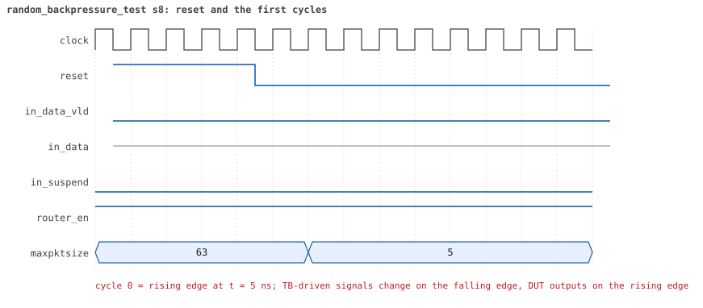
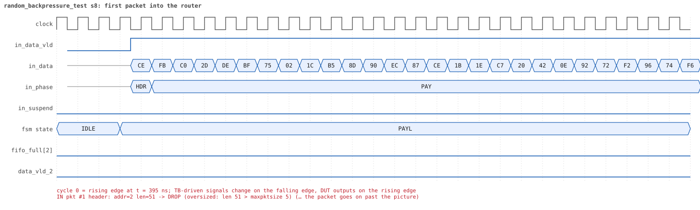
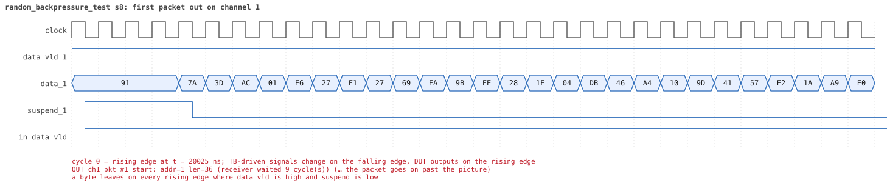
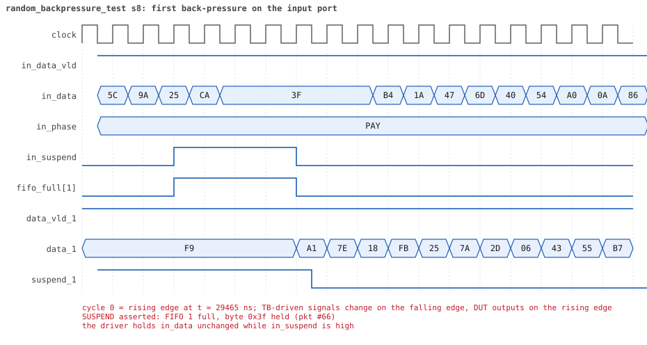
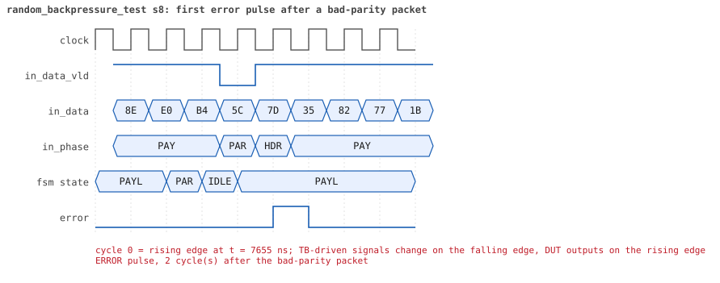
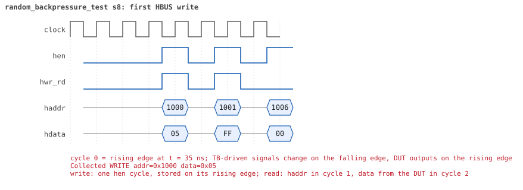
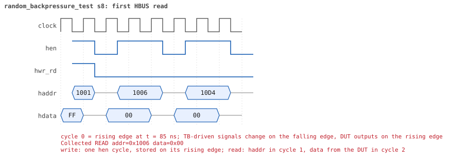

# random_backpressure_test seed 8

**Result:** PASSED (0 UVM_ERROR, 0 UVM_WARNING, 0 UVM_FATAL) · bench `yapp_project_tb` · sim time 37us · wall 17.4 s · log [`random_backpressure_test_s8.log`](random_backpressure_test_s8.log)

Waves: `random_backpressure_test_s8.fst` (GTKWave, Surfer or the VS Code wave viewer).
[Open the waves in Surfer](https://app.surfer-project.org/?load_url=https%3A%2F%2Fraw.githubusercontent.com%2Ftamirgabgab%2FQcom-Mentoring%2Fmain%2Fyapp_project%2Fregression%2Fyapp_project_tb%2Frandom_backpressure_test_s8%2Frandom_backpressure_test_s8.fst&startup_commands=run_command_file_from_url%20https%3A%2F%2Fraw.githubusercontent.com%2Ftamirgabgab%2FQcom-Mentoring%2Fmain%2Fyapp_project%2Ftb%2Fyapp_router.sucl) (web app, the signals already in groups: `yapp_project/tb/yapp_router.sucl`).

## Summary

- YAPP driver sent **75** packet(s) (5 with bad parity); the input monitor saw 75.
- Router: **17** forwarded, **58** dropped (58 oversized).
- Packets out: ch0 **1**, ch1 **7**, ch2 **9**.
- Scoreboard: 17 matched, 0 mismatched, 0 unexpected.
- Back-pressure: in_suspend asserted **2** time(s), longest hold 58 cycle(s).
- Error pulses: 5.
- HBUS: 9 write(s), 83 read(s).

## Stages

| time (ns) | stage |
|---|---|
| 0 | receivers: ch0 CHANNEL_RX_PROFILE_FAST, ch1 CHANNEL_RX_PROFILE_NORMAL, ch2 CHANNEL_RX_PROFILE_STALLY |
| 0 | random scenario: 75 packets in 2 bursts |
| 410 | burst 1/2: ctrl=0x05 (maxpktsize 5) en=0xff (router on, counter enables 1111111), 38 packet(s) |
| 18080 | burst 1/2 sent: addr0..3 9/8/20/1, bad parity 1, gap 0 29, length 10..63 |
| 18230 | burst 2/2: ctrl=0xeb (maxpktsize 43) en=0xff (router on, counter enables 1111111), 37 packet(s) |
| 34650 | burst 2/2 sent: addr0..3 3/14/20/0, bad parity 4, gap 0 26, length 2..63 |
| 34650 | final reads: every register and the stored packet, checked against the reference model |
| 36925 | done: 75 packets (17 forwarded, 58 dropped), 0 storm burst(s), 17 scoreboard matches, 83 HBUS reads checked, 5 error pulses for 5 bad packets |

## Pictures

**reset and the first cycles**

**first packet into the router**

**first packet out on channel 1**

**first back-pressure on the input port**

**first error pulse after a bad-parity packet**

**first HBUS write**

**first HBUS read**

## Timeline

837 events.

| time (ns) | who | event |
|---|---|---|
| 0 | yapp monitor | YAPP monitor running |
| 0 | **test** | STAGE: receivers: ch0 CHANNEL_RX_PROFILE_FAST, ch1 CHANNEL_RX_PROFILE_NORMAL, ch2 CHANNEL_RX_PROFILE_STALLY |
| 0 | **test** | STAGE: random scenario: 75 packets in 2 bursts |
| 0 | clk/rst driver | Starting clock (period 10) and holding reset for 5 cycles |
| 0 | **DUT** | RESET asserted |
| 50 | **DUT** | RESET released: router_en=1 maxpktsize=63 |
| 70 | hbus driver | Executed WRITE addr=0x1000 data=0x05 |
| 75 | **DUT** | CONFIG router_en=1 maxpktsize=5 |
| 75 | hbus monitor | Collected WRITE addr=0x1000 data=0x05 |
| 75 | reference | maxpktsize is now 5 |
| 90 | hbus driver | Executed WRITE addr=0x1001 data=0xff |
| 95 | hbus monitor | Collected WRITE addr=0x1001 data=0xff |
| 95 | reference | router_en is now 1 (en_reg 0xff) |
| 120 | hbus driver | Executed READ  addr=0x1006 data=0x00 |
| 125 | hbus monitor | Collected READ  addr=0x1006 data=0x00 |
| 150 | hbus driver | Executed READ  addr=0x10d4 data=0x00 |
| 155 | hbus monitor | Collected READ  addr=0x10d4 data=0x00 |
| 170 | hbus driver | Executed WRITE addr=0x11b4 data=0x67 |
| 175 | hbus monitor | Collected WRITE addr=0x11b4 data=0x67 |
| 200 | hbus driver | Executed READ  addr=0x11b4 data=0x67 |
| 205 | hbus monitor | Collected READ  addr=0x11b4 data=0x67 |
| 220 | hbus driver | Executed WRITE addr=0x11b8 data=0x29 |
| 225 | hbus monitor | Collected WRITE addr=0x11b8 data=0x29 |
| 250 | hbus driver | Executed READ  addr=0x11b8 data=0x29 |
| 255 | hbus monitor | Collected READ  addr=0x11b8 data=0x29 |
| 280 | hbus driver | Executed READ  addr=0x100d data=0x00 |
| 285 | hbus monitor | Collected READ  addr=0x100d data=0x00 |
| 300 | hbus driver | Executed WRITE addr=0x111d data=0xca |
| 305 | hbus monitor | Collected WRITE addr=0x111d data=0xca |
| 330 | hbus driver | Executed READ  addr=0x111d data=0xca |
| 335 | hbus monitor | Collected READ  addr=0x111d data=0xca |
| 350 | hbus driver | Executed WRITE addr=0x11e8 data=0x61 |
| 355 | hbus monitor | Collected WRITE addr=0x11e8 data=0x61 |
| 380 | hbus driver | Executed READ  addr=0x11e8 data=0x61 |
| 385 | hbus monitor | Collected READ  addr=0x11e8 data=0x61 |
| 410 | hbus driver | Executed READ  addr=0x100d data=0x00 |
| 410 | **test** | STAGE: burst 1/2: ctrl=0x05 (maxpktsize 5) en=0xff (router on, counter enables 1111111), 38 packet(s) |
| 410 | yapp driver | TX pkt #1: addr=2 len=51 parity=good delay=0 |
| 415 | hbus monitor | Collected READ  addr=0x100d data=0x00 |
| 425 | **DUT** | IN  pkt #1 header: addr=2 len=51 -> DROP (oversized: len 51 > maxpktsize 5) |
| 945 | **DUT** | IN  pkt #1 complete: addr=2 len=51 parity=ok dropped, 53 bytes in 53 cycles (held 0) |
| 945 | yapp monitor | RX pkt #1 on the input: addr=2 len=51 parity=good gap=37 |
| 945 | reference | Packet dropped: length 51 > maxpktsize 5 (addr=2) |
| 945 | **DUT** | ROUTER DROPS PACKET addr=2 length=51 (length > maxpktsize) |
| 950 | yapp driver | TX pkt #1 accepted by the DUT |
| 950 | yapp driver | TX pkt #2: addr=2 len=63 parity=good delay=2 |
| 975 | **DUT** | IN  pkt #2 header: addr=2 len=63 -> DROP (oversized: len 63 > maxpktsize 5) |
| 1615 | **DUT** | IN  pkt #2 complete: addr=2 len=63 parity=ok dropped, 65 bytes in 65 cycles (held 0) |
| 1615 | yapp monitor | RX pkt #2 on the input: addr=2 len=63 parity=good gap=2 |
| 1615 | reference | Packet dropped: length 63 > maxpktsize 5 (addr=2) |
| 1615 | **DUT** | ROUTER DROPS PACKET addr=2 length=63 (length > maxpktsize) |
| 1620 | yapp driver | TX pkt #2 accepted by the DUT |
| 1620 | yapp driver | TX pkt #3: addr=1 len=17 parity=good delay=0 |
| 1625 | **DUT** | IN  pkt #3 header: addr=1 len=17 -> DROP (oversized: len 17 > maxpktsize 5) |
| 1805 | **DUT** | IN  pkt #3 complete: addr=1 len=17 parity=ok dropped, 19 bytes in 19 cycles (held 0) |
| 1805 | yapp monitor | RX pkt #3 on the input: addr=1 len=17 parity=good gap=0 |
| 1805 | reference | Packet dropped: length 17 > maxpktsize 5 (addr=1) |
| 1805 | **DUT** | ROUTER DROPS PACKET addr=1 length=17 (length > maxpktsize) |
| 1810 | yapp driver | TX pkt #3 accepted by the DUT |
| 1810 | yapp driver | TX pkt #4: addr=1 len=49 parity=good delay=0 |
| 1815 | **DUT** | IN  pkt #4 header: addr=1 len=49 -> DROP (oversized: len 49 > maxpktsize 5) |
| 2315 | **DUT** | IN  pkt #4 complete: addr=1 len=49 parity=ok dropped, 51 bytes in 51 cycles (held 0) |
| 2315 | yapp monitor | RX pkt #4 on the input: addr=1 len=49 parity=good gap=0 |
| 2315 | reference | Packet dropped: length 49 > maxpktsize 5 (addr=1) |
| 2315 | **DUT** | ROUTER DROPS PACKET addr=1 length=49 (length > maxpktsize) |
| 2320 | yapp driver | TX pkt #4 accepted by the DUT |
| 2320 | yapp driver | TX pkt #5: addr=0 len=28 parity=good delay=0 |
| 2325 | **DUT** | IN  pkt #5 header: addr=0 len=28 -> DROP (oversized: len 28 > maxpktsize 5) |
| 2615 | **DUT** | IN  pkt #5 complete: addr=0 len=28 parity=ok dropped, 30 bytes in 30 cycles (held 0) |
| 2615 | yapp monitor | RX pkt #5 on the input: addr=0 len=28 parity=good gap=0 |
| 2615 | reference | Packet dropped: length 28 > maxpktsize 5 (addr=0) |
| 2615 | **DUT** | ROUTER DROPS PACKET addr=0 length=28 (length > maxpktsize) |
| 2620 | yapp driver | TX pkt #5 accepted by the DUT |
| 2620 | yapp driver | TX pkt #6: addr=2 len=48 parity=good delay=0 |
| 2625 | **DUT** | IN  pkt #6 header: addr=2 len=48 -> DROP (oversized: len 48 > maxpktsize 5) |
| 3115 | **DUT** | IN  pkt #6 complete: addr=2 len=48 parity=ok dropped, 50 bytes in 50 cycles (held 0) |
| 3115 | yapp monitor | RX pkt #6 on the input: addr=2 len=48 parity=good gap=0 |
| 3115 | reference | Packet dropped: length 48 > maxpktsize 5 (addr=2) |
| 3115 | **DUT** | ROUTER DROPS PACKET addr=2 length=48 (length > maxpktsize) |
| 3120 | yapp driver | TX pkt #6 accepted by the DUT |
| 3120 | yapp driver | TX pkt #7: addr=1 len=48 parity=good delay=0 |
| 3125 | **DUT** | IN  pkt #7 header: addr=1 len=48 -> DROP (oversized: len 48 > maxpktsize 5) |
| 3615 | **DUT** | IN  pkt #7 complete: addr=1 len=48 parity=ok dropped, 50 bytes in 50 cycles (held 0) |
| 3615 | yapp monitor | RX pkt #7 on the input: addr=1 len=48 parity=good gap=0 |
| 3615 | reference | Packet dropped: length 48 > maxpktsize 5 (addr=1) |
| 3615 | **DUT** | ROUTER DROPS PACKET addr=1 length=48 (length > maxpktsize) |
| 3620 | yapp driver | TX pkt #7 accepted by the DUT |
| 3620 | yapp driver | TX pkt #8: addr=2 len=12 parity=good delay=0 |
| 3625 | **DUT** | IN  pkt #8 header: addr=2 len=12 -> DROP (oversized: len 12 > maxpktsize 5) |
| 3755 | **DUT** | IN  pkt #8 complete: addr=2 len=12 parity=ok dropped, 14 bytes in 14 cycles (held 0) |
| 3755 | yapp monitor | RX pkt #8 on the input: addr=2 len=12 parity=good gap=0 |
| 3755 | reference | Packet dropped: length 12 > maxpktsize 5 (addr=2) |
| 3755 | **DUT** | ROUTER DROPS PACKET addr=2 length=12 (length > maxpktsize) |
| 3760 | yapp driver | TX pkt #8 accepted by the DUT |
| 3760 | yapp driver | TX pkt #9: addr=2 len=48 parity=good delay=0 |
| 3765 | **DUT** | IN  pkt #9 header: addr=2 len=48 -> DROP (oversized: len 48 > maxpktsize 5) |
| 4255 | **DUT** | IN  pkt #9 complete: addr=2 len=48 parity=ok dropped, 50 bytes in 50 cycles (held 0) |
| 4255 | yapp monitor | RX pkt #9 on the input: addr=2 len=48 parity=good gap=0 |
| 4255 | reference | Packet dropped: length 48 > maxpktsize 5 (addr=2) |
| 4255 | **DUT** | ROUTER DROPS PACKET addr=2 length=48 (length > maxpktsize) |
| 4260 | yapp driver | TX pkt #9 accepted by the DUT |
| 4260 | yapp driver | TX pkt #10: addr=2 len=54 parity=good delay=0 |
| 4265 | **DUT** | IN  pkt #10 header: addr=2 len=54 -> DROP (oversized: len 54 > maxpktsize 5) |
| 4815 | **DUT** | IN  pkt #10 complete: addr=2 len=54 parity=ok dropped, 56 bytes in 56 cycles (held 0) |
| 4815 | yapp monitor | RX pkt #10 on the input: addr=2 len=54 parity=good gap=0 |
| 4815 | reference | Packet dropped: length 54 > maxpktsize 5 (addr=2) |
| 4815 | **DUT** | ROUTER DROPS PACKET addr=2 length=54 (length > maxpktsize) |
| 4820 | yapp driver | TX pkt #10 accepted by the DUT |
| 4820 | yapp driver | TX pkt #11: addr=0 len=38 parity=good delay=0 |
| 4825 | **DUT** | IN  pkt #11 header: addr=0 len=38 -> DROP (oversized: len 38 > maxpktsize 5) |
| 5215 | **DUT** | IN  pkt #11 complete: addr=0 len=38 parity=ok dropped, 40 bytes in 40 cycles (held 0) |
| 5215 | yapp monitor | RX pkt #11 on the input: addr=0 len=38 parity=good gap=0 |
| 5215 | reference | Packet dropped: length 38 > maxpktsize 5 (addr=0) |
| 5215 | **DUT** | ROUTER DROPS PACKET addr=0 length=38 (length > maxpktsize) |
| 5220 | yapp driver | TX pkt #11 accepted by the DUT |
| 5220 | yapp driver | TX pkt #12: addr=2 len=61 parity=good delay=0 |
| 5225 | **DUT** | IN  pkt #12 header: addr=2 len=61 -> DROP (oversized: len 61 > maxpktsize 5) |
| 5845 | **DUT** | IN  pkt #12 complete: addr=2 len=61 parity=ok dropped, 63 bytes in 63 cycles (held 0) |
| 5845 | yapp monitor | RX pkt #12 on the input: addr=2 len=61 parity=good gap=0 |
| 5845 | reference | Packet dropped: length 61 > maxpktsize 5 (addr=2) |
| 5845 | **DUT** | ROUTER DROPS PACKET addr=2 length=61 (length > maxpktsize) |
| 5850 | yapp driver | TX pkt #12 accepted by the DUT |
| 5850 | yapp driver | TX pkt #13: addr=0 len=62 parity=good delay=0 |
| 5855 | **DUT** | IN  pkt #13 header: addr=0 len=62 -> DROP (oversized: len 62 > maxpktsize 5) |
| 6485 | **DUT** | IN  pkt #13 complete: addr=0 len=62 parity=ok dropped, 64 bytes in 64 cycles (held 0) |
| 6485 | yapp monitor | RX pkt #13 on the input: addr=0 len=62 parity=good gap=0 |
| 6485 | reference | Packet dropped: length 62 > maxpktsize 5 (addr=0) |
| 6485 | **DUT** | ROUTER DROPS PACKET addr=0 length=62 (length > maxpktsize) |
| 6490 | yapp driver | TX pkt #13 accepted by the DUT |
| 6490 | yapp driver | TX pkt #14: addr=2 len=10 parity=good delay=0 |
| 6495 | **DUT** | IN  pkt #14 header: addr=2 len=10 -> DROP (oversized: len 10 > maxpktsize 5) |
| 6605 | **DUT** | IN  pkt #14 complete: addr=2 len=10 parity=ok dropped, 12 bytes in 12 cycles (held 0) |
| 6605 | yapp monitor | RX pkt #14 on the input: addr=2 len=10 parity=good gap=0 |
| 6605 | reference | Packet dropped: length 10 > maxpktsize 5 (addr=2) |
| 6605 | **DUT** | ROUTER DROPS PACKET addr=2 length=10 (length > maxpktsize) |
| 6610 | yapp driver | TX pkt #14 accepted by the DUT |
| 6610 | yapp driver | TX pkt #15: addr=2 len=61 parity=good delay=0 |
| 6615 | **DUT** | IN  pkt #15 header: addr=2 len=61 -> DROP (oversized: len 61 > maxpktsize 5) |
| 7235 | **DUT** | IN  pkt #15 complete: addr=2 len=61 parity=ok dropped, 63 bytes in 63 cycles (held 0) |
| 7235 | yapp monitor | RX pkt #15 on the input: addr=2 len=61 parity=good gap=0 |
| 7235 | reference | Packet dropped: length 61 > maxpktsize 5 (addr=2) |
| 7235 | **DUT** | ROUTER DROPS PACKET addr=2 length=61 (length > maxpktsize) |
| 7240 | yapp driver | TX pkt #15 accepted by the DUT |
| 7240 | yapp driver | TX pkt #16: addr=2 len=43 parity=bad delay=0 |
| 7245 | **DUT** | IN  pkt #16 header: addr=2 len=43 -> DROP (oversized: len 43 > maxpktsize 5) |
| 7685 | **DUT** | IN  pkt #16 complete: addr=2 len=43 parity=BAD dropped, 45 bytes in 45 cycles (held 0) |
| 7685 | yapp monitor | RX pkt #16 on the input: addr=2 len=43 parity=bad gap=0 |
| 7685 | reference | Packet dropped: length 43 > maxpktsize 5 (addr=2) |
| 7685 | **DUT** | ROUTER DROPS PACKET addr=2 length=43 (length > maxpktsize) |
| 7690 | yapp driver | TX pkt #16 accepted by the DUT |
| 7690 | yapp driver | TX pkt #17: addr=1 len=31 parity=good delay=0 |
| 7695 | **DUT** | IN  pkt #17 header: addr=1 len=31 -> DROP (oversized: len 31 > maxpktsize 5) |
| 7710 | **DUT** | ERROR pulse, 2 cycle(s) after the bad-parity packet |
| 7710 | error checker | error pulse 2 cycles after the bad packet (0 still owed) |
| 8015 | **DUT** | IN  pkt #17 complete: addr=1 len=31 parity=ok dropped, 33 bytes in 33 cycles (held 0) |
| 8015 | yapp monitor | RX pkt #17 on the input: addr=1 len=31 parity=good gap=0 |
| 8015 | reference | Packet dropped: length 31 > maxpktsize 5 (addr=1) |
| 8015 | **DUT** | ROUTER DROPS PACKET addr=1 length=31 (length > maxpktsize) |
| 8020 | yapp driver | TX pkt #17 accepted by the DUT |
| 8020 | yapp driver | TX pkt #18: addr=3 len=58 parity=good delay=1 |
| 8035 | **DUT** | IN  pkt #18 header: addr=3 len=58 -> DROP (oversized: len 58 > maxpktsize 5) |
| 8625 | **DUT** | IN  pkt #18 complete: addr=3 len=58 parity=ok dropped, 60 bytes in 60 cycles (held 0) |
| 8625 | yapp monitor | RX pkt #18 on the input: addr=3 len=58 parity=good gap=1 |
| 8625 | reference | Packet dropped: illegal address 3 (len=58) |
| 8625 | **DUT** | ROUTER DROPS PACKET addr=3 length=58 (    illegal address) |
| 8630 | yapp driver | TX pkt #18 accepted by the DUT |
| 8630 | yapp driver | TX pkt #19: addr=2 len=58 parity=good delay=0 |
| 8635 | **DUT** | IN  pkt #19 header: addr=2 len=58 -> DROP (oversized: len 58 > maxpktsize 5) |
| 9225 | **DUT** | IN  pkt #19 complete: addr=2 len=58 parity=ok dropped, 60 bytes in 60 cycles (held 0) |
| 9225 | yapp monitor | RX pkt #19 on the input: addr=2 len=58 parity=good gap=0 |
| 9225 | reference | Packet dropped: length 58 > maxpktsize 5 (addr=2) |
| 9225 | **DUT** | ROUTER DROPS PACKET addr=2 length=58 (length > maxpktsize) |
| 9230 | yapp driver | TX pkt #19 accepted by the DUT |
| 9230 | yapp driver | TX pkt #20: addr=0 len=45 parity=good delay=1 |
| 9245 | **DUT** | IN  pkt #20 header: addr=0 len=45 -> DROP (oversized: len 45 > maxpktsize 5) |
| 9705 | **DUT** | IN  pkt #20 complete: addr=0 len=45 parity=ok dropped, 47 bytes in 47 cycles (held 0) |
| 9705 | yapp monitor | RX pkt #20 on the input: addr=0 len=45 parity=good gap=1 |
| 9705 | reference | Packet dropped: length 45 > maxpktsize 5 (addr=0) |
| 9705 | **DUT** | ROUTER DROPS PACKET addr=0 length=45 (length > maxpktsize) |
| 9710 | yapp driver | TX pkt #20 accepted by the DUT |
| 9710 | yapp driver | TX pkt #21: addr=2 len=41 parity=good delay=1 |
| 9725 | **DUT** | IN  pkt #21 header: addr=2 len=41 -> DROP (oversized: len 41 > maxpktsize 5) |
| 10145 | **DUT** | IN  pkt #21 complete: addr=2 len=41 parity=ok dropped, 43 bytes in 43 cycles (held 0) |
| 10145 | yapp monitor | RX pkt #21 on the input: addr=2 len=41 parity=good gap=1 |
| 10145 | reference | Packet dropped: length 41 > maxpktsize 5 (addr=2) |
| 10145 | **DUT** | ROUTER DROPS PACKET addr=2 length=41 (length > maxpktsize) |
| 10150 | yapp driver | TX pkt #21 accepted by the DUT |
| 10150 | yapp driver | TX pkt #22: addr=2 len=62 parity=good delay=0 |
| 10155 | **DUT** | IN  pkt #22 header: addr=2 len=62 -> DROP (oversized: len 62 > maxpktsize 5) |
| 10785 | **DUT** | IN  pkt #22 complete: addr=2 len=62 parity=ok dropped, 64 bytes in 64 cycles (held 0) |
| 10785 | yapp monitor | RX pkt #22 on the input: addr=2 len=62 parity=good gap=0 |
| 10785 | reference | Packet dropped: length 62 > maxpktsize 5 (addr=2) |
| 10785 | **DUT** | ROUTER DROPS PACKET addr=2 length=62 (length > maxpktsize) |
| 10790 | yapp driver | TX pkt #22 accepted by the DUT |
| 10790 | yapp driver | TX pkt #23: addr=2 len=43 parity=good delay=0 |
| 10795 | **DUT** | IN  pkt #23 header: addr=2 len=43 -> DROP (oversized: len 43 > maxpktsize 5) |
| 11235 | **DUT** | IN  pkt #23 complete: addr=2 len=43 parity=ok dropped, 45 bytes in 45 cycles (held 0) |
| 11235 | yapp monitor | RX pkt #23 on the input: addr=2 len=43 parity=good gap=0 |
| 11235 | reference | Packet dropped: length 43 > maxpktsize 5 (addr=2) |
| 11235 | **DUT** | ROUTER DROPS PACKET addr=2 length=43 (length > maxpktsize) |
| 11240 | yapp driver | TX pkt #23 accepted by the DUT |
| 11240 | yapp driver | TX pkt #24: addr=0 len=60 parity=good delay=0 |
| 11245 | **DUT** | IN  pkt #24 header: addr=0 len=60 -> DROP (oversized: len 60 > maxpktsize 5) |
| 11855 | **DUT** | IN  pkt #24 complete: addr=0 len=60 parity=ok dropped, 62 bytes in 62 cycles (held 0) |
| 11855 | yapp monitor | RX pkt #24 on the input: addr=0 len=60 parity=good gap=0 |
| 11855 | reference | Packet dropped: length 60 > maxpktsize 5 (addr=0) |
| 11855 | **DUT** | ROUTER DROPS PACKET addr=0 length=60 (length > maxpktsize) |
| 11860 | yapp driver | TX pkt #24 accepted by the DUT |
| 11860 | yapp driver | TX pkt #25: addr=2 len=63 parity=good delay=3 |
| 11895 | **DUT** | IN  pkt #25 header: addr=2 len=63 -> DROP (oversized: len 63 > maxpktsize 5) |
| 12535 | **DUT** | IN  pkt #25 complete: addr=2 len=63 parity=ok dropped, 65 bytes in 65 cycles (held 0) |
| 12535 | yapp monitor | RX pkt #25 on the input: addr=2 len=63 parity=good gap=3 |
| 12535 | reference | Packet dropped: length 63 > maxpktsize 5 (addr=2) |
| 12535 | **DUT** | ROUTER DROPS PACKET addr=2 length=63 (length > maxpktsize) |
| 12540 | yapp driver | TX pkt #25 accepted by the DUT |
| 12540 | yapp driver | TX pkt #26: addr=2 len=34 parity=good delay=0 |
| 12545 | **DUT** | IN  pkt #26 header: addr=2 len=34 -> DROP (oversized: len 34 > maxpktsize 5) |
| 12895 | **DUT** | IN  pkt #26 complete: addr=2 len=34 parity=ok dropped, 36 bytes in 36 cycles (held 0) |
| 12895 | yapp monitor | RX pkt #26 on the input: addr=2 len=34 parity=good gap=0 |
| 12895 | reference | Packet dropped: length 34 > maxpktsize 5 (addr=2) |
| 12895 | **DUT** | ROUTER DROPS PACKET addr=2 length=34 (length > maxpktsize) |
| 12900 | yapp driver | TX pkt #26 accepted by the DUT |
| 12900 | yapp driver | TX pkt #27: addr=1 len=46 parity=good delay=0 |
| 12905 | **DUT** | IN  pkt #27 header: addr=1 len=46 -> DROP (oversized: len 46 > maxpktsize 5) |
| 13375 | **DUT** | IN  pkt #27 complete: addr=1 len=46 parity=ok dropped, 48 bytes in 48 cycles (held 0) |
| 13375 | yapp monitor | RX pkt #27 on the input: addr=1 len=46 parity=good gap=0 |
| 13375 | reference | Packet dropped: length 46 > maxpktsize 5 (addr=1) |
| 13375 | **DUT** | ROUTER DROPS PACKET addr=1 length=46 (length > maxpktsize) |
| 13380 | yapp driver | TX pkt #27 accepted by the DUT |
| 13380 | yapp driver | TX pkt #28: addr=0 len=50 parity=good delay=1 |
| 13395 | **DUT** | IN  pkt #28 header: addr=0 len=50 -> DROP (oversized: len 50 > maxpktsize 5) |
| 13905 | **DUT** | IN  pkt #28 complete: addr=0 len=50 parity=ok dropped, 52 bytes in 52 cycles (held 0) |
| 13905 | yapp monitor | RX pkt #28 on the input: addr=0 len=50 parity=good gap=1 |
| 13905 | reference | Packet dropped: length 50 > maxpktsize 5 (addr=0) |
| 13905 | **DUT** | ROUTER DROPS PACKET addr=0 length=50 (length > maxpktsize) |
| 13910 | yapp driver | TX pkt #28 accepted by the DUT |
| 13910 | yapp driver | TX pkt #29: addr=1 len=40 parity=good delay=2 |
| 13935 | **DUT** | IN  pkt #29 header: addr=1 len=40 -> DROP (oversized: len 40 > maxpktsize 5) |
| 14345 | **DUT** | IN  pkt #29 complete: addr=1 len=40 parity=ok dropped, 42 bytes in 42 cycles (held 0) |
| 14345 | yapp monitor | RX pkt #29 on the input: addr=1 len=40 parity=good gap=2 |
| 14345 | reference | Packet dropped: length 40 > maxpktsize 5 (addr=1) |
| 14345 | **DUT** | ROUTER DROPS PACKET addr=1 length=40 (length > maxpktsize) |
| 14350 | yapp driver | TX pkt #29 accepted by the DUT |
| 14350 | yapp driver | TX pkt #30: addr=2 len=57 parity=good delay=0 |
| 14355 | **DUT** | IN  pkt #30 header: addr=2 len=57 -> DROP (oversized: len 57 > maxpktsize 5) |
| 14935 | **DUT** | IN  pkt #30 complete: addr=2 len=57 parity=ok dropped, 59 bytes in 59 cycles (held 0) |
| 14935 | yapp monitor | RX pkt #30 on the input: addr=2 len=57 parity=good gap=0 |
| 14935 | reference | Packet dropped: length 57 > maxpktsize 5 (addr=2) |
| 14935 | **DUT** | ROUTER DROPS PACKET addr=2 length=57 (length > maxpktsize) |
| 14940 | yapp driver | TX pkt #30 accepted by the DUT |
| 14940 | yapp driver | TX pkt #31: addr=0 len=44 parity=good delay=0 |
| 14945 | **DUT** | IN  pkt #31 header: addr=0 len=44 -> DROP (oversized: len 44 > maxpktsize 5) |
| 15395 | **DUT** | IN  pkt #31 complete: addr=0 len=44 parity=ok dropped, 46 bytes in 46 cycles (held 0) |
| 15395 | yapp monitor | RX pkt #31 on the input: addr=0 len=44 parity=good gap=0 |
| 15395 | reference | Packet dropped: length 44 > maxpktsize 5 (addr=0) |
| 15395 | **DUT** | ROUTER DROPS PACKET addr=0 length=44 (length > maxpktsize) |
| 15400 | yapp driver | TX pkt #31 accepted by the DUT |
| 15400 | yapp driver | TX pkt #32: addr=2 len=45 parity=good delay=1 |
| 15415 | **DUT** | IN  pkt #32 header: addr=2 len=45 -> DROP (oversized: len 45 > maxpktsize 5) |
| 15875 | **DUT** | IN  pkt #32 complete: addr=2 len=45 parity=ok dropped, 47 bytes in 47 cycles (held 0) |
| 15875 | yapp monitor | RX pkt #32 on the input: addr=2 len=45 parity=good gap=1 |
| 15875 | reference | Packet dropped: length 45 > maxpktsize 5 (addr=2) |
| 15875 | **DUT** | ROUTER DROPS PACKET addr=2 length=45 (length > maxpktsize) |
| 15880 | yapp driver | TX pkt #32 accepted by the DUT |
| 15880 | yapp driver | TX pkt #33: addr=1 len=42 parity=good delay=0 |
| 15885 | **DUT** | IN  pkt #33 header: addr=1 len=42 -> DROP (oversized: len 42 > maxpktsize 5) |
| 16315 | **DUT** | IN  pkt #33 complete: addr=1 len=42 parity=ok dropped, 44 bytes in 44 cycles (held 0) |
| 16315 | yapp monitor | RX pkt #33 on the input: addr=1 len=42 parity=good gap=0 |
| 16315 | reference | Packet dropped: length 42 > maxpktsize 5 (addr=1) |
| 16315 | **DUT** | ROUTER DROPS PACKET addr=1 length=42 (length > maxpktsize) |
| 16320 | yapp driver | TX pkt #33 accepted by the DUT |
| 16320 | yapp driver | TX pkt #34: addr=1 len=43 parity=good delay=0 |
| 16325 | **DUT** | IN  pkt #34 header: addr=1 len=43 -> DROP (oversized: len 43 > maxpktsize 5) |
| 16765 | **DUT** | IN  pkt #34 complete: addr=1 len=43 parity=ok dropped, 45 bytes in 45 cycles (held 0) |
| 16765 | yapp monitor | RX pkt #34 on the input: addr=1 len=43 parity=good gap=0 |
| 16765 | reference | Packet dropped: length 43 > maxpktsize 5 (addr=1) |
| 16765 | **DUT** | ROUTER DROPS PACKET addr=1 length=43 (length > maxpktsize) |
| 16770 | yapp driver | TX pkt #34 accepted by the DUT |
| 16770 | yapp driver | TX pkt #35: addr=2 len=17 parity=good delay=3 |
| 16805 | **DUT** | IN  pkt #35 header: addr=2 len=17 -> DROP (oversized: len 17 > maxpktsize 5) |
| 16985 | **DUT** | IN  pkt #35 complete: addr=2 len=17 parity=ok dropped, 19 bytes in 19 cycles (held 0) |
| 16985 | yapp monitor | RX pkt #35 on the input: addr=2 len=17 parity=good gap=3 |
| 16985 | reference | Packet dropped: length 17 > maxpktsize 5 (addr=2) |
| 16985 | **DUT** | ROUTER DROPS PACKET addr=2 length=17 (length > maxpktsize) |
| 16990 | yapp driver | TX pkt #35 accepted by the DUT |
| 16990 | yapp driver | TX pkt #36: addr=0 len=35 parity=good delay=0 |
| 16995 | **DUT** | IN  pkt #36 header: addr=0 len=35 -> DROP (oversized: len 35 > maxpktsize 5) |
| 17355 | **DUT** | IN  pkt #36 complete: addr=0 len=35 parity=ok dropped, 37 bytes in 37 cycles (held 0) |
| 17355 | yapp monitor | RX pkt #36 on the input: addr=0 len=35 parity=good gap=0 |
| 17355 | reference | Packet dropped: length 35 > maxpktsize 5 (addr=0) |
| 17355 | **DUT** | ROUTER DROPS PACKET addr=0 length=35 (length > maxpktsize) |
| 17360 | yapp driver | TX pkt #36 accepted by the DUT |
| 17360 | yapp driver | TX pkt #37: addr=0 len=27 parity=good delay=0 |
| 17365 | **DUT** | IN  pkt #37 header: addr=0 len=27 -> DROP (oversized: len 27 > maxpktsize 5) |
| 17645 | **DUT** | IN  pkt #37 complete: addr=0 len=27 parity=ok dropped, 29 bytes in 29 cycles (held 0) |
| 17645 | yapp monitor | RX pkt #37 on the input: addr=0 len=27 parity=good gap=0 |
| 17645 | reference | Packet dropped: length 27 > maxpktsize 5 (addr=0) |
| 17645 | **DUT** | ROUTER DROPS PACKET addr=0 length=27 (length > maxpktsize) |
| 17650 | yapp driver | TX pkt #37 accepted by the DUT |
| 17650 | yapp driver | TX pkt #38: addr=2 len=41 parity=good delay=0 |
| 17655 | **DUT** | IN  pkt #38 header: addr=2 len=41 -> DROP (oversized: len 41 > maxpktsize 5) |
| 18075 | **DUT** | IN  pkt #38 complete: addr=2 len=41 parity=ok dropped, 43 bytes in 43 cycles (held 0) |
| 18075 | yapp monitor | RX pkt #38 on the input: addr=2 len=41 parity=good gap=0 |
| 18075 | reference | Packet dropped: length 41 > maxpktsize 5 (addr=2) |
| 18075 | **DUT** | ROUTER DROPS PACKET addr=2 length=41 (length > maxpktsize) |
| 18080 | yapp driver | TX pkt #38 accepted by the DUT |
| 18080 | **test** | STAGE: burst 1/2 sent: addr0..3 9/8/20/1, bad parity 1, gap 0 29, length 10..63 |
| 18100 | hbus driver | Executed WRITE addr=0x1000 data=0xeb |
| 18105 | **DUT** | CONFIG router_en=1 maxpktsize=43 |
| 18105 | hbus monitor | Collected WRITE addr=0x1000 data=0xeb |
| 18105 | reference | maxpktsize is now 43 |
| 18120 | hbus driver | Executed WRITE addr=0x1001 data=0xff |
| 18125 | hbus monitor | Collected WRITE addr=0x1001 data=0xff |
| 18125 | reference | router_en is now 1 (en_reg 0xff) |
| 18150 | hbus driver | Executed READ  addr=0x10f9 data=0x00 |
| 18155 | hbus monitor | Collected READ  addr=0x10f9 data=0x00 |
| 18170 | hbus driver | Executed WRITE addr=0x116d data=0xb4 |
| 18175 | hbus monitor | Collected WRITE addr=0x116d data=0xb4 |
| 18200 | hbus driver | Executed READ  addr=0x116d data=0xb4 |
| 18205 | hbus monitor | Collected READ  addr=0x116d data=0xb4 |
| 18230 | hbus driver | Executed READ  addr=0x1040 data=0x6d |
| 18230 | **test** | STAGE: burst 2/2: ctrl=0xeb (maxpktsize 43) en=0xff (router on, counter enables 1111111), 37 packet(s) |
| 18230 | yapp driver | TX pkt #39: addr=2 len=61 parity=good delay=0 |
| 18235 | hbus monitor | Collected READ  addr=0x1040 data=0x6d |
| 18245 | **DUT** | IN  pkt #39 header: addr=2 len=61 -> DROP (oversized: len 61 > maxpktsize 43) |
| 18865 | **DUT** | IN  pkt #39 complete: addr=2 len=61 parity=ok dropped, 63 bytes in 63 cycles (held 0) |
| 18865 | yapp monitor | RX pkt #39 on the input: addr=2 len=61 parity=good gap=16 |
| 18865 | reference | Packet dropped: length 61 > maxpktsize 43 (addr=2) |
| 18865 | **DUT** | ROUTER DROPS PACKET addr=2 length=61 (length > maxpktsize) |
| 18870 | yapp driver | TX pkt #39 accepted by the DUT |
| 18870 | yapp driver | TX pkt #40: addr=0 len=48 parity=good delay=0 |
| 18875 | **DUT** | IN  pkt #40 header: addr=0 len=48 -> DROP (oversized: len 48 > maxpktsize 43) |
| 19365 | **DUT** | IN  pkt #40 complete: addr=0 len=48 parity=ok dropped, 50 bytes in 50 cycles (held 0) |
| 19365 | yapp monitor | RX pkt #40 on the input: addr=0 len=48 parity=good gap=0 |
| 19365 | reference | Packet dropped: length 48 > maxpktsize 43 (addr=0) |
| 19365 | **DUT** | ROUTER DROPS PACKET addr=0 length=48 (length > maxpktsize) |
| 19370 | yapp driver | TX pkt #40 accepted by the DUT |
| 19370 | yapp driver | TX pkt #41: addr=1 len=57 parity=good delay=0 |
| 19375 | **DUT** | IN  pkt #41 header: addr=1 len=57 -> DROP (oversized: len 57 > maxpktsize 43) |
| 19955 | **DUT** | IN  pkt #41 complete: addr=1 len=57 parity=ok dropped, 59 bytes in 59 cycles (held 0) |
| 19955 | yapp monitor | RX pkt #41 on the input: addr=1 len=57 parity=good gap=0 |
| 19955 | reference | Packet dropped: length 57 > maxpktsize 43 (addr=1) |
| 19955 | **DUT** | ROUTER DROPS PACKET addr=1 length=57 (length > maxpktsize) |
| 19960 | yapp driver | TX pkt #41 accepted by the DUT |
| 19960 | yapp driver | TX pkt #42: addr=1 len=36 parity=good delay=0 |
| 19965 | **DUT** | IN  pkt #42 header: addr=1 len=36 -> channel 1 |
| 20065 | **DUT** | OUT ch1 pkt #1 start: addr=1 len=36 (receiver waited 9 cycle(s)) |
| 20335 | **DUT** | IN  pkt #42 complete: addr=1 len=36 parity=ok forwarded, 38 bytes in 38 cycles (held 0) |
| 20335 | yapp monitor | RX pkt #42 on the input: addr=1 len=36 parity=good gap=0 |
| 20335 | reference | Packet forwarded: addr=1 len=36 -> channel 1 |
| 20340 | yapp driver | TX pkt #42 accepted by the DUT |
| 20340 | yapp driver | TX pkt #43: addr=1 len=62 parity=good delay=1 |
| 20355 | **DUT** | IN  pkt #43 header: addr=1 len=62 -> DROP (oversized: len 62 > maxpktsize 43) |
| 20430 | ch1 driver | ch1: packet consumed (response delay 9) |
| 20445 | **DUT** | OUT ch1 pkt #1 done: 38 bytes in 39 cycles |
| 20445 | ch1 monitor | ch1 RX pkt #1: addr=1 len=36 parity=good |
| 20445 | scoreboard | ch1 pkt matched: addr=1 len=36 (1 matched so far) |
| 20460 | ch1 driver | ch1: packet consumed (response delay 0) |
| 20985 | **DUT** | IN  pkt #43 complete: addr=1 len=62 parity=ok dropped, 64 bytes in 64 cycles (held 0) |
| 20985 | yapp monitor | RX pkt #43 on the input: addr=1 len=62 parity=good gap=1 |
| 20985 | reference | Packet dropped: length 62 > maxpktsize 43 (addr=1) |
| 20985 | **DUT** | ROUTER DROPS PACKET addr=1 length=62 (length > maxpktsize) |
| 20990 | yapp driver | TX pkt #43 accepted by the DUT |
| 20990 | yapp driver | TX pkt #44: addr=2 len=37 parity=good delay=0 |
| 20995 | **DUT** | IN  pkt #44 header: addr=2 len=37 -> channel 2 |
| 21055 | **DUT** | OUT ch2 pkt #1 start: addr=2 len=37 (receiver waited 5 cycle(s)) |
| 21375 | **DUT** | IN  pkt #44 complete: addr=2 len=37 parity=ok forwarded, 39 bytes in 39 cycles (held 0) |
| 21375 | yapp monitor | RX pkt #44 on the input: addr=2 len=37 parity=good gap=0 |
| 21375 | reference | Packet forwarded: addr=2 len=37 -> channel 2 |
| 21380 | yapp driver | TX pkt #44 accepted by the DUT |
| 21380 | yapp driver | TX pkt #45: addr=2 len=18 parity=good delay=2 |
| 21405 | **DUT** | IN  pkt #45 header: addr=2 len=18 -> channel 2 |
| 21430 | ch2 driver | ch2: packet consumed (response delay 5) |
| 21535 | **DUT** | OUT ch2 pkt #1 done: 39 bytes in 49 cycles |
| 21535 | ch2 monitor | ch2 RX pkt #1: addr=2 len=37 parity=good |
| 21535 | scoreboard | ch2 pkt matched: addr=2 len=37 (2 matched so far) |
| 21545 | **DUT** | OUT ch2 pkt #2 start: addr=2 len=18 (receiver waited 0 cycle(s)) |
| 21595 | **DUT** | IN  pkt #45 complete: addr=2 len=18 parity=ok forwarded, 20 bytes in 20 cycles (held 0) |
| 21595 | yapp monitor | RX pkt #45 on the input: addr=2 len=18 parity=good gap=2 |
| 21595 | reference | Packet forwarded: addr=2 len=18 -> channel 2 |
| 21600 | yapp driver | TX pkt #45 accepted by the DUT |
| 21600 | yapp driver | TX pkt #46: addr=1 len=15 parity=good delay=10 |
| 21705 | **DUT** | IN  pkt #46 header: addr=1 len=15 -> channel 1 |
| 21715 | **DUT** | OUT ch1 pkt #2 start: addr=1 len=15 (receiver waited 0 cycle(s)) |
| 21735 | **DUT** | OUT ch2 pkt #2 done: 20 bytes in 20 cycles |
| 21735 | ch2 monitor | ch2 RX pkt #2: addr=2 len=18 parity=good |
| 21735 | scoreboard | ch2 pkt matched: addr=2 len=18 (3 matched so far) |
| 21865 | **DUT** | IN  pkt #46 complete: addr=1 len=15 parity=ok forwarded, 17 bytes in 17 cycles (held 0) |
| 21865 | yapp monitor | RX pkt #46 on the input: addr=1 len=15 parity=good gap=10 |
| 21865 | reference | Packet forwarded: addr=1 len=15 -> channel 1 |
| 21870 | ch1 driver | ch1: packet consumed (response delay 0) |
| 21870 | yapp driver | TX pkt #46 accepted by the DUT |
| 21870 | yapp driver | TX pkt #47: addr=2 len=12 parity=good delay=20 |
| 21955 | **DUT** | OUT ch1 pkt #2 done: 17 bytes in 25 cycles |
| 21955 | ch1 monitor | ch1 RX pkt #2: addr=1 len=15 parity=good |
| 21955 | scoreboard | ch1 pkt matched: addr=1 len=15 (4 matched so far) |
| 22075 | **DUT** | IN  pkt #47 header: addr=2 len=12 -> channel 2 |
| 22085 | **DUT** | OUT ch2 pkt #3 start: addr=2 len=12 (receiver waited 0 cycle(s)) |
| 22110 | ch2 driver | ch2: packet consumed (response delay 9) |
| 22205 | **DUT** | IN  pkt #47 complete: addr=2 len=12 parity=ok forwarded, 14 bytes in 14 cycles (held 0) |
| 22205 | yapp monitor | RX pkt #47 on the input: addr=2 len=12 parity=good gap=20 |
| 22205 | reference | Packet forwarded: addr=2 len=12 -> channel 2 |
| 22210 | yapp driver | TX pkt #47 accepted by the DUT |
| 22210 | yapp driver | TX pkt #48: addr=1 len=47 parity=good delay=0 |
| 22215 | **DUT** | IN  pkt #48 header: addr=1 len=47 -> DROP (oversized: len 47 > maxpktsize 43) |
| 22245 | **DUT** | OUT ch2 pkt #3 done: 14 bytes in 17 cycles |
| 22245 | ch2 monitor | ch2 RX pkt #3: addr=2 len=12 parity=good |
| 22245 | scoreboard | ch2 pkt matched: addr=2 len=12 (5 matched so far) |
| 22580 | ch2 driver | ch2: packet consumed (response delay 2) |
| 22590 | ch1 driver | ch1: packet consumed (response delay 7) |
| 22695 | **DUT** | IN  pkt #48 complete: addr=1 len=47 parity=ok dropped, 49 bytes in 49 cycles (held 0) |
| 22695 | yapp monitor | RX pkt #48 on the input: addr=1 len=47 parity=good gap=0 |
| 22695 | reference | Packet dropped: length 47 > maxpktsize 43 (addr=1) |
| 22695 | **DUT** | ROUTER DROPS PACKET addr=1 length=47 (length > maxpktsize) |
| 22700 | yapp driver | TX pkt #48 accepted by the DUT |
| 22700 | yapp driver | TX pkt #49: addr=2 len=40 parity=good delay=1 |
| 22715 | **DUT** | IN  pkt #49 header: addr=2 len=40 -> channel 2 |
| 22765 | **DUT** | OUT ch2 pkt #4 start: addr=2 len=40 (receiver waited 4 cycle(s)) |
| 23125 | **DUT** | IN  pkt #49 complete: addr=2 len=40 parity=ok forwarded, 42 bytes in 42 cycles (held 0) |
| 23125 | yapp monitor | RX pkt #49 on the input: addr=2 len=40 parity=good gap=1 |
| 23125 | reference | Packet forwarded: addr=2 len=40 -> channel 2 |
| 23130 | yapp driver | TX pkt #49 accepted by the DUT |
| 23130 | yapp driver | TX pkt #50: addr=2 len=55 parity=good delay=0 |
| 23135 | **DUT** | IN  pkt #50 header: addr=2 len=55 -> DROP (oversized: len 55 > maxpktsize 43) |
| 23170 | ch2 driver | ch2: packet consumed (response delay 4) |
| 23265 | **DUT** | OUT ch2 pkt #4 done: 42 bytes in 51 cycles |
| 23265 | ch2 monitor | ch2 RX pkt #4: addr=2 len=40 parity=good |
| 23265 | scoreboard | ch2 pkt matched: addr=2 len=40 (6 matched so far) |
| 23390 | ch2 driver | ch2: packet consumed (response delay 8) |
| 23695 | **DUT** | IN  pkt #50 complete: addr=2 len=55 parity=ok dropped, 57 bytes in 57 cycles (held 0) |
| 23695 | yapp monitor | RX pkt #50 on the input: addr=2 len=55 parity=good gap=0 |
| 23695 | reference | Packet dropped: length 55 > maxpktsize 43 (addr=2) |
| 23695 | **DUT** | ROUTER DROPS PACKET addr=2 length=55 (length > maxpktsize) |
| 23700 | yapp driver | TX pkt #50 accepted by the DUT |
| 23700 | yapp driver | TX pkt #51: addr=2 len=47 parity=good delay=0 |
| 23705 | **DUT** | IN  pkt #51 header: addr=2 len=47 -> DROP (oversized: len 47 > maxpktsize 43) |
| 24185 | **DUT** | IN  pkt #51 complete: addr=2 len=47 parity=ok dropped, 49 bytes in 49 cycles (held 0) |
| 24185 | yapp monitor | RX pkt #51 on the input: addr=2 len=47 parity=good gap=0 |
| 24185 | reference | Packet dropped: length 47 > maxpktsize 43 (addr=2) |
| 24185 | **DUT** | ROUTER DROPS PACKET addr=2 length=47 (length > maxpktsize) |
| 24190 | yapp driver | TX pkt #51 accepted by the DUT |
| 24190 | yapp driver | TX pkt #52: addr=2 len=60 parity=good delay=0 |
| 24195 | **DUT** | IN  pkt #52 header: addr=2 len=60 -> DROP (oversized: len 60 > maxpktsize 43) |
| 24805 | **DUT** | IN  pkt #52 complete: addr=2 len=60 parity=ok dropped, 62 bytes in 62 cycles (held 0) |
| 24805 | yapp monitor | RX pkt #52 on the input: addr=2 len=60 parity=good gap=0 |
| 24805 | reference | Packet dropped: length 60 > maxpktsize 43 (addr=2) |
| 24805 | **DUT** | ROUTER DROPS PACKET addr=2 length=60 (length > maxpktsize) |
| 24810 | yapp driver | TX pkt #52 accepted by the DUT |
| 24810 | yapp driver | TX pkt #53: addr=2 len=44 parity=good delay=0 |
| 24815 | **DUT** | IN  pkt #53 header: addr=2 len=44 -> DROP (oversized: len 44 > maxpktsize 43) |
| 25265 | **DUT** | IN  pkt #53 complete: addr=2 len=44 parity=ok dropped, 46 bytes in 46 cycles (held 0) |
| 25265 | yapp monitor | RX pkt #53 on the input: addr=2 len=44 parity=good gap=0 |
| 25265 | reference | Packet dropped: length 44 > maxpktsize 43 (addr=2) |
| 25265 | **DUT** | ROUTER DROPS PACKET addr=2 length=44 (length > maxpktsize) |
| 25270 | yapp driver | TX pkt #53 accepted by the DUT |
| 25270 | yapp driver | TX pkt #54: addr=2 len=51 parity=good delay=0 |
| 25275 | **DUT** | IN  pkt #54 header: addr=2 len=51 -> DROP (oversized: len 51 > maxpktsize 43) |
| 25795 | **DUT** | IN  pkt #54 complete: addr=2 len=51 parity=ok dropped, 53 bytes in 53 cycles (held 0) |
| 25795 | yapp monitor | RX pkt #54 on the input: addr=2 len=51 parity=good gap=0 |
| 25795 | reference | Packet dropped: length 51 > maxpktsize 43 (addr=2) |
| 25795 | **DUT** | ROUTER DROPS PACKET addr=2 length=51 (length > maxpktsize) |
| 25800 | yapp driver | TX pkt #54 accepted by the DUT |
| 25800 | yapp driver | TX pkt #55: addr=2 len=44 parity=good delay=0 |
| 25805 | **DUT** | IN  pkt #55 header: addr=2 len=44 -> DROP (oversized: len 44 > maxpktsize 43) |
| 26255 | **DUT** | IN  pkt #55 complete: addr=2 len=44 parity=ok dropped, 46 bytes in 46 cycles (held 0) |
| 26255 | yapp monitor | RX pkt #55 on the input: addr=2 len=44 parity=good gap=0 |
| 26255 | reference | Packet dropped: length 44 > maxpktsize 43 (addr=2) |
| 26255 | **DUT** | ROUTER DROPS PACKET addr=2 length=44 (length > maxpktsize) |
| 26260 | yapp driver | TX pkt #55 accepted by the DUT |
| 26260 | yapp driver | TX pkt #56: addr=2 len=45 parity=good delay=0 |
| 26265 | **DUT** | IN  pkt #56 header: addr=2 len=45 -> DROP (oversized: len 45 > maxpktsize 43) |
| 26725 | **DUT** | IN  pkt #56 complete: addr=2 len=45 parity=ok dropped, 47 bytes in 47 cycles (held 0) |
| 26725 | yapp monitor | RX pkt #56 on the input: addr=2 len=45 parity=good gap=0 |
| 26725 | reference | Packet dropped: length 45 > maxpktsize 43 (addr=2) |
| 26725 | **DUT** | ROUTER DROPS PACKET addr=2 length=45 (length > maxpktsize) |
| 26730 | yapp driver | TX pkt #56 accepted by the DUT |
| 26730 | yapp driver | TX pkt #57: addr=0 len=2 parity=good delay=0 |
| 26735 | **DUT** | IN  pkt #57 header: addr=0 len=2 -> channel 0 |
| 26745 | **DUT** | OUT ch0 pkt #1 start: addr=0 len=2 (receiver waited 0 cycle(s)) |
| 26765 | **DUT** | IN  pkt #57 complete: addr=0 len=2 parity=ok forwarded, 4 bytes in 4 cycles (held 0) |
| 26765 | yapp monitor | RX pkt #57 on the input: addr=0 len=2 parity=good gap=0 |
| 26765 | reference | Packet forwarded: addr=0 len=2 -> channel 0 |
| 26770 | ch0 driver | ch0: packet consumed (response delay 0) |
| 26770 | yapp driver | TX pkt #57 accepted by the DUT |
| 26770 | yapp driver | TX pkt #58: addr=1 len=5 parity=good delay=0 |
| 26775 | **DUT** | IN  pkt #58 header: addr=1 len=5 -> channel 1 |
| 26785 | **DUT** | OUT ch0 pkt #1 done: 4 bytes in 5 cycles |
| 26785 | ch0 monitor | ch0 RX pkt #1: addr=0 len=2 parity=good |
| 26785 | scoreboard | ch0 pkt matched: addr=0 len=2 (7 matched so far) |
| 26825 | **DUT** | OUT ch1 pkt #3 start: addr=1 len=5 (receiver waited 4 cycle(s)) |
| 26835 | **DUT** | IN  pkt #58 complete: addr=1 len=5 parity=ok forwarded, 7 bytes in 7 cycles (held 0) |
| 26835 | yapp monitor | RX pkt #58 on the input: addr=1 len=5 parity=good gap=0 |
| 26835 | reference | Packet forwarded: addr=1 len=5 -> channel 1 |
| 26840 | yapp driver | TX pkt #58 accepted by the DUT |
| 26840 | yapp driver | TX pkt #59: addr=1 len=54 parity=good delay=0 |
| 26845 | **DUT** | IN  pkt #59 header: addr=1 len=54 -> DROP (oversized: len 54 > maxpktsize 43) |
| 26880 | ch1 driver | ch1: packet consumed (response delay 4) |
| 26890 | ch0 driver | ch0: packet consumed (response delay 0) |
| 26995 | **DUT** | OUT ch1 pkt #3 done: 7 bytes in 18 cycles |
| 26995 | ch1 monitor | ch1 RX pkt #3: addr=1 len=5 parity=good |
| 26995 | scoreboard | ch1 pkt matched: addr=1 len=5 (8 matched so far) |
| 27395 | **DUT** | IN  pkt #59 complete: addr=1 len=54 parity=ok dropped, 56 bytes in 56 cycles (held 0) |
| 27395 | yapp monitor | RX pkt #59 on the input: addr=1 len=54 parity=good gap=0 |
| 27395 | reference | Packet dropped: length 54 > maxpktsize 43 (addr=1) |
| 27395 | **DUT** | ROUTER DROPS PACKET addr=1 length=54 (length > maxpktsize) |
| 27400 | yapp driver | TX pkt #59 accepted by the DUT |
| 27400 | yapp driver | TX pkt #60: addr=2 len=46 parity=good delay=0 |
| 27405 | **DUT** | IN  pkt #60 header: addr=2 len=46 -> DROP (oversized: len 46 > maxpktsize 43) |
| 27500 | ch1 driver | ch1: packet consumed (response delay 10) |
| 27875 | **DUT** | IN  pkt #60 complete: addr=2 len=46 parity=ok dropped, 48 bytes in 48 cycles (held 0) |
| 27875 | yapp monitor | RX pkt #60 on the input: addr=2 len=46 parity=good gap=0 |
| 27875 | reference | Packet dropped: length 46 > maxpktsize 43 (addr=2) |
| 27875 | **DUT** | ROUTER DROPS PACKET addr=2 length=46 (length > maxpktsize) |
| 27880 | yapp driver | TX pkt #60 accepted by the DUT |
| 27880 | yapp driver | TX pkt #61: addr=1 len=63 parity=bad delay=0 |
| 27885 | **DUT** | IN  pkt #61 header: addr=1 len=63 -> DROP (oversized: len 63 > maxpktsize 43) |
| 28525 | **DUT** | IN  pkt #61 complete: addr=1 len=63 parity=BAD dropped, 65 bytes in 65 cycles (held 0) |
| 28525 | yapp monitor | RX pkt #61 on the input: addr=1 len=63 parity=bad gap=0 |
| 28525 | reference | Packet dropped: length 63 > maxpktsize 43 (addr=1) |
| 28525 | **DUT** | ROUTER DROPS PACKET addr=1 length=63 (length > maxpktsize) |
| 28530 | yapp driver | TX pkt #61 accepted by the DUT |
| 28530 | yapp driver | TX pkt #62: addr=2 len=53 parity=good delay=0 |
| 28535 | **DUT** | IN  pkt #62 header: addr=2 len=53 -> DROP (oversized: len 53 > maxpktsize 43) |
| 28590 | **DUT** | ERROR pulse, 6 cycle(s) after the bad-parity packet |
| 28590 | error checker | error pulse 6 cycles after the bad packet (0 still owed) |
| 29075 | **DUT** | IN  pkt #62 complete: addr=2 len=53 parity=ok dropped, 55 bytes in 55 cycles (held 0) |
| 29075 | yapp monitor | RX pkt #62 on the input: addr=2 len=53 parity=good gap=0 |
| 29075 | reference | Packet dropped: length 53 > maxpktsize 43 (addr=2) |
| 29075 | **DUT** | ROUTER DROPS PACKET addr=2 length=53 (length > maxpktsize) |
| 29080 | yapp driver | TX pkt #62 accepted by the DUT |
| 29080 | yapp driver | TX pkt #63: addr=2 len=2 parity=good delay=2 |
| 29105 | **DUT** | IN  pkt #63 header: addr=2 len=2 -> channel 2 |
| 29135 | **DUT** | IN  pkt #63 complete: addr=2 len=2 parity=ok forwarded, 4 bytes in 4 cycles (held 0) |
| 29135 | yapp monitor | RX pkt #63 on the input: addr=2 len=2 parity=good gap=2 |
| 29135 | reference | Packet forwarded: addr=2 len=2 -> channel 2 |
| 29140 | yapp driver | TX pkt #63 accepted by the DUT |
| 29140 | yapp driver | TX pkt #64: addr=2 len=9 parity=bad delay=1 |
| 29155 | **DUT** | IN  pkt #64 header: addr=2 len=9 -> channel 2 |
| 29175 | **DUT** | OUT ch2 pkt #5 start: addr=2 len=2 (receiver waited 6 cycle(s)) |
| 29200 | ch2 driver | ch2: packet consumed (response delay 6) |
| 29255 | **DUT** | IN  pkt #64 complete: addr=2 len=9 parity=BAD forwarded, 11 bytes in 11 cycles (held 0) |
| 29255 | yapp monitor | RX pkt #64 on the input: addr=2 len=9 parity=bad gap=1 |
| 29255 | reference | Packet forwarded: addr=2 len=9 -> channel 2 |
| 29260 | yapp driver | TX pkt #64 accepted by the DUT |
| 29260 | yapp driver | TX pkt #65: addr=1 len=6 parity=good delay=0 |
| 29265 | **DUT** | IN  pkt #65 header: addr=1 len=6 -> channel 1 |
| 29285 | **DUT** | OUT ch2 pkt #5 done: 4 bytes in 12 cycles |
| 29285 | ch2 monitor | ch2 RX pkt #5: addr=2 len=2 parity=good |
| 29285 | scoreboard | ch2 pkt matched: addr=2 len=2 (9 matched so far) |
| 29295 | **DUT** | OUT ch2 pkt #6 start: addr=2 len=9 (receiver waited 0 cycle(s)) |
| 29310 | ch2 driver | ch2: packet consumed (response delay 7) |
| 29335 | **DUT** | IN  pkt #65 complete: addr=1 len=6 parity=ok forwarded, 8 bytes in 8 cycles (held 0) |
| 29335 | yapp monitor | RX pkt #65 on the input: addr=1 len=6 parity=good gap=0 |
| 29335 | reference | Packet forwarded: addr=1 len=6 -> channel 1 |
| 29340 | yapp driver | TX pkt #65 accepted by the DUT |
| 29340 | yapp driver | TX pkt #66: addr=1 len=40 parity=good delay=1 |
| 29350 | **DUT** | ERROR pulse, 9 cycle(s) after the bad-parity packet |
| 29350 | error checker | error pulse 9 cycles after the bad packet (0 still owed) |
| 29355 | **DUT** | IN  pkt #66 header: addr=1 len=40 -> channel 1 |
| 29375 | **DUT** | OUT ch1 pkt #4 start: addr=1 len=6 (receiver waited 10 cycle(s)) |
| 29440 | ch1 driver | ch1: packet consumed (response delay 10) |
| 29505 | **DUT** | SUSPEND asserted: FIFO 1 full, byte 0x3f held (pkt #66) |
| 29505 | **DUT** | OUT ch2 pkt #6 done: 11 bytes in 22 cycles |
| 29505 | ch2 monitor | ch2 RX pkt #6: addr=2 len=9 parity=bad |
| 29505 | scoreboard | ch2 pkt matched: addr=2 len=9 (10 matched so far) |
| 29535 | **DUT** | OUT ch1 pkt #4 done: 8 bytes in 17 cycles |
| 29535 | ch1 monitor | ch1 RX pkt #4: addr=1 len=6 parity=good |
| 29535 | scoreboard | ch1 pkt matched: addr=1 len=6 (11 matched so far) |
| 29545 | **DUT** | SUSPEND released after 4 cycle(s) |
| 29545 | **DUT** | OUT ch1 pkt #5 start: addr=1 len=40 (receiver waited 0 cycle(s)) |
| 29805 | **DUT** | IN  pkt #66 complete: addr=1 len=40 parity=ok forwarded, 42 bytes in 46 cycles (held 4) |
| 29805 | yapp monitor | RX pkt #66 on the input: addr=1 len=40 parity=good gap=1 |
| 29805 | reference | Packet forwarded: addr=1 len=40 -> channel 1 |
| 29810 | yapp driver | TX pkt #66 accepted by the DUT |
| 29810 | yapp driver | TX pkt #67: addr=2 len=38 parity=good delay=0 |
| 29815 | **DUT** | IN  pkt #67 header: addr=2 len=38 -> channel 2 |
| 29825 | **DUT** | OUT ch2 pkt #7 start: addr=2 len=38 (receiver waited 0 cycle(s)) |
| 29870 | ch2 driver | ch2: packet consumed (response delay 10) |
| 29955 | **DUT** | OUT ch1 pkt #5 done: 42 bytes in 42 cycles |
| 29955 | ch1 monitor | ch1 RX pkt #5: addr=1 len=40 parity=good |
| 29955 | scoreboard | ch1 pkt matched: addr=1 len=40 (12 matched so far) |
| 30025 | **DUT** | SUSPEND asserted: FIFO 2 full, byte 0xd5 held (pkt #67) |
| 30160 | ch1 driver | ch1: packet consumed (response delay 8) |
| 30605 | **DUT** | SUSPEND released after 58 cycle(s) |
| 30785 | **DUT** | IN  pkt #67 complete: addr=2 len=38 parity=ok forwarded, 40 bytes in 98 cycles (held 58) |
| 30785 | yapp monitor | RX pkt #67 on the input: addr=2 len=38 parity=good gap=0 |
| 30785 | reference | Packet forwarded: addr=2 len=38 -> channel 2 |
| 30790 | yapp driver | TX pkt #67 accepted by the DUT |
| 30790 | yapp driver | TX pkt #68: addr=1 len=43 parity=bad delay=0 |
| 30795 | **DUT** | IN  pkt #68 header: addr=1 len=43 -> channel 1 |
| 30875 | **DUT** | OUT ch1 pkt #6 start: addr=1 len=43 (receiver waited 7 cycle(s)) |
| 30935 | **DUT** | OUT ch2 pkt #7 done: 40 bytes in 112 cycles |
| 30935 | ch2 monitor | ch2 RX pkt #7: addr=2 len=38 parity=good |
| 30935 | scoreboard | ch2 pkt matched: addr=2 len=38 (13 matched so far) |
| 31150 | ch2 driver | ch2: packet consumed (response delay 71) |
| 31235 | **DUT** | IN  pkt #68 complete: addr=1 len=43 parity=BAD forwarded, 45 bytes in 45 cycles (held 0) |
| 31235 | yapp monitor | RX pkt #68 on the input: addr=1 len=43 parity=bad gap=0 |
| 31235 | reference | Packet forwarded: addr=1 len=43 -> channel 1 |
| 31240 | yapp driver | TX pkt #68 accepted by the DUT |
| 31240 | yapp driver | TX pkt #69: addr=1 len=47 parity=good delay=0 |
| 31245 | **DUT** | IN  pkt #69 header: addr=1 len=47 -> DROP (oversized: len 47 > maxpktsize 43) |
| 31290 | **DUT** | ERROR pulse, 5 cycle(s) after the bad-parity packet |
| 31290 | error checker | error pulse 5 cycles after the bad packet (0 still owed) |
| 31310 | ch1 driver | ch1: packet consumed (response delay 7) |
| 31325 | **DUT** | OUT ch1 pkt #6 done: 45 bytes in 46 cycles |
| 31325 | ch1 monitor | ch1 RX pkt #6: addr=1 len=43 parity=bad |
| 31325 | scoreboard | ch1 pkt matched: addr=1 len=43 (14 matched so far) |
| 31530 | ch1 driver | ch1: packet consumed (response delay 0) |
| 31725 | **DUT** | IN  pkt #69 complete: addr=1 len=47 parity=ok dropped, 49 bytes in 49 cycles (held 0) |
| 31725 | yapp monitor | RX pkt #69 on the input: addr=1 len=47 parity=good gap=0 |
| 31725 | reference | Packet dropped: length 47 > maxpktsize 43 (addr=1) |
| 31725 | **DUT** | ROUTER DROPS PACKET addr=1 length=47 (length > maxpktsize) |
| 31730 | yapp driver | TX pkt #69 accepted by the DUT |
| 31730 | yapp driver | TX pkt #70: addr=1 len=63 parity=bad delay=3 |
| 31765 | **DUT** | IN  pkt #70 header: addr=1 len=63 -> DROP (oversized: len 63 > maxpktsize 43) |
| 32405 | **DUT** | IN  pkt #70 complete: addr=1 len=63 parity=BAD dropped, 65 bytes in 65 cycles (held 0) |
| 32405 | yapp monitor | RX pkt #70 on the input: addr=1 len=63 parity=bad gap=3 |
| 32405 | reference | Packet dropped: length 63 > maxpktsize 43 (addr=1) |
| 32405 | **DUT** | ROUTER DROPS PACKET addr=1 length=63 (length > maxpktsize) |
| 32410 | yapp driver | TX pkt #70 accepted by the DUT |
| 32410 | yapp driver | TX pkt #71: addr=2 len=40 parity=good delay=0 |
| 32415 | **DUT** | IN  pkt #71 header: addr=2 len=40 -> channel 2 |
| 32450 | **DUT** | ERROR pulse, 4 cycle(s) after the bad-parity packet |
| 32450 | error checker | error pulse 4 cycles after the bad packet (0 still owed) |
| 32525 | **DUT** | OUT ch2 pkt #8 start: addr=2 len=40 (receiver waited 10 cycle(s)) |
| 32825 | **DUT** | IN  pkt #71 complete: addr=2 len=40 parity=ok forwarded, 42 bytes in 42 cycles (held 0) |
| 32825 | yapp monitor | RX pkt #71 on the input: addr=2 len=40 parity=good gap=0 |
| 32825 | reference | Packet forwarded: addr=2 len=40 -> channel 2 |
| 32830 | yapp driver | TX pkt #71 accepted by the DUT |
| 32830 | yapp driver | TX pkt #72: addr=0 len=63 parity=good delay=0 |
| 32835 | **DUT** | IN  pkt #72 header: addr=0 len=63 -> DROP (oversized: len 63 > maxpktsize 43) |
| 32930 | ch2 driver | ch2: packet consumed (response delay 10) |
| 32995 | **DUT** | OUT ch2 pkt #8 done: 42 bytes in 48 cycles |
| 32995 | ch2 monitor | ch2 RX pkt #8: addr=2 len=40 parity=good |
| 32995 | scoreboard | ch2 pkt matched: addr=2 len=40 (15 matched so far) |
| 33190 | ch2 driver | ch2: packet consumed (response delay 5) |
| 33475 | **DUT** | IN  pkt #72 complete: addr=0 len=63 parity=ok dropped, 65 bytes in 65 cycles (held 0) |
| 33475 | yapp monitor | RX pkt #72 on the input: addr=0 len=63 parity=good gap=0 |
| 33475 | reference | Packet dropped: length 63 > maxpktsize 43 (addr=0) |
| 33475 | **DUT** | ROUTER DROPS PACKET addr=0 length=63 (length > maxpktsize) |
| 33480 | yapp driver | TX pkt #72 accepted by the DUT |
| 33480 | yapp driver | TX pkt #73: addr=2 len=43 parity=good delay=1 |
| 33495 | **DUT** | IN  pkt #73 header: addr=2 len=43 -> channel 2 |
| 33505 | **DUT** | OUT ch2 pkt #9 start: addr=2 len=43 (receiver waited 0 cycle(s)) |
| 33935 | **DUT** | IN  pkt #73 complete: addr=2 len=43 parity=ok forwarded, 45 bytes in 45 cycles (held 0) |
| 33935 | yapp monitor | RX pkt #73 on the input: addr=2 len=43 parity=good gap=1 |
| 33935 | reference | Packet forwarded: addr=2 len=43 -> channel 2 |
| 33940 | ch2 driver | ch2: packet consumed (response delay 0) |
| 33940 | yapp driver | TX pkt #73 accepted by the DUT |
| 33940 | yapp driver | TX pkt #74: addr=1 len=2 parity=good delay=3 |
| 33975 | **DUT** | IN  pkt #74 header: addr=1 len=2 -> channel 1 |
| 34005 | **DUT** | IN  pkt #74 complete: addr=1 len=2 parity=ok forwarded, 4 bytes in 4 cycles (held 0) |
| 34005 | yapp monitor | RX pkt #74 on the input: addr=1 len=2 parity=good gap=3 |
| 34005 | reference | Packet forwarded: addr=1 len=2 -> channel 1 |
| 34010 | yapp driver | TX pkt #74 accepted by the DUT |
| 34010 | yapp driver | TX pkt #75: addr=2 len=62 parity=good delay=0 |
| 34015 | **DUT** | IN  pkt #75 header: addr=2 len=62 -> DROP (oversized: len 62 > maxpktsize 43) |
| 34025 | **DUT** | OUT ch2 pkt #9 done: 45 bytes in 53 cycles |
| 34025 | ch2 monitor | ch2 RX pkt #9: addr=2 len=43 parity=good |
| 34025 | scoreboard | ch2 pkt matched: addr=2 len=43 (16 matched so far) |
| 34075 | **DUT** | OUT ch1 pkt #7 start: addr=1 len=2 (receiver waited 9 cycle(s)) |
| 34100 | ch1 driver | ch1: packet consumed (response delay 9) |
| 34100 | ch2 driver | ch2: packet consumed (response delay 7) |
| 34205 | **DUT** | OUT ch1 pkt #7 done: 4 bytes in 14 cycles |
| 34205 | ch1 monitor | ch1 RX pkt #7: addr=1 len=2 parity=good |
| 34205 | scoreboard | ch1 pkt matched: addr=1 len=2 (17 matched so far) |
| 34340 | ch1 driver | ch1: packet consumed (response delay 9) |
| 34645 | **DUT** | IN  pkt #75 complete: addr=2 len=62 parity=ok dropped, 64 bytes in 64 cycles (held 0) |
| 34645 | yapp monitor | RX pkt #75 on the input: addr=2 len=62 parity=good gap=0 |
| 34645 | reference | Packet dropped: length 62 > maxpktsize 43 (addr=2) |
| 34645 | **DUT** | ROUTER DROPS PACKET addr=2 length=62 (length > maxpktsize) |
| 34650 | yapp driver | TX pkt #75 accepted by the DUT |
| 34650 | **test** | STAGE: burst 2/2 sent: addr0..3 3/14/20/0, bad parity 4, gap 0 26, length 2..63 |
| 34650 | **test** | STAGE: final reads: every register and the stored packet, checked against the reference model |
| 34680 | hbus driver | Executed READ  addr=0x1000 data=0xeb |
| 34685 | hbus monitor | Collected READ  addr=0x1000 data=0xeb |
| 34710 | hbus driver | Executed READ  addr=0x1001 data=0xff |
| 34715 | hbus monitor | Collected READ  addr=0x1001 data=0xff |
| 34740 | hbus driver | Executed READ  addr=0x1004 data=0x05 |
| 34745 | hbus monitor | Collected READ  addr=0x1004 data=0x05 |
| 34770 | hbus driver | Executed READ  addr=0x1005 data=0x3a |
| 34775 | hbus monitor | Collected READ  addr=0x1005 data=0x3a |
| 34800 | hbus driver | Executed READ  addr=0x1006 data=0x01 |
| 34805 | hbus monitor | Collected READ  addr=0x1006 data=0x01 |
| 34830 | hbus driver | Executed READ  addr=0x1009 data=0x0c |
| 34835 | hbus monitor | Collected READ  addr=0x1009 data=0x0c |
| 34860 | hbus driver | Executed READ  addr=0x100a data=0x16 |
| 34865 | hbus monitor | Collected READ  addr=0x100a data=0x16 |
| 34890 | hbus driver | Executed READ  addr=0x100b data=0x28 |
| 34895 | hbus monitor | Collected READ  addr=0x100b data=0x28 |
| 34920 | hbus driver | Executed READ  addr=0x100d data=0x3e |
| 34925 | hbus monitor | Collected READ  addr=0x100d data=0x3e |
| 34950 | hbus driver | Executed READ  addr=0x1010 data=0xfa |
| 34955 | hbus monitor | Collected READ  addr=0x1010 data=0xfa |
| 34980 | hbus driver | Executed READ  addr=0x1011 data=0xe2 |
| 34985 | hbus monitor | Collected READ  addr=0x1011 data=0xe2 |
| 35010 | hbus driver | Executed READ  addr=0x1012 data=0x23 |
| 35015 | hbus monitor | Collected READ  addr=0x1012 data=0x23 |
| 35040 | hbus driver | Executed READ  addr=0x1013 data=0x04 |
| 35045 | hbus monitor | Collected READ  addr=0x1013 data=0x04 |
| 35070 | hbus driver | Executed READ  addr=0x1014 data=0xcf |
| 35075 | hbus monitor | Collected READ  addr=0x1014 data=0xcf |
| 35100 | hbus driver | Executed READ  addr=0x1015 data=0x2c |
| 35105 | hbus monitor | Collected READ  addr=0x1015 data=0x2c |
| 35130 | hbus driver | Executed READ  addr=0x1016 data=0x79 |
| 35135 | hbus monitor | Collected READ  addr=0x1016 data=0x79 |
| 35160 | hbus driver | Executed READ  addr=0x1017 data=0x0c |
| 35165 | hbus monitor | Collected READ  addr=0x1017 data=0x0c |
| 35190 | hbus driver | Executed READ  addr=0x1018 data=0x78 |
| 35195 | hbus monitor | Collected READ  addr=0x1018 data=0x78 |
| 35220 | hbus driver | Executed READ  addr=0x1019 data=0x58 |
| 35225 | hbus monitor | Collected READ  addr=0x1019 data=0x58 |
| 35250 | hbus driver | Executed READ  addr=0x101a data=0x4e |
| 35255 | hbus monitor | Collected READ  addr=0x101a data=0x4e |
| 35280 | hbus driver | Executed READ  addr=0x101b data=0x9c |
| 35285 | hbus monitor | Collected READ  addr=0x101b data=0x9c |
| 35310 | hbus driver | Executed READ  addr=0x101c data=0x76 |
| 35315 | hbus monitor | Collected READ  addr=0x101c data=0x76 |
| 35340 | hbus driver | Executed READ  addr=0x101d data=0xa8 |
| 35345 | hbus monitor | Collected READ  addr=0x101d data=0xa8 |
| 35370 | hbus driver | Executed READ  addr=0x101e data=0x46 |
| 35375 | hbus monitor | Collected READ  addr=0x101e data=0x46 |
| 35400 | hbus driver | Executed READ  addr=0x101f data=0x92 |
| 35405 | hbus monitor | Collected READ  addr=0x101f data=0x92 |
| 35430 | hbus driver | Executed READ  addr=0x1020 data=0x78 |
| 35435 | hbus monitor | Collected READ  addr=0x1020 data=0x78 |
| 35460 | hbus driver | Executed READ  addr=0x1021 data=0xbe |
| 35465 | hbus monitor | Collected READ  addr=0x1021 data=0xbe |
| 35490 | hbus driver | Executed READ  addr=0x1022 data=0x40 |
| 35495 | hbus monitor | Collected READ  addr=0x1022 data=0x40 |
| 35520 | hbus driver | Executed READ  addr=0x1023 data=0x6d |
| 35525 | hbus monitor | Collected READ  addr=0x1023 data=0x6d |
| 35550 | hbus driver | Executed READ  addr=0x1024 data=0x93 |
| 35555 | hbus monitor | Collected READ  addr=0x1024 data=0x93 |
| 35580 | hbus driver | Executed READ  addr=0x1025 data=0x88 |
| 35585 | hbus monitor | Collected READ  addr=0x1025 data=0x88 |
| 35610 | hbus driver | Executed READ  addr=0x1026 data=0x9a |
| 35615 | hbus monitor | Collected READ  addr=0x1026 data=0x9a |
| 35640 | hbus driver | Executed READ  addr=0x1027 data=0x61 |
| 35645 | hbus monitor | Collected READ  addr=0x1027 data=0x61 |
| 35670 | hbus driver | Executed READ  addr=0x1028 data=0x8f |
| 35675 | hbus monitor | Collected READ  addr=0x1028 data=0x8f |
| 35700 | hbus driver | Executed READ  addr=0x1029 data=0x21 |
| 35705 | hbus monitor | Collected READ  addr=0x1029 data=0x21 |
| 35730 | hbus driver | Executed READ  addr=0x102a data=0x5a |
| 35735 | hbus monitor | Collected READ  addr=0x102a data=0x5a |
| 35760 | hbus driver | Executed READ  addr=0x102b data=0x22 |
| 35765 | hbus monitor | Collected READ  addr=0x102b data=0x22 |
| 35790 | hbus driver | Executed READ  addr=0x102c data=0xaa |
| 35795 | hbus monitor | Collected READ  addr=0x102c data=0xaa |
| 35820 | hbus driver | Executed READ  addr=0x102d data=0xa9 |
| 35825 | hbus monitor | Collected READ  addr=0x102d data=0xa9 |
| 35850 | hbus driver | Executed READ  addr=0x102e data=0x54 |
| 35855 | hbus monitor | Collected READ  addr=0x102e data=0x54 |
| 35880 | hbus driver | Executed READ  addr=0x102f data=0x24 |
| 35885 | hbus monitor | Collected READ  addr=0x102f data=0x24 |
| 35910 | hbus driver | Executed READ  addr=0x1030 data=0x57 |
| 35915 | hbus monitor | Collected READ  addr=0x1030 data=0x57 |
| 35940 | hbus driver | Executed READ  addr=0x1031 data=0x76 |
| 35945 | hbus monitor | Collected READ  addr=0x1031 data=0x76 |
| 35970 | hbus driver | Executed READ  addr=0x1032 data=0x25 |
| 35975 | hbus monitor | Collected READ  addr=0x1032 data=0x25 |
| 36000 | hbus driver | Executed READ  addr=0x1033 data=0x9e |
| 36005 | hbus monitor | Collected READ  addr=0x1033 data=0x9e |
| 36030 | hbus driver | Executed READ  addr=0x1034 data=0xe3 |
| 36035 | hbus monitor | Collected READ  addr=0x1034 data=0xe3 |
| 36060 | hbus driver | Executed READ  addr=0x1035 data=0x4a |
| 36065 | hbus monitor | Collected READ  addr=0x1035 data=0x4a |
| 36090 | hbus driver | Executed READ  addr=0x1036 data=0x62 |
| 36095 | hbus monitor | Collected READ  addr=0x1036 data=0x62 |
| 36120 | hbus driver | Executed READ  addr=0x1037 data=0xb9 |
| 36125 | hbus monitor | Collected READ  addr=0x1037 data=0xb9 |
| 36150 | hbus driver | Executed READ  addr=0x1038 data=0x1c |
| 36155 | hbus monitor | Collected READ  addr=0x1038 data=0x1c |
| 36180 | hbus driver | Executed READ  addr=0x1039 data=0x5d |
| 36185 | hbus monitor | Collected READ  addr=0x1039 data=0x5d |
| 36210 | hbus driver | Executed READ  addr=0x103a data=0xb9 |
| 36215 | hbus monitor | Collected READ  addr=0x103a data=0xb9 |
| 36240 | hbus driver | Executed READ  addr=0x103b data=0x74 |
| 36245 | hbus monitor | Collected READ  addr=0x103b data=0x74 |
| 36270 | hbus driver | Executed READ  addr=0x103c data=0x04 |
| 36275 | hbus monitor | Collected READ  addr=0x103c data=0x04 |
| 36300 | hbus driver | Executed READ  addr=0x103d data=0x80 |
| 36305 | hbus monitor | Collected READ  addr=0x103d data=0x80 |
| 36330 | hbus driver | Executed READ  addr=0x103e data=0xc2 |
| 36335 | hbus monitor | Collected READ  addr=0x103e data=0xc2 |
| 36360 | hbus driver | Executed READ  addr=0x103f data=0xbd |
| 36365 | hbus monitor | Collected READ  addr=0x103f data=0xbd |
| 36390 | hbus driver | Executed READ  addr=0x1040 data=0x08 |
| 36395 | hbus monitor | Collected READ  addr=0x1040 data=0x08 |
| 36420 | hbus driver | Executed READ  addr=0x1041 data=0x72 |
| 36425 | hbus monitor | Collected READ  addr=0x1041 data=0x72 |
| 36450 | hbus driver | Executed READ  addr=0x1042 data=0xd7 |
| 36455 | hbus monitor | Collected READ  addr=0x1042 data=0xd7 |
| 36480 | hbus driver | Executed READ  addr=0x1043 data=0x33 |
| 36485 | hbus monitor | Collected READ  addr=0x1043 data=0x33 |
| 36510 | hbus driver | Executed READ  addr=0x1044 data=0x15 |
| 36515 | hbus monitor | Collected READ  addr=0x1044 data=0x15 |
| 36540 | hbus driver | Executed READ  addr=0x1045 data=0x60 |
| 36545 | hbus monitor | Collected READ  addr=0x1045 data=0x60 |
| 36570 | hbus driver | Executed READ  addr=0x1046 data=0x1c |
| 36575 | hbus monitor | Collected READ  addr=0x1046 data=0x1c |
| 36600 | hbus driver | Executed READ  addr=0x1047 data=0x55 |
| 36605 | hbus monitor | Collected READ  addr=0x1047 data=0x55 |
| 36630 | hbus driver | Executed READ  addr=0x1048 data=0x95 |
| 36635 | hbus monitor | Collected READ  addr=0x1048 data=0x95 |
| 36660 | hbus driver | Executed READ  addr=0x1049 data=0x9f |
| 36665 | hbus monitor | Collected READ  addr=0x1049 data=0x9f |
| 36690 | hbus driver | Executed READ  addr=0x104a data=0xe4 |
| 36695 | hbus monitor | Collected READ  addr=0x104a data=0xe4 |
| 36720 | hbus driver | Executed READ  addr=0x104b data=0xeb |
| 36725 | hbus monitor | Collected READ  addr=0x104b data=0xeb |
| 36750 | hbus driver | Executed READ  addr=0x104c data=0x15 |
| 36755 | hbus monitor | Collected READ  addr=0x104c data=0x15 |
| 36780 | hbus driver | Executed READ  addr=0x104d data=0x1b |
| 36785 | hbus monitor | Collected READ  addr=0x104d data=0x1b |
| 36810 | hbus driver | Executed READ  addr=0x104e data=0xb8 |
| 36815 | hbus monitor | Collected READ  addr=0x104e data=0xb8 |
| 36925 | **test** | STAGE: done: 75 packets (17 forwarded, 58 dropped), 0 storm burst(s), 17 scoreboard matches, 83 HBUS reads checked, 5 error pulses for 5 bad packets |
| 37125 | error checker | error pulse report: 5 bad packets, 5 pulses, 0 outside 1..10 cycles, at most 1 owed at once |
| 37125 | ch0 monitor | Channel 0 report: 1 packets collected |
| 37125 | ch1 monitor | Channel 1 report: 7 packets collected |
| 37125 | ch2 monitor | Channel 2 report: 9 packets collected |
| 37125 | hbus monitor | HBUS report: 9 writes, 83 reads |
| 37125 | coverage | Coverage of the router configuration: 69.6% · maxpktsize 0 / 1 / 2..61 / 62 / 63 : 0 / 0 / 75 / 0 / 0 packets · length < max / = max / max+1 / > max+1 : 15 / 2 / 2 / 56 · forwarded good / bad : 15 / 2 · dropped address 3 good / bad : 1 / 0 · dropped oversized good / bad : 54 / 3 · counter enables none / mixed / all : 0 / 0 / 75 |
| 37125 | coverage | HBUS address coverage: 92 accesses sampled, coverage 40.3% |
| 37125 | coverage | HBUS register bits coverage: 4 writes to ctrl_reg/en_reg, coverage 77.3% |
| 37125 | coverage | HBUS counter value coverage: 7 counter reads sampled, coverage 55.6% |
| 37125 | coverage | HBUS yapp_mem data coverage: 10 accesses sampled, coverage 29.4% |
| 37125 | reference | --- Reference model report --- · forwarded to scoreboard : 17 · dropped (router disabled) : 0 · dropped (oversized) : 57 · dropped (address 3) : 1 · counters parity/oversized/addr0..3 : 5 / 58 / 12 22 40 1 |
| 37125 | reference | HBUS reads checked against the model: 83 (0 mismatches, 0 of memory bytes never written) |
| 37125 | scoreboard | --- Scoreboard report --- · packets received : 17 · packets matched : 17 · packets mismatched: 0 · packets unexpected: 0 · packets to addr 3 : 0 · left in queue 0/1/2: 0 / 0 / 0 |
| 37125 | yapp driver | YAPP driver report: 75 packets sent |
| 37125 | coverage | YAPP gap coverage: 74 gaps sampled, coverage 100.0% |
| 37125 | yapp monitor | YAPP monitor report: 75 packets collected, 5 with bad parity |
| 37125 | yapp monitor | YAPP gaps: 53 back to back, 10 of 1 cycle, 4 of 2, 7 longer |
| 37125 | coverage | YAPP packet coverage: 75 packets sampled, coverage 60.0% |
