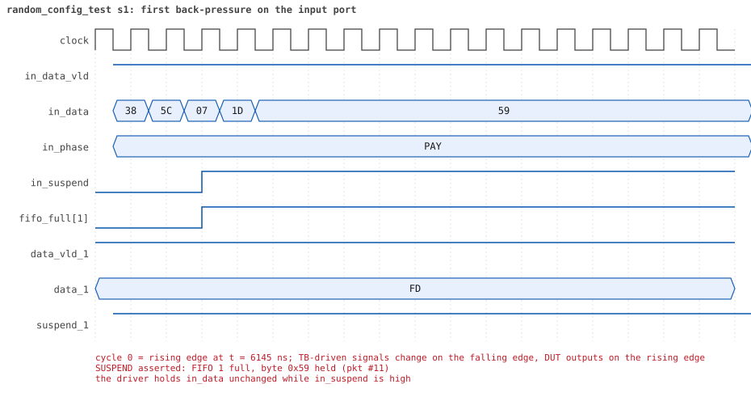

# random_config_test seed 1

**Result:** PASSED (0 UVM_ERROR, 0 UVM_WARNING, 0 UVM_FATAL) · bench `yapp_project_tb` · sim time 19us · wall 11.2 s · log [`random_config_test_s1.log`](random_config_test_s1.log)

Waves: `random_config_test_s1.fst` (GTKWave, Surfer or the VS Code wave viewer).
[Open the waves in Surfer](https://app.surfer-project.org/?load_url=https%3A%2F%2Fraw.githubusercontent.com%2Ftamirgabgab%2FQcom-Mentoring%2Fmain%2Fyapp_project%2Fregression%2Fyapp_project_tb%2Frandom_config_test_s1%2Frandom_config_test_s1.fst&startup_commands=run_command_file_from_url%20https%3A%2F%2Fraw.githubusercontent.com%2Ftamirgabgab%2FQcom-Mentoring%2Fmain%2Fyapp_project%2Ftb%2Fyapp_router.sucl) (web app, the signals already in groups: `yapp_project/tb/yapp_router.sucl`).

## Summary

- YAPP driver sent **22** packet(s) (4 with bad parity); the input monitor saw 22.
- Router: **6** forwarded, **16** dropped (10 oversized, 6 router disabled).
- Packets out: ch0 **0**, ch1 **1**, ch2 **5**.
- Scoreboard: 6 matched, 0 mismatched, 0 unexpected.
- Back-pressure: in_suspend asserted **8** time(s), longest hold 57 cycle(s).
- Error pulses: 3.
- HBUS: 48 write(s), 130 read(s).

## Stages

| time (ns) | stage |
|---|---|
| 0 | receivers: ch0 CHANNEL_RX_PROFILE_SLOW, ch1 CHANNEL_RX_PROFILE_STALLY, ch2 CHANNEL_RX_PROFILE_SLOW |
| 0 | random scenario: 22 packets in 8 bursts |
| 530 | burst 1/8: ctrl=0x00 (maxpktsize 0) en=0xff (router on, counter enables 1111111), 3 packet(s) |
| 2140 | burst 1/8 sent: addr0..3 2/1/0/0, bad parity 0, gap 0 1, length 32..63 |
| 2510 | burst 2/8: ctrl=0x40 (maxpktsize 0) en=0x01 (router on, counter enables 0000000), 2 packet(s) |
| 3940 | burst 2/8 sent: addr0..3 1/0/1/0, bad parity 0, gap 0 1, length 63..63 |
| 4210 | burst 3/8: ctrl=0x22 (maxpktsize 34) en=0xff (router on, counter enables 1111111), 2 packet(s) |
| 5020 | burst 3/8 sent: addr0..3 0/1/1/0, bad parity 1, gap 0 0, length 11..35 |
| 5350 | burst 4/8: ctrl=0x40 (maxpktsize 0) en=0xfe (router OFF, counter enables 1111111), 3 packet(s) |
| 5790 | burst 4/8 sent: addr0..3 1/1/1/0, bad parity 1, gap 0 0, length 1..20 |
| 6000 | burst 5/8: ctrl=0xbf (maxpktsize 63) en=0x6d (router on, counter enables 0110110), 3 packet(s) |
| 9330 | burst 5/8 sent: addr0..3 0/1/2/0, bad parity 1, gap 0 0, length 25..63 |
| 9680 | burst 6/8: ctrl=0x01 (maxpktsize 1) en=0x01 (router on, counter enables 0000000), 2 packet(s) |
| 10840 | burst 6/8 sent: addr0..3 1/0/1/0, bad parity 0, gap 0 1, length 46..63 |
| 11220 | burst 7/8: ctrl=0xbf (maxpktsize 63) en=0xfe (router OFF, counter enables 1111111), 3 packet(s) |
| 12390 | burst 7/8 sent: addr0..3 2/0/1/0, bad parity 0, gap 0 0, length 2..36 |
| 12700 | burst 8/8: ctrl=0xfe (maxpktsize 62) en=0xff (router on, counter enables 1111111), 4 packet(s) |
| 16530 | burst 8/8 sent: addr0..3 0/1/3/0, bad parity 1, gap 0 0, length 62..63 |
| 16530 | final reads: every register and the stored packet, checked against the reference model |
| 18805 | done: 22 packets (6 forwarded, 16 dropped), 0 storm burst(s), 6 scoreboard matches, 130 HBUS reads checked, 3 error pulses for 3 bad packets |

## Pictures

**reset and the first cycles**

**first packet into the router**

**first packet out on channel 2**

**first back-pressure on the input port**

**first error pulse after a bad-parity packet**

**first HBUS write**

**first HBUS read**

## Timeline

630 events.

| time (ns) | who | event |
|---|---|---|
| 0 | yapp monitor | YAPP monitor running |
| 0 | **test** | STAGE: receivers: ch0 CHANNEL_RX_PROFILE_SLOW, ch1 CHANNEL_RX_PROFILE_STALLY, ch2 CHANNEL_RX_PROFILE_SLOW |
| 0 | **test** | STAGE: random scenario: 22 packets in 8 bursts |
| 0 | clk/rst driver | Starting clock (period 10) and holding reset for 5 cycles |
| 0 | **DUT** | RESET asserted |
| 50 | **DUT** | RESET released: router_en=1 maxpktsize=63 |
| 70 | hbus driver | Executed WRITE addr=0x1000 data=0x00 |
| 75 | **DUT** | CONFIG router_en=1 maxpktsize=0 |
| 75 | hbus monitor | Collected WRITE addr=0x1000 data=0x00 |
| 75 | reference | maxpktsize is now 0 |
| 90 | hbus driver | Executed WRITE addr=0x1001 data=0xff |
| 95 | hbus monitor | Collected WRITE addr=0x1001 data=0xff |
| 95 | reference | router_en is now 1 (en_reg 0xff) |
| 110 | hbus driver | Executed WRITE addr=0x11e0 data=0x49 |
| 115 | hbus monitor | Collected WRITE addr=0x11e0 data=0x49 |
| 140 | hbus driver | Executed READ  addr=0x11e0 data=0x49 |
| 145 | hbus monitor | Collected READ  addr=0x11e0 data=0x49 |
| 160 | hbus driver | Executed WRITE addr=0x1156 data=0x05 |
| 165 | hbus monitor | Collected WRITE addr=0x1156 data=0x05 |
| 190 | hbus driver | Executed READ  addr=0x1156 data=0x05 |
| 195 | hbus monitor | Collected READ  addr=0x1156 data=0x05 |
| 210 | hbus driver | Executed WRITE addr=0x1149 data=0xe9 |
| 215 | hbus monitor | Collected WRITE addr=0x1149 data=0xe9 |
| 240 | hbus driver | Executed READ  addr=0x1149 data=0xe9 |
| 245 | hbus monitor | Collected READ  addr=0x1149 data=0xe9 |
| 260 | hbus driver | Executed WRITE addr=0x11e9 data=0xb1 |
| 265 | hbus monitor | Collected WRITE addr=0x11e9 data=0xb1 |
| 290 | hbus driver | Executed READ  addr=0x11e9 data=0xb1 |
| 295 | hbus monitor | Collected READ  addr=0x11e9 data=0xb1 |
| 310 | hbus driver | Executed WRITE addr=0x114d data=0x84 |
| 315 | hbus monitor | Collected WRITE addr=0x114d data=0x84 |
| 340 | hbus driver | Executed READ  addr=0x114d data=0x84 |
| 345 | hbus monitor | Collected READ  addr=0x114d data=0x84 |
| 370 | hbus driver | Executed READ  addr=0x100b data=0x00 |
| 375 | hbus monitor | Collected READ  addr=0x100b data=0x00 |
| 390 | hbus driver | Executed WRITE addr=0x1168 data=0x9e |
| 395 | hbus monitor | Collected WRITE addr=0x1168 data=0x9e |
| 420 | hbus driver | Executed READ  addr=0x1168 data=0x9e |
| 425 | hbus monitor | Collected READ  addr=0x1168 data=0x9e |
| 440 | hbus driver | Executed WRITE addr=0x111f data=0xe7 |
| 445 | hbus monitor | Collected WRITE addr=0x111f data=0xe7 |
| 470 | hbus driver | Executed READ  addr=0x111f data=0xe7 |
| 475 | hbus monitor | Collected READ  addr=0x111f data=0xe7 |
| 500 | hbus driver | Executed READ  addr=0x1002 data=0x00 |
| 505 | hbus monitor | Collected READ  addr=0x1002 data=0x00 |
| 530 | hbus driver | Executed READ  addr=0x100d data=0x00 |
| 530 | **test** | STAGE: burst 1/8: ctrl=0x00 (maxpktsize 0) en=0xff (router on, counter enables 1111111), 3 packet(s) |
| 530 | yapp driver | TX pkt #1: addr=0 len=55 parity=good delay=0 |
| 535 | hbus monitor | Collected READ  addr=0x100d data=0x00 |
| 545 | **DUT** | IN  pkt #1 header: addr=0 len=55 -> DROP (oversized: len 55 > maxpktsize 0) |
| 1105 | **DUT** | IN  pkt #1 complete: addr=0 len=55 parity=ok dropped, 57 bytes in 57 cycles (held 0) |
| 1105 | yapp monitor | RX pkt #1 on the input: addr=0 len=55 parity=good gap=49 |
| 1105 | reference | Packet dropped: length 55 > maxpktsize 0 (addr=0) |
| 1105 | **DUT** | ROUTER DROPS PACKET addr=0 length=55 (length > maxpktsize) |
| 1110 | yapp driver | TX pkt #1 accepted by the DUT |
| 1110 | yapp driver | TX pkt #2: addr=1 len=32 parity=good delay=1 |
| 1125 | **DUT** | IN  pkt #2 header: addr=1 len=32 -> DROP (oversized: len 32 > maxpktsize 0) |
| 1455 | **DUT** | IN  pkt #2 complete: addr=1 len=32 parity=ok dropped, 34 bytes in 34 cycles (held 0) |
| 1455 | yapp monitor | RX pkt #2 on the input: addr=1 len=32 parity=good gap=1 |
| 1455 | reference | Packet dropped: length 32 > maxpktsize 0 (addr=1) |
| 1455 | **DUT** | ROUTER DROPS PACKET addr=1 length=32 (length > maxpktsize) |
| 1460 | yapp driver | TX pkt #2 accepted by the DUT |
| 1460 | yapp driver | TX pkt #3: addr=0 len=63 parity=good delay=3 |
| 1495 | **DUT** | IN  pkt #3 header: addr=0 len=63 -> DROP (oversized: len 63 > maxpktsize 0) |
| 2135 | **DUT** | IN  pkt #3 complete: addr=0 len=63 parity=ok dropped, 65 bytes in 65 cycles (held 0) |
| 2135 | yapp monitor | RX pkt #3 on the input: addr=0 len=63 parity=good gap=3 |
| 2135 | reference | Packet dropped: length 63 > maxpktsize 0 (addr=0) |
| 2135 | **DUT** | ROUTER DROPS PACKET addr=0 length=63 (length > maxpktsize) |
| 2140 | yapp driver | TX pkt #3 accepted by the DUT |
| 2140 | **test** | STAGE: burst 1/8 sent: addr0..3 2/1/0/0, bad parity 0, gap 0 1, length 32..63 |
| 2160 | hbus driver | Executed WRITE addr=0x1000 data=0x40 |
| 2165 | hbus monitor | Collected WRITE addr=0x1000 data=0x40 |
| 2165 | reference | maxpktsize is now 0 |
| 2180 | hbus driver | Executed WRITE addr=0x1001 data=0x01 |
| 2185 | hbus monitor | Collected WRITE addr=0x1001 data=0x01 |
| 2185 | reference | router_en is now 1 (en_reg 0x01) |
| 2210 | hbus driver | Executed READ  addr=0x103e data=0x53 |
| 2215 | hbus monitor | Collected READ  addr=0x103e data=0x53 |
| 2230 | hbus driver | Executed WRITE addr=0x1175 data=0xa5 |
| 2235 | hbus monitor | Collected WRITE addr=0x1175 data=0xa5 |
| 2260 | hbus driver | Executed READ  addr=0x1175 data=0xa5 |
| 2265 | hbus monitor | Collected READ  addr=0x1175 data=0xa5 |
| 2290 | hbus driver | Executed READ  addr=0x100d data=0x3f |
| 2295 | hbus monitor | Collected READ  addr=0x100d data=0x3f |
| 2310 | hbus driver | Executed WRITE addr=0x1147 data=0x49 |
| 2315 | hbus monitor | Collected WRITE addr=0x1147 data=0x49 |
| 2340 | hbus driver | Executed READ  addr=0x1147 data=0x49 |
| 2345 | hbus monitor | Collected READ  addr=0x1147 data=0x49 |
| 2360 | hbus driver | Executed WRITE addr=0x1121 data=0xfc |
| 2365 | hbus monitor | Collected WRITE addr=0x1121 data=0xfc |
| 2390 | hbus driver | Executed READ  addr=0x1121 data=0xfc |
| 2395 | hbus monitor | Collected READ  addr=0x1121 data=0xfc |
| 2420 | hbus driver | Executed READ  addr=0x1048 data=0x90 |
| 2425 | hbus monitor | Collected READ  addr=0x1048 data=0x90 |
| 2450 | hbus driver | Executed READ  addr=0x100d data=0x3f |
| 2455 | hbus monitor | Collected READ  addr=0x100d data=0x3f |
| 2480 | hbus driver | Executed READ  addr=0x100a data=0x01 |
| 2485 | hbus monitor | Collected READ  addr=0x100a data=0x01 |
| 2510 | hbus driver | Executed READ  addr=0x101a data=0x25 |
| 2510 | **test** | STAGE: burst 2/8: ctrl=0x40 (maxpktsize 0) en=0x01 (router on, counter enables 0000000), 2 packet(s) |
| 2510 | yapp driver | TX pkt #4: addr=2 len=63 parity=good delay=12 |
| 2515 | hbus monitor | Collected READ  addr=0x101a data=0x25 |
| 2645 | **DUT** | IN  pkt #4 header: addr=2 len=63 -> DROP (oversized: len 63 > maxpktsize 0) |
| 3285 | **DUT** | IN  pkt #4 complete: addr=2 len=63 parity=ok dropped, 65 bytes in 65 cycles (held 0) |
| 3285 | yapp monitor | RX pkt #4 on the input: addr=2 len=63 parity=good gap=50 |
| 3285 | reference | Packet dropped: length 63 > maxpktsize 0 (addr=2) |
| 3285 | **DUT** | ROUTER DROPS PACKET addr=2 length=63 (length > maxpktsize) |
| 3290 | yapp driver | TX pkt #4 accepted by the DUT |
| 3290 | yapp driver | TX pkt #5: addr=0 len=63 parity=good delay=0 |
| 3295 | **DUT** | IN  pkt #5 header: addr=0 len=63 -> DROP (oversized: len 63 > maxpktsize 0) |
| 3935 | **DUT** | IN  pkt #5 complete: addr=0 len=63 parity=ok dropped, 65 bytes in 65 cycles (held 0) |
| 3935 | yapp monitor | RX pkt #5 on the input: addr=0 len=63 parity=good gap=0 |
| 3935 | reference | Packet dropped: length 63 > maxpktsize 0 (addr=0) |
| 3935 | **DUT** | ROUTER DROPS PACKET addr=0 length=63 (length > maxpktsize) |
| 3940 | yapp driver | TX pkt #5 accepted by the DUT |
| 3940 | **test** | STAGE: burst 2/8 sent: addr0..3 1/0/1/0, bad parity 0, gap 0 1, length 63..63 |
| 3960 | hbus driver | Executed WRITE addr=0x1000 data=0x22 |
| 3965 | **DUT** | CONFIG router_en=1 maxpktsize=34 |
| 3965 | hbus monitor | Collected WRITE addr=0x1000 data=0x22 |
| 3965 | reference | maxpktsize is now 34 |
| 3980 | hbus driver | Executed WRITE addr=0x1001 data=0xff |
| 3985 | hbus monitor | Collected WRITE addr=0x1001 data=0xff |
| 3985 | reference | router_en is now 1 (en_reg 0xff) |
| 4000 | hbus driver | Executed WRITE addr=0x11b1 data=0xac |
| 4005 | hbus monitor | Collected WRITE addr=0x11b1 data=0xac |
| 4030 | hbus driver | Executed READ  addr=0x11b1 data=0xac |
| 4035 | hbus monitor | Collected READ  addr=0x11b1 data=0xac |
| 4060 | hbus driver | Executed READ  addr=0x1008 data=0x00 |
| 4065 | hbus monitor | Collected READ  addr=0x1008 data=0x00 |
| 4080 | hbus driver | Executed WRITE addr=0x1197 data=0x13 |
| 4085 | hbus monitor | Collected WRITE addr=0x1197 data=0x13 |
| 4110 | hbus driver | Executed READ  addr=0x1197 data=0x13 |
| 4115 | hbus monitor | Collected READ  addr=0x1197 data=0x13 |
| 4130 | hbus driver | Executed WRITE addr=0x1123 data=0x47 |
| 4135 | hbus monitor | Collected WRITE addr=0x1123 data=0x47 |
| 4160 | hbus driver | Executed READ  addr=0x1123 data=0x47 |
| 4165 | hbus monitor | Collected READ  addr=0x1123 data=0x47 |
| 4180 | hbus driver | Executed WRITE addr=0x1193 data=0xcd |
| 4185 | hbus monitor | Collected WRITE addr=0x1193 data=0xcd |
| 4210 | hbus driver | Executed READ  addr=0x1193 data=0xcd |
| 4210 | **test** | STAGE: burst 3/8: ctrl=0x22 (maxpktsize 34) en=0xff (router on, counter enables 1111111), 2 packet(s) |
| 4210 | yapp driver | TX pkt #6: addr=1 len=35 parity=bad delay=20 |
| 4215 | hbus monitor | Collected READ  addr=0x1193 data=0xcd |
| 4425 | **DUT** | IN  pkt #6 header: addr=1 len=35 -> DROP (oversized: len 35 > maxpktsize 34) |
| 4785 | **DUT** | IN  pkt #6 complete: addr=1 len=35 parity=BAD dropped, 37 bytes in 37 cycles (held 0) |
| 4785 | yapp monitor | RX pkt #6 on the input: addr=1 len=35 parity=bad gap=48 |
| 4785 | reference | Packet dropped: length 35 > maxpktsize 34 (addr=1) |
| 4785 | **DUT** | ROUTER DROPS PACKET addr=1 length=35 (length > maxpktsize) |
| 4790 | yapp driver | TX pkt #6 accepted by the DUT |
| 4790 | yapp driver | TX pkt #7: addr=2 len=11 parity=good delay=10 |
| 4890 | **DUT** | ERROR pulse, 10 cycle(s) after the bad-parity packet |
| 4890 | error checker | error pulse 10 cycles after the bad packet (0 still owed) |
| 4895 | **DUT** | IN  pkt #7 header: addr=2 len=11 -> channel 2 |
| 5015 | **DUT** | IN  pkt #7 complete: addr=2 len=11 parity=ok forwarded, 13 bytes in 13 cycles (held 0) |
| 5015 | yapp monitor | RX pkt #7 on the input: addr=2 len=11 parity=good gap=10 |
| 5015 | reference | Packet forwarded: addr=2 len=11 -> channel 2 |
| 5020 | yapp driver | TX pkt #7 accepted by the DUT |
| 5020 | **test** | STAGE: burst 3/8 sent: addr0..3 0/1/1/0, bad parity 1, gap 0 0, length 11..35 |
| 5040 | hbus driver | Executed WRITE addr=0x1000 data=0x40 |
| 5045 | **DUT** | CONFIG router_en=1 maxpktsize=0 |
| 5045 | hbus monitor | Collected WRITE addr=0x1000 data=0x40 |
| 5045 | reference | maxpktsize is now 0 |
| 5060 | hbus driver | Executed WRITE addr=0x1001 data=0xfe |
| 5065 | **DUT** | CONFIG router_en=0 maxpktsize=0 |
| 5065 | hbus monitor | Collected WRITE addr=0x1001 data=0xfe |
| 5065 | reference | router_en is now 0 (en_reg 0xfe) |
| 5080 | hbus driver | Executed WRITE addr=0x11f4 data=0xfd |
| 5085 | hbus monitor | Collected WRITE addr=0x11f4 data=0xfd |
| 5110 | hbus driver | Executed READ  addr=0x11f4 data=0xfd |
| 5115 | hbus monitor | Collected READ  addr=0x11f4 data=0xfd |
| 5140 | hbus driver | Executed READ  addr=0x103b data=0xc9 |
| 5145 | hbus monitor | Collected READ  addr=0x103b data=0xc9 |
| 5160 | hbus driver | Executed WRITE addr=0x1177 data=0xc7 |
| 5165 | hbus monitor | Collected WRITE addr=0x1177 data=0xc7 |
| 5190 | hbus driver | Executed READ  addr=0x1177 data=0xc7 |
| 5195 | hbus monitor | Collected READ  addr=0x1177 data=0xc7 |
| 5210 | hbus driver | Executed WRITE addr=0x1179 data=0xd4 |
| 5215 | hbus monitor | Collected WRITE addr=0x1179 data=0xd4 |
| 5240 | hbus driver | Executed READ  addr=0x1179 data=0xd4 |
| 5245 | hbus monitor | Collected READ  addr=0x1179 data=0xd4 |
| 5260 | hbus driver | Executed WRITE addr=0x110c data=0xa4 |
| 5265 | hbus monitor | Collected WRITE addr=0x110c data=0xa4 |
| 5290 | hbus driver | Executed READ  addr=0x110c data=0xa4 |
| 5295 | hbus monitor | Collected READ  addr=0x110c data=0xa4 |
| 5305 | **DUT** | OUT ch2 pkt #1 start: addr=2 len=11 (receiver waited 40 cycle(s)) |
| 5320 | hbus driver | Executed READ  addr=0x100c data=0x00 |
| 5325 | hbus monitor | Collected READ  addr=0x100c data=0x00 |
| 5350 | hbus driver | Executed READ  addr=0x100f data=0x00 |
| 5350 | **test** | STAGE: burst 4/8: ctrl=0x40 (maxpktsize 0) en=0xfe (router OFF, counter enables 1111111), 3 packet(s) |
| 5350 | yapp driver | TX pkt #8: addr=1 len=1 parity=good delay=1 |
| 5355 | hbus monitor | Collected READ  addr=0x100f data=0x00 |
| 5375 | **DUT** | IN  pkt #8 header: addr=1 len=1 -> DROP (router disabled) |
| 5395 | **DUT** | IN  pkt #8 complete: addr=1 len=1 parity=ok dropped, 3 bytes in 3 cycles (held 0) |
| 5395 | yapp monitor | RX pkt #8 on the input: addr=1 len=1 parity=good gap=35 |
| 5395 | reference | Packet dropped: router disabled (addr=1 len=1) |
| 5395 | **DUT** | ROUTER DROPS PACKET addr=1 length=1 (router disabled) |
| 5400 | yapp driver | TX pkt #8 accepted by the DUT |
| 5400 | yapp driver | TX pkt #9: addr=0 len=5 parity=bad delay=1 |
| 5415 | **DUT** | IN  pkt #9 header: addr=0 len=5 -> DROP (router disabled) |
| 5420 | ch2 driver | ch2: packet consumed (response delay 40) |
| 5475 | **DUT** | IN  pkt #9 complete: addr=0 len=5 parity=BAD dropped, 7 bytes in 7 cycles (held 0) |
| 5475 | yapp monitor | RX pkt #9 on the input: addr=0 len=5 parity=bad gap=1 |
| 5475 | reference | Packet dropped: router disabled (addr=0 len=5) |
| 5475 | **DUT** | ROUTER DROPS PACKET addr=0 length=5 (router disabled) |
| 5480 | yapp driver | TX pkt #9 accepted by the DUT |
| 5480 | yapp driver | TX pkt #10: addr=2 len=20 parity=good delay=9 |
| 5575 | **DUT** | IN  pkt #10 header: addr=2 len=20 -> DROP (router disabled) |
| 5725 | **DUT** | OUT ch2 pkt #1 done: 13 bytes in 43 cycles |
| 5725 | ch2 monitor | ch2 RX pkt #1: addr=2 len=11 parity=good |
| 5725 | scoreboard | ch2 pkt matched: addr=2 len=11 (1 matched so far) |
| 5785 | **DUT** | IN  pkt #10 complete: addr=2 len=20 parity=ok dropped, 22 bytes in 22 cycles (held 0) |
| 5785 | yapp monitor | RX pkt #10 on the input: addr=2 len=20 parity=good gap=9 |
| 5785 | reference | Packet dropped: router disabled (addr=2 len=20) |
| 5785 | **DUT** | ROUTER DROPS PACKET addr=2 length=20 (router disabled) |
| 5790 | yapp driver | TX pkt #10 accepted by the DUT |
| 5790 | **test** | STAGE: burst 4/8 sent: addr0..3 1/1/1/0, bad parity 1, gap 0 0, length 1..20 |
| 5810 | hbus driver | Executed WRITE addr=0x1000 data=0xbf |
| 5815 | **DUT** | CONFIG router_en=0 maxpktsize=63 |
| 5815 | hbus monitor | Collected WRITE addr=0x1000 data=0xbf |
| 5815 | reference | maxpktsize is now 63 |
| 5830 | hbus driver | Executed WRITE addr=0x1001 data=0x6d |
| 5835 | **DUT** | CONFIG router_en=1 maxpktsize=63 |
| 5835 | hbus monitor | Collected WRITE addr=0x1001 data=0x6d |
| 5835 | reference | router_en is now 1 (en_reg 0x6d) |
| 5860 | hbus driver | Executed READ  addr=0x100d data=0x0b |
| 5865 | hbus monitor | Collected READ  addr=0x100d data=0x0b |
| 5890 | hbus driver | Executed READ  addr=0x1048 data=0x03 |
| 5895 | hbus monitor | Collected READ  addr=0x1048 data=0x03 |
| 5920 | hbus driver | Executed READ  addr=0x100d data=0x0b |
| 5925 | hbus monitor | Collected READ  addr=0x100d data=0x0b |
| 5940 | hbus driver | Executed WRITE addr=0x11a7 data=0xa6 |
| 5945 | hbus monitor | Collected WRITE addr=0x11a7 data=0xa6 |
| 5970 | hbus driver | Executed READ  addr=0x11a7 data=0xa6 |
| 5975 | hbus monitor | Collected READ  addr=0x11a7 data=0xa6 |
| 6000 | hbus driver | Executed READ  addr=0x1001 data=0x6d |
| 6000 | **test** | STAGE: burst 5/8: ctrl=0xbf (maxpktsize 63) en=0x6d (router on, counter enables 0110110), 3 packet(s) |
| 6000 | yapp driver | TX pkt #11: addr=1 len=63 parity=good delay=1 |
| 6005 | hbus monitor | Collected READ  addr=0x1001 data=0x6d |
| 6025 | **DUT** | IN  pkt #11 header: addr=1 len=63 -> channel 1 |
| 6185 | **DUT** | SUSPEND asserted: FIFO 1 full, byte 0x59 held (pkt #11) |
| 6310 | ch2 driver | ch2: packet consumed (response delay 29) |
| 6745 | **DUT** | OUT ch1 pkt #1 start: addr=1 len=63 (receiver waited 71 cycle(s)) |
| 6755 | **DUT** | SUSPEND released after 57 cycle(s) |
| 7235 | **DUT** | IN  pkt #11 complete: addr=1 len=63 parity=ok forwarded, 65 bytes in 122 cycles (held 57) |
| 7235 | yapp monitor | RX pkt #11 on the input: addr=1 len=63 parity=good gap=23 |
| 7235 | reference | Packet forwarded: addr=1 len=63 -> channel 1 |
| 7240 | yapp driver | TX pkt #11 accepted by the DUT |
| 7240 | yapp driver | TX pkt #12: addr=2 len=63 parity=bad delay=17 |
| 7380 | ch1 driver | ch1: packet consumed (response delay 71) |
| 7415 | **DUT** | IN  pkt #12 header: addr=2 len=63 -> channel 2 |
| 7575 | **DUT** | SUSPEND asserted: FIFO 2 full, byte 0x07 held (pkt #12) |
| 7765 | **DUT** | OUT ch2 pkt #2 start: addr=2 len=63 (receiver waited 34 cycle(s)) |
| 7775 | **DUT** | SUSPEND released after 20 cycle(s) |
| 8255 | **DUT** | IN  pkt #12 complete: addr=2 len=63 parity=BAD forwarded, 65 bytes in 85 cycles (held 20) |
| 8255 | yapp monitor | RX pkt #12 on the input: addr=2 len=63 parity=bad gap=17 |
| 8255 | reference | Packet forwarded: addr=2 len=63 -> channel 2 |
| 8260 | yapp driver | TX pkt #12 accepted by the DUT |
| 8260 | yapp driver | TX pkt #13: addr=2 len=25 parity=good delay=1 |
| 8275 | **DUT** | IN  pkt #13 header: addr=2 len=25 -> channel 2 |
| 8310 | **DUT** | ERROR pulse, 5 cycle(s) after the bad-parity packet |
| 8310 | error checker | error pulse 5 cycles after the bad packet (0 still owed) |
| 8400 | ch2 driver | ch2: packet consumed (response delay 34) |
| 8425 | **DUT** | SUSPEND asserted: FIFO 2 full, byte 0xa2 held (pkt #13) |
| 8795 | **DUT** | OUT ch2 pkt #2 done: 65 bytes in 104 cycles |
| 8795 | ch2 monitor | ch2 RX pkt #2: addr=2 len=63 parity=bad |
| 8795 | scoreboard | ch2 pkt matched: addr=2 len=63 (2 matched so far) |
| 8805 | **DUT** | SUSPEND released after 38 cycle(s) |
| 8805 | **DUT** | OUT ch2 pkt #3 start: addr=2 len=25 (receiver waited 0 cycle(s)) |
| 8895 | **DUT** | OUT ch1 pkt #1 done: 65 bytes in 216 cycles |
| 8895 | ch1 monitor | ch1 RX pkt #1: addr=1 len=63 parity=good |
| 8895 | scoreboard | ch1 pkt matched: addr=1 len=63 (3 matched so far) |
| 8900 | ch2 driver | ch2: packet consumed (response delay 38) |
| 8915 | **DUT** | SUSPEND asserted: FIFO 2 full, byte 0xa5 held (pkt #13) |
| 9260 | ch1 driver | ch1: packet consumed (response delay 150) |
| 9325 | **DUT** | IN  pkt #13 complete: addr=2 len=25 parity=ok forwarded, 27 bytes in 106 cycles (held 79) |
| 9325 | **DUT** | SUSPEND released after 41 cycle(s) |
| 9325 | yapp monitor | RX pkt #13 on the input: addr=2 len=25 parity=good gap=1 |
| 9325 | reference | Packet forwarded: addr=2 len=25 -> channel 2 |
| 9330 | yapp driver | TX pkt #13 accepted by the DUT |
| 9330 | **test** | STAGE: burst 5/8 sent: addr0..3 0/1/2/0, bad parity 1, gap 0 0, length 25..63 |
| 9350 | hbus driver | Executed WRITE addr=0x1000 data=0x01 |
| 9355 | **DUT** | CONFIG router_en=1 maxpktsize=1 |
| 9355 | hbus monitor | Collected WRITE addr=0x1000 data=0x01 |
| 9355 | reference | maxpktsize is now 1 |
| 9370 | hbus driver | Executed WRITE addr=0x1001 data=0x01 |
| 9375 | hbus monitor | Collected WRITE addr=0x1001 data=0x01 |
| 9375 | reference | router_en is now 1 (en_reg 0x01) |
| 9390 | hbus driver | Executed WRITE addr=0x1146 data=0x79 |
| 9395 | hbus monitor | Collected WRITE addr=0x1146 data=0x79 |
| 9420 | hbus driver | Executed READ  addr=0x1146 data=0x79 |
| 9425 | hbus monitor | Collected READ  addr=0x1146 data=0x79 |
| 9450 | hbus driver | Executed READ  addr=0x100d data=0x19 |
| 9455 | hbus monitor | Collected READ  addr=0x100d data=0x19 |
| 9470 | hbus driver | Executed WRITE addr=0x1189 data=0x64 |
| 9475 | **DUT** | OUT ch2 pkt #3 done: 27 bytes in 68 cycles |
| 9475 | ch2 monitor | ch2 RX pkt #3: addr=2 len=25 parity=good |
| 9475 | scoreboard | ch2 pkt matched: addr=2 len=25 (4 matched so far) |
| 9475 | hbus monitor | Collected WRITE addr=0x1189 data=0x64 |
| 9500 | hbus driver | Executed READ  addr=0x1189 data=0x64 |
| 9505 | hbus monitor | Collected READ  addr=0x1189 data=0x64 |
| 9520 | hbus driver | Executed WRITE addr=0x11a1 data=0x79 |
| 9525 | hbus monitor | Collected WRITE addr=0x11a1 data=0x79 |
| 9550 | hbus driver | Executed READ  addr=0x11a1 data=0x79 |
| 9555 | hbus monitor | Collected READ  addr=0x11a1 data=0x79 |
| 9580 | hbus driver | Executed READ  addr=0x101d data=0x20 |
| 9585 | hbus monitor | Collected READ  addr=0x101d data=0x20 |
| 9600 | hbus driver | Executed WRITE addr=0x11dd data=0x23 |
| 9605 | hbus monitor | Collected WRITE addr=0x11dd data=0x23 |
| 9630 | hbus driver | Executed READ  addr=0x11dd data=0x23 |
| 9635 | hbus monitor | Collected READ  addr=0x11dd data=0x23 |
| 9650 | hbus driver | Executed WRITE addr=0x1121 data=0x42 |
| 9655 | hbus monitor | Collected WRITE addr=0x1121 data=0x42 |
| 9680 | hbus driver | Executed READ  addr=0x1121 data=0x42 |
| 9680 | **test** | STAGE: burst 6/8: ctrl=0x01 (maxpktsize 1) en=0x01 (router on, counter enables 0000000), 2 packet(s) |
| 9680 | yapp driver | TX pkt #14: addr=2 len=46 parity=good delay=0 |
| 9685 | hbus monitor | Collected READ  addr=0x1121 data=0x42 |
| 9695 | **DUT** | IN  pkt #14 header: addr=2 len=46 -> DROP (oversized: len 46 > maxpktsize 1) |
| 9780 | ch2 driver | ch2: packet consumed (response delay 40) |
| 10165 | **DUT** | IN  pkt #14 complete: addr=2 len=46 parity=ok dropped, 48 bytes in 48 cycles (held 0) |
| 10165 | yapp monitor | RX pkt #14 on the input: addr=2 len=46 parity=good gap=36 |
| 10165 | reference | Packet dropped: length 46 > maxpktsize 1 (addr=2) |
| 10165 | **DUT** | ROUTER DROPS PACKET addr=2 length=46 (length > maxpktsize) |
| 10170 | yapp driver | TX pkt #14 accepted by the DUT |
| 10170 | yapp driver | TX pkt #15: addr=0 len=63 parity=good delay=2 |
| 10195 | **DUT** | IN  pkt #15 header: addr=0 len=63 -> DROP (oversized: len 63 > maxpktsize 1) |
| 10835 | **DUT** | IN  pkt #15 complete: addr=0 len=63 parity=ok dropped, 65 bytes in 65 cycles (held 0) |
| 10835 | yapp monitor | RX pkt #15 on the input: addr=0 len=63 parity=good gap=2 |
| 10835 | reference | Packet dropped: length 63 > maxpktsize 1 (addr=0) |
| 10835 | **DUT** | ROUTER DROPS PACKET addr=0 length=63 (length > maxpktsize) |
| 10840 | yapp driver | TX pkt #15 accepted by the DUT |
| 10840 | **test** | STAGE: burst 6/8 sent: addr0..3 1/0/1/0, bad parity 0, gap 0 1, length 46..63 |
| 10860 | hbus driver | Executed WRITE addr=0x1000 data=0xbf |
| 10865 | **DUT** | CONFIG router_en=1 maxpktsize=63 |
| 10865 | hbus monitor | Collected WRITE addr=0x1000 data=0xbf |
| 10865 | reference | maxpktsize is now 63 |
| 10880 | hbus driver | Executed WRITE addr=0x1001 data=0xfe |
| 10885 | **DUT** | CONFIG router_en=0 maxpktsize=63 |
| 10885 | hbus monitor | Collected WRITE addr=0x1001 data=0xfe |
| 10885 | reference | router_en is now 0 (en_reg 0xfe) |
| 10900 | hbus driver | Executed WRITE addr=0x11dd data=0x97 |
| 10905 | hbus monitor | Collected WRITE addr=0x11dd data=0x97 |
| 10930 | hbus driver | Executed READ  addr=0x11dd data=0x97 |
| 10935 | hbus monitor | Collected READ  addr=0x11dd data=0x97 |
| 10950 | hbus driver | Executed WRITE addr=0x11d9 data=0xbb |
| 10955 | hbus monitor | Collected WRITE addr=0x11d9 data=0xbb |
| 10980 | hbus driver | Executed READ  addr=0x11d9 data=0xbb |
| 10985 | hbus monitor | Collected READ  addr=0x11d9 data=0xbb |
| 11010 | hbus driver | Executed READ  addr=0x10fb data=0x00 |
| 11015 | hbus monitor | Collected READ  addr=0x10fb data=0x00 |
| 11040 | hbus driver | Executed READ  addr=0x1001 data=0xfe |
| 11045 | hbus monitor | Collected READ  addr=0x1001 data=0xfe |
| 11060 | hbus driver | Executed WRITE addr=0x1170 data=0x6e |
| 11065 | hbus monitor | Collected WRITE addr=0x1170 data=0x6e |
| 11090 | hbus driver | Executed READ  addr=0x1170 data=0x6e |
| 11095 | hbus monitor | Collected READ  addr=0x1170 data=0x6e |
| 11110 | hbus driver | Executed WRITE addr=0x111e data=0xe3 |
| 11115 | hbus monitor | Collected WRITE addr=0x111e data=0xe3 |
| 11140 | hbus driver | Executed READ  addr=0x111e data=0xe3 |
| 11145 | hbus monitor | Collected READ  addr=0x111e data=0xe3 |
| 11170 | hbus driver | Executed READ  addr=0x1001 data=0xfe |
| 11175 | hbus monitor | Collected READ  addr=0x1001 data=0xfe |
| 11190 | hbus driver | Executed WRITE addr=0x1140 data=0x39 |
| 11195 | hbus monitor | Collected WRITE addr=0x1140 data=0x39 |
| 11220 | hbus driver | Executed READ  addr=0x1140 data=0x39 |
| 11220 | **test** | STAGE: burst 7/8: ctrl=0xbf (maxpktsize 63) en=0xfe (router OFF, counter enables 1111111), 3 packet(s) |
| 11220 | yapp driver | TX pkt #16: addr=0 len=36 parity=good delay=19 |
| 11225 | hbus monitor | Collected READ  addr=0x1140 data=0x39 |
| 11425 | **DUT** | IN  pkt #16 header: addr=0 len=36 -> DROP (router disabled) |
| 11795 | **DUT** | IN  pkt #16 complete: addr=0 len=36 parity=ok dropped, 38 bytes in 38 cycles (held 0) |
| 11795 | yapp monitor | RX pkt #16 on the input: addr=0 len=36 parity=good gap=58 |
| 11795 | reference | Packet dropped: router disabled (addr=0 len=36) |
| 11795 | **DUT** | ROUTER DROPS PACKET addr=0 length=36 (router disabled) |
| 11800 | yapp driver | TX pkt #16 accepted by the DUT |
| 11800 | yapp driver | TX pkt #17: addr=2 len=2 parity=good delay=17 |
| 11975 | **DUT** | IN  pkt #17 header: addr=2 len=2 -> DROP (router disabled) |
| 12005 | **DUT** | IN  pkt #17 complete: addr=2 len=2 parity=ok dropped, 4 bytes in 4 cycles (held 0) |
| 12005 | yapp monitor | RX pkt #17 on the input: addr=2 len=2 parity=good gap=17 |
| 12005 | reference | Packet dropped: router disabled (addr=2 len=2) |
| 12005 | **DUT** | ROUTER DROPS PACKET addr=2 length=2 (router disabled) |
| 12010 | yapp driver | TX pkt #17 accepted by the DUT |
| 12010 | yapp driver | TX pkt #18: addr=0 len=30 parity=good delay=6 |
| 12075 | **DUT** | IN  pkt #18 header: addr=0 len=30 -> DROP (router disabled) |
| 12385 | **DUT** | IN  pkt #18 complete: addr=0 len=30 parity=ok dropped, 32 bytes in 32 cycles (held 0) |
| 12385 | yapp monitor | RX pkt #18 on the input: addr=0 len=30 parity=good gap=6 |
| 12385 | reference | Packet dropped: router disabled (addr=0 len=30) |
| 12385 | **DUT** | ROUTER DROPS PACKET addr=0 length=30 (router disabled) |
| 12390 | yapp driver | TX pkt #18 accepted by the DUT |
| 12390 | **test** | STAGE: burst 7/8 sent: addr0..3 2/0/1/0, bad parity 0, gap 0 0, length 2..36 |
| 12410 | hbus driver | Executed WRITE addr=0x1000 data=0xfe |
| 12415 | **DUT** | CONFIG router_en=0 maxpktsize=62 |
| 12415 | hbus monitor | Collected WRITE addr=0x1000 data=0xfe |
| 12415 | reference | maxpktsize is now 62 |
| 12430 | hbus driver | Executed WRITE addr=0x1001 data=0xff |
| 12435 | **DUT** | CONFIG router_en=1 maxpktsize=62 |
| 12435 | hbus monitor | Collected WRITE addr=0x1001 data=0xff |
| 12435 | reference | router_en is now 1 (en_reg 0xff) |
| 12460 | hbus driver | Executed READ  addr=0x100d data=0x3f |
| 12465 | hbus monitor | Collected READ  addr=0x100d data=0x3f |
| 12490 | hbus driver | Executed READ  addr=0x1001 data=0xff |
| 12495 | hbus monitor | Collected READ  addr=0x1001 data=0xff |
| 12520 | hbus driver | Executed READ  addr=0x1033 data=0x8b |
| 12525 | hbus monitor | Collected READ  addr=0x1033 data=0x8b |
| 12540 | hbus driver | Executed WRITE addr=0x11eb data=0xd3 |
| 12545 | hbus monitor | Collected WRITE addr=0x11eb data=0xd3 |
| 12570 | hbus driver | Executed READ  addr=0x11eb data=0xd3 |
| 12575 | hbus monitor | Collected READ  addr=0x11eb data=0xd3 |
| 12590 | hbus driver | Executed WRITE addr=0x1133 data=0xdd |
| 12595 | hbus monitor | Collected WRITE addr=0x1133 data=0xdd |
| 12620 | hbus driver | Executed READ  addr=0x1133 data=0xdd |
| 12625 | hbus monitor | Collected READ  addr=0x1133 data=0xdd |
| 12640 | hbus driver | Executed WRITE addr=0x11a4 data=0x1f |
| 12645 | hbus monitor | Collected WRITE addr=0x11a4 data=0x1f |
| 12670 | hbus driver | Executed READ  addr=0x11a4 data=0x1f |
| 12675 | hbus monitor | Collected READ  addr=0x11a4 data=0x1f |
| 12700 | hbus driver | Executed READ  addr=0x10fe data=0x00 |
| 12700 | **test** | STAGE: burst 8/8: ctrl=0xfe (maxpktsize 62) en=0xff (router on, counter enables 1111111), 4 packet(s) |
| 12700 | yapp driver | TX pkt #19: addr=2 len=63 parity=bad delay=4 |
| 12705 | hbus monitor | Collected READ  addr=0x10fe data=0x00 |
| 12755 | **DUT** | IN  pkt #19 header: addr=2 len=63 -> DROP (oversized: len 63 > maxpktsize 62) |
| 13395 | **DUT** | IN  pkt #19 complete: addr=2 len=63 parity=BAD dropped, 65 bytes in 65 cycles (held 0) |
| 13395 | yapp monitor | RX pkt #19 on the input: addr=2 len=63 parity=bad gap=36 |
| 13395 | reference | Packet dropped: length 63 > maxpktsize 62 (addr=2) |
| 13395 | **DUT** | ROUTER DROPS PACKET addr=2 length=63 (length > maxpktsize) |
| 13400 | yapp driver | TX pkt #19 accepted by the DUT |
| 13400 | yapp driver | TX pkt #20: addr=1 len=63 parity=good delay=19 |
| 13470 | **DUT** | ERROR pulse, 7 cycle(s) after the bad-parity packet |
| 13470 | error checker | error pulse 7 cycles after the bad packet (0 still owed) |
| 13595 | **DUT** | IN  pkt #20 header: addr=1 len=63 -> DROP (oversized: len 63 > maxpktsize 62) |
| 14235 | **DUT** | IN  pkt #20 complete: addr=1 len=63 parity=ok dropped, 65 bytes in 65 cycles (held 0) |
| 14235 | yapp monitor | RX pkt #20 on the input: addr=1 len=63 parity=good gap=19 |
| 14235 | reference | Packet dropped: length 63 > maxpktsize 62 (addr=1) |
| 14235 | **DUT** | ROUTER DROPS PACKET addr=1 length=63 (length > maxpktsize) |
| 14240 | yapp driver | TX pkt #20 accepted by the DUT |
| 14240 | yapp driver | TX pkt #21: addr=2 len=62 parity=good delay=1 |
| 14255 | **DUT** | IN  pkt #21 header: addr=2 len=62 -> channel 2 |
| 14415 | **DUT** | SUSPEND asserted: FIFO 2 full, byte 0x6b held (pkt #21) |
| 14465 | **DUT** | OUT ch2 pkt #4 start: addr=2 len=62 (receiver waited 20 cycle(s)) |
| 14475 | **DUT** | SUSPEND released after 6 cycle(s) |
| 14945 | **DUT** | IN  pkt #21 complete: addr=2 len=62 parity=ok forwarded, 64 bytes in 70 cycles (held 6) |
| 14945 | yapp monitor | RX pkt #21 on the input: addr=2 len=62 parity=good gap=1 |
| 14945 | reference | Packet forwarded: addr=2 len=62 -> channel 2 |
| 14950 | yapp driver | TX pkt #21 accepted by the DUT |
| 14950 | yapp driver | TX pkt #22: addr=2 len=62 parity=good delay=1 |
| 14965 | **DUT** | IN  pkt #22 header: addr=2 len=62 -> channel 2 |
| 15090 | ch2 driver | ch2: packet consumed (response delay 20) |
| 15115 | **DUT** | SUSPEND asserted: FIFO 2 full, byte 0xf7 held (pkt #22) |
| 15375 | **DUT** | OUT ch2 pkt #4 done: 64 bytes in 92 cycles |
| 15375 | ch2 monitor | ch2 RX pkt #4: addr=2 len=62 parity=good |
| 15375 | scoreboard | ch2 pkt matched: addr=2 len=62 (5 matched so far) |
| 15385 | **DUT** | SUSPEND released after 27 cycle(s) |
| 15385 | **DUT** | OUT ch2 pkt #5 start: addr=2 len=62 (receiver waited 0 cycle(s)) |
| 15570 | ch2 driver | ch2: packet consumed (response delay 27) |
| 15585 | **DUT** | SUSPEND asserted: FIFO 2 full, byte 0x22 held (pkt #22) |
| 15955 | **DUT** | SUSPEND released after 37 cycle(s) |
| 16010 | ch2 driver | ch2: packet consumed (response delay 36) |
| 16025 | **DUT** | SUSPEND asserted: FIFO 2 full, byte 0x8c held (pkt #22) |
| 16315 | **DUT** | SUSPEND released after 29 cycle(s) |
| 16525 | **DUT** | IN  pkt #22 complete: addr=2 len=62 parity=ok forwarded, 64 bytes in 157 cycles (held 93) |
| 16525 | yapp monitor | RX pkt #22 on the input: addr=2 len=62 parity=good gap=1 |
| 16525 | reference | Packet forwarded: addr=2 len=62 -> channel 2 |
| 16530 | yapp driver | TX pkt #22 accepted by the DUT |
| 16530 | **test** | STAGE: burst 8/8 sent: addr0..3 0/1/3/0, bad parity 1, gap 0 0, length 62..63 |
| 16530 | **test** | STAGE: final reads: every register and the stored packet, checked against the reference model |
| 16560 | hbus driver | Executed READ  addr=0x1000 data=0xfe |
| 16565 | hbus monitor | Collected READ  addr=0x1000 data=0xfe |
| 16590 | hbus driver | Executed READ  addr=0x1001 data=0xff |
| 16595 | hbus monitor | Collected READ  addr=0x1001 data=0xff |
| 16620 | hbus driver | Executed READ  addr=0x1004 data=0x02 |
| 16625 | hbus monitor | Collected READ  addr=0x1004 data=0x02 |
| 16650 | hbus driver | Executed READ  addr=0x1005 data=0x06 |
| 16655 | hbus monitor | Collected READ  addr=0x1005 data=0x06 |
| 16675 | **DUT** | OUT ch2 pkt #5 done: 64 bytes in 130 cycles |
| 16675 | ch2 monitor | ch2 RX pkt #5: addr=2 len=62 parity=good |
| 16675 | scoreboard | ch2 pkt matched: addr=2 len=62 (6 matched so far) |
| 16680 | hbus driver | Executed READ  addr=0x1006 data=0x00 |
| 16685 | hbus monitor | Collected READ  addr=0x1006 data=0x00 |
| 16700 | ch2 driver | ch2: packet consumed (response delay 28) |
| 16710 | hbus driver | Executed READ  addr=0x1009 data=0x02 |
| 16715 | hbus monitor | Collected READ  addr=0x1009 data=0x02 |
| 16740 | hbus driver | Executed READ  addr=0x100a data=0x04 |
| 16745 | hbus monitor | Collected READ  addr=0x100a data=0x04 |
| 16770 | hbus driver | Executed READ  addr=0x100b data=0x06 |
| 16775 | hbus monitor | Collected READ  addr=0x100b data=0x06 |
| 16800 | hbus driver | Executed READ  addr=0x100d data=0x3e |
| 16805 | hbus monitor | Collected READ  addr=0x100d data=0x3e |
| 16830 | hbus driver | Executed READ  addr=0x1010 data=0xfa |
| 16835 | hbus monitor | Collected READ  addr=0x1010 data=0xfa |
| 16860 | hbus driver | Executed READ  addr=0x1011 data=0x00 |
| 16865 | hbus monitor | Collected READ  addr=0x1011 data=0x00 |
| 16890 | hbus driver | Executed READ  addr=0x1012 data=0xd0 |
| 16895 | hbus monitor | Collected READ  addr=0x1012 data=0xd0 |
| 16920 | hbus driver | Executed READ  addr=0x1013 data=0x3e |
| 16925 | hbus monitor | Collected READ  addr=0x1013 data=0x3e |
| 16950 | hbus driver | Executed READ  addr=0x1014 data=0x73 |
| 16955 | hbus monitor | Collected READ  addr=0x1014 data=0x73 |
| 16980 | hbus driver | Executed READ  addr=0x1015 data=0xe5 |
| 16985 | hbus monitor | Collected READ  addr=0x1015 data=0xe5 |
| 17010 | hbus driver | Executed READ  addr=0x1016 data=0x85 |
| 17015 | hbus monitor | Collected READ  addr=0x1016 data=0x85 |
| 17040 | hbus driver | Executed READ  addr=0x1017 data=0x28 |
| 17045 | hbus monitor | Collected READ  addr=0x1017 data=0x28 |
| 17070 | hbus driver | Executed READ  addr=0x1018 data=0x32 |
| 17075 | hbus monitor | Collected READ  addr=0x1018 data=0x32 |
| 17100 | hbus driver | Executed READ  addr=0x1019 data=0x51 |
| 17105 | hbus monitor | Collected READ  addr=0x1019 data=0x51 |
| 17130 | hbus driver | Executed READ  addr=0x101a data=0x07 |
| 17135 | hbus monitor | Collected READ  addr=0x101a data=0x07 |
| 17160 | hbus driver | Executed READ  addr=0x101b data=0xd4 |
| 17165 | hbus monitor | Collected READ  addr=0x101b data=0xd4 |
| 17190 | hbus driver | Executed READ  addr=0x101c data=0xe8 |
| 17195 | hbus monitor | Collected READ  addr=0x101c data=0xe8 |
| 17220 | hbus driver | Executed READ  addr=0x101d data=0xcd |
| 17225 | hbus monitor | Collected READ  addr=0x101d data=0xcd |
| 17250 | hbus driver | Executed READ  addr=0x101e data=0xd8 |
| 17255 | hbus monitor | Collected READ  addr=0x101e data=0xd8 |
| 17280 | hbus driver | Executed READ  addr=0x101f data=0xf7 |
| 17285 | hbus monitor | Collected READ  addr=0x101f data=0xf7 |
| 17310 | hbus driver | Executed READ  addr=0x1020 data=0xc1 |
| 17315 | hbus monitor | Collected READ  addr=0x1020 data=0xc1 |
| 17340 | hbus driver | Executed READ  addr=0x1021 data=0xe4 |
| 17345 | hbus monitor | Collected READ  addr=0x1021 data=0xe4 |
| 17370 | hbus driver | Executed READ  addr=0x1022 data=0x0f |
| 17375 | hbus monitor | Collected READ  addr=0x1022 data=0x0f |
| 17400 | hbus driver | Executed READ  addr=0x1023 data=0x18 |
| 17405 | hbus monitor | Collected READ  addr=0x1023 data=0x18 |
| 17430 | hbus driver | Executed READ  addr=0x1024 data=0x60 |
| 17435 | hbus monitor | Collected READ  addr=0x1024 data=0x60 |
| 17460 | hbus driver | Executed READ  addr=0x1025 data=0xcb |
| 17465 | hbus monitor | Collected READ  addr=0x1025 data=0xcb |
| 17490 | hbus driver | Executed READ  addr=0x1026 data=0xc9 |
| 17495 | hbus monitor | Collected READ  addr=0x1026 data=0xc9 |
| 17520 | hbus driver | Executed READ  addr=0x1027 data=0x76 |
| 17525 | hbus monitor | Collected READ  addr=0x1027 data=0x76 |
| 17550 | hbus driver | Executed READ  addr=0x1028 data=0x06 |
| 17555 | hbus monitor | Collected READ  addr=0x1028 data=0x06 |
| 17580 | hbus driver | Executed READ  addr=0x1029 data=0x47 |
| 17585 | hbus monitor | Collected READ  addr=0x1029 data=0x47 |
| 17610 | hbus driver | Executed READ  addr=0x102a data=0x9c |
| 17615 | hbus monitor | Collected READ  addr=0x102a data=0x9c |
| 17640 | hbus driver | Executed READ  addr=0x102b data=0x7a |
| 17645 | hbus monitor | Collected READ  addr=0x102b data=0x7a |
| 17670 | hbus driver | Executed READ  addr=0x102c data=0x04 |
| 17675 | hbus monitor | Collected READ  addr=0x102c data=0x04 |
| 17700 | hbus driver | Executed READ  addr=0x102d data=0x93 |
| 17705 | hbus monitor | Collected READ  addr=0x102d data=0x93 |
| 17730 | hbus driver | Executed READ  addr=0x102e data=0x2f |
| 17735 | hbus monitor | Collected READ  addr=0x102e data=0x2f |
| 17760 | hbus driver | Executed READ  addr=0x102f data=0x0f |
| 17765 | hbus monitor | Collected READ  addr=0x102f data=0x0f |
| 17790 | hbus driver | Executed READ  addr=0x1030 data=0x95 |
| 17795 | hbus monitor | Collected READ  addr=0x1030 data=0x95 |
| 17820 | hbus driver | Executed READ  addr=0x1031 data=0x21 |
| 17825 | hbus monitor | Collected READ  addr=0x1031 data=0x21 |
| 17850 | hbus driver | Executed READ  addr=0x1032 data=0x6c |
| 17855 | hbus monitor | Collected READ  addr=0x1032 data=0x6c |
| 17880 | hbus driver | Executed READ  addr=0x1033 data=0x22 |
| 17885 | hbus monitor | Collected READ  addr=0x1033 data=0x22 |
| 17910 | hbus driver | Executed READ  addr=0x1034 data=0x12 |
| 17915 | hbus monitor | Collected READ  addr=0x1034 data=0x12 |
| 17940 | hbus driver | Executed READ  addr=0x1035 data=0xfc |
| 17945 | hbus monitor | Collected READ  addr=0x1035 data=0xfc |
| 17970 | hbus driver | Executed READ  addr=0x1036 data=0x88 |
| 17975 | hbus monitor | Collected READ  addr=0x1036 data=0x88 |
| 18000 | hbus driver | Executed READ  addr=0x1037 data=0x14 |
| 18005 | hbus monitor | Collected READ  addr=0x1037 data=0x14 |
| 18030 | hbus driver | Executed READ  addr=0x1038 data=0x9b |
| 18035 | hbus monitor | Collected READ  addr=0x1038 data=0x9b |
| 18060 | hbus driver | Executed READ  addr=0x1039 data=0xea |
| 18065 | hbus monitor | Collected READ  addr=0x1039 data=0xea |
| 18090 | hbus driver | Executed READ  addr=0x103a data=0x8c |
| 18095 | hbus monitor | Collected READ  addr=0x103a data=0x8c |
| 18120 | hbus driver | Executed READ  addr=0x103b data=0xba |
| 18125 | hbus monitor | Collected READ  addr=0x103b data=0xba |
| 18150 | hbus driver | Executed READ  addr=0x103c data=0x50 |
| 18155 | hbus monitor | Collected READ  addr=0x103c data=0x50 |
| 18180 | hbus driver | Executed READ  addr=0x103d data=0x7a |
| 18185 | hbus monitor | Collected READ  addr=0x103d data=0x7a |
| 18210 | hbus driver | Executed READ  addr=0x103e data=0x96 |
| 18215 | hbus monitor | Collected READ  addr=0x103e data=0x96 |
| 18240 | hbus driver | Executed READ  addr=0x103f data=0xc5 |
| 18245 | hbus monitor | Collected READ  addr=0x103f data=0xc5 |
| 18270 | hbus driver | Executed READ  addr=0x1040 data=0xf7 |
| 18275 | hbus monitor | Collected READ  addr=0x1040 data=0xf7 |
| 18300 | hbus driver | Executed READ  addr=0x1041 data=0xb4 |
| 18305 | hbus monitor | Collected READ  addr=0x1041 data=0xb4 |
| 18330 | hbus driver | Executed READ  addr=0x1042 data=0xc9 |
| 18335 | hbus monitor | Collected READ  addr=0x1042 data=0xc9 |
| 18360 | hbus driver | Executed READ  addr=0x1043 data=0x74 |
| 18365 | hbus monitor | Collected READ  addr=0x1043 data=0x74 |
| 18390 | hbus driver | Executed READ  addr=0x1044 data=0x63 |
| 18395 | hbus monitor | Collected READ  addr=0x1044 data=0x63 |
| 18420 | hbus driver | Executed READ  addr=0x1045 data=0x77 |
| 18425 | hbus monitor | Collected READ  addr=0x1045 data=0x77 |
| 18450 | hbus driver | Executed READ  addr=0x1046 data=0x8e |
| 18455 | hbus monitor | Collected READ  addr=0x1046 data=0x8e |
| 18480 | hbus driver | Executed READ  addr=0x1047 data=0xe9 |
| 18485 | hbus monitor | Collected READ  addr=0x1047 data=0xe9 |
| 18510 | hbus driver | Executed READ  addr=0x1048 data=0xa8 |
| 18515 | hbus monitor | Collected READ  addr=0x1048 data=0xa8 |
| 18540 | hbus driver | Executed READ  addr=0x1049 data=0xe4 |
| 18545 | hbus monitor | Collected READ  addr=0x1049 data=0xe4 |
| 18570 | hbus driver | Executed READ  addr=0x104a data=0xf7 |
| 18575 | hbus monitor | Collected READ  addr=0x104a data=0xf7 |
| 18600 | hbus driver | Executed READ  addr=0x104b data=0xec |
| 18605 | hbus monitor | Collected READ  addr=0x104b data=0xec |
| 18630 | hbus driver | Executed READ  addr=0x104c data=0xad |
| 18635 | hbus monitor | Collected READ  addr=0x104c data=0xad |
| 18660 | hbus driver | Executed READ  addr=0x104d data=0x77 |
| 18665 | hbus monitor | Collected READ  addr=0x104d data=0x77 |
| 18690 | hbus driver | Executed READ  addr=0x104e data=0x46 |
| 18695 | hbus monitor | Collected READ  addr=0x104e data=0x46 |
| 18805 | **test** | STAGE: done: 22 packets (6 forwarded, 16 dropped), 0 storm burst(s), 6 scoreboard matches, 130 HBUS reads checked, 3 error pulses for 3 bad packets |
| 19005 | error checker | error pulse report: 3 bad packets, 3 pulses, 0 outside 1..10 cycles, at most 1 owed at once |
| 19005 | ch0 monitor | Channel 0 report: 0 packets collected |
| 19005 | ch1 monitor | Channel 1 report: 1 packets collected |
| 19005 | ch2 monitor | Channel 2 report: 5 packets collected |
| 19005 | hbus monitor | HBUS report: 48 writes, 130 reads |
| 19005 | coverage | Coverage of the router configuration: 87.0% · maxpktsize 0 / 1 / 2..61 / 62 / 63 : 5 / 2 / 2 / 4 / 3 packets · length < max / = max / max+1 / > max+1 : 2 / 4 / 3 / 7 · forwarded good / bad : 5 / 1 · dropped address 3 good / bad : 0 / 0 · dropped oversized good / bad : 8 / 2 · counter enables none / mixed / all : 4 / 3 / 9 |
| 19005 | coverage | HBUS address coverage: 178 accesses sampled, coverage 50.6% |
| 19005 | coverage | HBUS register bits coverage: 16 writes to ctrl_reg/en_reg, coverage 100.0% |
| 19005 | coverage | HBUS counter value coverage: 8 counter reads sampled, coverage 55.6% |
| 19005 | coverage | HBUS yapp_mem data coverage: 64 accesses sampled, coverage 29.4% |
| 19005 | reference | --- Reference model report --- · forwarded to scoreboard : 6 · dropped (router disabled) : 6 · dropped (oversized) : 10 · dropped (address 3) : 0 · counters parity/oversized/addr0..3 : 2 / 6 / 2 4 6 0 |
| 19005 | reference | HBUS reads checked against the model: 130 (0 mismatches, 0 of memory bytes never written) |
| 19005 | scoreboard | --- Scoreboard report --- · packets received : 6 · packets matched : 6 · packets mismatched: 0 · packets unexpected: 0 · packets to addr 3 : 0 · left in queue 0/1/2: 0 / 0 / 0 |
| 19005 | yapp driver | YAPP driver report: 22 packets sent |
| 19005 | coverage | YAPP gap coverage: 21 gaps sampled, coverage 100.0% |
| 19005 | yapp monitor | YAPP monitor report: 22 packets collected, 4 with bad parity |
| 19005 | yapp monitor | YAPP gaps: 1 back to back, 5 of 1 cycle, 1 of 2, 14 longer |
| 19005 | coverage | YAPP packet coverage: 22 packets sampled, coverage 56.7% |
