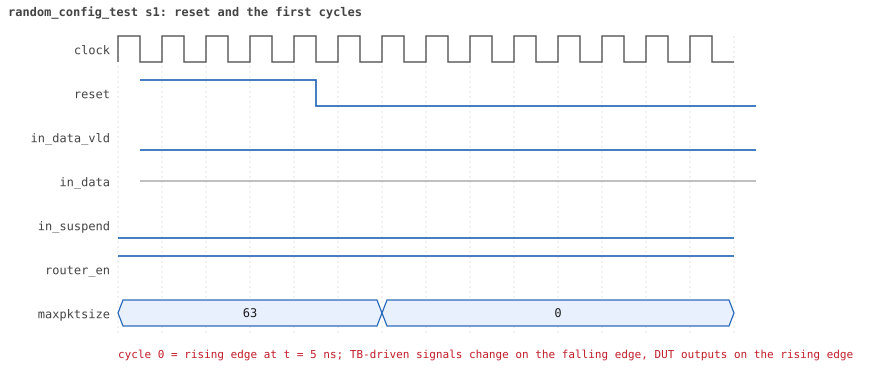
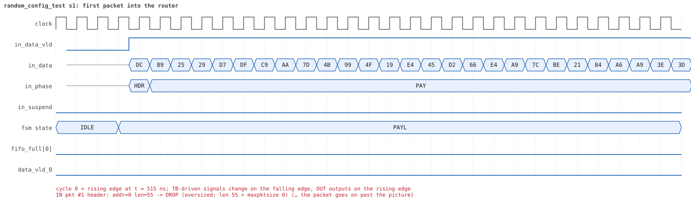
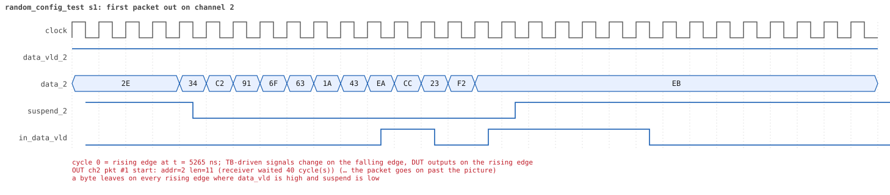
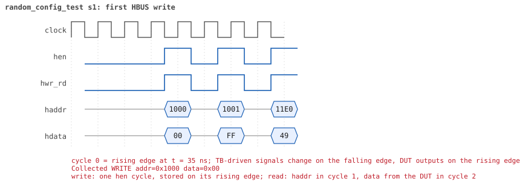
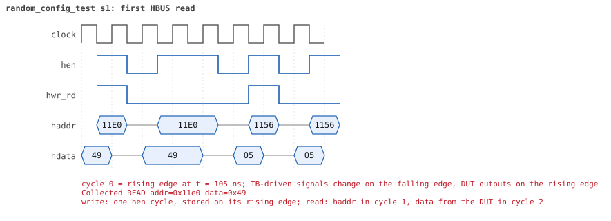

# random_config_test seed 1

**Result:** PASSED (0 UVM_ERROR, 0 UVM_WARNING, 0 UVM_FATAL) · bench `yapp_project_tb` · sim time 15us · wall 8.9 s · log [`random_config_test_s1.log`](random_config_test_s1.log)

Waves: `random_config_test_s1.fst` (GTKWave, Surfer or the VS Code wave viewer).
[Open the waves in Surfer](https://app.surfer-project.org/?load_url=https%3A%2F%2Fraw.githubusercontent.com%2Ftamirgabgab%2FQcom-Mentoring%2Fmain%2Fyapp_project%2Fregression%2Fyapp_project_tb%2Frandom_config_test_s1%2Frandom_config_test_s1.fst&startup_commands=run_command_file_from_url%20https%3A%2F%2Fraw.githubusercontent.com%2Ftamirgabgab%2FQcom-Mentoring%2Fmain%2Fyapp_project%2Ftb%2Fyapp_router.sucl) (web app, the signals already in groups: `yapp_project/tb/yapp_router.sucl`).

## Summary

- YAPP driver sent **22** packet(s) (4 with bad parity); the input monitor saw 22.
- Router: **6** forwarded, **16** dropped (9 oversized, 7 router disabled).
- Packets out: ch0 **2**, ch1 **2**, ch2 **2**.
- Scoreboard: 6 matched, 0 mismatched, 0 unexpected.
- Back-pressure: in_suspend asserted **0** time(s).
- Error pulses: 2.
- HBUS: 50 write(s), 114 read(s).

## Stages

| time (ns) | stage |
|---|---|
| 0 | receivers: ch0 RX_STALLY, ch1 RX_FAST, ch2 RX_STALLY |
| 0 | random scenario: 22 packets in 8 bursts |
| 530 | burst 1/8: ctrl=0x00 (maxpktsize 0) en=0xff (router on, counter enables 1111111), 3 packet(s) |
| 2140 | burst 1/8 sent: addr0..3 2/1/0/0, bad parity 0, gap 0 1, length 32..63 |
| 2510 | burst 2/8: ctrl=0x40 (maxpktsize 0) en=0x01 (router on, counter enables 0000000), 2 packet(s) |
| 3940 | burst 2/8 sent: addr0..3 1/0/1/0, bad parity 0, gap 0 1, length 63..63 |
| 4210 | burst 3/8: ctrl=0x22 (maxpktsize 34) en=0xff (router on, counter enables 1111111), 2 packet(s) |
| 5020 | burst 3/8 sent: addr0..3 0/1/1/0, bad parity 1, gap 0 0, length 11..35 |
| 5370 | burst 4/8: ctrl=0x40 (maxpktsize 0) en=0xfe (router OFF, counter enables 1111111), 3 packet(s) |
| 6760 | burst 4/8 sent: addr0..3 0/1/0/2, bad parity 1, gap 0 0, length 1..63 |
| 7180 | burst 5/8: ctrl=0x16 (maxpktsize 22) en=0xf5 (router on, counter enables 1111010), 3 packet(s) |
| 8820 | burst 5/8 sent: addr0..3 0/1/1/1, bad parity 0, gap 0 0, length 21..63 |
| 9100 | burst 6/8: ctrl=0x3e (maxpktsize 62) en=0xff (router on, counter enables 1111111), 2 packet(s) |
| 10120 | burst 6/8 sent: addr0..3 1/1/0/0, bad parity 0, gap 0 1, length 21..63 |
| 10400 | burst 7/8: ctrl=0xef (maxpktsize 47) en=0xff (router on, counter enables 1111111), 3 packet(s) |
| 11850 | burst 7/8 sent: addr0..3 2/0/1/0, bad parity 1, gap 0 0, length 41..47 |
| 12140 | burst 8/8: ctrl=0x51 (maxpktsize 17) en=0xc6 (router OFF, counter enables 1100011), 4 packet(s) |
| 12810 | burst 8/8 sent: addr0..3 0/1/1/2, bad parity 1, gap 0 1, length 1..17 |
| 12810 | final reads: every register and the stored packet, checked against the reference model |
| 14605 | done: 22 packets (6 forwarded, 16 dropped), 0 storm burst(s), 6 scoreboard matches, 114 HBUS reads checked, 2 error pulses for 2 bad packets |

## Pictures

**reset and the first cycles**

**first packet into the router**

**first packet out on channel 2**

**first error pulse after a bad-parity packet**

**first HBUS write**

**first HBUS read**

## Timeline

581 events.

| time (ns) | who | event |
|---|---|---|
| 0 | yapp monitor | YAPP monitor running |
| 0 | **test** | STAGE: receivers: ch0 RX_STALLY, ch1 RX_FAST, ch2 RX_STALLY |
| 0 | **test** | STAGE: random scenario: 22 packets in 8 bursts |
| 0 | clk/rst driver | Starting clock (period 10) and holding reset for 5 cycles |
| 0 | **DUT** | RESET asserted |
| 50 | **DUT** | RESET released: router_en=1 maxpktsize=63 |
| 70 | hbus driver | Executed WRITE addr=0x1000 data=0x00 |
| 75 | **DUT** | CONFIG router_en=1 maxpktsize=0 |
| 75 | hbus monitor | Collected WRITE addr=0x1000 data=0x00 |
| 75 | reference | maxpktsize is now 0 |
| 90 | hbus driver | Executed WRITE addr=0x1001 data=0xff |
| 95 | hbus monitor | Collected WRITE addr=0x1001 data=0xff |
| 95 | reference | router_en is now 1 (en_reg 0xff) |
| 110 | hbus driver | Executed WRITE addr=0x11e0 data=0x49 |
| 115 | hbus monitor | Collected WRITE addr=0x11e0 data=0x49 |
| 140 | hbus driver | Executed READ  addr=0x11e0 data=0x49 |
| 145 | hbus monitor | Collected READ  addr=0x11e0 data=0x49 |
| 160 | hbus driver | Executed WRITE addr=0x1156 data=0x05 |
| 165 | hbus monitor | Collected WRITE addr=0x1156 data=0x05 |
| 190 | hbus driver | Executed READ  addr=0x1156 data=0x05 |
| 195 | hbus monitor | Collected READ  addr=0x1156 data=0x05 |
| 210 | hbus driver | Executed WRITE addr=0x1149 data=0xe9 |
| 215 | hbus monitor | Collected WRITE addr=0x1149 data=0xe9 |
| 240 | hbus driver | Executed READ  addr=0x1149 data=0xe9 |
| 245 | hbus monitor | Collected READ  addr=0x1149 data=0xe9 |
| 260 | hbus driver | Executed WRITE addr=0x11e9 data=0xb1 |
| 265 | hbus monitor | Collected WRITE addr=0x11e9 data=0xb1 |
| 290 | hbus driver | Executed READ  addr=0x11e9 data=0xb1 |
| 295 | hbus monitor | Collected READ  addr=0x11e9 data=0xb1 |
| 310 | hbus driver | Executed WRITE addr=0x114d data=0x84 |
| 315 | hbus monitor | Collected WRITE addr=0x114d data=0x84 |
| 340 | hbus driver | Executed READ  addr=0x114d data=0x84 |
| 345 | hbus monitor | Collected READ  addr=0x114d data=0x84 |
| 370 | hbus driver | Executed READ  addr=0x100b data=0x00 |
| 375 | hbus monitor | Collected READ  addr=0x100b data=0x00 |
| 390 | hbus driver | Executed WRITE addr=0x1168 data=0x9e |
| 395 | hbus monitor | Collected WRITE addr=0x1168 data=0x9e |
| 420 | hbus driver | Executed READ  addr=0x1168 data=0x9e |
| 425 | hbus monitor | Collected READ  addr=0x1168 data=0x9e |
| 440 | hbus driver | Executed WRITE addr=0x111f data=0xe7 |
| 445 | hbus monitor | Collected WRITE addr=0x111f data=0xe7 |
| 470 | hbus driver | Executed READ  addr=0x111f data=0xe7 |
| 475 | hbus monitor | Collected READ  addr=0x111f data=0xe7 |
| 500 | hbus driver | Executed READ  addr=0x1002 data=0x00 |
| 505 | hbus monitor | Collected READ  addr=0x1002 data=0x00 |
| 530 | hbus driver | Executed READ  addr=0x100d data=0x00 |
| 530 | **test** | STAGE: burst 1/8: ctrl=0x00 (maxpktsize 0) en=0xff (router on, counter enables 1111111), 3 packet(s) |
| 530 | yapp driver | TX pkt #1: addr=0 len=55 parity=good delay=0 |
| 535 | hbus monitor | Collected READ  addr=0x100d data=0x00 |
| 545 | **DUT** | IN  pkt #1 header: addr=0 len=55 -> DROP (oversized: len 55 > maxpktsize 0) |
| 1105 | **DUT** | IN  pkt #1 complete: addr=0 len=55 parity=ok dropped, 57 bytes in 57 cycles (held 0) |
| 1105 | yapp monitor | RX pkt #1 on the input: addr=0 len=55 parity=good gap=49 |
| 1105 | reference | Packet dropped: length 55 > maxpktsize 0 (addr=0) |
| 1105 | **DUT** | ROUTER DROPS PACKET addr=0 length=55 (length > maxpktsize) |
| 1110 | yapp driver | TX pkt #1 accepted by the DUT |
| 1110 | yapp driver | TX pkt #2: addr=1 len=32 parity=good delay=1 |
| 1125 | **DUT** | IN  pkt #2 header: addr=1 len=32 -> DROP (oversized: len 32 > maxpktsize 0) |
| 1455 | **DUT** | IN  pkt #2 complete: addr=1 len=32 parity=ok dropped, 34 bytes in 34 cycles (held 0) |
| 1455 | yapp monitor | RX pkt #2 on the input: addr=1 len=32 parity=good gap=1 |
| 1455 | reference | Packet dropped: length 32 > maxpktsize 0 (addr=1) |
| 1455 | **DUT** | ROUTER DROPS PACKET addr=1 length=32 (length > maxpktsize) |
| 1460 | yapp driver | TX pkt #2 accepted by the DUT |
| 1460 | yapp driver | TX pkt #3: addr=0 len=63 parity=good delay=3 |
| 1495 | **DUT** | IN  pkt #3 header: addr=0 len=63 -> DROP (oversized: len 63 > maxpktsize 0) |
| 2135 | **DUT** | IN  pkt #3 complete: addr=0 len=63 parity=ok dropped, 65 bytes in 65 cycles (held 0) |
| 2135 | yapp monitor | RX pkt #3 on the input: addr=0 len=63 parity=good gap=3 |
| 2135 | reference | Packet dropped: length 63 > maxpktsize 0 (addr=0) |
| 2135 | **DUT** | ROUTER DROPS PACKET addr=0 length=63 (length > maxpktsize) |
| 2140 | yapp driver | TX pkt #3 accepted by the DUT |
| 2140 | **test** | STAGE: burst 1/8 sent: addr0..3 2/1/0/0, bad parity 0, gap 0 1, length 32..63 |
| 2160 | hbus driver | Executed WRITE addr=0x1000 data=0x40 |
| 2165 | hbus monitor | Collected WRITE addr=0x1000 data=0x40 |
| 2165 | reference | maxpktsize is now 0 |
| 2180 | hbus driver | Executed WRITE addr=0x1001 data=0x01 |
| 2185 | hbus monitor | Collected WRITE addr=0x1001 data=0x01 |
| 2185 | reference | router_en is now 1 (en_reg 0x01) |
| 2210 | hbus driver | Executed READ  addr=0x103e data=0x53 |
| 2215 | hbus monitor | Collected READ  addr=0x103e data=0x53 |
| 2230 | hbus driver | Executed WRITE addr=0x1175 data=0xa5 |
| 2235 | hbus monitor | Collected WRITE addr=0x1175 data=0xa5 |
| 2260 | hbus driver | Executed READ  addr=0x1175 data=0xa5 |
| 2265 | hbus monitor | Collected READ  addr=0x1175 data=0xa5 |
| 2290 | hbus driver | Executed READ  addr=0x100d data=0x3f |
| 2295 | hbus monitor | Collected READ  addr=0x100d data=0x3f |
| 2310 | hbus driver | Executed WRITE addr=0x1147 data=0x49 |
| 2315 | hbus monitor | Collected WRITE addr=0x1147 data=0x49 |
| 2340 | hbus driver | Executed READ  addr=0x1147 data=0x49 |
| 2345 | hbus monitor | Collected READ  addr=0x1147 data=0x49 |
| 2360 | hbus driver | Executed WRITE addr=0x1121 data=0xfc |
| 2365 | hbus monitor | Collected WRITE addr=0x1121 data=0xfc |
| 2390 | hbus driver | Executed READ  addr=0x1121 data=0xfc |
| 2395 | hbus monitor | Collected READ  addr=0x1121 data=0xfc |
| 2420 | hbus driver | Executed READ  addr=0x1048 data=0x90 |
| 2425 | hbus monitor | Collected READ  addr=0x1048 data=0x90 |
| 2450 | hbus driver | Executed READ  addr=0x100d data=0x3f |
| 2455 | hbus monitor | Collected READ  addr=0x100d data=0x3f |
| 2480 | hbus driver | Executed READ  addr=0x100a data=0x01 |
| 2485 | hbus monitor | Collected READ  addr=0x100a data=0x01 |
| 2510 | hbus driver | Executed READ  addr=0x101a data=0x25 |
| 2510 | **test** | STAGE: burst 2/8: ctrl=0x40 (maxpktsize 0) en=0x01 (router on, counter enables 0000000), 2 packet(s) |
| 2510 | yapp driver | TX pkt #4: addr=2 len=63 parity=good delay=12 |
| 2515 | hbus monitor | Collected READ  addr=0x101a data=0x25 |
| 2645 | **DUT** | IN  pkt #4 header: addr=2 len=63 -> DROP (oversized: len 63 > maxpktsize 0) |
| 3285 | **DUT** | IN  pkt #4 complete: addr=2 len=63 parity=ok dropped, 65 bytes in 65 cycles (held 0) |
| 3285 | yapp monitor | RX pkt #4 on the input: addr=2 len=63 parity=good gap=50 |
| 3285 | reference | Packet dropped: length 63 > maxpktsize 0 (addr=2) |
| 3285 | **DUT** | ROUTER DROPS PACKET addr=2 length=63 (length > maxpktsize) |
| 3290 | yapp driver | TX pkt #4 accepted by the DUT |
| 3290 | yapp driver | TX pkt #5: addr=0 len=63 parity=good delay=0 |
| 3295 | **DUT** | IN  pkt #5 header: addr=0 len=63 -> DROP (oversized: len 63 > maxpktsize 0) |
| 3935 | **DUT** | IN  pkt #5 complete: addr=0 len=63 parity=ok dropped, 65 bytes in 65 cycles (held 0) |
| 3935 | yapp monitor | RX pkt #5 on the input: addr=0 len=63 parity=good gap=0 |
| 3935 | reference | Packet dropped: length 63 > maxpktsize 0 (addr=0) |
| 3935 | **DUT** | ROUTER DROPS PACKET addr=0 length=63 (length > maxpktsize) |
| 3940 | yapp driver | TX pkt #5 accepted by the DUT |
| 3940 | **test** | STAGE: burst 2/8 sent: addr0..3 1/0/1/0, bad parity 0, gap 0 1, length 63..63 |
| 3960 | hbus driver | Executed WRITE addr=0x1000 data=0x22 |
| 3965 | **DUT** | CONFIG router_en=1 maxpktsize=34 |
| 3965 | hbus monitor | Collected WRITE addr=0x1000 data=0x22 |
| 3965 | reference | maxpktsize is now 34 |
| 3980 | hbus driver | Executed WRITE addr=0x1001 data=0xff |
| 3985 | hbus monitor | Collected WRITE addr=0x1001 data=0xff |
| 3985 | reference | router_en is now 1 (en_reg 0xff) |
| 4000 | hbus driver | Executed WRITE addr=0x11b1 data=0xac |
| 4005 | hbus monitor | Collected WRITE addr=0x11b1 data=0xac |
| 4030 | hbus driver | Executed READ  addr=0x11b1 data=0xac |
| 4035 | hbus monitor | Collected READ  addr=0x11b1 data=0xac |
| 4060 | hbus driver | Executed READ  addr=0x1008 data=0x00 |
| 4065 | hbus monitor | Collected READ  addr=0x1008 data=0x00 |
| 4080 | hbus driver | Executed WRITE addr=0x1197 data=0x13 |
| 4085 | hbus monitor | Collected WRITE addr=0x1197 data=0x13 |
| 4110 | hbus driver | Executed READ  addr=0x1197 data=0x13 |
| 4115 | hbus monitor | Collected READ  addr=0x1197 data=0x13 |
| 4130 | hbus driver | Executed WRITE addr=0x1123 data=0x47 |
| 4135 | hbus monitor | Collected WRITE addr=0x1123 data=0x47 |
| 4160 | hbus driver | Executed READ  addr=0x1123 data=0x47 |
| 4165 | hbus monitor | Collected READ  addr=0x1123 data=0x47 |
| 4180 | hbus driver | Executed WRITE addr=0x1193 data=0xcd |
| 4185 | hbus monitor | Collected WRITE addr=0x1193 data=0xcd |
| 4210 | hbus driver | Executed READ  addr=0x1193 data=0xcd |
| 4210 | **test** | STAGE: burst 3/8: ctrl=0x22 (maxpktsize 34) en=0xff (router on, counter enables 1111111), 2 packet(s) |
| 4210 | yapp driver | TX pkt #6: addr=1 len=35 parity=bad delay=20 |
| 4215 | hbus monitor | Collected READ  addr=0x1193 data=0xcd |
| 4425 | **DUT** | IN  pkt #6 header: addr=1 len=35 -> DROP (oversized: len 35 > maxpktsize 34) |
| 4785 | **DUT** | IN  pkt #6 complete: addr=1 len=35 parity=BAD dropped, 37 bytes in 37 cycles (held 0) |
| 4785 | yapp monitor | RX pkt #6 on the input: addr=1 len=35 parity=bad gap=48 |
| 4785 | reference | Packet dropped: length 35 > maxpktsize 34 (addr=1) |
| 4785 | **DUT** | ROUTER DROPS PACKET addr=1 length=35 (length > maxpktsize) |
| 4790 | yapp driver | TX pkt #6 accepted by the DUT |
| 4790 | yapp driver | TX pkt #7: addr=2 len=11 parity=good delay=10 |
| 4890 | **DUT** | ERROR pulse, 10 cycle(s) after the bad-parity packet |
| 4890 | error checker | error pulse 10 cycles after the bad packet (0 still owed) |
| 4895 | **DUT** | IN  pkt #7 header: addr=2 len=11 -> channel 2 |
| 4995 | **DUT** | OUT ch2 pkt #1 start: addr=2 len=11 (receiver waited 9 cycle(s)) |
| 5015 | **DUT** | IN  pkt #7 complete: addr=2 len=11 parity=ok forwarded, 13 bytes in 13 cycles (held 0) |
| 5015 | yapp monitor | RX pkt #7 on the input: addr=2 len=11 parity=good gap=10 |
| 5015 | reference | Packet forwarded: addr=2 len=11 -> channel 2 |
| 5020 | yapp driver | TX pkt #7 accepted by the DUT |
| 5020 | **test** | STAGE: burst 3/8 sent: addr0..3 0/1/1/0, bad parity 1, gap 0 0, length 11..35 |
| 5040 | hbus driver | Executed WRITE addr=0x1000 data=0x40 |
| 5045 | **DUT** | CONFIG router_en=1 maxpktsize=0 |
| 5045 | hbus monitor | Collected WRITE addr=0x1000 data=0x40 |
| 5045 | reference | maxpktsize is now 0 |
| 5060 | hbus driver | Executed WRITE addr=0x1001 data=0xfe |
| 5065 | **DUT** | CONFIG router_en=0 maxpktsize=0 |
| 5065 | hbus monitor | Collected WRITE addr=0x1001 data=0xfe |
| 5065 | reference | router_en is now 0 (en_reg 0xfe) |
| 5080 | hbus driver | Executed WRITE addr=0x11f4 data=0xfd |
| 5085 | hbus monitor | Collected WRITE addr=0x11f4 data=0xfd |
| 5110 | ch2 driver | ch2: packet consumed (response delay 9) |
| 5110 | hbus driver | Executed READ  addr=0x11f4 data=0xfd |
| 5115 | hbus monitor | Collected READ  addr=0x11f4 data=0xfd |
| 5130 | hbus driver | Executed WRITE addr=0x1177 data=0xc7 |
| 5135 | hbus monitor | Collected WRITE addr=0x1177 data=0xc7 |
| 5160 | hbus driver | Executed READ  addr=0x1177 data=0xc7 |
| 5165 | hbus monitor | Collected READ  addr=0x1177 data=0xc7 |
| 5180 | hbus driver | Executed WRITE addr=0x1179 data=0xd4 |
| 5185 | hbus monitor | Collected WRITE addr=0x1179 data=0xd4 |
| 5210 | hbus driver | Executed READ  addr=0x1179 data=0xd4 |
| 5215 | hbus monitor | Collected READ  addr=0x1179 data=0xd4 |
| 5225 | **DUT** | OUT ch2 pkt #1 done: 13 bytes in 24 cycles |
| 5225 | ch2 monitor | ch2 RX pkt #1: addr=2 len=11 parity=good |
| 5225 | scoreboard | ch2 pkt matched: addr=2 len=11 (1 matched so far) |
| 5230 | hbus driver | Executed WRITE addr=0x110c data=0xa4 |
| 5235 | hbus monitor | Collected WRITE addr=0x110c data=0xa4 |
| 5260 | hbus driver | Executed READ  addr=0x110c data=0xa4 |
| 5265 | hbus monitor | Collected READ  addr=0x110c data=0xa4 |
| 5290 | hbus driver | Executed READ  addr=0x100c data=0x00 |
| 5295 | hbus monitor | Collected READ  addr=0x100c data=0x00 |
| 5320 | hbus driver | Executed READ  addr=0x100f data=0x00 |
| 5325 | hbus monitor | Collected READ  addr=0x100f data=0x00 |
| 5340 | hbus driver | Executed WRITE addr=0x115a data=0x62 |
| 5345 | hbus monitor | Collected WRITE addr=0x115a data=0x62 |
| 5370 | hbus driver | Executed READ  addr=0x115a data=0x62 |
| 5370 | **test** | STAGE: burst 4/8: ctrl=0x40 (maxpktsize 0) en=0xfe (router OFF, counter enables 1111111), 3 packet(s) |
| 5370 | yapp driver | TX pkt #8: addr=1 len=63 parity=good delay=1 |
| 5375 | hbus monitor | Collected READ  addr=0x115a data=0x62 |
| 5395 | **DUT** | IN  pkt #8 header: addr=1 len=63 -> DROP (router disabled) |
| 5810 | ch2 driver | ch2: packet consumed (response delay 10) |
| 6035 | **DUT** | IN  pkt #8 complete: addr=1 len=63 parity=ok dropped, 65 bytes in 65 cycles (held 0) |
| 6035 | yapp monitor | RX pkt #8 on the input: addr=1 len=63 parity=good gap=37 |
| 6035 | reference | Packet dropped: router disabled (addr=1 len=63) |
| 6035 | **DUT** | ROUTER DROPS PACKET addr=1 length=63 (router disabled) |
| 6040 | yapp driver | TX pkt #8 accepted by the DUT |
| 6040 | yapp driver | TX pkt #9: addr=3 len=63 parity=good delay=1 |
| 6055 | **DUT** | IN  pkt #9 header: addr=3 len=63 -> DROP (router disabled) |
| 6695 | **DUT** | IN  pkt #9 complete: addr=3 len=63 parity=ok dropped, 65 bytes in 65 cycles (held 0) |
| 6695 | yapp monitor | RX pkt #9 on the input: addr=3 len=63 parity=good gap=1 |
| 6695 | reference | Packet dropped: router disabled (addr=3 len=63) |
| 6695 | **DUT** | ROUTER DROPS PACKET addr=3 length=63 (router disabled) |
| 6700 | yapp driver | TX pkt #9 accepted by the DUT |
| 6700 | yapp driver | TX pkt #10: addr=3 len=1 parity=bad delay=3 |
| 6735 | **DUT** | IN  pkt #10 header: addr=3 len=1 -> DROP (router disabled) |
| 6755 | **DUT** | IN  pkt #10 complete: addr=3 len=1 parity=BAD dropped, 3 bytes in 3 cycles (held 0) |
| 6755 | yapp monitor | RX pkt #10 on the input: addr=3 len=1 parity=bad gap=3 |
| 6755 | reference | Packet dropped: router disabled (addr=3 len=1) |
| 6755 | **DUT** | ROUTER DROPS PACKET addr=3 length=1 (router disabled) |
| 6760 | yapp driver | TX pkt #10 accepted by the DUT |
| 6760 | **test** | STAGE: burst 4/8 sent: addr0..3 0/1/0/2, bad parity 1, gap 0 0, length 1..63 |
| 6780 | hbus driver | Executed WRITE addr=0x1000 data=0x16 |
| 6785 | **DUT** | CONFIG router_en=0 maxpktsize=22 |
| 6785 | hbus monitor | Collected WRITE addr=0x1000 data=0x16 |
| 6785 | reference | maxpktsize is now 22 |
| 6800 | hbus driver | Executed WRITE addr=0x1001 data=0xf5 |
| 6805 | **DUT** | CONFIG router_en=1 maxpktsize=22 |
| 6805 | hbus monitor | Collected WRITE addr=0x1001 data=0xf5 |
| 6805 | reference | router_en is now 1 (en_reg 0xf5) |
| 6820 | hbus driver | Executed WRITE addr=0x11d3 data=0x43 |
| 6825 | hbus monitor | Collected WRITE addr=0x11d3 data=0x43 |
| 6850 | hbus driver | Executed READ  addr=0x11d3 data=0x43 |
| 6855 | hbus monitor | Collected READ  addr=0x11d3 data=0x43 |
| 6870 | hbus driver | Executed WRITE addr=0x11f3 data=0xad |
| 6875 | hbus monitor | Collected WRITE addr=0x11f3 data=0xad |
| 6900 | hbus driver | Executed READ  addr=0x11f3 data=0xad |
| 6905 | hbus monitor | Collected READ  addr=0x11f3 data=0xad |
| 6930 | hbus driver | Executed READ  addr=0x100d data=0x0b |
| 6935 | hbus monitor | Collected READ  addr=0x100d data=0x0b |
| 6960 | hbus driver | Executed READ  addr=0x1001 data=0xf5 |
| 6965 | hbus monitor | Collected READ  addr=0x1001 data=0xf5 |
| 6990 | hbus driver | Executed READ  addr=0x103d data=0xee |
| 6995 | hbus monitor | Collected READ  addr=0x103d data=0xee |
| 7010 | hbus driver | Executed WRITE addr=0x1116 data=0xa9 |
| 7015 | hbus monitor | Collected WRITE addr=0x1116 data=0xa9 |
| 7040 | hbus driver | Executed READ  addr=0x1116 data=0xa9 |
| 7045 | hbus monitor | Collected READ  addr=0x1116 data=0xa9 |
| 7070 | hbus driver | Executed READ  addr=0x1009 data=0x02 |
| 7075 | hbus monitor | Collected READ  addr=0x1009 data=0x02 |
| 7090 | hbus driver | Executed WRITE addr=0x112e data=0xd0 |
| 7095 | hbus monitor | Collected WRITE addr=0x112e data=0xd0 |
| 7120 | hbus driver | Executed READ  addr=0x112e data=0xd0 |
| 7125 | hbus monitor | Collected READ  addr=0x112e data=0xd0 |
| 7150 | hbus driver | Executed READ  addr=0x1007 data=0x00 |
| 7155 | hbus monitor | Collected READ  addr=0x1007 data=0x00 |
| 7180 | hbus driver | Executed READ  addr=0x100d data=0x0b |
| 7180 | **test** | STAGE: burst 5/8: ctrl=0x16 (maxpktsize 22) en=0xf5 (router on, counter enables 1111010), 3 packet(s) |
| 7180 | yapp driver | TX pkt #11: addr=3 len=63 parity=good delay=2 |
| 7185 | hbus monitor | Collected READ  addr=0x100d data=0x0b |
| 7215 | **DUT** | IN  pkt #11 header: addr=3 len=63 -> DROP (oversized: len 63 > maxpktsize 22) |
| 7855 | **DUT** | IN  pkt #11 complete: addr=3 len=63 parity=ok dropped, 65 bytes in 65 cycles (held 0) |
| 7855 | yapp monitor | RX pkt #11 on the input: addr=3 len=63 parity=good gap=45 |
| 7855 | reference | Packet dropped: illegal address 3 (len=63) |
| 7855 | **DUT** | ROUTER DROPS PACKET addr=3 length=63 (    illegal address) |
| 7860 | yapp driver | TX pkt #11 accepted by the DUT |
| 7860 | yapp driver | TX pkt #12: addr=2 len=63 parity=good delay=7 |
| 7935 | **DUT** | IN  pkt #12 header: addr=2 len=63 -> DROP (oversized: len 63 > maxpktsize 22) |
| 8575 | **DUT** | IN  pkt #12 complete: addr=2 len=63 parity=ok dropped, 65 bytes in 65 cycles (held 0) |
| 8575 | yapp monitor | RX pkt #12 on the input: addr=2 len=63 parity=good gap=7 |
| 8575 | reference | Packet dropped: length 63 > maxpktsize 22 (addr=2) |
| 8575 | **DUT** | ROUTER DROPS PACKET addr=2 length=63 (length > maxpktsize) |
| 8580 | yapp driver | TX pkt #12 accepted by the DUT |
| 8580 | yapp driver | TX pkt #13: addr=1 len=21 parity=good delay=1 |
| 8595 | **DUT** | IN  pkt #13 header: addr=1 len=21 -> channel 1 |
| 8605 | **DUT** | OUT ch1 pkt #1 start: addr=1 len=21 (receiver waited 0 cycle(s)) |
| 8815 | **DUT** | IN  pkt #13 complete: addr=1 len=21 parity=ok forwarded, 23 bytes in 23 cycles (held 0) |
| 8815 | yapp monitor | RX pkt #13 on the input: addr=1 len=21 parity=good gap=1 |
| 8815 | reference | Packet forwarded: addr=1 len=21 -> channel 1 |
| 8820 | ch1 driver | ch1: packet consumed (response delay 0) |
| 8820 | yapp driver | TX pkt #13 accepted by the DUT |
| 8820 | **test** | STAGE: burst 5/8 sent: addr0..3 0/1/1/1, bad parity 0, gap 0 0, length 21..63 |
| 8835 | **DUT** | OUT ch1 pkt #1 done: 23 bytes in 24 cycles |
| 8835 | ch1 monitor | ch1 RX pkt #1: addr=1 len=21 parity=good |
| 8835 | scoreboard | ch1 pkt matched: addr=1 len=21 (2 matched so far) |
| 8840 | hbus driver | Executed WRITE addr=0x1000 data=0x3e |
| 8845 | **DUT** | CONFIG router_en=1 maxpktsize=62 |
| 8845 | hbus monitor | Collected WRITE addr=0x1000 data=0x3e |
| 8845 | reference | maxpktsize is now 62 |
| 8860 | hbus driver | Executed WRITE addr=0x1001 data=0xff |
| 8865 | hbus monitor | Collected WRITE addr=0x1001 data=0xff |
| 8865 | reference | router_en is now 1 (en_reg 0xff) |
| 8890 | hbus driver | Executed READ  addr=0x100b data=0x02 |
| 8895 | hbus monitor | Collected READ  addr=0x100b data=0x02 |
| 8910 | hbus driver | Executed WRITE addr=0x1177 data=0xda |
| 8915 | hbus monitor | Collected WRITE addr=0x1177 data=0xda |
| 8940 | hbus driver | Executed READ  addr=0x1177 data=0xda |
| 8945 | hbus monitor | Collected READ  addr=0x1177 data=0xda |
| 8960 | hbus driver | Executed WRITE addr=0x1186 data=0xb0 |
| 8965 | hbus monitor | Collected WRITE addr=0x1186 data=0xb0 |
| 8990 | hbus driver | Executed READ  addr=0x1186 data=0xb0 |
| 8995 | hbus monitor | Collected READ  addr=0x1186 data=0xb0 |
| 9020 | hbus driver | Executed READ  addr=0x100b data=0x02 |
| 9025 | hbus monitor | Collected READ  addr=0x100b data=0x02 |
| 9050 | hbus driver | Executed READ  addr=0x1016 data=0xc4 |
| 9055 | hbus monitor | Collected READ  addr=0x1016 data=0xc4 |
| 9070 | hbus driver | Executed WRITE addr=0x11cb data=0xa7 |
| 9075 | hbus monitor | Collected WRITE addr=0x11cb data=0xa7 |
| 9100 | hbus driver | Executed READ  addr=0x11cb data=0xa7 |
| 9100 | **test** | STAGE: burst 6/8: ctrl=0x3e (maxpktsize 62) en=0xff (router on, counter enables 1111111), 2 packet(s) |
| 9100 | yapp driver | TX pkt #14: addr=1 len=21 parity=good delay=0 |
| 9105 | hbus monitor | Collected READ  addr=0x11cb data=0xa7 |
| 9115 | **DUT** | IN  pkt #14 header: addr=1 len=21 -> channel 1 |
| 9125 | **DUT** | OUT ch1 pkt #2 start: addr=1 len=21 (receiver waited 0 cycle(s)) |
| 9335 | **DUT** | IN  pkt #14 complete: addr=1 len=21 parity=ok forwarded, 23 bytes in 23 cycles (held 0) |
| 9335 | yapp monitor | RX pkt #14 on the input: addr=1 len=21 parity=good gap=29 |
| 9335 | reference | Packet forwarded: addr=1 len=21 -> channel 1 |
| 9340 | yapp driver | TX pkt #14 accepted by the DUT |
| 9340 | yapp driver | TX pkt #15: addr=0 len=63 parity=good delay=13 |
| 9345 | **DUT** | OUT ch1 pkt #2 done: 23 bytes in 23 cycles |
| 9345 | ch1 monitor | ch1 RX pkt #2: addr=1 len=21 parity=good |
| 9345 | scoreboard | ch1 pkt matched: addr=1 len=21 (3 matched so far) |
| 9460 | ch1 driver | ch1: packet consumed (response delay 0) |
| 9475 | **DUT** | IN  pkt #15 header: addr=0 len=63 -> DROP (oversized: len 63 > maxpktsize 62) |
| 10115 | **DUT** | IN  pkt #15 complete: addr=0 len=63 parity=ok dropped, 65 bytes in 65 cycles (held 0) |
| 10115 | yapp monitor | RX pkt #15 on the input: addr=0 len=63 parity=good gap=13 |
| 10115 | reference | Packet dropped: length 63 > maxpktsize 62 (addr=0) |
| 10115 | **DUT** | ROUTER DROPS PACKET addr=0 length=63 (length > maxpktsize) |
| 10120 | yapp driver | TX pkt #15 accepted by the DUT |
| 10120 | **test** | STAGE: burst 6/8 sent: addr0..3 1/1/0/0, bad parity 0, gap 0 1, length 21..63 |
| 10140 | hbus driver | Executed WRITE addr=0x1000 data=0xef |
| 10145 | **DUT** | CONFIG router_en=1 maxpktsize=47 |
| 10145 | hbus monitor | Collected WRITE addr=0x1000 data=0xef |
| 10145 | reference | maxpktsize is now 47 |
| 10160 | hbus driver | Executed WRITE addr=0x1001 data=0xff |
| 10165 | hbus monitor | Collected WRITE addr=0x1001 data=0xff |
| 10165 | reference | router_en is now 1 (en_reg 0xff) |
| 10180 | hbus driver | Executed WRITE addr=0x11eb data=0xfb |
| 10185 | hbus monitor | Collected WRITE addr=0x11eb data=0xfb |
| 10210 | hbus driver | Executed READ  addr=0x11eb data=0xfb |
| 10215 | hbus monitor | Collected READ  addr=0x11eb data=0xfb |
| 10240 | hbus driver | Executed READ  addr=0x100d data=0x3f |
| 10245 | hbus monitor | Collected READ  addr=0x100d data=0x3f |
| 10270 | hbus driver | Executed READ  addr=0x106c data=0x00 |
| 10275 | hbus monitor | Collected READ  addr=0x106c data=0x00 |
| 10290 | hbus driver | Executed WRITE addr=0x110f data=0xca |
| 10295 | hbus monitor | Collected WRITE addr=0x110f data=0xca |
| 10320 | hbus driver | Executed READ  addr=0x110f data=0xca |
| 10325 | hbus monitor | Collected READ  addr=0x110f data=0xca |
| 10340 | hbus driver | Executed WRITE addr=0x11f0 data=0xb1 |
| 10345 | hbus monitor | Collected WRITE addr=0x11f0 data=0xb1 |
| 10370 | hbus driver | Executed READ  addr=0x11f0 data=0xb1 |
| 10375 | hbus monitor | Collected READ  addr=0x11f0 data=0xb1 |
| 10400 | hbus driver | Executed READ  addr=0x1000 data=0xef |
| 10400 | **test** | STAGE: burst 7/8: ctrl=0xef (maxpktsize 47) en=0xff (router on, counter enables 1111111), 3 packet(s) |
| 10400 | yapp driver | TX pkt #16: addr=0 len=47 parity=bad delay=1 |
| 10405 | hbus monitor | Collected READ  addr=0x1000 data=0xef |
| 10425 | **DUT** | IN  pkt #16 header: addr=0 len=47 -> channel 0 |
| 10485 | **DUT** | OUT ch0 pkt #1 start: addr=0 len=47 (receiver waited 5 cycle(s)) |
| 10905 | **DUT** | IN  pkt #16 complete: addr=0 len=47 parity=BAD forwarded, 49 bytes in 49 cycles (held 0) |
| 10905 | yapp monitor | RX pkt #16 on the input: addr=0 len=47 parity=bad gap=30 |
| 10905 | reference | Packet forwarded: addr=0 len=47 -> channel 0 |
| 10910 | yapp driver | TX pkt #16 accepted by the DUT |
| 10910 | yapp driver | TX pkt #17: addr=2 len=41 parity=good delay=1 |
| 10925 | **DUT** | IN  pkt #17 header: addr=2 len=41 -> channel 2 |
| 10945 | **DUT** | OUT ch2 pkt #2 start: addr=2 len=41 (receiver waited 1 cycle(s)) |
| 10950 | **DUT** | ERROR pulse, 4 cycle(s) after the bad-parity packet |
| 10950 | error checker | error pulse 4 cycles after the bad packet (0 still owed) |
| 10960 | ch0 driver | ch0: packet consumed (response delay 5) |
| 11075 | **DUT** | OUT ch0 pkt #1 done: 49 bytes in 60 cycles |
| 11075 | ch0 monitor | ch0 RX pkt #1: addr=0 len=47 parity=bad |
| 11075 | scoreboard | ch0 pkt matched: addr=0 len=47 (4 matched so far) |
| 11345 | **DUT** | IN  pkt #17 complete: addr=2 len=41 parity=ok forwarded, 43 bytes in 43 cycles (held 0) |
| 11345 | yapp monitor | RX pkt #17 on the input: addr=2 len=41 parity=good gap=1 |
| 11345 | reference | Packet forwarded: addr=2 len=41 -> channel 2 |
| 11350 | yapp driver | TX pkt #17 accepted by the DUT |
| 11350 | yapp driver | TX pkt #18: addr=0 len=46 parity=good delay=2 |
| 11360 | ch2 driver | ch2: packet consumed (response delay 1) |
| 11375 | **DUT** | IN  pkt #18 header: addr=0 len=46 -> channel 0 |
| 11385 | **DUT** | OUT ch0 pkt #2 start: addr=0 len=46 (receiver waited 0 cycle(s)) |
| 11465 | **DUT** | OUT ch2 pkt #2 done: 43 bytes in 53 cycles |
| 11465 | ch2 monitor | ch2 RX pkt #2: addr=2 len=41 parity=good |
| 11465 | scoreboard | ch2 pkt matched: addr=2 len=41 (5 matched so far) |
| 11470 | ch0 driver | ch0: packet consumed (response delay 10) |
| 11730 | ch2 driver | ch2: packet consumed (response delay 9) |
| 11845 | **DUT** | IN  pkt #18 complete: addr=0 len=46 parity=ok forwarded, 48 bytes in 48 cycles (held 0) |
| 11845 | yapp monitor | RX pkt #18 on the input: addr=0 len=46 parity=good gap=2 |
| 11845 | reference | Packet forwarded: addr=0 len=46 -> channel 0 |
| 11850 | yapp driver | TX pkt #18 accepted by the DUT |
| 11850 | **test** | STAGE: burst 7/8 sent: addr0..3 2/0/1/0, bad parity 1, gap 0 0, length 41..47 |
| 11870 | hbus driver | Executed WRITE addr=0x1000 data=0x51 |
| 11875 | **DUT** | CONFIG router_en=1 maxpktsize=17 |
| 11875 | hbus monitor | Collected WRITE addr=0x1000 data=0x51 |
| 11875 | reference | maxpktsize is now 17 |
| 11890 | hbus driver | Executed WRITE addr=0x1001 data=0xc6 |
| 11895 | **DUT** | CONFIG router_en=0 maxpktsize=17 |
| 11895 | hbus monitor | Collected WRITE addr=0x1001 data=0xc6 |
| 11895 | reference | router_en is now 0 (en_reg 0xc6) |
| 11910 | hbus driver | Executed WRITE addr=0x113c data=0x48 |
| 11915 | hbus monitor | Collected WRITE addr=0x113c data=0x48 |
| 11935 | **DUT** | OUT ch0 pkt #2 done: 48 bytes in 56 cycles |
| 11935 | ch0 monitor | ch0 RX pkt #2: addr=0 len=46 parity=good |
| 11935 | scoreboard | ch0 pkt matched: addr=0 len=46 (6 matched so far) |
| 11940 | hbus driver | Executed READ  addr=0x113c data=0x48 |
| 11945 | hbus monitor | Collected READ  addr=0x113c data=0x48 |
| 11960 | hbus driver | Executed WRITE addr=0x115f data=0xd0 |
| 11965 | hbus monitor | Collected WRITE addr=0x115f data=0xd0 |
| 11990 | hbus driver | Executed READ  addr=0x115f data=0xd0 |
| 11995 | hbus monitor | Collected READ  addr=0x115f data=0xd0 |
| 12010 | hbus driver | Executed WRITE addr=0x11b0 data=0xcf |
| 12015 | hbus monitor | Collected WRITE addr=0x11b0 data=0xcf |
| 12040 | hbus driver | Executed READ  addr=0x11b0 data=0xcf |
| 12045 | hbus monitor | Collected READ  addr=0x11b0 data=0xcf |
| 12060 | hbus driver | Executed WRITE addr=0x117b data=0x57 |
| 12065 | hbus monitor | Collected WRITE addr=0x117b data=0x57 |
| 12090 | hbus driver | Executed READ  addr=0x117b data=0x57 |
| 12095 | hbus monitor | Collected READ  addr=0x117b data=0x57 |
| 12110 | hbus driver | Executed WRITE addr=0x1110 data=0x31 |
| 12115 | hbus monitor | Collected WRITE addr=0x1110 data=0x31 |
| 12140 | hbus driver | Executed READ  addr=0x1110 data=0x31 |
| 12140 | **test** | STAGE: burst 8/8: ctrl=0x51 (maxpktsize 17) en=0xc6 (router OFF, counter enables 1100011), 4 packet(s) |
| 12140 | yapp driver | TX pkt #19: addr=1 len=1 parity=good delay=0 |
| 12145 | hbus monitor | Collected READ  addr=0x1110 data=0x31 |
| 12155 | **DUT** | IN  pkt #19 header: addr=1 len=1 -> DROP (router disabled) |
| 12160 | ch0 driver | ch0: packet consumed (response delay 7) |
| 12175 | **DUT** | IN  pkt #19 complete: addr=1 len=1 parity=ok dropped, 3 bytes in 3 cycles (held 0) |
| 12175 | yapp monitor | RX pkt #19 on the input: addr=1 len=1 parity=good gap=30 |
| 12175 | reference | Packet dropped: router disabled (addr=1 len=1) |
| 12175 | **DUT** | ROUTER DROPS PACKET addr=1 length=1 (router disabled) |
| 12180 | yapp driver | TX pkt #19 accepted by the DUT |
| 12180 | yapp driver | TX pkt #20: addr=3 len=16 parity=good delay=1 |
| 12195 | **DUT** | IN  pkt #20 header: addr=3 len=16 -> DROP (router disabled) |
| 12365 | **DUT** | IN  pkt #20 complete: addr=3 len=16 parity=ok dropped, 18 bytes in 18 cycles (held 0) |
| 12365 | yapp monitor | RX pkt #20 on the input: addr=3 len=16 parity=good gap=1 |
| 12365 | reference | Packet dropped: router disabled (addr=3 len=16) |
| 12365 | **DUT** | ROUTER DROPS PACKET addr=3 length=16 (router disabled) |
| 12370 | yapp driver | TX pkt #20 accepted by the DUT |
| 12370 | yapp driver | TX pkt #21: addr=2 len=15 parity=bad delay=7 |
| 12445 | **DUT** | IN  pkt #21 header: addr=2 len=15 -> DROP (router disabled) |
| 12605 | **DUT** | IN  pkt #21 complete: addr=2 len=15 parity=BAD dropped, 17 bytes in 17 cycles (held 0) |
| 12605 | yapp monitor | RX pkt #21 on the input: addr=2 len=15 parity=bad gap=7 |
| 12605 | reference | Packet dropped: router disabled (addr=2 len=15) |
| 12605 | **DUT** | ROUTER DROPS PACKET addr=2 length=15 (router disabled) |
| 12610 | yapp driver | TX pkt #21 accepted by the DUT |
| 12610 | yapp driver | TX pkt #22: addr=3 len=17 parity=good delay=1 |
| 12625 | **DUT** | IN  pkt #22 header: addr=3 len=17 -> DROP (router disabled) |
| 12805 | **DUT** | IN  pkt #22 complete: addr=3 len=17 parity=ok dropped, 19 bytes in 19 cycles (held 0) |
| 12805 | yapp monitor | RX pkt #22 on the input: addr=3 len=17 parity=good gap=1 |
| 12805 | reference | Packet dropped: router disabled (addr=3 len=17) |
| 12805 | **DUT** | ROUTER DROPS PACKET addr=3 length=17 (router disabled) |
| 12810 | yapp driver | TX pkt #22 accepted by the DUT |
| 12810 | **test** | STAGE: burst 8/8 sent: addr0..3 0/1/1/2, bad parity 1, gap 0 1, length 1..17 |
| 12810 | **test** | STAGE: final reads: every register and the stored packet, checked against the reference model |
| 12840 | hbus driver | Executed READ  addr=0x1000 data=0x51 |
| 12845 | hbus monitor | Collected READ  addr=0x1000 data=0x51 |
| 12870 | hbus driver | Executed READ  addr=0x1001 data=0xc6 |
| 12875 | hbus monitor | Collected READ  addr=0x1001 data=0xc6 |
| 12900 | hbus driver | Executed READ  addr=0x1004 data=0x02 |
| 12905 | hbus monitor | Collected READ  addr=0x1004 data=0x02 |
| 12930 | hbus driver | Executed READ  addr=0x1005 data=0x07 |
| 12935 | hbus monitor | Collected READ  addr=0x1005 data=0x07 |
| 12960 | hbus driver | Executed READ  addr=0x1006 data=0x01 |
| 12965 | hbus monitor | Collected READ  addr=0x1006 data=0x01 |
| 12990 | hbus driver | Executed READ  addr=0x1009 data=0x05 |
| 12995 | hbus monitor | Collected READ  addr=0x1009 data=0x05 |
| 13020 | hbus driver | Executed READ  addr=0x100a data=0x04 |
| 13025 | hbus monitor | Collected READ  addr=0x100a data=0x04 |
| 13050 | hbus driver | Executed READ  addr=0x100b data=0x03 |
| 13055 | hbus monitor | Collected READ  addr=0x100b data=0x03 |
| 13080 | hbus driver | Executed READ  addr=0x100d data=0x2e |
| 13085 | hbus monitor | Collected READ  addr=0x100d data=0x2e |
| 13110 | hbus driver | Executed READ  addr=0x1010 data=0xb8 |
| 13115 | hbus monitor | Collected READ  addr=0x1010 data=0xb8 |
| 13140 | hbus driver | Executed READ  addr=0x1011 data=0x1e |
| 13145 | hbus monitor | Collected READ  addr=0x1011 data=0x1e |
| 13170 | hbus driver | Executed READ  addr=0x1012 data=0x69 |
| 13175 | hbus monitor | Collected READ  addr=0x1012 data=0x69 |
| 13200 | hbus driver | Executed READ  addr=0x1013 data=0x2f |
| 13205 | hbus monitor | Collected READ  addr=0x1013 data=0x2f |
| 13230 | hbus driver | Executed READ  addr=0x1014 data=0xf0 |
| 13235 | hbus monitor | Collected READ  addr=0x1014 data=0xf0 |
| 13260 | hbus driver | Executed READ  addr=0x1015 data=0x4c |
| 13265 | hbus monitor | Collected READ  addr=0x1015 data=0x4c |
| 13290 | hbus driver | Executed READ  addr=0x1016 data=0x34 |
| 13295 | hbus monitor | Collected READ  addr=0x1016 data=0x34 |
| 13320 | hbus driver | Executed READ  addr=0x1017 data=0x3c |
| 13325 | hbus monitor | Collected READ  addr=0x1017 data=0x3c |
| 13350 | hbus driver | Executed READ  addr=0x1018 data=0x2c |
| 13355 | hbus monitor | Collected READ  addr=0x1018 data=0x2c |
| 13380 | hbus driver | Executed READ  addr=0x1019 data=0xf1 |
| 13385 | hbus monitor | Collected READ  addr=0x1019 data=0xf1 |
| 13410 | hbus driver | Executed READ  addr=0x101a data=0x16 |
| 13415 | hbus monitor | Collected READ  addr=0x101a data=0x16 |
| 13440 | hbus driver | Executed READ  addr=0x101b data=0xdb |
| 13445 | hbus monitor | Collected READ  addr=0x101b data=0xdb |
| 13470 | hbus driver | Executed READ  addr=0x101c data=0xa4 |
| 13475 | hbus monitor | Collected READ  addr=0x101c data=0xa4 |
| 13500 | hbus driver | Executed READ  addr=0x101d data=0xc2 |
| 13505 | hbus monitor | Collected READ  addr=0x101d data=0xc2 |
| 13530 | hbus driver | Executed READ  addr=0x101e data=0x7e |
| 13535 | hbus monitor | Collected READ  addr=0x101e data=0x7e |
| 13560 | hbus driver | Executed READ  addr=0x101f data=0x14 |
| 13565 | hbus monitor | Collected READ  addr=0x101f data=0x14 |
| 13590 | hbus driver | Executed READ  addr=0x1020 data=0x66 |
| 13595 | hbus monitor | Collected READ  addr=0x1020 data=0x66 |
| 13620 | hbus driver | Executed READ  addr=0x1021 data=0xd6 |
| 13625 | hbus monitor | Collected READ  addr=0x1021 data=0xd6 |
| 13650 | hbus driver | Executed READ  addr=0x1022 data=0x1a |
| 13655 | hbus monitor | Collected READ  addr=0x1022 data=0x1a |
| 13680 | hbus driver | Executed READ  addr=0x1023 data=0xdb |
| 13685 | hbus monitor | Collected READ  addr=0x1023 data=0xdb |
| 13710 | hbus driver | Executed READ  addr=0x1024 data=0x13 |
| 13715 | hbus monitor | Collected READ  addr=0x1024 data=0x13 |
| 13740 | hbus driver | Executed READ  addr=0x1025 data=0x8c |
| 13745 | hbus monitor | Collected READ  addr=0x1025 data=0x8c |
| 13770 | hbus driver | Executed READ  addr=0x1026 data=0x55 |
| 13775 | hbus monitor | Collected READ  addr=0x1026 data=0x55 |
| 13800 | hbus driver | Executed READ  addr=0x1027 data=0x58 |
| 13805 | hbus monitor | Collected READ  addr=0x1027 data=0x58 |
| 13830 | hbus driver | Executed READ  addr=0x1028 data=0x37 |
| 13835 | hbus monitor | Collected READ  addr=0x1028 data=0x37 |
| 13860 | hbus driver | Executed READ  addr=0x1029 data=0xd3 |
| 13865 | hbus monitor | Collected READ  addr=0x1029 data=0xd3 |
| 13890 | hbus driver | Executed READ  addr=0x102a data=0x58 |
| 13895 | hbus monitor | Collected READ  addr=0x102a data=0x58 |
| 13920 | hbus driver | Executed READ  addr=0x102b data=0xf7 |
| 13925 | hbus monitor | Collected READ  addr=0x102b data=0xf7 |
| 13950 | hbus driver | Executed READ  addr=0x102c data=0xbd |
| 13955 | hbus monitor | Collected READ  addr=0x102c data=0xbd |
| 13980 | hbus driver | Executed READ  addr=0x102d data=0xbe |
| 13985 | hbus monitor | Collected READ  addr=0x102d data=0xbe |
| 14010 | hbus driver | Executed READ  addr=0x102e data=0xf3 |
| 14015 | hbus monitor | Collected READ  addr=0x102e data=0xf3 |
| 14040 | hbus driver | Executed READ  addr=0x102f data=0x73 |
| 14045 | hbus monitor | Collected READ  addr=0x102f data=0x73 |
| 14070 | hbus driver | Executed READ  addr=0x1030 data=0x19 |
| 14075 | hbus monitor | Collected READ  addr=0x1030 data=0x19 |
| 14100 | hbus driver | Executed READ  addr=0x1031 data=0xf0 |
| 14105 | hbus monitor | Collected READ  addr=0x1031 data=0xf0 |
| 14130 | hbus driver | Executed READ  addr=0x1032 data=0x28 |
| 14135 | hbus monitor | Collected READ  addr=0x1032 data=0x28 |
| 14160 | hbus driver | Executed READ  addr=0x1033 data=0x11 |
| 14165 | hbus monitor | Collected READ  addr=0x1033 data=0x11 |
| 14190 | hbus driver | Executed READ  addr=0x1034 data=0xb7 |
| 14195 | hbus monitor | Collected READ  addr=0x1034 data=0xb7 |
| 14220 | hbus driver | Executed READ  addr=0x1035 data=0xbf |
| 14225 | hbus monitor | Collected READ  addr=0x1035 data=0xbf |
| 14250 | hbus driver | Executed READ  addr=0x1036 data=0x53 |
| 14255 | hbus monitor | Collected READ  addr=0x1036 data=0x53 |
| 14280 | hbus driver | Executed READ  addr=0x1037 data=0xff |
| 14285 | hbus monitor | Collected READ  addr=0x1037 data=0xff |
| 14310 | hbus driver | Executed READ  addr=0x1038 data=0x3d |
| 14315 | hbus monitor | Collected READ  addr=0x1038 data=0x3d |
| 14340 | hbus driver | Executed READ  addr=0x1039 data=0x6b |
| 14345 | hbus monitor | Collected READ  addr=0x1039 data=0x6b |
| 14370 | hbus driver | Executed READ  addr=0x103a data=0x97 |
| 14375 | hbus monitor | Collected READ  addr=0x103a data=0x97 |
| 14400 | hbus driver | Executed READ  addr=0x103b data=0xa2 |
| 14405 | hbus monitor | Collected READ  addr=0x103b data=0xa2 |
| 14430 | hbus driver | Executed READ  addr=0x103c data=0x37 |
| 14435 | hbus monitor | Collected READ  addr=0x103c data=0x37 |
| 14460 | hbus driver | Executed READ  addr=0x103d data=0x66 |
| 14465 | hbus monitor | Collected READ  addr=0x103d data=0x66 |
| 14490 | hbus driver | Executed READ  addr=0x103e data=0xdc |
| 14495 | hbus monitor | Collected READ  addr=0x103e data=0xdc |
| 14605 | **test** | STAGE: done: 22 packets (6 forwarded, 16 dropped), 0 storm burst(s), 6 scoreboard matches, 114 HBUS reads checked, 2 error pulses for 2 bad packets |
| 14805 | error checker | error pulse report: 2 bad packets, 2 pulses, 0 outside 1..10 cycles, at most 1 owed at once |
| 14805 | ch0 monitor | Channel 0 report: 2 packets collected |
| 14805 | ch1 monitor | Channel 1 report: 2 packets collected |
| 14805 | ch2 monitor | Channel 2 report: 2 packets collected |
| 14805 | hbus monitor | HBUS report: 50 writes, 114 reads |
| 14805 | coverage | Coverage of the router configuration: 87.0% · maxpktsize 0 / 1 / 2..61 / 62 / 63 : 5 / 0 / 8 / 2 / 0 packets · length < max / = max / max+1 / > max+1 : 5 / 1 / 2 / 7 · forwarded good / bad : 5 / 1 · dropped address 3 good / bad : 1 / 0 · dropped oversized good / bad : 7 / 1 · counter enables none / mixed / all : 2 / 3 / 10 |
| 14805 | coverage | HBUS address coverage: 164 accesses sampled, coverage 53.2% |
| 14805 | coverage | HBUS register bits coverage: 16 writes to ctrl_reg/en_reg, coverage 100.0% |
| 14805 | coverage | HBUS counter value coverage: 11 counter reads sampled, coverage 55.6% |
| 14805 | coverage | HBUS yapp_mem data coverage: 68 accesses sampled, coverage 29.4% |
| 14805 | reference | --- Reference model report --- · forwarded to scoreboard : 6 · dropped (router disabled) : 7 · dropped (oversized) : 8 · dropped (address 3) : 1 · counters parity/oversized/addr0..3 : 2 / 7 / 5 4 3 1 |
| 14805 | reference | HBUS reads checked against the model: 114 (0 mismatches, 0 of memory bytes never written) |
| 14805 | scoreboard | --- Scoreboard report --- · packets received : 6 · packets matched : 6 · packets mismatched: 0 · packets unexpected: 0 · packets to addr 3 : 0 · left in queue 0/1/2: 0 / 0 / 0 |
| 14805 | yapp driver | YAPP driver report: 22 packets sent |
| 14805 | coverage | YAPP gap coverage: 21 gaps sampled, coverage 100.0% |
| 14805 | yapp monitor | YAPP monitor report: 22 packets collected, 4 with bad parity |
| 14805 | yapp monitor | YAPP gaps: 1 back to back, 6 of 1 cycle, 1 of 2, 13 longer |
| 14805 | coverage | YAPP packet coverage: 22 packets sampled, coverage 56.7% |
